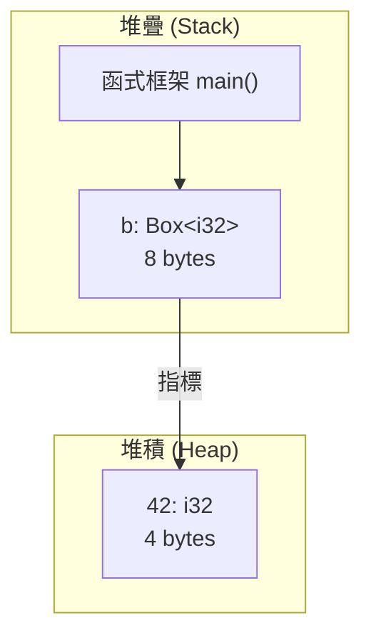
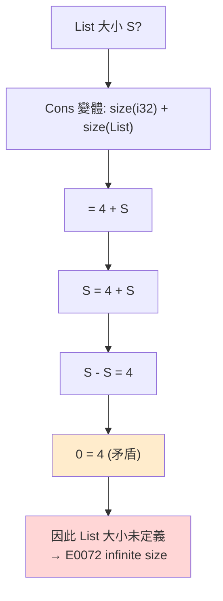
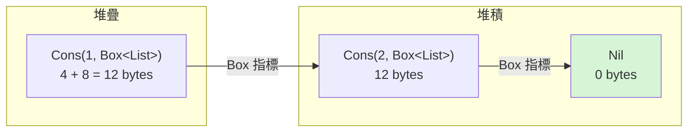

# 10.1 Box<T> 在堆積上配置資料

所有權模型的前提是編譯期必須知道每個型別的大小。這是 Rust 與 C++ 最大的差異之一：C++ 允許物件大小在執行期才決定，Rust 則要求一切靜態可知。這個約束帶來的安全性是實實在在的——編譯器知道一個值佔多少位元組，才能配置堆疊框架、才能複製位元組、才能確保記憶體回收的時機精確。但它也帶來了一個明顯的阻礙：某些資料結構在數學上就無法確定大小。

`Box<T>` 是解決這個阻礙的第一個工具，也是最單純的一個。它做的事情非常直接：把 `T` 的值配置在堆積上，而 `Box<T>` 本身只是一個指標，固定佔用 8 個位元組（在 64 位元平台）。盒子本身住在堆疊上，被盒子指向的東西才住在堆積上。這個分離聽起來像是吹毛求疵，但它正是遞迴型別得以存在的原因。

## 堆疊與堆積的分工

先複習第 4 章建立的直覺：堆疊由執行緒的堆疊框架管理，配置與釋放是單純的指標加減，速度極快；堆積由全域配置器管理，需要較昂貴的簿記，而且可能涉及操作系統的系統呼叫。當一個值的大小在編譯期已知，Rust 預設把它放在堆疊上。

```rust
use std::mem::size_of;

fn main() {
    println!("i32      = {}", size_of::<i32>());
    println!("u64      = {}", size_of::<u64>());
    println!("Box<i32> = {}", size_of::<Box<i32>>());
    println!("Box<u128>= {}", size_of::<Box<u128>>());
}
```

輸出會顯示 `i32` 佔 4 個位元組，`u128` 佔 16 個位元組，但 `Box<i32>` 與 `Box<u128>` 同樣都是 8 個位元組。這個恆等關係可以寫成一個簡單的等式：

$$
\mathrm{size}(\mathrm{Box}\langle T\rangle) = \mathrm{size}(\text{pointer}) = 8 \quad (\text{on 64-bit})
$$

注意等式左邊完全不出現 `T`。這不是巧合，而是 `Box` 最重要的性質：它把「值的型別」與「值的儲存位置」解耦了。



這個圖也說明了一個實務上容易忽略的事實：即使 `Box` 指向的資料只有 4 個位元組，你仍然付出了一次堆積配置。`Box` 不是免費的，它是「用執行期成本換取型別彈性」的交換籌碼。

## 遞迴型別的難題

現在來看本章的核心問題。假設我們想定義一個不可變的整數串列，這是個再自然不過的資料結構需求：

```rust
enum List {
    Cons(i32, List),
    Nil,
}
```

這段程式碼**無法編譯**，編譯器會報 `error[E0072]: recursive type 'List' has infinite size`。這個錯誤值得慢慢拆解，因為它揭示了 Rust 型別系統最深刻的一條規則。

編譯器在配置堆疊框架前必須算出 `List` 佔幾個位元組。它會逐一檢查每個列舉變體：`Nil` 不含任何欄位，大小為 0；`Cons` 含有兩個欄位，其大小為 `size_of::<i32>()` 加上 `size_of::<List>()`。於是我們得到一個定義在自身之上的方程：

$$
S = \mathrm{size}(i32) + S = 4 + S
$$

這個方程沒有解。任何有限的 $`S`$ 都無法滿足 $`S = 4 + S`$ ，因為兩邊相減會得到 $`0 = 4`$ ，矛盾。編譯器因此判定 `List` 的大小是無限大的——這不是說它真的佔用無窮記憶體，而是說它在數學上沒有良定義（well-defined）的大小。

用展開的方式看更清楚。如果 `List` 的值是 `Cons(1, Cons(2, Cons(3, Nil)))`，那麼記憶體需求會是：

$$
4 + (4 + (4 + 0)) = 4 + 4 + 4 = 12 \text{ bytes}
$$

如果再多一層，就變成 $`4 + 4 + 4 + 4 = 16`$ 。每多一個節點，記憶體需求就增加 4 個位元組，而且**沒有上限**。串列長度是執行期的資料，型別卻必須在編譯期描述所有可能的長度。這正是遞迴型別無法直接表示的原因。



## Box 打破循環

解法是把遞迴的那一邊「縮水」成一個固定大小的指標。也就是說，`Cons` 裡面不放 `List`，而放 `Box<List>`：

```rust
enum List {
    Cons(i32, Box<List>),
    Nil,
}

fn main() {
    let list = List::Cons(1, Box::new(List::Cons(2, Box::new(List::Nil))));

    let mut sum = 0;
    let mut current = &list;
    loop {
        match current {
            List::Cons(value, next) => {
                sum += value;
                current = next;
            }
            List::Nil => break,
        }
    }
    println!("總和 = {sum}");
}
```

現在重新計算大小。`Box<List>` 是個指標，固定 8 個位元組，與 `List` 的內容無關：

$$
\mathrm{size}(\mathrm{List}) = \max\big(\mathrm{size}(i32) + \mathrm{size}(\mathrm{Box}\langle \mathrm{List}\rangle),\ 0\big) = 4 + 8 = 12 \text{ bytes}
$$

方程不再自我指涉：`size(Box<List>)` 是 8，而 8 是一個已知常數。所以 `List` 的大小終於有了確定答案，編譯器可以放心地配置堆疊框架。

這裡值得停下來強調：整個技巧建立在「`Box` 的大小與其內容無關」這個唯一事實上。`Box` 就像一道防火門隔開了遞迴，火焰被限制在堆積上，而堆積上的配置是執行期的事，編譯器不需要知道總共有多少個節點。



在 `Box` 出現之前，有兩種常見的替代做法。一種是把遞迴改成「非遞迴的連鎖結構」，用 `Option` 包裝或用索引代替指標；另一種是語言層級直接支援指標，比如 C 的 `List *next`。Rust 刻意不提供裸指標的自動解參考，於是 `Box` 填上了這個缺口：它提供安全的所有權與自動釋放，同時保留指標的固定大小。

## Box 的其他用途

遞迴型別只是 `Box` 最著名的用途。實務上它還承擔另外三種角色。

第一種是**把大型資料移出堆疊**。假設一個函式需要一個 4 MB 的暫存緩衝區：

```rust
use std::mem::size_of;

fn process(buffer: &[u8; 4_000_000]) -> u8 {
    buffer.iter().copied().sum::<u8>()
}

fn main() {
    let buffer = Box::new([0u8; 4_000_000]);
    println!("buffer 大小 = {}", size_of_val(&buffer));
    println!("結果 = {}", process(&buffer));
}
```

`size_of_val(&buffer)` 印出的是 8，因為 `buffer` 這個變數本身只佔 8 個位元組；真正的 4 MB 躺在堆積上。若寫成 `let buffer = [0u8; 4_000_000];`，這個陣列就會直接配置在堆疊框架裡，超過預設 8 MB 執行緒堆疊的應用程式很容易在函式呼叫時就崩潰，甚至是在進入函式之前、由呼叫端準備引數時就先崩潰。

這個差異在「搬移」時更明顯。`Vec` 與 `Box` 搬移時都只搬 3 個指標（起始位置、長度、容量），但原始的 `[u8; 4_000_000]` 搬移時要複製 4 MB 的位元組。Rust 沒有寫時複製（copy-on-write）的最佳化，搬移就是真的位元組複製。

第二種是**動態大小的資料結構**。`Box<[u8]>` 是一個胖指標（fat pointer），除了資料指標之外還記錄了長度；`Box<dyn Trait>` 則記錄了 vtable 指標。第 11 章會詳細討論迭代器，第 12 章會談到執行緒安全，而 `Box<dyn Trait>` 是兩者都會用到的基礎設施。

第三種是**表達型別層級的所有權關係**。`Box<T>` 擁有的 `T` 會在 `Box` 被丟棄時自動被丟棄，包括 `T` 內部還擁有的其他資源。

## Box 與動態派發

`Box<dyn Trait>` 是 `Box` 最重要的進階用法。讓我們直接看程式碼：

```rust
trait Draw {
    fn draw(&self) -> String;
}

struct Button;
struct SelectBox;

impl Draw for Button {
    fn draw(&self) -> String {
        "按鈕".to_string()
    }
}

impl Draw for SelectBox {
    fn draw(&self) -> String {
        "選取框".to_string()
    }
}

fn draw_all(items: &[Box<dyn Draw>]) {
    for item in items {
        println!("{}", item.draw());
    }
}

fn main() {
    let items: Vec<Box<dyn Draw>> = vec![Box::new(Button), Box::new(SelectBox)];
    draw_all(&items);
}
```

這裡的關鍵在於 `Vec<Box<dyn Draw>>` 這個型別。`Button` 與 `SelectBox` 是兩個完全不同的具體型別，它們的大小、對齊需求都不同，因此不可能放在同一個 `Vec<Button>` 裡。但 `Box<dyn Draw>` 對兩者都是一樣的：一個 8 個位元組的資料指標加上一個 8 個位元組的 vtable 指標，總共 16 個位元組。因為胖指標的大小是固定的，`Vec` 才能連續配置它們。

代價是**失去靜態派發**。當 `item.draw()` 被呼叫時，編譯器無法知道被呼叫的是 `Button::draw` 還是 `SelectBox::draw`，必須在執行期透過 vtable 做一次間接跳轉。若效能極度敏感，且型別集合在編譯期已知，應改用泛型搭配特徵物件或泛型列舉（enum dispatch）：

```rust
trait Draw {
    fn draw(&self) -> String;
}

struct Button;
struct SelectBox;

impl Draw for Button {
    fn draw(&self) -> String {
        "按鈕".to_string()
    }
}

impl Draw for SelectBox {
    fn draw(&self) -> String {
        "選取框".to_string()
    }
}

fn draw_all<T: Draw>(items: &[T]) {
    for item in items {
        println!("{}", item.draw());
    }
}

fn main() {
    let buttons = vec![Button];
    let boxes = vec![SelectBox];
    draw_all(&buttons);
    draw_all(&boxes);
}
```

這個泛型版本會被單態化（monomorphization）成兩份獨立程式碼，呼叫都是靜態直接跳轉，沒有 vtable 查表，也沒有胖指標的額外 8 個位元組。第 9 章已經詳細討論過單態化，這裡只做對照。

## Box 與解除參考

`Box<T>` 實作了 `Deref<Target = T>`，這是 Rust 中一個非常特殊的設計。`Deref` 讓 `Box<T>` 在方法呼叫上表現得就像 `T` 本身，因此你可以對 `Box<String>` 直接呼叫 `.len()`、`.push_str()`，不必每次都寫 `(*boxed).len()`。

更精確地說，`Deref` 讓 `Box<T>` 能以「借用 `T`」的方式參與所有接受 `&T` 的操作。編譯器在方法解析時會依序嘗試 `Box<T>`、`&Box<T>`、`&mut Box<T>`、然後是 `Box<T>` 所 deref 到的 `T`、`&T`、`&mut T`，這個過程稱為 autoderef。

```rust
fn main() {
    let b = Box::new(String::from("Rust"));
    println!("長度 = {}", b.len());      // 自動解參考
    println!("第一字元 = {}", &b[0..1]);  // 自動解參考
}
```

但「自動解參考」在語意上要小心。`b.len()` 編譯成 `(*b).len()`，這是一次**不可變借用的**解參考，不會移動 `b` 裡的值。若寫成 `let s = *b;`，那才是一次真正的移動，會把 `String` 從盒子裡搬出來，而盒子隨即失效——因為盒子是唯一擁有者，它不能同時擁有和放棄同一份資料。

`Deref` 的更深層意義是它在型別系統中扮演了「智慧指標之間的轉換橋樑」。`Box<T>` 能自動轉成 `&T`，`Rc<T>` 能自動轉成 `&T`，`String` 能自動轉成 `&str`。這些轉換都透過 `Deref` 家族特徵統一表達，讓 API 簽章可以只寫 `&str` 卻接受 `String`、`&String`、`Box<String>`、`Rc<String>` 四種來源。這是 Rust API 設計中非常重要的慣例，第 7 章談到模組組織時會再次使用。

`Box` 也有自己的 `From` 轉換，最常見的是 `Box::new` 與 `into_boxed_slice()`。當你想要把一個 `Vec` 交給一個只接受 `Box<[T]>` 的 API，轉換是零成本的一次指標搬移，因為 `Vec` 與 `Box<[T]>` 的堆積配置本來就是同一塊連續記憶體。

## 常見誤用與最佳實踐

`Box` 最常見的誤用，是把它當成「避免搬移」的萬靈藥。事實上，對於小型型別（例如 `i32`、`bool`、幾個欄位的結構體），`Box` 帶來的堆積配置成本遠大於它省下的搬移成本。判斷的準則很簡單：如果 `T` 的大小小於一個指標的話，直接把 `T` 放在原本的位置就好。

另一個誤用是把 `Box` 當成迴圈累加器。例如在迴圈中反覆 `Box::new` 然後丟棄，每次都是一次堆積配置加上一次堆積釋放，在大量迭代時成本相當可觀。正確做法是先把資料收集到 `Vec` 裡，最後再一次性轉成 `Box<[T]>`。

第三個誤用是過早使用 `Box<dyn Trait>`。很多程式設計者一聽到「多型」就立刻想到型別擦除，但型別擦除意味著執行期的 vtable 查表，也意味著失去編譯期的最佳化機會。只有在型別集合確實無法在編譯期列舉出來時（例如來自使用者輸入的插件系統），才真的需要 `Box<dyn Trait>`。

`Box` 與所有權的關係也延伸出一個實務建議：若一個函式的參數只是「讀取」資料，把參數型別寫成 `&T` 即可，不需要 `&Box<T>`。Rust 會自動 deref 轉換，讓 `&Box<T>` 自動符合 `&T` 的預期，但直接寫 `&T` 更能表達意圖，也讓函式能同時接受 `Box<T>`、`Vec<T>` 的元素等等各種來源。這個原則在第 11 章談閉包時會再次出現。

## Box 與所有權的關係

`Box<T>` 本身就是一個擁有者，因此它完全遵守第 4 章的所有權與借用規則，不享有任何豁免。

```rust
fn main() {
    let b1 = Box::new(String::from("hello"));
    let b2 = b1;                 // 移動，b1 之後不可用
    println!("{b2}");

    let b3 = Box::new(String::from("world"));
    let r = &b3;                 // 不可變借用
    println!("{r}");

    let mut b4 = Box::new(String::from("rust"));
    let m = &mut b4;             // 可變借用
    m.push_str("!");
    println!("{b4}");
}
```

`b1` 被移動給 `b2` 之後，程式碼裡就再也不能提及 `b1`，因為若能提及，就會出現有兩個擁有者指向同一塊堆積記憶體的情況。`Rc` 之所以存在，正是因為它提供了另一種（更寬鬆）的所有權模型——共享所有權。

`Box` 也遵循 `Drop`。當 `Box<String>` 離開作用域時，堆積上的 `String` 會先被釋放（連同它內部的字串緩衝區），然後指標本身被丟棄。Rust 不需要手動呼叫任何釋放函式，這一點與 C++ 的 `delete` 形成對比：

```rust
struct Resource {
    id: u32,
}

impl Drop for Resource {
    fn drop(&mut self) {
        println!("釋放資源 {}", self.id);
    }
}

fn main() {
    let r = Box::new(Resource { id: 7 });
    println!("資源 {} 已配置", r.id);
}
```

輸出會依序是「資源 7 已配置」與「釋放資源 7」。`Box` 的 `Drop` 實作會先釋放堆積上的內容，再釋放指標本身；這就是所謂的「遞迴釋放」（recursive drop），Rust 會沿著所有權樹一路清理到底。

## 效能的真相

`Box` 的成本可以分成三塊來看。

第一塊是配置成本。`Box::new` 呼叫全域配置器，在一般程式中約數十到數百個奈秒，相較於一次堆積配置帶來的實際工作，這通常是可接受的。Rust 的全域配置器在多執行緒環境中會使用 thread-local 快取，避免每次配置都搶鎖。

第二塊是額外的一次間接存取。`Box` 的解參考是兩步：先從堆疊（或結構體欄位）讀出指標，再從堆積讀出資料。這對快取不友善，尤其在遍歷大型結構時。若資料本身很小而且生命週期適合放堆疊，直接放著通常更快。

第三塊是搬移成本——這恰恰是 `Box` 的優勢所在。`Box` 的搬移是 8 個位元組的複製，而非整個 `T` 的大小。

```rust
use std::time::Instant;

fn main() {
    let big = [1u8; 1_000_000];

    let t = Instant::now();
    let moved = big;             // 複製 1 MB
    let stack_move = t.elapsed();

    let t = Instant::now();
    let boxed = Box::new(big);
    let heap_move = t.elapsed();
    let _ = (moved, boxed);

    println!("堆疊搬移: {stack_move:?}");
    println!("堆積搬移: {heap_move:?}");
}
```

這個比較的結果會因機器而異，但方向是確定的：堆積搬移是 8 個位元組的複製，堆疊搬移是 1 MB 的記憶體頻寬消耗。`Box` 讓我們能夠用一次堆積配置，換取所有後續搬移的近乎免費。

## Box 與 Vec 的分工

`Box` 與 `Vec` 經常被混為一談，但兩者的設計意圖完全不同。

`Vec<T>` 是一塊**連續配置、可成長的緩衝區**。它由三個部分組成：指向堆積首元素的指標、目前長度、已分配的容量。`Vec` 擁有 0 到多個元素，會在 `push` 時按需擴充，並在擴充時把舊資料搬到新位置。

`Box<T>` 是**單一值的擁有者**。它精確地指向一個 `T`，沒有長度與容量的概念，也沒有擴充機制。

| 面向 | `Box<T>` | `Vec<T>` |
| --- | --- | --- |
| 擁有者數量 | 恰好一個 | 一個容器擁有 0 到多個元素 |
| 堆積內容 | 單一 `T` | 連續的 `T` 陣列 |
| 大小 | 固定 8 位元組（64 位元） | 24 位元組（三個 usize） |
| 成長 | 無 | 支援 `push`，容量按需翻倍 |
| 元素存取 | 解參考一次 | 索引一次 |
| 常見用途 | 遞迴型別、大型值搬移、型別擦除 | 動態長度的集合 |

實務上，`Box<[T]>` 這個組合很常出現——`Vec<T>` 可以用 `into_boxed_slice()` 轉換成它，得到的東西同樣是一塊堆積上的連續記憶體，但失去了成長能力，且 `Box<[T]>` 只有 16 位元組（胖指標：指標加長度）。這個型別特別適合 API 邊界——接收一大段資料但不打算修改它時，用 `Box<[T]>` 傳遞比 `&[T]` 更能表達「這份資料是專屬於你的」。

## Box 與 Rc 的分工

最後把 `Box` 放進本章的整體地圖。`Box` 與 `Rc` 的差異可以用一句話總結：**`Box` 是唯一擁有者，`Rc` 是共享擁有者。**

`Box<T>` 保證堆積上的資料只有一個擁有者，因此編譯器能靜態推理出「沒有別人會修改它」，不需要任何執行期計數。這讓它能與 `&mut T` 的可變借用規則緊密配合，也讓它能安全地跨越執行緒邊界（只要 `T` 本身是 `Send` 的）。

`Rc<T>` 則允許多個擁有者指向同一份資料，代價是它必須在執行期維護參考計數，而且因為計數的增減本身就是競爭，它無法安全地跨執行緒。下一節就會看到 `Rc` 的完整設計。

## 從 Box 走向共享所有權

`Box<T>` 有一個根本的限制：它只能有一個擁有者。當你把 `Box<T>` 傳給某個函式，呼叫之後那個值就離開你的作用域了。如果你希望兩個地方都還能使用它，就必須複製——但對 `Box<T>` 來說，複製意味著深拷貝 `T`，這既昂貴又往往不是我們想要的。

另一種思路是借用：傳 `&Box<T>` 或 `&T` 給函式。但借用有生命週期的約束，而且無法同時給兩個持有者各一份「擁有」的權柄。真實程式中常見的需求——例如一個圖形介面的多個元件需要共享同一份文件、一棵樹的父節點要持有子節點、子節點也要回頭引用父節點——要求的是**共享所有權**。

Rust 對此的答案是參考計數。`Rc<T>` 在堆積上維護一個計數器，每當一個新的擁有者被建立就加一，每當一個擁有者被丟棄就減一，歸零時才真正釋放資料。這就是下一節的主題。而 `Weak<T>` 則是為了處理參考計數系統固有的弱點——循環引用——而生的補充機制。

## 小結

`Box<T>` 的存在理由可以總結為三個層次。最底層是型別層次：它讓大小未定的遞迴型別得以存在。最上層是效能層次：它讓大型資料的搬移變成 8 個位元組的複製。它同時也是第 11 章的基礎設施——`Box<dyn Trait>` 提供了在執行期決定具體型別的能力，這是所有動態多型機制的基礎。

還有一層是語意層次：`Box<T>` 精確地表達了「我擁有這份資料，別人沒有」。這個宣告讓編譯器能推導出「沒有其他擁有者會修改它」這個事實，而這個事實正是 `&mut T` 可變借用規則得以成立的前提。`Box` 與 `&mut T` 之所以能共存，不是巧合，而是同一套所有權模型的兩種投影。

接下來的一節要處理所有權模型的另一個延伸。`Box` 解決的是「一個擁有者」的問題，但真實程式中經常需要多個地方引用同一份資料，此時就必須引入共享所有權與參考計數。
