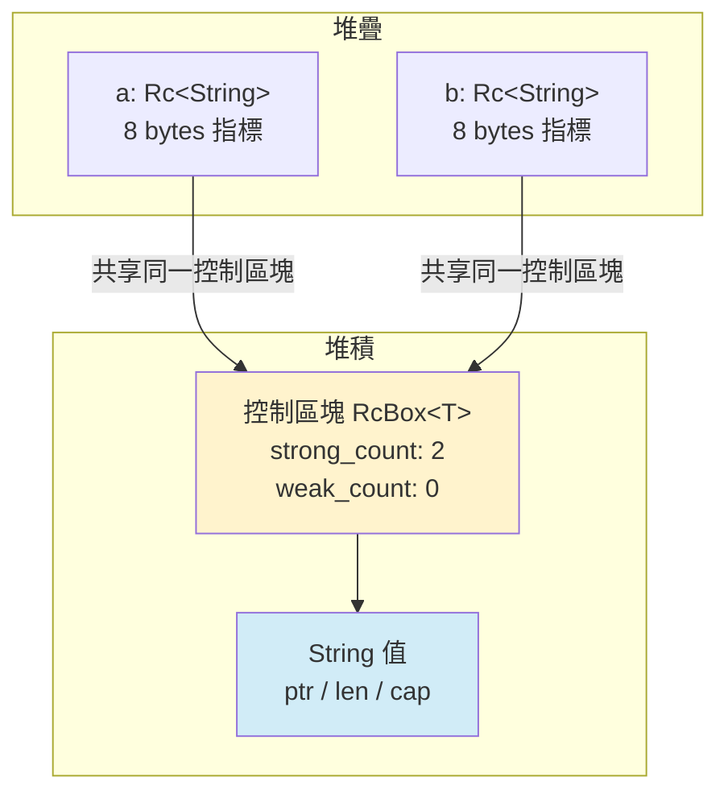
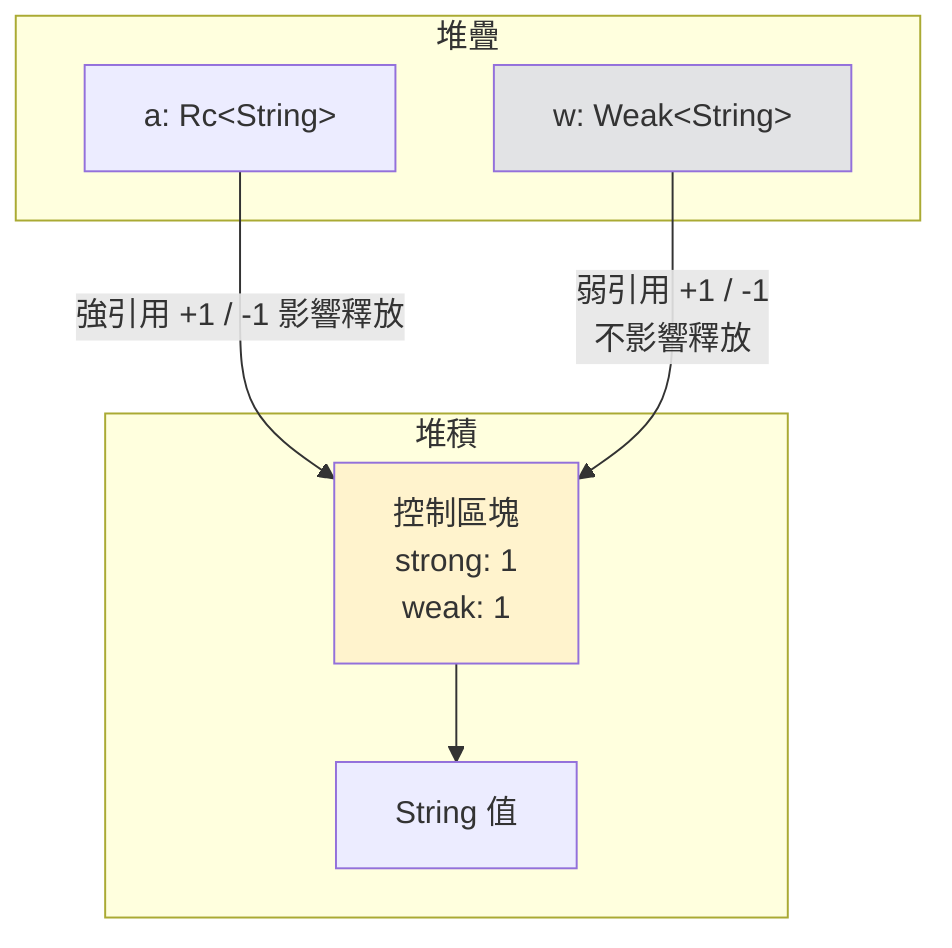

# 10.2 Rc<T> 與參考計數

`Box<T>` 解決了「一個擁有者」的問題，但現實世界裡資料經常需要被多個地方共同持有。想想一個文字編輯器的場景：選取範圍、游標位置、字元計數這三個模組都需要讀取同一份文件內容，而且它們的壽命彼此獨立——任何一個模組先被釋放都不應該影響另外兩個。這種需求在 Rust 裡稱為**共享所有權**（shared ownership）。

Rust 的解法是參考計數。把計數器與資料一起放在堆積上，每複製一次智慧指標就加一，每丟棄一次就減一，歸零時真正釋放資料。本節要深入 `Rc<T>` 的運作原理、它為什麼不能跨執行緒，以及如何用 `Weak<T>` 修補循環引用這個必然存在的漏洞。

## Rc 的基本語意

`Rc<T>` 的用法非常直覺，就是把 `Box<T>` 的「唯一擁有」換成「多重擁有」：

```rust
use std::rc::Rc;

fn main() {
    let a = Rc::new(String::from("共享的字串"));
    let b = Rc::clone(&a);

    println!("a 的強引用計數 = {}", Rc::strong_count(&a));
    println!("b 的強引用計數 = {}", Rc::strong_count(&b));
    println!("內容 = {}", b);
}
```

`Rc::clone` 這裡特別值得注意。它**沒有複製** `String` 的內容，只不過是把計數器加一，並把堆積上那個資料的指標複製一份給呼叫者。因此這個操作是 $`O(1)`$ 的，與被共享資料的大小完全無關。

這個語意與 `Clone` 有本質差異，必須清楚區分：

| 操作 | 行為 | 複雜度 | 結果 |
| --- | --- | --- | --- |
| `t.clone()`（`Clone` 衍生） | 深度複製 `T` 的內容 | $`O(\text{size of } T)`$ | 兩個獨立的值 |
| `Rc::clone(&rc)` | 只增加參考計數 | $`O(1)`$ | 兩個指向同一份資料的擁有者 |

`Rc<T>` 本身並不實作 `Clone`。標準庫刻意不讓 `Rc<T>` 自動衍生 `Clone`，因為自動衍生的 `Clone` 會讓 `rc.clone()` 變成深度複製，與使用者「我想要共享」的直覺完全相反。這個設計決定是 Rust API 設計哲學的典型體現：**當某個操作的語意有歧義時，寧可要求使用者明確寫出 `Rc::clone` 這種帶型別的呼叫**。

## 共享所有權的語意邊界

引入 `Rc` 之後，必須清楚理解它放寬了哪些規則、又保留了哪些規則，否則很容易寫出以為能跑、實際卻是邏輯錯誤的程式。

首先，**`Rc` 只放寬了擁有權的數量，沒有放寬可變性**。兩個 `Rc<T>` 可以指向同一份資料，但只要 `T` 不是內部可變性的型別，你依然不能透過其中任何一個 `Rc` 去修改它。`Rc` 給的是「多個人一起看同一本書」的權利，不是「多個人同時在同一本書上寫字」的權利。真正的共享可變狀態需要 `Rc<RefCell<T>>` 的組合，這是下一節的主題。

其次，**`Rc` 不會改變型別的可變性判定**。如果 `T` 本身是可變的結構體，`Rc<RefCell<T>>` 仍然遵守 `RefCell` 的執行期借用規則；`Rc<Mutex<T>>` 仍然遵守 `Mutex` 的鎖規則。`Rc` 只是在最外層加了一層計數，對內層的規則毫無影響。

再者，**`Rc` 只能共享同一個型別**。`Rc<String>` 與 `Rc<Vec<u8>>` 是不同的型別，無法放在同一個 `Vec` 裡。如果需要「同質但型別不同」的集合，答案跟第 10.1 節一樣是 `Box<dyn Trait>` 或泛型。

還有一個實務上很常見的陷阱：`Rc` 的 deref 會讓你以為自己拿到的是 `T`，但其實你拿到的是對 `T` 的借用。當你寫 `rc.len()` 時，編譯器做的是 `(*rc).len()`，也就是對 `T` 的方法呼叫。若 `T` 剛好有個方法跟 `Rc` 自己的方法同名，`Rc` 的方法會優先被選到——這個解析順序的細節在第 11 章談方法解析時會再提到。

## 記憶體配置與控制區塊

`Rc` 的內部配置比 `Box` 複雜一點。它不是「一個指標」，而是「一個指向控制區塊的指標」，而控制區塊同時持有強引用計數、弱引用計數，以及資料本身：



這個拓撲說明了三件事。第一，兩個 `Rc` 指標指向的是**同一個**控制區塊，所以計數器只有一份，所有擁有者看到的是同一個數字。第二，計數器與資料被放在**同一個配置**裡，這樣遞迴釋放時不需要跨兩塊記憶體操作，減少了快取失效。第三，弱引用計數也存在於這個控制區塊中——它的用途會在稍後說明。

因為 `Rc` 有控制區塊，它的 `Rc` 指標大小和 `Box` 一樣是 8 個位元組，但整體的堆積成本比 `Box` 多了一點：多出兩個計數欄位（通常各 8 個位元組）。

## 參考計數的實作細節

從效能角度來看，參考計數的常駐成本相當低。`Rc::clone` 只做兩件事：對一個 `usize` 做加一，以及複製一個 8 個位元組的指標。`Rc` 的 drop 則對計數器做減一，並在歸零時釋放控制區塊與其中的資料。

因為計數器的操作是位元組級別的，不涉及任何配置或釋放，所以它的成本接近於零。這與 `Arc` 形成鮮明對比：`Arc` 的計數器必須使用原子操作才能避免資料競爭，在多執行緒環境中原子操作的快取一致性成本會遠高於一般整數運算。

另一個常被低估的細節是 `Rc` 的 drop 順序。當一個 `Rc` 被丟棄且計數歸零時，標準庫會先釋放控制區塊中持有的 `T`（觸發 `T` 自己的 `Drop`），然後才釋放控制區塊本身。這個順序保證了 `T` 在被釋放時仍能安全地存取它的控制區塊，例如 `T` 的 `Drop` 實作若需要檢查自己還有沒有其他 `Rc` 擁有者。

`Rc<T>` 還提供兩個便利方法：`Rc::get_mut` 與 `Rc::make_mut`。前者只在計數為 1 時回傳 `Option<&mut T>`，是安全的唯一存取途徑；後者則是「複製-on-寫入」：若計數為 1 就原地回傳 `&mut T`，若計數大於 1 就深複製一份 `T` 並把計數降為 1。`Rc::make_mut` 要求 `T` 實作 `Clone`，它的存在讓 `Rc<T>` 也能用於那些需要可變語意的場景。

```rust
use std::rc::Rc;

fn main() {
    let mut shared = Rc::new(vec![1, 2, 3]);
    println!("計數 = {}", Rc::strong_count(&shared));

    Rc::make_mut(&mut shared).push(4);
    println!("計數 = {}", Rc::strong_count(&shared));
    println!("內容 = {shared:?}");
}
```

注意 `Rc::make_mut` 在計數為 1 時**不會**深複製，這讓它在大多數情況下是零成本的。這與 `Arc::make_mut` 的行為完全一致。

## 為什麼標準庫不提供執行緒安全的 Rc

這個問題的答案完全取決於參考計數本身的性質。

考慮兩個執行緒同時持有同一個 `Rc`。當其中一個把 clone 丟棄時，它要先把計數減一；另一個同時建立新的 clone 時，要把計數加一。若這兩步沒有被正確同步，計數就會出錯：

- 兩個執行緒同時「讀取計數、減一、寫回」，會發生遺失更新（lost update），計數少算了。
- 計數被少算，可能導致資料在仍有人使用時被釋放，形成釋放後使用（use-after-free）。
- 計數被多算，則是記憶體洩漏——資料永遠不會被釋放。

更根本的問題是，即使計數本身是正確的，「計數歸零就釋放資料」這個判斷與「另一個執行緒正在讀取該資料」之間仍然存在競態窗口。要讓這件事安全，`Rc` 必須讓**所有**對 `Rc` 的操作（包括讀取 `T` 的內容）都受到同一把鎖的保護，那將是極大的執行期負擔。

因此 Rust 給了明確的答案：`Rc<T>` **不實作 `Send`，也不實作 `Sync`**。這兩個性質是編譯器的 auto trait（自動特徵），編譯器能根據欄位型別自動推導，而 `Rc<T>` 內部含有非原子計數器，因此自動被排除在 `Send` 與 `Sync` 之外。

```rust
use std::rc::Rc;
use std::thread;

fn main() {
    let data = Rc::new(String::from("跨執行緒"));
    let cloned = Rc::clone(&data);

    let handle = thread::spawn(move || {
        println!("執行緒內: {cloned}");
    });
    handle.join().unwrap();
}
```

這段程式碼無法編譯，錯誤訊息是：

```text
error[E0277]: `Rc<String>` cannot be sent between threads safely
   = help: the trait `Send` is not implemented for `Rc<String>`
   = note: `Rc<String>` is not `Sync`
```

這個編譯期錯誤正是 Rust 安全性模型的價值所在。編譯器在**編譯期**就拒絕了這段程式碼，而不是讓它在執行期產生間歇性的資料競爭。第 12 章會詳細討論 `Send` 與 `Sync` 的完整語意，以及 `Arc<T>` 如何用原子操作提供跨執行緒的共享所有權。

## 循環引用與記憶體洩漏

參考計數有個先天性的弱點：它只能偵測「沒有任何人指向這份資料」的情況，但無法偵測「一群人互相指向彼此、因此永遠不會有人放手」的情況。

最典型的例子是樹狀結構中，父節點持有子節點、子節點也持有父節點：

```rust
use std::rc::Rc;

struct Node {
    value: i32,
    parent: RefCell<Option<Rc<Node>>>,
    children: RefCell<Vec<Rc<Node>>>,
}

use std::cell::RefCell;

fn main() {
    let parent = Rc::new(Node {
        value: 1,
        parent: RefCell::new(None),
        children: RefCell::new(Vec::new()),
    });
    let child = Rc::new(Node {
        value: 2,
        parent: RefCell::new(None),
        children: RefCell::new(Vec::new()),
    });

    parent.children.borrow_mut().push(Rc::clone(&child));
    *child.parent.borrow_mut() = Some(Rc::clone(&parent));

    println!("parent 強引用 = {}", Rc::strong_count(&parent));
    println!("child 強引用 = {}", Rc::strong_count(&child));
}
```

在 `main` 結束時，`parent` 與 `child` 各自的計數都是 2（一個是區域變數，一個是另一個節點持有的引用）。當區域變數被丟棄，計數各減一變成 1，但此時互相的引用仍然存在，因此計數永遠不會歸零，兩份資料都不會被釋放。

這就是**循環引用造成的記憶體洩漏**。注意這是 Rust 已知且設計上接受的限制，不是 bug：Rust 沒有垃圾收集器，也不會在執行期掃描堆積尋找無主物。偵測循環引用需要追蹤整個堆積的可达性圖，這在執行期成本高昂且難以即時完成。

## Weak 打破循環

`Weak<T>` 是 `Rc<T>` 的補充。它是一個**不參與計數歸零判斷**的引用。`Rc::downgrade` 可以把一個 `Rc` 降級成 `Weak`：
```rust
use std::rc::{Rc, Weak};

fn main() {
    let strong = Rc::new(String::from("資料"));
    let weak: Weak<String> = Rc::downgrade(&strong);

    println!("強引用計數 = {}", Rc::strong_count(&strong));
    println!("弱引用計數 = {}", Rc::weak_count(&strong));

    drop(strong);

    println!("降級後是否還活著 = {}", weak.upgrade().is_some());
}
```



這個拓撲把強弱兩種引用的差異畫得很清楚。兩者都指向同一個控制區塊，但只有強引用的增減會影響「資料何時被釋放」這個判斷。弱引用的計數存在控制區塊裡，是為了讓 `Weak` 知道自己是否已經失效，以及讓 `Rc` 在釋放資料時能知道是否還有弱引用需要被通知。

`Weak::upgrade()` 會回傳 `Option<Rc<T>>`。如果原始的 `Rc` 還活著，就回傳 `Some`；如果資料已經被釋放，就回傳 `None`。這個 `Option` 不是多餘的設計，而是必要的安全機制——在多執行緒環境中，「檢查存活」與「取得指標」之間存在競態窗口，`upgrade()` 把這兩步原子化地綁在一起。

用 `Weak` 修正上一節的樹狀結構，循環就消失了：

```rust
use std::cell::RefCell;
use std::rc::{Rc, Weak};

struct Node {
    value: i32,
    parent: RefCell<Weak<Node>>,
    children: RefCell<Vec<Rc<Node>>>,
}

fn main() {
    let parent = Rc::new(Node {
        value: 1,
        parent: RefCell::new(Weak::new()),
        children: RefCell::new(Vec::new()),
    });
    let child = Rc::new(Node {
        value: 2,
        parent: RefCell::new(Weak::new()),
        children: RefCell::new(Vec::new()),
    });

    parent.children.borrow_mut().push(Rc::clone(&child));
    *child.parent.borrow_mut() = Rc::downgrade(&parent);

    let p = child.parent.borrow();
    if let Some(node) = p.upgrade() {
        println!("父節點的值 = {}", node.value);
    }
}
```

現在 `parent` 的強引用計數是 1（只有區域變數），`child` 的強引用計數也是 1。`child` 對 `parent` 的連結是弱引用，不影響 `parent` 的釋放判斷；`main` 結束時 `parent` 先被釋放，之後 `child` 被釋放時，它內部的 `Weak` 只是嘗試升級失敗而什麼都不做。

**弱引用的典型用途模式**有三種。第一是**由父指向子的反向連結**，如上例：樹的節點需要回頭找父節點，但父節點不該因此而被孩子拖住。第二是**觀察者模式的註冊表**：一個事件來源維護一份 `Vec<Weak<Observer>>`，當觀察者被釋放後，它會自動從註冊表中消失，不需要手動取消訂閱。第三是**快取**：`Weak` 用來避免快取項目阻止大型資料被釋放，快取失效時 `upgrade()` 回傳 `None`，呼叫者就重新計算。

```rust
use std::cell::RefCell;
use std::rc::{Rc, Weak};

struct Registry {
    observers: RefCell<Vec<Weak<String>>>,
}

fn main() {
    let registry = Rc::new(Registry {
        observers: RefCell::new(Vec::new()),
    });

    let observer = Rc::new(String::from("觀察者 A"));
    registry
        .observers
        .borrow_mut()
        .push(Rc::downgrade(&observer));

    registry.observers.borrow_mut().retain(|w| w.upgrade().is_some());
    println!("存活觀察者 = {}", registry.observers.borrow().len());

    drop(observer);
    registry.observers.borrow_mut().retain(|w| w.upgrade().is_some());
    println!("存活觀察者 = {}", registry.observers.borrow().len());
}
```

`retain` 那兩行是清理死掉的弱引用，`upgrade()` 回傳 `None` 就代表該觀察者已經被釋放。

## Arc：執行緒安全的對應物

`Arc<T>` 是 `Rc<T>` 的執行緒安全版本，結構幾乎一模一樣，唯一差別是計數器使用原子操作（atomic operation）而非一般整數操作：

```rust
use std::sync::Arc;
use std::thread;

fn main() {
    let data = Arc::new(String::from("跨執行緒共享"));
    let cloned = Arc::clone(&data);

    let handle = thread::spawn(move || {
        println!("執行緒內: {cloned}");
    });
    handle.join().unwrap();

    println!("主執行緒強引用 = {}", Arc::strong_count(&data));
}
```

原子操作的成本是實實在在的。在現代 x86 架構上，一個無競爭的原子加一或減一大約是幾個奈秒，而一般整數加一是不到一個奈秒。這個差距在大量複製 `Arc` 的程式碼裡會累積，但换来的是正確性。

`Arc` 同樣有 `Weak` 對應物 `std::sync::Weak`，API 幾乎完全鏡射 `Rc` 的版本。

`Arc` 還有一個容易踩到的陷阱：`Arc<T>` 只保證**計數器**是執行緒安全的，不代表 `T` 的內容是。`Arc<RefCell<i32>>` 在跨執行緒時仍然會 panic，因為 `RefCell` 的借用標記不是原子的。第 12 章會說明，正確的做法是 `Arc<Mutex<i32>>`。

## 從 Rc 到 Arc 的取捨

在實際專案中，`Rc` 與 `Arc` 的選擇幾乎不需要猶豫：只要資料需要在執行緒間流動，就用 `Arc`；否則用 `Rc`。因為 `Arc` 是 `Rc` 的嚴格超集（除了計數器型別不同），API 幾乎完全鏡射，切換成本極低。

真正需要猶豫的是另一個問題：**這個共享狀態真的需要跨執行緒嗎？** 很多程式設計者會本能地用 `Arc<Mutex<T>>`，但若資料其實只在單一執行緒中使用，`Rc<RefCell<T>>` 會更快也更簡單。`Mutex` 的鎖取得是真正的系統級同步，在高度競爭的環境下可能成為瓶頸。

另一個常見的選擇是 **`Arc<Mutex<T>>` 對 `Arc<RwLock<T>>`**。`Mutex` 一次只允許一個寫入者（或多個讀取者？——不，`Mutex` 一次只允許一個持有者，讀寫都要搶），`RwLock` 允許多個並行讀取者但獨佔寫入者。若共享資料以讀取為主，`RwLock` 能提供更好的並行度，但它的開銷也略高，且若讀取者容易陷入巢狀鎖定，死鎖的風險更高。

還有一個更進階的選擇是使用通道（channel）傳遞訊息而非共享狀態。第 12 章會詳細說明，Rust 的所有權模型讓「把資料的所有權轉移到另一個執行緒」成為安全且自然的操作，因而在很多情況下根本不需要共享可變狀態。

## 智慧指標對照表

把本章與前一節的內容放在一起，可以得到一份完整的決策表：

| 指標 | 擁有權數 | 執行緒安全 | 檢查時機 | 適用情境 |
| --- | --- | --- | --- | --- |
| `Box<T>` | 唯一擁有者 | 是（若 `T` 是 `Send`） | 編譯期 | 遞迴型別、大型值搬移 |
| `Rc<T>` | 多個擁有者 | 否（不實作 `Send`/`Sync`） | 執行期計數 | 單執行緒內共享資料 |
| `Arc<T>` | 多個擁有者 | 是（原子計數） | 執行期計數 | 跨執行緒共享資料 |
| `RefCell<T>` | 借用期間唯一 | 否 | 執行期借用標記 | 單執行緒內的內部可變性 |
| `Mutex<T>` | 借用期間唯一 | 是 | 執行期鎖 | 跨執行緒的內部可變性 |

從這張表可以看出一條規律：`Box`、`Rc`、`Arc` 解決的是**擁有權**的問題——誰能持有這份資料；而 `RefCell`、`Mutex` 解決的是**可變性**的問題——持有者能不能改它。兩組概念互相正交，因此可以自由組合。`Rc<RefCell<T>>` 是單執行緒共享可變狀態的標準答案，而 `Arc<Mutex<T>>` 是跨執行緒的標準答案，這將是下一節的主題。

## 小結

`Rc<T>` 擴充了 Rust 的所有權模型，讓資料能同時被多個擁有者持有，並以堆積上的參考計數追蹤生命週期。它的代價是引入執行期成本，並且失去了跨執行緒的能力——後者不是疏忽，而是參考計數的固有競態所導致的必然結果。

`Weak<T>` 則是針對循環引用的解方，它讓連結可以單向存在而不阻止資料釋放。記住一個實用的判準：**若一個連結是「擁有者對擁有者」的關係，就用 `Rc`；若它是「擁有者對附屬資訊」的關係，就用 `Weak`**。父節點擁有子節點是 `Rc`，子節點回看父節點是 `Weak`；事件來源擁有觀察者清單是 `Rc`，觀察者在清單中的位置是 `Weak`。

下一節要處理所有權模型的第三個延伸：如何在編譯期不可變的引用之內改變資料。這需要一個與 `Rc` 完全不同的機制——內部可變性。
