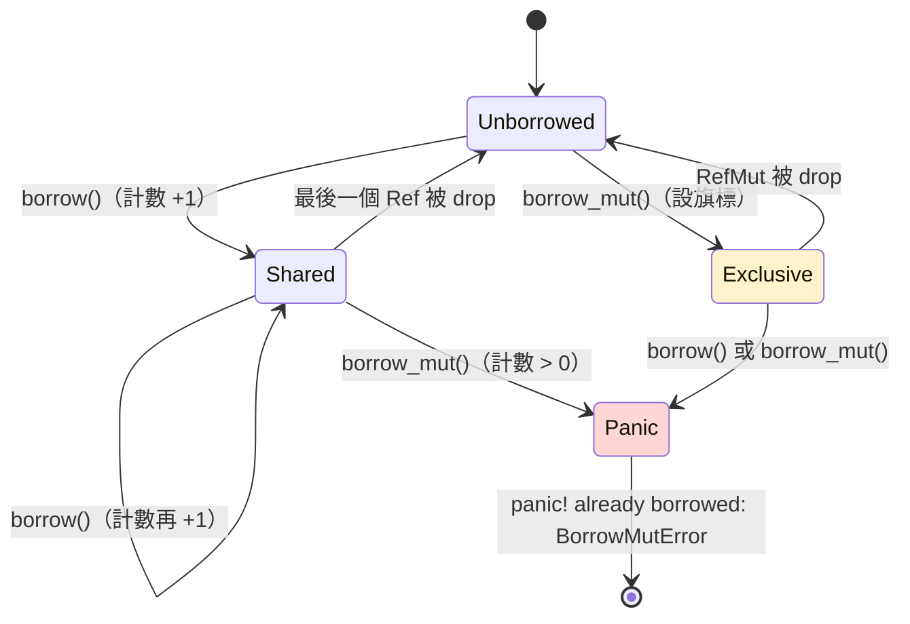

# 10.3 RefCell<T> 與內部可變性模式

前兩節解決的是擁有權的問題：`Box` 處理唯一擁有者，`Rc` 處理共享擁有者。但 Rust 的借用規則還有一個面向沒有被觸及——**可變性**。第 4 章立下的規則是：任意時刻，一個值要嘛有多個不可變借用，要嘛恰有一個可變借用，兩者不可並存。這條規則由編譯器在編譯期強制執行，然而有些情境下，「這個借用是否衝突」只有執行期才知道。本節的主題 `RefCell<T>` 正是把這條規則的檢查時機從編譯期搬到執行期的工具，這種手法稱為**內部可變性**（interior mutability）。

內部可變性聽起來像是在違反規則，但它其實是借用規則的另一種表達方式：資料對外呈現不可變的介面，內部卻在執行期追蹤借用的使用情況，一旦有人同時做出衝突的存取，程式立刻終止。換句話說，安全保證依然成立，只是代價從「編譯失敗」變成了「執行期 panic」。理解這個交換，是理解本節全部內容的鑰匙。

## 為什麼需要內部可變性

考慮一個再平常不過的情境：一個結構體以 `&self` 提供方法，這是 Rust 慣例中「只讀」的承諾。但如果這個方法內部需要更新快取、遞增統計計數器、或記錄最後一次存取的時間呢？在純粹的借用模型下，這是不可能的——`&self` 不允許任何修改。你可能會把方法改成 `&mut self`，但那會迫使所有呼叫者都持有可變借用，整個 API 的彈性就此消失；而且可變借用是獨佔的，一旦某個呼叫者握著它，其他模組就完全無法同時存取這個物件。

問題的根源在於借用檢查器的工作方式：它在編譯期只看得到**靜態的**借用圖，凡是「兩個借用是否會在執行期重疊」取決於輸入資料或使用者行為的情況，它一律從嚴拒絕。這個從嚴在絕大多數時候是美德，但少數時候會把合法的設計也擋在門外。

這種「對外不可變、對內可變」的需求比想像中普遍。觀察者名單需要在通知時增刪成員、`Rc` 的參考計數本身就是在不可變指標背後被更新的值、圖形介面的元件樹常常以不可變引用遍歷卻需要更新狀態。這些場景的共同特徵是：**可變性是實作細節，不是介面的一部分**。

Rust 的答案是把「是否衝突」的判斷延後。類型上對外只暴露不可變介面，內部則用執行期的簿記來維護借用規則。這不是放棄安全，而是換一種方式守護安全。

## RefCell 的執行期借用標記

`RefCell<T>` 擁有一個 `T`，並在內部維護兩個執行期欄位：一個是不可變借用的計數，一個是可變借用的旗標。每當你呼叫 `borrow()`，計數加一；呼叫 `borrow_mut()` 時，若旗標顯示已有任何借用存在（無論可變或不可變），就立即 panic；否則設立旗標，並在回傳的守衛物件被丟棄時清除旗標。借用規則本身一字未改，改變的只是**誰來檢查、何時檢查**。

```rust
use std::cell::RefCell;

fn main() {
    let cell = RefCell::new(5);

    let a = cell.borrow();
    let b = cell.borrow();      // 多個不可變借用，允許
    println!("a = {a}, b = {b}");
    drop(a);
    drop(b);

    let mut m = cell.borrow_mut();
    *m += 1;
    println!("m = {m}");
}
```

違規的程式碼則會在執行期被攔截：

```rust
use std::cell::RefCell;

fn main() {
    let cell = RefCell::new(5);
    let a = cell.borrow();
    let mut m = cell.borrow_mut();  // panic！
    *m += 1;
    println!("{a}");
}
```

執行這段程式會得到 `thread 'main' panicked at 'already borrowed: BorrowMutError'` 這樣的訊息。`borrow()` 與 `borrow_mut()` 回傳的不是裸引用，而是 `Ref<T>` 與 `RefMut<T>` 兩種守衛物件，它們在 `Drop` 時把借用標記還回去。這也意味著一個容易疏忽的陷阱：守衛若被意外留存（例如存進了某個結構體），借用就會一直被佔住，之後的 `borrow_mut()` 會在毫無徵兆的遠處 panic。除錯時，先檢查「是誰還握著守衛」往往比檢查 panic 現場更有價值。

借用狀態可以畫成一個小的狀態機：



這個狀態機與第 5 章的借用檢查器如出一轍：共享與獨佔互斥，共享可以疊加，獨佔必須孤身。唯一差別是這裡的轉移發生在執行期，且違規的後果是 panic 而非編譯錯誤。

## Cell 的對照

`std::cell` 模組裡還有一個更原始的型別 `Cell<T>`。它與 `RefCell` 的差別在於：`Cell` 根本**不提供引用**。你只能用 `get()`（要求 `T: Copy`）整體讀出值、用 `set()` 整體寫入新值、或用 `take()` 換出舊值。既然沒有引用被交出去，就沒有「兩個引用同時存活」的可能，因此 `Cell` 完全不需要借用檢查，`get` 與 `set` 的成本就是單純的記憶體讀寫。

```rust
use std::cell::Cell;

fn main() {
    let counter = Cell::new(0);
    counter.set(counter.get() + 1);
    counter.set(counter.get() + 1);
    println!("計數 = {}", counter.get());
}
```

選擇的判準很直接：如果 `T` 是 `i32`、`bool` 這類小型 `Copy` 型別，`Cell` 更輕；如果 `T` 是 `String`、`Vec` 這類需要借用內部內容的型別，就只能用 `RefCell`。兩者都要求「跨執行緒不安全」，都不實作 `Sync`。

## RefCell 與 Mutex 的取捨

`RefCell` 的角色在多執行緒世界裡的對應物是 `Mutex<T>`。兩者做的是同一件事——在不可變介面背後允許修改——但保證的範圍不同。`RefCell` 的借用標記是普通的整數運算，沒有任何同步措施，因此它只能存在於單一執行緒；`Mutex` 的鎖是真正的系統級同步原語，可以在執行期協調多個執行緒的互斥存取。

| 面向 | `RefCell<T>` | `Mutex<T>` |
| --- | --- | --- |
| 適用範圍 | 單一執行緒 | 跨執行緒 |
| 執行期檢查 | 借用標記（計數與旗標） | 鎖的取得與釋放 |
| 違規後果 | panic（`BorrowMutError`） | 阻塞等待（或死鎖） |
| 編譯期保證 | 不實作 `Sync`，無法跨執行緒 | 實作 `Sync`，可與 `Arc` 組合 |
| 開銷 | 接近零 | 原子操作與系統呼叫 |

一個重要的編譯期事實是：`RefCell<T>` 不實作 `Sync`，所以把它放進 `Arc` 之後企圖跨執行緒共享，編譯器會直接拒絕。Rust 用型別系統逼你選擇正確的工具，而不是讓你帶著一顆非原子的計數器進入競態。第 12 章會完整展開 `Mutex` 與 `Arc` 的世界，這裡只需記住分工：單執行緒用 `RefCell`，跨執行緒用 `Mutex`。

## 常見用途

內部可變性在實務中有三個高頻場景。第一是**隱藏在介面後的內部狀態**：把 `RefCell` 欄位設為私有，getter 與 setter 控制所有存取，型別對外依然只暴露 `&self` 方法，呼叫者完全感受不到執行期借用檢查的存在。

第二是**快取**。一個昂貴的計算結果可以存在 `RefCell<Option<T>>` 裡，第一次以 `&self` 呼叫時計算並寫入，之後直接回傳快取值。這正是「對外唯讀、內部寫入」的教科書案例。

第三是**計數器與統計**。在 `&self` 方法中遞增一個計數，用 `Cell<usize>` 就夠了；若需要更新更複雜的結構（例如 `HashMap`），就換成 `RefCell`。三者共同的妙處在於呼叫端毫無感知：`&self` 的簽名保住了，借用檢查器不會把可變性外洩到介面上，單元測試也只需要測公開行為而不必窺探內部狀態。

```rust
use std::cell::{Cell, RefCell};

struct TemperatureSeries {
    cache: RefCell<Option<Vec<f64>>>,
    query_count: Cell<usize>,
}

impl TemperatureSeries {
    fn new() -> Self {
        TemperatureSeries {
            cache: RefCell::new(None),
            query_count: Cell::new(0),
        }
    }

    fn readings(&self) -> Vec<f64> {
        self.query_count.set(self.query_count.get() + 1);
        if let Some(data) = self.cache.borrow().as_ref() {
            return data.clone();
        }
        let data = expensive_query();
        *self.cache.borrow_mut() = Some(data.clone());
        data
    }
}

fn expensive_query() -> Vec<f64> {
    vec![22.5, 23.1, 21.8, 24.0]
}

fn main() {
    let series = TemperatureSeries::new();
    let _ = series.readings();
    let _ = series.readings();
    println!("查詢次數 = {}", series.query_count.get());
}
```

注意 `readings` 的簽名自始至終是 `&self`，呼叫者無法從介面看出內部有快取被更新。這就是內部可變性模式想達成的封裝效果。

## try_borrow：不 panic 的路徑

panic 不是 `RefCell` 提供的唯一選項。如果你預期衝突**可能**發生，而且想優雅地處理它而不是讓程式崩潰，`try_borrow` 與 `try_borrow_mut` 回傳的是 `Result`：借用成功時是 `Ok(Ref)` 或 `Ok(RefMut)`，衝突時是 `Err(BorrowMutError)`，程式可以自行決定下一步。

```rust
use std::cell::RefCell;

fn main() {
    let cell = RefCell::new(vec![1, 2, 3]);

    let reader = cell.borrow();
    let attempt = cell.try_borrow_mut();
    match attempt {
        Ok(_) => println!("取得可變借用"),
        Err(_) => println!("有人正在讀取，稍後再試"),
    }
    drop(reader);

    let writer = cell.try_borrow_mut();
    println!("這次成功 = {}", writer.is_ok());
}
```

這個設計再次呼應了第 8 章的錯誤處理哲學：可預期的失敗用 `Result` 表達，程式設計者的疏失才用 panic。如果一個借用衝突在你的設計中是「正常會發生的事」，就應該用 `try_borrow` 而不是 `borrow`；反之，如果衝突代表程式邏輯有 bug，那麼 `borrow` 的立即 panic 反而是最好的失敗方式——它會在最接近錯誤源頭的地方停下來，帶著完整的堆疊回溯。

## 守衛物件的解參考

`Ref<T>` 與 `RefMut<T>` 之所以用起來像裸引用，是因為它們實作了 `Deref` 與 `DerefMut`。`Ref<Vec<i32>>` 可以直接呼叫 `.len()`、用索引存取元素、被 `for` 迴圈遍歷——所有的操作都被自動轉發到內部的 `T`。這個第 10.1 節介紹過的自動解參考機制，在這裡扮演了關鍵的潤滑劑角色：如果每次借用都要明確呼叫某個取得 `&T` 的方法，內部可變性的程式碼將會非常囉唆。

```rust
use std::cell::RefCell;

fn main() {
    let cell = RefCell::new(String::from("hello"));
    let mut guard = cell.borrow_mut();
    guard.push_str(", world");   // DerefMut 轉發
    println!("{}", guard.len()); // Deref 轉發
}
```

守衛物件還有一個值得記住的性質：把 `Ref` 丟棄與把借用還回去是同一件事。這意味著你可以用 `drop(g)` 精確控制借用的釋放時機，而不必依賴作用域的結尾。在長函式或複雜條件分支中，早一點釋放借用常常是避免後續 `borrow_mut` panic 的關鍵技巧。

## Rc 與 RefCell 的組合

第 10.2 節留下了一個伏筆：`Rc` 只放寬了擁有權的數量，多個擁有者依然不能修改資料。把 `RefCell` 套在內層，缺口就補上了。`Rc<RefCell<T>>` 的語意是「多個擁有者共享同一份資料，且可以在執行期借用規則的保護下修改它」——這是單執行緒環境中共享可變狀態的標準答案。

```rust
use std::cell::RefCell;
use std::rc::Rc;

#[derive(Debug)]
struct Player {
    name: String,
    score: i32,
}

fn main() {
    let alice = Rc::new(RefCell::new(Player {
        name: "Alice".to_string(),
        score: 0,
    }));
    let bob = Rc::clone(&alice);

    println!("建立時擁有者數 = {}", Rc::strong_count(&alice));

    let mut p = bob.borrow_mut();
    p.score += 10;
    drop(p);

    alice.borrow_mut().score += 5;

    println!("最終狀態 = {:?}", alice.borrow());
    println!("最終擁有者數 = {}", Rc::strong_count(&alice));
}
```

`alice` 與 `bob` 是兩個獨立的擁有者，卻指向同一份 `Player`，兩邊都能透過 `borrow_mut()` 修改分數。若把這段程式碼中兩次 `borrow_mut` 之間插入一次未釋放的借用，panic 就會出現——借用規則仍然在場，只是換了裁判。

這個組合在資料結構中的典型應用，就是上一節的樹狀節點：`parent` 欄位用 `RefCell<Weak<Node>>`、`children` 欄位用 `RefCell<Vec<Rc<Node>>>`，父與子可以互相連結又各自修改，而循環引用由 `Weak` 解決。三種工具在這裡各司其職：`Rc` 管擁有權、`Weak` 管循環、`RefCell` 管可變性。

## 智慧指標全景

把第 10 章三節的工具放在同一張表上，可以看清它們如何沿著兩條正交的軸分工：

| 指標 | 擁有權數 | 執行緒安全 | 檢查時機 | 典型組合與用途 |
| --- | --- | --- | --- | --- |
| `Box<T>` | 唯一 | 是（若 `T` 為 `Send`） | 編譯期 | 遞迴型別、大型值搬移 |
| `Rc<T>` | 多個 | 否 | 執行期計數 | 單執行緒共享讀取 |
| `Arc<T>` | 多個 | 是（原子計數） | 執行期計數 | 跨執行緒共享讀取 |
| `RefCell<T>` | 借用期間唯一 | 否 | 執行期借用標記 | 隱藏可變性的介面 |
| `Mutex<T>` | 借用期間唯一 | 是 | 執行期鎖 | 跨執行緒的內部可變性 |

橫向讀這張表，上三行回答「誰擁有它」，下兩行回答「誰能改它」。縱向讀，則是檢查時機從編譯期滑向執行期的過程：每往右一步，安全保證就多一分執行期成分，效能與彈性也隨之易位。組合的規則於是不言自明——需要共享的可變狀態，就把兩條軸的工具疊起來：單執行緒是 `Rc<RefCell<T>>`，跨執行緒是 `Arc<Mutex<T>>`。疊加時要記得順序有意義：外層決定擁有權語意，內層決定可變性語意，寫反了（例如 `RefCell<Rc<T>>`）雖然合法，卻表達的是完全不同的資料形狀。

## 執行期檢查的代價

現在可以誠實地盤點代價了。把檢查從編譯期搬到執行期，你失去的是兩樣東西：第一是**提前失敗**，編譯錯誤在寫程式當下就被發現，panic 卻可能發生在已上線的系統裡，甚至只在使用者觸發某條罕見路徑時才現身；第二是**微小的執行期開銷**，每次借用的取得與釋放都要更新標記，雖然通常可忽略，但它不是零。此外還有一筆更隱形的帳：借用衝突從「型別簽名上的合約」變成「文件裡的注意事項」，閱讀 API 的人不再能從簽名一眼看出借用紀律，必須深入實作才能確認安全性。

因此內部可變性應該被視為**不得已時的工具**，而不是預設選項。設計 API 時的第一選擇永遠是讓借用檢查器在編譯期把關；只有當「衝突與否確實取決於執行期資料」或「可變性確實是實作細節」時，才引入 `RefCell`。一個實用的自查問題是：這個 panic 若在生產環境發生，我能否在單元測試裡重現？如果答案是否定的，多半表示 `RefCell` 被用來掩蓋了一個應該由所有權模型解決的設計問題。

## RefCell 的常見陷阱

實務上 `RefCell` 的事故大多來自三種模式。第一種是**守衛外洩**：把 `Ref` 或 `RefMut` 存進比預期更長壽命的地方——一個結構體欄位、一個集合、甚至一次不小心的函式回傳——於是後續的借用全部撞牆。第二種是**跨借用的重入**：在持有 `borrow_mut()` 的期間呼叫某個函式，而那個函式內部又對同一個 `RefCell` 呼叫 `borrow()`，panic 就發生在被呼叫方的深處，現場與病因相距甚遠。第三種是**在 `Drop` 中借用**：型別的 `Drop` 實作若去 `borrow()` 自己的 `RefCell` 欄位，而丟棄順序恰有另一個守衛存活，同樣會在收尾階段爆炸。

```rust
use std::cell::RefCell;

struct Logger {
    lines: RefCell<Vec<String>>,
}

impl Logger {
    fn log(&self, msg: &str) {
        self.lines.borrow_mut().push(msg.to_string());
    }
}

fn main() {
    let logger = Logger { lines: RefCell::new(Vec::new()) };
    let mut guard = logger.lines.borrow_mut();
    guard.push("直接寫入".to_string());
    logger.log("重入！");   // panic：guard 還活著
}
```

這段程式在 `logger.log` 那一行 panic，儘管兩行程式碼看起來完全無辜。防禦的方法是收斂存取路徑：讓所有修改都經過少數幾個方法，並確保方法的實作內部**先取得、用完即棄**守衛，絕不讓守衛跨越方法邊界。`Rc<RefCell<T>>` 的程式碼尤其要遵守這條紀律，因為共享所有權讓「誰還握著守衛」變得難以肉眼追蹤。

## UnsafeCell：一切的根基

值得在最後掀開底牌：`RefCell` 與 `Cell` 的內部都建立在一個型別之上——`std::cell::UnsafeCell<T>`。它是 Rust 中唯一合法的「在 `&T` 背後修改資料」的方式，包裝了 `static mut` 之外的底層現實。`UnsafeCell` 本身完全沒有安全檢查，直接使用它需要 `unsafe` 區塊，並由程式設計者自己擔保不產生別名違規。

`Cell` 與 `RefCell` 的價值正在於此：它們把 `UnsafeCell` 的 `unsafe` 內核包裝成安全的介面，用執行期簿記證明每一次存取都無衝突，於是使用者可以在 `safe` 程式碼中安心享受內部可變性。這個分層呼應了本書反覆出現的主題——`unsafe` 被隔離在標準庫的最深處，安全保證在其上層層堆疊。同樣的模式也出現在 `Rc`（非原子計數）與未來的 `Mutex`（系統鎖）之中。

## 內部可變性與封裝的界線

內部可變性最需要節制的地方，是它與封裝之間的張力。把 `RefCell` 欄位設為私有，等於把執行期借用規則的執法權收回型別內部——呼叫者無法直接 `borrow_mut`，只能經過你設計的方法。這是正確的方向：執行期檢查的失敗模式（panic）越靠近錯誤源頭越好，而封裝恰恰把所有借用行為集中到少數可審視的程式碼裡。反過來，如果把 `RefCell` 欄位公開，借用標記就散落在整個程式碼庫，任何一處不經意的長壽守衛都可能讓千里之外的呼叫崩潰。

這也解釋了為什麼標準庫的 API 幾乎從不直接暴露 `RefCell`。`Rc` 的參考計數、`Vec` 的容量欄位、惰性初始化的快取，全是內部可變性的化身，但它們都以不可變介面呈現給使用者。一條可以帶走的設計準則是：**內部可變性是實作者的特權，不是使用者的介面**。當你發現自己在多個模組之間傳遞 `RefCell` 守衛，多半表示邊界畫錯了——該移動的是所有權，而不是借用。

## 小結

`RefCell<T>` 把借用規則的檢查從編譯期搬到了執行期：共享借用與獨佔借用依然互斥，違規者立刻 panic，代價是失去提前失敗的保護。`Cell` 是不交出引用的極簡版本，`Mutex` 是跨執行緒的對應物，而 `Rc<RefCell<T>>` 則是單執行緒共享可變狀態的完整解答。所有這些都立足於 `UnsafeCell` 這個唯一的根基之上。

把本章的智慧指標地圖合起來看，擁有權與可變性是兩個正交的軸：`Box`、`Rc`、`Arc` 回答「誰擁有它」，`Cell`、`RefCell`、`Mutex` 回答「誰能改它」。第 12 章將沿著可變性這條軸走進多執行緒的世界——`Arc<Mutex<T>>` 會取代 `Rc<RefCell<T>>`，原子計數會取代普通計數，而借用檢查器依然會在編譯期替我們排除整類錯誤。
