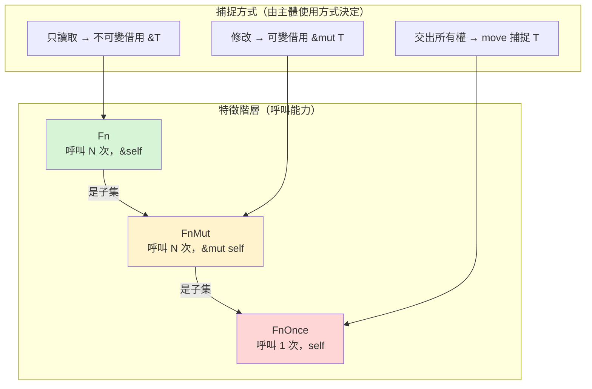

# 11.1 閉包（Closures）：捕捉環境的匿名函數

第 9 章展示了泛型與特徵如何讓程式碼在不付出執行期代價的前提下被重複使用。本章把這套機制推進到下一個層次：**行為本身成為可以傳遞的值**。Rust 用兩個互補的機制完成這件事——閉包捕捉環境中的資料，迭代器把「逐一處理元素」的迴圈抽象成可組合的管線。兩者合起來，構成了 Rust 函數式風格的骨架，也是第 12 章執行緒 API 與第 13 章非同步程式設計的語言基礎。

## 閉包的語法

閉包是可以捕捉所在環境變數的匿名函數。語法上用一對豎線包住參數，後面直接接運算式：

```rust
fn main() {
    let add_one = |x| x + 1;
    println!("{}", add_one(5));

    let add = |a: i32, b: i32| a + b;
    println!("{}", add(2, 3));

    let square = |x: i32| -> i32 { x * x };
    println!("{}", square(7));
}
```

參數與回傳型別通常可以省略，編譯器會從第一次呼叫推導出來。這個推導有一個容易忽略的限制：每個閉包的參數型別只會被推導**一次**。先以 `i32` 呼叫、再以 `&str` 呼叫同一個閉包會編譯失敗——因為閉包不像泛型函式會為每種型別單態化一份，它只是一個具體的匿名型別。如果需要多型行為，應該把閉包放進泛型參數，稍後會看到。

閉包與一般函式最根本的差異在於它可以**使用定義處作用域中的變數**：

```rust
fn main() {
    let threshold = 10;
    let is_large = |x: i32| x > threshold;
    println!("{}", is_large(15));
    println!("{}", is_large(8));
}
```

`threshold` 不是 `is_large` 的參數，卻被它「記住」了。這個捕捉動作不是魔法，而是一個非常具體的記憶體安排，接下來就拆解它。先把直覺建立起來：編譯器看到 `is_large` 用到了外層的 `threshold`，就會生成一個只含一個欄位的匿名結構體，並把 `threshold` 的值放進去；呼叫 `is_large(15)` 時，實際執行的是那個結構體上的方法。閉包的「捕捉環境」，說穿了就是**把用到的變數變成自己的欄位**。

## 閉包的型別與推導限制

每個閉包表達式都有一個編譯器自行命名、使用者寫不出來的型別。這個事實有幾個直接的後果。第一，你不能在程式碼裡寫出閉包的具體型別，只能透過 `impl Fn`、泛型參數或特徵物件間接地指涉它。第二，兩個寫法完全相同的閉包也是不同型別——`let a = |x| x + 1; let b = |x| x + 1;` 裡的 `a` 與 `b` 是兩個型別，不能放進同一個陣列，除非轉成函式指標或特徵物件。第三，也是最容易絆倒人的：**型別推導每個閉包只做一次**。

```rust,ignore
fn main() {
    let coerce = |x| x;
    let _ = coerce(5i32);
    let _ = coerce("字串");   // 編譯錯誤：x 已被推導為 i32
}
```

編譯器在第一次呼叫時鎖定 `x` 的型別為 `i32`，第二次呼叫就被視為型別不符。這與泛型函式形成對比——泛型函式會為每種參數型別單態化出獨立的版本，而閉包只有一份、只有一組欄位與主體。如果確實需要多型的「類閉包」行為，把邏輯寫成泛型函式才是正解：

```rust
fn identity<T>(x: T) -> T {
    x
}

fn main() {
    println!("{}", identity(5));
    println!("{}", identity("字串"));
}
```

這裡隱藏著一個深層的對稱：泛型函式本質上是「每個型別各生成一個閉包」的語法糖，而閉包是「捕捉了特定型別值的一個函式」。Rust 把兩者統一在同一套單態化機制之下，這也是第 9 章的零成本抽象能延伸到本章的原因。

## 捕捉的三種模式

變數如何被捕捉，取決於閉包主體**如何使用**它，共有三種模式。第一是**不可變借用**：閉包只讀取變數，捕捉的是 `&T`。第二是**可變借用**：閉包修改變數，捕捉的是 `&mut T`，因此同一時間不能有其他借用。第三是**取得所有權**：閉包把變數移進自己體內，原變數在捕捉之後失效。編譯器採用的是最小權限原則——預設選擇能讓主體通過編譯的捕捉方式，只有主體的要求逼它升級時，捕捉才會從借用升到移動。

```rust
fn main() {
    let name = String::from("Rust");
    let greet = || println!("Hello, {name}");          // 不可變借用

    let mut count = 0;
    let mut bump = || count += 1;                       // 可變借用
    bump();
    bump();
    println!("count = {count}");                        // bump 之後仍可用

    let data = String::from("資料");
    let own = move || println!("{data}");               // 取得所有權
    own();
}
```

`move` 關鍵字強制閉包取得所有被捕捉變數的所有權，即使本來只需要借用。它最常出現在兩個場景：把閉包交給執行緒（第 12 章）時，閉包的壽命可能超過原作用域，借用無從成立；以及想把資料「搬進」閉包而不留原份時。要注意 `move` 只改變捕捉方式，不改變 `Fn` 特徵的判定——`move` 進來的變數若閉包只讀取，閉包依然是 `Fn`。

捕捉方式由使用方式決定、而編譯器會在必要時**強化**它。一條實用的規則是：只要閉包可能活得比原作用域久（例如被 `thread::spawn` 或被存進結構體帶走），編譯器就會要求 `move`，否則捕捉的引用會懸空。

## move 的細節與常見誤解

`move` 的第一個誤解是把它想成「複製」。`move` 執行的是第 4 章意義上的**移動**：`Copy` 型別（如 `i32`）被逐位元複製，非 `Copy` 型別（如 `String`）的所有權被整個搬走，原變數就此失效。因此下面這段程式裡，`own` 捕捉的是 `data` 本身，`data` 之後不能再被使用：

```rust,ignore
fn main() {
    let data = String::from("重要資料");
    let own = move || println!("{data}");
    own();
    println!("{data}");   // 編譯錯誤：data 已被移動
}
```

如果既想搬進閉包、又想留下原份，答案不是 `move` 的什麼變體，而是**複製一份再搬**：`let cloned = data.clone(); let own = move || println!("{cloned}");`。所有權系統不提供「複製但語意模糊」的選項，要複製就明確呼叫 `clone`。

第二個誤解是 `move` 會改變閉包的特徵類別。它不會：`move` 只決定捕捉的方式，`Fn`/`FnMut`/`FnOnce` 的判定仍然取決於主體如何使用捕捉到的值。`move || x + 1` 捕捉的 `x` 是被搬進來的 `i32`，但主體只讀取它，閉包依然是 `Fn`。真正把閉包降級成 `FnOnce` 的是主體中的移動——把捕捉的值從閉包裡交出去。理解了「捕捉方式」與「使用方式」是兩個獨立的維度，`move` 的行為就不再神祕。


三種捕捉模式對應到三個特徵。`FnOnce` 表示閉包被呼叫一次後就消耗掉自己——它捕捉了環境的所有權並在呼叫中交出去。`FnMut` 表示閉包可以多次呼叫，且每次呼叫可能修改捕捉的環境，因此呼叫需要 `&mut self`。`Fn` 表示閉包可以多次呼叫且不修改環境，呼叫只需要 `&self`。三者有嚴格的包含關係：實作 `Fn` 的閉包必然也實作 `FnMut` 與 `FnOnce`，反之不然。



這個階層決定了泛型參數應該綁哪個特徵。原則是**取最寬鬆者**：只需要呼叫的程式碼綁 `FnOnce`，會重複呼叫的綁 `FnMut`，不修改環境的綁 `Fn`。綁得越寬鬆，接受到的閉包種類越多，API 就越通用。

```rust
fn apply_once<F: FnOnce(i32) -> i32>(f: F, x: i32) -> i32 {
    f(x)
}

fn apply_mut<F: FnMut(i32)>(mut f: F) {
    f(1);
    f(2);
}

fn apply<F: Fn(i32) -> i32>(f: F, x: i32) -> i32 {
    f(x)
}

fn main() {
    let base = 100;
    println!("{}", apply(|x| x + base, 5));

    let mut total = 0;
    apply_mut(|x| total += x);
    println!("total = {total}");

    let owned = String::from("done");
    let consume = move |x: i32| {
        println!("{owned}");
        x
    };
    println!("{}", apply_once(consume, 42));
}
```

編譯器會替每個閉包檢查它實際上該實作哪個特徵：`|x| x + base` 只讀取 `base`，是 `Fn`；`|x| total += x` 修改 `total`，是 `FnMut`；`consume` 把捕捉的 `owned` 移出了閉包主體，是 `FnOnce`——它只能被呼叫一次，第二次呼叫 `apply_once(consume, ...)` 就會編譯失敗。注意這些檢查全部發生在編譯期，特徵綁定就是合約，違約者無法通過編譯。

## 閉包與函式指標的差異

每個閉包都是編譯器生成的**獨一無二的匿名型別**。即使兩個閉包的簽名完全相同，它們的型別也不同，因為各自捕捉的環境內容不同——捕捉了什麼、捕捉了幾個變數，都會反映在這個匿名結構體的欄位裡。可以把閉包直觀地理解為「一個結構體加上一個 `call` 方法」：捕捉的變數是欄位，主體是方法。

函式指標 `fn(i32) -> i32` 則只是一個位址，沒有任何環境可以捕捉。因此不捕捉環境的閉包可以自動轉成函式指標，但捕捉了環境的閉包絕無可能：

```rust
fn double(x: i32) -> i32 {
    x * 2
}

fn main() {
    let f: fn(i32) -> i32 = double;
    println!("{}", f(21));

    let n = 3;
    let g = move |x: i32| x + n;
    // let h: fn(i32) -> i32 = g;   // 編譯錯誤：g 捕捉了環境
    println!("{}", g(1));
}
```

這個差異解釋了一個重要事實：既然每個閉包型別獨一無二，就不可能寫出「接受任意閉包」的具體型別參數——答案只有泛型或特徵物件兩條路。

## 閉包與生命週期

捕捉引入了借用，借用就必然帶著生命週期。閉包捕捉的引用，其壽命受兩個約束夾擊：不能超過被捕捉的變數，也不能超過閉包自己的使用期間。大多數情況下編譯器能自動推導，不需要顯式標註；但當閉包要被存進結構體或跨函式傳遞時，約束就會浮上檯面，其中最著名的是特徵物件的 `'static` 界。

```rust,ignore
fn main() {
    let local = String::from("短命");
    let f: Box<dyn Fn() -> usize> = Box::new(|| local.len());
    // 編譯錯誤：local 可能在此作用域結束後失效，
    // 而 Box<dyn Fn> 預設要求 'static
    println!("{}", f());
}
```

`Box<dyn Fn>` 的完整型別其實是 `Box<dyn Fn + 'static>`——特徵物件的預設生命週期界要求被包裝的值不借用任何局部變數。解法有兩條：給 `local` 加上 `move`，把所有權搬進閉包，借用就此消失；或者顯式縮短特徵物件的生命週期界（如 `Box<dyn Fn + 'a>`），讓型別系統承認這個閉包只活在 `'a` 之內。實務上前者遠為常見，這也是為什麼存進結構體的閉包幾乎總是 `move` 的。

## 標準庫中的閉包

閉包已經滲透到標準庫的每個角落，提前熟悉幾個高頻場景會讓後面的章節更順。`Vec` 的排序方法接受閉包作為比較函式：

```rust
fn main() {
    let mut words = vec!["banana", "fig", "cherry"];
    words.sort_by_key(|w| w.len());
    println!("{words:?}");

    let mut scores = vec![(90, "甲"), (72, "乙"), (88, "丙")];
    scores.sort_by(|a, b| b.0.cmp(&a.0));
    println!("{scores:?}");
}
```

`HashMap` 的 `entry().or_insert_with()` 則展示了閉包作為「延遲初始化」的角色——只有當鍵不存在時，插入用的閉包才會被呼叫：

```rust
use std::collections::HashMap;

fn main() {
    let text = "the quick the lazy the dog";
    let mut counts: HashMap<&str, usize> = HashMap::new();
    for word in text.split_whitespace() {
        *counts.entry(word).or_insert(0) += 1;
    }
    println!("{counts:?}");
}
```

這兩個例子共同的模式是：**行為被當成參數交給資料結構**，而結構只在恰當的時機呼叫它。第 11.2 節的迭代器會把這個模式推到極致——幾乎每個適配器都吃一個閉包。

捕捉不是無形的：它建立的借用與任何其他借用一樣，受第 5 章的借用檢查器管轄。一個可變捕捉存活期間，原變數不能有其他借用；甚至連「捕捉了可變借用的閉包本身」也變成不可 `Copy` 的值——兩個這樣的閉包無法同時存在。看一個會編譯失敗的例子：

```rust,ignore
fn main() {
    let mut total = 0;
    let mut bump = || total += 1;

    let print = || println!("total = {total}");  // 編譯錯誤
    // bump 仍握有 total 的可變借用

    bump();
    print();
}
```

錯誤訊息會指出 `bump` 對 `total` 的可變借用尚未結束，因此 `print` 的不可變借用無法成立。修法與普通借用衝突一模一樣：先 `drop` 或縮短 `bump` 的壽命，或者把 `print` 的呼叫安排在 `bump` 完全離開作用域之後。這個例子說明了一件重要的事：**閉包沒有借用檢查的特權**。捕捉只是把普通的借用藏在語法糖底下，檢查規則原封不動。

## 泛型參數與零成本

把閉包作為泛型參數，得到的正是第 9 章的單態化紅利：編譯器為每個實際傳入的閉包型別生成一份特化程式碼，`f(x)` 被直接內聯成函式主體，沒有函式指標跳轉、沒有 vtable 查表、捕捉的變數就放在閉包結構體裡隨取隨用。這就是「閉包抽象是零成本」的具體含義。

另一條路是特徵物件 `Box<dyn Fn(i32) -> i32>`。它把閉包裝在盒子裡、透過 vtable 呼叫，換來的是可以在 `Vec` 中混合存放不同閉包、可以在執行期改變行為，代價是一次堆積配置與每次呼叫的間接跳轉。選擇準則與第 10.1 節 `Box<dyn Trait>` 的討論完全一致：型別集合在編譯期已知就泛型，否則才用特徵物件。

```rust
fn make_adder(offset: i32) -> impl Fn(i32) -> i32 {
    move |x| x + offset
}

fn make_counter() -> impl FnMut() -> i32 {
    let mut count = 0;
    move || {
        count += 1;
        count
    }
}

fn main() {
    let add5 = make_adder(5);
    println!("{}", add5(10));
    println!("{}", add5(20));

    let mut counter = make_counter();
    println!("{}", counter());
    println!("{}", counter());
}
```

這個例子示範了閉包作為回傳值。回傳型別只能寫 `impl Fn`——`impl Trait` 語法隱藏了那個匿名型別，但保證它實作該特徵。注意 `make_adder` 中的 `move` 是**必要**的：`offset` 是函式參數，函式返回後它的堆疊框架就消失了，若閉包只借用它，回傳的閉包會立刻懸空；`move` 把 `offset` 搬進閉包體內，讓它隨閉包一起存活。`make_counter` 同理，而且它捕捉了可變的 `count`，所以回傳的是 `impl FnMut`——呼叫端也必須用 `mut` 綁定接收的變數。

若不同分支需要回傳**不同**的閉包，`impl Fn` 就不夠了，因為兩個匿名型別不同、無法統一；此時必須用 `Box<dyn Fn(i32) -> i32>` 把它們擦除成同一個型別。這正是閉包「型別獨一無二」的直接後果。

## 一個完整的例子

把本節的所有元素組合起來：一個可配置的資料過濾器，用泛型接受任意判準閉包，並支援在執行期更換策略。```rust
struct Filter {
    predicate: Box<dyn Fn(i32) -> bool>,
    history: Vec<i32>,
}

impl Filter {
    fn new(predicate: impl Fn(i32) -> bool + 'static) -> Self {
        Filter {
            predicate: Box::new(predicate),
            history: Vec::new(),
        }
    }

    fn keep(&mut self, items: &[i32]) -> Vec<i32> {
        let kept: Vec<i32> = items
            .iter()
            .copied()
            .filter(|&x| (self.predicate)(x))
            .collect();
        self.history.extend_from_slice(items);
        kept
    }
}

fn main() {
    let threshold = 10;
    let mut above = Filter::new(move |x| x > threshold);
    println!("{:?}", above.keep(&[3, 15, 8, 42, 7]));

    above.predicate = Box::new(|x| x % 2 == 0);
    println!("{:?}", above.keep(&[11, 20, 33, 46]));
}
```

`new` 用泛型接受閉包並立刻裝箱，介面上是 `impl Fn` 的彈性，內部換成 `Box<dyn Fn>` 的同質型別，因為 `predicate` 欄位需要在執行期被替換成不同策略——這是兩種傳遞方式在真實程式碼中合作的典型形態。第一個閉包捕捉 `threshold` 並以 `move` 搬入，避免借用懸空；第二個閉包不捕捉任何環境，事實上可以轉成函式指標。整個過程中，閉包是否捕捉、捕捉多少，編譯器都精確追蹤，任何一處借用衝突都會在編譯期現形。

## 小結

閉包把「環境」變成可以打包攜帶的資料：捕捉方式由主體的使用方式決定，並對應到 `Fn`、`FnMut`、`FnOnce` 三個特徵，由編譯期檢查保證呼叫的安全性。作為泛型參數的閉包被單態化成直接內聯的程式碼，是零成本抽象的又一例證；作為回傳值或存進結構體的閉包，則需要 `impl Fn` 或 `Box<dyn Fn>` 來處理型別獨一無二的問題。

回顧本節的知識地圖，可以把閉包的設計哲學壓縮成三句話。第一，捕捉即欄位：閉包就是一個匿名的結構體加上呼叫方法，環境的捕捉沒有任何魔法。第二，特徵即合約：`Fn` 家族把「呼叫幾次、改不改環境」編碼進型別，違約在編譯期就會暴露。第三，泛型即免費：只要型別在編譯期已知，閉包的抽象就不產生任何執行期稅，只有在真正需要執行期多型時才付出 `Box` 與 vtable 的代價。

下一節把閉包放進它最重要的舞台：迭代器。迭代器適配器到處接受閉包作為處理步驟，兩者合起來讓 Rust 能用宣告式的語法寫出與手寫迴圈同樣快甚至更快的程式碼。
