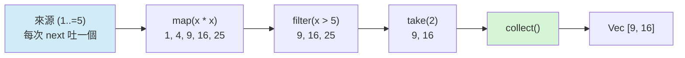

# 11.2 迭代器（Iterators）的高效處理與運作原理

上一節的閉包解決了「行為如何被捕捉與傳遞」，本節把它放進最大的應用舞台：迭代器。`for` 迴圈在 Rust 底層就是迭代器驅動的，而 `map`、`filter` 這些組合子讓整條資料處理流程可以用一串宣告式呼叫表達。更關鍵的是，這些看似高階的抽象在編譯後與手寫迴圈同樣快——迭代器是 Rust「零成本抽象」承諾最完整的示範。

## Iterator 特徵與惰性求值

迭代器的全部核心只有一個方法。標準庫的定義是：

```rust
pub trait Iterator {
    type Item;
    fn next(&mut self) -> Option<Self::Item>;
    // 其餘方法皆有預設實作
}
```

關聯型別 `Item` 宣告這個迭代器吐出什麼，`next` 每次回傳一個元素，耗盡後回傳 `None`。所有其他的組合子——`map`、`filter`、`take` 等上百個方法——都只是這個方法的包裝。

```rust
fn main() {
    let v = vec![10, 20, 30];
    let mut it = v.iter();
    println!("{:?}", it.next());
    println!("{:?}", it.next());
    println!("{:?}", it.next());
    println!("{:?}", it.next());
}
```

與 `Iterator` 配對的是 `IntoIterator` 特徵：任何實作它的型別都可以用 `into_iter()` 轉成迭代器，而 `for` 迴圈的語法糖正是「對 `into_iter()` 的結果不斷呼叫 `next`」。`Vec`、陣列、`HashMap`、範圍 `0..n` 都實作了它。

迭代器是**惰性的**（lazy）：建立一條迭代器鏈不執行任何計算，只有真正呼叫 `next`（通常由 `for` 迴圈或 `collect` 觸發）時，元素才會一個個被拉出來處理。

```rust
fn main() {
    let v = vec![1, 2, 3, 4, 5];
    let iter = v.iter().map(|x| x * 2).filter(|&x| x > 4);
    println!("還沒有任何計算發生");
    let result: Vec<i32> = iter.collect();
    println!("{result:?}");
}
```

這段程式在 `collect` 之前只建立了描述，沒有跑過一次乘法或比較。惰性不只是效能特性，更是正確性特性：無限序列因此可以存在，`take` 也才能在取滿之後停止推進。

## 適配器與消費者

迭代器方法分為兩類。**適配器**（adapters）回傳新的迭代器，惰性地轉換元素串流；**消費者**（consumers）驅動 `next`，把串流收成最終結果。常用的適配器與消費者整理如下：

| 類別 | 方法 | 作用 |
| --- | --- | --- |
| 適配器 | `map` | 對每個元素套用函數 |
| 適配器 | `filter` | 保留判準為真的元素 |
| 適配器 | `filter_map` | 轉換並過濾，`None` 被丟棄 |
| 適配器 | `take` / `skip` | 取前 N 個 / 略過前 N 個 |
| 適配器 | `enumerate` | 附加索引 |
| 適配器 | `zip` | 兩條迭代器配對成元組 |
| 適配器 | `chain` | 串接兩條迭代器 |
| 適配器 | `flat_map` | 映射後攤平 |
| 消費者 | `collect` | 收集成集合型別 |
| 消費者 | `fold` | 摺疊成單一值 |
| 消費者 | `sum` / `any` / `all` / `find` | 求和、存在、全稱、首次命中 |

```rust
fn main() {
    let squares: Vec<i32> = (1..=5).map(|x| x * x).collect();
    println!("{squares:?}");

    let evens: Vec<i32> = (1..=10).filter(|x| x % 2 == 0).collect();
    println!("{evens:?}");

    let words = ["apple", "fig", "banana"];
    let lengths: Vec<(usize, String)> = words
        .iter()
        .enumerate()
        .map(|(i, w)| (i, w.len()))
        .collect();
    println!("{lengths:?}");

    let total: i32 = (1..=100).sum();
    let any_gt_90 = (1..=100).any(|x| x > 90);
    let all_pos = (1..=100).all(|x| x > 0);
    let first_sq_gt_500 = (1..=100).map(|x| x * x).find(|&x| x > 500);
    println!("{total} {any_gt_90} {all_pos} {first_sq_gt_500:?}");
}
```

這些組合子能串成任意長度的鏈，每個環節只描述一步轉換。鏈越長，惰性管線的優勢越明顯——元素像流水線上的工件，一個接一個穿過所有工位，而不是每個工位各自等一整批。



`collect` 的目標型別由**接收端的型別標註**決定，這是它最重要的推導規則。收集到 `Vec` 最常見；收集到 `String` 適用於 `char` 或 `&str` 的串流；收集到 `HashMap` 需要元素是 `(K, V)` 元組：

```rust
use std::collections::HashMap;

fn main() {
    let v: Vec<i32> = (1..=3).collect();
    let s: String = ['R', 'u', 's', 't'].iter().collect();
    let m: HashMap<&str, i32> =
        [("a", 1), ("b", 2)].into_iter().collect();
    println!("{v:?} {s} {m:?}");
}
```

三種借用語意也需要區分：`iter()` 借用元素（`&T`）、`iter_mut()` 可變借用（`&mut T`）、`into_iter()` 取得所有權（`T`，容器被消耗）。選擇哪一個，就是在宣告迴圈結束後原容器是否還要使用。

## 零成本的數學直觀

迭代器鏈為什麼不比手寫迴圈慢？直觀的答案藏在編譯器做的事裡。一條像 `map(f).filter(g).take(2)` 的鏈，執行語意等價於一個帶三層狀態的單一迴圈；編譯器對每個適配器做內聯之後，鏈就**坍縮**成一個扁平迴圈，所有中間狀態都被放進暫存器。若把整條鏈看成對序列施加的函數合成，一個元素 $`x`$ 穿過鏈的成本是：

$$
c_{\text{chain}}(x) = c_{\mathrm{take}}\big(g(f(x))\big) + c_f + c_g
$$

而對全體元素的總成本是 $`\sum_{x \in S} c_{\text{chain}}(x)`$ ——每個元素恰好穿過鏈一次，沒有任何批次中間集合被建立。相比之下，先 `map` 收成 `Vec` 再 `filter` 收成另一個 `Vec` 的寫法，會產生 $`\lvert S \rvert`$ 與中間結果大小兩倍的配置與搬移。

實際上 LLVM 的內聯與逃逸分析通常做得更好：固定長度的小迴圈會被完全展開，邊界檢查被合併消除。觀察的方式很直接——`cargo install cargo-show-asm` 之後用 `cargo asm --rust 核心函式名` 就能看到編譯後的組譯，確認迭代器鏈是否真的坍縮成了與手寫版本相同的機器碼。

## 迭代器與借用檢查器的張力

零成本不等於零限制。迭代器本質上持有對容器的借用，因此借用規則會延伸到迴圈內部：一個可變迭代器存活期間，不能再造出第二個。

```rust
fn main() {
    let mut v = vec![1, 2, 3, 4];
    for x in v.iter_mut() {
        *x *= 2;
        // let y = v.len();   // 編譯錯誤：v 已被 iter_mut 可變借用
    }
    println!("{v:?}");
}
```

這段程式若取消註解就無法編譯——`iter_mut` 佔住了整個 `Vec` 的可變借用。張力的典型場景是「同時處理前半與後半」，例如一個分割演算法需要兩個互不重疊的可變區段。借用檢查器只看得到「整個容器的一次可變借用」，看不到「兩個不重疊的區段」，此時標準庫的 `split_at_mut` 提供了解法：

```rust
fn main() {
    let mut v = vec![1, 2, 3, 4, 5, 6];
    let (left, right) = v.split_at_mut(3);
    for x in left.iter_mut() {
        *x += 100;
    }
    for y in right.iter_mut() {
        *y *= 10;
    }
    println!("{v:?}");
}
```

`split_at_mut` 回傳兩個獨立的可變切片，借用檢查器接受它們並存——因為標準庫在實作中用 `unsafe` 證明了兩個切片指向的記憶體確實不重疊，然後把這個證明封裝成安全介面。這與上一節 `UnsafeCell` 的故事一脈相承：`unsafe` 被隔離在證明成立之處，安全抽象在其上開放。

## 效能誤區：過早 collect

惰性最常被破壞的方式，是在鏈的中間插入 `collect`：

```rust
fn main() {
    let data: Vec<i32> = (1..=1_000_000).collect();

    let slow: Vec<i32> = data
        .iter()
        .map(|x| x * 2)
        .collect::<Vec<i32>>()
        .into_iter()
        .filter(|x| x % 3 == 0)
        .collect();

    let fast: Vec<i32> = data
        .iter()
        .map(|x| x * 2)
        .filter(|x| x % 3 == 0)
        .copied()
        .collect();

    println!("{} {}", slow.len(), fast.len());
}
```

`slow` 的寫法把一百萬個元素的 `Vec` 建了又拆、拆了又建，每次 `collect` 都是一次完整的配置與寫入；`fast` 讓所有元素只流過一條管線。兩者結果相同，但 `slow` 付出了數次百萬級的記憶體流量。判準很簡單：**中間結果沒有被單獨使用，就不要 collect**。反過來說，如果中間集合確實需要被多次讀取（例如先建索引再多次查詢），`collect` 就是必要且正確的。

## 用 fold 重寫一條迭代器鏈

迭代器鏈與 `fold` 之間存在精確的對應：任何消費者鏈都可以收斂成一次 `fold`。下面的例子把「過濾、轉換、累加」三步寫成兩種形式：

```rust
fn main() {
    let data = [3, 14, 15, 9, 26, 5];

    let chain_total: i32 = data
        .iter()
        .filter(|&&x| x > 5)
        .map(|&x| x * 10)
        .sum();

    let fold_total = data.iter().fold(0, |acc, &x| {
        if x > 5 {
            acc + x * 10
        } else {
            acc
        }
    });

    assert_eq!(chain_total, fold_total);
    println!("鏈式 = {chain_total}, fold = {fold_total}");
}
```

兩者產出完全相同的值，且編譯後的機器碼也幾乎相同。`fold` 的價值在於當累積邏輯無法拆成純串流的映射與過濾時——例如同時維護最大值與總和——它提供了一個不犧牲單次遍歷的統一出口。`fold` 的簽名正是「以狀態機的方式消化串流」：初值是起始狀態，閉包是轉移函數。

## 小結

迭代器把「逐一處理元素」抽象成 `next` 方法之上的可組合管線：適配器惰性地描述轉換，消費者驅動計算，`collect` 的目標型別由接收端決定。零成本抽象在這裡得到最完整的體現——整條鏈在編譯後坍縮成單一迴圈，抽象層數不產生任何執行期稅。同時，借用檢查器的規則穿過抽象層持續生效，`split_at_mut` 展示了標準庫如何在必要處用受控的 `unsafe` 化解張力。

閉包與迭代器至此構成完整的第 11 章：前者把環境打包成值，後者把迴圈提升為管線。下一步要把這些工具推向真正的並行世界——第 12 章將介紹執行緒與 `Send`/`Sync`，屆時 `move` 閉包會成為跨執行緒轉移所有權的標準載體，`Arc<Mutex<T>>` 會接手第 10 章留下的共享可變狀態，而迭代器鏈也將在 `rayon` 這類函式庫中被平行化成一條程式碼不變、速度翻倍的管線。
