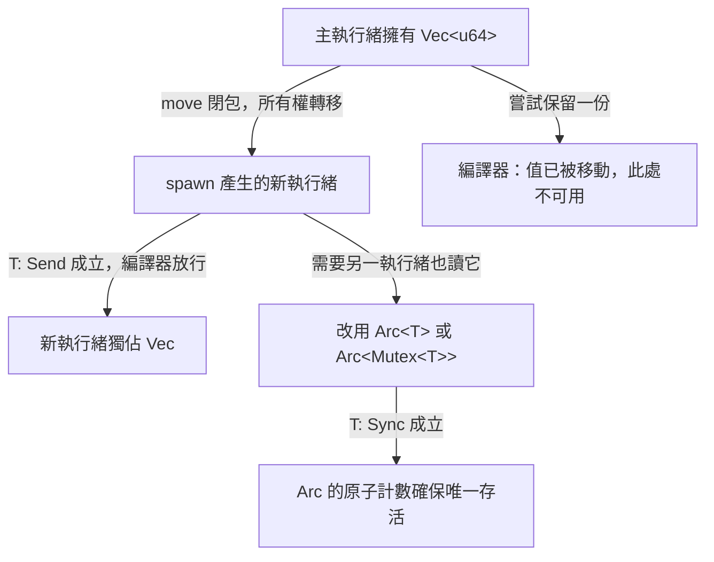

# 12.1 建立與管理執行緒（Threads）

## 執行緒與程序的分野

在作業系統的觀點裡，一個**程序**（process）擁有獨立的位址空間、檔案描述表與資源配額，彼此之間只能透過行程間通訊機制互動；而一個**執行緒**（thread）則是程序內部的排程單位，多個執行緒共享同一份堆積記憶體、同一組全域變數與同一個檔案描述表。兩者的取捨非常明確：程序間隔離性高但通訊成本昂貴，執行緒共用記憶體因此通訊近乎零成本，代價是必須自己處理同步問題。

Rust 把這個差異直接反映在型別系統裡。編譯器預設禁止你把任何資料交給另一個執行緒，除非該型別明確宣告自己是 `Send` 或 `Sync`（本章末節會詳述）。這代表「跨執行緒共享記憶體」不再是一個寫錯了也不會有人發現的隱形錯誤，而是編譯期就會被攔截的明確決定。C++ 允許你寫出 `int* p` 在兩個執行緒中同時被寫入的程式碼，那是未定義行為（undefined behavior），但編譯器完全沉默；Rust 的編譯器則會直接拒絕大多數這類程式碼。

在語言設計史上，Rust 是少數把「平行」而非「並行」當成預設心態的語言。Python 的 `threading` 模組受全域解譯器鎖（global interpreter lock）限制，執行緒無法真正同時執行；Java 的 `Thread` 需要顯式呼叫 `synchronized` 才具備互斥性；Go 用 goroutine 搭配 channel 抹平了同步細節，但換來了垃圾收集器與共享記憶體的隱性風險。Rust 的選擇是保留低階控制權，同時用型別系統換取安全性——你仍然可以自己操作位元、仍然可以用裸指標（需 `unsafe`），但共用狀態的路徑被引導到所有權轉移或明確加鎖上。

## 第一個執行緒

標準函式庫的 `std::thread::spawn` 會啟動一個新執行緒並立刻返回，其回傳型別是 `JoinHandle<T>`。這個句柄代表「對那個執行緒的控制權」，最常見的用途是等待它結束：

```rust
use std::thread;

fn main() {
    let handle = thread::spawn(|| {
        println!("子執行緒開始工作");
        42
    });

    println!("主執行緒仍在運作");
    let result = handle.join().unwrap();
    println!("子執行緒回傳 {}", result);
}
```

`handle.join()` 會阻塞目前執行緒，直到目標執行緒結束，並回傳 `Result<T, Box<dyn Any + Send>>`。成功時是子執行緒閉包的回傳值（本例為 `42`），失敗時則是該執行緒 panic 所攜帶的 payload。`join` 只能呼叫一次，第二次呼叫會 panic（`JoinHandle` 的 `join` 方法取走 `self`），因此若需要多次等待，得先把句柄包在 `Option` 裡。

這裡有個關鍵行為值得留意：**若完全不呼叫 `join()`，而主執行緒先結束，整個程序會直接退出，尚未完成的子執行緒會被強制中止**。這與 Java 的非 daemon 執行緒行為不同。想讓子執行緒的成果確實被使用，就必須 `join()`；想讓子執行緒「自己跑完」再結束程序，則需要其他機制（例如第 13 章的非同步執行環境，或自行設計的收尾流程）。

反過來說，如果你**不**持有 `JoinHandle`，編譯器會發出 `unused_must_use` 警告，因為 `JoinHandle` 被標記為 `#[must_use]`。這是一個刻意的設計提醒：句柄不只是一個控制物件，它同時是一份「我還沒確認這個執行緒的結果」的責任憑證。

## move 閉包與所有權轉移

執行緒閉包可能需要用到外層作用域的變數。但編譯器不會允許閉包以借用方式「順手」把外部資料帶進另一個執行緒，因為那個外部變數的生命週期與存取時機跨越了執行緒邊界，無法靜態推理。正確做法是使用 `move` 關鍵字：

```rust
use std::thread;

fn main() {
    let data = vec![1u64, 2, 3, 4, 5];
    let name = String::from("worker");

    let handle = thread::spawn(move || {
        let sum: u64 = data.iter().sum();
        println!("{} 計算出總和 {}", name, sum);
        sum
    });

    let total = handle.join().unwrap();
    println!("主執行緒收到總和 {}", total);
}
```

`move ||` 會把閉包捕捉到的所有變數**移動**進閉包環境。這是跨執行緒傳遞資料的標準做法，也是 Rust 與 Python、JavaScript 最大的差異所在：Python 可以直接用一個執行緒安全地共用一個 `list`，Rust 則要求你明確寫下所有權轉移的意圖。編譯器據此知道 `data` 在轉移後已被主執行緒放棄，因此不可能出現兩個執行緒同時持有同一份 `Vec` 的情況。

如果資料只是要以唯讀方式共享，可以改傳入參考而非捕獲，但這需要該型別實作 `Sync` 並且參考活得夠久；在實務中，`move` 加所有權轉移幾乎總是更簡單也更安全。

## 執行緒的 panic 行為

執行緒中的 panic 不會自動中止整個程序，除非 panic 發生在 `main` 執行緒上。未被 `join()` 的 panic 會在標準錯誤輸出印出一則訊息，而其他執行緒繼續運作。若有呼叫 `join()`，就可以把 panic 轉為 `Err` 來處理：

```rust
use std::thread;

fn main() {
    let handle = thread::spawn(|| {
        panic!("某個不變條件被破壞了");
    });

    match handle.join() {
        Ok(_) => println!("子執行緒正常結束"),
        Err(payload) => {
            if let Some(msg) = payload.downcast_ref::<&str>() {
                println!("捕捉到 panic：{}", msg);
            } else if let Some(msg) = payload.downcast_ref::<String>() {
                println!("捕捉到 panic：{}", msg);
            } else {
                println!("捕捉到未知型別的 panic");
            }
        }
    }
}
```

這個設計讓 panic 成為可攜帶型別資訊的錯誤通道。`Box<dyn Any + Send>` 之所以要求 `Send`，是因為 payload 是在另一個執行緒產生的，其所有權要跨越執行緒邊界回到呼叫端。實務上的建議是：把會 panic 的邏輯包在能回傳 `Result` 的函式裡，用 `?` 往上傳播，`join()` 留給真正無法復原的邊界情況。

## 建立執行緒的代價

執行緒並非免費。每一個執行緒都有一份獨立的堆疊記憶體，Rust 標準函式庫預設的大小約為 2 MiB；雖然是保留位址空間而非立刻實際配置，但在數千個執行緒的規模下仍會造成虛擬記憶體壓力。建立執行緒本身需要作業系統配置控制區塊、配置堆疊並排入執行緒佇列，其時間成本大約在數十微秒的量級，這意味著「為每個小工作開一個執行緒」在數十萬次反覆時會成為明顯的開銷。此外，作業系統對單一程序的執行緒數量也有上限限制，超過後 `spawn` 會直接回傳 `Err`。

`thread::Builder` 讓你調整這些細節：

```rust
use std::thread;

fn main() {
    let handle = thread::Builder::new()
        .name("image-resizer".to_string())
        .stack_size(4 * 1024 * 1024)
        .spawn(|| {
            println!("我在自訂名稱的執行緒中，堆疊是 4 MiB");
        })
        .expect("無法建立執行緒");

    handle.join().unwrap();
}
```

自訂名稱在除錯時特別有用：當執行緒出現在 `top`、`htop` 或 crash report 中時，`image-resizer` 遠比 `unnamed-thread-7` 有診斷價值。堆疊大小則可用來在「需要深遞迴」與「需要大量平行工作」之間取捨。若設定的堆疊過小，執行緒會在存取越界時收到 `SIGSEGV` 並被直接終止，Rust 的 panic 機制無法攔截這種情況，因為它發生在堆疊指標已經損壞之後。

執行緒數量也有實務上的上限考量。在 Linux 上，預設的行程數上限可以透過 `ulimit -u` 查詢；而每個執行緒的虛擬堆疊會讓 64 位元行程的位址空間迅速膨脹。一個常見的折衷做法是「執行緒池」：預先建立固定數量的執行緒，它們不斷從一個工作佇列取任務執行，避免在迴圈中反覆付出建立成本。第 12.2 節的通道範例會展示這種結構的雛形。

## 執行緒與程序：何時選哪一個

既然兩者都能做「同時做多件事」，工程上必須有一套取捨準則。判斷的起點是**是否需要共享記憶體**。若工作單元之間可以完全透過序列化資料交換，且其中有需要重複呼叫的非安全系統功能（例如大量 fork 行程處理檔案），使用程序更合適：OS 提供的程序隔離能擋掉互相干擾，崩潰也只影響單一程序。反之，若工作需要在同一份大型資料集的不同區段上操作，或需要頻繁交換複雜的物件圖，執行緒的共用位址空間是唯一合理選擇。

第二個判斷點是**故障隔離需求**。執行緒共享位址空間，其中一個執行緒觸發未定義行為（例如透過 `unsafe` 寫出界）可能直接破壞整個程序；程序則天然有硬性邊界。對於需要長期運行、可被外部輸入影響的服務，這種隔離有時比效能更重要。

第三個判斷點是**資源成本**。建立一個程序的代價是完整的位址空間初始化與頁表建立，比執行緒高昂一個數量級；但程序結束時 OS 能一次回收全部資源，執行緒若遺漏資源則要靠 RAII 逐一歸還。


在 Rust 的實務專案中，一個常見的架構是「程序池 + 執行緒池」：先以程序做粗粒度的故障與權限隔離，再在每個程序內以執行緒做細粒度的平行處理。第 18 章的持續整合專案會觸及這種結構。

## 排程與負載平衡

Rust 沒有自己的執行緒排程器。`std::thread::spawn` 建立的執行緒是原生 OS 執行緒，排程策略完全交給作業系統決定，通常是時間片輪轉加上優先權調整。Rust 沒有搶占式中斷或綠色執行緒的概念，因此也不會出現「一個執行緒長時間佔用 CPU 導致其他執行緒 starve」這種需要語言層面處置的問題。

要決定要開幾個執行緒，標準函式庫提供了 `available_parallelism`：

```rust
use std::thread;

fn main() {
    let parallelism = thread::available_parallelism()
        .map(|n| n.get())
        .unwrap_or(1);
    println!("建議的平行度為 {}", parallelism);
}
```

這個值在多核心機器上通常等於實體核心數，在有超執行緒的環境則會考慮邏輯處理器數量，而在容器中會讀取 cgroup 的 CPU 配額。它提供的是一個起點而非真理：真正的最佳執行緒數還取決於工作特性是 CPU 密集、I/O 密集還是記憶體密集。

## Send 與 Sync：編譯期安全性的核心

`Send` 與 `Sync` 是兩個**標記特徵**（marker trait），它們沒有任何方法，只承載語意宣告。

| 特徵 | 語意 | 對應的問題 |
| --- | --- | --- |
| `Send` | 該值的所有權可以安全地轉移到另一個執行緒 | 搬過去之後，會不會有第二份擁有者？ |
| `Sync` | 該值的**共用參考**可以安全地在多執行緒同時存在 | 同時讀寫同一份資料會不會出錯？ |

兩者之間有個漂亮的對稱性：對任意型別 $T$ ，`&T: Send` 成立當且僅當 `T: Sync` 成立。理由是「把共享參考送到別的執行緒」等同於「在那裡對它進行存取」，而這正是 `Sync` 所保證的。這條規則不是巧合，而是編譯器自動套用的**蘊含式**（implied bound）規則：如果 `T: Sync`，編譯器會自動推導 `&T: Send`，不需要你手動宣告。反過來，`T: Send` 絕不會自動推出 `T: Sync`，因為把值搬走和同時共用是兩回事。

常見推導如下：

| 型別 | `Send` | `Sync` | 理由 |
| --- | --- | --- | --- |
| `i32`、`bool`、`String`、`Vec<T>` | 是 | 是 | 內部所有權唯一，移動即可 |
| `&T` | 視 `T: Sync` | 視 `T: Sync` | 參考的存取需同步 |
| `Rc<T>` | 否 | 否 | 參考計數非原子操作 |
| `RefCell<T>` | 否 | 否 | 借用計數與可變性檢查非執行緒安全 |
| `Mutex<T>` | 是 | 是 | 內部以鎖保護 |
| `Arc<T>` | 是 | 是 | 原子參考計數 |

`Rc<T>` 為什麼不是 `Send`？因為 `Rc` 的強/弱參考計數是用普通整數做增減。當兩個執行緒同時 clone 或 drop 同一個 `Rc` 時，計數可能更新遺失，導致計數數值不正確，進而造成提前釋放（use-after-free）或永不釋放（記憶體洩漏）。這正是 `Arc<T>`（原子參考計數）存在的理由——兩者 API 幾乎相同，差別只在計數器的實作為原子操作。`Mutex<T>` 之所以 `Send` 且 `Sync`，是因為它的內部狀態由作業系統層級的鎖保護，所有存取都必須先取得鎖。

## 編譯器如何證明沒有資料競爭

Rust 對資料競爭的防護並不是「執行期檢查」，而是**所有權與借用規則的延伸**。核心論證可以拆成兩步：

1. 所有權是唯一的。任何時刻一個值只有一個擁有者，把值交給另一個執行緒就是**轉移**而非複製，原擁有者隨即失效。
2. 借用檢查器保證在任一時間點，對同一份資料的**唯一可變引用**數量不超過一個，同時存在的**共享引用**數量可以有很多個，但前提是型別 `Sync`。

把兩者合起來：在沒有 `Mutex`、`RwLock` 或原子操作的情況下，你無法寫出「兩個執行緒同時可變存取同一份堆積資料」的程式，因為第二個執行緒根本拿不到第二個可變參考。你只能選擇「轉移」（唯一擁有）或者「加鎖共享」（序列化存取）。



相較之下，C++ 的 `std::vector` 在型別層面完全沒有「可不可以跨執行緒」的資訊，`std::thread` 的建構子也接受任意可複製的引數。Rust 把這個判斷從「程式碼審查與測試時才會發現的隱憂」提升為「編譯期錯誤訊息」。

## 完整範例：平行求和

下面這個範例把資料切成若干塊，分派給多個執行緒各自求和，再由主執行緒合併：

```rust
use std::thread;

fn parallel_sum(data: &[u64], workers: usize) -> u64 {
    if data.is_empty() {
        return 0;
    }
    let workers = workers.max(1);
    let chunk_size = data.len().div_ceil(workers);

    let handles: Vec<_> = data
        .chunks(chunk_size)
        .map(|chunk| {
            let owned = chunk.to_vec();
            thread::spawn(move || owned.iter().sum::<u64>())
        })
        .collect();

    handles
        .into_iter()
        .map(|h| h.join().unwrap())
        .sum()
}

fn main() {
    let data: Vec<u64> = (1..=1_000_000).collect();
    let workers = thread::available_parallelism()
        .map(|n| n.get())
        .unwrap_or(1);

    let start = std::time::Instant::now();
    let total = parallel_sum(&data, workers);
    let elapsed = start.elapsed();

    println!("總和 = {}，耗時 {:?}，工作執行緒數 {}", total, elapsed, workers);
}
```

這個範例刻意示範了幾個要點。`chunk.to_vec()` 產生每個執行緒各自擁有的資料副本，讓所有權轉移乾淨俐落；若資料很大，可以改成只轉移切片的索引範圍而共用同一份 `Vec`，這時就需要 `Arc` 搭配內部可變性或鎖。`handles` 這個 `Vec` 同時扮演了「等待清單」與「擁有者集合」兩種角色：只有當 `handles` 被 `into_iter()` 消耗掉時，才去 `join()` 每一個句柄，保證所有子執行緒的結果都被收齊。

效能上的觀察重點在於加速比。CPU 密集的工作（例如整數運算）通常能接近線性加速，但存在 Amdahl 定律描述的上限：若不可並行的部分佔 $s$ ，加速比最多是 $ 1 / s $ 。切塊、複製與合併都屬於不可並行的部分，所以在資料量小或工作單位太細時，額外的執行緒建立成本會讓總時間反而變長。

實務上的經驗法則是：讓每個工作單位至少花費數十微秒，並且讓工作單位數量遠大於執行緒數目，這樣才不會讓排程與同步的固定成本淹沒平行帶來的效益。反過來，如果工作單位只耗時幾微秒，例如處理百萬筆整數的加總，正確的做法往往是**不要**開執行緒，改用迭代器的向量化實作——現代 CPU 的單核效能往往已經超越你的手寫迴圈，第 11 章談過的迭代器零成本抽象在這裡就是最佳解。

另一個容易踩到的陷阱是**記憶體放大**。上面的範例為了讓所有權轉移乾淨，把每個切片複製成一份 `Vec`，這讓峰值記憶體用量變成資料的兩倍加上執行緒數量乘以切片大小。當資料集很大時，更好的作法是只傳遞索引範圍，並讓所有執行緒共用一份不可變的資料：

```rust
use std::sync::Arc;
use std::thread;

fn main() {
    let data: Arc<Vec<u64>> = Arc::new((1..=1000).collect());
    let handles: Vec<_> = (0..4)
        .map(|i| {
            let data = Arc::clone(&data);
            thread::spawn(move || {
                let chunk = data.len() / 4;
                let part: u64 = data[i * chunk..(i + 1) * chunk].iter().sum();
                part
            })
        })
        .collect();

    let total: u64 = handles.into_iter().map(|h| h.join().unwrap()).sum();
    println!("總和 = {}", total);
}
```

這裡 `Arc<Vec<u64>>` 是安全的，因為 `Vec<u64>` 同時是 `Send` 與 `Sync`，而 `Arc` 保證只要還有一個 `Arc` 存活，內部的堆積資料就不會被釋放。共享的是**不可變**資料，所以不需要任何鎖——這是 Rust 中並行設計的第一選擇：能用共享唯讀就用共享唯讀，把可變性降到最小。

本章建立了執行緒的基本模型：如何啟動、如何等待、如何處理 panic、以及語言層面如何保證安全性。接下來兩節將分別處理執行緒間通訊的兩種典範——以訊息傳遞為主的第 12.2 節，以及以共用狀態為主的第 12.3 節。
