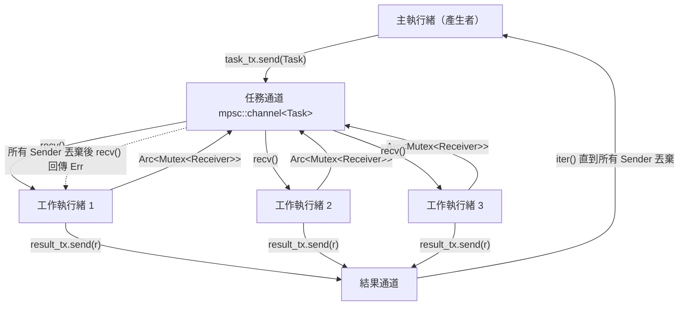

# 12.2 使用訊息傳遞（Channels）進行通訊

## 從共享狀態到訊息傳遞

在多執行緒程式的設計中，兩種典範貫穿所有決策：**共用狀態**與**訊息傳遞**。共用狀態是指多個執行緒存取同一份記憶體，必須用鎖或原子操作保護；訊息傳遞則是執行緒透過通道互相送資料，所有權隨著訊息一起轉移。前者的風險是資料競爭與死鎖，後者的風險則主要是通道本身的設計與阻塞行為。

Rust 標準函式庫在 `std::sync::mpsc` 提供了通道（channel）。它的設計哲學非常明確：**每一份資料在任何時刻只有一個擁有者**。你把資料送進通道，資料的所有權就從你手上移交给通道，再由通道移交给接收端。因為所有權全程唯一，就不存在「兩個執行緒同時修改同一份資料」的可能——這是 Rust 用型別系統換來的免費安全保證，也是與 Go 的 `chan`、C# 的 `Channel<T>` 最根本的差異：那些語言的通道是複製或參考語意的，Rust 的通道是移動語意的。

## 建立通道

`mpsc::channel()` 回傳一組 `(Sender<T>, Receiver<T>)`。`T` 是通道所傳遞的資料型別，編譯器會要求發送端與接收端使用同一個 `T`：

```rust
use std::sync::mpsc;
use std::thread;

fn main() {
    let (tx, rx) = mpsc::channel();

    thread::spawn(move || {
        tx.send(String::from("你好")).unwrap();
    });

    let received = rx.recv().unwrap();
    println!("收到：{}", received);
}
```

這個範例裡有兩個關鍵的所有權動作。`tx` 被 `move` 進閉包，因為通道的發送端必須存活到訊息送完為止；而 `String` 在 `send` 時被**移動**進通道，`send` 之後 `tx` 那一側原本的 `String` 就不存在了。這與 `Arc<Mutex<Vec<String>>>` 的共用模型形成鮮明對比——後者要手動加鎖、前者完全不需要。

## Sender 與 Receiver 的型別關係

`Sender<T>` 可以 `clone()`，產生多個發送端，這就是 `mpsc` 這個縮寫的由來：**Multiple Producer, Single Consumer**（多生產者，單消費者）。相對地，`Receiver<T>` **不實作** `Clone`，因為一個通道只能有一個消費者端；如果有兩個執行緒同時呼叫 `recv()`，它們會競爭同一個佇列，而 Rust 的所有權語意要求接收端是唯一的。

```rust
use std::sync::mpsc;
use std::thread;

fn main() {
    let (tx, rx) = mpsc::channel::<u32>();

    for id in 0..3u32 {
        let tx = tx.clone();
        thread::spawn(move || {
            for i in 0..2u32 {
                tx.send(id * 10 + i).unwrap();
            }
        });
    }
    drop(tx);

    let mut results: Vec<u32> = rx.iter().collect();
    results.sort_unstable();
    println!("結果：{:?}", results);
}
```

注意 `drop(tx)` 這一行。`tx` 在主執行緒中原本還有一份，如果主執行緒不主動丟棄它，`rx.iter()` 這個迭代器就永遠不會結束——因為迭代器只有在**所有** `Sender` 都被丟棄後才會回傳 `None`。這個「以擁有者數決定生命週期」的設計非常 Rust：通道的結束不是靠一個顯式的 `close()` 呼叫，而是靠型別系統裡的擁有者計數自然導出的。Python 的 `queue.Queue` 需要呼叫 `task_done()` 或設定 sentinel 值來標示結束，Go 需要關閉 channel 並處理 `ok` 布林值，Rust 則是「沒有人還能發送，就是結束了」。

這個設計帶來一個實務上的必然推論：**`Sender` 必須被 `drop` 才能讓迭代終止**，而 `drop` 必須發生在正確的時機。若你把 `tx` 存在一個 `Arc<Mutex<>>` 裡，或是被某個函式當作參數傳入而沒有及時釋放，接收端的 `iter()` 就會一直等下去。良好的做法是讓 `Sender` 的作用域盡可能短，讓它在不需要時自然離開作用域。

另一個推論是：**所有權就是最好的生命週期管理**。當一個工作執行緒結束時，它持有的 `Sender` 副本自動被釋放，通道的參考計數隨之下降；當最後一個 `Sender` 消失，接收端立刻收到 `Err`。你不需要寫任何手動的清理程式，也不可能忘記清理。

## 通道的封裝與型別設計

一個成熟的設計會把通道隱藏在一個自訂型別之後，而不是讓 `Sender` 與 `Receiver` 散落在程式各處。這樣做的好處是可以在單一位置處理結束協定、錯誤轉換與容量設定：

```rust
use std::sync::mpsc::{self, Receiver, Sender};

pub struct TaskQueue {
    sender: Sender<Job>,
    receiver: Receiver<Job>,
}

#[derive(Debug)]
pub struct Job {
    pub id: u64,
    pub payload: String,
}

impl TaskQueue {
    pub fn new() -> Self {
        let (sender, receiver) = mpsc::channel();
        TaskQueue { sender, receiver }
    }

    pub fn submit(&self, id: u64, payload: &str) -> Result<(), mpsc::SendError<Job>> {
        self.sender.send(Job {
            id,
            payload: payload.to_string(),
        })
    }

    pub fn next(&self) -> Option<Job> {
        self.receiver.try_recv().ok()
    }
}

fn main() {
    let queue = TaskQueue::new();
    queue.submit(1, "壓縮圖片").unwrap();
    queue.submit(2, "產生縮圖").unwrap();

    while let Some(job) = queue.next() {
        println!("處理 #{}：{}", job.id, job.payload);
    }
}
```

這種封裝讓「通道是這個模組的內部實作細節」成為可能。呼叫端只看到 `submit` 與 `next` 兩個方法，不需要知道通道的存在，日後要從 `mpsc` 換成 `crossbeam-channel` 或 `flume` 也只需修改內部。

## 平行求和：通道的另一種典型應用

除了工作佇列，通道也很適合「分派子任務、回收結果」的模式：

```rust
use std::sync::mpsc;
use std::thread;

fn main() {
    let data: Vec<u64> = (1..=1000).collect();
    let chunk = data.len() / 4;

    let (tx, rx) = mpsc::channel::<u64>();
    let mut handles = vec![];

    for i in 0..4 {
        let tx = tx.clone();
        let part = data[i * chunk..(i + 1) * chunk].to_vec();
        handles.push(thread::spawn(move || {
            let sum: u64 = part.iter().sum();
            tx.send(sum).unwrap();
        }));
    }
    drop(tx);

    let total: u64 = rx.iter().sum();
    for h in handles {
        h.join().unwrap();
    }
    println!("總和 = {}", total);
}
```

這個範例裡，`rx.iter().sum()` 能夠結束是因為 `drop(tx)` 讓主執行緒放棄了最後一份發送端的所有權。這個 `drop` 是刻意的——它把「我已經派完所有工作了」這個事實編碼進型別系統。

## 傳送與接收的四種形式

`send` 回傳 `Result<(), SendError<T>>`，因為接收端有可能已經被丟棄——這時訊息無處可去，`SendError` 會把被還原的 `T` 一併帶回來，讓你不損失資料：

```rust
use std::sync::mpsc;
use std::thread;
use std::time::Duration;

fn main() {
    let (tx, rx) = mpsc::channel::<u32>();

    let consumer = thread::spawn(move || {
        let mut total = 0;
        while let Ok(msg) = rx.recv_timeout(Duration::from_millis(100)) {
            total += msg;
        }
        total
    });

    for i in 1..=5 {
        if tx.send(i).is_err() {
            println!("接收端已離開，停止傳送");
            break;
        }
    }
    drop(tx);

    println!("總和 = {}", consumer.join().unwrap());
}
```

四個主要操作的語意如下：

| 操作 | 行為 | 失敗情形 |
| --- | --- | --- |
| `tx.send(v)` | 移入 `v` 並傳送 | 回傳 `Err(SendError(v))`，表示接收端已消失 |
| `rx.recv()` | 阻塞直到有一則訊息 | 回傳 `Err(RecvError)`，表示所有發送端已丟棄 |
| `rx.try_recv()` | 立刻取回，不阻塞 | `Empty` 表示暫時無資料，`Disconnected` 表示通道已關閉 |
| `rx.recv_timeout(d)` | 最多等待 `d` | 逾時回傳 `Timeout` |

`try_recv` 與 `recv_timeout` 回傳的是 `TryRecvError` 與 `RecvTimeoutError` 這類帶有分類標記的列舉型別，可以用 `match` 精準區分「現在沒東西」與「永遠不會再有東西」兩種截然不同的狀況。這個區分在實務上極為重要：前者只需重試，後者應該結束迴圈。

```rust
use std::sync::mpsc;
use std::thread;
use std::time::Duration;

fn main() {
    let (tx, rx) = mpsc::channel::<u32>();

    let producer = thread::spawn(move || {
        thread::sleep(Duration::from_millis(50));
        tx.send(42).unwrap();
    });

    let mut attempt = 0;
    loop {
        match rx.try_recv() {
            Ok(v) => {
                println!("取得 {}", v);
                break;
            }
            Err(mpsc::TryRecvError::Empty) => {
                attempt += 1;
                if attempt > 100 {
                    println!("放棄等待");
                    break;
                }
                thread::sleep(Duration::from_millis(1));
            }
            Err(mpsc::TryRecvError::Disconnected) => {
                println!("通道已關閉");
                break;
            }
        }
    }
    producer.join().unwrap();
}
```

## 通道的所有權語意

上面所有範例都沒有出現 `Arc` 與 `Mutex`，這是因為 `send` 吃掉了資料。送出 `String` 之後，發送端手裡那份就不存在了；資料的所有權沿著通道一路移動到接收端，全程沒有任何兩個擁有者並存的瞬間。

這個語意帶來一個實用的推論：**通道天然避免重複處理**。若你用 `Arc<Mutex<Vec<u32>>>` 收集資料並用一個標記陣列記錄「已處理過」，那個標記陣列本身就需要另一把鎖，而且可能出現「標記已寫入但資料未處理」的順序不一致。用通道時，工作項目本身就是唯一的存在憑證，取出即代表歸屬唯一。

另一個推論是**通道的兩端各自是 `Send` 的**。`Sender<T>` 與 `Receiver<T>` 都實作 `Send`，只要 `T` 也是 `Send`，你就能把它們自由地送到不同的執行緒。這與 `Rc` 形成對比：`Rc` 不是 `Send`，所以無法作為執行緒間傳遞的載體。你可以把 `Sender` 放進 `Arc` 讓多個執行緒共用同一個發送端，但那個 `Arc` 裡的 `Sender` 依然是 `Send` 的。

值得留意的是 `Sender<T>` **不是** `Sync`，這意味著你無法把 `&Sender<T>` 直接送到另一個執行緒使用；需要的是 `&Sender<T>: Send`，而這要求 `Sender<T>: Sync`，不成立。實務上的解法是 `clone()` 出新的 `Sender` 副本，而不是共用同一個參考。這個設計避免了「多個執行緒同時對同一個通道佇列呼叫 `send`」時內部計數更新的競爭。

## 多消費者需要 Arc<Mutex<Receiver>>

有時候你確實想要多個消費者。此時的標準做法是把 `Receiver` 包進 `Arc<Mutex<>>`，讓多個執行輪流鎖住接收端，從中取出一則訊息：

```rust
use std::sync::{mpsc, Arc, Mutex};
use std::thread;

fn main() {
    let (tx, rx) = mpsc::channel::<u32>();
    let rx = Arc::new(Mutex::new(rx));

    let mut handles = vec![];
    for _ in 0..3 {
        let rx = Arc::clone(&rx);
        handles.push(thread::spawn(move || {
            let mut count = 0;
            loop {
                let msg = {
                    let guard = rx.lock().unwrap();
                    guard.recv()
                };
                match msg {
                    Ok(_) => count += 1,
                    Err(_) => break,
                }
            }
            count
        }));
    }

    for i in 0..9 {
        tx.send(i).unwrap();
    }
    drop(tx);

    let total: usize = handles.into_iter().map(|h| h.join().unwrap()).sum();
    println!("共處理 {} 則訊息", total);
}
```

這裡有個技巧值得注意：鎖的守衛對象（`MutexGuard`）被限制在一個區塊之內，這樣 `recv()` 的阻塞等待發生在**未持有鎖**的狀態下。如果直接寫 `rx.lock().unwrap().recv()`，那個執行緒會在阻塞時一直占著鎖，其他消費者將完全無法前進——這是一種隱性死鎖的溫床。這個「取鎖、取資料、放鎖」的最小化臨界區原則，是第 12.3 節的核心主題之一。

## 完整範例：工作佇列

把上述概念組合起來，可以做出一個標準的執行緒池／工作佇列模式。這個範例示範「以通道協調多執行緒」的完整結構：主執行緒派發任務，工作執行緒取回任務並回報結果。

```rust
use std::sync::{mpsc, Arc, Mutex};
use std::thread;

enum Task {
    Square(u64),
    Cube(u64),
    Shutdown,
}

fn main() {
    let (task_tx, task_rx) = mpsc::channel::<Task>();
    let (result_tx, result_rx) = mpsc::channel::<u64>();

    let task_rx = Arc::new(Mutex::new(task_rx));

    let mut workers = vec![];
    for id in 0..4 {
        let task_rx = Arc::clone(&task_rx);
        let result_tx = result_tx.clone();
        workers.push(thread::spawn(move || {
            loop {
                let task = {
                    let guard = task_rx.lock().unwrap();
                    guard.recv()
                };
                match task {
                    Ok(Task::Square(n)) => result_tx.send(n * n).unwrap(),
                    Ok(Task::Cube(n)) => result_tx.send(n * n * n).unwrap(),
                    Ok(Task::Shutdown) | Err(_) => break,
                }
            }
            id
        }));
    }

    drop(result_tx);

    for n in 1u64..=10 {
        task_tx.send(Task::Square(n)).unwrap();
        task_tx.send(Task::Cube(n)).unwrap();
    }
    for _ in 0..4 {
        task_tx.send(Task::Shutdown).unwrap();
    }
    drop(task_tx);

    let mut results: Vec<u64> = result_rx.iter().collect();
    results.sort_unstable();
    println!("結果：{:?}", results);

    let ids: Vec<i32> = workers.into_iter().map(|h| h.join().unwrap()).collect();
    println!("工作執行緒編號：{:?}", ids);
}
```

這個設計的優點在於**結構上的對稱性**：任務佇列與結果佇列都用通道，而通道的所有權規則自動處理了結束訊號。當 `task_tx` 的所有副本被丟棄時，工作執行緒的 `recv()` 會回傳 `Err`，於是它們自然退出；不需要額外的計數器或特殊的結束值。



## 通道帶來的編譯期保證

通道提供的保證可以濃縮成一句話：**編譯器保證不會有兩個執行緒同時擁有同一份資料**。理由是所有權唯一，而 `send` 與 `recv` 都是所有權的交接點。

這項保證的實際效果是，一個使用通道的 Rust 程式在**資料競爭**這個維度上幾乎是免疫的。剩下的風險轉移到了別處：邏輯錯誤（例如把任務指派給錯誤的執行緒）、資源耗盡，以及阻塞引起的停滯。把難以證明的問題從「記憶體正確性」轉移到「邏輯正確性」，是 Rust 整體安全策略的核心。

順帶一提，通道並不能保證訊息的**順序**。多個生產者各自送出的訊息，在接收端看到的順序是未定義的；即使只有一個生產者，`mpsc::channel` 的內部佇列也是先到先服務，但多執行緒交錯送出時順序仍取決於排程。如果你的演算法需要嚴格順序，就必須在應用層面自行編號並排序。

## 死鎖的可能性

通道本身不死鎖，但**使用方式**可能死鎖。最經典的案例是兩個執行緒互相等待對方的資料：

```rust
use std::sync::mpsc;
use std::thread;

fn main() {
    let (tx_a, rx_a) = mpsc::channel::<u32>();
    let (tx_b, rx_b) = mpsc::channel::<u32>();

    let h1 = thread::spawn(move || {
        let v = rx_b.recv().unwrap();
        tx_a.send(v + 1).unwrap();
    });

    let h2 = thread::spawn(move || {
        let v = rx_a.recv().unwrap();
        tx_b.send(v + 1).unwrap();
    });

    h1.join().unwrap();
    h2.join().unwrap();
    println!("（這段程式實際上會永久阻塞）");
}
```

這段程式會永久卡住：兩個執行緒各自先等對方的通道，而對方的訊息要等自己送出之後才會產生。這是循環等待（circular wait），與鎖的死鎖條件同源。

更普遍的情況是**容量為零的通道造成的隱性互斥**。`mpsc::channel()` 是無界的，容量其實是無限大；但若你改用 `sync_channel(0)`，發送方在接收方取走訊息之前會一直阻塞。此時若發送方還持有某把鎖，就可能形成「持有鎖並等待通道」與「持有通道等待鎖」的交叉。

防範原則有幾條：避免跨越兩個通道互相等待的拓撲；不要在持有鎖的狀態下呼叫可能阻塞的 `recv()`；對任何等待都設定逾時，用 `recv_timeout` 把永久阻塞轉成可處理的錯誤。

另一個常見的陷阱是**迴圈中的隱性阻塞**。假設你寫了一個處理佇列的迴圈，每輪 `recv_timeout` 都用一秒的逾時，當佇列空了之後，主執行緒每秒會醒來一次確認「還沒東西」再繼續睡。若你在這個迴圈裡還要做心跳或健康檢查，就要注意逾時長度與反應速度之間的取捨——太短會浪費 CPU，太長則讓關閉訊號變得遲緩。

還有一個容易被忽略的點：**通道的容量與生產者數量會共同決定記憶體上限**。`sync_channel(100)` 在四個生產者的情況下，實際上可能同時存在 104 筆待處理資料。若這批資料每筆是一個大型緩衝區，峰值記憶體用量會遠超你的預期。設計容量時要把生產者數量與單筆大小一起算進去。

## 有界通道與背壓

`sync_channel(bound)` 建立容量有限的通道。當佇列已滿時，`Sender::send` 會**阻塞**直到有空間，這就是**背壓**（backpressure）：生產者的速度被消費者拉住了。

Rust 的 `sync_channel` 是以一個固定容量的環形緩衝區實作的，`send` 在緩衝區滿時會等待通知。它與多數語言的佇列有一個關鍵差異：Rust 的 `send` 在**滿的情況下會阻塞**，而不是丟棄最舊的項目或回傳錯誤。這讓「資料不丟失」成為預設行為，但也意味著設計者必須思考：當消費者永久停擺時，生產者會被卡在哪裡。

```rust
use std::sync::mpsc;
use std::thread;
use std::time::Duration;

fn main() {
    let (tx, rx) = mpsc::sync_channel::<u32>(2);

    let consumer = thread::spawn(move || {
        let mut sum = 0;
        while let Ok(v) = rx.recv() {
            sum += v;
            thread::sleep(Duration::from_millis(10));
        }
        sum
    });

    for i in 1..=5 {
        tx.send(i).unwrap();
        println!("已送 {}", i);
    }
    drop(tx);

    println!("總和 = {}", consumer.join().unwrap());
}
```

在這個範例中，主執行緒送完第 3 筆之後就會被卡住，因為容量為 2 的佇列已滿，而消費者每 10 毫秒才取走一筆。這個「阻塞」正是流控（flow control）的機制：它保證記憶體用量不會隨著生產速度無限膨脹。在處理來自網路的資料時，這一點尤其重要——沒有背壓的系統會在流量尖峰時耗盡記憶體。

有界通道還有另一個好處：它讓錯誤更容易被發現。當 `send` 永久阻塞時，往往代表下游已經停止運作，而無界通道只會默默堆積記憶體直到程序被 OOM killer 殺掉。

需要補充的是，Rust 標準函式庫的 `mpsc` **沒有提供** `try_send` 這類非阻塞發送的 API。有界通道要實作非阻塞語意，只能搭配 `recv_timeout` 與計時邏輯，或改用 `crossbeam-channel` 等第三方套件。若你的系統需要「塞不進去就丟棄或降級」的策略，第三方通道庫通常更合適。

## 與 async 通道的對照

`std::sync::mpsc` 是**阻塞式**的。在一個執行緒中呼叫 `recv()`，會把整個 OS 執行緒停在那裡。如果一個執行緒同時要處理多條連線，這種阻塞模型就不合適——你會需要一個連線一個執行緒，成本很高。

非同步世界裡有對應的工具：`tokio::sync::mpsc` 是 async 版本的通道，`send` 與 `recv` 都是 `async` 方法，它們不會阻塞 OS 執行緒，而是在「沒有資料可取」時讓出控制權給執行環境的排程器。tokio 的通道同樣提供 `bounded` 與 `unbounded` 兩種容量模式，背壓語意與同步版本一致。

兩者的取捨很清楚：`std::sync::mpsc` 適合「少量執行緒、每個都在做重 CPU 或阻塞式 I/O」的場景；`tokio::sync::mpsc` 適合「大量連線、I/O 密集且等待時間長」的場景。第 13 章會完整討論 tokio 的執行模型與非同步通道的細節，那裡也會說明為什麼在 async 環境中使用阻塞式的 `std::sync::mpsc::Receiver::recv` 是一個嚴重錯誤——它會卡住整個執行環境。

至此我們完成了兩種通訊典範中的第一種。訊息傳遞的優點是所有權清晰、安全性由編譯器保證；缺點是資料必須透過通道序列化一次，且無法直接共享複雜的可變狀態。

在選擇通訊方式時，有一個簡單的判準值得牢記：**若資料的所有權可以自然地從一方「交給」另一方，就用通道；若多個執行緒必須「同時看到同一份資料的變化」，才用共用狀態**。前者是前一個執行緒用完就不再需要的資料，後者是所有參與者都要持續觀察的共享儀表板。硬要對第一種情況使用鎖，往往只是換來更多複雜度而沒有實益。
