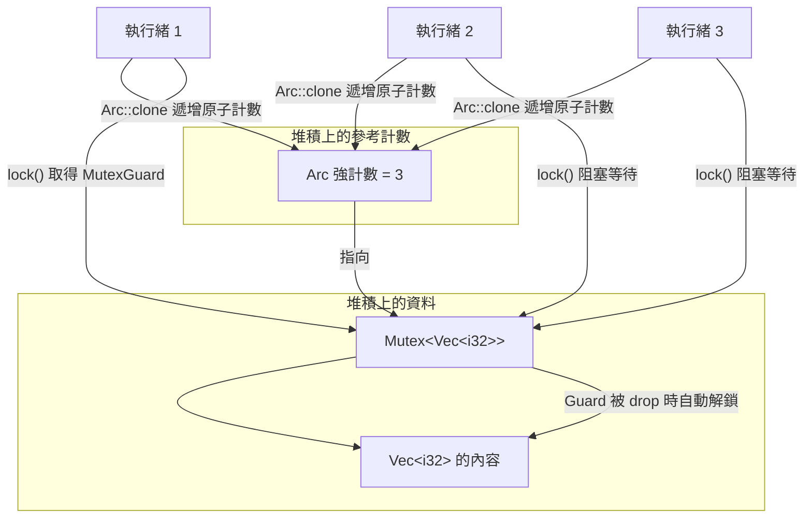

# 12.3 共用狀態與同步（Mutex、Arc）

## 共用狀態的難度

第 12.2 節的通道讓資料透過所有權轉移在執行緒間流動，那是安全的。但有一類問題是通道無法自然解決的：多個執行緒必須**同時看到同一份資料的最新狀態**。一個聊天機器人的線上人數、一個快取命中率計數器、一個正在被多個 worker 同時更新的任務狀態表——這些資料沒有「交給某一方」的語意，它們就是所有人共用的。

這就是「共用狀態」（shared state）。一旦允許多個執行緒存取同一塊記憶體，三種嚴重問題就出現了：**資料競爭**（data race，兩個執行緒同時存取同一記憶體位置且其中至少一個是寫入）、**死鎖**（deadlock，執行緒互相等待對方持有的資源）以及**飢餓**（starvation，某些執行緒長期拿不到資源）。在 C++ 與 Java 裡，這些問題要靠程式設計者記得加鎖來避免；在 Rust 裡，編譯器會強制你做出明確的選擇。

Rust 對這個問題的答案是分層的：`Mutex<T>` 提供互斥存取（同一時間只有一個執行緒能進入），`Arc<T>` 提供共享擁有權（多個執行緒都能持有同一份資料），`RwLock<T>` 提供讀多寫少情境下的並行讀取。三者組合起來，就是 Rust 共用狀態的標準配備。

## Mutex：互斥鎖

`Mutex<T>` 是 mutual exclusion 的縮寫。它包住一個 `T`，並提供 `lock()` 方法回傳一個**守衛型別**（guard type）`MutexGuard<'_, T>`，透過 `Deref` 讓你像存取一般資料一樣使用內部值：

```rust
use std::sync::Mutex;

fn main() {
    let m = Mutex::new(5);

    {
        let mut lock = m.lock().unwrap();
        *lock += 3;
    }

    {
        let lock = m.lock().unwrap();
        println!("目前的值 = {}", *lock);
    }
}
```

這裡有兩個設計細節值得留意。第一，`lock()` 回傳的是 `Result<MutexGuard<'_, T>, PoisonError<MutexGuard<'_, T>>>`，而不是直接的守衛。這是因為**中毒**（poisoning）機制：若一個持有鎖的執行緒發生了 panic，鎖會被標記為中毒。守衛被丟棄時會釋放鎖，但同時留下這個「曾經有持有者 panic」的標記。取得中毒的鎖時，`lock()` 回傳 `Err`，讓你能決定是繼續使用（因為資料狀態可能仍然一致）還是中止程式。`unwrap()` 的作用正是把這個 `Result` 化簡成守衛值，代價是中毒時會觸發 panic。

第二，解鎖**不需要手動呼叫**。`MutexGuard` 的 `Drop` 實作會自動釋放鎖。這個 RAII（resource acquisition is initialization）設計與第 4 章的 `Vec`、第 8 章的 `File` 一致：資源的釋放綁定在值的生命週期上，而不是綁定在程式碼路徑上。這意味著即使你的函式在中途 panic 或提前 `return`，鎖也一定會被釋放——不可能出現「忘記解鎖」導致永久死鎖的情形。

```rust
use std::sync::Mutex;

fn increment(counter: &Mutex<i32>) {
    let mut guard = counter.lock().unwrap();
    *guard += 1;
}

fn main() {
    let counter = Mutex::new(0);
    increment(&counter);
    increment(&counter);
    println!("計數 = {}", *counter.lock().unwrap());
}
```

注意 `increment` 的簽章：它接受 `&Mutex<i32>`，而 `&Mutex<i32>` 是 `Send` 的（因為 `Mutex<i32>: Sync`），所以這個函式可以安全地在多執行緒中使用。鎖的可共享性正是透過 `Sync` 這個 marker 特徵表達出來的。

## Arc：原子參考計數

`Arc` 是 atomically reference counted 的縮寫，它是第 10 章 `Rc` 的執行緒安全版本。`Rc` 用普通整數維護強參考計數，而 `Arc` 用原子操作（`fetch_add` 與 `fetch_sub`）來更新計數，因此可以安全地跨執行緒共享：

```rust
use std::sync::Arc;
use std::thread;

fn main() {
    let data = Arc::new(vec![1, 2, 3]);
    let mut handles = vec![];

    for _ in 0..3 {
        let data = Arc::clone(&data);
        handles.push(thread::spawn(move || data.iter().sum::<i32>()));
    }

    let total: i32 = handles.into_iter().map(|h| h.join().unwrap()).sum();
    println!("總和 = {}", total);
}
```

`Arc::clone` 之所以是一個獨立的函式而不是 `Clone` 特徵的實作，是一個刻意的 API 設計：方法形式的 `data.clone()` 看起來像深拷貝，容易讓人誤解，而 `Arc::clone(&data)` 在視覺上就表明「這只是增加一個參考計數，資料本身沒有複製」。

## 為什麼兩者必須一起用

`Arc` 與 `Mutex` 解決的是**完全不同**的問題，缺一不可：

`Arc<T>` 回答的是「**誰擁有**這份資料」。它讓多個執行緒都能持有指向同一份堆積資料的句柄，並確保最後一個句柄消失時才釋放資料。但 `Arc` 完全不管資料**內容**的存取——如果 `T` 裡有可變狀態，`Arc<Mutex<T>>` 中的 `Mutex` 才是保護內容的機制。

`Mutex<T>` 回答的是「**誰能存取**這份資料」。它保證同一時間只有一個執行緒能取得內容的可變存取。但 `Mutex<T>` 本身只是一個堆積上的值，要讓多個執行緒都拿到它的守衛，仍然需要某種共享擁有權的機制，也就是 `Arc`。

所以兩者組合起來的 `Arc<Mutex<T>>` 就讀作：「這份資料由多個執行緒共同擁有，但內容的存取被序列化」。這是 Rust 共用可變狀態的標準形式，也是 Rust 社群中出現頻率最高的型別之一。



## 完整範例：Arc<Mutex<Vec<i32>>>

下面這個程式示範最典型的用法：多個執行緒各自把自己的資料推進同一個共享的 `Vec`。

```rust
use std::sync::{Arc, Mutex};
use std::thread;

fn main() {
    let shared: Arc<Mutex<Vec<i32>>> = Arc::new(Mutex::new(Vec::new()));
    let mut handles = vec![];

    for worker_id in 0..4 {
        let shared = Arc::clone(&shared);
        handles.push(thread::spawn(move || {
            for i in 0..5 {
                let mut guard = shared.lock().unwrap();
                guard.push(worker_id * 10 + i);
            }
        }));
    }

    for h in handles {
        h.join().unwrap();
    }

    let guard = shared.lock().unwrap();
    println!("收集到的資料：{:?}", *guard);
}
```

這段程式是安全的，因為對 `Vec` 的可變存取全部被同一把鎖序列化。執行緒之間可能以任何順序交錯執行，但任何時刻都只有一個執行緒持有守衛，因此不存在資料競爭。

然而它的**效能**值得批評。臨界區包含了 `guard.push(...)`，而 `push` 可能觸發堆積重新配置，這會是相對昂貴的操作，同時還要把鎖完全持有。更糟的是，臨界區裡若夾帶了 `println!` 這類會取得內部格式鎖的呼叫，就可能與其他執行緒產生死鎖（見下一節）。正確的寫法是把必要的運算搬出臨界區：

```rust
use std::sync::{Arc, Mutex};
use std::thread;

fn main() {
    let shared: Arc<Mutex<Vec<i32>>> = Arc::new(Mutex::new(Vec::new()));
    let mut handles = vec![];

    for worker_id in 0..4 {
        let shared = Arc::clone(&shared);
        handles.push(thread::spawn(move || {
            let produced: Vec<i32> = (0..5).map(|i| worker_id * 10 + i).collect();
            let mut guard = shared.lock().unwrap();
            guard.extend(produced);
        }));
    }

    for h in handles {
        h.join().unwrap();
    }

    let guard = shared.lock().unwrap();
    println!("收集到 {} 筆資料", guard.len());
}
```

第一個版本是「每次 push 都鎖一次」，第二個是「先在鎖外批次算好，再鎖一次批次寫入」。後者把鎖的取得次數從 20 次降到 4 次，臨界區也短得多。這是同步程式設計最核心的原則：**盡量縮短臨界區**。

## 死鎖的預防

死鎖的四個必要條件是：互斥、持有並等待、非搶占資源、循環等待。在 Rust 裡前三項都由 `Mutex` 天然滿足，唯一需要設計者留意的是**循環等待**——兩個執行緒各持有一把鎖，又互相等待對方的那把。

最直接的預防手段是**固定加鎖順序**。若所有執行緒都以全域一致的方向（例如依記憶體位址或某個編號）取得多把鎖，循環就不可能形成：

```rust
use std::sync::{Arc, Mutex};

fn main() {
    let a = Arc::new(Mutex::new(0));
    let b = Arc::new(Mutex::new(0));

    let (a1, b1) = (Arc::clone(&a), Arc::clone(&b));
    let (a2, b2) = (Arc::clone(&a), Arc::clone(&b));

    let t1 = std::thread::spawn(move || {
        let mut ga = a1.lock().unwrap();
        let mut gb = b1.lock().unwrap();
        *ga += 1;
        *gb += 1;
    });

    let t2 = std::thread::spawn(move || {
        let mut ga = a2.lock().unwrap();
        let mut gb = b2.lock().unwrap();
        *ga += 1;
        *gb += 1;
    });

    t1.join().unwrap();
    t2.join().unwrap();
    println!("a = {}, b = {}", *a.lock().unwrap(), *b.lock().unwrap());
}
```

這裡兩個執行緒都以 `a` 然後 `b` 的順序取得鎖，所以不會互相等待。若其中一個改成先 `b` 後 `a`，就會死鎖。

第二個原則是**不要在持有鎖時呼叫未知的程式碼**。所謂未知，包括可能取得其他鎖的函式、可能做 I/O 的操作、可能 panic 的操作，以及像 `println!` 這種會取得內部格式狀態鎖的巨集。第三個原則是使用 **`try_lock`** 做非阻塞嘗試：

```rust
use std::sync::Mutex;
use std::time::Duration;

fn main() {
    let m = Mutex::new(1);

    match m.try_lock() {
        Ok(mut guard) => {
            *guard += 1;
            println!("快速取得鎖：{}", *guard);
        }
        Err(std::sync::TryLockError::WouldBlock) => {
            println!("鎖被占用，改用等待");
            let mut guard = m.lock().unwrap();
            *guard += 1;
        }
        Err(std::sync::TryLockError::Poisoned(_)) => {
            println!("鎖已中毒");
        }
    }

    std::thread::sleep(Duration::from_millis(10));
}
```

`try_lock` 回傳 `TryLockError`，區分「現在拿不到」與「已經中毒」兩種情況。在鎖競爭激烈但臨界區很短的場景中，`try_lock` 加上一點退避重試，有時比盲目阻塞更好，因為它讓執行緒有機會先去處理別的工作。

第四個原則是**縮短臨界區**，並且在可能的情況下把「持有鎖的時間」降到接近零：先在鎖外算好結果，只在最後真正修改共享狀態的那一刻才取得鎖。

## 中毒（Poisoning）的語意與處理

中毒機制的設計哲學是「寧可保守也不要靜默地繼續使用可能已損壞的狀態」。當持有 `MutexGuard` 的執行緒 panic 時，鎖被標記為中毒；之後的 `lock()` 回傳 `Err(PoisonError)`，其中包含了守衛，所以你可以選擇「恢復並繼續使用」。

```rust
use std::sync::{Arc, Mutex};

fn main() {
    let m = Arc::new(Mutex::new(vec![1, 2, 3]));
    let worker = Arc::clone(&m);

    let result = std::thread::spawn(move || {
        let mut guard = worker.lock().unwrap();
        guard.push(4);
        panic!("在持有鎖時發生錯誤");
    })
    .join();

    assert!(result.is_err());

    let outcome = match m.lock() {
        Ok(guard) => format!("未中毒：{:?}", *guard),
        Err(poisoned) => {
            let guard = poisoned.into_inner();
            format!("中毒但資料仍可讀：{:?}", *guard)
        }
    };
    println!("{}", outcome);
}
```

`PoisonError::into_inner()` 會取出守衛，讓你繞過中毒檢查繼續使用資料。這是一個明確的工程決策：只有當你確定「panic 發生時共享狀態仍是一致的」時才應該這麼做。上例中 panic 發生在 `push` 之後，資料其實是完整的，因此可以安全地繼續。

要注意的是，**中毒只針對 `Mutex`，不針對 `RwLock`**。`RwLock` 在有寫入者 panic 時，會讓後續的讀取與寫入都回傳 `Err`，行為略有差異。實務上常見的策略是：對 `Mutex` 採取 `unwrap()`（毒了就讓程序崩潰，因為狀態可能真的壞了），或對可容忍的狀態採取 `into_inner()`。

## RwLock：多讀單寫

`RwLock<T>` 把「獨佔」與「共用」分成兩種模式：`read()` 取得讀守衛，可以有多個讀者同時持有；`write()` 取得寫守衛，獨佔且排斥所有其他存取。這在「讀多寫少」的工作負載上能大幅提升並行度：

```rust
use std::sync::{Arc, RwLock};
use std::thread;

fn main() {
    let config = Arc::new(RwLock::new(vec!["default".to_string()]));
    let mut handles = vec![];

    for _ in 0..3 {
        let cfg = Arc::clone(&config);
        handles.push(thread::spawn(move || {
            let guard = cfg.read().unwrap();
            println!("讀到 {} 筆設定", guard.len());
        }));
    }

    {
        let cfg = Arc::clone(&config);
        handles.push(thread::spawn(move || {
            let mut guard = cfg.write().unwrap();
            guard.push("新增".to_string());
        }));
    }

    for h in handles {
        h.join().unwrap();
    }

    let guard = config.read().unwrap();
    println!("最終設定：{:?}", *guard);
}
```

`RwLock` 的代價是它比 `Mutex` 複雜得多。讀寫鎖的內部需要追蹤多個狀態：目前有幾個讀者、是否等待著寫入者、寫入者是否在場。實作通常用一個原子計數加上條件變數來實現，這使得每次 `read()` 的成本明顯高於 `Mutex::lock()`。因此只有在讀寫比例懸殊時，`RwLock` 才可能划算。

另外還有**饑餓**（starvation）的風險。不同的實作會採取不同的策略：writer-preferred 的實作會讓等待中的寫入者優先於新的讀者，避免寫入者被讀者餓死；reader-preferred 的實作則讓讀者優先，可能讓寫入者永遠等不到機會。Rust 標準函式庫的 `RwLock` 在作業系統層面通常是寫入者優先的，但確切的行為取決於平台。若你的系統有大量讀取與少量寫入，且寫入延遲重要，務必在實際負載下量測。

實務指南是：**先用 `Mutex`，量測之後再考慮 `RwLock`**。`RwLock` 只在「讀取佔九成以上且臨界區不算短」時才明確划算。

## 效能考量與 Amdahl 定律

鎖競爭是平行程式的頭號效能殺手。當多個執行緒頻繁爭奪同一把鎖，它們的執行時間就不再是並行的，而是序列化的——整體速度退化為單執行緒。若臨界區本身很短，鎖的取得與釋放開銷還會佔據主導地位。

Amdahl 定律直觀地描述了這個上限：若程式有 $`p`$ 的比例可以完全平行化，則使用 $`n`$ 個處理器時的最大加速比是

$$
\frac{1}{(1 - p) + \frac{p}{n}}
$$

當 $`p = 1`$ （完全可平行）時，加速比趨近 $`n`$ ；當 $`p = 0.95`$ 時，即使 $`n`$ 趨近無限大，加速比也只有 $`1 / 0.05 = 20`$ 。這說明**鎖競爭造成的序列化區段**是無法靠增加硬體掩蓋的。

```rust
use std::sync::atomic::{AtomicU64, Ordering};
use std::sync::{Arc, Mutex};
use std::thread;

fn main() {
    let counter = Arc::new(Mutex::new(0u64));
    let fast = Arc::new(AtomicU64::new(0));

    let mut handles = vec![];
    for _ in 0..4 {
        let counter = Arc::clone(&counter);
        let fast = Arc::clone(&fast);
        handles.push(thread::spawn(move || {
            for _ in 0..10_000 {
                *counter.lock().unwrap() += 1;
                fast.fetch_add(1, Ordering::Relaxed);
            }
        }));
    }

    for h in handles {
        h.join().unwrap();
    }
    println!("Mutex 版本 = {}", *counter.lock().unwrap());
    println!("Atomic 版本 = {}", fast.load(Ordering::Relaxed));
}
```

這個範例刻意讓兩個版本做同樣的事：把計數器加一。`Mutex` 版本每次都必須取得與釋放鎖，四個執行緒會在鎖上排隊；原子版本用 `fetch_add` 一次完成「讀取並寫入」，沒有鎖，也沒有競爭開銷。對單純的計數操作，原子操作幾乎總是更好的選擇。

三種同步機制的對照如下：

| 機制 | 適用情境 | 臨界區成本 | 主要風險 |
| --- | --- | --- | --- |
| `Mutex<T>` | 一般可變狀態，寫入頻繁 | 中 | 死鎖、中毒、競爭 |
| `RwLock<T>` | 讀多寫少，讀取為主 | 高於 Mutex | 寫入者飢餓、實作複雜 |
| 原子型別 | 單一計數器、旗標、指標交換 | 低 | 邏輯順序錯誤、假共享 |

## 為什麼 Rust 不提供無鎖資料結構

無鎖（lock-free）與免鎖（wait-free）資料結構在學術與工業界都很有吸引力：它們保證在至少一個執行緒取得進度的前提下，系統不會被鎖住。然而 Rust 的標準函式庫刻意**不**提供它們，原因有四個。

第一是**正確性證明的難度**。無鎖結構的正確性論證往往依賴特定的記憶體模型假設，要證明「線性化點」的正確需要極其細緻的推論。Rust 的 `Ordering`（`Relaxed`、`Acquire`、`Release`、`AcqRel`、`SeqCst`）提供了完整的記憶體模型，但要在其上證明一個複雜的 Treiber 堆疊或 Michael-Scott 佇列是正確的，是一項專門的研究工作。

第二是**使用錯誤的後果嚴重**。Rust 的哲學是「把錯誤留在編譯期」。而記憶體順序錯誤往往**無法**在編譯期察覺，它會在特定的 CPU 架構、特定的最佳化設定下才顯現出來，產生了間歇性的資料損毀。相較之下，`Mutex` 是「正確但慢」，無鎖結構是「可能快但有時錯」。

第三是**除錯難度**。鎖造成的停滯可以用 `jstack` 或 `perf` 觀察到；無鎖結構的問題則可能表現為計數器數值莫名增加，幾乎不可能診斷。

第四是**抽象層次的干擾**。要正確使用原子操作，就必須在整個程式的記憶體模型語意下思考，而不是逐行程式碼思考。Rust 選擇讓 99% 的情況使用簡單且安全的 `Mutex`，把無鎖結構留給少數需要它的應用，並透過 `crossbeam` 等第三方 crate 提供。

## 與 C++ 的對照

C++ 的 `std::mutex` 在**使用上**和 Rust 的 `Mutex` 幾乎一樣，但**保證**天差地別。C++ 的 `std::mutex` 只是防止兩個執行緒同時進入临界區，它完全不管臨界區裡的資料是什麼，也不管有沒有別的執行緒在別處以 `std::vector` 的內部指標直接改寫同一塊記憶體。

C++ 中最危險的寫法是把 `std::vector` 的元素指標交給另一個執行緒，或在持有 `std::mutex` 保護的物件之外，用另一個未受保護的參考存取同一個 `std::vector`。`std::mutex` 對這類錯誤完全無感——mutex 只知道「誰進了临界區」，不知道「有沒有別人在別處偷改資料」。

Rust 的編譯器則會直接拒絕大多數這類程式碼。若你要把 `Vec` 的參考送到另一個執行緒，編譯器會要求 `Vec<T>: Sync`，而 `Vec<T>` 只在 `T: Send` 時滿足 `Sync`。這迫使你回頭用 `Arc<Mutex<Vec<T>>>` 把保護機制寫在型別裡。換句話說，**Rust 把「請記得加鎖」這條工程紀律，改寫成「不對就編譯不過」的語言保證**。

```rust
use std::sync::{Arc, Mutex};
use std::thread;

fn main() {
    let counter = Arc::new(Mutex::new(0u64));
    let mut handles = vec![];

    for _ in 0..4 {
        let counter = Arc::clone(&counter);
        handles.push(thread::spawn(move || {
            for _ in 0..25_000 {
                let mut guard = counter.lock().unwrap();
                *guard += 1;
            }
        }));
    }

    for h in handles {
        h.join().unwrap();
    }

    println!("最終計數 = {}", *counter.lock().unwrap());
}
```

## 完整範例：直方圖計算與合併

最後用一個更貼近真實需求的範例收束：多個執行緒各自處理一批數據並統計字元出現次數，最後合併成一份全域直方圖。

```rust
use std::collections::HashMap;
use std::sync::{Arc, Mutex};
use std::thread;

fn count_chars(text: &str) -> HashMap<char, usize> {
    let mut counts = HashMap::new();
    for ch in text.chars() {
        if ch.is_ascii_alphabetic() {
            *counts.entry(ch.to_ascii_lowercase()).or_insert(0) += 1;
        }
    }
    counts
}

fn main() {
    let samples = vec![
        "Rust is a systems programming language".to_string(),
        "Ownership and borrowing in Rust".to_string(),
        "Rust guarantees memory safety".to_string(),
        "Concurrency without data races".to_string(),
    ];

    let global: Arc<Mutex<HashMap<char, usize>>> = Arc::new(Mutex::new(HashMap::new()));
    let mut handles = vec![];

    for sample in samples {
        let global = Arc::clone(&global);
        handles.push(thread::spawn(move || {
            let local = count_chars(&sample);
            let mut guard = global.lock().unwrap();
            for (ch, n) in local {
                *guard.entry(ch).or_insert(0) += n;
            }
        }));
    }

    for h in handles {
        h.join().unwrap();
    }

    let guard = global.lock().unwrap();
    let mut pairs: Vec<(char, usize)> = guard.iter().map(|(&c, &n)| (c, n)).collect();
    pairs.sort_unstable();
    for (ch, n) in pairs {
        println!("'{}' 出現 {} 次", ch, n);
    }
}
```

這個範例刻意示範了「**局部聚合，全域合併**」這個重要的效能模式。每個執行緒在自己的棧上建立區域性的 `HashMap`——完全不需要鎖，因為那是它私有的；只有在最後把結果併入全域計數表時才短暫取得鎖。若改成每個字元都鎖一次，慢上數十倍都不奇怪。

值得注意的是，這個直方圖的**最終數值與執行緒排程無關**。每個執行緒產生的局部計數是確定性的，而合併是加法，符合交換律與結合律，因此無論四個執行緒以任何先後順序完成，全域結果都相同。這種「可交換的合併運算」是設計並行聚合器的理想前提：不需要任何排序或編號協議。反之，若合併運算不具備這種性質，就必須引入額外的同步機制，或把來源資訊一併攜帶在資料裡。

此外還有一個細節：取得守衛之後立刻把它限制在需要的範圍內。`let mut guard = global.lock().unwrap();` 之後的迴圈只做 `HashMap` 的合併，沒有任何 I/O 與外部呼叫，這是最安全的臨界區形態。整個程式的正確性不依賴任何執行緒的執行順序，最終的直方圖與字元數量是確定的。

本章完成了 Rust 並行安全的三個支柱：12.1 節的執行緒模型與 `Send`/`Sync` 保證、12.2 節的通道所有權通訊、以及本節的 `Arc<Mutex<T>>` 共用狀態。當你掌握這三者如何在同一個程式中搭配使用——用通道傳遞工作項目、用鎖保護共享的聚合狀態——你就具備了建構真實多執行緒系統的全部基礎。第 13 章將把場景轉向非同步，以 tokio 為例說明如何在單一執行緒的事件迴圈中同時處理成千上萬個 I/O 作業。
