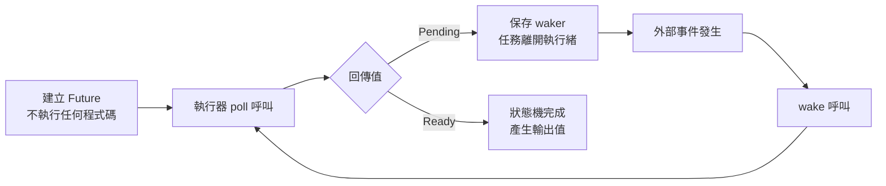

# 13.1 Future 與非同步執行模型

## 一個等待中的程式

在同步程式中，等待網路回應的寫法非常直觀：呼叫函式，函式回傳結果，然後繼續往下走。

```rust
fn fetch() -> String {
    // 內部呼叫阻塞式 I/O，執行緒停在這裡直到資料到達
    String::from("payload")
}

fn main() {
    let body = fetch();
    println!("{}", body);
}
```

問題在於「內部呼叫阻塞式 I/O」這一句。在作業系統的世界裡，等待 I/O 本質上是一種放棄執行緒的行為。執行緒停在某個 syscall 上，把 CPU 交給核心排程器，等資料從網路卡或磁碟被搬進來。對於一個同時服務一萬個連線的伺服器而言，如果每個連線都配上一條專屬執行緒，光是執行緒堆疊與上下文切換的成本就會吃掉大部分的效能。

非同步的解法是把「等待」從執行緒身上移到函式身上。函式不再真的停下來等待，而是說：「還沒準備好，這裡有一個尚未完成的計算，請之後再來問我。」Rust 把這個概念抽象成一個標準庫的特徵，名字就叫 `Future`。

```rust
use std::future::Future;

fn fetch() -> impl Future<Output = String> {
    // 尚未完成的操作
    async { String::from("payload") }
}
```

注意這裡的 `fetch` 回傳的不是 `String`，而是一個 `Future`。未來的某個時刻，這個 future 會「完成」，完成時才會產生 `String`。整個模型只有一個核心概念：**未來的值**。

## Future 特徵的定義

`Future` 特徵的定義相當精簡，但每一個參數都有存在的理由。

```rust
use std::future::Future;
use std::pin::Pin;
use std::task::{Context, Poll};

pub trait Future {
    type Output;
    fn poll(self: Pin<&mut Self>, cx: &mut Context<'_>) -> Poll<Self::Output>;
}
```

`type Output` 是完成後產生的值的型別。`poll` 是驅動這個狀態機的唯一方法，它接收一個 `Pin<&mut Self>` 與一個 `&mut Context<'_>`，回傳 `Poll<Self::Output>`。`Poll` 只有兩個變體：`Poll::Pending` 表示「還沒好，請稍後再叫我」，`Poll::Ready(value)` 表示「完成了，值在這裡」。

`Pin` 的存在是為了阻止 future 被移動。future 是一個內部可能持有「自我參照」的狀態機，例如某個 future 內部有一個 `Vec`，而它的 `poll` 方法會把某個元素的參考存進結構體裡。若允許整個 future 被搬到另一個記憶體位置，那個參考就會指向舊的堆積配位，成為懸垂指標。`Pin` 是一種型別層面的承諾：一旦被 pin 住，就永遠不會被移動。

`Context` 則是 future 與執行器之間的聯絡窗口。裡面最重要的欄位是 `Waker`，它是一個可複製的句柄，指向執行器內部的某個「任務排程佇列」。當 future 回傳 `Poll::Pending` 時，它應該把這個 waker 存起來；等 I/O 事件發生、計時器到點或資料就緒時，執行器會呼叫 `wake()`，把任務重新排進就緒佇列，等待下一次 `poll`。

這四個元素共同構成了一個完整的介面：型別描述成果、狀態機驅動方法、記憶體安全保證，以及回呼通道。

```mermaid
stateDiagram-v2
    [*] --> 已建立
    已建立 --> 輪詢中 : poll() 被呼叫
    輪詢中 --> 就緒等待 : 回傳 Poll::Pending
    就緒等待 --> 輪詢中 : wake() 觸發重新排程
    輪詢中 --> 已完成 : 回傳 Poll::Ready(value)
    已完成 --> [*]
    note right of 就緒等待
        waker 被存起
        等待 I/O 或計時器事件
    end note
```

## Future 是惰性的

`Future` 最容易被忽略、卻最具影響力的性質是它的**惰性**。建立一個 future 不會啟動任何事情。真正的推進只發生在 `poll` 被呼叫的時候。

```rust
async fn load_config() -> Vec<u8> {
    println!("開始載入");
    vec![1, 2, 3]
}

fn main() {
    let fut = load_config();
    println!("尚未執行");
}
```

這段程式只會印出「尚未執行」。`load_config()` 的呼叫只是構造出一個 future 狀態機，把「開始載入」這個副作用記錄在尚未執行的程式碼中。要讓它真正跑起來，必須有人去 poll 它——這個「有人」就是執行器。

這個設計與 `Iterator` 的結構極為相似。迭代器同樣是狀態機：`next()` 被呼叫才前進一次，每次前進都消耗一點狀態並回傳一個元素。差別在於驅動者的數量——迭代器幾乎總是由同一段迴圈驅動，而 future 可能被數百個任務交錯驅動。



## 執行器：推動狀態機的引擎

既然 future 是惰性的，就必須有一個元件負責不斷地 poll 它們。這個元件就是**執行器**（executor），它的核心是一個簡單的迴圈。

```rust
use std::collections::VecDeque;
use std::future::Future;
use std::pin::Pin;
use std::task::{Context, Poll, RawWaker, RawWakerVTable, Waker};

fn noop_waker() -> Waker {
    fn clone(_: *const ()) -> RawWaker {
        RawWaker::new(std::ptr::null(), &VTABLE)
    }
    fn wake(_: *const ()) {}
    fn wake_by_ref(_: *const ()) {}
    fn drop(_: *const ()) {}
    static VTABLE: RawWakerVTable = RawWakerVTable::new(clone, wake, wake_by_ref, drop);
    unsafe { Waker::from_raw(RawWaker::new(std::ptr::null(), &VTABLE)) }
}

fn block_on<F: Future>(future: F) -> F::Output {
    let mut future = Box::pin(future);
    let waker = noop_waker();
    let mut cx = Context::from_waker(&waker);
    loop {
        match future.as_mut().poll(&mut cx) {
            Poll::Ready(value) => return value,
            Poll::Pending => std::thread::yield_now(),
        }
    }
}

fn main() {
    let value = block_on(async { 21 * 2 });
    println!("結果：{}", value);
}
```

這個 `block_on` 為了教學目的做了簡化：它不建立真正的排程器，`wake` 是空實作，所以 `Pending` 之後只能靠 `yield_now` 忙等。真正的執行器會在 `Pending` 時把任務交還給排程器，去執行其他任務，等事件發生時再透過 `wake` 把它叫回來。

執行器還要處理另一個維度：任務在 `poll` 期間可能需要把執行緒讓出來。當某個 future 因為「等待網路資料」而回傳 `Pending`，這個任務就必須離開目前的執行緒，否則其他任務會被卡住。執行器通常以一個就緒任務佇列加上一個等待佇列來管理這件事。

## async 與 await 的編譯期轉換

`async` 與 `await` 並不是新的語言功能，它們是編譯器的語法糖，最終都會被轉成 `Future` 與 `poll` 的組合。

一個 `async fn` 會被轉換成一個回傳 `impl Future` 的普通函式。函式主體被包裝成一個狀態機，`await` -expression 則被轉換成「呼叫被 await 的 future 的 `poll` 方法」。

```rust
async fn step_one() -> u32 {
    1
}

async fn step_two() -> u32 {
    2
}

async fn total() -> u32 {
    let a = step_one().await;
    let b = step_two().await;
    a + b
}
```

`total` 的邏輯上等同於一個手寫的狀態機：第一次 poll 時計算 `a`，把 `step_two()` 的 future 存進狀態機並回傳 `Pending`；第二次 poll 時取出 `b` 並回傳 `Ready(3)`。`await` 之前的所有程式碼在第一次 poll 時執行，之後的程式碼在對應的 future 完成後執行。

這個轉換解釋了一個關鍵事實：**async 函式的呼叫端決定了執行模型**。編譯器只負責產生 future，至於誰來 poll、poll 幾次、在哪個執行緒上 poll，全部由呼叫端決定。同樣的 future 可以被 `block_on` 同步等待、被 `tokio::spawn` 丟到背景任務、或被另一個 future 巢狀等待。

## 為什麼沒有內建執行器

Rust 的非同步設計刻意不綁定任何執行器，這是它與其他語言最鮮明的差異。

在 Go 裡，`go func() { ... }()` 會立刻排程一個 goroutine，語言內建了一整套排程器。在 JavaScript 裡，`Promise` 有微任務佇列，事件迴圈由執行環境提供。在 C# 裡，`async`/`await` 搭配 TPL 執行緒池，執行模型同樣是語言層面綁定的。

Rust 選擇了第三條路：`async` 只產生資料流，執行器由 crate 提供。這個取捨換來幾項好處。首先是零成本與可替換性，執行器只是把 future 搬到執行緒上的薄層，不同執行器可以在同一份業務程式碼下無縫替換。其次是編譯時間，Rust 編譯器不需要在核心語言中實作排程策略，支援執行緒、非同步 I/O 或單一執行緒都由外部 crate 決定。最後是生態系的多樣性，Tokio、async-std、smol、glommio 各有擅長的領域。

```rust
// 同一個 future 可以被不同的執行器驅動
async fn business_logic() -> u32 {
    42
}

fn main() {
    // 由某個執行器 poll
    let result = tokio::runtime::Runtime::new()
        .unwrap()
        .block_on(business_logic());
    println!("{}", result);
}
```

## async 函式回傳的不是結果

由於 `async fn` 會被轉成回傳 future 的函式，呼叫它不會立刻求值。

```rust
async fn fetch_user(id: u32) -> String {
    println!("開始查詢使用者 {}", id);
    format!("user-{}", id)
}

fn main() {
    let fut = fetch_user(7);
    println!("future 已經建立，但還沒有任何副作用");
    // 真正執行需要 runtime.block_on(fut)
}
```

`let fut = fetch_user(7);` 只會建立一個狀態機。若這行程式碼後面跟的是 `fut.await` 或 `runtime.block_on(fut)`，副作用才會發生。這與「函式呼叫即求值」的直覺不同，是初學者最常踩到的坑之一。

## Send、Sync 與借用檢查器

跨執行緒執行的 future 必須是 `Send` 的，這是一個編譯期保證：future 內部的所有狀態都能安全地搬到另一條執行緒。`tokio::spawn` 會要求 `F: Future + Send + 'static`，三者缺一不可。

`Send` 的要求源自 `await` 點的借用跨躍。若一個 future 在 `await` 之前取得了 `&mut Vec<u8>`，而在 `await` 期間這個參考仍然活著，那麼參考所指的記憶體就必須在任務被搬移到另一條執行緒之後仍然有效。這會直接排除掉所有可能跨執行緒共享的非同步參考。

借用檢查器與 async 的相容性，一度是 Rust 社群最大的痛點。早期版本中，`async fn` 回傳的 future 隱含地把所有借用綁在回傳型別的生命週期上，造成大量難以理解的生命週期錯誤。2024 年 1.85 版之後，`async fn` 在 `impl Trait` 與借用之間的相容性獲得顯著改善，許多原本需要手動標註 `+ '_` 或改寫成 `async move` 的情境變得自然，編譯器對借用範圍的推斷也更精準。

手動實作 `Future` 時，可以直接觀察到借用如何跨過 `Pending`：

```rust
use std::future::Future;
use std::pin::Pin;
use std::task::{Context, Poll};

struct Borrowed<'a> {
    data: &'a [u8],
    position: usize,
}

impl Future for Borrowed<'_> {
    type Output = u8;

    fn poll(self: Pin<&mut Self>, _cx: &mut Context<'_>) -> Poll<u8> {
        let me = self.get_mut();
        if me.position < me.data.len() {
            let value = me.data[me.position];
            me.position += 1;
            Poll::Ready(value)
        } else {
            Poll::Pending
        }
    }
}
```

這個 future 持有 `&'a [u8]` 的參考，並在多次 poll 之間保留狀態。借用檢查器保證 `&'a [u8]` 在 future 被使用的期間都保持有效，而 `Send` 的實作則只會在 `&[u8]` 本身是 `Send` 時才被衍生。

## 阻塞與非同步的互斥

在 async 函式裡呼叫阻塞 API，是非同步程式中危害最大的錯誤。阻塞呼叫會把整條執行緒釘住，讓排程在該執行緒上的所有任務全部停滯。在多執行緒 runtime 中，這會造成所謂的「執行緒飢餓」，吞吐量急劇下降，而且症狀往往出現在與阻塞點無關的地方。

```rust
use std::fs;

async fn bad_example() -> String {
    // 在 async 函式裡做阻塞式檔案讀取，整條執行緒會被卡住
    let content = fs::read_to_string("config.toml").unwrap();
    content
}

async fn good_example() -> String {
    // 使用非同步版本，讓出執行緒
    let content = tokio::fs::read_to_string("config.toml").await.unwrap();
    content
}
```

判斷標準很簡單：如果一個 API 會讓呼叫它的執行緒停止推進，那麼它就不能出現在 async 函式裡。`std::fs`、`std::net` 的阻塞版本、`std::thread::sleep`、以及大部分計算密集的函式都屬於這一類。

更隱蔽的危險來自所謂的「偽非同步」。有些第三方套件提供的函式名稱帶著 async 的味道，內部卻呼叫阻塞 API，或在內部偷偷建立一條執行緒。這類函式不會在編譯期被察覺，只有在負載升高時才會暴露問題。檢查方式很直接：閱讀原始碼或文件，確認它是否真的使用了非同步 I/O 介面。

## Waker 與就緒佇列

`Waker` 的語義值得再細說一次，因為它是「非同步」與「阻塞」的根本差別所在。一個阻塞等待的執行緒，是被核心的排程器從就緒佇列中取出、放入等待佇列，直到事件發生再放回去。整個過程的驅動權掌握在作業系統手裡，應用程式本身沒有任何介入的機會。

非同步等待則完全不同。future 在回傳 `Poll::Pending` 之前，必須把 waker 交給某個會在未來被觸發的東西。可能是作業系統的 I/O 完成事件、可能是執行緒池中的計時器、可能是另一個任務完成的訊號。當那個東西被觸發時，`wake()` 會把任務的排程句柄放回執行器的就緒佇列。

```rust
use std::task::Wake;
use std::sync::Arc;

struct Countdown {
    remaining: u32,
}

impl Wake for Countdown {
    fn wake(self: Arc<Self>) {
        println!("被喚醒，還剩 {} 次", self.remaining);
    }
}
```

`Wake` 特徵是 `Waker` 的現代介面，讓自訂的喚醒邏輯不必直接操作 `RawWaker` 的 unsafe 程式碼。`Arc<Self>` 是必要的，因為 `wake` 會取得喚醒目標的所有權，而喚醒者本身可能已經被丟棄。

這個機制帶來一個重要的性質：**任務不會被遺忘，也不會被重複喚醒**。執行器通常會用一個「已排程」旗標確保同一個任務在同一時間只存在於就緒佇列一次。這使得喚醒操作是非同步且冪等的，設計者可以放心地在多處呼叫 `wake_by_ref` 而不必擔心造成任務重複排程。

## async move 與捕獲語意

`async` 區塊預設以「借用」的方式捕獲環境中的變數。這個行為有時會造成 lifetime 錯誤，因為捕獲的參考必須活得比 future 更久。

```rust
async fn some_async_op() {}

async fn borrow_version(text: String) -> usize {
    let reference = &text;
    // 在 await 之後才使用參考，text 必須仍然活著
    some_async_op().await;
    reference.len()
}
```

兩段程式碼的差別在捕獲語意。`borrow_version` 以借用方式捕獲 `text`，因為 `reference` 的使用跨越了 `await` 點，所以借用檢查器要求 `text` 在整個 future 的生命週期內有效。加入 `async move` 之後，future 會取得 `text` 的所有權而非借用，這個限制便消失了。

```rust
async fn some_async_op() {}

fn make_future(text: String) -> impl std::future::Future<Output = usize> {
    async move {
        let reference = &text;
        some_async_op().await;
        reference.len()
    }
}
```

`async move` 的判斷準則很單純：如果 future 需要存活得比被捕獲的變數更久，就應該用 `async move` 取得所有權；如果 future 的生命週期短於區域生命週期，維持借用即可。`tokio::spawn` 要求 `'static`，這使得 `async move` 成為最常見的寫法。

## 取消語意

Rust 的 future 沒有內建的取消機制。所謂取消，就是「不再 poll 它」，然後讓它被丟棄。這個語意比很多語言更簡單，也更不容易出錯，但代價是取消時的清理必須靠 `Drop` 實作來保證。

```rust
use std::sync::Arc;
use std::sync::atomic::{AtomicBool, Ordering};

struct Guard {
    active: Arc<AtomicBool>,
}

impl Drop for Guard {
    fn drop(&mut self) {
        self.active.store(false, Ordering::SeqCst);
        println!("資源已釋放");
    }
}

async fn long_running_operation() {}

async fn guarded(active: Arc<AtomicBool>) {
    let _guard = Guard { active };
    long_running_operation().await;
}
```

把 `_guard` 放在 `await` 之前，它就會在整個 future 被丟棄時隨之析構，無論是正常完成、錯誤返回還是被取消。這是 Rust 非同步程式裡處理資源清理的標準模式，與同步程式中以 `Drop` 取代手動 `defer` 的理念一致。

不過要留意，`Drop` 只能在 future 真的被丟棄時才執行。若執行緒被強制中止，或程序直接結束，某些清理就不會發生。因此在 `Drop` 中不應假設所有資源都還可用。

## 與其他語言的執行模型比較

把 Rust 與 Go、JavaScript、C# 放在一起比較，可以清楚看出 Rust 的設計位置。

| 語言 | 非同步關鍵字 | 是否內建執行器 | 排程單位 | 跨執行緒移動 |
| --- | --- | --- | --- | --- |
| Go | `go` 關鍵字 | 是 | goroutine | 由編譯器與排程器決定 |
| JavaScript | `Promise`、`async` | 是（事件迴圈） | 微任務佇圈 | 事件迴圈為單執行緒 |
| C# | `async`/`await` | 是（執行緒池） | 工作項目 | 由執行緒池決定 |
| Rust | `async`/`await` | 否 | 由執行器 crate 決定 | 由 `Send` 標記決定 |

這張表裡最值得注意的是最後兩欄。Go 的 goroutine 可以在多執行緒之間自由移動，是因為編譯器保證了 goroutine 的所有狀態都符合共享記憶體模型的要求。JavaScript 放棄了這個能力，事件迴圈始終在單一執行緒上運作，僅靠語言的單執行緒語意來保證一致性。Rust 走的是中間路線：它不預設執行模型，但提供 `Send` 與 `Sync` 這兩個標記，讓「這個 future 能不能搬到別的執行緒」成為一個可以被編譯器驗證的型別層級問題。

這種設計也讓 Rust 能夠同時服務兩種截然不同的場景。編寫單執行緒的 GUI 應用時，可以用 current-thread runtime 取得最簡單的行為模型；編寫高併發的網路服務時，多執行緒 runtime 提供工作竊取式的負載平衡。業務程式碼不必修改一行。

## 手寫狀態機

除了用 `async`/`await`，也可以直接用 `std::future::poll_fn` 組出狀態機：

```rust
use std::future::poll_fn;
use std::task::Poll;

async fn countdown(from: u32) {
    let mut current = from;
    poll_fn(move |cx| {
        if current == 0 {
            Poll::Ready(())
        } else {
            current -= 1;
            cx.waker().wake_by_ref();
            Poll::Pending
        }
    })
    .await;
}

#[tokio::main]
async fn main() {
    countdown(3).await;
    println!("倒數結束");
}
```

這個範例展示了一個重要觀念：`poll_fn` 讓你可以手動控制 `Pending` 與 `Ready` 的切換，並在需要時呼叫 `wake_by_ref` 把自己重新排進佇列。`countdown` 這個 future 會被 poll 四次，前三次回傳 `Pending`，最後一次回傳 `Ready`。

## Future 與 Stream

`Future` 描述的是「一個最終會完成的值」，而 `Stream` 描述的是「一串依序產生的值」。兩者的介面幾乎對稱：`Future::poll` 回傳 `Poll<Output>`，`Stream::poll_next` 回傳 `Poll<Option<Item>>`，多出來的 `Option` 用來表示串流已經結束。

| 面向 | `Future` | `Stream` |
| --- | --- | --- |
| 產出數量 | 恰好一個值 | 零個到多個值 |
| 完成訊號 | `Poll::Ready(value)` | `Poll::Ready(None)` |
| 驅動方式 | `poll` 一次即結束 | 反覆 `poll` 直到收到 `None` |
| 常見來源 | 網路請求、檔案讀取、計時器 | TCP 資料流、訊息通道、非同步迭代器 |

理解這個對稱性有實際價值：掌握了 `Future` 的 poll 迴圈，就等於掌握了 `Stream` 的 poll 迴圈，只不過後者要在收到 `None` 之前持續驅動。許多非同步 I/O 框架正是以 `Stream` 為基礎，把一條 TCP 連線或一個檔案抽象成可持續拉取的項目序列。

## 非同步函式的組合性

非同步的價值不僅在於單一函式能等待，更在於非同步函式可以像普通函式一樣自由組合。一個回傳 future 的函式可以接受另一個 future 作為參數，也可以回傳多個 future 的組合。

```rust
use std::future::Future;

async fn fetch_all(ids: Vec<u32>) -> Vec<String> {
    let mut results = Vec::new();
    for id in ids {
        results.push(fetch_one(id).await);
    }
    results
}

async fn fetch_one(id: u32) -> String {
    format!("item-{}", id)
}

fn sequential(ids: Vec<u32>) -> impl Future<Output = Vec<String>> {
    async move { fetch_all(ids).await }
}
```

這個函式把「產生 future」與「執行 future」分離開來：`sequential` 只是組裝，不做任何實際工作，真正的啟動時機仍由呼叫端決定。這種分離讓非同步 API 具備極高的組合性，因為未來的型別 `impl Future<Output = Vec<String>>` 與具體的執行策略完全無關。

如果需要同時啟動多個 future 而非循序等待，可以使用 `futures` crate 提供的 `join!` 巨集，它會把所有 future 放進同一個狀態機，用一次 poll 就能推進所有分支。

```rust
use futures::join;

async fn fetch_one(id: u32) -> String {
    format!("item-{}", id)
}

async fn concurrent(ids: Vec<u32>) -> Vec<String> {
    let a = fetch_one(ids[0]);
    let b = fetch_one(ids[1]);
    let (ra, rb) = join!(a, b);
    vec![ra, rb]
}
```

這個差異在處理網路請求時特別重要。循序等待十個請求，若每個需要一百毫秒，總共就要一千毫秒；同時等待則只需最慢的那一個，也就是一百毫秒。這種「把所有等待交給同一個狀態機」的技巧，正是下一節要介紹的 Tokio 多任務排程能夠高效運作的基礎。

## 小結

Rust 的非同步模型建立在單一概念之上：future 是由 `poll` 驅動的惰性狀態機。`Pin` 保證它不會被移動，`Context` 提供回到執行器的通道，`Waker` 讓狀態機能在就緒時被重新排程。`async` 與 `await` 只是編譯期的轉換糖，最終都收斂到這四個要素。

正是因為語言層面刻意保持中立，Rust 才能讓執行器成為可替換的基礎設施。下一節將以 Tokio 為例，完整呈現一個生產級執行器的排程模型、任務管理與非同步 I/O 介面。
