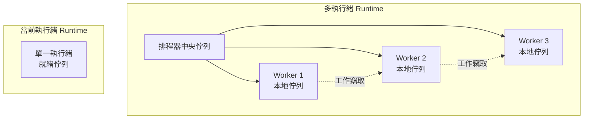
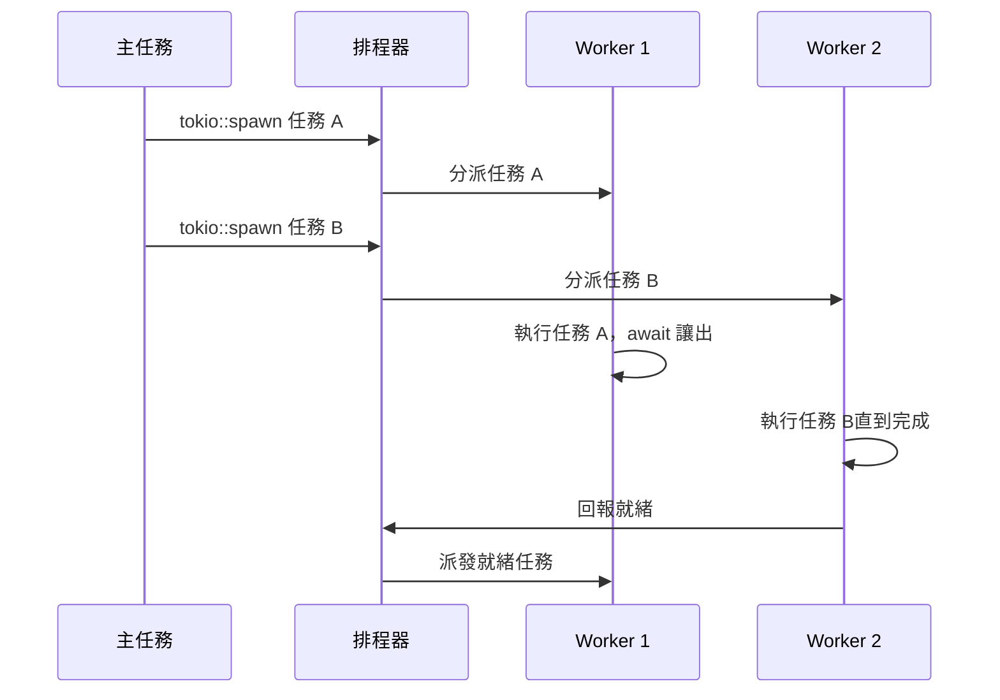
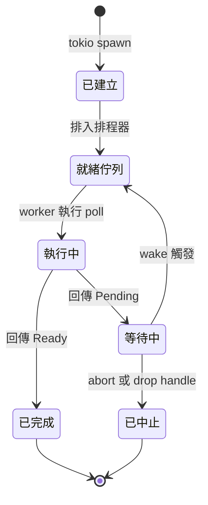

# 13.2 認識 Tokio 執行環境（Runtime）

## Tokio 是什麼

Tokio 是 Rust 生態系中使用最廣泛的非同步執行器。它不是語言的一部分，而是由社群維護的一個 crate，但它事實上扮演了「Rust 非同步的預設基礎設施」的角色。

Tokio 提供的功能涵蓋了非同步程式的核心需求。非同步檔案與網路 I/O 是最直接的用途，它把作業系統的 I/O 完成事件封裝成 future。計時器讓程式碼可以等待一段時間，而不必佔用一條執行緒。任務排程器負責決定哪些任務在什麼時候被 poll，是整個系統的心臟。訊號處理讓伺服器能夠在收到 `SIGTERM` 時優雅地關閉。同步原語則提供了非同步版本的鎖與通道。

與其他執行器相比，Tokio 的最大優勢是整合度。它不是一個只做排程的小型 crate，而是一個涵蓋 I/O、計時、編碼、檔案系統與同步工具的完整平台，並且被 Axum、Hyper、SQLx、Reqwest 等幾乎所有主流的 Rust 網路框架所採用。

## Cargo.toml 的相依設定

引入 Tokio 最簡單的方式是使用 `full` 特徵，它會開啟所有可選功能。

```toml
[dependencies]
tokio = { version = "1", features = ["full"] }
```

`full` 的優點是開箱即用，缺點是編譯時間顯著增加。Tokio 的可選功能是累積式的，`full` 等同於同時開啟 `rt`、`rt-multi-thread`、`macros`、`net`、`time`、`sync`、`fs`、`io-util`、`signal` 與 `process`。

在正式專案中，建議依實際需求精選特徵。

```toml
[dependencies]
tokio = { version = "1", features = ["rt-multi-thread", "macros", "net", "time", "sync"] }
```

這份設定涵蓋了網路伺服器最常用的功能：多執行緒 runtime、`#[tokio::main]` 巨集、TCP I/O、計時器與同步原語，但沒有開啟 `fs` 與 `process`，編譯速度會快上一截。若只需要在測試中使用非同步，可以只開 `macros`、`rt` 與 `time`。

```toml
[dependencies]
tokio = { version = "1", features = ["macros", "rt", "time"] }
```

| 功能需求 | 建議開啟的特徵 |
| --- | --- |
| `#[tokio::main]` 巨集 | `macros`、`rt` |
| 多執行緒 runtime | `rt-multi-thread` |
| TCP、UDP 監聽 | `net` |
| 計時器與逾時 | `time` |
| 非同步鎖與通道 | `sync` |
| 檔案系統操作 | `fs` |
| 子行程管理 | `process` |

## #[tokio::main] 如何運作

`#[tokio::main]` 巨集把 `async fn main` 轉換成同步的程式入口。它的展開過程相當直接。

```rust
use tokio::time::{sleep, Duration};

#[tokio::main]
async fn main() {
    sleep(Duration::from_millis(100)).await;
    println!("主程式結束");
}
```

巨集大致等價於下面的程式碼：建立一個 runtime，呼叫 `block_on` 把 `main` 的 future 跑完。

```rust
fn main() {
    let runtime = tokio::runtime::Builder::new_multi_thread()
        .enable_all()
        .build()
        .expect("無法建立 runtime");
    runtime.block_on(async_main());
}
```

`block_on` 會把給定的 future 當成一個任務來 poll，並在目前執行緒上等待它完成。這個「等待」是真正的阻塞，但與 `std::thread::sleep` 不同，runtime 在等待期間仍然可以驅動其他任務，因為它使用的是同一個機制的多執行緒排程。

在測試或 library 環境中，通常會手動建立 runtime 來取得更細緻的控制。

```rust
use tokio::runtime::Builder;

fn main() {
    let runtime = Builder::new_current_thread()
        .enable_all()
        .build()
        .expect("無法建立 runtime");
    runtime.block_on(async {
        println!("在 runtime 內執行");
    });
}
```

## 兩種 runtime 配置

Tokio 提供兩種主要的 runtime 配置，它們的差異是理解整個排程模型的關鍵。

多執行緒 runtime 由 `new_multi_thread` 建立，預設會啟動與 CPU 邏輯核心數量相同的 worker 執行緒。工作執行緒彼此平行，各自擁有本地佇列。當某條執行緒的本地佇列空了，它會先嘗試從其他執行緒那裡「偷」取任務，這個策略稱為工作竊取。

當前執行緒 runtime 由 `new_current_thread` 建立，所有任務都在呼叫 `block_on` 的那條執行緒上執行。這個模型的行為更接近 JavaScript 的事件迴圈或 Go 的單核 `GOMAXPROCS=1` 模式，優點是沒有跨執行緒同步的成本，也不存在競態。



選擇的原則很直接：長時間運作的伺服器、需要利用多核心的應用，應該使用多執行緒 runtime。命令列工具、只需要簡單 I/O 的腳本、以及測試，則適合當前執行緒 runtime。

```rust
use tokio::runtime::Builder;

fn main() {
    let runtime = Builder::new_current_thread()
        .enable_all()
        .build()
        .unwrap();
    runtime.block_on(async {
        println!("單執行緒執行");
    });
}
```

## tokio::spawn 與背景任務

`tokio::spawn` 把一個 future 交給 runtime 排程，並立即回傳 `JoinHandle`。這個呼叫本身不阻塞，future 的主體要等到某條 worker 執行緒 poll 它時才會開始執行。

```rust
use tokio::time::{sleep, Duration};

#[tokio::main]
async fn main() {
    let handle = tokio::spawn(async {
        sleep(Duration::from_millis(50)).await;
        "背景任務完成"
    });

    println!("主流程繼續");
    let result = handle.await.unwrap();
    println!("{}", result);
}
```

`JoinHandle` 是一個 future，await 它會得到任務的執行結果。任務若正常完成，結果是它的回傳值；任務若 panic，結果是 `Err`；任務若被中止，結果則是 `Err` 且帶有取消的標記。

`tokio::spawn` 對 future 有三個編譯期要求。第一個是 `Send`，因為任務可能在任何一條 worker 執行緒上執行。第二個是 `'static`，因為 runtime 不會追蹤任務的借用關係，任務必須能夠活得比呼叫端更久。第三個是輸出型別必須是 `Send`，否則結果無法送回等待它的執行緒。

```rust
use std::sync::Arc;
use tokio::sync::Mutex;

#[tokio::main]
async fn main() {
    let counter = Arc::new(Mutex::new(0u64));
    let mut handles = Vec::new();

    for _ in 0..4 {
        let counter = Arc::clone(&counter);
        handles.push(tokio::spawn(async move {
            let mut guard = counter.lock().await;
            *guard += 1;
        }));
    }

    for handle in handles {
        handle.await.unwrap();
    }

    let guard = counter.lock().await;
    println!("總計：{}", *guard);
}
```

這個範例也示範了一個重要的觀念：`Arc<Mutex<T>>` 是非同步程式中共享狀態的標準做法。`Arc` 讓所有權可以跨執行緒共用，`Mutex` 保證同一時間只有一個任務能修改內部狀態。

## select! 巨集

`select!` 巨集讓程式碼同時等待多個 future，並在最先完成的那一個上繼續執行，其餘的則被取消。

```rust
use tokio::sync::mpsc;
use tokio::time::{sleep, Duration};

#[tokio::main]
async fn main() {
    let (tx, mut rx) = mpsc::channel::<u32>(4);

    tokio::spawn(async move {
        for i in 1..=3 {
            sleep(Duration::from_millis(30)).await;
            let _ = tx.send(i).await;
        }
    });

    let mut ticker = Box::pin(sleep(Duration::from_secs(1)));
    loop {
        tokio::select! {
            value = rx.recv() => {
                match value {
                    Some(v) => println!("收到訊息 {}", v),
                    None => break,
                }
            }
            _ = &mut ticker => {
                println!("計時器到期，結束迴圈");
                break;
            }
        }
    }
}
```

這個模式是典型的「事件迴圈」寫法：同時等待來自通道的資料與一個逾時訊號，任何一個先發生就處理它。`select!` 的分支必須是 future，而且必須是 `Unpin` 或被包在 `Box::pin` 裡。對於迴圈中重複使用的 future，通常用 `tokio::time::interval` 搭配 `Pin::as_mut` 或 `Box::pin` 來處理。

`select!` 還支援 `else` 分支，當所有分支都返回 `Pending` 且沒有分支準備好時執行。這個特性可以用來實作「保底逾時」。

```rust
use tokio::time::{sleep, Duration};

async fn wait_for_event() -> Option<u32> {
    let handle = tokio::spawn(async {
        sleep(Duration::from_millis(10)).await;
        Some(7)
    });
    tokio::select! {
        value = handle => value.ok().flatten(),
        _ = sleep(Duration::from_millis(100)) => None,
    }
}
```

## join! 與 try_join!

`join!` 等待所有列出的 future 完成，並以元組形式回傳所有結果。

```rust
use tokio::time::{sleep, Duration};

async fn task_a() -> u32 {
    sleep(Duration::from_millis(30)).await;
    1
}

async fn task_b() -> u32 {
    sleep(Duration::from_millis(50)).await;
    2
}

#[tokio::main]
async fn main() {
    let (a, b) = tokio::join!(task_a(), task_b());
    println!("{} 與 {}", a, b);
}
```

`try_join!` 則是 `join!` 的錯誤處理版本：只要其中任何一個 future 回傳 `Err`，整個巨集就立刻回傳那個錯誤，其餘的 future 會被取消。

```rust
use std::io;

async fn read_config() -> io::Result<String> {
    Ok("config".to_string())
}

async fn read_secret() -> io::Result<String> {
    Err(io::Error::new(io::ErrorKind::NotFound, "缺少密鑰"))
}

#[tokio::main]
async fn main() {
    let result: io::Result<(String, String)> =
        tokio::try_join!(read_config(), read_secret());
    match result {
        Ok((config, secret)) => println!("{} / {}", config, secret),
        Err(e) => println!("失敗：{}", e),
    }
}
```

兩者的取捨很清楚：若所有結果都必須成功才有意義，用 `try_join!`；若每個結果的失敗都可以個別處理，用 `join!` 並各自檢查結果。若要把多個 future 收集到 `Vec`，可以使用 `futures` crate 提供的 `try_join_all` 與 `join_all`。

## 計時器與逾時

`tokio::time::sleep` 是一個等待指定時間的 future。它不佔用任何執行緒，時間到了之後由 runtime 的計時器驅動 waker。

`tokio::time::timeout` 則把另一個 future 包起來，若在期限內沒有完成就回傳 `Err`。

```rust
use std::time::Duration;
use tokio::time::{sleep, timeout};

async fn slow_operation() -> &'static str {
    sleep(Duration::from_secs(2)).await;
    "完成"
}

#[tokio::main]
async fn main() {
    match timeout(Duration::from_millis(100), slow_operation()).await {
        Ok(value) => println!("成功：{}", value),
        Err(_) => println!("逾時，操作被取消"),
    }
}
```

逾時是防止程式 hang 住的最後一道防線。任何對外部資源的等待都應該設上限，因為網路可能無回應、磁碟可能滿載、對方服務可能陷入無回應狀態。

`tokio::time::interval` 提供週期性計時器，`tokio::time::timeout_at` 則以一個絕對時間點為基準，在多個操作共用同一個期限時特別有用。

## 非同步 I/O

Tokio 的網路模組提供完整的 TCP 與 UDP 支援。

```rust
use tokio::io::{AsyncReadExt, AsyncWriteExt};
use tokio::net::TcpListener;

#[tokio::main]
async fn main() -> std::io::Result<()> {
    let listener = TcpListener::bind("127.0.0.1:8080").await?;
    println!("監聽 127.0.0.1:8080");

    loop {
        let (mut socket, addr) = listener.accept().await?;
        println!("連線來自 {}", addr);

        tokio::spawn(async move {
            let mut buffer = vec![0u8; 1024];
            loop {
                let n = socket.read(&mut buffer).await?;
                if n == 0 {
                    break;
                }
                socket.write_all(&buffer[..n]).await?;
            }
        });
    }
}
```

這段程式碼的結構就是非同步伺服器的骨架。`accept().await` 會在沒有連線時把任務掛起，不佔用執行緒；每個連線被交給獨立任務處理，因此單一連線的慢速客戶端不會影響其他連線。

`tokio::fs` 提供非同步檔案系統操作。

```rust
use tokio::fs;

#[tokio::main]
async fn main() -> std::io::Result<()> {
    let content = fs::read_to_string("README.md").await?;
    println!("讀到 {} 個位元組", content.len());

    fs::write("output.txt", content).await?;
    Ok(())
}
```

`tokio::fs` 在底層其實是使用一個全域的阻塞執行緒池。檔案系統的 API 在作業系統層面沒有真正的非同步介面，因此 Tokio 選擇把阻塞呼叫丟到專門的執行緒上處理，避免佔用 worker 執行緒。

## 非同步同步原語

`sync` 模組提供非同步版本的鎖與通道。它們與 `std` 版本的差異只有一個，但這個差異極為重要：**取得鎖時是等待而非阻塞**。

| 用途 | `std` 版本 | Tokio 版本 | 差異 |
| --- | --- | --- | --- |
| 互斥鎖 | `std::sync::Mutex` | `tokio::sync::Mutex` | 取得鎖會 `await` 而非停住執行緒 |
| 讀寫鎖 | `std::sync::RwLock` | `tokio::sync::RwLock` | 同上，且寫入者優先 |
| 通道 | `std::sync::mpsc` | `tokio::sync::mpsc` | 容量有上限，支援 `send().await` |
| 廣播 | 無 | `tokio::sync::broadcast` | 一對多，每個訂閱者都收到 |
| 單值 | `std::sync::mpsc` 的一次性 | `tokio::sync::oneshot` | 只傳遞一次值或錯誤 |
| 通知 | `Condvar` | `tokio::sync::Notify` | 非同步的喚醒機制 |

`mpsc` 通道預設是**有界**的，這是刻意的設計。

```rust
use tokio::sync::mpsc;

#[tokio::main]
async fn main() {
    let (tx, mut rx) = mpsc::channel::<u32>(8);

    tokio::spawn(async move {
        for i in 0..20 {
            // 通道滿了會等待，形成背壓
            if tx.send(i).await.is_err() {
                break;
            }
        }
    });

    while let Some(value) = rx.recv().await {
        println!("收到 {}", value);
    }
}
```

有界通道的容量就是背壓的來源。當接收端消費不夠快時，`send` 會 await 而非無限地把資料堆在記憶體裡，這防止了記憶體被無界的訊息流撐爆。

`oneshot` 與 `broadcast` 則涵蓋了另外兩種常見的通訊拓撲。

```rust
use tokio::sync::{broadcast, oneshot};

#[tokio::main]
async fn main() {
    let (tx, mut rx) = oneshot::channel::<String>();
    tokio::spawn(async move {
        let _ = tx.send("單次回覆".to_string());
    });
    println!("收到 {}", rx.await.unwrap());

    let (btx, mut brx) = broadcast::channel::<u32>(16);
    let mut sub = btx.subscribe();
    btx.send(1).unwrap();
    println!("訂閱者收到 {}", sub.recv().await.unwrap());
    println!("原有訂閱者收到 {}", brx.recv().await.unwrap());
}
```

## 處理阻塞操作

當真的需要呼叫阻塞 API 時，有兩種退路。第一種是 `tokio::task::spawn_blocking`，它把閉包丟到 runtime 專門的阻塞執行緒池。

```rust
use std::time::Duration;
use tokio::task::spawn_blocking;

#[tokio::main]
async fn main() {
    let result = spawn_blocking(|| {
        std::thread::sleep(Duration::from_millis(100));
        "阻塞工作完成"
    })
    .await
    .unwrap();
    println!("{}", result);
}
```

第二種是 `std::thread::spawn`，適合完全不與 async 互動的獨立工作。

```rust
use std::thread;

#[tokio::main]
async fn main() {
    let handle = thread::spawn(|| {
        let mut total = 0u64;
        for i in 0..1_000_000 {
            total += i;
        }
        total
    });
    println!("背景執行緒仍在運算");
    println!("結果：{}", handle.join().unwrap());
}
```

選擇的原則是：偶發的阻塞操作用 `spawn_blocking`，它使用一個可成長的執行緒池；CPU 密集的長時間運算則應該交給專用的執行緒池，例如 Rayon 或自建的固定數量執行緒，以免佔用 blocking 池的資源。

## 替代方案

Rust 有幾個主要的執行器替代方案。async-std 的設計目標是提供與標準庫高度相似、容易學習的介面，並且內建了不依賴作業系統的 timer 與網路抽象，適合希望維持 std 風格的專案。smol 則是另一個輕量級的選擇，以最小的依賴樹為目標，常被用來示範執行器可以寫得多小。glommio 專注於高併發的 I/O 密集場景，直接把執行緒數量限制在一到兩個以降低上下文切換成本。

| 執行器 | 設計取向 | 適用情境 |
| --- | --- | --- |
| Tokio | 功能完整，生態系主導 | 伺服器與大多數正式專案 |
| async-std | 介面接近 std，內建抽象 | 偏好標準庫風格、跨平台一致 |
| smol | 極小核心，模組化組裝 | 學習用途、自訂組合 |
| glommio | 極少執行緒的 I/O 優化 | 大量連線的邊緣服務 |

在大多數情況下，Tokio 是最保險的選擇。它的社群規模最大，文件最完整，且幾乎所有主流框架都以它為預設後端。

## 工作竊取與負載平衡

多執行緒 runtime 的排程策略借鑑了 Go 的設計。每條 worker 執行緒擁有一個本地任務佇列，這是個雙端佇列，新任務優先從尾端加入，既有任務則從頭端取出，這樣佇列能維持良好的快取局部性。

當某條執行緒的工作量不足時，它不會閒置，而是主動去其他執行緒的佇列尾端偷取一半任務。偷取失敗才會退回到全域的中央佇列。這個策略的優點是負載平衡不需要全域鎖，也不需要集中式的排程點，代價是失敗時可能出現執行緒空轉。

在 Tokio 中，跨執行緒 spawn 的任務會進入全域佇列，在同一條執行緒上 spawn 的任務則直接放進該執行緒的本地佇列。這個區分意味著大量在單一任務內連續 spawn 的工作，會讓那條執行緒的本地佇列迅速膨脹。

```rust
use tokio::task::JoinSet;

async fn spawn_many(ids: Vec<u32>) -> Vec<u32> {
    let mut set = JoinSet::new();
    for id in ids {
        set.spawn(async move { id * 2 });
    }

    let mut results = Vec::new();
    while let Some(joined) = set.join_next().await {
        if let Ok(value) = joined {
            results.push(value);
        }
    }
    results
}
```

`JoinSet` 是比手動維護 `Vec<JoinHandle>` 更方便的集合型別，它會在所有任務完成後自動清理，並且在 `JoinSet` 被丟棄時中止其中所有尚未完成的任務。



## I/O 驅動與平台差異

Tokio 的非同步 I/O 建立在作業系統提供的 I/O 完成事件之上。在 Linux 上使用 `epoll`，在 macOS 與 BSD 上使用 `kqueue`，在 Windows 上使用 `IOCP`。這層差異被完全封裝，程式碼只看到 `await` 的抽象介面。

這也解釋了為什麼非同步 I/O 特別擅長處理「大量等待中的連線」。當一個事件迴圈一次 `epoll_wait` 就能取得數百個檔案描述符的狀態變化，而同步 I/O 每個連線都需要一條阻塞在 `read` 上的執行緒。執行緒數量從數千條降到數十條，記憶體與排程成本隨之大幅下降。

然而這個優勢有一個前提：I/O 必須真的是非阻塞的。若在 async 函式中呼叫 `std::fs::read_to_string`，`epoll` 完全幫不上忙，因為執行緒已經卡在核心的檔案讀取上了。

## 任務的完整生命週期

一個 Tokio 任務會經過幾個明確的階段。建立階段是 `tokio::spawn` 被呼叫，此時 future 已經封裝完畢但尚未執行。排程階段是任務被放入就緒佇列，等待某條 worker 執行緒取得。執行階段是 `poll` 被呼叫，若回傳 `Pending` 會再次排入等待狀態。完成階段則是回傳 `Ready`，任務的結果被寫入 `JoinHandle`，之後排程結構被釋放。



中止任務有兩種方式。呼叫 `JoinHandle::abort` 會發出取消訊號，任務在下一個 `await` 點被丟棄；直接丟棄 `JoinHandle` 則不會中止任務，任務仍會在背景繼續跑到完成，只是不再有人等待它的結果。這個差異經常造成困惑，選擇哪一種取決於設計意圖。

```rust
use tokio::time::{sleep, Duration};

#[tokio::main]
async fn main() {
    let handle = tokio::spawn(async {
        sleep(Duration::from_secs(10)).await;
        "永遠不會被用到"
    });

    handle.abort();
    match handle.await {
        Err(e) if e.is_cancelled() => println!("任務已取消"),
        _ => println!("其他結果"),
    }
}
```

## select! 的分支控制

`select!` 預設會隨機挑選一個準備好的分支，這保證了公平性，避免某個分支長期佔有執行機會。但有時需要優先處理高頻率的來源，例如伺服器要優先處理客戶端的訊息而非週期性的心跳。此時可以使用 `biased;` 指示詞。

```rust
use tokio::sync::mpsc;
use tokio::time::{interval, Duration};

#[tokio::main]
async fn main() {
    let (tx, mut rx) = mpsc::channel::<u32>(32);
    let mut heartbeat = interval(Duration::from_millis(500));

    loop {
        tokio::select! {
            biased;

            value = rx.recv() => {
                match value {
                    Some(v) => println!("優先處理訊息 {}", v),
                    None => break,
                }
            }
            _ = heartbeat.tick() => {
                println!("心跳");
            }
        }
    }
}
```

另一個常見需求是「取消其餘分支」。`select!` 在某個分支完成之後，會自動丟棄其他分支的 future，這意味著其他分支的清理程式碼會以 `Drop` 的方式執行。若某個分支啟動了資源，需要用 `Drop` 實作來確保它被正確釋放。

## 測試非同步程式

Tokio 提供 `#[tokio::test]` 巨集，讓非同步函式能像同步測試一樣執行。

```rust
use tokio::time::{sleep, Duration};

#[tokio::test]
async fn test_sleep_elapsed() {
    let start = tokio::time::Instant::now();
    sleep(Duration::from_millis(50)).await;
    assert!(start.elapsed() >= Duration::from_millis(50));
}
```

這個巨集會自動建立一個 current-thread runtime 並執行測試本體。預設的 `flavor` 是 `current_thread`，若要測試多執行緒行為，可以指定 `#[tokio::test(flavor = "multi_thread", worker_threads = 2)]`。

時間測試可以用 `tokio::time::pause()` 讓時鐘進入自動前進模式。在這個模式下，`sleep` 不會真的等待，時間會在所有任務都陷入等待時自動跳到下一個時間點。

```rust
use tokio::time::{sleep, Duration};

#[tokio::test(start_paused = true)]
async fn test_timeout_fires_immediately() {
    let start = tokio::time::Instant::now();
    let result = tokio::time::timeout(Duration::from_secs(30), sleep(Duration::from_secs(60))).await;
    assert!(result.is_err());
    assert!(start.elapsed() < Duration::from_secs(1));
}
```

這項功能讓測試可以在瞬間完成，卻仍然驗證了長逾時的情境，不會讓測試套件實際跑上三十秒。

## 效能與資源設定

runtime 的 builder 提供了幾個值得調整的參數。`worker_threads` 決定 worker 執行緒的數量，預設等於邏輯核心數；對 I/O 密集的服務而言，數量可以略少於核心數。`max_blocking_threads` 控制阻塞執行緒池的上限，預設是 512，若程式碼中有大量 `spawn_blocking` 卻忘記控制數量，這個上限可以避免執行緒無限成長。

```rust
use tokio::runtime::Builder;

fn main() {
    let runtime = Builder::new_multi_thread()
        .worker_threads(4)
        .max_blocking_threads(64)
        .enable_all()
        .build()
        .unwrap();

    runtime.block_on(async {
        println!("受限的 runtime");
    });
}
```

另一個常見的效能問題是 `tokio::time::sleep` 被用來輪詢狀態。每秒呼叫一次 `sleep` 會讓每個任務每秒醒來一次，在任務數量多時造成可觀的浪費。正確的做法是使用事件通知，例如 `Notify` 或通道，讓狀態變化時主動喚醒等待者。

## 讓工作離開主任務

實務上常見的需求是讓某個背景工作持續運行，同時主流程可以正常結束或等待它。`tokio::spawn` 產生的背景任務與 runtime 綁定，runtime 被關閉時任務會被中止。若需要明確等待所有工作結束，`TaskTracker` 提供了更清楚的介面。

```rust
use std::time::Duration;
use tokio::time::sleep;
use tokio_util::task::TaskTracker;

#[tokio::main]
async fn main() {
    let tracker = TaskTracker::new();

    for id in 0..3u32 {
        let tracker = tracker.clone();
        tracker.spawn(async move {
            sleep(Duration::from_millis(50 * id as u64)).await;
            println!("背景工作 {} 完成", id);
        });
    }

    tracker.close();
    tracker.wait().await;
    println!("所有背景工作結束");
}
```

`close` 與 `wait` 的組合提供了一個明確的「等待所有工作完成」介面。這個模式特別適合批次處理程式，確保程序結束前所有結果都已寫出。

另一種常見結構是「主從式」：主任務透過通道派發工作給一組專門的 worker，worker 做完後回報結果。這種結構能把任務的產生與執行分離，讓負載平衡更有效。

```rust
use tokio::sync::mpsc;

enum Job {
    Process(u32),
    Shutdown,
}

#[tokio::main]
async fn main() {
    let (job_tx, mut job_rx) = mpsc::channel::<Job>(64);

    tokio::spawn(async move {
        for id in 0..5u32 {
            if job_tx.send(Job::Process(id)).await.is_err() {
                break;
            }
        }
        let _ = job_tx.send(Job::Shutdown).await;
    });

    while let Some(job) = job_rx.recv().await {
        match job {
            Job::Process(id) => println!("處理工作 {}", id),
            Job::Shutdown => break,
        }
    }
}
```

這個結構中，通道容量 64 就是背壓的源頭。當 worker 消費不夠快時，`job_tx.send` 會 await，發送端自然被減速。

最後要提醒的是，`tokio_util` 並非 Tokio 本身的一部分，而是官方維護的輔助 crate。它提供 `TaskTracker`、`CancellationToken` 與 `SyncIoBridge` 等實用工具，安裝方式是在 `Cargo.toml` 中另外加入 `tokio-util` 相依項。

```toml
[dependencies]
tokio = { version = "1", features = ["full"] }
tokio-util = "0.7"
```

## 小結

Tokio 把上一節抽象的 `Future` 模型轉化為一套可運作的平台。多執行緒 runtime 透過工作竊取來平衡負載，當前執行緒 runtime 則提供單一執行緒的確定性行為。`tokio::spawn` 讓背景工作與主流程並行，`select!` 與 `join!` 提供了組合多個 future 的基本工具，非同步 I/O 與非同步同步原語則讓整個程式碼庫保持一致的等待語意。

下一節將聚焦於實務：如何避免讓 async 函式退化成阻塞、如何控制背壓與取消，以及如何用 `tracing` 觀測這些看不見的等待。
