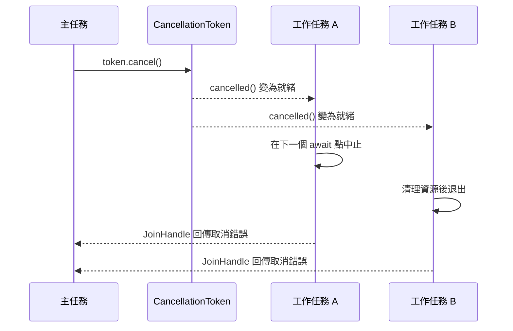
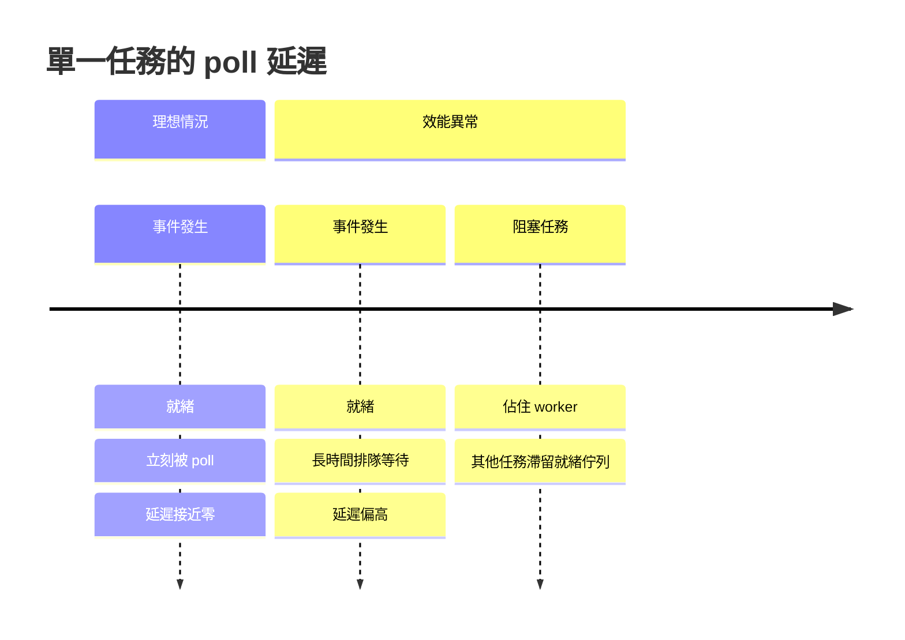

# 13.3 編寫高效的非同步 Rust 程式

## 非同步程式的效能來自哪裡

非同步並非為了讓單一操作變快。事實上，一個 async 函式的執行成本通常比對應的同步函式更高，因為它多了一層狀態機、一次 `poll` 呼叫，以及執行器的排程開銷。非同步真正的價值在於改變資源的使用方式：讓數千個等待中的連線可以共用少數幾條執行緒。

這個區別決定了效能優化的方向。優化非同步程式不是讓每次 poll 更快，而是讓排程器有足夠多的「可執行工作」可用，同時避免任何一條執行緒被無謂地阻塞。當某個任務在 `await` 點停滯時，它佔用的資源應該接近於零，而不是一整條執行緒。

這個原則貫穿本章的所有內容。每一條規則背後都在回答同一個問題：這個等待是否佔用了寶貴的執行緒時間。

## 原則一：絕不在 async 函式中阻塞

這是所有非同步 Rust 規則中最重要、也最容易被違反的一條。阻塞行為不只是讓效能變差，而是會讓整個 runtime 停滯。

```rust
use std::fs;
use std::thread;

async fn bad_handler(path: &str) -> String {
    // 阻塞讀取：整條 worker 執行緒卡在這裡
    fs::read_to_string(path).unwrap()
}

async fn also_bad() {
    // 阻塞睡眠：同樣佔住執行緒
    thread::sleep(std::time::Duration::from_secs(1));
}

async fn good_handler(path: &str) -> std::io::Result<String> {
    // 非同步版本：等待期間釋放執行緒
    tokio::fs::read_to_string(path).await
}
```

在多執行緒 runtime 中，阻塞一條 worker 還算可以忍受，runtime 會用其他 worker 顶上。但在當前執行緒 runtime 中，一次阻塞就是全面停擺。特別危險的情況是連鎖效應：任務 A 阻塞，同時它持有的鎖被任務 B 等待，而任務 B 所在的那條執行緒又被另一個任務 C 阻塞等待，形成迴圈等待，整個系統就此僵死。

修正的方式主要有三種。第一種是改用非同步版本，例如 `tokio::fs`、`tokio::net`、`tokio::time::sleep`。第二種是把工作交給 `spawn_blocking`。第三種是如果這是 CPU 密集運算，就交給專用的執行緒池，例如 Rayon。

```rust
use std::time::Duration;
use tokio::task::spawn_blocking;

async fn cpu_bound(n: u64) -> u64 {
    spawn_blocking(move || (0..n).map(|x| x * x).sum::<u64>())
        .await
        .unwrap()
}
```

## 原則二：不要持有鎖跨越 await

這是第二個最常見的效能與正確性陷阱。假設用 `std::sync::Mutex` 的守衛跨越了 `await` 點，那段時間裡鎖就會一直被佔住，其他所有想取得該鎖的任務都會被阻擋。

```rust
use std::sync::Mutex;

// 有問題：守衛跨越 await，鎖被長時間持有
async fn bad_pattern(items: &Vec<u32>) -> u32 {
    let guard = items.lock().unwrap();
    tokio::time::sleep(std::time::Duration::from_millis(100)).await;
    guard.iter().sum()
}
```

使用非同步鎖可以讓等待者改為等待而非阻塞，但同樣應該避免跨越 `await`。

```rust
use std::sync::Arc;
use tokio::sync::Mutex;

async fn good_pattern(state: Arc<Mutex<Vec<u32>>>) -> u32 {
    // 先取得鎖，複製出需要的資料，立刻釋放鎖
    let snapshot = {
        let guard = state.lock().await;
        guard.clone()
    };

    // 此時已經沒有任何鎖被持有
    tokio::time::sleep(std::time::Duration::from_millis(100)).await;
    snapshot.iter().sum()
}
```

這個「臨界區只涵蓋純記憶體操作」的寫法是核心原則。鎖的持有時間應該以奈秒計，而不是以網路往返的毫秒計。若真的需要在鎖內進行複雜計算，可以考慮用 `parking_lot` 之類的鎖，或是把資料結構改成不需要鎖的形式，例如 `DashMap` 或 immutable 資料結構。

## 原則三：控制任務的細粒度

`tokio::spawn` 每次呼叫都有成本。要建立任務、分配排程結構、放入佇列，每個任務都會帶來額外的記憶體開銷與排程延遲。

如果只是要等待少數幾個 future，`join!` 巨集會把它們放進同一個狀態機，完全不需要 spawn。

```rust
use tokio::time::{sleep, Duration};

async fn fetch_a() -> u32 {
    sleep(Duration::from_millis(30)).await;
    1
}

async fn fetch_b() -> u32 {
    sleep(Duration::from_millis(50)).await;
    2
}

#[tokio::main]
async fn main() {
    // 不需要 spawn，join! 在同一個任務內並行
    let (a, b) = tokio::join!(fetch_a(), fetch_b());
    println!("{} {}", a, b);
}
```

反過來，若要處理大量項目，與其每項 spawn 一個任務，不如把批次交給少數幾個 worker。

```rust
use std::sync::Arc;
use tokio::sync::Mutex;

async fn process_batch(items: Vec<u32>) -> Vec<u32> {
    let results = Arc::new(Mutex::new(Vec::new()));
    let mut handles = Vec::new();

    // 限制同時存在的任務數量
    for chunk in items.chunks(64) {
        let results = Arc::clone(&results);
        let chunk = chunk.to_vec();
        handles.push(tokio::spawn(async move {
            let mut local = Vec::with_capacity(chunk.len());
            for value in chunk {
                local.push(value * 2);
            }
            let mut guard = results.lock().await;
            guard.extend(local);
        }));
    }

    for handle in handles {
        handle.await.unwrap();
    }

    let guard = results.lock().await;
    guard.clone()
}
```

這段程式碼同時示範了兩個重點：把結果收集到區域變數後再統一寫入共享結構，避免每個任務都去競爭同一把鎖；以及限制同時存在的任務數量，避免記憶體暴增。

## 原則四：讓背壓自然發生

背壓是整個非同步系統能否穩定運作的關鍵。當生產端比消費端快時，資料必須有地方去：要么阻塞生產端，要么被丟棄，要么堆在記憶體裡直到 OOM。有界通道讓系統選擇第一種。

```rust
use tokio::sync::mpsc;

#[tokio::main]
async fn main() {
    // 容量 10 的有界通道
    let (tx, mut rx) = mpsc::channel::<u32>(10);

    let producer = tokio::spawn(async move {
        for i in 0..1000u32 {
            // 通道滿了就等待，這就是背壓
            if tx.send(i).await.is_err() {
                break;
            }
        }
    });

    let mut count = 0;
    while let Some(value) = rx.recv().await {
        count += 1;
        if value % 100 == 0 {
            println!("已處理 {}", value);
        }
    }

    producer.await.unwrap();
    println!("總共處理 {} 筆", count);
}
```

通道容量的選擇是一個權衡。容量太小會讓生產端與消費端頻繁同步，降低吞吐量。容量太大則讓突發流量堆積在記憶體裡，延遲上升，也失去了背壓的意義。實務上可以從 16 或 64 開始，依實測調整。

若資料可以安全丟棄，可以使用 `try_send` 搭配 `TrySendError::Full` 來明確丟棄或降級。

```rust
use tokio::sync::mpsc;

#[tokio::main]
async fn main() {
    let (tx, mut rx) = mpsc::channel::<u32>(4);

    match tx.try_send(42) {
        Ok(()) => println!("送達"),
        Err(mpsc::error::TrySendError::Full(_)) => println!("通道已滿，丟棄"),
        Err(mpsc::error::TrySendError::Closed(_)) => println!("通道已關閉"),
    }

    let _ = rx.recv().await;
}
```

## 原則五：逾時與取消

逾時是防止系統 hang 住的最後一道防線。任何對外部資源的等待都應該有上限，因為外部資源的失效模式是「沒有回應」而非「回報錯誤」。

```rust
use std::time::Duration;
use tokio::time::timeout;

async fn call_remote() -> Result<String, String> {
    tokio::time::sleep(Duration::from_secs(5)).await;
    Ok("遠端回應".to_string())
}

async fn with_timeout() -> Result<String, String> {
    match timeout(Duration::from_secs(1), call_remote()).await {
        Ok(result) => result,
        Err(_) => Err("逾時".to_string()),
    }
}
```

取消則是另一個維度的機制。逾時會自動取消被包裝的 future，但當多個任務需要被一起中止時，就需要明確的取消訊號。`CancellationToken` 正是為此設計的。

```rust
use std::time::Duration;
use tokio_util::sync::CancellationToken;

async fn worker(token: CancellationToken, id: u32) {
    loop {
        tokio::select! {
            _ = token.cancelled() => {
                println!("工作 {} 收到取消訊號", id);
                break;
            }
            _ = tokio::time::sleep(Duration::from_millis(100)) => {
                println!("工作 {} 執行一輪", id);
            }
        }
    }
}

#[tokio::main]
async fn main() {
    let token = CancellationToken::new();
    let child = token.child_token();

    let handle = tokio::spawn(worker(child, 1));
    tokio::time::sleep(Duration::from_millis(250)).await;
    token.cancel();
    handle.await.unwrap();
    println!("全部結束");
}
```

`CancellationToken` 的父子關係讓取消能沿著樹狀結構向下傳播。取消是協作式的：任務必須自己檢查 token，被中止的任務不會立刻消失，而是在下一個 `await` 點或下一輪迴圈被丟棄。



## 原則六：錯誤處理在 async 中照常運作

`?` 運算子在 async 函式中的行為與同步函式完全相同。唯一的差別是 `?` 作用在 `Poll::Ready(Err(...))` 上時，會讓函式立即回傳 `Poll::Ready(Err(...))` 而不必等待後續的 await。

```rust
use std::io;
use tokio::fs;

async fn read_config() -> io::Result<String> {
    let content = fs::read_to_string("config.toml").await?;
    Ok(content)
}

async fn process() -> io::Result<()> {
    // ? 照常運作
    let content = read_config().await?;
    println!("{} 個位元組", content.len());
    Ok(())
}
```

任務失敗時的命運取決於失敗發生的位置與任務是否被等待。一個 `tokio::spawn` 出來的任務若 panic，預設不會影響其他任務，但 panic 訊息只會印到 stderr，錯誤會被完全吞掉。因此生產環境應該顯式處理 `JoinHandle` 的結果。

```rust
use std::time::Duration;
use tokio::time::sleep;

#[tokio::main]
async fn main() {
    let handle = tokio::spawn(async {
        sleep(Duration::from_millis(10)).await;
        panic!("某個不變條件被破壞");
    });

    match handle.await {
        Ok(value) => println!("成功：{}", value),
        Err(e) if e.is_panic() => println!("任務 panic 了"),
        Err(e) => println!("任務被取消：{}", e),
    }
}
```

`join!` 與 `try_join!` 的差異在前一節已經說明，但值得再強調一次：`join!` 會等待全部無論成敗，`try_join!` 在第一個錯誤出現時就短路。實務上，當所有子任務的成功與失敗都被視為同等重要時，用 `join!` 並逐一檢查結果；有主從關係時用 `try_join!`。

## 原則七：記憶體與生命週期陷阱

`tokio::spawn` 要求 `'static`，這是最常見的生命週期錯誤來源。

```rust
use std::sync::Arc;

#[tokio::main]
async fn main() {
    let name = String::from("短命字串");

    // 編譯錯誤：name 的借用無法滿足 'static
    // tokio::spawn(async move { println!("{}", name); });

    // 正確做法一：讓 future 取得所有權
    let owned = name.clone();
    tokio::spawn(async move { println!("{}", owned); });

    // 正確做法二：用 Arc 共享
    let shared = Arc::new(name);
    let cloned = Arc::clone(&shared);
    tokio::spawn(async move { println!("{}", cloned); });
}
```

第二種情況更麻煩：若 future 需要引用某個區域變數的內容，而這個內容必須活到任務結束，就必須把資料移到 `Arc` 裡，或者把任務限制在同步的 `scope` 範圍內。`tokio::task::scope` 提供了類似的借用結構。

```rust
use tokio::time::{sleep, Duration};

#[tokio::main]
async fn main() {
    let data = vec![1u32, 2, 3];
    let mut handles = Vec::new();

    tokio::task::scope(|scope| {
        for value in &data {
            handles.push(scope.spawn(async move {
                sleep(Duration::from_millis(10)).await;
                println!("處理 {}", value);
            }));
        }
    })
    .await;

    println!("全部完成，資料仍在範圍內");
}
```

`scope` 讓任務可以借用呼叫端的資料而不需要 `'static`，在批次處理資料時特別實用。代價是所有 scope 內的任務必須在 scope 結束前完成。

## 可觀測性：tracing 與結構化日誌

非同步程式的診斷困難度遠高於同步程式，因為呼叫堆疊不再對應執行流程。`tracing` crate 是這類問題的標準解法，它提供結構化的事件記錄與跨任務的關聯。

```rust
use tracing::{info, instrument};
use std::time::Duration;
use tokio::time::sleep;

#[instrument(skip(detail))]
async fn handle_request(request_id: u64, detail: &str) {
    info!(request_id, detail, "開始處理請求");
    sleep(Duration::from_millis(10)).await;
    info!(request_id, "請求處理完成");
}

#[tokio::main]
async fn main() {
    tracing_subscriber::fmt()
        .with_max_level(tracing::Level::INFO)
        .init();

    handle_request(1, "查詢使用者").await;
    handle_request(2, "更新統計").await;
}
```

`#[instrument]` 巨集會自動記錄函式的進入與離開，並把參數作為欄位附加到事件上。`skip` 用於排除不想記錄的欄位，避免敏感資料外洩或產生過多雜訊。

要追蹤跨任務的關聯，最有效的方式是建立一個追蹤 ID，並用 `Span` 把它傳遞下去。

```rust
use tracing::info;
use uuid::Uuid;

#[derive(Clone)]
struct RequestContext {
    trace_id: Uuid,
}

async fn handle(ctx: RequestContext, payload: u32) {
    info!(trace_id = %ctx.trace_id, payload, "處理訊息");
}

#[tokio::main]
async fn main() {
    let ctx = RequestContext { trace_id: Uuid::new_v4() };
    let child = ctx.clone();
    tokio::spawn(async move {
        handle(child, 1).await;
    });
    handle(ctx, 2).await;
}
```

追蹤 ID 應該在請求進入系統時產生，隨著工作流程一路傳遞，並在最終的日誌中出現。這樣即使一千個任務交錯執行，也能把同一個流程的日誌串起來。

除了日誌，Tokio 提供了 `tokio-console` 這個診斷工具。它是一個基於網頁的儀表板，可以即時顯示每個任務的狀態與 poll 延遲。

```toml
[dependencies]
tokio = { version = "1", features = ["full", "tracing"] }
tokio-console = "0.4"
```

```rust
#[tokio::main]
async fn main() {
    let _console = tokio_console::Layer::new();
    // 啟動後在瀏覽器開啟 http://tokio.rs/console 觀察
}
```

## 效能檢查

tokio-console 顯示的 poll 延遲是最直接的效能指標。poll 延遲是指任務從「被喚醒」到「實際被 poll」之間等待的時間。延遲高代表排程器有問題，例如某個任務長時間佔用執行緒，或者就緒佇列過長。



常見的效能問題有三類。第一類是阻塞某條 worker，例如在 async 函式中呼叫 `std::fs::read_to_string`，這條 worker 在阻塞期間完全無法處理其他任務。第二類是過度 spawn，數萬個任務同時存在會讓排程結構佔用大量記憶體，且每次 poll 都有快取失效的代價。第三類是輪詢，例如每秒 `sleep` 一次來檢查狀態，這會讓大量任務定期醒來。

tokio 自己也提供了量測 poll 延遲的方法。

```rust
use std::time::Duration;
use tokio::time::{sleep, Instant};

#[tokio::main]
async fn main() {
    let start = Instant::now();
    sleep(Duration::from_millis(50)).await;
    let elapsed = start.elapsed();
    println!("實際經過 {:?}", elapsed);
}
```

`tokio::time::Instant` 與 `std::time::Instant` 的重要差異在於，前者遵守 runtime 的時間暫停機制。在測試中使用 `start_paused = true` 時，時間會自動前進，因此不會真的等待 50 毫秒。

量測的正確做法是在正式環境的代表性負載下進行，而不是在開發機上以單一請求測量。poll 延遲的分佈比平均值更能說明問題：若延遲集中在少數任務，通常是那些任務的程式碼有問題；若整體延遲都偏高，則是併發量超過了執行緒的處理能力。

## 完整的生產級範例

下面這個範例把本章的諸多原則整合在一起：併發抓取多個 URL、限制併發數量以形成背壓、對每個請求設定逾時、區分錯誤類型，最後彙整結果。

```rust
use std::sync::Arc;
use std::time::Duration;
use tokio::sync::{mpsc, Semaphore};
use tokio::time::timeout;

#[derive(Debug)]
enum FetchError {
    Timeout,
    Transport(String),
}

#[derive(Debug)]
struct FetchResult {
    url: String,
    body: Option<String>,
    error: Option<FetchError>,
}

async fn fetch_one(url: String) -> FetchResult {
    let simulated = async {
        if url.ends_with(".missing") {
            Err(FetchError::Transport("找不到資源".to_string()))
        } else {
            Ok(format!("內容 of {}", url))
        }
    };

    match timeout(Duration::from_millis(500), simulated).await {
        Ok(Ok(body)) => FetchResult { url, body: Some(body), error: None },
        Ok(Err(e)) => FetchResult { url, body: None, error: Some(e) },
        Err(_) => FetchResult { url, body: None, error: Some(FetchError::Timeout) },
    }
}

async fn fetch_all(urls: Vec<String>) -> Vec<FetchResult> {
    let permits = Semaphore::new(8);
    let (tx, mut rx) = mpsc::channel(16);

    for url in urls {
        let permits = Arc::clone(&permits);
        let tx = tx.clone();
        tokio::spawn(async move {
            let _permit = permits.acquire().await;
            let result = fetch_one(url).await;
            let _ = tx.send(result).await;
        });
    }
    drop(tx);

    let mut results = Vec::new();
    while let Some(result) = rx.recv().await {
        results.push(result);
    }
    results
}

fn main() {
    let urls = vec![
        "https://example.com/a".to_string(),
        "https://example.com/missing".to_string(),
        "https://example.com/b".to_string(),
    ];

    let runtime = tokio::runtime::Runtime::new().unwrap();
    let results = runtime.block_on(fetch_all(urls));

    let ok = results.iter().filter(|r| r.error.is_none()).count();
    println!("成功 {} 筆，失敗 {} 筆", ok, results.len() - ok);
}
```

這個範例展示了幾個關鍵設計。`Semaphore` 搭配有界通道形成雙重背壓：同時最多八個請求在進行，結果通道容量十六避免記憶體無限成長。逾時統一設定在五百分之一秒，確保單一慢速端點不會拖垮整批工作。錯誤被收集到結果中而非立即中斷整批任務，這是最後能彙整成功與失敗計數的原因。

在真實系統中，`fetch_one` 會換成 `reqwest` 的 GET 呼叫，錯誤型別也會換成 `reqwest::Error`。整體結構不變。

## 測試策略

非同步程式的測試有兩個特別的技巧。`#[tokio::test]` 讓測試可以用非同步語法撰寫，而 `start_paused = true` 讓時間測試瞬間完成。

```rust
use std::time::Duration;
use tokio::time::{sleep, timeout};

#[tokio::test]
async fn test_fast_path() {
    let start = tokio::time::Instant::now();
    sleep(Duration::from_millis(100)).await;
    assert!(start.elapsed() >= Duration::from_millis(100));
}

#[tokio::test(start_paused = true)]
async fn test_timeout_does_not_wait_real_time() {
    let result = timeout(Duration::from_secs(3600), sleep(Duration::from_secs(7200))).await;
    assert!(result.is_err());
}
```

第二個測試驗證的是「一個小時的逾時在一個小時後才會回傳錯誤」這個邏輯，但在暫停時鐘下瞬間完成。若沒有這個技巧，這樣的測試會讓測試套件實際執行一小時。

## 常見陷阱速查

非同步程式中的問題往往具有共同的樣貌。把阻塞與非同步的對應關係整理成表格，可以在撰寫程式碼時快速自我檢查。

| 標準函式庫的阻塞版本 | Tokio 的非同步版本 | 混用的後果 |
| --- | --- | --- |
| `std::fs::read_to_string` | `tokio::fs::read_to_string` | 執行緒被釘住，其他任務停滯 |
| `std::net::TcpStream` | `tokio::net::TcpStream` | 連線處理佔滿執行緒 |
| `std::thread::sleep` | `tokio::time::sleep` | 排程器沒有可執行的工作 |
| `std::sync::Mutex::lock` | `tokio::sync::Mutex::lock` | 等待鎖時停住整條執行緒 |
| `std::sync::mpsc::channel` | `tokio::sync::mpsc::channel` | 發送端無法形成背壓 |
| `std::process::Command` | `tokio::process::Command` | 子行程管理佔住 worker |

這張表最右欄的「混用的後果」值得特別留意。混用不會產生編譯錯誤，也不會 panic，程式只是默默地變慢。這是為什麼非同步效能問題往往需要靠量測而不是靠閱讀程式碼來發現。

除了 API 的對應關係，還有幾個結構性的陷阱值得記住。第一個是在 `select!` 中使用 `&mut` 參照的分支，若忘記用 `&mut` 而直接移出值，會在第二次迴圈時產生編譯錯誤。第二個是忘記 `drop` 一個 `MutexGuard`，讓鎖在無意間跨越了 `await`。第三個是把 `tokio::sync::Mutex` 放在 `std::sync::Mutex` 裡，形成鎖的巢狀與潛在的死鎖。

```rust
use std::sync::Mutex as StdMutex;
use tokio::sync::Mutex as AsyncMutex;

// 不建議：在 async 鎖裡持有 std 鎖
struct Bad {
    inner: AsyncMutex<StdMutex<Vec<u32>>>,
}

// 建議：只保留一層非同步鎖
struct Good {
    inner: AsyncMutex<Vec<u32>>,
}
```

## 漸進式遷移策略

把既有的同步程式碼改造成非同步版本，不必一次全部重寫。可行的策略是從最外層開始，也就是 I/O 邊界。

第一步是找出程式的入口點，把 `main` 改成 `async fn main` 並加上 `#[tokio::main]`。此時所有既有的同步函式仍然可以正常呼叫，只是不再能在 async 函式內直接使用阻塞 API。

第二步是把最頻繁的阻塞點替換掉，通常是檔案讀寫與網路呼叫。這一步能帶來最大的效益，因為這些操作佔用的等待時間最長。

第三步才是把複雜的業務邏輯改寫成非同步形式，例如把回呼式的 API 改為 future、把共享狀態改為非同步鎖。這個階段的成本最高，收益也最取決於程式的實際負載。

```rust
use std::time::Duration;
use tokio::time::sleep;

fn sync_stage() -> Vec<u32> {
    vec![1, 2, 3]
}

async fn async_stage(input: Vec<u32>) -> Vec<u32> {
    let mut output = Vec::with_capacity(input.len());
    for value in input {
        sleep(Duration::from_millis(1)).await;
        output.push(value * 2);
    }
    output
}

#[tokio::main]
async fn main() {
    let base = sync_stage();
    let result = async_stage(base).await;
    println!("{:?}", result);
}
```

同步函式與非同步函式可以在同一個程式碼庫中自由共存。兩者的邊界就是 I/O 操作的所在位置，選擇讓邊界靠近 I/O 或遠離 I/O，取決於該區塊是否需要等待外部資源。

## 編譯期檢查輔助

有幾個工具可以在編譯期就找出常見的非同步錯誤。`tokio` 提供的 `clippy` lint 與 `#[allow(clippy::...)]` 註記可以協助標記可疑的寫法。Rust 編譯器本身則會對某些明顯錯誤給出提示，例如在 async 函式中持有 `MutexGuard` 跨越 await 時產生的 `future_not_send` 類診斷。

設定檔中的 lint 層級可以讓團隊在整體層級強制某些規則。

```toml
[dependencies]
tokio = { version = "1", features = ["full"] }
tokio-util = "0.7"
```

```toml
[lints.clippy]
await_holding_lock = "warn"
await_holding_refcell_ref = "warn"
```

`await_holding_lock` 這個 lint 正是用來抓出「持有同步鎖跨越 await」的問題。它能把本章第二條原則從口頭提醒變成自動檢查，在大型程式碼庫中特別有價值。

## 與本系列其他主題的呼應

非同步執行模型不是孤立的高階技巧，而是所有長時間運作服務的基礎設施。在《Agent 技術》一書中，代理系統需要同時呼叫多個語言模型服務、等待工具執行結果、處理串流回應，這些全都是典型的 I/O 密集等待。若用同步模型實作，代理的並行能力會被線性限制住。

在《電腦下棋》一書中，思考樹的展開同樣是高度併發的工作。棋力搜尋會同時探索數百個候選分支，每個分支需要等待神經網路推論的結果。非同步讓推論的批次可以交給 GPU 佇列，同時 CPU 繼續處理其他分支，兩種資源的等待得以重疊。

更廣泛地說，凡是「服務很多客戶端、每個客戶端大部分時間都在等待外部回應」的系統，都應該採用非同步模型。反過來，凡是「少數客戶端、大量本地運算」的系統，同步模型加上執行緒池往往更簡單且更高效。辨識系統的等待模式，是選擇架構的第一步。

## 小結

高效的非同步程式遵循幾個一致的原則。永遠不要在 async 函式中阻塞；讓鎖的持有時間短到只涵蓋記憶體操作；用 `join!` 避免不必要的任務，用批次處理避免過度 spawn；用有界通道建立背壓；用逾時與取消防止系統卡死；用 `Arc` 與 `scope` 處理生命週期。

這些規則的共同目標只有一個：讓排程器永遠有足夠的可執行工作，同時讓每個任務的等待成本接近於零。當這個目標達成時，數千個併發連線可以跑在少數幾條執行緒上，而程式碼的複雜度不會隨之爆炸。

非同步 Rust 的設計起點是語言層面的中立，執行器由生態系提供；Tokio 以其完整性成為事實上的標準，而本節列出的原則，正是把這套標準用對的實務指南。
