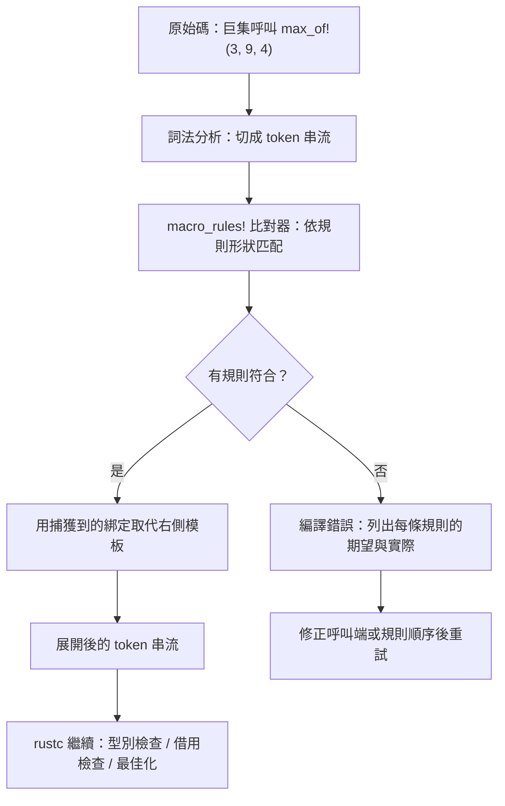

# 14.1 宣告式巨集（macro_rules!）

## 巨集：在編譯期改寫程式碼的工具

Rust 的巨集（macro）是一種**在編譯期把一段程式碼樣板改寫成另一段程式碼**的機制。你寫下的巨集呼叫並不是執行期的函式呼叫，而是在編譯期間被「展開」（expand）成真正的 Rust 程式碼，之後才交給 rustc 進行型別檢查、借用檢查與最佳化。這意味著巨集能夠生成一般函式根本無法表達的語法：新的關鍵字位置、新的型別、新的 `impl` 區塊，甚至新的語句結構本身。

宣告式巨集（declarative macro）使用 `macro_rules!` 定義。它的優點是不需要撰寫任何 Rust 程式碼就能完成，編譯器直接把規則翻譯成比對器；缺點是它的比對語言是一種受限的「模式語言」，能表達的東西遠比完整的 Rust 語法少。本節先把 `macro_rules!` 的語法與心智模型談清楚，下一節再介紹能力更強但成本更高的程序巨集（procedural macro）。

一個常見的誤解是「巨集 = 函式的另一種寫法」。這在功能上偶爾成立，在原理上卻完全不同。假設某段樣板程式碼在整個專案中出現 $ n $ 次，每次呼叫都要重複撰寫相同的型別綁定、轉換與錯誤處理。若用泛型函式表達，型別參數與生命週期會讓簽章迅速膨脹，呼叫端也要額外撰寫 turbofish 或型別註記；若用巨集表達，樣板只在巨集內寫一次，呼叫端保持乾淨，且因為展開後不再有「函式呼叫」這層間接，某些優化甚至可以做得更好。

我們可以先用一個簡化的成本模型來理解巨集的價值。假設樣板程式碼在專案中出現 $ n $ 次，而每次呼叫所省下的手動程式碼量約為 $ s $ 行，巨集定義本身需要 $ d $ 行程式碼作為一次性成本。若編譯期展開的單位成本記為 $ c_m $ ，則採用巨集的總成本大致是 $ d + n \cdot c_m $ ，而重複手寫的成本則接近 $ n \cdot s $ 。只要 $ d + n \cdot c_m < n \cdot s $ ，巨集就是划算的；這也解釋了為什麼「語法重複度高、型別多樣性低」的場景特別適合巨集。

## 語法骨架：規則、配對與展開

`macro_rules!` 的定義由一或多條規則組成，每條規則的形狀都是「輸入模式」對應「輸出展開」：

```rust
macro_rules! 名字 {
    (模式) => { 展開內容 };
    (模式) => { 展開內容 };
}
```

規則的匹配是依照書寫順序進行的，編譯器會先嘗試第一條規則，若整個呼叫的 token 序列不符合，就往下一條規則比對。因此**更具體的模式要寫在前面**，這與 `match` 的分支順序規則一致。定義巨集之後，呼叫時使用驚嘆號：`名字!(...)`。

規則右側的展開內容用大括號包住，最後通常補上分號。展開內容中可以引用捕獲到的綁定，只要在前面加上 `$` 符號即可。下面這個例子是最簡單的完整形態：

```rust
macro_rules! double {
    ($x:expr) => {
        $x * 2
    };
}

fn main() {
    let n = 21;
    println!("{}", double!(n));
    println!("{}", double!(1 + 2));
}
```

呼叫 `double!(n)` 時，編譯器把 `n` 這個 token 序列捕獲進綁定 `$x`，然後把整條規則的右側展開成 `n * 2`。`double!(1 + 2)` 則展開成 `1 + 2 * 2`，注意運算優先序並不變，因為捕獲到的片段在展開時仍然是原封不動的一段 token。

巨集呼叫有兩種結束語法風格：`名字!(...)` 與 `名字![...]` 都可以，但**混用會造成解析疑義**。另外在項目位置（item position）如模組頂端或結構體定義內使用巨集時，結尾的分號是必須的；在運算式位置則可省略。撰寫巨集時最好固定一種風格，通常是括號加分號的慣例。

## 片段說明符：宣告式巨集的心臟

`macro_rules!` 的模式語言並非 Rust 的型別系統，而是「token 樹的形狀描述」。最常見的一種是**片段說明符**（fragment specifier），寫法是 `$` 加上一個綁定名稱、冒號與說明符種類：

```rust
macro_rules! 片段示範 {
    ($e:expr) => { $e };
    ($t:ty) => { $t };
    ($i:ident) => { $i };
}
```

每一種說明符定義了比對器應該接受哪一類 token。下表整理了最常用的幾種：

| 說明符 | 匹配對象 | 匹配邊界與注意事項 |
| --- | --- | --- |
| `expr` | 完整的表達式 | 涵蓋字面量、路徑、呼叫、索引、二元運算等；到逗號或右括號為止 |
| `ty` | 一個型別 | 包含 `Vec<T>`、`&str`、函式指標等完整型別寫法 |
| `pat` | 一個模式 | 對應 `match` 分支或 `let` 綁定的形狀，如 `Some(x)` |
| `ident` | 單一識別字 | 變數名稱、函式名稱，不含路徑分隔符 |
| `path` | 一條路徑 | 可含 `::` 路徑運算子，如 `std::collections::HashMap` |
| `block` | 一整個區塊 | 對應 `{ ... }`，包含巢狀花括號的平衡性 |
| `stmt` | 一條敘述 | 包含尾端分號的敘述，邊界較模糊，常與 `expr` 混用 |
| `item` | 一個項目 | 函式、結構體、impl 區塊等定義 |
| `literal` | 一個字面量 | 整數、浮點、布林、字元、字串，不含負號 |
| `vis` | 可見性修飾 | `pub`、`pub(crate)` 或無 |
| `lifetime` | 一個生命週期 | 如 `'a` |
| `tt` | 單一 token 樹 | 最寬鬆的比對方式，任何 token 都可以 |

`expr` 與 `ty` 的邊界差異值得特別體會。表達式是「產生一個值」的語法，而型別是「描述一個值」的語法，兩者在某些位置長得很像，但語意完全不同。實務上，用型別說明符搭配泛型容器會得到 `Vec<T>` 這樣的展開，而改用表達式說明符時，編譯器會嘗試把 `T` 當成值使用而編譯失敗：

```rust
macro_rules! 型別展開 {
    ($t:ty) => { Vec<$t> };
    ($e:expr) => { Vec<$e> };
}
```

另一個容易踩到的坑是 `literal` 不包含負號。整數說明符無法匹配 `-1`，因為負號是另一個 token；正確做法是改用表達式說明符來涵蓋帶正負號的數值：

```rust
macro_rules! 取值 {
    ($n:literal) => { $n };
    ($n:expr) => { $n };
}
```

類似的還有 `ident` 不會匹配 `foo::bar`，那種情況要用 `path`。

`stmt` 是邊界最模糊的一個說明符，它的比對範圍會延伸到分號為止，因此在有巢狀結構時行為不易預期。現代的 Rust 程式碼常見的建議是：能用 `expr` 就用 `expr`，只有在你真的需要區分「有分號的敘述」與「無分號的尾端表達式」時才引入 `stmt`。

## 重複匹配的運作

重複匹配是巨集表達「可變長度列表」的核心機制。星號量詞表示括號內的內容可以出現零次或多次，問號量詞表示零次或一次。這個結構在模式與展開內容中**必須成對使用**：模式裡有幾個重複子句，展開內容裡就得有幾個對應的重複子句，編譯器會依序把捕獲到的項目填回去。

```rust
macro_rules! 列出 {
    ($($name:ident),*) => {
        {
            let mut count = 0;
            $(
                count += 1;
                let _ = stringify!($name);
            )*
            count
        }
    };
}

fn main() {
    assert_eq!(列出!(alpha, beta, gamma), 3);
    assert_eq!(列出!(), 0);
}
```

重複次數由**匹配到的項目數**決定，而不是由程式碼裡寫死的數字決定。展開時捕獲到的 `alpha`、`beta`、`gamma` 會依次代入 `stringify!($name)` 的位置，產生三段對應的敘述。

若要允許尾端逗號，標準做法是在重複子句之後加上一個選用的逗號：

```rust
macro_rules! 計算 {
    ($($e:expr),+ $(,)?) => {
        0 $(+ $e)+
    };
}

fn main() {
    assert_eq!(計算!(1, 2, 3), 6);
    assert_eq!(計算!(1, 2, 3,), 6);
}
```

注意 `$(,)?` 這個可選逗號**只允許出現零次或一次**，因此 `計算!(1, 2, 3,)` 合法，但 `計算!(1,,2)` 會在編譯期報「expected expression」。這個語法在 Rust 2018 版之後是慣用寫法，值得記住。

另一個常見陷阱是**引用綁定時重複子句數量不一致**。如果模式裡用了兩個重複子句，展開內容裡卻只寫一個，編譯器會直接報錯：

```rust
macro_rules! 錯了 {
    ($($a:expr, $b:expr),*) => {
        $a
    };
}
```

這類錯誤訊息常常指出「第幾個重複子句」的問題，但不容易讓初學者一眼看出根因。**展開內容裡的每個 `$` 綁定都必須能在模式中找到對應的捕獲**，這是撰寫巨集時最需要小心的地方之一。

## 綁定與重複的搭配合法性

綁定與重複子句的搭配，其實比想像中更嚴格。除了「成對出現」這個大原則，還有幾條細則。第一，**在重複子句內只能引用該子句捕獲到的綁定**，跨子句引用會失敗。第二，綁定出現在重複子句之外時，只能引用在模式中位於它之前的綁定。第三，同一個綁定名不能在模式中重複使用。

```rust
macro_rules! 最大值 {
    ($x:expr) => { $x };
    ($x:expr, $($rest:expr),+ $(,)?) => {
        {
            let mut best = $x;
            $(
                if $rest > best {
                    best = $rest;
                }
            )+
            best
        }
    };
}

fn main() {
    assert_eq!(最大值!(7), 7);
    assert_eq!(最大值!(3, 9, 4), 9);
    assert_eq!(最大值!(3, 9, 4,), 9);
}
```

這裡第一條規則處理單一元素，第二條處理兩個以上的元素。它們的順序不能對調，否則 `最大值!(7)` 會先撞上第二條規則而報「expected expression, found `)`」。這種「基礎情況先行、遞迴情況在後」的排列，是撰寫巨集時反覆出現的結構。

## 衛生性：Rust 相對 C 巨集的重要改進

C 的 `macro` 是純粹的文字替換，因此有著名的「巨集捕捉」問題：巨集內部使用的變數名稱若與呼叫端的同名，會在展開後互相干擾。Rust 的 `macro_rules!` 引入了**衛生性**（hygiene），讓巨集內部引入的綁定帶有獨立的語法脈絡。

```rust
macro_rules! 內部計數 {
    () => {{
        let counter = 10;
        counter + 1
    }};
}

fn main() {
    let counter = 100;
    println!("{}", 內部計數!());
    println!("{}", counter);
}
```

輸出的兩行分別是 `11` 與 `100`。巨集裡的 `counter` 與呼叫端的 `counter` 雖然同名，但在編譯器眼中是兩個不同的變數，因此在展開後不會互相覆蓋。這個特性讓巨集可以用「看起來很普通」的區域變數名，而不必費心取一個全世界獨一無二的名字。

需要補充的是，Rust 的衛生性並非全面無敵。區域變數與綁定確實受到保護，但**項目名稱**（例如巨集內定義的函式名或結構體名）並不享有同樣的保護。因此若巨集在被展開後會引入一個新的結構體，它應該是 `pub` 的並被放在可預期的模組路徑下，或者由呼叫端用 `use` 明確引入。

## 內建巨集與常見用法

標準函式庫提供了大量內建巨集，它們本身就是 `macro_rules!` 的實踐，因此也是最好的學習樣本。最常見的是格式化系列：`format!` 回傳 `String`，`print!` 與 `println!` 直接輸出，`write!` 與 `writeln!` 把結果寫進任何實作 `fmt::Write` 的物件（例如 `String` 或檔案）。`assert!`、`assert_eq!` 與 `assert_ne!` 負責斷言，`panic!` 產生恐慌，`unreachable!` 標記不可能到達的路徑。

```rust
use std::fmt::Write;

fn main() {
    let mut buf = String::new();
    write!(&mut buf, "{}-{}", 1, 2).unwrap();
    assert_eq!(buf, "1-2");
    assert_eq!(format!("{:>4}", 7), "   7");
}
```

容器相關的巨集有 `vec!`（建立 `Vec`）、`format_args!`（產生格式化引數）與 `concat!`（在編譯期拼接字串常值）。`vec!` 尤其值得注意：它可以接受單一元素、重複元素，或以逗號分隔的完整列表。

```rust
fn main() {
    let a = vec![1, 2, 3];
    let b = vec![0; 1024];
    assert_eq!(a.len(), 3);
    assert_eq!(b.len(), 1024);
}
```

另外還有控制流程相關的 `matches!`、`dbg!` 與 `todo!`。`matches!` 特別實用，它把「比對某個值是否符合某個模式」的常見寫法壓縮成單一表達式，同時保持型別檢查。

```rust
fn main() {
    let x = Some(3);
    assert!(matches!(x, Some(n) if n > 2));
}
```

## 除 debug 難度：先寫函式，再考慮巨集

宣告式巨集最大的實務痛點是**錯誤訊息難以閱讀**。當比對失敗時，rustc 通常會指出「rule #2 expected ... but found ...」，並把巨集呼叫處的 token 序列整段傾倒出來。這些訊息對已經熟悉巨集語法的人有參考價值，對剛接觸巨集的人則幾乎無法行動。

另一個問題是**除錯體驗落差**。一般函式的錯誤會指向具體的原始碼行號，而巨集展開後的錯誤則指向展開結果，其中的片段來源在編譯器輸出中往往難以辨認。`cargo expand`（由 `cargo-expand` 提供）可以把巨集展開結果印出來，是定位問題的第一線工具。

面對這些摩擦，一條被社群反覆驗證的經驗法則是：**能用泛型函式或特徵表達的，就先不要用巨集**。函式的錯誤訊息好讀、型別安全、可被工具完整理解；巨集則是把樣板消除了，卻把理解成本轉嫁給了維護者。只有在語法層面的重複（例如大量重複的結構體定義或 impl 區塊）無法用函式消除時，巨集才真正划算。

## 一個完整範例：把它組裝起來

綜合以上，我們可以寫出一個實用且完整的巨集。下面的 `計數句子!` 接受若干字串，產生一個 `Vec<String>`，並在編譯期就固定好長度。

```rust
macro_rules! 句子清單 {
    () => {
        Vec::new()
    };
    ($($text:expr),+ $(,)?) => {
        {
            let mut v: Vec<String> = Vec::new();
            $(
                v.push($text.to_string());
            )+
            v
        }
    };
}

fn main() {
    let items = 句子清單!("第一句", "第二句", "第三句");
    assert_eq!(items.len(), 3);
    assert_eq!(items[1], "第二句");
    let empty = 句子清單!();
    assert!(empty.is_empty());
}
```

這個範例涵蓋了幾個關鍵技術：以空的 `()` 分支處理零元素情境；用問號量詞容忍尾端逗號；用加號量詞確保至少一個元素；並在展開內容中正確重複引用綁定。

## 引出程序巨集

回顧 `macro_rules!` 的能力邊界，我們會發現它受限於「以 token 形狀比對」這個前提。它看不清語法樹的結構，無法可靠地知道一段程式碼是「一個函式呼叫」還是「兩段相鄰的敘述」，也無法針對一個結構體的所有欄位自動產生對應的程式碼。

當需求變成「讀懂輸入的完整語法樹，並依據其結構生成新的型別或新的 `impl` 區塊」時，就需要一整套真正的解析器。這正是下一節要介紹的程序巨集（procedural macro）所擅長的領域。


