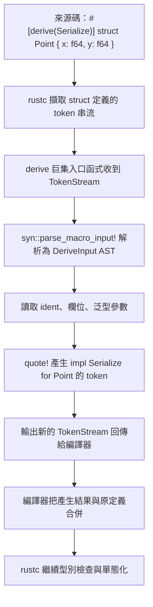
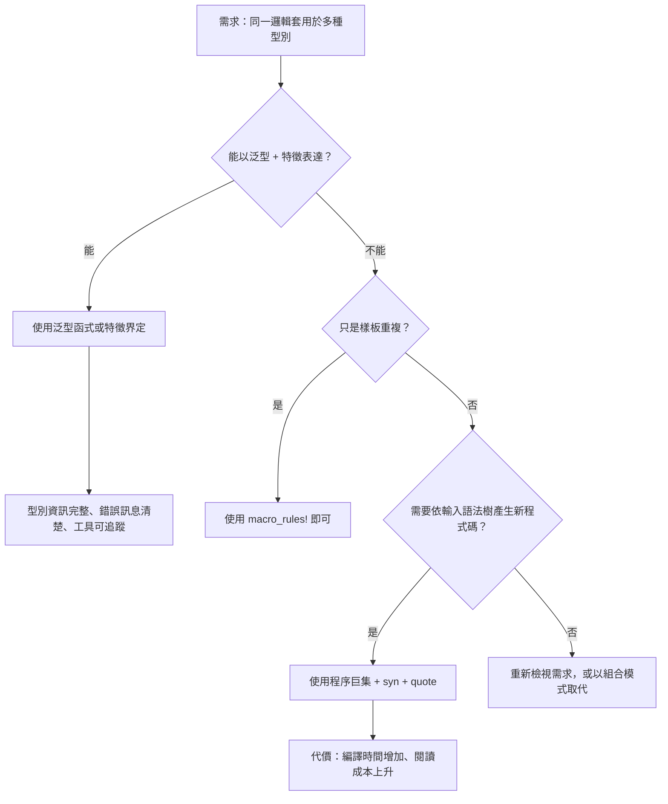

# 14.2 程序巨集（Procedural Macros）簡介

## 從「比對形狀」到「讀懂語法樹」

第 14.1 節的 `macro_rules!` 是一門**以 token 形狀比對為基礎**的巨集語言。它能看到「這裡有一個識別字、這裡有一個逗號、這裡有一組括號」，卻看不到這些 token 組成的整體結構。程序巨集（procedural macro）跨過了這道門檻：它拿到的是編譯器交給它的一整段**語法樹**，可以用真正的解析器把輸入拆解成結構化的資料模型，檢查它、改造它，最後再產生新的 token 串流交回編譯器。

程序巨集的這項能力，意味著它可以做 `macro_rules!` 做不到的事。它能辨識一個函式的簽章並改寫它的主體，能列舉一個結構體的所有欄位並為每個欄位產生對應的方法，也能在讀到不符合預期的輸入時回傳帶有清晰訊息的編譯期錯誤。`serde` 的序列化、`clap` 的命令列參數解析、`thiserror` 的錯誤型別產生，全都是建立在这項能力之上。

換句話說，宣告式巨集是一個**受限的樣板引擎**，程序巨集則是一個**在編譯期執行的程式**。前者勝在簡單、零相依、編譯速度快；後者勝在表達力，代價是需要一個獨立的 crate、需要解析器相依，而且每次使用都要付出編譯期的處理成本。

## 三種形式

Rust 的程序巨集有三種形式，它們在 `proc-macro` crate 中的入口函式型別各不相同。

**函式式巨集**（function-like macro）以括號或方括號呼叫，形式像 `my_macro!(...)`。**屬性巨集**（attribute macro）寫在項目之前，例如 `#[tokio::test]`，負責改寫被標記的項目本身。**derive 巨集**（derive macro）寫在結構體或列舉之前，例如 `#[derive(Serialize)]`，負責從輸入型別產生額外的程式碼。

```rust
// 函式式
#[proc_macro]
pub fn my_function_like(input: TokenStream) -> TokenStream { /* ... */ }

// 屬性
#[proc_macro_attribute]
pub fn my_attribute(attr: TokenStream, item: TokenStream) -> TokenStream { /* ... */ }

// derive
#[proc_macro_derive(MyTrait)]
pub fn my_derive(input: TokenStream) -> TokenStream { /* ... */ }
```

derive 巨集還可以透過 `attributes(my_trait)` 參數宣告「輔助屬性」，讓使用者在 `#[derive(...)]` 之外額外加上自訂的標記。`serde` 的 `#[serde(rename = "...")]` 就是這樣運作的：derive 巨集在解析輸入結構體時，會同時辨識被允許的輔助屬性。

所有程序巨集都必須放在一個 `proc-macro = true` 的 crate 裡，這個 crate 不能含有任何其他形式的項目：

```toml
[package]
name = "my_macros"
version = "0.1.0"
edition = "2021"

[lib]
proc-macro = true

[dependencies]
proc-macro2 = "1"
quote = "1"
syn = { version = "2", features = ["full"] }
```

## 三個核心相依的分工

撰寫程序巨集幾乎一定會用到 `proc-macro2`、`quote` 與 `syn` 這三個 crate，它們的分工非常清楚。

`proc-macro2` 提供**與 proc-macro API 平行但更好用的 token 資料型別**。標準函式庫的 `proc_macro::TokenStream` 只能存在於 proc-macro crate 內，且提供的檢視能力有限；`proc-macro2` 的 `TokenStream`、`TokenTree`、`Group`、`Ident` 等型別既可以在任何 crate 中使用，也能與 `quote!` 的輸出直接互轉。

`quote!` 巨集是**程式碼生成器**。它讓你用類似 Rust 語法的寫法組出 token 串流，並且會自動處理識別字的插值：`#var` 會把一個變數的 token 插進去，`#name` 引用一個識別字常數。

`syn` 是**語法樹解析器**。它把 token 串流解析成帶型別的 AST，像是 `DeriveInput`、`ItemFn`、`ItemStruct`，並且用 `Parse` trait 讓你定義自己的資料型別。`quote!` 與 `syn` 搭配時，標準流程是：用 `syn` 解析、用 `quote!` 生成、最後 `parse_macro_input!` 輔助巨集負責把解析失敗轉成漂亮的編譯期錯誤。

```rust
use proc_macro::TokenStream;
use quote::quote;
use syn::{parse_macro_input, DeriveInput};

#[proc_macro_derive(Greet)]
pub fn greet(input: TokenStream) -> TokenStream {
    let ast = parse_macro_input!(input as DeriveInput);
    let name = &ast.ident;
    let expanded = quote! {
        impl #name {
            pub fn greet(&self) -> String {
                format!("Hello, {}!", stringify!(#name))
            }
        }
    };
    expanded.into()
}
```

`parse_macro_input!` 在解析失敗時會立刻 `return`，並以 `compile_error!` 的形式回報錯誤位置與原因，而不是讓程序在後續處理中 panic。這個小巨集是 `syn` 官方推薦的標準入口寫法。

## derive 巨集的工作原理

derive 巨集的運作流程可以分成四個階段。首先，使用者寫下 `#[derive(Greet)]` 加上結構體定義。其次，編譯器把結構體定義的 token 序列交給 derive 巨集的入口函式。第三，巨集解析輸入並產生新的 token 串流。第四，編譯器把新產生的 token 附加到原始定義之後，一併交給後續的編譯階段。

關鍵在於第四步：**derive 巨集不能移除或修改原本的結構體定義**，它只能「額外產生」程式碼。這是刻意設計的限制，因為它保證了 derive 巨集不會破壞型別的基本性質。想改寫原有項目的語法，那屬於**屬性巨集**的權限。



## 實作 Serialize 的原理

`serde_derive` 就是這套機制的代表性實作。當你寫下 `#[derive(Serialize)]` 時，`serde_derive` 會讀入結構體的定義，找出每個欄位的名稱與型別，然後為它產生一個 `impl Serialize` 區塊。

對一個簡單的結構體而言，產生的程式碼本質上是「依序呼叫序列化函式」：

```rust
// 概念上等價於 serde_derive 為 Point 產生的程式碼
impl Serialize for Point {
    fn serialize<S: Serializer>(&self, serializer: S) -> Result<S::Ok, S::Error> {
        let mut state = serializer.serialize_struct("Point", 2)?;
        state.serialize_field("x", &self.x)?;
        state.serialize_field("y", &self.y)?;
        state.end()
    }
}
```

`serde_derive` 還必須處理一連串複雜的情境：泛型參數要一併帶入 `impl` 區塊、列舉的每個變體要各自對應到序列化格式、容器型別有專屬的快捷路徑、欄位可以加上 `#[serde(skip)]` 或 `#[serde(rename = "...")]` 等輔助屬性。這些都不是 `macro_rules!` 能夠駕馭的，因為它們需要真正理解型別的結構。

這也是為什麼 `serde` 的 `Serialize` 與 `Deserialize` 是兩個獨立的特徵：前者只需要「讀取結構體的形狀」，後者則需要「建立結構體的實例」，兩者的程式碼生成邏輯完全不同。

## 屬性巨集：改寫既有項目

屬性巨集接收兩個 token 串流：`attr` 是屬性括號內的內容，`item` 是被標記的項目。它可以把 `item` 解析後改寫，再回傳新的項目。

```rust
use proc_macro::TokenStream;
use quote::quote;
use syn::{parse_macro_input, ItemFn};

#[proc_macro_attribute]
pub fn timed(_attr: TokenStream, item: TokenStream) -> TokenStream {
    let func = parse_macro_input!(item as ItemFn);
    let name = &func.sig.ident;
    let vis = &func.vis;
    let sig = &func.sig;
    let block = &func.block;
    let expanded = quote! {
        #vis #sig {
            let __start = std::time::Instant::now();
            let __result = #block;
            eprintln!("{} took {:?}", stringify!(#name), __start.elapsed());
            __result
        }
    };
    expanded.into()
}
```

`#[test]` 是標準函式庫內建的屬性巨集，它把函式改寫成符合測試執行框架協定的形式。`#[tokio::test]` 則是外部 crate 提供的屬性巨集，它在 `#[test]` 的基礎上額外生成一個 runtime 的建立與清理邏輯，因為非同步函式必須在執行器中才能運作。

除了 `#[test]`，常見的屬性巨集還有 `#[tokio::main]`（為 `main` 函式生成執行器）、`#[cfg_attr]`（依條件套用屬性）與 `#[derive]` 搭配的輔助屬性。屬性巨集的實作難度通常高於 derive，因為它必須把改寫後的項目在語意上做到完全等價。

## 開發體驗：錯誤訊息與取捨

程序巨集最大的工程負擔是**錯誤訊息的品質**。如果你的巨集在遇到非預期輸入時只是 `panic!`，使用者會看到一段指向 proc-macro crate 內部的堆疊，完全不知道自己的程式碼哪裡寫錯了。正確的做法是產生 `compile_error!` 並附上可操作的說明。

```rust
use proc_macro::TokenStream;
use quote::quote;
use syn::{parse_macro_input, DeriveInput, Fields};

#[proc_macro_derive(Describe)]
pub fn describe(input: TokenStream) -> TokenStream {
    let ast = parse_macro_input!(input as DeriveInput);
    let name = &ast.ident;
    let description = match &ast.data {
        syn::Data::Struct(s) => match &s.fields {
            Fields::Named(_) => "a named-field struct",
            Fields::Unnamed(_) => "a tuple struct",
            Fields::Unit => "a unit struct",
        },
        syn::Data::Enum(_) => "an enum",
        syn::Data::Union(_) => {
            return syn::Error::new_spanned(&ast.ident, "Describe cannot be derived for unions")
                .to_compile_error()
                .into();
        }
    };
    let expanded = quote! {
        impl #name {
            pub fn describe(&self) -> &'static str {
                #description
            }
        }
    };
    expanded.into()
}
```

`syn::Error` 的 `new_spanned` 能把錯誤訊息精準地指到使用者的原始碼位置，`to_compile_error()` 再把它轉成編譯器能理解的 `compile_error!` 呼叫。這是撰寫友善巨集的標準做法。

另一個取捨是**要不要完整依賴 `syn`**。`syn` 功能完整，但它本身是一個龐大的相依鏈，會拉長編譯時間。對只需要處理簡單結構的情況，有些專案會直接操作 `proc_macro2` 的 token 樹而不用 `syn`。判斷的標準是：若你的巨集需要辨識型別、泛型、lifetimes 這些概念，就該用 `syn`；若只是做 token 的插入與刪除，直接操作 token 即可。

## 生態系中的應用

程序巨集已經是 Rust 生態系不可分割的一部分。`serde` 用 derive 巨集處理序列化，`clap` 用 derive 巨集把結構體欄位變成命令列參數，`tokio` 用屬性巨集把非同步函式接到執行器上，`thiserror` 用 derive 巨集從 error 註解產生 `std::error::Error` 實作，`derive_more` 則用一組 derive 巨集產生常見的 `Deref`、`From`、`Display` 等實作。

這些工具的共同點是：它們消除的是**純粹的樣板程式碼**，而不是隱藏複雜的控制流程。`#[derive(Clone)]` 產生的是「對每個欄位呼叫 `clone`」這樣完全顯式的程式碼，閱讀者只要展開就能立刻理解行為。這是好的巨集設計的判準。

## 巨集的取捨

程序巨集不是免費的。它會增加編譯時間（`syn` 的解析與 `quote!` 的生成都要花時間），讓閱讀者必須理解展開後的程式碼才能判斷行為，且在錯誤訊息上引入了第三方相依的變數。同一件事有多種寫法時，過度使用巨集會讓 codebase 的風格不一致。

因此 Rust 社群的共識是**先用函式與特徵，不行才用巨集**。泛型與特徵能解決大部分「同一段邏輯、不同型別」的需求，而且保留了完整的型別資訊與工具支援。只有當需求是「根據輸入的語法結構產生新的語法結構」時，巨集才是唯一合理的选择。



下一節將把視角拉回整個工程流程：如何用測試、靜態檢查與文件三道關卡，確保這些被巨集產生的程式碼不僅能編譯，還真的正確、可讀、並能被他人使用。
