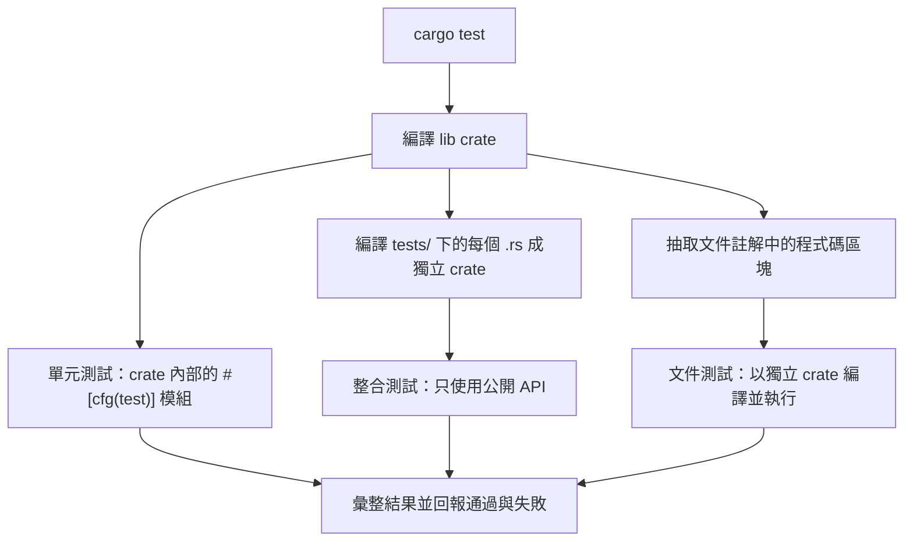

# 15.1 單元測試與整合測試

## 內建的測試框架

Rust 的標準函式庫內建了完整的測試框架，不需要像多數語言那樣額外引入測試框架。測試函式以 `#[test]` 屬性標記，測試模組以 `#[cfg(test)]` 條件編譯，`cargo test` 會編譯測試並依序執行。

```rust
pub fn add(a: i32, b: i32) -> i32 {
    a + b
}

#[cfg(test)]
mod tests {
    use super::*;

    #[test]
    fn adds_two_numbers() {
        assert_eq!(add(2, 3), 5);
    }
}
```

`#[cfg(test)]` 意味著這個模組只在測試編譯時存在，正式建置時它會被完全移除，因此測試用的輔助函式不會進入發行產物。這個設計讓測試碼碼能自由使用 `super::*` 引入被測模組的私有項目，卻不必擔心污染公開 API。

執行測試的基本指令是 `cargo test`。它會先建置測試目標，再執行測試二進位檔，並對每一個測試函式各跑一次：

```bash
cargo test
cargo test adds_two_numbers          # 只跑名稱包含此字串的測試
cargo test -- --nocapture            # 顯示被捕捉的輸出
cargo test -- --test-threads=1        # 單執行緒執行
```

`--nocapture` 很重要，因為測試框架預設會捕捉 `println!` 的輸出，只有在測試失敗時才一併印出。當你想觀察程式在測試中的中間狀態時，加上 `--nocapture` 就能直接看到。

## 測試的層級組織

Rust 把測試分成三個層級，各自有不同的可見範圍與擺放位置。

| 層級 | 位置 | 可存取範圍 | 執行時機 |
| --- | --- | --- | --- |
| 單元測試 | 被測模組內的 `#[cfg(test)] mod tests` | 可存取私有項目 | 與 crate 一起編譯 |
| 整合測試 | `tests/` 目錄下的每個 `.rs` 檔 | 只能使用公開 API | 每個檔案是獨立 crate |
| 文件測試 | 文件註解中的程式碼區塊 | 只能使用公開 API | `cargo test` 時一併執行 |

單元測試貼近被測程式碼，能測到私有函式，失敗時的錯誤訊息也能直接指出是內部哪一段邏輯出了問題。整合測試則站在使用者的角度，只透過公開 API 操作 crate，等於同時驗證了「介面設計是否足夠好用」這個問題。文件測試是 Rust 特有的第三層：文件註解裡的程式碼區塊會被抽出、編譯並執行，確保範例不會隨著時間演进而過期。



## 斷言與訊息

最基本的是 `assert!`，它接受一個布林值：

```rust
#[test]
fn positive_sum() {
    let total = 3 + 5;
    assert!(total > 0, "sum should be positive, got {total}");
}
```

`assert_eq!` 比較兩個值是否相等，`assert_ne!` 比較是否不等。兩者都會在失敗時印出兩邊的值，這對除錯非常關鍵。

```rust
#[test]
fn compares_values() {
    let expected = vec![1, 2, 3];
    let actual = vec![1, 2, 4];
    assert_eq!(expected, actual);
    assert_ne!(expected, actual);
}
```

所有斷言都支援自訂訊息，格式字串可以像 `println!` 一樣引用變數：

```rust
#[test]
fn length_check() {
    let words = vec!["a", "b"];
    assert_eq!(words.len(), 2, "expected 2 words but found {}", words.len());
}
```

`assert_eq!` 有一個容易被忽略的細節：它要求兩邊的型別相同，且要求 `PartialEq` 與 `Debug`。`Debug` 是必要的，因為失敗時要印出值。若某個型別不適合實作 `Debug`，可以改用 `assert!(a == b)`，但這會失去差異輸出。

## 測試 panic 路徑

對於預期會 panic 的路徑，`#[should_panic]` 可以把 panic 變成成功條件。

```rust
pub fn divide(a: i32, b: i32) -> i32 {
    if b == 0 {
        panic!("division by zero");
    }
    a / b
}

#[cfg(test)]
mod tests {
    use super::*;

    #[test]
    #[should_panic(expected = "division by zero")]
    fn panics_on_zero_divisor() {
        divide(1, 0);
    }
}
```

`expected` 參數會比對 panic 訊息的**子字串**，這讓測試在訊息文字微調後仍然穩定。若沒有指定 `expected`，任何 panic 都算通過，測試的嚴謹度較低，建議盡量加上。

## 忽略、平行執行與篩選

某些測試很慢或依賴外部資源，可以用 `#[ignore]` 標記，讓它不被預設執行，但仍可用 `cargo test -- --ignored` 單獨執行。

```rust
#[test]
#[ignore = "requires network access"]
fn fetches_remote_data() {
    // 實際的網路操作
}
```

測試預設以多執行緒平行執行，每個測試在自己的執行緒中跑，彼此的執行緒本地的資料互不干擾，但**全域狀態是共用的**。若測試會修改全域變數或環境變數，就可能出現難以重現的間歇性失敗，此時可以用 `--test-threads=1` 強制循序執行來協助診斷。

執行緒本地的隔離可以用 `std::thread::LocalKey` 或第三方 crate，但更常見的做法是把共享狀態封裝進 `Mutex`，測試時用獨立的 guard 避免交錯。

## 文件測試

文件測試是 Rust 獨有的機制，也是最容易被低估的一項優勢。文件註解中的程式碼區塊會被抽取成獨立的 crate 編譯並執行，所以文件中的範例永遠不會與實際行為脫節。

```rust
/// 將數字加倍。
///
/// # 範例
///
/// ```
/// use stacker::double;
///
/// assert_eq!(double(21), 42);
/// ```
pub fn double(x: i32) -> i32 {
    x * 2
}
```

區塊開頭的空白會被剝除，程式碼會被自動包成 `fn main() { ... }`。若程式碼本身需要 `main`，可以加上 `no_run` 標記表示「只編譯不執行」，或用 `ignore` 完全跳過。文件測試只能使用 crate 的公開 API，因此它同時也是對公開介面的體驗測試。

## 對照其他語言

Rust 的測試框架是內建的，這與 Python 的 `unittest`/`pytest`、JavaScript 的 Jest、Java 的 JUnit 形成對比。內建的好處是零相依、任何專案開箱即用，且工具鏈整合完整：`cargo test` 會同時建置、除錯並執行測試，不需要額外的設定檔。

代價是生態系的功能較分散。測試替身（mock）、參數化測試、快照測試這類需求，通常要靠 `mockall`、`rstest`、`insta` 等第三方 crate 補足。Rust 的哲學是提供核心機制並保持小，而把擴充交給社群。

## 屬性測試與模糊測試

傳統的單元測試驗證的是你想到的案例，屬性測試（property-based testing）驗證的是「對所有輸入都成立的性質」。`proptest` 是這個領域最主流的 crate，它會自動產生大量隨機輸入，並在找到反例時自動縮減到最小失敗案例。

```rust
use proptest::prelude::*;

proptest! {
    #[test]
    fn double_is_always_even(x in 0i32..1000) {
        prop_assert_eq!(double(x) * 2, (x * 2) * 2);
    }
}
```

模糊測試（fuzzing）則更為激進。`cargo-fuzz` 會用 libFuzzer 持續對函式餵入隨機位元組，試圖找到會造成當機或記憶體錯誤的輸入，特別適合解析器與 unsafe 程式碼。

```rust
#![no_main]
use libfuzzer_sys::fuzz_target;

fuzz_target!(|data: &[u8]| {
    let _ = stacker::parse(data);
});
```

## 基準測試與覆蓋率

效能宣稱需要證據。`criterion` 是基準測試的標準選擇，它會做統計分析並自動產出比較報告：

```rust
use criterion::{criterion_group, criterion_main, Criterion};

fn bench_add(c: &mut Criterion) {
    c.bench_function("add", |b| b.iter(|| 2 + 3));
}

criterion_group!(benches, bench_add);
criterion_main!(benches);
```

覆蓋率則可以用 `cargo llvm-cov` 或 `cargo tarpaulin` 取得，它們會插樁編譯並統計每條程式路徑是否被執行過。覆蓋率數字本身不是目標，它的主要用途是找出**完全沒有被測到的程式碼區塊**，那些區塊往往正是缺陷的藏身處。

```bash
cargo install cargo-llvm-cov
cargo llvm-cov --all-features --html
```

## 測試設計原則

好的測試應該驗證**行為**而非實作。測試私有函式的回傳值是合理的，但測試「函式呼叫了某個輔助函式」這種內部細節，只會讓重構變得困難。每一個斷言都應該有清楚的失敗訊息，讓讀取 CI 日誌的人不必回頭看程式碼就知道出了什麼事。

另一個原則是**每個測試只測一件事**。若一個測試裡有多個斷言，前一個失敗時你不知道後面的狀態，因此應該拆開。這樣失敗報告會精準指向問題，而通過的測試也能明確宣告「這個行為是對的」。

## 一個完整範例

底下是一個同時包含單元測試與整合測試的小型 crate。

```rust
// src/lib.rs
pub struct Stack {
    items: Vec<i32>,
}

impl Stack {
    pub fn new() -> Self {
        Stack { items: Vec::new() }
    }

    pub fn push(&mut self, value: i32) {
        self.items.push(value);
    }

    pub fn pop(&mut self) -> Option<i32> {
        self.items.pop()
    }

    pub fn len(&self) -> usize {
        self.items.len()
    }

    pub fn is_empty(&self) -> bool {
        self.items.is_empty()
    }
}

#[cfg(test)]
mod tests {
    use super::*;

    #[test]
    fn new_stack_is_empty() {
        let s = Stack::new();
        assert!(s.is_empty());
        assert_eq!(s.len(), 0);
    }

    #[test]
    fn push_and_pop() {
        let mut s = Stack::new();
        s.push(1);
        s.push(2);
        assert_eq!(s.len(), 2);
        assert_eq!(s.pop(), Some(2));
        assert_eq!(s.pop(), Some(1));
        assert_eq!(s.pop(), None);
    }
}
```

```rust
// tests/integration.rs
use stacker::Stack;

#[test]
fn stack_behaves_like_a_lifo() {
    let mut s = Stack::new();
    for i in 1..=5 {
        s.push(i);
    }
    let popped: Vec<i32> = std::iter::from_fn(|| s.pop()).collect();
    assert_eq!(popped, vec![5, 4, 3, 2, 1]);
    assert!(s.is_empty());
}
```

整合測試放在 `tests/` 目錄下會成為獨立 crate，只能透過 `use stacker::Stack` 使用公開 API。若某個功能只能在整合測試中透過 `#[cfg(test)]` 才測得到，通常表示公開介面的設計還有可以改進的地方。
