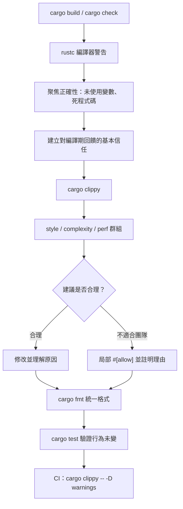

# 15.2 使用 Clippy 檢查程式碼品質

## 一個專屬的 lint 工具

Rust 編譯器 rustc 本身就會發出警告，例如未使用的變數、未到不了的程式碼分支。這些警告聚焦在**正確性**：它們要嘛指出程式碼可能有錯，要嘛指出程式碼毫無疑問是錯的。但 rustc 的警告集合非常保守，它不會主動告訴你「這段寫法有更簡潔的等價形式」。

Clippy 是 Rust 官方的 lint 工具，專門補上這一塊。它以 rustc 的外掛形式運作，同時執行 rustc 本身的檢查與額外的 lint 集合，涵蓋**可讀性、慣例寫法與潛在的效能問題**。它的定位是與編譯器警告互補，而非取代。

```bash
cargo clippy
cargo clippy --fix          # 自動修正部分 lint
cargo clippy -- -D warnings # 把警告視為錯誤
```

`cargo clippy` 隨 rustup 工具鏈一同安裝，不需要額外下載。安裝後在專案根目錄執行即可，它會先檢查整個 crate，再逐條列出 lint。輸出格式與編譯器警告一致，包含檔案、行號、程式碼片段與說明。

```text
warning: this expression creates a reference which is immediately dereferenced by the compiler
  --> src/lib.rs:10:20
   |
10 |     match &items[0] {
   |            ^^^^^^^^^ help: change this to: `match items[0]`
   |
   = note: `#[warn(clippy::needless_borrow)]` on by default
```

lint 名稱 `clippy::needless_borrow` 讓你可以精準地允許或禁止單一條規則，這在下面討論如何控制檢查強度時非常重要。

## lint 群組

Clippy 的規則依性質分成數個群組，可以整組開啟或關閉。

| 群組 | 定位 | 預設 | 典型例子 |
| --- | --- | --- | --- |
| `correctness` | 幾乎確定是錯誤的程式碼 | 開啟 | 忘記 `?`、錯誤的型別轉換 |
| `style` | 違反慣例寫法 | 開啟 | `needless_return`、`redundant_clone` |
| `complexity` | 可以更簡單 | 開啟 | `single_match`、`let_and_return` |
| `perf` | 可能的效能問題 | 開啟 | `redundant_clone`、`useless_vec` |
| `pedantic` | 允許更多寫法，風格建議 | 關閉 | `must_use_candidate`、`missing_errors_doc` |
| `nursery` | 尚在培育中的規則，會變動 | 關閉 | `missing_const_for_fn` |
| `cargo` | 套件清單相關 | 開啟 | `multiple_crate_versions` |

預設的行為是：`correctness`、`style`、`complexity`、`perf`、`cargo` 開啟，`pedantic` 與 `nursery` 關啟。

## 常見的 lint 與它們的意義

下表列出初學者最常遇到、也最容易理解的幾條規則。

| lint | 觸發的情況 | 建議的修正 |
| --- | --- | --- |
| `needless_return` | 函式最後一行是 `return expr;` | 直接寫 `expr` |
| `redundant_clone` | 對不會再使用的值呼叫 `clone()` | 移除該次複製 |
| `let_and_return` | 先綁定再立刻 `return` | 直接回傳 |
| `single_match` | 只匹配一個分支的 `match` | 改用 `if let` |
| `manual_map` | 以 `match` 實作 `Option::map` | 改用 `.map()` |
| `useless_vec` | 只用 `vec!` 建立空向量 | 改用 `Vec::new()` |
| `collapsible_if` | `if` 巢狀在 `if` 內部 | 合併條件 |
| `needless_borrow` | 對已經是引用的值再加 `&` | 移除額外的 `&` |
| `question_mark` | 手寫 `match` 做錯誤傳播 | 改用 `?` 運算子 |
| `type_complexity` | 型別嵌套過深 | 引入型別別名 |

這些 lint 的共同點是：**它們指出的是等價寫法，不是錯誤**。程式碼在觸發 lint 時依然是正確的，只是有更清楚的表達方式。

## 完整的前後對照

下面這段程式碼會觸發多條 lint：

```rust
pub fn find_largest(items: &Vec<i32>) -> Option<i32> {
    let mut largest = None;
    for item in items.iter() {
        match largest {
            Some(current) => {
                if *item > current {
                    largest = Some(*item);
                }
            }
            None => {
                largest = Some(*item);
            }
        }
    }
    return largest;
}
```

執行 `cargo clippy` 會得到如下診斷：

```text
warning: this argument creates a reference which is immediately dereferenced by the compiler
  --> src/lib.rs:2:28
   |
2  | pub fn find_largest(items: &Vec<i32>) -> Option<i32> {
   |                            ^^^^^ help: change this to: `&[i32]`
   |
   = note: `#[warn(clippy::ptr_arg)]` on by default

warning: you probably don't need to clone this
  --> src/lib.rs:8:28
   |
8  |             largest = Some(*item);
   |                            ^^^^^ help: use `item` here instead
```

修正後的版本更短，也更符合 Rust 的慣例：

```rust
pub fn find_largest(items: &[i32]) -> Option<i32> {
    let mut largest = None;
    for &item in items {
        if item > largest.unwrap_or(i32::MIN) {
            largest = Some(item);
        }
    }
    largest
}
```

值得注意的是 `&Vec<i32>` 改成 `&[i32]` 這件事。Clippy 的 `ptr_arg` 會提醒你：接受 `&Vec<T>` 限制了呼叫端必須提供一個真正的 `Vec`，而接受 `&[T]` 則同時接受 `Vec`、`陣列` 與切片，介面更有彈性。這類建議往往不只是風格問題，還關乎 API 的可用性。

## 為什麼有些規則預設關閉

`pedantic` 群組裡的建議有時不符合團隊的風格偏好。例如 `must_use_candidate` 會建議所有回傳 `Result` 的公開函式都加上 `#[must_use]`，這在風格上合理，但某些專案會覺得過度干擾。`missing_errors_doc` 要求錯誤回傳型別的文件寫明可能的錯誤，也往往過於嚴格。

`nursery` 群組的規則仍在演進，行為可能隨版本改變，適合在自己的專案裡試用，但不建議在教學或新手專案中全面開啟。

## 允許特定 lint 的時機

當某條規則的建議不適合你的情況，可以用 `#[allow]` 屬性局部關閉：

```rust
#[allow(clippy::too_many_arguments)]
pub fn connect(host: &str, port: u16, user: &str, pass: &str, timeout: u64) -> bool {
    true
}
```

更好的做法是先嘗試重構讓規則自然滿足，例如把參數改為一個結構體。屬性也可以加在 crate 層級：

```rust
#![allow(clippy::module_name_repetitions)]
```

濫用 `#[allow]` 是危險的：它會讓真正的問題被永久隱藏。實務上建議每次允許時，在程式碼中留下一行註解說明原因，並且盡量把允許範圍限制在最小的區塊。另一個選擇是在 `Cargo.toml` 中統一管理：

```toml
[lints.clippy]
pedantic = { level = "warn", priority = -1 }
module_name_repetitions = "allow"
```

Cargo 的 `[lints]` 表格（Rust 1.74 起可用）讓 lint 設定成為專案設定檔的一部分，比散落在各處的屬性更容易檢視與稽核。

## 與 rustfmt 的分工

rustfmt 與 Clippy 經常被混為一談，但兩者處理的是不同層面的問題。rustfmt 管的是**格式**：縮排、逗號位置、換行方式。它不看語意，只依一套明確的規則把程式碼排整齊，任何兩位開發者跑 rustfmt 都會得到相同的結果。Clippy 管的是**語意與慣例**：它讀懂程式碼的行為，判斷某種寫法是否冗餘、是否可能出錯、是否可以用更清楚的形式表達。

兩者是互補而非競爭的。一個合理的分工是：rustfmt 保證**外觀一致**，Clippy 保證**寫法合理**。可以放心地讓 rustfmt 自動改動空白與換行，因為它不改變語意；而 Clippy 的修正建議通常需要人來判斷，因為它可能改變程式的結構。

```bash
cargo fmt
cargo fmt -- --check   # 只檢查不修改，適合放進 CI
```

## 在持續整合中把 Clippy 當成必要檢查

在 CI 中，Clippy 應該與編譯、測試並列為一道關卡。最常見的設定是把警告升級為錯誤：

```yaml
- name: Clippy
  run: cargo clippy --all-targets --all-features -- -D warnings
```

`--all-targets` 會連測試程式碼與範例一起檢查，這很重要，因為測試碼碼同樣需要可讀性。`-D warnings` 則讓任何 lint 都直接讓建置失敗，避免警告在長期累積後被忽略。

如果專案使用了 `pedantic`，常見的實務做法是開啟整組、再個別允用少數不符合團隊習慣的規則，而不是全部預設關閉。

## 與編譯器警告的差異

回到最初的定位：編譯器關注**正確性**，Clippy 關注**可讀性與慣例**。rustc 會告訴你「這個變數永遠不會被讀取」，因為那是明確的問題；它不會告訴你「這個函式可以寫成更簡潔的形式」，因為那涉及風格判斷。

兩者的關係不是競爭，而是層次。rustc 的警告是語言層面的必然推論，Clippy 的建議是社群層面的經驗累積。因此**教學情境中應先讓學生看懂編譯器警告**，再引入 Clippy。學生若連「未使用的變數」代表什麼都還沒掌握，就直接面對上百條 Clippy 規則，只會學會忽略警告訊息。先建立對編譯期回饋的信任，之後的工具才有意義。

同樣地，`cargo clippy` 輸出的訊息量本身就可能淹沒重點。建議教學專案初期只開啟預設群組，並把每次修正都當成一次練習：讀懂訊息、判斷建議是否合理、動手修改、理解差異。



最後的 `cargo test` 那一環不能省略。Clippy 的修正本質上是改寫程式碼，即使是最保守的建議也可能有隱蔽的副作用。讓測試套件在每一次風格修正後依然全數通過，才能確認這次修改只是改變了寫法而沒有改變行為——這也正是下一節「自動生成 API 文件」所要呼應的：文件的正確性同樣需要類似的紀律來維護。
