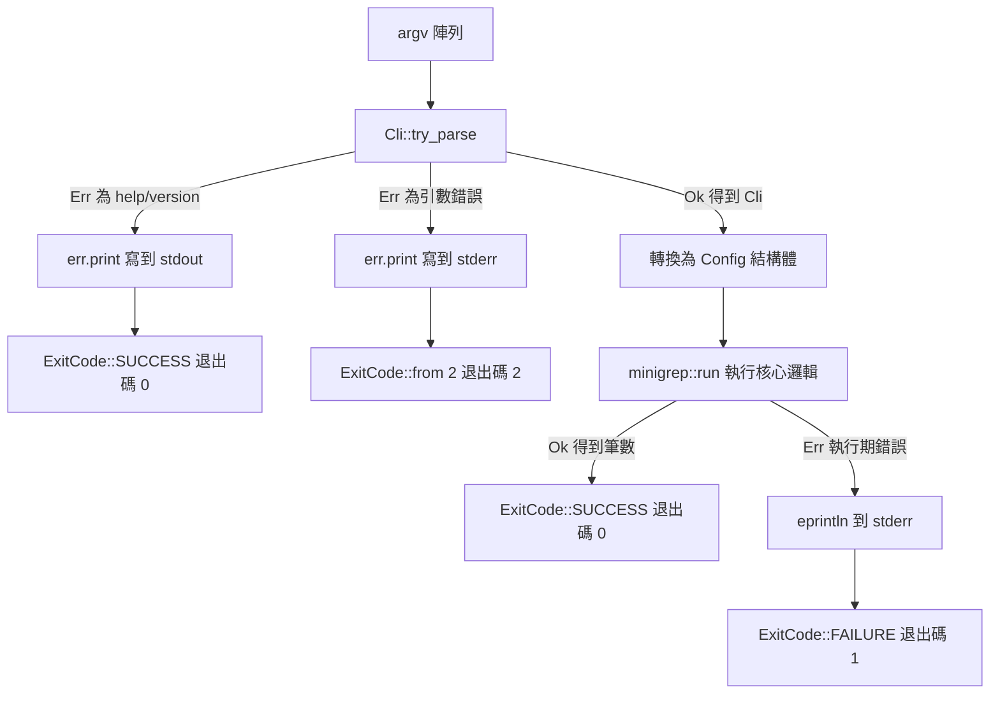

# 16.1 實戰專案一：命令列工具（CLI）開發——讀取命令列參數

## 專案規劃：把邏輯與介面分開

本章起我們要打造一個真正能用的工具：`minigrep`，一個仿造 Unix `grep` 的文字搜尋器。這個小專案刻意選在這兩個位置，是因為它同時需要**對外介面**與**核心邏輯**兩個面向，而兩者的測試方式截然不同。命令列介面要測的是「給定這串引數，會不會得到預期的設定」；搜尋邏輯要測的是「給定這串位元組，會不會印出預期的行」。若把兩者混在同一個 `main` 函式裡，兩種測試都會變得笨拙。

因此第一步是建立一個套件，並且用 Cargo 的慣例把二進位與函式庫分開：

```bash
cargo new minigrep
cd minigrep
```

`cargo new` 會同時產生 `Cargo.toml`、`src/main.rs` 與 `README.md`。接著我們在 `src/` 下新增一個 `lib.rs`。Cargo 會自動偵測到這個檔案並把它當成該套件的函式庫目標，而 `main.rs` 則是預設的執行檔目標。兩者之間的關係是：`main.rs` 透過 `use minigrep::...` 呼叫 `lib.rs` 匯出的函式。

這個安排帶來三個好處。第一，核心邏輯可以寫在沒有任何 `println!` 的函式裡，回傳值交由呼叫端決定如何呈現。第二，`lib.rs` 裡的函式可以被 `src/tests/` 下的整合測試與單元測試直接引用。第三，套件既能發布成函式庫讓別人使用，也能發布成執行檔讓人安裝到系統路徑。Rust 官方手冊裡的這一章正是依此順序安排，本書沿用同樣的骨架。

```rust
// src/lib.rs
pub fn grep<'a>(content: &'a str, pattern: &'a str) -> Vec<&'a str> {
    content
        .lines()
        .filter(|line| line.contains(pattern))
        .collect()
}
```

值得留意的是這個函式的簽章：兩個參數都是 `&'a str`，回傳的 `Vec` 借用同樣的生命週期 `'a`。這代表它不會配置任何新的字串，結果只是指向輸入內容的切片。在搜尋工具裡這類「零配置」的特性會直接轉化為可觀察的效能差異，因為搜尋一遍檔案可能牽涉上百萬行的比對。

## 手動解析：它能做對，但做不好

最原始的做法是直接讀取環境引數。`std::env::args()` 回傳一個 `Args` 迭代器，其項目型別是 `String`，包含執行程式的名稱以及後續所有引數。

```rust
use std::env;

fn main() {
    let args: Vec<String> = env::args().collect();
    let pattern = &args[1];
    let path = &args[2];
    println!("模式：{}，路徑：{}", pattern, path);
}
```

這段程式在參數齊全時可以運作，但 `args[1]` 這個寫法本身就是隱藏的地雷。`Vec` 的索引運算子在越界時會 **panic**，而非回傳 `Err`。若使用者只執行 `minigrep` 而沒有給引數，程式會直接崩潰並印出令人費解的 `index out of bounds: the len is 1 but the index is 1`，對完全沒有使用經驗的使用者而言，這是相當不友善的介面。

即使把索引存取改成 `get` 並妥善處理缺漏，引數的**順序**仍然由使用者記憶。這是手動解析最根本的缺陷：它把「這是模式、那是路徑」這項語意資訊完全丟掉，只留下位置資訊。而一旦工具加入第三個選項，介面就會迅速退化。使用者輸入 `--recursive` 與 `recursive` 的差別、`-r` 與 `--r` 的差別，手動解析完全無法辨識。

第二個缺陷是**缺乏助益資訊**。手動解析的工具通常沒有 `--help`，使用者只能靠猜測參數，或者去讀原始碼才知道該程式能做什麼。第三個缺陷是**沒有型別檢查**：`args[1]` 只是一段 `String`，「這是布林旗標」「這是整數計數」這件事無法在型別層面表達，解析與驗證被迫混在一起，錯誤訊息也就難以精準。最後一點是**可測試性**：手動解析的程式碼寫在 `main` 裡，要測試就只能真的啟動子行程，成本高昂而且難以涵蓋邊界情況。

值得對照的是 Python 生態的 `argparse`。它同樣能產生 `--help`、同樣能驗證型別，但它把介面規格寫成一份執行期的 Python 物件，並以關鍵字引數呼叫，無法在編譯期就確定介面形狀。Rust 的 `clap` derive 風格則不同：規格就是型別定義，錯誤在編譯期就會浮現。

## 交給 `clap`：以型別描述介面

`clap` 是 Rust 生態事實上的標準命令列解析框架，第 4 版重新設計了 API，主打兩種風格：builder 風格與 derive 風格。builder 風格像 `argparse` 一樣呼叫函式逐步組建命令；derive 風格則把介面規格寫成結構體欄位。對已經熟悉 Rust 資料型別的讀者而言，derive 風格可讀性極高，而且編譯器會幫你確認型別無誤。

```toml
# Cargo.toml
[dependencies]
clap = { version = "4.5", features = ["derive"] }
```

`derive` 是一個功能旗標（feature flag），預設並未開啟，必須顯式要求。在 derive 風格下，一個完整的命令列介面可以這樣宣告：

```rust
use clap::{Parser, Subcommand};
use std::path::PathBuf;

#[derive(Parser, Debug)]
#[command(name = "minigrep", version, about = "搜尋檔案內容的簡易工具")]
struct Cli {
    /// 要搜尋的樣式（正規表達式）
    #[arg(value_name = "PATTERN")]
    pattern: String,

    /// 要搜尋的檔案路徑
    #[arg(value_name = "PATH")]
    path: PathBuf,

    /// 遞迴搜尋目錄
    #[arg(short, long)]
    recursive: bool,

    /// 忽略大小寫
    #[arg(short = 'i', long)]
    ignore_case: bool,

    /// 讀取樣式的逾時（毫秒）
    #[arg(long, value_name = "MS", default_value_t = 1000)]
    timeout_ms: u64,

    #[command(subcommand)]
    command: Option<Command>,
}

#[derive(Subcommand, Debug)]
enum Command {
    /// 只統計符合的行數
    Count {
        /// 要統計的檔案
        path: PathBuf,
    },
}
```

這段宣告做了幾件事。`#[derive(Parser)]` 讓 `clap` 從結構體推導出「如何把引數轉成這個型別」；`#[command(name = ..., version, about = ...)]` 設定程式名稱，並**開啟 `--version` 與 `--help`**。`value_name` 決定 `--help` 中顯示的佔位符名稱；`default_value_t` 為整數型別提供了帶型別的預設值寫法。`#[arg(short, long)]` 會同時產生 `-r` 與 `--recursive`，若短旗標字母已被占用，可像上面那樣用 `short = 'i'` 明確指定。

`#[command(subcommand)]` 搭配 `#[derive(Subcommand)]` 則定義了子命令。當欄位型別是 `Option<Command>` 時子命令變成選用的；改成 `Command` 則表示該子命令**必填**，缺漏時 `clap` 會自動回報「缺少子命令」並顯示提示。子命令的好處是每個子命令可以有自己的位置引數與選項，而不致讓所有選項擠在同一個命名空間裡互相干擾。

## 引數的三個類型

命令列引數在語意上可分為三類，`clap` 對每一類都有對應的表達方式。

| 類型 | 說明 | 宣告方式 | 型別 | 範例 |
|---|---|---|---|---|
| 位置引數 | 依位置決定意義 | 欄位直接命名 | `String`、`PathBuf` | `minigrep foo file.txt` |
| 具值選項 | 需要一個值的長選項 | `#[arg(long)]` | `String`、`u64`、`PathBuf` | `--timeout 500` |
| 布林旗標 | 只需真假開關 | `#[arg(short, long)]` | `bool` | `-r`、`--recursive` |

具值選項若希望「有值時用該值、沒給值時用預設」，可以再加上 `default_value`。而 `value_parser` 屬性則指定值的解析器，例如 `value_parser = clap::value_parser!(u32)` 會限制可接受的數值範圍與格式，讓 `--timeout abc` 這種輸入在解析階段就被擋下，並附上正確的錯誤訊息。

還有一個常被忽略的細節：`bool` 型別的旗標在 `clap` 中可以設定「計數語意」。加上 `action = clap::ArgAction::Count` 之後，`-vvv` 會得到數值 `3`，這在日誌等級控制（`-v`、`-vv`、`-vvv` 分別對應 info、debug、trace）這類場景非常實用。

## 位置引數、選項與旗標的取捨

設計命令列介面時，有一個長期的爭議：應該用 Unix 式的「位置引數優先」，還是 git 式的「子命令與旗標優先」。Unix 的 `grep` 走的是前者，`grep pattern file.txt`，介面極簡但擴充空間有限；`git` 走的是後者，`git commit -m "message"`，每個子命令自成一個小的介面。

實務上兩者往往混合使用。位置引數適合**必然存在且只有一個**的輸入，例如檔案路徑；具值選項適合**可選但需要值**的設定，例如逾時毫秒數；布林旗標適合**切換行為**的開關，例如是否遞迴。把三者的語意分清楚，介面才會穩定。`clap` 讓這個分類直接反映在型別上：`String` 與 `PathBuf` 是位置引數，`Option<String>` 幾乎總是選項，而 `bool` 幾乎總是旗標。

`clap` 也支援宣告引數之間的相依與互斥關係。`requires` 表示某個選項出現時另一個必須同時出現，`conflicts_with` 表示兩者不能並存。

```rust
#[derive(Parser, Debug)]
struct Cli {
    /// 輸出格式
    #[arg(long, value_name = "FORMAT", requires = "output")]
    format: Option<String>,

    /// 輸出檔案
    #[arg(long, value_name = "FILE")]
    output: Option<std::path::PathBuf>,
}
```

這類規則讓 `clap` 能在解析階段就擋下無意義的組合，而不需要在 `main` 裡寫一連串 `if` 檢查。搭配 `required_if_eq` 還能表達「當某引數等於某值時，另一個成為必填」這類條件式需求。

## 產生的介面

宣告完成後，`clap` 會自動生成數種互動介面。`--help` 會列出所有引數、說明文字、預設值與可能的子命令：

```rust
use clap::Parser;

fn main() {
    let cli = Cli::parse();
    println!("{:?}", cli);
}
```

```bash
$ cargo run -- --help
Usage: minigrep [OPTIONS] <PATTERN> <PATH>
Commands:
  count  只統計符合的行數
  help   Print this message or the help of the given subcommand(s)

Arguments:
  <PATTERN>  要搜尋的樣式（正規表達式）
  <PATH>     要搜尋的檔案路徑

Options:
  -r, --recursive        遞迴搜尋目錄
  -i, --ignore-case      忽略大小寫
      --timeout-ms <MS>  讀取樣式的逾時（毫秒） [default: 1000]
  -h, --help             Print help
  -V, --version          Print version
```

注意 `help` 子命令是 `clap` 自動產生的，而 `-h` 與 `-V` 也是。這意味著**助益資訊不再是每個專案都要重複撰寫的工作**，而是宣告介面時的免費副產品。文件註解（`///`）會被 `clap` 讀取並轉成說明文字，因此介面說明與 Rustdoc 註解可以共用同一份來源。

## 錯誤處理與退出碼

`Cli::parse()` 在遇到錯誤時會直接印出訊息並結束程式，但這樣無法控制退出碼，也不利於測試。更好的做法是用 `try_parse()`，它回傳 `Result<Cli, clap::Error>`。

`clap::Error` 本身攜帶了資訊：它知道這是「請求說明」（例如 `--help`）還是「真正的錯誤」，也知道自己應該被寫進標準輸出還是標準錯誤。`Error::exit()` 會印出訊息並以適當的程式碼結束；若想自己決定退出碼，可以檢查 `use_stderr()`。

```rust
use clap::Parser;
use std::process::ExitCode;

fn main() -> ExitCode {
    let cli = match Cli::try_parse() {
        Ok(cli) => cli,
        Err(err) => {
            let _ = err.print();
            return if err.use_stderr() {
                ExitCode::from(2)
            } else {
                ExitCode::SUCCESS
            };
        }
    };

    println!("即將以樣式 {} 搜尋 {}", cli.pattern, cli.path.display());
    ExitCode::SUCCESS
}
```

這樣 `--help` 與真正錯誤走的是**同一條流程**：`try_parse` 產生錯誤物件，`print()` 決定去向，`use_stderr()` 決定退出碼。差別只在最後一行。這個設計值得留意，因為它讓「顯示說明」與「回報錯誤」共用同一套呈現邏輯，不會出現兩種格式。

退出碼的設計慣例如下：`0` 代表成功；`1` 代表執行期的一般性錯誤（例如找不到檔案）；`2` 代表**引數使用錯誤**。把引數錯誤獨立成 `2`，讓呼叫腳本可以分辨「我寫錯指令」與「工具本身出問題」。Unix 慣例使用 `2` 表示引數錯誤，正是 `grep` 的行為。



## 值的解析：從字串到型別

命令列上的所有值最終都是字串，把它們轉成有意義的型別是解析工作的核心。`clap` 為此提供了 `value_parser` 機制，其預設行為已經涵蓋了常見型別：`String`、`PathBuf`、`u64`、`f64` 與 `bool` 都能直接解析。當預設不夠用時，可以指定自訂解析函式。

```rust
use clap::builder::ValueParser;

fn parse_duration_ms(raw: &str) -> Result<u64, String> {
    match raw.parse::<u64>() {
        Ok(v) if v <= 60_000 => Ok(v),
        Ok(_) => Err(format!("逾時不可超過 60000 毫秒，收到 {}", v)),
        Err(_) => Err(format!("無法解析為整數：{}", raw)),
    }
}

#[derive(Parser, Debug)]
struct Cli {
    /// 逾時上限（毫秒，最大 60000）
    #[arg(long, value_parser = parse_duration_ms, default_value = "5000")]
    timeout_ms: u64,
}
```

自訂解析函式的簽章是 `Fn(&str) -> Result<T, E>`，其中 `E` 必須能轉成 `Box<dyn Error + Send + Sync + 'static>`。`Err` 的內容會被 `clap` 直接呈現給使用者，因此錯誤訊息應當寫給人看。這個設計把「驗證」放在解析階段，意味著解析完成後的 `timeout_ms` 一定落在合法範圍內，主流程不必再做防禦性檢查。

同理，`value_name` 影響的是 `--help` 的顯示，而 `default_value` 影響的是**缺漏時的取值**。兩者常常需要搭配：若一個選項有預設值，`clap` 會自動把它變成選用（型別為 `Option<T>` 即可），因為預設值已經填上了缺漏的狀況。

## 測試引數解析

因為解析邏輯藏在型別裡，測試變得非常直接。`clap` 提供 `CommandFactory` 特徵來取得底層的 `clap::Command` 物件，可用以做自我檢查；而 `try_parse_from` 則讓我們能以假想的引數陣列測試解析結果。

```rust
#[cfg(test)]
mod tests {
    use super::*;
    use clap::CommandFactory;

    #[test]
    fn verify_cli() {
        Cli::command().debug_assert();
    }

    #[test]
    fn parses_pattern_and_path() {
        let cli = Cli::try_parse_from(["minigrep", "hello", "notes.txt"]).unwrap();
        assert_eq!(cli.pattern, "hello");
        assert_eq!(cli.path, PathBuf::from("notes.txt"));
        assert!(!cli.recursive);
    }

    #[test]
    fn parses_flags() {
        let cli = Cli::try_parse_from([
            "minigrep", "-r", "-i", "hello", "src",
        ])
        .unwrap();
        assert!(cli.recursive);
        assert!(cli.ignore_case);
    }

    #[test]
    fn rejects_missing_pattern() {
        let err = Cli::try_parse_from(["minigrep"]).unwrap_err();
        assert_eq!(err.kind(), clap::error::ErrorKind::MissingRequiredArgument);
    }

    #[test]
    fn parses_subcommand() {
        let cli = Cli::try_parse_from(["minigrep", "count", "a.txt"]).unwrap();
        match cli.command {
            Some(Command::Count { path }) => assert_eq!(path, PathBuf::from("a.txt")),
            None => panic!("預期有 count 子命令"),
        }
    }
}
```

`debug_assert()` 特別值得注意：它會驗證命令列定義本身是否自洽，例如短旗標是否重複、預設值是否符合宣告的型別。這個檢查應當在每次 `cargo test` 時自動執行。它還能抓到一個常見疏漏：若同一個欄位被標記成 `short` 但沒有指定字母，`clap` 會從欄位名稱推導，若推導失敗就在測試中報錯。

## 整合測試：驗證真實的退出碼

前面的測試都在行程內驗證解析結果，但退出碼是使用者腳本唯一能依賴的契約，因此值得用整合測試實際啟動執行檔來確認。`assert_cmd` 是 Rust 生態中這件事的標準工具。

```toml
[dev-dependencies]
assert_cmd = "2"
```

```rust
// tests/cli.rs
use assert_cmd::Command;
use predicates::prelude::*;

#[test]
fn help_exits_with_zero() {
    let mut cmd = Command::cargo_bin("minigrep").unwrap();
    cmd.arg("--help")
        .assert()
        .success()
        .stdout(predicate::str::contains("Usage"));
}

#[test]
fn missing_arguments_exit_with_two() {
    let mut cmd = Command::cargo_bin("minigrep").unwrap();
    cmd.assert()
        .code(2)
        .stderr(predicate::str::contains("PATTERN"));
}
```

這兩個測試分別鎖定了「說明請求回傳 0」與「引數錯誤回傳 2」兩條行為。它們屬於整合測試，會實際編譯執行檔並啟動子行程，執行時間比單元測試長，但正因為如此，它們驗證的是**使用者真正看到的東西**，而不是某個內部函式的假設。

## 環境變數與設定

實務上的工具往往需要從環境變數讀取預設值，例如資料庫連線字串或 API 金鑰。`clap` 的 `env` 屬性讓參數可以從環境變數取得，且**命令列引數的優先權高於環境變數**。

```rust
#[derive(Parser, Debug)]
#[command(name = "minigrep", version)]
struct Cli {
    /// 要搜尋的樣式
    #[arg(long, value_name = "PATTERN", env = "MINIGREP_PATTERN")]
    pattern: Option<String>,

    /// 要搜尋的檔案路徑
    #[arg(value_name = "PATH")]
    path: PathBuf,
}
```

如此一來，使用者可以設定 `MINIGREP_PATTERN` 作為全域預設，也可以在單次執行時用 `--pattern` 覆蓋它。要留意 `env` 只在**該引數未被命令列提供時**才生效，因此把原本的必填位置引數改成 `Option` 加 `env` 是常見的調整。這個優先序與 Unix 慣例一致：明確給出的引數永遠勝過環境設定，因為使用者在當下看見的應該是當下的意圖。

環境變數也帶來安全性上的顧慮。`env` 屬性只能讀取環境變數，絕不能反過來把敏感值寫回環境或印到 `--help` 中；`clap` 在產生說明文字時只會顯示變數名稱而不會顯示其值，這點是安全的。另外，若某個環境變數含有路徑，記得用 `PathBuf` 而非 `String` 接收，才能讓後續的路徑操作保持型別安全。

## 從介面到執行的交接

至此，`Cli` 結構體已經是 `Config` 結構體的來源。兩者的差異在於語意層級：`Cli` 描述的是「使用者可以怎麼輸入」，`Config` 描述的是「程式內部實際要遵循的設定」。把兩者分開有實質好處，因為 `Config` 內部可能包含**永遠不會從命令列進入的欄位**，例如預設的編碼名稱、預設的最大檔案大小，或測試時注入的快取。

```rust
// src/lib.rs
use std::path::PathBuf;

pub struct Config {
    pub pattern: String,
    pub path: PathBuf,
    pub recursive: bool,
    pub ignore_case: bool,
    pub max_file_size: u64,
}
```

這個欄位在 `main.rs` 中永遠不需要被填入，它有合理的預設值，但測試時可以自由指定不同的值來觀察行為差異。若把 `Cli` 直接當成 `Config` 使用，這種靈活性就消失了——每一個測試都得捏造一整套命令列引數才能改變單一參數。

## 完整範例

綜合以上，一個可執行的完整 CLI 骨架如下。`main` 只負責解析、組態與呼叫，核心行為留在函式庫中。

```rust
// src/main.rs
use clap::Parser;
use minigrep::Config;
use std::process::ExitCode;

#[derive(Parser, Debug)]
#[command(name = "minigrep", version, about = "搜尋檔案內容的簡易工具")]
struct Cli {
    /// 要搜尋的樣式
    #[arg(value_name = "PATTERN")]
    pattern: String,

    /// 要搜尋的檔案路徑
    #[arg(value_name = "PATH")]
    path: std::path::PathBuf,

    /// 遞迴搜尋目錄
    #[arg(short, long)]
    recursive: bool,

    /// 忽略大小寫
    #[arg(short = 'i', long)]
    ignore_case: bool,
}

fn main() -> ExitCode {
    let cli = match Cli::try_parse() {
        Ok(cli) => cli,
        Err(err) => {
            let _ = err.print();
            return if err.use_stderr() {
                ExitCode::from(2)
            } else {
                ExitCode::SUCCESS
            };
        }
    };

    let config = Config {
        pattern: cli.pattern,
        path: cli.path,
        recursive: cli.recursive,
        ignore_case: cli.ignore_case,
    };

    match minigrep::run(&config) {
        Ok(count) => {
            println!("共找到 {} 筆符合結果", count);
            ExitCode::SUCCESS
        }
        Err(err) => {
            eprintln!("錯誤：{}", err);
            ExitCode::FAILURE
        }
    }
}
```

這個流程有個很實際的價值：`Config` 是一個純資料結構，不含任何 I/O，也不含任何全域狀態。下一節要撰寫的搜尋核心將以 `Config` 作為輸入，以 `Result` 作為輸出，於是搜尋邏輯本身就能用一行命令列引數反覆測試，而不必啟動整個程式。命令列介面負責「把使用者的意圖變成可靠的資料」，核心邏輯負責「把可靠的資料變成正確的結果」，兩者的分工一旦確立，後續新增功能（統計模式、彩色輸出）就都是對既有結構的擴充，而不是重寫。

## 小結：把介面當成公開的合約

本章的內容可以濃縮成一句話：**命令列介面是一份公開的合約，而 `clap` 讓這份合約以型別的形式存在**。這句話有三層意思。第一層是語意層：`Cli` 結構體的每個欄位都是使用者可觀察的行為單位，欄位名稱對應到 `--help` 中的長選項名稱，型別則決定了值的合法範圍。第二層是錯誤層：不合法的輸入不會以 panic 的形式爆發，而是被轉成帶有明確退出碼的 `clap::Error`，這讓腳本可以安全地呼叫你的工具。第三層是測試層：因為合約是型別，所以可以用 `try_parse_from` 在行程內直接測試，不需要啟動子行程。

這三層性質帶來一個工程上的必然結果：**當你修改 `Cli` 結構體時，編譯器會指出所有受影響的地方**。若某個函式原本假設 `path` 一定是 `PathBuf`，一旦把它改成 `Option<PathBuf>`，編譯立刻失敗。命令列介面是使用者最常依賴的邊界，任何形式的無聲破壞都代價高昂，而型別系統正是防範這類破壞最有效的工具。

下一節我們把注意力從「怎麼把引數讀進來」轉向「拿到引數之後要做什麼」，也就是搜尋核心本身的實作：那裡會出現檔案讀取的 API 選擇、正規表達式的效能考量，以及遞迴搜尋時的路徑處理。
