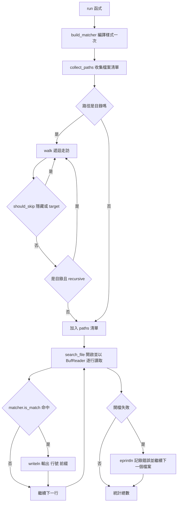

# 16.2 實戰專案一：檔案讀寫與文字搜尋（仿 grep 工具）

## 搜尋核心的第一版

上一節我們建立了 `Cli` 與 `Config`，此刻它們還只是一份介面規格。要讓 `minigrep` 真正運作，需要實作「讀取內容、逐行比對、印出符合的行」這三個步驟。

最直覺的寫法是一次把整個檔案讀進記憶體：

```rust
use std::fs;

pub fn read_file(path: &std::path::Path) -> Result<String, std::io::Error> {
    fs::read_to_string(path)
}
```

`fs::read_to_string` 接受一個 `AsRef<Path>` 的路徑，開啟檔案、讀取全部位元組，並嘗試以 UTF-8 解碼。它回傳 `Result<String, io::Error>`，其中 `io::Error` 涵蓋了「檔案不存在」「沒有權限」「不是有效的 UTF-8」等所有可能的失敗。

這段程式碼完全正確，但它的行為**隨檔案大小而變**。一個 10 KB 的設定檔與一個 2 GB 的日誌檔，都會被完整地放進記憶體。搜尋工具最常處理的正是日誌檔與原始碼樹這類大檔案，因此這個限制不是理論問題。

## 兩種讀取 API 的取捨

Rust 的標準函式庫提供了兩條讀取路徑。第一條是一次性讀入，如前所述。第二條是透過緩衝讀取器逐行前進：

```rust
use std::fs::File;
use std::io::{BufRead, BufReader};

fn print_lines(path: &std::path::Path, pattern: &str) -> Result<usize, std::io::Error> {
    let file = File::open(path)?;
    let reader = BufReader::new(file);
    let mut count = 0;

    for line in reader.lines() {
        let line = line?;
        if line.contains(pattern) {
            println!("{}: {}", path.display(), line);
            count += 1;
        }
    }
    Ok(count)
}
```

`BufReader<File>` 包裹了檔案物件，提供一個固定大小的內部緩衝區。`BufRead::lines()` 回傳一個 `Lines` 迭代器，每次 `next()` 會從緩衝區中取出一行，並在需要時向底層檔案補讀資料。這個設計的本質是**串流處理**：記憶體占用量與檔案大小無關，只與緩衝區大小有關。

這就是為什麼逐行讀取應當是預設選擇。它的記憶體占用是常數級的，不隨輸入規模成長；它不需要把整個檔案放進記憶體，因此能處理遠超出可用記憶體的檔案；而且它的延遲特性更好，第一筆結果在讀完第一行之後就能輸出，不必等待整個檔案讀完。

從複雜度來看，逐行讀取的時間仍是 $`O(n)`$ （ $`n`$ 為檔案位元組數），與一次讀入相同；但空間複雜度從 $`O(n)`$ 降為 $`O(1)`$ ：

$$
S_{\text{一次讀入}} = O(n), \qquad S_{\text{逐行讀取}} = O(b)
$$

其中 $`b`$ 為緩衝區大小。若再考慮最長行的長度 $`L`$ ，逐行讀取的實際占用是 $`O(b + L)`$ ，因為一行本身必須完整地放進記憶體才能被檢查。這也解釋了為什麼處理「單行超長」的特殊檔案時需要額外小心。

## 逐行讀取的失效模式

`lines()` 有兩個必須知道的行為特性。第一，它會**剝掉行尾的換行符**。`BufRead::lines()` 回傳的每一項都不包含 `\n` 或 `\r\n`，因此印出時若想保留原始格式，得自行補上換行。

第二，**檔案最後一行沒有結尾換行符的情況**。`lines()` 依然會把那一行回傳出來，這點常被誤解。真正的陷阱在於反向操作：若你用 `lines()` 讀取內容再寫回，就會丟掉原本的結尾換行符，導致檔案位元組層級的差異。對於需要精確還原的場景（例如處理設定檔或做檔案雜湊），應該使用 `read_until` 並自行處理分隔符，或直接使用 `read_to_string` 保留完整內容。

第三個細節是 `\r\n`。在 Windows 上以 `\r\n` 結尾的檔案，於 Linux 上讀取時行尾會殘留 `\r`。`lines()` 只剝掉 `\n`。這在搜尋工具中可能造成漏判——搜尋 `"foo"` 會找到，但 `"foo\r"` 不會。實務上的處理方式是在比對前對行尾做正規化，或在讀取時就統一換行格式。

## 錯誤處理：單檔失敗不該中止整體

搜尋多個檔案時，錯誤處理的策略需要特別設計。如果一個檔案不存在就讓整個程式崩潰，使用者只會看到第一個錯誤，其餘檔案根本沒被搜尋。更合理的做法是**記錄錯誤並繼續處理**。

```rust
fn main() {
    let config = Config { /* ... */ };
    let mut total = 0usize;
    let mut errors = 0usize;

    for path in &config.paths {
        match minigrep::search_file(path, &config) {
            Ok(count) => total += count,
            Err(err) => {
                eprintln!("{}: {}", path.display(), err);
                errors += 1;
            }
        }
    }

    if errors > 0 {
        eprintln!("共有 {} 個檔案無法處理", errors);
    }
}
```

這個模式把「個別失敗」與「整體失敗」分開：個別檔案的問題被回報到標準錯誤，但搜尋繼續進行；整體是否算成功，則可以由呼叫端根據 `errors` 數量決定。Unix 的 `grep` 也是這個行為——它會對無法讀取的檔案印出訊息，然後繼續，最後以退出碼 `2` 表示「有檔案出錯但其餘成功」。

Rust 的 `Result` 與 `?` 運算子在這裡非常合適。`?` 會在 `Err` 時提前返回，但把錯誤值轉換成 `Box<dyn Error>` 只需一個 `?`，因為 `Box<dyn Error>` 實作了 `From<E>`。

## 使用 `regex` 做樣式比對

到目前為止我們用的是 `str::contains` 的字面比對。真實的 `grep` 支援正規表達式，而 Rust 生態中 `regex` crate 是這件事的標準答案。

```toml
[dependencies]
regex = "1"
```

```rust
use regex::Regex;

pub fn build_matcher(pattern: &str, ignore_case: bool) -> Result<Regex, regex::Error> {
    let mut builder = Regex::builder(pattern);
    if ignore_case {
        builder.case_insensitive(true);
    }
    Ok(builder.build()?)
}
```

`Regex::builder` 提供了流式設定 API。`case_insensitive(true)` 對應的是我們在第 16.1 節宣告的 `--ignore-case` 旗標。注意正規表達式的**編譯成本是顯著的**，所以樣式只應該編譯一次，而不是在每一行重新建構。

`regex` crate 使用有限狀態機（DFA）比對，單次比對的時間是 $`O(n)`$ ， $`n`$ 為被比對字串的長度，且與樣式的複雜度無關。這是它相較於回溯式引擎（backtracking engine）的核心優勢：不存在指數級的最壞情況。

但這不等於可以掉以輕心。`regex` crate 會在編譯期拒絕某些帶有巢狀量詞的樣式（例如 `(a+)+`），因為那類樣式在回溯引擎中會導致災難性回溯（catastrophic backtracking），俗稱 ReDoS。使用者輸入的樣式必須被信任嗎？若樣式來自不可控的來源，就應該設下長度上限並限制巢狀深度；若來自使用者自己，通常是可以接受的。

## 結果呈現：檔名與行號前綴

Unix 的 `grep` 在搜尋多個檔案時會在每行前面加上檔名與行號：

```text
src/main.rs:12:fn main() {
src/lib.rs:3:pub fn grep(content: &str) {
```

這個前綴資訊需要兩項東西：檔案路徑與行號。行號只要在迴圈中維護一個計數器即可，從 1 開始，因為對使用者而言的第一行就是第 1 行。

```rust
fn print_match(path: &std::path::Path, line_number: usize, line: &str) {
    println!("{}:{}:{}", path.display(), line_number, line);
}
```

當只搜尋單一檔案時，`grep` 會省略檔名前綴，只留行號。這個行為可以根據傳入的檔案數量決定。`grep` 還有 `-h`（隱藏檔名）與 `-H`（強制顯示檔名）兩個旗標來覆寫預設，設計上同樣是「預設由上下文決定，允許使用者覆寫」的典型例子。

## 寫出結果：從 stdout 到 `BufWriter`

搜尋工具的另一個面向是輸出。把結果寫到哪裡？Unix 的 `grep` 有 `-l`（只列出檔名）、`-o`（只輸出匹配片段）與 `-c`（只輸出計數）等選項，但它們都寫到標準輸出，除非搭配 `-o` 這類寫到檔案的選項。

在 Rust 中，`println!` 是最直接的寫法，但它有個隱藏成本：每呼叫一次 `println!` 就會對底層的 `Stdout` 做一次寫入，而 `Stdout` 本身雖然有內部緩衝，寫入路徑仍涉及鎖定與格式化。當輸出量是數百萬行時，這個成本會非常明顯。

```rust
use std::io::{BufWriter, Write};

let stdout = std::io::stdout();
let mut out = BufWriter::new(stdout.lock());
writeln!(out, "{}:{}:{}", path.display(), idx + 1, line)?;
out.flush()?;
```

`stdout.lock()` 取出一個可重入的鎖定句柄，`BufWriter` 在其外層再加一層緩衝。`flush()` 必須被明確呼叫，因為 `BufWriter` 的Drop只會嘗試把殘留資料寫出，但忽略錯誤。明確 flush 讓寫入失敗（例如磁碟滿）能被上層觀察到，這在把搜尋結果導向檔案時很重要。

把寫入抽象成 `&mut impl Write` 還帶來一個額外好處：測試可以把 `Vec<u8>` 當成 sink 傳進去，然後用 `String::from_utf8` 檢查輸出內容。這種測試完全不需要攔截標準輸出，也不需要子行程。

## 遞迴搜尋目錄

到這裡我們處理的都是單一檔案。真正的搜尋工具需要能走訪目錄樹。核心是 `fs::read_dir`，它回傳一個迭代器，其項目型別為 `Result<DirEntry, io::Error>`。

```rust
use std::fs;
use std::path::{Path, PathBuf};

fn walk(dir: &Path, out: &mut Vec<PathBuf>) -> std::io::Result<()> {
    for entry in fs::read_dir(dir)? {
        let entry = entry?;
        let path = entry.path();
        if path.is_dir() {
            walk(&path, out)?;
        } else {
            out.push(path);
        }
    }
    Ok(())
}
```

這裡有兩個值得說明的 Rust API 細節。第一是 `Path` 與 `PathBuf` 的分工：`Path` 是借用的路徑視圖（`&Path`），`PathBuf` 擁有可增長的緩衝區。`read_dir` 回傳的 `DirEntry::path()` 會配置一個新的 `PathBuf`，因為它不知道呼叫者要保存多久。遞迴函式以 `&Path` 接受參數，正是為了避免每次遞迴都多一次所有權轉移。

第二是 `path.is_dir()` 會額外做一次系統呼叫來取得檔案metadata。追求效能時，可以改用 `entry.file_type()`，因為 `DirEntry` 已經快取了這項資訊（在 Unix 上來自 `readdir` 的 `d_type` 欄位）。這是一個小小的但真實的差異，在數十萬個檔案的樹上會累積成可感知的時間。

第二個 API 細節是 `strip_prefix`。當我們從某個根目錄開始遞迴時，希望輸出的相對路徑不含前綴：

```rust
let relative = path.strip_prefix(root).unwrap_or(path);
println!("{}:{}", relative.display(), line_number);
```

`strip_prefix` 回傳 `Result<&Path, StripPrefixError>`，因為給定的前綴可能並不是路徑的開頭。在我們的呼叫情境中它一定成功，但 API 仍要求處理失敗情形，`unwrap_or` 提供了一個合理的退路：無法剝除時就用原路徑。

## 忽略隱藏檔案與 `target` 目錄

遞迴搜尋若不加過濾，會搜進 `.git`、`.cargo`、`target` 這些目錄——既拖慢速度，也會產生大量無關的匹配結果（`target` 裡的相依套件原始碼常常包含版權行或樣板文字）。

過濾規則大致有三類：隱藏檔案（檔名以 `.` 開頭）、建置輸出目錄（`target`、`node_modules`）、以及二進位檔案。隱藏檔案的判斷很簡單，只要看檔名是否以 `.` 開頭。

```rust
fn should_skip(path: &Path) -> bool {
    path.file_name()
        .and_then(|n| n.to_str())
        .map(|n| n.starts_with('.') || n == "target" || n == "node_modules")
        .unwrap_or(false)
}
```

這裡用 `to_str()` 把 `OsStr` 轉成 `&str`，回傳 `Option`。非 UTF-8 的檔名會得到 `None`，此時 `unwrap_or(false)` 選擇不跳過——這是較保守的選擇，因為跳過使用者明確指定的檔案比不跳過更令人意外。

## 從命令列到 `run` 函式的重構

現在是把所有零件組裝起來的時刻。設計上最重要的是**把邏輯與 I/O 分離**。如果搜尋函式直接印出結果，單元測試就只能靠比對標準輸出來驗證，脆弱且受限。

更好的設計是讓核心函式**回傳**結果：

```rust
pub struct Match {
    pub line_number: usize,
    pub text: String,
}

pub fn search_content(config: &Config, content: &str) -> Vec<Match> {
    let matcher = match build_matcher(&config.pattern, config.ignore_case) {
        Ok(m) => m,
        Err(err) => {
            eprintln!("樣式無效：{}", err);
            return Vec::new();
        }
    };

    let mut results = Vec::new();
    for (idx, line) in content.lines().enumerate() {
        if matcher.is_match(line) {
            results.push(Match {
                line_number: idx + 1,
                text: line.to_string(),
            });
        }
    }
    results
}
```

注意這個函式的輸入是 `&str`，也就是「一段內容」。這讓單元測試可以直接餵入字串常數，不需要在磁碟上建立暫存檔案。這正是 Rust 官方手冊那個 `minigrep` 專案的核心教訓：**把函式的輸入抽象到最能凸顯其邏輯的那一層**。搜尋「一段文字中有哪些行符合樣式」這個問題，本來就不需要檔案系統的參與。

## 錯誤型別的設計

若核心函式的錯誤型別是 `Box<dyn Error>`，它能裝載任何錯誤，但代價是呼叫端無法**結構化**地處理不同類型的錯誤，只能把訊息印出來。若需要針對「檔案不存在」給出特定提示，就需要一個自訂的錯誤型別。

```rust
use std::fmt;

#[derive(Debug)]
pub enum ConfigError {
    InvalidPattern(regex::Error),
    Io(std::io::Error),
}

impl fmt::Display for ConfigError {
    fn fmt(&self, f: &mut fmt::Formatter<'_>) -> fmt::Result {
        match self {
            ConfigError::InvalidPattern(err) => write!(f, "無效的樣式：{}", err),
            ConfigError::Io(err) => write!(f, "I/O 錯誤：{}", err),
        }
    }
}

impl std::error::Error for ConfigError {
    fn source(&self) -> Option<&(dyn std::error::Error + 'static)> {
        match self {
            ConfigError::InvalidPattern(err) => Some(err),
            ConfigError::Io(err) => Some(err),
        }
    }
}

impl From<std::io::Error> for ConfigError {
    fn from(err: std::io::Error) -> Self {
        ConfigError::Io(err)
    }
}

impl From<regex::Error> for ConfigError {
    fn from(err: regex::Error) -> Self {
        ConfigError::InvalidPattern(err)
    }
}
```

`impl From` 讓 `?` 運算子可以自動把 `io::Error` 轉成 `ConfigError`，這是第 8 章介紹過的錯誤轉換慣例。`source()` 方法則保留了錯誤的**來源鏈**，讓上層在需要時能取得原始的 `io::Error` 並檢查其 `ErrorKind`——例如判斷是 `NotFound` 還是 `PermissionDenied`。

而 `run` 函式的回傳型別則採 `Result<(), Box<dyn Error>>`：

```rust
pub fn run(config: &Config) -> Result<(), Box<dyn std::error::Error>> {
    let matcher = build_matcher(&config.pattern, config.ignore_case)?;
    let paths = collect_paths(&config.path)?;
    let mut total = 0usize;

    for path in &paths {
        let file = match File::open(path) {
            Ok(f) => f,
            Err(err) => {
                eprintln!("{}: {}", path.display(), err);
                continue;
            }
        };
        let reader = BufReader::new(file);
        for (idx, line) in reader.lines().enumerate() {
            let line = match line {
                Ok(l) => l,
                Err(err) => {
                    eprintln!("{}: {}", path.display(), err);
                    break;
                }
            };
            if matcher.is_match(&line) {
                total += 1;
                println!("{}:{}:{}", path.display(), idx + 1, line);
            }
        }
    }

    if total == 0 {
        return Err("找不到符合的內容".into());
    }
    Ok(())
}
```

回傳 `Result<(), Box<dyn Error>>` 有幾個好處。`Box<dyn Error>` 是一個物件安全的錯誤型別，可以承載任何實作 `Error` 的錯誤，未來要換成 `anyhow::Error` 也只需改一行。更重要的是，**回傳 `Err` 意味著退出碼非零**，這正是 `grep` 在沒有匹配時回傳 `1` 的慣例——「沒找到」對腳本而言是一種需要被區分的狀態，而不是單純的成功。

## 檔案路徑的型別：`Path` 與 `PathBuf`

搜尋工具幾乎所有操作都圍繞著檔案系統路徑，因此值得把路徑型別的設計講清楚。`Path` 是一個以 `OsStr` 為基礎的、**借用的**路徑視圖；`PathBuf` 則是**擁有**一塊堆積記憶體的、可增長的路徑緩衝區。兩者的關係與 `str` 對 `String` 完全一致。

在搜尋程式中，這個分工有明確的邊界。`Config` 儲存路徑時必須用 `PathBuf`，因為它要長期持有這份資料。而遍歷時的臨時變數用 `&Path` 就好：`read_dir` 回傳的 `DirEntry::path()` 已經配置好了一個 `PathBuf`，把它轉成 `&Path` 傳給遞迴函式可以避免反覆配置。

```rust
use std::path::{Path, PathBuf};

fn collect(dir: &Path, out: &mut Vec<PathBuf>) -> std::io::Result<()> {
    for entry in std::fs::read_dir(dir)? {
        let path = entry?.path();
        if path.is_dir() {
            collect(path.as_path(), out)?;
        } else {
            out.push(path);
        }
    }
    Ok(())
}
```

這段程式碼同時展示了 Rust 的兩個特性。其一是**所有權的自然流動**：`entry?.path()` 回傳一個擁有資料的 `PathBuf`，`out.push(path)` 把這個所有權轉移進集合，沒有任何複製。其二是**自動解參考**：`collect(path.as_path(), out)?` 中，`path` 是 `PathBuf` 而參數要的是 `&Path`，編譯器會自動插入 `as_path()`，因為 `PathBuf` 有 `Deref<Target = Path>` 的實作。這種「自動借位」讓 API 變得自然而不含糊。

路徑的**組合**也有專門的方法。`Path::join` 會依平台分隔符把兩段接起來，而且若右邊是絕對路徑，結果就是那個絕對路徑——這與 `PathBuf::push` 的語意一致。組合路徑時要注意不要直接用字串相加，因為 Windows 的分隔符是 `\` 而非 `/`。

## 完整的 `minigrep` 實作

把上述所有部分組裝起來，一個可運作的核心如下。

```rust
// src/lib.rs
use regex::Regex;
use std::fs::File;
use std::io::{BufRead, BufReader, Write};
use std::path::{Path, PathBuf};

pub struct Config {
    pub pattern: String,
    pub path: PathBuf,
    pub recursive: bool,
    pub ignore_case: bool,
    pub count_only: bool,
}

fn build_matcher(pattern: &str, ignore_case: bool) -> Result<Regex, regex::Error> {
    let mut builder = Regex::builder(pattern);
    if ignore_case {
        builder.case_insensitive(true);
    }
    builder.build()
}

fn should_skip(path: &Path) -> bool {
    path.file_name()
        .and_then(|n| n.to_str())
        .map(|n| n.starts_with('.') || n == "target" || n == "node_modules")
        .unwrap_or(false)
}

fn collect_paths(config: &Config) -> Result<Vec<PathBuf>, std::io::Error> {
    let mut paths = Vec::new();
    if config.path.is_dir() {
        walk(&config.path, config, &mut paths)?;
    } else {
        paths.push(config.path.clone());
    }
    Ok(paths)
}

fn walk(dir: &Path, config: &Config, out: &mut Vec<PathBuf>) -> std::io::Error {
    for entry in std::fs::read_dir(dir)? {
        let entry = entry?;
        let path = entry.path();
        if should_skip(&path) {
            continue;
        }
        if path.is_dir() {
            if config.recursive {
                walk(&path, config, out)?;
            }
        } else {
            out.push(path);
        }
    }
    Ok(())
}

pub fn search_file(
    path: &Path,
    matcher: &Regex,
    writer: &mut impl Write,
) -> std::io::Result<usize> {
    let file = File::open(path)?;
    let reader = BufReader::new(file);
    let mut count = 0usize;

    for (idx, line) in reader.lines().enumerate() {
        let line = line?;
        if matcher.is_match(&line) {
            count += 1;
            writeln!(writer, "{}:{}:{}", path.display(), idx + 1, line)?;
        }
    }
    Ok(count)
}

pub fn run(config: &Config) -> Result<(), Box<dyn std::error::Error>> {
    let matcher = build_matcher(&config.pattern, config.ignore_case)?;
    let paths = collect_paths(config)?;
    let stdout = std::io::stdout();
    let mut out = std::io::BufWriter::new(stdout.lock());
    let mut total = 0usize;

    for path in &paths {
        match search_file(path, &matcher, &mut out) {
            Ok(count) => total += count,
            Err(err) => eprintln!("{}: {}", path.display(), err),
        }
    }
    out.flush()?;

    if config.count_only {
        writeln!(out, "{}", total)?;
    }
    if total == 0 {
        return Err("找不到符合的內容".into());
    }
    Ok(())
}
```

這個版本有幾個刻意的設計選擇。樣式只編譯一次，之後所有檔案共用同一個 `Regex`。輸出走的是 `BufWriter`，避免每一行都直接對系統呼叫做一次 `write` 系統呼叫。搜尋函式接受 `&mut impl Write`，因此單元測試可以傳入 `Vec<u8>` 來捕捉輸出，完全不需要碰觸標準輸出。

## 單元測試

有了前面的分層，測試變得非常自然。核心搜尋可以用記憶體中的位元組測試，而不需要建立暫存檔案。

```rust
#[cfg(test)]
mod tests {
    use super::*;

    fn matches_of(content: &str, pattern: &str) -> Vec<String> {
        let matcher = Regex::new(pattern).unwrap();
        content
            .lines()
            .filter(|l| matcher.is_match(l))
            .map(|l| l.to_string())
            .collect()
    }

    #[test]
    fn finds_single_match() {
        let content = "\
Rust
is fast
and memory safe";
        let hits = matches_of(content, "fast");
        assert_eq!(hits, vec!["is fast".to_string()]);
    }

    #[test]
    fn finds_multiple_matches() {
        let content = "\
Rust
is fast
and memory safe";
        let hits = matches_of(content, "Rust|memory");
        assert_eq!(hits.len(), 2);
    }

    #[test]
    fn handles_no_trailing_newline() {
        let content = "alpha\nbeta";
        let hits = matches_of(content, "beta");
        assert_eq!(hits, vec!["beta".to_string()]);
    }

    #[test]
    fn respects_case_insensitive_flag() {
        let matcher = Regex::builder("hello")
            .case_insensitive(true)
            .build()
            .unwrap();
        assert!(matcher.is_match("HELLO world"));
    }
}
```

第三個測試 `handles_no_trailing_newline` 特別重要，它正是前面提到的失效模式。把它寫成測試，就等於把這項行為契約固定下來，未來若有人改用不同的讀取方式，測試會立刻指出差異。

## 擴充：支援多種輸入格式

真實的搜尋工具還要處理非純文字檔案。二進位檔案的判定方式之一是檢查前若干位元組中有無 NUL 字元；另一種是先用啟發式規則過濾，再以正規表達式細查。Rust 生态中的 `grep-cli` 套件就採用了類似策略，並支援 gzip 壓縮檔的透明解壓。

純文字的處理則涉及編碼。`fs::read_to_string` 會要求整份內容是合法的 UTF-8，遇到無效位元組就整個失敗。而 `BufRead::lines()` 同樣要求每一行是合法 UTF-8，但它的失敗點被縮小到**單行**，因此可以選擇「跳過壞行繼續」而不是「整個檔案失敗」。這個差異在處理混合編碼的日誌檔時非常實用。

```rust
let content = fs::read(path)?;
let text = String::from_utf8_lossy(&content);
for (idx, line) in text.lines().enumerate() {
    if matcher.is_match(line) {
        println!("{}:{}:{}", path.display(), idx + 1, line);
    }
}
```

`String::from_utf8_lossy` 會把無效的位元組序列替換成 U+FFFD 替換字元，永遠不會失敗。這個取捨很清楚：資料保真度換取了健壯性。若工具處理的是原始碼或設定檔，`fs::read_to_string` 的嚴格行為才是正確的選擇。

## 效能討論

搜尋工具的效能主要受三個因素影響。第一是**避免重複配置**。若在迴圈內重新編譯 `Regex`，每次都要重新建構狀態機，代價是樣式長度的線性時間乘上檔案數量。把它提到迴圈外就消除了這個成本。第二是**使用 `BufWriter`**。`println!` 每呼叫一次就會觸發一次寫入系統呼叫，在數百萬行的輸出下，這個成本非常可觀。`BufWriter` 會把寫入累積到緩衝區再一次送出，通常能帶來數倍到數十倍的差距。第三是**線性掃描**。`Regex` 的 DFA 比對對每一行都是 $`O(L)`$ （ $`L`$ 為行長），所以整體複雜度是 $`O(n)`$ ：

$$
T_{\text{搜尋}} = O\left( \sum_{i=1}^{m} L_i \right) = O(n)
$$

其中 $`m`$ 為行數、 $`L_i`$ 為第 $`i`$ 行的長度。這個線性特徵是 `grep` 能在數秒內掃過數 GB 日誌的原因。

第四個因素是**平行搜尋**。搜尋不同檔案之間沒有資料相依，理論上可以完全平行。Rust 的執行緒模型讓這件事很容易：把檔案清單切分給多個執行緒，用通道收集結果即可。但要注意輸出順序會變得不確定，若使用者需要穩定輸出就必須排序，這個取捨要依工具的定位決定。

## 延伸功能

有了穩定的核心，擴充功能就只是增加幾個分支。**彩色輸出**可以根據 `atty` 判斷 stdout 是否為終端，並在匹配處包上 ANSI 逸出序列：

```rust
const RED: &str = "\x1b[31m";
const RESET: &str = "\x1b[0m";

fn highlight(line: &str, matcher: &Regex) -> String {
    matcher
        .replace_all(line, |caps: &regex::Captures<'_>| {
            format!("{}{}{}", RED, &caps[0], RESET)
        })
        .to_string()
}
```

**忽略大小寫**已經在 `build_matcher` 中以 `case_insensitive` 實作，它不需要改動搜尋迴圈本身——這正是樣式抽象的好處。**計數模式**則是 `Config` 加一個 `count_only` 欄位，在輸出時改印總數，核心搜尋迴圈完全不變。

這三個延伸說明了本章最重要的設計原則：**把變動的東西集中到少數幾個地方**。樣式的比對規則集中在 `build_matcher`，輸出的格式集中在 `search_file` 的 `writeln!`，行為的開關集中在 `Config`。新增功能時要修改的地方是有界的，而測試也只需針對那幾個地方撰寫。



至此，`minigrep` 具備了完整的功能：位置引數指定樣式與路徑，布林旗標控制遞迴與大小寫，介面由 `clap` 負責生成與驗證，核心由 `regex` 與標準函式庫實作，並且每個環節都能獨立測試。下一章我們會把視角從命令列轉向網路，看看同一套所有權與型別思維如何支撐起一個真正的高效能 Web 服務。
