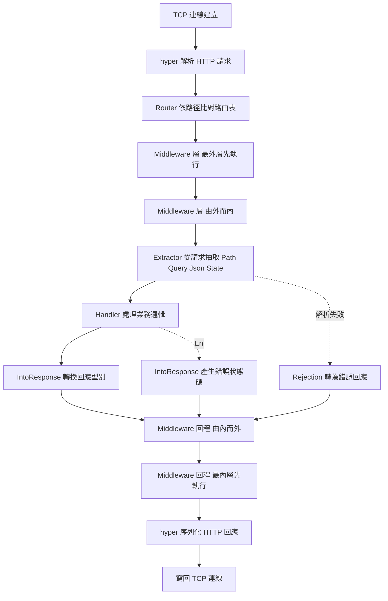

# 17.1 實戰專案二：高效能 Web API 服務——使用 Axum 建立 Web 伺服器

## 為什麼 Rust 適合寫 Web 服務

在討論框架之前，先回答一個更根本的問題：為什麼在 Go、Java、Node.js 這些語言已經能寫出高效能 Web 服務的今天，還要考慮用 Rust？

第一個理由是**沒有垃圾收集器所帶來的延遲可預測性**。GC 的運作時機由實作決定，雖然現代的 GC 已經把停頓時間壓得很短，但「某個請求可能剛好撞上一次回收」這件事永遠存在。Rust 沒有這個問題：記憶體在離開作用域時就立刻被釋放，沒有任何不確定的停頓。這對延遲敏感的服務（交易系統、串流媒體、期貨行情）特別重要。

第二個理由是**零成本抽象帶來的開發效率**。Rust 的型別系統允許你寫出高階的抽象，卻在編譯期把它們降解成與手寫低階程式碼等價的機器碼。第 9 章談過的泛型與特徵在 Web 框架裡扮演著關鍵角色：`axum` 的 handler 與 extractor 建立在特徵之上，但執行期沒有任何動態派發的開銷。

第三個理由是**對 async 的原生支援**。Rust 的 `async`/`await` 是語言層級的 constructs，`Future` 是標準函式庫的核心型別，而 `tokio` 這類執行環境只是驅動 `Future` 的一個函式庫。這種設計讓整個生態系都建立在同一套基礎上。

第四個理由是**成熟的 crate 生態**。`tokio`、`hyper`、`tower`、`serde`、`axum` 這些 crate 涵蓋了非同步執行、HTTP 協定解析、服務抽象與序列化，把它們組合起來就是一套完整的生產級網路堆疊。而且它們全都由大型社群維護，有詳細的文件與長期的相容性承諾。

最後一個理由是**安全**。Web 服務是攻擊面最廣的應用之一，記憶體安全缺陷在網路上被利用的案例比比皆是。Rust 把這類缺陷從「靠 fuzzing 去找」變成「編譯器保證不存在」。

## Axum 的設計

`axum` 是 Tokio 團隊維護的網路框架，它的設計哲學可以用一句話概括：**以型別表達 HTTP 的結構**。

`axum` 建立在兩個基礎之上。底層是 `hyper`，一個專注於 HTTP/1 與 HTTP/2 協定實作的函式庫，負責解析位元組流、處理連線與協定細節。`hyper` 之上是 `tower`，一個「服務」的抽象與組合框架。`tower::Service` 特徵只有一個核心方法：

```rust
async fn call(&mut self, req: Request) -> Response;
```

`axum` 把「路由匹配」與「型別化的請求／回應轉換」這兩件事實作為 `Service` 實作來組合。這個分層的好處是，`tower` 生態裡大量的中介軟體（限流、逾時、重試、負載平衡）都可以直接套用在 `axum` 上，不需要任何轉接。

`axum` 最有特色的是 **extractor** 與 **handler** 的組合。extractor 是某個 `FromRequest` 特徵的實作，它負責從 HTTP 請求中抽取某種型別；handler 則是一個以 extractor 為參數、回傳某個 `IntoResponse` 實作的函式。

```rust
use axum::extract::FromRequest;

trait FromRequest<S>: Sized {
    type Rejection: IntoResponse;
    async fn from_request(req: Request, state: &S) -> Result<Self, Self::Rejection>;
}
```

這個設計的精妙之處在於**型別安全**：handler 的簽章本身就是它的規格書。`Path<u64>` 表示路徑參數必須是整數，`Json<T>` 表示請求本體必須是能反序列化成 `T` 的 JSON，`State<AppState>` 表示需要存取應用狀態。編譯器會檢查這些組合是否合法，例如同一個請求不能有兩個 `Body` extractor。

## 最小的 Hello 伺服器

第一個例子應該盡可能簡單，讓我們先確認整個鏈路能跑起來：

```toml
# Cargo.toml
[dependencies]
axum = "0.7"
tokio = { version = "1", features = ["full"] }
```

```rust
use axum::routing::get;
use axum::Router;

#[tokio::main]
async fn main() {
    let app = Router::new().route("/", get(|| async { "Hello, World!" }));

    let listener = tokio::net::TcpListener::bind("0.0.0.0:3000")
        .await
        .expect("無法綁定連接埠");

    println!("伺服器正在 0.0.0.0:3000 監聽");
    axum::serve(listener, app)
        .await
        .expect("伺服器執行失敗");
}
```

`#[tokio::main]` 是程序化巨集，它把 `async fn main` 轉換成建立 `tokio` 執行環境並阻塞等待的同步函式。`Router::new()` 建立一個空的路由表，`route("/", get(handler))` 把 HTTP GET 請求的路徑 `/` 對應到某個 handler。

`axum::serve` 接受一個 `TcpListener` 與一個服務，並在 `Future` 尚未完成時持續 poll。`TcpListener::bind` 回傳 `Result`，因為綁定連接埠可能失敗——連接埠被占用、權限不足或位址無效。

`Router` 的型別是 `Router<S>`，其中 `S` 是應用狀態的型別。當沒有狀態時，型別參數會是 `()`，這讓「不需要狀態的路由」與「需要狀態的路由」在型別上區分開來。

## Handler 的簽章與 Extractor

handler 就是一個 `async fn`，它的參數必須實作 `FromRequest`，回傳值必須實作 `IntoResponse`。常見的 extractor 有五種。

| Extractor | 來源 | 用途 | 失敗時 |
|---|---|---|---|
| `Path<T>` | 路徑參數 | `/users/{id}` 中的 `id` | 404 或 400 |
| `Query<T>` | 查詢字串 | `?page=2&size=10` | 400 |
| `Json<T>` | 請求本體 | 解析 JSON 並反序列化 | 400 或 422 |
| `State<S>` | 應用狀態 | 存取共用的 `Arc` 資料 | 500 |
| `Extension<T>` | 擴充資料 | 存取請求範圍外的共用值 | 500 |

```rust
use axum::extract::{Path, Query};
use axum::Json;
use serde::{Deserialize, Serialize};

#[derive(Deserialize)]
struct Pagination {
    page: Option<u32>,
    size: Option<u32>,
}

#[derive(Serialize)]
struct User {
    id: u64,
    name: String,
}

async fn list_users(Query(pagination): Query<Pagination>) -> Json<Vec<User>> {
    let page = pagination.page.unwrap_or(1);
    let size = pagination.size.unwrap_or(20);
    let users = vec![User {
        id: 1,
        name: format!("使用者第 {} 頁", page),
    }];
    Json(users)
}

async fn get_user(Path(id): Path<u64>) -> Json<User> {
    Json(User {
        id,
        name: "Alice".to_string(),
    })
}
```

`Query<Pagination>` 用了 `serde` 的 `Deserialize` 衍生，`Json<User>` 的回傳則需要 `Serialize`。這兩個衍生宏正是 `axum` 能把「HTTP 層面」與「應用型別」無縫接起來的原因：查詢字串 `?page=2` 會被自動映射到 `pagination.page`，型別不匹配時回傳 400。

`Path<u64>` 同理，路徑中的 `{id}` 會被解析成 `u64`。若使用者傳入 `/users/abc`，解析失敗，此時 extractor 的 rejection 會被自動轉成 400 回應。

## 回應型別

回應端同樣由特徵抽象。`IntoResponse` 讓 handler 可以回傳多種型別：

```rust
use axum::http::StatusCode;
use axum::response::{Html, IntoResponse, Redirect};

async fn variants() -> impl IntoResponse {
    (
        StatusCode::OK,
        [("content-type", "text/html; charset=utf-8")],
        "<h1>你好</h1>",
    )
}
```

`axum` 提供了 `Json<T>`、`Html<T>`、`Redirect`、`StatusCode`、`String`、`&'static str` 與 `(StatusCode, T)` 等常見的實作。`(StatusCode, T)` 這個元組實作特別實用，因為它讓設定狀態碼不需要額外的型別包裝。

若要自訂回應型別，只需實作 `IntoResponse`：

```rust
use axum::response::{IntoResponse, Response};

struct ApiError {
    status: StatusCode,
    message: String,
}

impl IntoResponse for ApiError {
    fn into_response(self) -> Response {
        (self.status, self.message).into_response()
    }
}
```

不過在真實專案裡，直接用 `thiserror` 定義一個錯誤列舉會更好，這正是下一節的內容。

## 中介軟體：Layer 與 Middleware

中介軟體是包在路由外的處理層，用於日誌、認證、跨域、限流這類橫切關注點。`axum` 提供兩種中介軟體介面。

`middleware::from_fn` 讓你用一個普通函式寫中介軟體，最為直覺：

```rust
use axum::extract::Request;
use axum::middleware::Next;
use axum::response::Response;

async fn request_id(mut req: Request, next: Next) -> Response {
    let id = uuid::Uuid::new_v4().to_string();
    req.extensions_mut().insert(id.clone());
    let mut res = next.run(req).await;
    res.headers_mut()
        .insert("x-request-id", id.parse().unwrap());
    res
}
```

`Next` 代表管線的下一段，`next.run(req).await` 會呼叫後續的處理。`Request::extensions_mut()` 提供一個型別化的擴充儲存區（`Extensions`），可以在中介軟體之間傳遞自訂資料而不用改動請求本身的結構。

`Layer` 則是 `tower` 的組合抽象，適合撰寫可重用的中介軟體套件：

```rust
use tower::Layer;
use tower_http::{
    cors::{CorsLayer, CorsPolicy},
    trace::TraceLayer,
};

let cors = CorsLayer::new()
    .allow_origin(CorsPolicy::any())
    .allow_methods([axum::http::Method::GET, axum::http::Method::POST]);

let app = Router::new()
    .route("/", get(|| async { "hi" }))
    .layer(TraceLayer::new_for_http())
    .layer(cors)
    .layer(middleware::from_fn(request_id));
```

`Layer` 的關鍵特性是**型別化的狀態傳遞**：`.layer()` 會把先前的路由型別與目前的型別組合，若某個 Layer 需要改變請求型別（例如認證中介軟體要插入使用者身分），編譯器會確保後續的 handler 能接受那個新狀態。`tower-http` 提供了 CORS、追蹤、壓力限流、超時等現成的 Layer。

## 狀態管理：`State` 與 `Arc`

需要共用資料時，使用 `State<S>` extractor。`S` 必須實作 `Clone + Send + Sync + 'static`，最常見的型別是 `Arc<T>`。

```rust
use axum::extract::State;
use std::sync::Arc;
use std::sync::atomic::{AtomicU64, Ordering};

#[derive(Clone)]
struct AppState {
    counter: Arc<AtomicU64>,
}

async fn count(State(state): State<AppState>) -> String {
    let n = state.counter.fetch_add(1, Ordering::Relaxed) + 1;
    format!("第 {} 次請求", n)
}

let state = AppState {
    counter: Arc::new(AtomicU64::new(0)),
};
let app = Router::new()
    .route("/count", get(count))
    .with_state(state);
```

`with_state` 把狀態注入路由，之後 `State<AppState>` extractor 就能取出它。`Arc` 的選擇是必然的：多個請求可能同時需要這份狀態，而 `Arc` 的原子計數保證它在所有持有者都釋放之前不會被回收。這正是第 12.3 節談過的共享所有權模式。

`AppState` 本身實作 `Clone` 是必要的，因為 `State<S>` 每次都會**複製**一份 `S`——但因為 `S` 內部是 `Arc`，這個複製只是計數加一，實際資料仍然只有一份。

## 錯誤處理

Web 服務的錯誤處理有兩個層次：**應用錯誤**（例如找不到資源）與**內部錯誤**（例如資料庫連線失敗）。前者應該轉成適當的 HTTP 狀態碼，後者應該被記錄但不洩漏細節。

`thiserror` 讓錯誤列舉的撰寫變得非常簡潔：

```toml
[dependencies]
thiserror = "2"
anyhow = "1"
```

```rust
use axum::http::StatusCode;
use axum::response::{IntoResponse, Response};
use thiserror::Error;

#[derive(Debug, Error)]
enum AppError {
    #[error("找不到使用者 {0}")]
    NotFound(String),

    #[error("資料庫錯誤")]
    Database(#[from] sqlx::Error),

    #[error("內部錯誤：{0}")]
    Internal(#[from] anyhow::Error),
}

impl IntoResponse for AppError {
    fn into_response(self) -> Response {
        let status = match &self {
            AppError::NotFound(_) => StatusCode::NOT_FOUND,
            AppError::Database(_) => StatusCode::INTERNAL_SERVER_ERROR,
            AppError::Internal(_) => StatusCode::INTERNAL_SERVER_ERROR,
        };

        if status.is_server_error() {
            tracing::error!("伺服器錯誤：{}", self);
        }

        (status, self.to_string()).into_response()
    }
}
```

`anyhow` 與 `thiserror` 的分工是明確的：`thiserror` 用於**有明確結構、需要被上層辨識**的錯誤（本例的 `AppError`），它產生的列舉可以輕易地做 `match`；`anyhow` 用於**不透明的錯誤**，例如應用程式啟動階段的設定載入失敗，那裡不需要區分具體種類，只需要把訊息與來源鏈保留下來。這是 Rust 社群廣泛認可的慣例。

`#[from]` 屬性自動生成 `From` 實作，讓 `?` 能在 handler 中直接轉換錯誤型別。

## 背景任務

有些工作不該阻塞請求——寄送通知、寫入佇列、清理暫存檔。這類任務可以用 `tokio::spawn` 放到背景執行。

```rust
fn spawn_background_task(state: AppState) {
    tokio::spawn(async move {
        let mut interval = tokio::time::interval(std::time::Duration::from_secs(60));
        loop {
            interval.tick().await;
            tracing::info!("定期檢查執行中");
            let _ = &state;
        }
    });
}
```

`tokio::spawn` 需要 `'static` 的未來，因此區塊中的資料必須被 `move` 進去。這裡的 `AppState` 內部是 `Arc`，複製成本極低。

不過要特別注意：`tokio::spawn` 產生的任務是**detached** 的，主程式結束時它不會被等待。若背景任務很重要（例如必須把待處理的訊息寫完），應當保存 `JoinHandle` 並在關閉流程中 `await` 它，否則程序退出可能遺失資料。

## 優雅關閉

生產環境的伺服器不應該在收到訊號時立刻中止，否則進行中的請求會被硬生生切斷。`axum::serve` 提供了 `with_graceful_shutdown` 來處理這件事。

```rust
async fn shutdown_signal() {
    let ctrl_c = async {
        tokio::signal::ctrl_c()
            .await
            .expect("無法安裝 Ctrl+C 處理器");
    };

    #[cfg(unix)]
    let terminate = async {
        tokio::signal::unix::signal(tokio::signal::unix::SignalKind::terminate())
            .expect("無法安裝 SIGTERM 處理器")
            .recv()
            .await;
    };

    #[cfg(not(unix))]
    let terminate = std::future::pending::<()>();

    tokio::select! {
        _ = ctrl_c => {},
        _ = terminate => {},
    }

    tracing::info!("收到關閉訊號，停止接受新請求");
}
```

`tokio::select!` 讓多個 future 同時競爭，誰先完成就採納誰。這裡的 `terminate` future 在非 Unix 平台上永遠不會完成（`pending`），因此編譯器仍要求它回傳 `()` 型別的結果，型別得以統一。

```rust
axum::serve(listener, app)
    .with_graceful_shutdown(shutdown_signal())
    .await?;
```

在收到訊號之後，`axum::serve` 會停止接受新連線，但會等待進行中的請求完成後才返回。搭配容器化的部署環境時，務必確認 orchestrator 給足夠的時間讓關閉流程跑完，否則同樣會造成請求被切斷。

## 效能

Rust Web 服務的效能祕訣其實相當樸素：**用正確的建置模式**。

```bash
cargo build --release
```

除錯建置（debug build）沒有開啟最佳化，程式碼可能慢上十倍甚至更多。`--release` 啟用 LLVM 的最佳化流程，並且會把 `#[inline]` 與泛型的單型化代碼真正最佳化。

第二個重點是**不要在 handler 中做阻塞操作**。檔案讀取、阻塞的資料庫驅動、`std::thread::sleep` 這些操作會佔住執行緒，讓整個執行環境的並行度下降。正確做法是使用非同步版本，或把阻塞操作丟到 `tokio::task::spawn_blocking` 中。

第三個重點是**使用 `tracing` 而不是 `println!`**。`tracing` 是結構化的日誌框架，它產生的紀錄帶有欄位而非只是字串，因此可以被收集、篩選與關聯。搭配 `tracing-subscriber` 就能輸出結構化的 JSON 日誌，供日誌系統索引。

```rust
use tracing_subscriber::{layer::SubscriberExt, util::SubscriberInitExt, EnvFilter};

tracing_subscriber::registry()
    .with(EnvFilter::try_from_default_env().unwrap_or_else(|_| "info".into()))
    .with(tracing_subscriber::fmt::layer().json())
    .init();
```

## 框架取捨

Rust 生態中還有其他 Web 框架，取捨各有不同。

| 框架 | 抽象層次 | 非同步 | 特色 | 代價 |
|---|---|---|---|---|
| `axum` | 較低，直接建於 `tower`/`hyper` | 是 | 與 Tokio 生態緊密整合，型別安全 | 功能需自行組合 crate |
| `actix-web` | 中等 | 是 | 功能完整、文件豐富、生態成熟 | 歷史包袱較重，執行模型非 Tokio |
| `rocket` | 較高 | 是 | 高度約定的「零設定」開發體驗 | 客製化受限，抽象成本較高 |
| `warp` | 中等 | 是 | Filter 風格，組合性強 | 學習曲線較陡，錯誤訊息較難讀 |

`actix-web` 與 `axum` 的最大差異在執行模型。`actix-web` 使用自有的 actor 式執行模型，歷史包袱較重（例如早期版本中 actor 建立在 `unsafe` 之上引發的爭議）。相較之下 `axum` 直接建在 Tokio 的 `hyper` 之上，整個堆疊一致，學習資源也集中在 Tokio 生態。

`rocket` 的抽象層次最高，它把「路由、資料驗證、錯誤處理」都做成約定好的形式，開發體驗非常順暢，但當需求超出約定時能做的調整有限。`axum` 則相反，它提供的是零件，組合方式由你決定。

對本書的專案而言，`axum` 是合適的選擇：它的分層足夠清晰，能讓本章的每個概念都有明確的對應位置。

## 完整範例

綜合以上，一個可執行的完整 Web 服務如下：

```rust
use axum::extract::{Path, State};
use axum::http::StatusCode;
use axum::response::{Html, IntoResponse, Response};
use axum::routing::{get, post};
use axum::{Json, Router};
use serde::{Deserialize, Serialize};
use std::sync::atomic::{AtomicU64, Ordering};
use std::sync::Arc;
use tokio::net::TcpListener;
use tracing_subscriber::{layer::SubscriberExt, util::SubscriberInitExt, EnvFilter};

#[derive(Clone)]
struct AppState {
    hits: Arc<AtomicU64>,
}

#[derive(Serialize)]
struct User {
    id: u64,
    name: String,
}

#[derive(Deserialize)]
struct CreateUser {
    name: String,
}

#[derive(Debug)]
struct ApiError {
    status: StatusCode,
    message: String,
}

impl IntoResponse for ApiError {
    fn into_response(self) -> Response {
        (self.status, self.message).into_response()
    }
}

async fn index() -> Html<&'static str> {
    Html("<h1>minigrep API</h1>")
}

async fn list_users(State(state): State<AppState>) -> Json<Vec<User>> {
    let id = state.hits.fetch_add(1, Ordering::Relaxed) + 1;
    Json(vec![User {
        id,
        name: "Alice".to_string(),
    }])
}

async fn create_user(Json(payload): Json<CreateUser>) -> Result<(StatusCode, Json<User>), ApiError> {
    if payload.name.trim().is_empty() {
        return Err(ApiError {
            status: StatusCode::BAD_REQUEST,
            message: "姓名不可為空".to_string(),
        });
    }
    Ok((
        StatusCode::CREATED,
        Json(User {
            id: 1,
            name: payload.name,
        }),
    ))
}

async fn get_user(Path(id): Path<u64>) -> Result<Json<User>, ApiError> {
    if id == 0 {
        return Err(ApiError {
            status: StatusCode::NOT_FOUND,
            message: "找不到使用者".to_string(),
        });
    }
    Ok(Json(User {
        id,
        name: "Alice".to_string(),
    }))
}

async fn shutdown_signal() {
    let ctrl_c = async {
        tokio::signal::ctrl_c()
            .await
            .expect("無法安裝 Ctrl+C 處理器");
    };

    #[cfg(unix)]
    let terminate = async {
        tokio::signal::unix::signal(tokio::signal::unix::SignalKind::terminate())
            .expect("無法安裝 SIGTERM 處理器")
            .recv()
            .await;
    };

    #[cfg(not(unix))]
    let terminate = std::future::pending::<()>();

    tokio::select! {
        _ = ctrl_c => {},
        _ = terminate => {},
    }

    tracing::info!("收到關閉訊號，停止接受新請求");
}

#[tokio::main]
async fn main() -> Result<(), Box<dyn std::error::Error>> {
    tracing_subscriber::registry()
        .with(EnvFilter::try_from_default_env().unwrap_or_else(|_| "info".into()))
        .with(tracing_subscriber::fmt::layer())
        .init();

    let state = AppState {
        hits: Arc::new(AtomicU64::new(0)),
    };

    let app = Router::new()
        .route("/", get(index))
        .route("/users", get(list_users).post(create_user))
        .route("/users/{id}", get(get_user))
        .with_state(state);

    let listener = TcpListener::bind("0.0.0.0:3000").await?;
    tracing::info!("伺服器正在 0.0.0.0:3000 監聽");

    axum::serve(listener, app)
        .with_graceful_shutdown(shutdown_signal())
        .await?;

    Ok(())
}
```

這個範例把本章的每個概念都串在一起：`Router` 定義路由，`State` 提供共用狀態，`Json` 處理序列化，`Path` 解析路徑參數，`ApiError` 把應用錯誤轉成 HTTP 回應，`tracing` 負責觀測，`with_graceful_shutdown` 負責生命週期管理。



下一步要處理的是這個服務最關鍵的依賴：**資料的儲存**。目前的 `list_users` 只是回傳硬編碼的資料，任何真實的 API 都必須把資料放在資料庫裡，而資料庫存取又帶來全新的問題：連線成本、交易邊界、查詢效能，以及輸入驗證的安全性。下一節就以 `sqlx` 為例，把這些問題一一處理。
