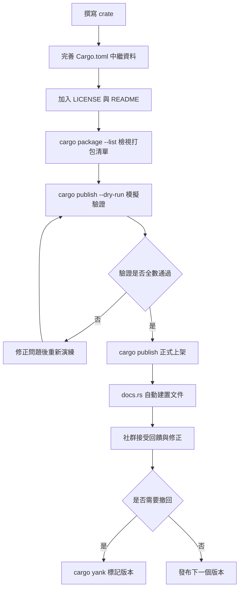

# 18.1 發布你的 Crate 到 Crates.io

寫完一個函式庫之後，最自然的下一步就是把它放上 crates.io，讓全世界的開發者都能 `cargo add` 它。這個動作看似只是打一行指令，但發布出去之後，crate 名稱就被永久佔用、版本號會被寫進使用者的 `Cargo.lock`、你的公開 API 會變成別人程式碼的依賴對象。換句話說，發布是**一次對外承諾**，而本章要談的就是如何讓這份承諾建立在充分準備之上。

## 一、發布前必須具備的元資料

crates.io 對中繼資料（metadata）有基本要求，其中最關鍵的是 `Cargo.toml` 裡的 `[package]` 區段：

```toml
[package]
name = "tinytext"
version = "0.3.1"
edition = "2021"
rust-version = "1.74"
description = "A tiny, dependency-free text normalization toolkit."
license = "MIT OR Apache-2.0"
repository = "https://github.com/example/tinytext"
documentation = "https://docs.rs/tinytext"
homepage = "https://github.com/example/tinytext"
readme = "README.md"
keywords = ["text", "unicode", "normalization"]
categories = ["text-processing"]
include = ["src/**/*", "README.md", "LICENSE-MIT", "LICENSE-APACHE"]
```

`name` 是 crates.io 上的全域識別碼，一旦佔用就無法轉讓給別人，因此在動筆前最好先到 crates.io 搜尋確認。`version` 遵循語意化版本規範，格式為 `主版本.次版本.修補版本`。`description` 會出現在 crates.io 的搜尋結果與 `cargo add` 的輸出中，寫得清楚與否直接影響別人是否會試用。

`license` 是必填欄位，而且必須使用 SPDX 識別碼。Cargo 會檢查這個字串是否在它內建的授權清單裡，拼錯會導致發布被拒。`repository` 與 `documentation` 則讓使用者能快速找到原始碼與 API 文件。`keywords` 最多五個，每個最多二十個字元，是搜尋曝光的主要來源；`categories` 同樣是最多五個，但必須是 crates.io 預先定義好的分類名稱，不能自創。`readme` 指定的檔案會被渲染在 crate 的首頁，因此千萬不要指向一個不會被打包進套件的檔案，否則首頁會變成空白。

## 二、語意化版本與 Rust 的慣例

Rust 社群對版本號有一套比一般語意化版本更細緻的期待。**在 `0.x` 階段，任何版本變更都被視為不穩定**。也就是說，`0.1.0` 到 `0.2.0` 屬於破壞性變更，`0.2.0` 到 `0.2.1` 也是。真正的相容性承諾要等到 `1.0.0` 之後才開始生效。

到了 `1.0.0` 之後，語意化版本的規則就必須被嚴格遵守。增加新函式、新增公開結構體欄位、引入新的特徵實作，通常都算次版本號的提升；移除公開項目、改變函式簽章、改變錯誤行為，則必須提升主版本號。Rust 特有的一個灰色地帶是**特徵（trait）實作**：如果你的公開函式回傳一個公開特徵，該特徵的實作集合其實也是 API 的一部分，因為下游可能依賴某個具體型別恰好實作了某個特徵。

```rust
// 0.2.0：破壞性變更，移除原有的函式
// 0.3.0：新增函式，相容
// 1.0.0：穩定釋出，凍結 API 承諾
```

實務上，許多 crate 選擇在 `1.0` 之後使用 `0.1.x` 形式的「次要版本通道」來降低維護成本，例如 `tokio` 早期就曾長期停留在 `0.x` 階段。選擇權在你，但一旦發布了 `1.0.0`，你就等於宣告「API 會維持相容直到 `2.0.0`」，這份宣告是有份量的。

### 版本生命週期的實務決策

版本策略其實是 crate 成熟度的一部分。一個還在快速摸索 API 的專案，停留在 `0.1.x` 反而是誠實的表示：它明確告訴下游「這裡的介面還可能改動，你要有心理準備」。若在此時就發布 `1.0.0`，你等於要為相容性付出實際的維護成本，而這筆成本往往在專案還沒找到穩定用例之前是不划算的。

另一方面，一旦下游開始依賴你的 `1.x`，任何破壞性調整都會造成一次「上游劇變」的連鎖反應。因此進入 `1.x` 的時機，判斷依據不是功能完成度，而是**你是否已經找到至少兩三個真實用例**，並從中歸納出穩定的介面輪廓。若這三個用例的用法沒有交集，就還不到凍結 API 的時候。

## 三、準備發布的實務流程

crates.io 使用 API token 做認證，不需要密碼。登入一次即可：

```bash
cargo login
cargo login --registry crates-io   # 指定 registry
```

token 會被寫入 `~/.cargo/credentials.toml`（或環境變數 `CARGO_REGISTRY_TOKEN`）。這個檔案絕對不能進版控，也絕對不能放進 CI 日誌中。GitHub Actions 情境下正確的做法是使用 `actions/secrets` 存放 token，並在啟動器中標記為遮罩。

在多人協作的專案中，`cargo publish` 會拒絕在**工作目錄不乾淨**時執行，這是防止把未提交的變更一起發布出去的保險。急著測試時可以加上 `--allow-dirty` 暫時略過，但正式發布絕對不該帶著這個旗標。

接著是**檢查打包內容**。`cargo package --list` 會列出即將被打進 `.crate` 壓縮檔的所有檔案，這是排除多餘檔案最直接的工具：

```bash
cargo package --list
```

輸出通常會包含 `Cargo.toml`、`Cargo.lock`（僅函式庫在 `--allow-dirty` 情境下）、原始碼與 `Cargo.toml.orig`。如果結果中出現了 `target/`、`.github/`、本機設定檔或大型測試資料夾，就應該用 `include` 與 `exclude` 修正。

打包之後還有一個更嚴謹的驗證動作：Cargo 會把 `.crate` 壓縮檔留在 `target/package/` 目錄下，你可以解開它，實際確認內容：

```bash
cargo package
tar tzf target/package/tinytext-0.3.1.crate
```

`cargo package --list` 與 `tar tzf` 的差別在於，後者看到的是**真正上傳的位元組**，包含 Cargo 自動產生的 `Cargo.toml` 正規化版本。如果你對打包結果仍有疑慮，還可以從解開的目錄直接安裝一次，用最接近使用者的方式驗證：

```bash
cargo install --path target/package/tinytext-0.3.1
```

`cargo publish --dry-run` 是完整的模擬發布。它會在建置套件、執行打包、上傳到暫存區並執行後端驗證，只是不會真的上架：

```bash
cargo publish --dry-run
```

這道命令能擋掉絕大多數初學者的錯誤，包括缺少授權、依賴路徑寫成相對路徑、套件名稱含有非法字元，以及 `Cargo.toml` 與原始碼不一致。真正發布時，`cargo publish` 同樣會先做這些驗證，全部通過才會正式上架，因此 `--dry-run` 是安全發布的必備演練。

## 四、常見的發布阻礙

最常見的第一號阻礙是 `license` 欄位未填或填寫格式錯誤，例如寫成 `MIT License` 而不是 `MIT`，這會讓 SPDX 解析失敗。第二號是**沒有把授權檔案放進套件裡**。宣告了 `MIT` 卻沒有附上 `LICENSE` 檔，雖然 Cargo 不會因此拒絕發布，但下游使用者拿到的是一份無法稽核的授權宣告。

第三號阻礙出現在文件測試階段。README 裡的程式碼片段若是 Rust 區塊，會被當成文件測試執行，若片段依賴了未匯出的型別、或引用了套件內不存在的檔案，發布就會失敗：

```rust
//! # 範例
//!
//! ```
//! use tinytext::normalize;
//! assert_eq!(normalize("  Hello  "), "hello");
//! ```
```

第四號阻礙是**依賴的版本要求過嚴**。寫 `serde = "=1.0.219"` 這種完全固定的版本，會讓下游專案無法與其他 crate 的 serde 版本共存，解析衝突的機率大增，也會讓你的 crate 難以被採用。正確的做法是寫成 `serde = "1.0"`，讓 Cargo 去解決。第五個阻礙則是把相依寫成相對路徑：

```toml
# 錯誤：發布時無法解析
[dependencies]
helper = { path = "../helper" }

# 正確：使用版本相依
[dependencies]
helper = "0.2"
```

## 五、用 include 與 exclude 控制打包內容

Cargo 預設會打包所有未被 `.gitignore` 排除的檔案，但真實專案的目錄通常比套件需要的內容多得多。`include` 採白名單策略，`exclude` 採黑名單策略：

```toml
[package]
include = [
    "src/**/*",
    "benches/**/*",
    "README.md",
    "CHANGELOG.md",
    "LICENSE-MIT",
    "LICENSE-APACHE",
]
exclude = ["/.github", "/scripts", "*.snap"]
```

兩者的差別在於優先序與可預測性。`include` 一旦寫下，未列入的檔案一律不打包，即使之後新增了新的原始碼目錄也必須同步更新白名單；`exclude` 則是新檔案自動被打包，需要明確排除才會被剔除。對結構穩定的函式庫，`include` 更安全；對快速迭代中的專案，`exclude` 較省事。兩者可以並存，`include` 優先。

## 六、封裝 API 的命名慣例

公開的 crate 根模組就是使用者的第一個接觸面，但根模組不應該暴露所有內部細節。正確的做法是內部實作放在私有模組中，只把穩定的部分透過 `pub use` 重新導出：

```rust
mod error;
mod parser;
mod tokenizer;

pub use error::{Error, Result};
pub use parser::Parser;
pub use tokenizer::Token;
```

這種「封裝式重新導出」的優點是，你可以自由更動 `parser` 內部的資料結構，只要 `Parser` 的公開簽章不變即可。更重要的是它建立了一道緩衝帶：使用者寫的是 `tinytext::Parser`，而不是 `tinytext::parser::internal::Parser`，後者的路徑一旦公開就變成了承諾。

另一個慣例是**把 trait 與其實作分離命名**。Rust 慣用 `-` 分隔的套件名對應到 `::` 分隔的模組路徑，例如 `serde-json` 對應 `serde_json`，`tinytext-format` 對應 `tinytext_format`。若你的 crate 名含有連字號，建立一個同名模組再重新導出，可以讓使用者的 `use` 敘述讀起來更自然。

在 `1.0` 之前的階段，破壞性變更還有一種常見的緩衝手段：**以版本修飾命名**。例如把舊介面保留在 `ParserV1`，新介面放在 `ParserV2`，並在文件中明確標示何時會移除舊版。這種做法能把一次性的破壞變成漸進式的遷移，讓下游有機會分批調整。等專案進入 `1.x` 之後，就不再需要這類緩衝了。

命名上還有兩個細節值得留意。公開的型別名應該用完整的名詞片語，避免縮寫造成理解成本，例如 `TokenizeConfig` 優於 `TokCfg`。而**方法與欄位應該使用一致的動詞時態**：方法若取得或計算某個值，可以使用 `to_`、`as_`、`get_` 前綴區分語意差異。Rust 的標準函式庫在這方面樹立了良好典範，遵循類似的命名慣例能讓你的 crate 融入整體生態。

## 七、預先發布、撤回與文件自動建置

`cargo publish` 在版本上線之前會執行一連串後端驗證：確認名稱未被佔用、驗證版本號是否大於既有版本、確認所有相依都能在 crates.io 上被解析、執行建置與文件測試。全部通過之後，版本才會出現在 crates.io 的索引裡。

如果發現某個版本有問題，唯一的「撤回」手段是 yank：

```bash
cargo yank --vers 0.3.1
cargo yank --vers 0.3.1 --undo
```

**yank 不會刪除套件**，已存在的 `Cargo.lock` 依然能安裝該版本，但新的相依解析會預設跳過被 yank 的版本，因此 `cargo add` 不會再選它。既有專案在建置時會看到一則警告，提示該版本已被撤回。正因如此，yank 是修正而非銷毀的機制，適合用來處理「壞掉但仍需要保留記錄」的版本。

至於 API 文件，crates.io 會自動呼叫 docs.rs 為你建置文件。docs.rs 是與 crates.io 合作的託管服務，它在每次新版本發布時拉取你的 crate，在乾淨的環境中執行 `cargo doc --no-deps` 並保存產物。使用者只要打開 `https://docs.rs/你的套件名` 就能看到對應版本的完整 API 文件，版本選擇器可以直接切換到歷史版本。這代表你不必自己維護 `gh-pages` 分支，也不必在 README 裡手動貼上文件連結。

docs.rs 還提供兩項貼心功能。第一是**功能開關的交叉編譯文件**：docs.rs 會嘗試為你宣告的每一個 feature 組合各建置一份文件，使用者可以在頁面上切換，看開啟 `serde` 與不開啟 `serde` 時的 API 差異。第二是 **README 直接渲染在文件首頁**，但前提是 README 必須被打包進套件裡，否則該區塊會是空的。

在發布前，你也可以完全離線地預覽文件：

```bash
cargo doc --no-deps --open
```

這會在本機產生 `target/doc/index.html`，可用來確認文件註解的格式、程式碼範例是否正確渲染，以及公開項目是否都附帶了說明。若專案有大量文件範例，記得同時跑一次 `cargo test --doc`，確認範例程式碼真的能編譯並通過。

## 八、社群期待與專案治理

發布到 crates.io 只是開始，社群期待的是一個**可持續維護的專案**。一份合格的專案通常會包含下列檔案：`LICENSE`（授權條款）、`README.md`（用途說明與快速上手）、`CONTRIBUTING.md`（如何參與，包括分支命名與提交訊息格式）、`CODE_OF_CONDUCT.md`（行為準則）、`CHANGELOG.md`（變更紀錄）以及 GitHub issue 與 PR 範本。

`CHANGELOG.md` 值得特別一提。Rust 社群有個名為 `cargo-release` 的工具，可以直接從 Git tag 產生變更紀錄並自動發布版本：

```bash
cargo install cargo-release
cargo release patch      # 遞增修補版本、產生 tag、發布
cargo release minor
```

使用 `cargo release` 時，`Cargo.toml` 裡的版本號會被自動更新，並且能搭配 Git tag 觸發自動發布流程。這個工具同時內建了「發布前檢查」，會確認工作目錄乾淨、CHANGELOG 已更新、版本號未被佔用。

治理文件的作用不只是禮貌。`CONTRIBUTING.md` 降低了外部貢獻者的參與門檻，讓他們知道該從哪個分支開始、提交訊息該怎麼寫、測試應該怎麼跑。`CODE_OF_CONDUCT.md` 明確了社群互動的底線，對有大量陌生貢獻者的專案尤其重要。issue 與 PR 範本則能讓回報問題的人提供必要的資訊，例如作業系統版本、Rust 版本與最小重現範例，大幅降低往返溝通的成本。

版本發布的節奏本身也會影響社群觀感。若數月沒有任何更新，使用者會懷疑專案是否已停止維護；反過來，若每個小修正都急著發布，版本號會被無謂地消耗，而且每次發布都是一次對 crates.io 的請求。較穩健的做法是累積一批變更後再統一發布，並在 CHANGELOG 中清楚列出使用者關心的條目。

## 九、跨平台發布與安裝體驗

Rust 的交叉編譯需要目標平台的標準函式庫，`rustup target add` 就能安裝：

```bash
rustup target add x86_64-pc-windows-msvc aarch64-apple-darwin
cargo build --release --target x86_64-pc-windows-msvc
```

不過 `cargo build --target` 只解決編譯，不解決連結。Windows 需要 MSVC 或 GNU 工具鏈，Apple Silicon 需要對應的 SDK，交叉編譯完整可執行檔在 CI 上較為可行——GitHub Actions 提供 Windows、macOS、Linux 的原生 runner 與多種 Rust 版本，直接在各平台上建置是最可靠的做法。

對使用者而言，最順暊的安裝體驗是 `cargo install`：

```bash
cargo install ripgrep        # 從 crates.io 安裝
cargo install --git https://github.com/example/tinytext
cargo install --path ./tinytext
```

`cargo install` 預設會編譯 `--release` 版本，這代表安裝耗時可能長達數分鐘。若要提供更快的路徑，可以改為分發預先編譯的二進位，並讓 `cargo install` 退回原始碼建置作為備援：

```toml
[package]
# 若 install 指令指向二進位，可用 package.metadata 提示
```

## 十、依賴發布的注意事項

發布 crate 時，每一個相依都是你的下游要一起承擔的風險。**不要過度依賴未成熟的 crate**，尤其是 `0.x` 階段的相依：對方隨時可能做破壞性變更或直接停止維護。如果一個相依只用了非常小的功能，考慮自己實作或挑選更穩定的替代品。

版本鎖定策略也要想清楚。`Cargo.toml` 寫的是**相容範圍**，`Cargo.lock` 寫的是**精確版本**。函式庫不提交 `Cargo.lock`，讓下游自己解析；但在自己的專案與 CI 中，應該提交 lockfile 以獲得可重現的建置。若要控管相依版本品質，可以使用 `cargo update` 的 `--precise` 參數，或引入 `cargo-deny` 這類工具做政策檢查。

另外，crate 名稱的相似度會影響下載體驗。Crates.io 在顯示下載量時會合併相似名稱的套件，因此 `rust-foo` 與 `rustfoo` 這類名稱可能共享統計數字。命名時保持明確的差異是避免誤導的一種方式。

除了名稱，**crate 描述本身也是依賴治理的一部分**。你在 `Cargo.toml` 中宣告的每個相依，下游都會連帶取得。若某個相依是純粹的方便之選，但它帶來了三十個傳遞性依賴，那麼你在事實上替下游做了一個沒有經過他們同意的決定。比較克制的做法是把它降級為**選用的 feature**，讓使用者自行選擇是否開啟。

反過來，也不要為了維持相依數量好看而重複造輪子。Rust 生態已經有大量高品質的通用 crate，複製一份通常意味著你要獨自承擔後續維護與安全修補的責任。只有當既有方案無法滿足需求，或你需要一個功能明確更小的變體時，自己實作才是划算的。

最後是**版本鎖定的分層策略**。函式庫的 `Cargo.toml` 應該盡量使用寬鬆但有意義的範圍，例如 `serde = "1.0"`，並在文件中介紹建議搭配的版本。而專案自己的 `Cargo.lock` 應當提交到版控，並在 CI 中使用 `cargo update` 的受控更新來定期吸收安全修補。這樣一來，既不會把繩索綁得太緊，也不會讓修補永遠延後。

## 十一、發布流程與檢查清單



綜合以上，發布前可以照著下面這張清單逐項確認：

| 檢查項目 | 工具或檔案 | 通過條件 |
| --- | --- | --- |
| 中繼資料完整 | `Cargo.toml` | name、version、edition、description、license 皆已填寫 |
| 授權檔案到位 | `LICENSE-MIT` 等 | 檔案存在且與 SPDX 識別碼一致 |
| 打包內容正確 | `cargo package --list` | 無 `target/`、`.github/` 等多餘檔案 |
| 建置與文件測試通過 | `cargo publish --dry-run` | 無警告、無錯誤 |
| README 可獨立閱讀 | `README.md` | 程式碼範例可被當作文件測試執行 |
| 相依版本範圍合理 | `Cargo.toml` | 未使用 `=` 固定版本或相對路徑 |
| 公開 API 已封裝 | `src/lib.rs` | 僅透過 `pub use` 導出穩定介面 |
| 治理檔案齊備 | 專案根目錄 | 含 CONTRIBUTING、CODE_OF_CONDUCT、CHANGELOG |
| 版本號未重複 | crates.io 索引 | 版本大於既有最新版本 |

依這張清單走完一次，你對 crates.io 發出的就不再是一個「感覺可以」的 crate，而是一個對使用者負責、對未來的自己也有交代的發布。
