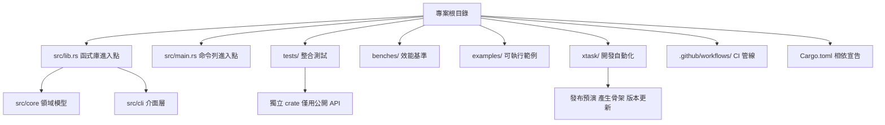
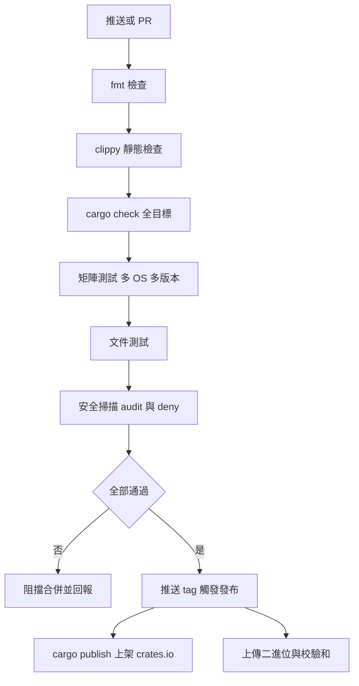

# 18.2 CI/CD 與 Rust 專案最佳實踐

前面十幾章談的是「怎麼寫出正確的 Rust」，但真正決定一個專案能不能長期存活的是另一件事：當你按下 Enter 之後，有沒有一個全自動的機制替你把關。Rust 的型別系統擋掉了記憶體安全問題，卻擋不住拼字錯誤的文件、失效的測試、過時的依賴或體積暴漲的產物。這些問題，正是持續整合存在的理由。

## 一、CI 的必備檢查

一套合格的 Rust CI 管線至少包含五道關卡，它們各自對應不同類型的缺陷：

| 檢查項 | 指令 | 目的 | 失敗代表什麼 |
| --- | --- | --- | --- |
| 格式檢查 | `cargo fmt --check` | 程式碼排版與 rustfmt 設定一致 | 風格分歧，阻擋合併 |
| 靜態檢查 | `cargo clippy -- -D warnings` | 找出常見錯誤與可疑寫法 | 存在潛在缺陷或技術債 |
| 編譯檢查 | `cargo check --all-targets` | 涵蓋測試、範例與基準的編譯 | 某個目標建置不過 |
| 單元與整合測試 | `cargo test` | 驗證行為符合預期 | 功能回歸 |
| 文件測試 | `cargo test --doc` | 驗證 README 與文件中的範例 | 文件與實作脫節 |

這五道關卡的順序有講究。`cargo fmt --check` 放在最前面，因為它最快、幾乎不需要建置，且失敗原因明確。`cargo check` 比 `cargo build` 快，因為它只做型別檢查不做程式碼生成，適合當作前置篩檢。`clippy` 則是最容易出現「環境差異」的步驟：clippy 的 lint 集合會隨 Rust 版本變動，新版本可能對舊程式碼提出新警告，因此固定 clippy 版本或使用 `cargo clippy` 時指定工具鏈版本，是維護 CI 穩定的關鍵。

把 `-D warnings` 加上很重要。預設情況下 clippy 只是印出警告並以成功結束，只有加上 `-D warnings` 才會讓警告變成錯誤。這代表**任何新增的 lint 警告都會立刻擋下合併**，而不是默默堆積成技術債。

另外，CI 中的環境變數設定也值得留意。在 workflow 頂層宣告 `CARGO_TERM_COLOR: always`，可以讓 CI 日誌保留 Cargo 的彩色輸出；再設定 `RUSTFLAGS: "-D warnings"`，則能讓編譯階段的警告也直接升級為錯誤，讓「未使用的變數」這類問題無法逃過檢查。

## 二、GitHub Actions 的觸發條件與矩陣

GitHub Actions 的 workflow 由 `.github/workflows/` 下的 YAML 檔案定義。觸發條件決定了它在什麼時候執行，對 Rust 專案而言，常見的組合是：每次推送與 PR 時跑快速檢查，tag 推送時才跑發布流程。

```yaml
name: CI

on:
  push:
    branches: ["main"]
    tags: ["v*"]
  pull_request:
    branches: ["main"]
  workflow_dispatch:
```

`workflow_dispatch` 讓 workflow 能在網頁介面上手動觸發，這在排查問題或臨時做一次完整矩陣時很有用。分支條件寫成 `"main"` 而非空字串，代表只有目標分支才會完整執行，這能省下大量無謂的 CI 額度。

**矩陣（matrix）** 是 Rust CI 的核心武器。Rust 保證同一個 crate 在不同作業系統與不同編譯器版本上都能編譯，這項保證必須靠 CI 來持續驗證：

```yaml
jobs:
  test:
    strategy:
      fail-fast: false
      matrix:
        os: [ubuntu-latest, macos-latest, windows-latest]
        rust: ["stable", "beta", "nightly"]
    runs-on: ${{ matrix.os }}
```

`fail-fast: false` 讓一個組合失敗時，其餘組合仍會繼續跑完，這樣你能在一次檢視中看到完整的失敗範圍，而不是只看到第一個錯誤。

## 三、完整的 Workflow 範例

下面這份設定涵蓋了日常開發最需要的部分：快取、矩陣測試、文件建置與安全性掃描。

```yaml
name: CI

on:
  push:
    branches: ["main"]
  pull_request:
    branches: ["main"]

permissions:
  contents: read

env:
  CARGO_TERM_COLOR: always
  RUSTFLAGS: "-D warnings"

jobs:
  fmt:
    runs-on: ubuntu-latest
    steps:
      - uses: actions/checkout@v4
      - uses: dtolnay/rust-toolchain@stable
        with:
          components: rustfmt
      - run: cargo fmt --all --check

  clippy:
    runs-on: ubuntu-latest
    steps:
      - uses: actions/checkout@v4
      - uses: dtolnay/rust-toolchain@stable
        with:
          components: clippy
      - uses: Swatinem/rust-cache@v2
      - run: cargo clippy --all-targets --all-features -- -D warnings

  test:
    needs: [fmt, clippy]
    strategy:
      fail-fast: false
      matrix:
        os: [ubuntu-latest, macos-latest, windows-latest]
        rust: ["stable", "1.75.0"]
    runs-on: ${{ matrix.os }}
    steps:
      - uses: actions/checkout@v4
      - uses: dtolnay/rust-toolchain@master
        with:
          toolchain: ${{ matrix.rust }}
      - uses: Swatinem/rust-cache@v2
        with:
          key: ${{ matrix.os }}-${{ matrix.rust }}
      - run: cargo test --all-targets --all-features
      - run: cargo test --doc

  audit:
    runs-on: ubuntu-latest
    steps:
      - uses: actions/checkout@v4
      - uses: dtolnay/rust-toolchain@stable
      - uses: rustsec/audit-check@v2
        with:
          token: ${{ secrets.GITHUB_TOKEN }}
```

`dtolnay/rust-toolchain` 是一個廣泛使用的 action，它用官方工具鏈安裝 Rust，並且比矩陣快取更快。`Swatinem/rust-cache` 則自動處理 `~/.cargo` 與 `target/` 的快取，讓第二次建置通常只需數十秒而非數分鐘。

## 四、測試覆蓋率與安全掃描

測試覆蓋率是另一個常被低估的指標。它不能直接衡量品質，但能精準指出**哪些程式碼從未被執行過**，這往往直接對應到隱藏的缺陷。

```yaml
  coverage:
    runs-on: ubuntu-latest
    steps:
      - uses: actions/checkout@v4
      - uses: dtolnay/rust-toolchain@stable
        with:
          components: llvm-tools-preview
      - uses: Swatinem/rust-cache@v2
      - uses: taiki-e/install-action@cargo-llvm-cov
      - run: cargo llvm-cov --all-features --workspace --lcov --output-path lcov.info
      - uses: codecov/codecov-action@v4
        with:
          files: lcov.info
          fail_ci_if_error: true
```

`cargo llvm-cov` 依賴 LLVM 的 coverage instrumentation，因此需要額外安裝 `llvm-tools-preview` 元件。產生的 `lcov.info` 是標準格式，codecov 這個托管服務會把它轉成網頁上的圖形報告。

安全掃描則是另一個維度。RustSec Advisory Database 維護著 Rust 生態的已知漏洞公告，而 `cargo audit` 會比對你的 lockfile 是否含有受影響的版本：

```bash
cargo install cargo-audit
cargo audit
```

`cargo deny` 則處理授權與重複依賴問題。它可以根據 `deny.toml` 設定拒絕特定授權、限制同時存在的多個版本，並產生依賴關係圖。`cargo outdated` 用於檢查相依是否有新版本，特別適合搭配 Dependabot 一起運作。

```toml
# deny.toml
[advisories]
ignore = []

[licenses]
allow = ["MIT", "Apache-2.0", "Unicode-3.0"]
```

`cargo deny` 的授權檢查特別值得重視。MIT 與 Apache-2.0 這類寬鬆授權通常沒有問題，但 LGPL 與部分 GPL 授權有著強烈的連結義務，若把它們帶進一個閉源商業函式庫，可能造成法律風險。把授權白名單寫進設定並讓 CI 強制執行，等於把這項檢查從「法務部門的例行公事」變成「每次合併都會自動發生」。

在工具鏈版本管理上，`rust-toolchain.toml` 檔案扮演關鍵角色：

```toml
[toolchain]
channel = "1.83.0"
components = ["rustfmt", "clippy"]
profile = "minimal"
```

把它提交到版控庫，本機的 `rustup` 會自動切換到指定版本，CI 也能用同樣的設定安裝工具鏈。這消除了「我本機能過，CI 掛掉」這類最令人挫折的問題。

## 五、跨平台與多版本編譯矩陣

矩陣不只用於測試，也用於產物建置。同一份 workflow 可以同時負責「驗證」與「產出」，差別只在最後是否上傳 artifact：

```yaml
  build:
    needs: test
    strategy:
      fail-fast: false
      matrix:
        include:
          - os: ubuntu-latest
            target: x86_64-unknown-linux-gnu
          - os: macos-latest
            target: aarch64-apple-darwin
          - os: windows-latest
            target: x86_64-pc-windows-msvc
    runs-on: ${{ matrix.os }}
    steps:
      - uses: actions/checkout@v4
      - uses: dtolnay/rust-toolchain@stable
        with:
          targets: ${{ matrix.target }}
      - uses: Swatinem/rust-cache@v2
      - run: cargo build --release --target ${{ matrix.target }}
      - run: cargo test --release --target ${{ matrix.target }}
      - uses: actions/upload-artifact@v4
        with:
          name: bin-${{ matrix.target }}
          path: target/${{ matrix.target }}/release/
```

這裡有個容易踩到的陷阱：**交叉編譯不等於能測試**。在 Linux 上用 `--target aarch64-apple-darwin` 可以嘗試編譯，但沒有 Apple SDK 就會失敗，而且即使成功也無法執行。因此跨平台矩陣的正確做法是「在該平台上建置該平台的產物」，讓 runner 與 target 一一對應。

矩陣的設計還有一個細節：`include` 讓你為特定組合指定額外設定，而 `exclude` 可以把明顯沒有意義的組合去掉。例如某些 crate 只在 Windows 上才需要額外的相依，這時可以在矩陣中宣告：

```yaml
    strategy:
      matrix:
        os: [ubuntu-latest, macos-latest, windows-latest]
        exclude:
          - os: windows-latest
            rust: "nightly"
```

把 nightly 從 Windows 組合中排除，既省下 CI 資源，也避免 nightly 在該平台上偶發的建置失敗拖垮整條管線。

## 六、產物發布與持續發布

`cargo build --release` 與 `cargo install` 的差別在於**產物形態**。前者產生的是 `target/release/` 下的可執行檔與 `.rlib`、`.rmeta` 等中間產物；後者則是把 crate 安裝到 Cargo 的 bin 目錄，並且預設以 release 模式編譯。對使用者來說，`cargo install` 是安裝命令列工具的標準入口。

分發預先編譯的二進位時，除了壓縮，還應該提供校驗和，讓使用者能確認下載的檔案沒有被竄改：

```bash
tar czf tinytext-linux-x64.tar.gz target/x86_64-unknown-linux-gnu/release/tinytext
shasum -a 256 tinytext-linux-x64.tar.gz > tinytext-linux-x64.tar.gz.sha256
```

持續發布則由 tag 觸發。當你推送 `v1.2.0` 這樣的 tag，workflow 會辨識出版本號並把 crate 發布到 crates.io：

```yaml
  release:
    needs: [test, build]
    if: startsWith(github.ref, 'refs/tags/v')
    runs-on: ubuntu-latest
    permissions:
      contents: write
    steps:
      - uses: actions/checkout@v4
      - uses: dtolnay/rust-toolchain@stable
      - uses: Swatinem/rust-cache@v2
      - run: cargo publish --locked
      - uses: softprops/action-gh-release@v2
        with:
          files: target/release/tinytext
```

`--locked` 參數確保發布時使用的相依版本與已提交的 lockfile 完全一致，不會在 CI 中悄悄解析出新的版本。token 透過 `CARGO_REGISTRY_TOKEN` 環境變數傳入，值應存放在 repository secrets。

## 七、快取與建置加速

建置時間是 Rust CI 最主要的成本來源，有幾個有效的手段。第一是**快取 `target/` 目錄**，這能讓重複的編譯工作直接命中。第二是 **`sccache`**，它是一個編譯器快取伺服器，能跨專案甚至跨 CI 執行重用編譯結果：

```yaml
      - uses: taiki-e/install-action@sccache
      - run: sccache --show-stats
```

第三是 **`cargo-nextest`**，它以行程為單位並行執行測試，比 Cargo 內建的逐執行緒執行方式快上不少：

```bash
cargo nextest run --all-features
```

第四是 **`mold`** 連結器，在 Linux 上通常能顯著縮短連結階段的時間：

```yaml
      - name: Install mold
        run: |
          curl -L https://github.com/rui314/mold/releases/download/v1.9.0/mold-1.9.0-x86_64-linux-gnu.tar.gz | tar xz -C ~ --strip-components=1
          echo "$HOME/.local/bin" >> $GITHUB_PATH
      - run: mold --version
```

這四種手段可以疊加使用，而且彼此不衝突。實務上的建議是先用 `Swatinem/rust-cache` 解決大部分問題，只有在 CI 時間仍然過長時才逐步引入其他工具。

## 八、專案結構最佳實踐

一個成熟 Rust 專案的目錄結構通常長這樣：

```text
myproject/
├── Cargo.toml          # 套件中繼資料與相依宣告
├── Cargo.lock          # 應用程式提交，函式庫不提交
├── README.md
├── LICENSE
├── src/
│   ├── lib.rs          # 函式庫進入點
│   ├── main.rs         # 命令列工具進入點
│   ├── core/           # 核心領域模型
│   └── cli/            # 命令列介面層
├── tests/              # 整合測試（每個檔案是獨立 crate）
├── benches/            # 效能基準，使用 criterion
├── examples/           # 可執行範例
├── xtask/              # 自動化開發任務
└── .github/workflows/  # CI 設定
```

**`src/lib.rs` 與 `src/main.rs` 分離**是重要的設計。若兩者同時存在，Cargo 會建出函式庫 crate 與命令列 crate 兩個目標，後者可以呼叫前者。這樣的好處是命令列工具的邏輯可以被整合測試直接涵蓋，而不必啟動子行程。

`mod` 組織模組時，建議**以功能劃分而非以型別劃分**。一個 `core/` 模組內含所有領域型別與其操作，比把型別各自拆成一個檔案更容易維護，因為型別之間的耦合本來就難以切開。

`tests/` 目錄中的每個檔案都是一個獨立的 crate，意味著它只能透過 `pub` 匯出的介面來操作你的函式庫。這是一種**隱形的 API 測試**：任何測試需要觸及非公開細節，都代表公開介面可能設計得不夠好。`benches/` 使用 criterion 這類框架做精準的效能量測，`examples/` 則承載可執行範例，兩者都會被 `cargo check --all-targets` 涵蓋。

`xtask/` 是 Cargo 官方推薦的自動化模式。它是一個不在版控中發布的私有 crate，專門用來執行重複的開發任務：

```toml
[package]
name = "xtask"
version = "0.1.0"
edition = "2021"
publish = false

[dependencies]
```

```rust
// xtask/src/main.rs
use std::process::Command;

fn main() {
    match std::env::args().nth(1).as_deref() {
        Some("release") => {
            let status = Command::new("cargo")
                .args(["publish", "--dry-run"])
                .status()
                .expect("failed to run cargo publish");
            std::process::exit(status.code().unwrap_or(1));
        }
        _ => eprintln!("usage: xtask <release>"),
    }
}
```

把發布預演、產生骨架程式碼、批次更新版號這類工作收進 `xtask`，可以讓「怎麼做」變成「跑哪個指令」，也讓新人不需要口頭傳授流程。`publish = false` 這一行尤其重要，它保證這個內部工具永遠不會被誤發布到 crates.io 上。

對於多 crate 組成的 workspace，發布時需要指定套件名稱：

```bash
cargo publish -p myproject-core
cargo publish -p myproject-cli
```

順序很重要：先發布被依賴的函式庫，並等待 crates.io 的索引更新完成，再發布依賴它的上層 crate。索引更新通常是數秒到數十秒的延遲，若發布太快會出現「相依版本找不到」的錯誤。此時只要等待一下重試即可。

### 目錄結構與職責



## 九、依賴管理與效能調校

依賴管理的第一個工具是 `cargo tree`。它能顯示相依樹，並且 `-d` 參數專門列出**同時存在多個版本**的相依：

```bash
cargo tree -d
cargo tree -i serde          # 反向查詢誰依賴了某個 crate
cargo tree --features full   # 檢視某功能開啟後的相依
```

重複的相依會讓編譯時間與二進位體積雙雙上升。找到重複來源後，通常可以透過 `cargo update -p 名稱 --precise 版本` 讓它們收斂到同一版本。

除了數量，**相依的品質**同樣重要。每個引入的 crate 都是一份需要長期追蹤的安全責任，因此新增相依時應該附帶幾個判斷：它的維護狀態是否活躍、授權是否相容、傳遞性依賴有幾個、以及它的下載量與使用社群規模是否足以支撐長期的信任。這些資訊都能透過 `cargo tree` 與 crates.io 的頁面快速取得。

**功能的設計要謹慎**。每個 feature 都是一條相依的分支，而 features 之間的組合會產生「特徵乘法」——五個 feature 理論上有三十二種組合，理論上 CI 應該跑 `--all-features`，但如果功能之間有相依關係，某些組合可能根本無法編譯。設計原則是**讓每個 feature 都能獨立運作**，或者至少在文件中明確列出合法的組合。

`cargo add --no-default-features` 讓你在加入相依時就關閉預設功能，這對於只需要部分功能的 crate 特別有用，可以大幅減少傳遞性相依。

```bash
cargo add serde --no-default-features
cargo add serde --no-default-features --features derive
```

這兩行的差別是關鍵：先關掉預設功能，再依需求精準開啟真正要用的那一項。這種寫法讓相依的意圖變得明確，也讓依賴樹維持在最小規模。

效能調校則是在 `Cargo.toml` 的 profile 區段進行：

```toml
[profile.release]
opt-level = 3
lto = "thin"
codegen-units = 1
panic = "abort"
strip = "symbols"

[profile.release.package."*"]
opt-level = 2
```

`lto = "thin"` 讓編譯器在編譯單位之間進行最佳化，比完整 LTO 便宜得多，但多數情況下能取得相近的效益。`codegen-units = 1` 讓整個 crate 在單一單位中最佳化，能提升執行效率，代價是編譯時間變長。`opt-level = "s"` 偏向體積最小化，適合要嵌入其他程式的函式庫。`panic = "abort"` 移除展開機制，可以縮小體積，但會讓 `catch_unwind` 失效，撰寫伺服器或需要捕捉 panic 的程式時要謹慎。

最後那行 `[profile.release.package."*"]` 是進階技巧：它能對所有相依套件套用較弱的最佳化等級，把最佳化火力集中在自己的程式碼上。這樣做的好處是兼顧了執行效率與編譯速度，因為相依的程式碼通常不需要被最佳化到極致。

## 十、安全與供應鏈

供應鏈安全是 Rust 生態近年來最受關注的議題。crates.io 的下載量與依賴樹都是公開的，這意味著**一個被廣泛依賴的 crate 若遭到入侵，影響會擴散到極廣**。對策包含幾個層面。

在 CI 中，一律使用**最小權限**。`permissions: contents: read` 讓 workflow 只能讀取程式碼，不能推送或修改內容；只有需要發布的 job 才提升權限。第三方 action 也應盡量鎖定到具體的 commit SHA，而非浮動的 tag。

`cargo auditable` 會在建置時把相依的資訊嵌入二進位，使得使用者能夠在事後檢查某個執行檔究竟包含哪些 crate：

```bash
cargo install cargo-auditable
cargo auditable build --release
```

產出的二進位可以用 `cargo auditable info` 檢視其中包含的相依清單。對於需要嚴格控管來源的組織，還有簽章與 SBOM 的做法。簽章讓使用者能驗證套件或 artifact 來自真正的發布者，SBOM（軟件物料清單）則列出產物中包含的所有元件，方便漏洞掃描工具批次比對。

在私有 registry 的情境下，組織可以架設自己的 crates.io 相容服務，把發布流程完全收在內部。這種「私有 registry 加上公開 registry 作為備援」的組態，既能滿足合規要求，又不會犧牲套件的可用性。相對地，若專案只依賴 crates.io，那麼網路可用性就成為建置管線的單點風險。


對於需要嚴格控管來源的組織，還有簽章與 SBOM 的做法。簽章讓使用者能驗證套件或 artifact 來自真正的發布者，SBOM（軟體物料清單）則列出產物中包含的所有元件，方便漏洞掃描工具批次比對。

## 十一、常見的 CI 陷阱

第一個陷阱是**快取失效導致建置變慢**。快取的 key 通常包含作業系統、Rust 版本與 lockfile 雜湊；一旦相依更新，key 就會改變，所有東西都要重編譯。若專案更新相依很頻繁，可以考慮把 `target/` 快取與相依快取拆開，或使用 `sccache` 這類以內容為基礎的快取。

第二個陷阱是**矩陣過大**。作業系統三種乘上 Rust 版本三種，再乘上專案數量，很容易讓 CI 時間與額度失控。務實的做法是讓 `stable` 跑完整矩陣，其他版本只在 Linux 上跑一次即可，因為相容性問題多數與平台無關。

第三個陷阱是 **`--all-features` 導致建置時間爆炸**。開啟所有功能會拉進最多相依，有時還會引入編譯時間極長的相依（例如某些綁定生成工具）。若專案功能眾多，與其一律 `--all-features`，不如列出關鍵功能組合分別測試。

第四個陷阱是**依賴浮動的工具鏈**。若 workflow 沒有指定固定的 Rust 版本，每天建置的結果可能不同，某天冒出來的新 lint 會讓 CI 突然紅燈。指定 `toolchain: stable` 並搭配 `rust-toolchain.toml` 檔案，可以讓本機與 CI 使用同一版本。

第五個陷阱是**把發布和測試綁在同一個 job**。若 `cargo publish` 與測試同時執行，一旦測試失敗，發布可能已經啟動。正確的做法是讓發布 job 依賴測試 job 成功完成，形成一條嚴格的先後順序鏈。

第六個陷阱是**快取命中了錯誤的相依版本**。快取 key 若沒有包含 lockfile 的雜湊值，就可能在相依更新後仍使用舊的編譯結果，造成神祕的行為差異。`Swatinem/rust-cache` 預設會把 lockfile 納入 key，因此在多數情況下不需要額外處理。

第七個陷阱則是**矩陣中的環境不一致**。有時同一個 workflow 中，兩個 job 分別用 `actions/checkout@v4` 與 `actions/checkout@v3`，導致行為細微不同。把 action 版本統一宣告在 workflow 層級，是消除這類混亂的好方法。

## 十二、給新專案的最小可行 CI



如果資源有限，只能先做一件事，那麼最小可行的設定長這樣：

```yaml
name: CI

on:
  push:
    branches: ["main"]
  pull_request:

permissions:
  contents: read

jobs:
  ci:
    runs-on: ubuntu-latest
    steps:
      - uses: actions/checkout@v4
      - uses: dtolnay/rust-toolchain@stable
        with:
          components: rustfmt, clippy
      - uses: Swatinem/rust-cache@v2
      - run: cargo fmt --all --check
      - run: cargo clippy --all-targets -- -D warnings
      - run: cargo test --all-features
      - run: cargo test --doc
```

這份設定只需要一分鐘左右就能在本機驗證完畢，卻已經涵蓋了格式、風格、行為與文件四個維度。待專案逐漸成長，再依序補上矩陣測試、覆蓋率報告、安全掃描與自動發布。

CI 的本質是把「我記得每次都要檢查的事情」交給機器。Rust 已經幫你消除了記憶體安全這一類最難查的錯誤，剩下的部分就交給這條管線吧。
