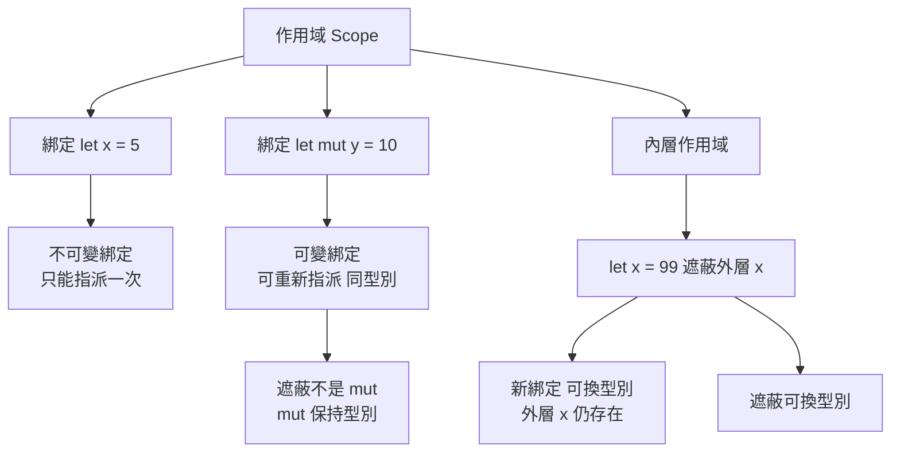

# 2.1 變數與可變性（mut、遮蔽 Shadowing）

## 綁定：Rust 的第一個觀念轉向

在多數主流語言裡，宣告一個變數的語意是「建立一個容器，之後可以往裡面塞值」。Rust 的 `let` 做的事情更接近「把某個名稱與某個值綁定在一起」，而且這個綁定預設是**不可變**的。這裡的「不可變」不是指位元組在記憶體裡被鎖住，而是指**這個名稱在它的作用域內無法再指向另一個值**。一旦寫成 `let x = 5;`，之後的 `x` 就永遠是 `5`，既不能重新指派，也不能改成 `6`。

這個設計看起來只是語法上的小改動，實際上卻是 Rust 整套安全性論證的起點。因為「值不會被神不知鬼不覺地改掉」，程式碼的行為就可以靠閱讀原始碼與閱讀編譯後的機器碼來推斷，而不必去追蹤「誰可能在中間改過它」。這種可推理性是 Rust 得以在沒有垃圾收集器、沒有執行緒的同時，提供記憶體安全與無資料競爭保證的基礎。

```rust
fn main() {
    let x = 5;
    // x = 6; // 錯誤：cannot assign twice to immutable variable
    println!("x 的值是 {x}");
}
```

要讓綁定可以被重新指派，必須在宣告時明確加上 `mut` 關鍵字：

```rust
fn main() {
    let mut x = 5;
    x = x + 1;
    x = x * 2;
    println!("x 的值是 {x}");
}
```

`mut` 修飾的是**綁定**而不是值本身。這個區別在後續章節會變得非常關鍵：當你把一個 `mut` 綁定交給別人時（例如傳入函式），對方取得的是「可變借用」而非「所有權」，借用規則會進一步限制對方能做的事。

## 為什麼預設不可變能減少副作用

在 C 或 C++ 裡，一個函式把參數「改成別的值」是常見手法，例如把收到的指標所指內容重排。這種寫法把「輸入」與「輸出」混在同一個參數裡，呼叫端難以判斷自己的資料是否被動過，副作用於是沿著呼叫鏈擴散。Rust 的預設不可變等於宣告：**若一個值要從「輸入」變成「輸出」，必須在型別或名稱上留下痕跡**。最直接的痕跡就是 `mut`。

這個預設還帶來一個副作用非常實用的推論：不可變的資料可以被任意複製而無須複製資料本身，因為沒有任何地方能觀察到差異。這正是第 4 章「所有權」與第 12 章「執行緒」能夠優雅結合的基礎——多個執行緒若各自持有同一份不可變資料的參考，因為沒有任何一方能改寫內容，就不會產生資料競爭。Rust 官方在《The Rust Programming Language》裡引述的說法是：不可變性是預設狀態， mutation 需要被「要求」而非被「允許」。

從工程角度來看，這把「程式碼壞掉的時間點」往前推了。可變狀態的 bug 往往不是語法錯誤，而是「在某個不該改的地方被改了」，而這類問題在除錯時往往難以重現。改成不可變之後，同樣的邏輯錯誤要嘛在編譯期被擋下，要嘛變成更容易追蹤的資料流問題。

這個取捨在實務上並不昂貴。把一個常數宣告成 `let` 與把它寫成 `const`，在執行期成本上幾乎沒有差別；但前者只能被重新指派一次，後者則連指派的權利都沒有。把「計算結果」和「可被覆寫的暫存槽」分開，是 Rust 程式碼風格的常見特徵。

```rust
const TAX_RATE: f64 = 0.05;

fn subtotal(prices: &[f64]) -> f64 {
    prices.iter().sum()
}

fn total(prices: &[f64]) -> f64 {
    let sum = subtotal(prices);
    let sum = sum * (1.0 + TAX_RATE);   // 遮蔽語意清晰：進入「含稅」階段
    sum
}

fn main() {
    let prices = [100.0, 250.0, 80.0];
    println!("{:.2}", total(&prices));
}
```

另一個常被低估的好處是**可推導性**。當一個函式的回傳型別是 `&str` 而不是 `&mut str`，呼叫端就知道這段字串在接下來的程式中不會被悄悄換掉。這種資訊在大型程式碼庫裡能省下大量「誰改了這裡」的考古工作，也是 Rust 在重構時敢於做大規模改名與移動的安全墊。

從效能的角度來看，不可變性還帶來編譯器最佳化的空間。`let x = 5;` 之後的 `x` 是編譯期已知的常數，編譯器可以直接摺疊它，甚至把後續使用它的運算整體提升為編譯期常數。相對地，一個 `mut` 綁定的值每次讀取都可能不同，編譯器必須保留載入指令。這差異在高頻迴圈裡偶爾看得出來，但多半不是瓶頸所在——真正的瓶頸通常在記憶體存取而非綁定屬性。

## `mut` 與遮蔽：兩種完全不同的機制

Rust 提供了兩種看起來相似、實際上截然不同的方式來「改變一個名字所對應的東西」。第一種是 `mut`，它讓**同一個綁定**在之後能被重新指派到新的值。第二種是**遮蔽**（shadowing），指的是在同一作用域中用 `let` 重新宣告同名變數，新的綁定會**取代**舊的綁定。舊的值若已無使用者就會被丟棄，若仍有使用者則交由所有權規則處理。

遮蔽最大的特色是**可以改變型別**。`mut` 做不到這件事，因為重新指派時新值必須與舊值同型別。

```rust
fn main() {
    let spaces = "   ";
    let spaces = spaces.len();   // 遮蔽：型別從 &str 變成 usize
    println!("{spaces}");

    let mut count = 0;           // mut：型別固定為整數
    // count = "三";              // 錯誤：型別不符
    count += 3;
    println!("{count}");
}
```

兩者的差異可以整理成下表：

| 面向 | `mut` 重新指派 | `let` 遮蔽 |
|---|---|---|
| 綁定數量 | 仍是一個綁定 | 產生全新的綁定，舊的可被丟棄 |
| 型別可否改變 | 否，必須同型別 | 可以，新舊型別無關 |
| 記憶體回收 | 舊值被丟棄（若無其他擁有者） | 舊值依所有權規則決定 |
| 對外可見性 | 同一作用域內後續程式碼皆可見 | 同樣作用於後續程式碼 |
| 適用場景 | 累加、狀態更新 | 型別轉換、收窄作用域借用 |

## 遮蔽的兩大實用時機

遮蔽最常見的用途是**型別轉換**。Rust 沒有隱式轉型，想從一種型別轉到另一種，必須顯式表達，而遮蔽讓這個表達寫得相當自然：變數名稱保持不變，語意隨著型別演進。

```rust
fn main() {
    let raw = "3 7 11";
    let nums: Vec<i32> = raw.split_whitespace()
        .map(|s| s.parse().unwrap())
        .collect();
    let total: i32 = nums.iter().sum();
    let total_str = format!("總和 = {total}");
    println!("{total_str}");
}
```

遮蔽的另一個用途是**在受控的作用域內取得可變借用**。當你只想在某個小區塊內修改一個本來不可變的綁定，與其把整個宣告改成 `mut`（等於把可變性延伸到整個作用域），不如用遮蔽開一個更小的可變範圍。這在第 5 章討論生命週期與借用時特別有用。

```rust
fn main() {
    let data = vec![1, 2, 3];
    {
        let mut data = data;   // 取得所有權，並在這個作用域內可變
        data.push(4);
        println!("內部：{data:?}");
    }
    // 這裡的 data 已被移動，編譯器不會讓你誤用
}
```

注意這裡的 `let mut data = data;` 是一個**移動**而非複製，因為 `Vec<T>` 不實作 `Copy`。遮蔽同名並不會神奇地複製資料；所有權在遮蔽的瞬間就已經決定了歸屬。

遮蔽也可以用來把「讀到的東西」與「要還回去的東西」分開，這在處理 API 的連續呼叫時很常見。

```rust
fn parse_and_describe(input: &str) -> String {
    let trimmed = input.trim();
    let parsed: u32 = trimmed.parse().unwrap_or(0);
    let parsed = parsed.saturating_mul(2);
    format!("結果為 {parsed}")
}

fn main() {
    let out = parse_and_describe("  21 ");
    println!("{out}");
}
```

如果不想取得所有權，只想讀取，可以改用 `let ref` 或直接借用。這點會在第 4 章的借用章節詳細說明；此處只需記住：遮蔽不會改變所有權的規則，它只是換了個名字綁定同一份或另一份資料。

## `const` 與 `static`：常數與靜態變數

Rust 提供了兩種在編譯期就固定、但存在方式不同的關鍵字。`const` 定義的是**常數**，它在編譯期就被求值並直接內嵌到使用它的位置，型別必須標註，且每個使用點都有自己的一份。

```rust
const MAX_RETRIES: u32 = 3;
const PI: f64 = 3.14159;

fn main() {
    let attempts = MAX_RETRIES;      // 直接就是 3
    let circle = PI * 2.0;
    println!("{attempts} {circle}");
}
```

`static` 定義的是**靜態變數**，它有一個固定的記憶體位址，整個程式 lifetime 內只有一份，並且預設是不可變的（`static mut` 雖可寫，但會帶來 unsafe 與資料競爭的爭議）。它不能用 `const` 的方式做常數摺疊，取用時若在執行期使用其位址，程式碼體積也會略微增加。

```rust
static APP_NAME: &str = "rust-book";
static COUNTER: std::sync::atomic::AtomicU32 = std::sync::atomic::AtomicU32::new(0);

fn main() {
    COUNTER.fetch_add(1, std::sync::atomic::Ordering::Relaxed);
    println!("{APP_NAME} {}", COUNTER.load(std::sync::atomic::Ordering::Relaxed));
}
```

兩者的取捨如下：

| 面向 | `const` | `static` |
|---|---|---|
| 求值時機 | 編譯期 | 編譯期初始化，執行期擁有固定位址 |
| 副本數量 | 每個使用點一份 | 全程式唯一一份 |
| 型別註解 | 必須 | 必須 |
| 位址唯一性 | 不保證 | 保證 |
| 適用場景 | 數值常數、字串常數 | 共享狀態、位元組陣列、原子計數 |

有一個細微但實用的差別：`const` 的值在使用處會被直接寫死，因此它不佔任何執行期記憶體，也不會帶來初始化順序問題；`static` 則在程式啟動時完成初始化，佔用固定的一段位址，若初始化過程 panic 會導致整個程式無法啟動。實務上，凡是「數值」或「字串常數」都用 `const`，凡是「需要唯一身分」或「需要跨執行緒共享可變狀態」才用 `static`。

`static` 還可以搭配原子型別，用來實作不需要鎖的簡單計數器。原子操作在第 12 章會展開說明，此處的重點是：`static` 的位址唯一性，使得 `&COUNTER` 可以安全地送進其他執行緒。

## 作用域、遮蔽與初始化

Rust 的作用域以大括號界定，`let` 宣告的綁定從宣告處開始生效，到作用域結束為止。內層作用域可以用同名 `let` 遮蔽外層的綁定，外層的值在被遮蔽之後仍然存在，只是無法透過該名稱存取。

```rust
fn main() {
    let x = 1;
    {
        let x = x + 10;   // 內層遮蔽外層
        println!("內層 x = {x}");
    }
    println!("外層 x = {x}");   // 仍是 1
}
```

另一個與 C 對比鮮明的特性是：**Rust 沒有未初始化的變數**。C 允許宣告 `int x;` 然後在稍後賦值，若讀取未賦值的值就是未定義行為。Rust 中每個綁定在宣告那一刻就必須有一個值，編譯器會追蹤資料流，確保任何使用點都讀得到已初始化的資料。

```rust
fn main() {
    // let x;             // 錯誤：type annotations needed
    let x: i32;
    // println!("{x}");   // 錯誤：此處尚未初始化
    x = 42;
    println!("{x}");
}
```

這種設計在除錯時極有價值：它把「讀到垃圾值」這一整類問題從執行期推到了編譯期。同樣的機制也解釋了為什麼 Rust 的 `let` 不能像 C 那樣先宣告後賦值——型別推斷需要一個初始值才能運作。

作用域還承擔了另一項重要任務：**資源的釋放時機**。Rust 會在綁定離開作用域時，呼叫其所有資源的析構邏輯（`Drop` trait）。因此 `let` 的作用域不只是一個命名空間邊界，也是資源生命週期的邊界。把資源放在更小的作用域裡，就等於提早釋放它。

```rust
fn main() {
    let first = String::from("hello");
    {
        let second = String::from("world");
        println!("{first} {second}");   // 兩者皆有效
    }                                     // second 在此被丟棄
    println!("{first}");
}
```

這裡 `second` 的記憶體在離開內層作用域時就歸還給系統或配置器，而不是等到 `main` 結束。對照第 10 章的智慧指標與第 8 章的錯誤處理，就會發現「作用域」其實是 Rust 中最重要的資源管理工具，比手動 `free` 或 `defer` 都來得可靠。

## 遮蔽如何讓資料流更清晰

遮蔽的真正價值在於，它讓**同一個名稱承載資料處理的不同階段**，而每一階段的型別都精確地表達了當下的語意。傳統做法是取一堆名字：`raw`、`raw_len`、`parsed`、`parsed_total`，讀者得在腦中維護名字之間的對應。遮蔽把這些階段串成一條線。

```rust
fn main() {
    let input = "42";
    let input = input.trim();            // &str
    let input = input.parse::<i32>();    // Result<i32, ParseIntError>
    let input = match input {
        Ok(v) => v,
        Err(_) => 0,
    };                                    // i32
    let input = input * 2;               // i32
    println!("{input}");
}
```

同一個名字 `input` 在不同行代表不同型別，讀者只要看當下行就能知道現在手上是什麼。這種「型別驅動的階段命名」在處理外部輸入時特別有價值，因為不可信資料往往需要經過清洗、解析、驗證、轉換數個階段。

遮蔽的另一個好處是**讓函式的參數型別與內部型別分離**。很多函式的自然介面是 `&str`，但內部運算需要 `String` 或解析後的數字，這時在函式開頭遮蔽一次參數名稱，就能把轉換集中在一處，避免在整個函式裡混用兩個名字。

```rust
fn summarize(raw: &str) -> String {
    let raw = raw.trim().to_owned();     // String：先取得擁有的副本
    let raw = raw.lines().count();       // usize：再換算成行數
    format!("共 {raw} 行")
}

fn main() {
    let s = "第一行\n第二行\n第三行";
    println!("{}", summarize(s));
}
```

這種寫法的好處是「原始輸入」這個概念在函式內部只存在於第一行的綁定，往後每一行都清楚地表達「目前處理到哪一步」。相較之下，命名 `raw_str`、`raw_owned`、`line_count` 三個變數，雖然資訊量相同，但讀者必須靠名字的相似度去推斷它們的關係；遮蔽則由語言本身保證了這個順序。

## 常見陷阱：把 `mut` 當成 C 的可變變數

最常見的誤解是把 `mut` 理解為「像 C 一樣可隨手改的變數」。這個誤解會在第一次遇到借用錯誤時造成困惑。事實上，`mut` 只是授權你**重新指派這個綁定**，它並不繞過任何借用規則。

```rust
fn main() {
    let mut v = vec![1, 2, 3];
    let first = &v[0];
    // 若解除下一行的註解，編譯器會回報
    // cannot borrow `v` as mutable because it is also borrowed as immutable
    // v.push(4);
    println!("{first}");
    v.push(4);
    println!("{v:?}");
}
```

這段程式碼在 C++ 中完全合法，但在 Rust 中被拒絕，原因是 `first` 借用了 `v`，而 `push` 需要獨佔可變借用。`mut` 授予的是**這個作用域內對這個綁定的重新指派權**，不是「任何時候都能改它所指向的資料」。

另一個陷阱是把 `mut` 加在不需要的地方。Rust 的編譯器會警告 `variable does not need to be mutable`，這項警告通常意味著設計可以簡化——資料不需要改變，那就不該把它標成可變。

```rust
fn main() {
    let items = vec![1, 2, 3];
    let doubled: Vec<i32> = items.iter().map(|x| x * 2).collect();
    println!("{doubled:?}");
}
```

在這個例子裡，`items` 從未被重新指派，因此它不需要 `mut`；若寫成 `let mut items`，編譯器就會發出「不需要 mut」的警告。反過來說，若程式碼確實需要重新指派卻忘了加 `mut`，編譯器給出的則是錯誤而非警告——這是 Rust「硬錯誤多於軟警告」哲學的又一例證：型別與綁定層的問題一律阻擋編譯，只有風格層的問題才以警告呈現。

正確的心智模型是三層的：**綁定層**（`let`／`mut` 決定名字能否重新指派）、**所有權層**（值歸誰，決定移動與丟棄）、**借用層**（借用期間能否被別人同時可變存取）。前兩層在第 2 章與第 4 章討論，第三層是第 5 章的內容。初學時只要記住「`mut` 屬於綁定層」，就不會把它和 C 的可變變數混為一談。

還有一個常見的困惑來源是 `mut` 與「可變參數」的差別。Rust 的函式參數永遠不會因為呼叫端傳入什麼而改變，只有透過 `&mut` 取得可變參照才可能修改呼叫端的資料。`mut` 只影響**函式內部**那個綁定能不能重新指派，完全不影響參數本身。

```rust
fn bump(n: i32) -> i32 {
    let n = n + 1;     // 遮蔽參數，呼叫端不受影響
    n
}

fn main() {
    let value = 10;
    let result = bump(value);
    println!("{value} -> {result}");
}
```

這與 C 的 `void f(int n) { n++; }` 在結果上相同，但 Rust 的寫法意圖更明確：遮蔽表示「我現在談論的是另一個東西」，而不是「我偷偷改了你的參數」。

## 綁定、作用域與遮蔽的結構

下圖總結本章的三個概念如何交會：綁定建立於作用域之中，遮蔽則在同一作用域內替換綁定。



## 小結

Rust 的可變性設計可以濃縮成三句話：綁定預設不可變，需要改變時必須用 `mut` 明確要求；`mut` 只作用於綁定的重新指派，不能改變型別，也不豁免任何借用規則；遮蔽則是更靈活的手法，它建立新綁定、能跨越型別，常用於型別轉換與收窄可變範圍。理解這三者的分工，才能在第 4 章進入所有權時，不把「擁有」與「可改」混為一談。

本章還反覆出現的一個主題是「把意圖寫進程式碼」。`mut` 讓「我打算改這個」變成顯眼的關鍵字，遮蔽讓「這裡換了語意」變成可見的邊界，`const` 與 `static` 讓「這是全域唯一的共享狀態」變成無法忽略的宣告。這種「意圖可見」的設計，是 Rust 能夠讓安全性成為語言保證而非團隊紀律的根本原因。
