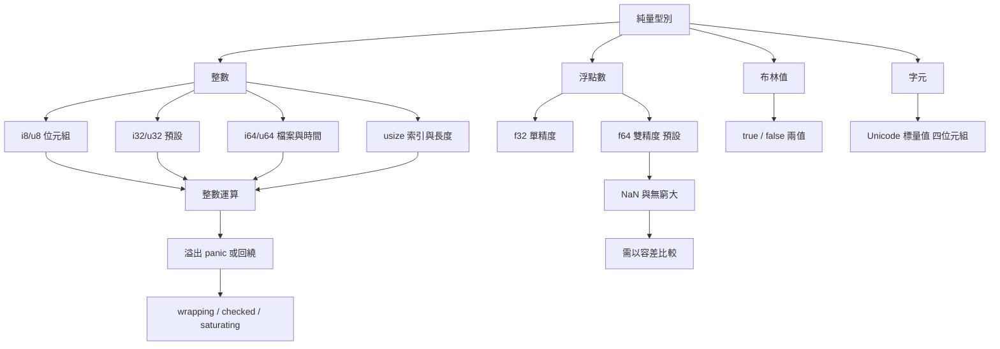

# 2.2 純量型別（整數、浮點數、布林值、字元）

## 純量的意義

所謂「純量型別」，是指那些在語意上不可再分割的值：它們沒有內部結構，也沒有需要另外管理的資源。Rust 的型別系統把這些值切成整數、浮點數、布林值與字元四大類，每一類都提供了多個寬度不同的變體。這種「寧可多給選擇、也絕不隱式轉換」的設計，是 Rust 與 C 語系最大的語意差異之一。

C 的 `int` 在多數平台上都是 32 位元，但語言規格從未保證；`long` 在 Windows 上是 32 位、在 Linux 上卻是 64 位。Rust 則要求程式碼在每一處都明確知道數字的寬度，特別是與作業系統介面交換位元組時。程式碼若沒有寫 `u8`，就必須寫 `usize` 或 `u32`，沒有模糊地帶。

## 整數型別

Rust 的整數分為有號（signed）與無號（unsigned）兩族，各自有固定的寬度：

| 型別 | 位元組數 | 位元數 | 取值範圍 | 備註 |
|---|---|---|---|---|
| `i8` | 1 | 8 | $ -128 \sim 127 $ | 常見於位元組 |
| `i16` | 2 | 16 | $ -32768 \sim 32767 $ | 罕見 |
| `i32` | 4 | 32 | $ -2^{31} \sim 2^{31}-1 $ | 預設整數型別 |
| `i64` | 8 | 64 | $ -2^{63} \sim 2^{63}-1 $ | 預設時間戳寬度 |
| `i128` | 16 | 128 | $ -2^{127} \sim 2^{127}-1 $ | 精度運算 |
| `isize` | 平台相關 | 32 或 64 | 對應 `usize` | 指標寬度 |
| `u8` | 1 | 8 | $ 0 \sim 255 $ | 常用於位元組 |
| `u16` | 2 | 16 | $ 0 \sim 65535 $ | UTF-16 程式碼單元 |
| `u32` | 4 | 32 | $ 0 \sim 2^{32}-1 $ | 色彩碼 |
| `u64` | 8 | 64 | $ 0 \sim 2^{64}-1 $ | 檔案大小 |
| `u128` | 16 | 128 | $ 0 \sim 2^{128}-1 $ | 128 位元 UUID |
| `usize` | 平台相關 | 32 或 64 | $ 0 \sim 2^{64}-1 $ | 索引與長度 |

沒有標註型別的整數字面值，會由編譯器依上下文推斷；在無法推斷時，預設為 `i32`。這個「預設」本身值得留意：若一段程式碼裡到處都是 `i32`，那麼它多半需要被重新檢視，因為真實的系統程式很少只需要 32 位元整數。

### 整數與位元組的對應

`u8` 佔一個位元組，這個事實讓它成為序列化、雜湊、加密與網路協定的通用單位。當需要把一段位元組資料轉成整數運算（例如計算 CRC 或雜湊），`u8` 與 `u32`、`u64` 之間的轉換是位元組級的手足操作。

```rust
fn main() {
    let bytes: [u8; 4] = [0xDE, 0xAD, 0xBE, 0xEF];
    let mut acc: u32 = 0;
    for b in bytes {
        acc = (acc << 8) | u32::from(b);
    }
    println!("0x{acc:08X}");
}
```

這段程式把四個位元組組合成一個 32 位元整數，其中 `u32::from(b)` 是安全的擴張轉換（`u8` 必定能放進 `u32`），而 `<< 8` 與 `|` 則組出大端的組裝順序。

### 有號與無號的取捨

有號整數能表達負數，無號整數則把全部的位元用來表示非負值，因此範圍上限是對應有號型別的兩倍減一。實務上有一個簡單的判準：**值在語意上不可能為負，就用無號型別**。長度、大小、計數、時間戳（Unix epoch 之後的秒數）都屬於這一類。

反過來說，無號型別在運算時容易出現「下溢」的陷阱——`0u32 - 1` 在偵測模式會 panic，因為減法之後的結果無法用無號型別表示。很多 API 因此選擇 `i64` 來表示時間差或位移量，因為差值本來就可能是負的。

### `i128` 與 `u128` 的特殊地位

128 位元整數在多數平台上並非原生指令，而是在需要時由編譯器以軟體模擬，因此運算成本明顯較高。它們的實用場景集中在需要極大數值的場合，例如把兩個 64 位元 UUID 合併成一個 128 位元識別碼，或是對極大整數做定點數運算。

```rust
fn main() {
    let big: u128 = u128::MAX;
    println!("{big}");
    let half = big / 2;
    println!("{half}");
    let composed: u128 = (u64::MAX as u128) << 64 | u64::MAX as u128;
    println!("{composed}");
}
```

在一般應用中，優先選用 `u64`，只有在確實需要更大範圍時才動用 128 位元型別。

```rust
fn main() {
    let a = 42;                 // i32
    let b: u8 = 200;            // 明確標註
    let c = 1_000_000u64;       // 底線分隔與後綴
    let d = 0xFF_u8;            // 十六進位
    let e = 0b1010_1010i32;      // 二進位
    let f = 1_000.5f32;         // 浮點需有小數點或 f32 後綴
    println!("{a} {b} {c} {d} {e} {f}");
}
```

### `usize` 為何與索引長度綁定

`usize` 的寬度永遠等於目標平台的指標寬度，也就是「一次記憶體存取最多能走多少位元組」。它因此成為集合長度與索引的自然型別：任何連續記憶體區塊的大小上限，都是位址空間能表達的大小。

更關鍵的是，Rust 的索引運算子要求索引的型別就是 `usize`。這不是任意選擇，而是型別系統的一致性要求：切片長度本身也是 `usize`，若索引允許是 `i32`，就會出現負數索引的困擾，以及把長度存成有號整數時可能為負的問題。

```rust
fn main() {
    let v = vec![10, 20, 30];
    let len = v.len();              // usize
    let i = 1usize;
    println!("{} {}", v[i], len);
}
```

把長度存進 `i32` 是常見的錯誤來源。`v.len() as i32` 在長度超過 $ 2^{31}-1 $ 時會溢出，因此正確做法是讓長度保持 `usize`，只有在真正需要算術運算時才做有意的轉換。

### 整數溢出的行為

Rust 對整數溢位的處理與 C 不同：C 是未定義行為，Rust 在偵測模式（debug）下會直接 panic，在釋放模式（release）下則以二進位補數回繞。開發時 panic 讓溢位立刻暴露，生產環境回繞則避免崩潰導致服務中斷。

```rust
fn main() {
    let max = u8::MAX;
    let result = std::panic::catch_unwind(|| max + 1);
    match result {
        Ok(v) => println!("未溢出：{v}"),
        Err(_) => println!("偵測到溢出，已 panic"),
    }
}
```

需要明確控制行為時，標準庫提供四組對應的方法，取捨如下：

| 方法 | 溢出時行為 | 適用情境 |
|---|---|---|
| `wrapping_add` | 回繞 | 計數器、雜湊運算等刻意的模運算 |
| `checked_add` | 回傳 `None` | 不可信輸入，需要偵測失敗 |
| `saturating_add` | 夾在上下界 | 音量、亮度等物理量 |
| `overflowing_add` | 回傳 `(值, 是否溢出)` | 需要同時取得結果與旗標 |

```rust
fn main() {
    let a: u8 = 250;
    println!("{}", a.wrapping_add(10));      // 4
    println!("{:?}", a.checked_add(10));     // None
    println!("{}", a.saturating_add(10));    // 255
    println!("{:?}", a.overflowing_add(10));  // (4, true)
}
```

在 `debug` 組建中，`+` 運算子等同於 `checked_add` 的「遇錯就 panic」版本；在 `release` 組建中則等同於 `wrapping_add`。這個差異讓同一份程式碼在開發期與生產期有不同的防護強度，是 Rust「把錯誤移到左邊」哲學的具體落實。

## 浮點型別

浮點型別只有 `f32` 與 `f64` 兩種，分別對應 IEEE 754 的單精度與雙精度。`f64` 是預設型別，在現代處理器上效能與 `f32` 幾乎相同，因此除非有明確的儲存空間或頻寬考量，否則直接使用 `f64`。

IEEE 754 定義了幾種特殊值，其中對程式設計影響最大的兩個是 **NaN**（Not a Number）與無窮大。NaN 是任何運算的結果與自身比較都回傳 `false`，因此 `x == x` 對 NaN 而言為假，這在數學上違反了相等性的自反性，卻是浮點運算的標準行為。

```rust
fn main() {
    let nan = f64::NAN;
    println!("{}", nan == nan);              // false
    println!("{}", nan.is_nan());            // true
    let inf = f64::INFINITY;
    println!("{}", inf + 1.0);               // inf
    println!("{}", inf - inf);               // NaN
}
```

浮點相等性比較因此需要格外小心。比較由運算產生的數值時，實務上應當判斷「差值是否小於某個容許誤差」，而非直接用 `==`。

```rust
fn approx_eq(a: f64, b: f64, eps: f64) -> bool {
    (a - b).abs() < eps
}

fn main() {
    let sum = 0.1 + 0.2;
    println!("{}", sum);                        // 0.30000000000000004
    println!("{}", approx_eq(sum, 0.3, 1e-9));   // true
}
```

`0.1 + 0.2 != 0.3` 這類現象源自二進位浮點無法精確表示十進位小數。當需要精確的十進位運算（例如財務金額），標準做法是改用整數搭配最小單位，或引入專門的十進位函式庫。

### 整數除法與溢位除零

整數除法一律向零捨去，且除以零會 panic 而非回傳錯誤。這與浮點除法不同：浮點除以零會得到無窮大或 NaN。

```rust
fn main() {
    println!("{}", 7 / 2);       // 3
    println!("{}", -7 / 2);      // -3，向零捨去
    println!("{}", 7 % 2);       // 1
    println!("{}", -7 % 2);      // -1，餘數符號跟隨被除數
    // println!("{}", 1 / 0);    // 錯誤：attempt to divide by zero
}
```

`%` 的結果符號跟隨被除數而非除數，這在處理負數金額的分配時需要特別留意。若要計算數學定義下的非負餘數，可以寫 `((a % b) + b) % b`。

### 整數與浮點的混合比較

型別不符不只發生在算術運算上，比較運算同樣嚴格。`1 == 1.0` 是編譯錯誤，必須先用 `as` 統一型別，而統一到哪一種又涉及精度取捨。

```rust
fn main() {
    let i = 3i64;
    let f = 3.0f64;
    // println!("{}", i == f);   // 錯誤：mismatched types
    println!("{}", i == f as i64);
    println!("{}", (i as f64) == f);
}
```

實務上更推薦的作法是讓浮點值在進入比較之前就轉成整數，或反過來讓所有參與比較的值維持同一型別，而不是在每次比較時現場轉換。型別不一致的寫法雖然能編譯，卻容易在某一處被遺漏，造成難以察覺的邏輯不一致。

### 浮點的輸出格式

`println!` 對浮點預設印出最短的、能唯一還原該數值的表示，因此 `0.1` 印出 `0.1` 而不是 `0.1000000000000000055`。但運算結果往往需要固定的小數位數，這時可以指定精度與對齊方式。

```rust
fn main() {
    let pi = std::f64::consts::PI;
    println!("{pi}");            // 3.141592653589793
    println!("{pi:.2}");         // 3.14，保留兩位小數
    println!("{pi:.4}");         // 3.1416
    println!("{:8.3}", pi);      // 左對齊、寬度 8
    println!("{pi:e}");          // 科學記號
}
```

在輸出金額或比例時，固定小數位數是必要的，因為 `2.0` 與 `2.00` 在數學上相同，在顯示上卻代表不同的意義。

### 浮點的排序與 NaN 的傳播

`f64` 實作了 `PartialOrd` 但沒有實作 `Ord`，因為浮點的全序無法建立：NaN 與任何值的比較都為假，放進排序中就會破壞全序性。這是 Rust 中 `PartialEq` 與 `Ord` 分離的一個典型例子。

```rust
fn main() {
    let vals = [3.0f64, f64::NAN, 1.0, 2.0];
    let mut v = vals;
    v.sort_by(|a, b| a.partial_cmp(b).unwrap_or(std::cmp::Ordering::Equal));
    println!("{v:?}");
}
```

由於 NaN 具備「汙染」特性，只要運算鏈中出現 NaN，結果就是 NaN。因此在科學計算或數值分析中，需要特別檢查輸入是否為 NaN 或無窮大。

## 布林值

`bool` 只有 `true` 與 `false` 兩個值。與 C 不同，Rust 的布林值不能與整數互換，`if true` 之外的形式都不被接受，`bool` 與整數之間的 `as` 轉換雖然合法，但多半意味著型別設計有問題。

```rust
fn main() {
    let flag = true;
    println!("{flag}");
    // let n: i32 = flag as i32;  // 可以但不建議
}
```

布林值在 Rust 中佔一個位元組，且保證只有 `true` 與 `false` 兩種可能，編譯器可以據此最佳化分支。`bool` 也是 `if`、`while`、`match` 等控制結構的條件型別，不接受隱式轉換。

## 字元：Unicode 標量值

Rust 的 `char` 是 **Unicode 標量值**，固定佔用四個位元組，並保證是有效的 UTF-8 編碼。它涵蓋的範圍是 $ 0 \sim 2^{24}-1 $ ，但排除了代理碼點（surrogate code points），因此「emoji 佔一個 `char`」是成立的。

```rust
fn main() {
    let c = 'A';
    let e = '🦀';
    println!("{} {} {}", c, e, c as u32);
    println!("{}", '中'.len_utf8());     // 3 個位元組
    println!("{}", '中'.len_utf16());    // 1 個 UTF-16 單位
}
```

`char` 與 `u8` 的差異常被忽略。`u8` 只是一個位元組的整數，可以是任意 $ 0 \sim 255 $ ；`char` 則是 Unicode 標量值。兩者之間的 `as` 轉換在 `u8` 上截斷高位的部分，因此把非 ASCII 字元轉成 `u8` 會得到不正確的結果。

```rust
fn main() {
    let c = '🦀';
    let byte = c as u8;      // 截斷，只保留最低 8 位元
    println!("{byte}");
}
```

另外，`char` 不是「一個字」的同義詞。像是 `é` 這個字在某些輸入來源中可能是單一碼點，也可能是基字加上合併音符，此時在 Rust 中就是兩個 `char`。若需要判斷使用者的「人類看得見的字數」，必須用 `unicode-segmentation` 這類函式庫。

### 字元與字串的差別

`char` 是單一 Unicode 標量值，而 `String` 是 UTF-8 編碼的位元組序列，兩者不可互換。字串是第 2.3 節之後才會處理的型別，但這裡必須先建立一個觀念：Rust 沒有「字元等於一個位元組」的假設，因此 `String` 的長度與其語意長度未必相同。

```rust
fn main() {
    let s = "🦀";
    println!("bytes = {}", s.len());          // 4
    println!("chars = {}", s.chars().count()); // 1
}
```

在處理二進位資料時也必須留意：Rust 的 `&str` 是 UTF-8 文字，不是任意位元組序列。任意位元組要用 `&[u8]` 或 `Vec<u8>` 表示。混淆這兩者是許多安全漏洞的來源。

### 布林值的型別安全

`bool` 只有兩個值，但它的價值不在於「存 true 或 false」，而在於**杜絕了把它與其他型別混用的可能**。在 C 中，`if (ptr)` 會編譯通過，`if (count)` 也會編譯通過，這種寫法把「非零為真」的規則隱藏在意圖背後。

Rust 的 `if` 要求條件嚴格為 `bool`，因此 `if count` 會是編譯錯誤。這項看似煩人的限制，實際上消滅了一整類「測試條件寫錯」的缺陷——在 C 裡，`if (i = 5)` 指的是派值而非比較，卻能編譯通過，是無數除錯小時的來源。

```rust
fn main() {
    let count = 5;
    // if count { }             // 錯誤：expected `bool`
    let flag: bool = count > 0; // 明確的比較
    if flag {
        println!("有內容");
    }
}
```

## 整數與浮點的混用陷阱

Rust 不允許整數與浮點直接相加，即使數值看起來「顯然可行」。

```rust
fn main() {
    let i = 3;
    let f = 0.5;
    // let bad = i + f;   // 錯誤：mismatched types
    let ok = i as f64 + f;
    println!("{ok}");
}
```

`as` 轉型是明確的，但也是危險的：從 `f64` 轉到整數時，小數部分會被**捨去**而非四捨五入，且超出目標型別範圍的值屬於未定義行為（在實務上多半被折成非預期結果）。從 `u64` 轉到 `i32` 同樣會截斷高位。

```rust
fn main() {
    let big: u64 = 300;
    let truncated = big as i32;    // 44
    println!("{truncated}");

    let neg = -1.9f64;
    println!("{}", neg as i32);    // -1，向零捨去
}
```

需要正確的捨入或飽和轉換時，標準庫提供 `f64::round`、`f64::floor` 與 `num_traits` 之類的 saturating 轉換。第 9 章介紹泛型之後，會看到如何寫出對整數與浮點都適用的轉換函式。

## 位元操作與二進位協定

Rust 提供 `&`、`|`、`^`、`!`、`<<`、`>>` 六個位元運算子，優先權低於比較，高於 `&&` 與 `||`。它們只對整數有效，這讓「不小心把布林值拿來做位元運算」在編譯期就被擋下。

```rust
fn main() {
    let flags: u8 = 0b0000_1011;
    let mask: u8 = 0b0000_0010;
    println!("{:?}", flags & mask);      // 2
    println!("{:?}", flags | mask);      // 11
    println!("{:?}", flags ^ mask);      // 9
    println!("{:?}", !flags);            // 244
    println!("{}", flags << 2);          // 44
    println!("{}", flags >> 2);          // 2
}
```

在網路協定與檔案格式中，位元組是標準單位，因此 `u8` 幾乎總是正確選擇。當協定以 32 位元為單位時，用 `u32` 並以 `to_be_bytes` 或 `to_le_bytes` 轉成位元組陣列，可以把位元組序（endianness）的處理交給標準庫。

```rust
fn main() {
    let v: u32 = 0x1234_5678;
    println!("{:?}", v.to_be_bytes());   // [18, 52, 86, 120]
    println!("{:?}", v.to_le_bytes());   // [120, 86, 52, 18]
    println!("{}", u32::from_be_bytes([18, 52, 86, 120]));
}
```

## 實務建議

第一，**避免不必要的浮點**。計數、金額、序號、雜湊值都應使用整數；只有物理量、比例與需要小數表示的量才用浮點。第二，**用 `checked_*` 處理不可信輸入**，特別是解析來自網路或檔案的數字。第三，**金額用整數最小單位**，例如以分為單位存 `i64`，避免 `0.1 + 0.2` 這類誤差進入帳務流程。

第四，**選擇明確的寬度**。不要寫 `let x: i32 = 5;` 只因為預設如此，應寫下真正需要的寬度；同理，也不要用 `as` 來消除型別錯誤，那只是把編譯期問題推到執行期。

第五，**把溢出的預期寫在型別裡**。若一個計數器理論上會溢出，與其在每個呼叫點都寫 `wrapping_add`，不如定義一個專用的新類型來承載這個語意。第 9 章的泛型與第 15 章的測試會說明如何把這類不變條件包裝成型別。

```rust
use std::sync::atomic::{AtomicU32, Ordering};

struct RequestCounter(AtomicU32);

impl RequestCounter {
    fn new() -> Self {
        RequestCounter(AtomicU32::new(0))
    }

    fn bump(&self) -> u32 {
        self.0.fetch_add(1, Ordering::Relaxed)
    }
}

fn main() {
    let c = RequestCounter::new();
    c.bump();
    println!("{}", c.bump());
}
```

這段程式把「原子的計數」封裝成一個語意明確的型別，使用者不需要記得 `fetch_add` 的回傳語意，也不可能忘記傳入 `Ordering`。這是 Rust 常用的設計手法：用型別承載不變條件，讓違例無法被寫出來。

### 解析外部輸入的範例

從文字解析數字時，最容易出錯的地方不是語法，而是型別不符與溢出。用 `parse` 搭配 `?` 運算子（細節見第 8 章）可以把錯誤一路往上传遞。

```rust
fn parse_u16(input: &str) -> Result<u16, String> {
    let t = input.trim();
    if t.is_empty() {
        return Err("輸入為空".to_string());
    }
    t.parse::<u16>().map_err(|e| format!("解析失敗：{e}"))
}

fn main() {
    match parse_u16("65535") {
        Ok(v) => println!("{v}"),
        Err(e) => println!("{e}"),
    }
    match parse_u16("65536") {
        Ok(v) => println!("{v}"),
        Err(e) => println!("{e}"),
    }
}
```

注意 `parse::<u16>()` 對超出範圍的輸入會直接回傳錯誤，而不是像 `as` 那樣靜默截斷。這正是「以 `Result` 取代 `as`」的實質意義：把不可能的型別組合從型別系統裡徹底排除。

### 一個對照 C 的範例

把上述同一段邏輯用 C 的常見寫法對照，可以清楚看出 Rust 的取捨：

```c
/* C 的常見寫法：溢出被靜默忽略 */
unsigned short parse_port(const char *s) {
    return (unsigned short)atoi(s);   /* 70000 會被截斷成 4464 */
}
```

Rust 的版本不可能出現這種情況，因為 `parse::<u16>()` 的回傳型別是 `Result<u16, ParseIntError>`，要嘛成功、要嘛帶著錯誤，不存在「成功但值被改掉」的中間狀態。

```rust
fn parse_port(input: &str) -> Option<u16> {
    let n: u16 = input.trim().parse().ok()?;
    if n == 0 {
        return None;
    }
    Some(n)
}

fn main() {
    println!("{:?}", parse_port("8080"));
    println!("{:?}", parse_port("70000"));   // None，不會靜默溢出
}
```

## 型別選擇的速查



## 常見錯誤速查

底下把本章出現過的陷阱整理成一張表，方便在除錯時快速對照症狀：

| 症狀 | 可能原因 | 建議做法 |
|---|---|---|
| `mismatched types` | 整數與浮點混用 | 統一型別或明確 `as` |
| `attempt to divide by zero` | 整數除法除數為零 | 先檢查除數 |
| `attempt to add with overflow` | 偵測模式下的溢位 | 改用 `checked_*` |
| 值莫名變小 | 釋放模式下的回繞 | 改用 `checked_*` 或 `saturating_*` |
| `NaN` 意外出現 | 除零、`inf - inf` | 檢查輸入與中間值 |
| 字元變成亂碼 | `char as u8` 截斷 | 用 `u32` 或直接處理字串 |
| 索引編譯不過 | 索引型別不是 `usize` | 轉型或讓長度保持 `usize` |
| 長度計算異常 | `len() as i32` 溢出 | 保留 `usize` |

這張表的價值在於，它把「症狀」與「原因」直接對應，讓除_debug不必每次都重新推導語言規則。Rust 的型別錯誤訊息相當具體，配合這張對照表，多數問題可以在幾分鐘內定位。

## 小結

純量型別的選擇看似細節，實則決定了程式的正確性邊界。整數提供了精確與可預期的算術，但溢出的處理必須由開發者依語意決定；浮點提供了連續的實數運算，卻帶來 NaN 與相等性陷阱；`bool` 的嚴格性讓控制流程無法被誤用；`char` 則把 Unicode 的複雜度封裝成一個穩定的四位元組單位。

掌握這些差異，才能在後續章節討論集合、錯誤處理與並行時，選對基礎的資料表示。更深一層的體會是：Rust 把「型別不符」與「溢位」這類問題從執行期搬到編譯期，靠的不是更多的檢查程式碼，而是讓語言本身就沒有辦法表達那些錯誤的狀態。第 8 章會看到 `Result` 如何延續這個思路，把可預期的失敗也變成型別的一部分。
