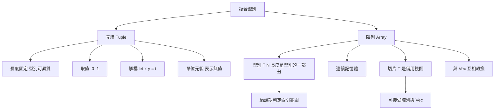

# 2.3 複合型別（元組 Tuple、陣列 Array）

## 從純量到複合

純量型別描述的是單一的值，但真實的系統程式幾乎總是處理「幾個值組成的結構」。Rust 提供兩種複合型別：**元組**把固定數量、可能異質的值綁在一起；**陣列**則把固定數量、同質的值排成一列。兩者都把長度寫進型別裡，這是 Rust 型別系統最具辨識度的特徵之一。

把長度放進型別不是美觀考量，而是安全性與效能的共同基礎。它讓編譯器在編譯期就知道陣列的實際大小，因而能在許多情況下消除執行期的邊界檢查，同時也讓「索引超出範圍」這類錯誤在型別層面就無法被表達。

## 元組

元組的長度固定，元素型別可以各不相同。它以括號包住一串用逗號分隔的運算式，型別寫成 `(T1, T2, ...)` 的形式。

```rust
fn main() {
    let point = (3.5, 7.0);
    let person = (String::from("愛達"), 30, 1.75);
    println!("{point:?} {person:?}");
}
```

### 取值方式

元組的元素可以用「數字索引」存取，從 `0` 開始。索引必須是整數型別的字面值或常數，不能是變數。

```rust
fn main() {
    let point = (3.5, 7.0);
    let x = point.0;
    let y = point.1;
    println!("({x}, {y})");
}
```

這裡的語意要特別注意：`point.0` 是**複製**該元素，而不是取得一個可變的引用。要修改元組中的元素，整個元組必須先宣告為 `mut`，而且元素本身必須是可變的型別。

```rust
fn main() {
    let mut point = (3.5, 7.0);
    point.0 = 10.0;
    println!("{point:?}");
}
```

若元素是 `String` 這類堆積型別，元組本身並不允許直接改寫其內容；要改寫需要取得可變參照，而這又牽涉所有權。這個限制正是第 4 章要處理的問題。

### 解構賦值

更常見的做法是**解構**（destructuring），一次把元素拆成個別變數。

```rust
fn main() {
    let point = (3.5, 7.0);
    let (x, y) = point;
    println!("({x}, {y})");
}
```

解構不一定要用在 `let` 上。函式參數、迴圈元素、`match` 的分支都可以使用解構模式，這是 Rust 表達式的通用特性，第 6 章會詳細討論模式對應。

```rust
fn swap(a: (i32, i32)) -> (i32, i32) {
    let (x, y) = a;
    (y, x)
}

fn main() {
    let p = (1, 2);
    let q = swap(p);
    println!("{q:?}");
}
```

注意 `let (x, y) = point;` 是**移動**操作：元組的所有權轉移給 `x` 與 `y`，`point` 之後不能再被使用。若元組的所有元素都是 `Copy` 型別（例如全是數字），則實際上是複製，`point` 仍可使用。這個差異在第 4 章會有更完整的說明。

### 單位元組

`() `是長度為零的元組，稱為**單位元組**（unit tuple）。它的意義不在於承載資料，而在於表示「沒有值」。

在 Rust 中，函式若沒有回傳值，其回傳型別是 `()`。因此 `fn f() { ... }` 與 `fn f() -> () { ... }` 是等價的寫法，只是後者較少使用。

```rust
fn log(msg: &str) {
    println!("{msg}");
}

fn main() {
    let r = log("hello");    // r 的型別是 ()
    let _same: () = r;       // 單位元組可用來標註型別
}
```

單位元組的價值在於，它讓「回傳值」這個概念在型別上無所不在。`Result` 的成功分支可以回傳真正的值，失敗分支回傳錯誤；不需要回傳值的函式則回傳單位元組。由於 Rust 只有表達式沒有陳述式（這點在 2.4 節說明），沒有回傳值的函式必須以 `()` 結尾，語法上毫無含糊空間。

`()` 也能出現在其他位置。例如一個函式回傳 `()`，意味著它只用於它的副作用；把這個函式的結果綁定到變數上，會得到一個沒有內容的值。

```rust
fn main() {
    let unit = ();
    let _same: () = unit;
    // println!("{unit}");  // 單位元組不實作 Display
}
```

### 回傳多個值

元組最直接的用途之一是讓函式一次回傳多個值。Rust 沒有 C 語言那種透過指標參數「順便」輸出結果的慣例，因此多值回傳一律靠元組。

```rust
fn divmod(a: i32, b: i32) -> (i32, i32) {
    (a / b, a % b)
}

fn main() {
    let (quotient, remainder) = divmod(17, 5);
    println!("商 {quotient}，餘 {remainder}");
}
```

這個寫法比 `fn divmod(a: i32, b: i32, out: &mut i32)` 清晰得多：輸入與輸出在型別上就分開了，呼叫端也不需要先準備兩個變數再取位址。第 8 章的 `Result` 正是這個模式的延伸，把「值或錯誤」封裝成一個型別。

### 元組作為結構體欄位

元組可以作為結構體的欄位型別，這在語意上表示「這幾個值綁在一起」。第 6 章會正式介紹結構體，此處只先建立概念。

```rust
struct Measurement {
    name: String,
    bounds: (f64, f64),
}

fn main() {
    let m = Measurement {
        name: String::from("體溫"),
        bounds: (36.0, 37.5),
    };
    println!("{} 的範圍：{:?} 到 {:?}", m.name, m.bounds.0, m.bounds.1);
}
```

### 元組的比較與相等

元組實作了 `PartialEq` 與 `Eq`（若元素也實作），因此可以直接用 `==` 比較。比較是逐元素進行，長度不同則不相等。

```rust
fn main() {
    let a = (1, "x");
    let b = (1, "x");
    let c = (1, "y");
    println!("{} {}", a == b, a == c);
}
```

注意元組的相等性要求元素型別支援相等比較。含 `f64` 的元組不實作 `Eq`（因為 NaN），因此無法用於以 `HashMap` 的鍵或 `HashSet` 的元素。

## 陣列

陣列的型別寫成 `[T; N]`，其中 `T` 是元素型別，`N` 是長度，兩者都是型別的一部分。

```rust
fn main() {
    let a: [i32; 5] = [1, 2, 3, 4, 5];
    let b = [0u8; 1000];        // 1000 個 0
    let c: [char; 3] = ['a', 'b', 'c'];
    println!("{} {} {}", a.len(), b.len(), c.len());
}
```

`[0; 1000]` 這種寫法特別實用：它會先用一個元素填滿，再複製成指定長度。相較於手寫一千個 0，它既省空間也少打錯字的機會。

### 陣列與 `Copy`

陣列的 `Copy` 行為取決於元素型別：若元素實作了 `Copy`，整個陣列也實作 `Copy`，賦值時是複製；否則賦值是移動。

```rust
fn main() {
    let a = [1, 2, 3];
    let b = a;              // 複製，因為 i32 是 Copy
    println!("{a:?} {b:?}");

    let s = [String::from("x"), String::from("y")];
    let t = s;              // 移動，因為 String 不是 Copy
    // println!("{s:?}");   // 錯誤：s 已被移動
    println!("{t:?}");
}
```

### 切片：陣列的視圖

切片 `&[T]` 是對一段連續記憶體的**借用視圖**，它不擁有資料。從陣列取切片時要使用範圍語法。

```rust
fn main() {
    let a = [1, 2, 3, 4, 5, 6];
    let s = &a[1..3];        // 包含索引 1、2
    println!("{s:?}");       // [2, 3]
    println!("{}", s.len());
}
```

範圍的右端是**不包含**的，這就是所謂的半開區間。`&a[1..3]` 取得索引 1 與 2 兩個元素。

把切片傳入函式是 Rust 中最常見的參數形式：它同時接受陣列與 `Vec`，且執行期不會有複製成本。

```rust
fn sum(data: &[i32]) -> i32 {
    data.iter().sum()
}

fn main() {
    let a = [1, 2, 3];
    let v = vec![4, 5, 6];
    println!("{} {}", sum(&a), sum(&v));
}
```

第 4.4 節會更詳細地討論切片與其生命週期。

### 陣列與 `Vec` 的關係

`Vec<T>` 是堆積上的可增長陣列，是執行期長度未知的連續序列。陣列與 `Vec` 提供了相同的 API（索引、迭代、`len`），因此大部份程式碼只要把參數型別寫成 `&[T]` 或 `&Vec<T>` 就能通用。

轉換方式有幾種：`vec![]` 巨集可從元素建立 `Vec`，`to_vec()` 從切片複製一份，`Vec::from` 也能從陣列建立。

```rust
fn main() {
    let a = [1, 2, 3];
    let v1 = a.to_vec();
    let v2 = vec![1, 2, 3];
    let v3 = Vec::from(a);
    println!("{v1:?} {v2:?} {v3:?}");
}
```

`to_vec()` 會配置新的堆積記憶體並複製元素；`Vec::from(a)` 對 `Copy` 元素也做同樣的事。若只是要借用，不該呼叫 `to_vec()`，直接傳 `&a` 即可。

### 記憶體佈局

陣列的元素在記憶體中連續排列，整體大小是元素大小乘以長度：

$$
\text{size of } [T; N] = N \times \text{size of } T
$$

以 `i32` 為例，四個元素的陣列佔 $ 4 \times 4 = 16 $ 位元組。陣列本身的值通常放在呼叫端的堆疊框架上，而元素若是指向堆積的型別（如 `String`），則堆疊上放的是指標，實際內容在別處。

`Vec<T>` 的差異在於：堆積上有一塊連續空間，而 `Vec` 這個值本身（指標、長度、容量三個欄位，共 24 位元組於 64 位元平台）放在堆疊上。

```rust
fn main() {
    let a = [1u8, 2, 3, 4];
    let v = vec![1u8, 2, 3, 4];
    println!("array bytes = {}", std::mem::size_of_val(&a));
    println!("vec bytes = {}", std::mem::size_of_val(&v));
    println!("heap capacity = {}", v.capacity());
}
```

在 64 位元平台上，陣列佔 4 位元組，而 `Vec` 的控制結構佔 24 位元組。這個對比說明為什麼在已知大小且不需要增長時，偏好使用陣列。

### 為什麼長度要寫進型別

把長度放進型別，換來三項好處。

第一，**編譯期就能判定索引範圍**。若 `a` 的型別是 `[i32; 5]`，那麼 `a[6]` 是編譯錯誤，編譯器在最佳化時可以完全移除邊界檢查。

第二，**型別即文件**。`fn f(data: &[u8; 32])` 明確表達「這裡需要剛好 32 個位元組」；`fn f(data: &[u8])` 表達「這裡接受任意長度」。

第三，**泛型可以依長度最佳化**。第 9 章的 `const` 泛型參數讓長度成為編譯期常數，函式能依實際長度特化程式碼。

### 陣列的索引與邊界

陣列的索引使用方括號，與 C 相同，但越界時的行為是 **panic** 而非未定義行為。這個差異極為重要：在 C 中越界讀取可能悄悄讀到相鄰記憶體，是資安漏洞的常見來源；在 Rust 中越界必定被偵測。

```rust
fn main() {
    let a = [1, 2, 3];
    println!("{}", a[0]);
    // println!("{}", a[3]);   // panic：index out of bounds
}
```

若索引來自外部輸入且不可信，應使用 `get` 方法，它回傳 `Option`，不會 panic。

```rust
fn main() {
    let a = [1, 2, 3];
    let i = 5;
    match a.get(i) {
        Some(&v) => println!("值為 {v}"),
        None => println!("索引 {i} 超出範圍，長度為 {}", a.len()),
    }
}
```

### 陣列的常用方法

陣列（與 `Vec`）提供一整套方法，涵蓋查找、排序與轉換。

```rust
fn main() {
    let mut a = [3, 1, 4, 1, 5];
    a.sort();
    println!("{a:?}");
    println!("{}", a.contains(&4));
    println!("{:?}", a.iter().rev().take(2).collect::<Vec<_>>());
    println!("{}", a.iter().sum::<i32>());
    let mut b = a;
    b.reverse();
    println!("{b:?}");
}
```

`sort` 需要元素型別實作 `Ord`，因此對 `f64` 陣列無法使用（NaN 破壞全序）。這與上一節提到 `f64` 只實作 `PartialOrd` 是同一個原因。

### 迭代陣列的三種方式

Rust 對遍歷陣列提供三種常見寫法，各自適用於不同情境。

```rust
fn main() {
    let a = [10, 20, 30];

    for v in a {                 // 取得值，元素為 Copy 時 a 仍可用
        println!("{v}");
    }

    for v in &a {                // 取得借用，避免複製
        println!("{v}");
    }

    for (i, v) in a.iter().enumerate() {   // 同時取得索引與值
        println!("{i}: {v}");
    }
}
```

第一種寫法在迴圈結束時取得陣列的所有權（或在元素為 `Copy` 時只是複製）。第二種借用陣列，是最安全的預設選擇。第三種透過迭代器的 `enumerate` 同時取得索引，這是 Rust 沒有「索引式迴圈」的替代方案之一，會在 3.2 節進一步討論。

### 長度作為型別的一部分

除了配置成本，陣列與 `Vec` 在介面層面的差異也值得一提。陣列的長度是型別的一部分，因此兩個長度不同的陣列是**不同的型別**，不能互相賦值。

```rust
fn main() {
    let a = [1, 2, 3];
    let b: [i32; 3] = a;      // 長度相同，型別相同
    println!("{b:?}");
    // let c = [1, 2, 3, 4];
    // let d: [i32; 3] = c;    // 錯誤：型別不符
}
```

這看起來是個限制，實際上卻是優勢：編譯器據此知道所有可能的長度，可以為每種長度產生最佳化後的程式碼。`Vec` 則只有一個長度在執行期才知道，因此迭代時必然要讀取長度欄位並做比較。

在撰寫泛型函式時，這個差異會直接影響能否接受不同長度的輸入。解法有兩種：把參數型別寫成切片 `&[T]`（接受任意長度）或使用 `impl IntoIterator<Item = T>`（接受陣列與 `Vec` 皆可）。

### 效能比較範例

下面的程式分別以陣列與 `Vec` 處理相同資料，用以觀察記憶體佈局的差異：

```rust
fn sum_stack() -> u32 {
    let data = [1u32, 2, 3, 4, 5, 6, 7, 8];
    data.iter().copied().sum()
}

fn sum_heap() -> u32 {
    let data = vec![1u32, 2, 3, 4, 5, 6, 7, 8];
    data.iter().copied().sum()
}

fn main() {
    println!("stack = {}", sum_stack());
    println!("heap  = {}", sum_heap());
}
```

兩者的運算成本幾乎相同，因為迭代器的編譯結果與手寫迴圈等價（第 11 章會說明零成本抽象）。真正的差異在配置：陣列不需要堆積配置，函式返回時也不需要釋放；`Vec` 則有配置的時間與容量成長的開銷。在元素數量固定且小的場合，陣列是明確的選擇。

若要觀察實際差異，可以用 `std::time::Instant` 量測大量呼叫的耗時：

```rust
use std::time::Instant;

fn sum_stack() -> u32 {
    let data = [1u32, 2, 3, 4, 5, 6, 7, 8];
    data.iter().copied().sum()
}

fn sum_heap() -> u32 {
    let data = vec![1u32, 2, 3, 4, 5, 6, 7, 8];
    data.iter().copied().sum()
}

fn main() {
    let n = 1_000_000;
    let t = Instant::now();
    let mut acc = 0i64;
    for _ in 0..n {
        acc += sum_stack() as i64;
    }
    println!("stack: {:?}, acc = {acc}", t.elapsed());

    let t = Instant::now();
    let mut acc = 0i64;
    for _ in 0..n {
        acc += sum_heap() as i64;
    }
    println!("heap:  {:?}, acc = {acc}", t.elapsed());
}
```

差異通常在每個呼叫數十到數百奈秒之間，主要來自配置器呼叫與稍後的釋放。這個量級在多數應用中並不重要，因此選型的真正依據是**語意**：長度在編譯期已知就用陣列，執行期才知道就用 `Vec`。

### 對齊與填充

連續排列不代表位元組一定是緊接著的。CPU 以一個單位存取記憶體，典型大小是 8 或 16 位元組，因此結構體與陣列的起始位址必須符合其元素的對齊要求，否則存取時需要額外的處理。編譯器會在必要時插入填充位元組（padding）。

```rust
#[repr(C)]
struct Packet {
    kind: u8,
    length: u32,
}

fn main() {
    println!("Packet = {}", std::mem::size_of::<Packet>());
    println!("u32 = {}", std::mem::size_of::<u32>());
    println!("u8 = {}", std::mem::size_of::<u8>());
}
```

`Packet` 的實際大小是 8 位元組而不是 5，因為 `length` 需要 4 位元組對齊，前面得補上 3 個填充位元組。`repr(C)` 保證欄位依宣告順序排列且不做重新排序，這在撰寫與外部協定的二進位資料結構時是必要的。

陣列本身的對齊要求取決於元素型別：`[u8; 16]` 只需要一位元組對齊，可以放在任何位置；`[u32; 4]` 需要四位元組對齊。在需要手動配置對齊記憶體的場景（例如與硬體暫存器或 GPU 緩衝區互動），這個差異會直接影響可用性。

### 二進位協定的固定長度陣列

在網路協定或檔案格式中，固定長度的陣列型別是最精確的描述方式。

```rust
#[repr(C)]
#[derive(Debug, Clone, Copy)]
struct Header {
    magic: [u8; 4],
    version: u8,
    flags: u8,
    length: u16,
}

fn main() {
    let h = Header {
        magic: *b"RUST",
        version: 1,
        flags: 0,
        length: 42,
    };
    println!("{h:?}");
    let bytes = unsafe { std::slice::from_raw_parts((&h as *const Header).cast::<u8>(), std::mem::size_of::<Header>()) };
    println!("{bytes:?}");
}
```

使用 `repr(C)` 後，記憶體中的位元組佈局是確定的，這讓結構體可以直接與 C 程式或硬體協作。第 10 章討論 `unsafe` 與原始指標時，會再次看到這類應用。

### 陣列與固定容量容器

固定長度陣列有時仍嫌麻煩：元素數量在編譯期已知，但內容需要一點點建構，或需要額外的輔助功能（例如複製、比較、除錯輸出）。此時可以使用 `arrayvec` 這類固定容量向量，它提供 `Vec` 的部分 API，卻把容量限制在編譯期常數。

```rust
fn main() {
    // 以固定容量取代 heap 配置
    let mut buf: [u8; 16] = [0; 16];
    for (i, b) in buf.iter_mut().enumerate() {
        *b = (i * 2) as u8;
    }
    println!("{buf:?}");
    println!("{}", buf.len());
}
```

這段程式完全使用標準庫的 `[u8; 16]`，但寫法與操作 `Vec` 幾乎相同：先用 `[0; 16]` 建立預設值，再以 `iter_mut` 逐項填入。在需要確定性記憶體佔用、又不想引入外部相依的場景中，這是個務實的折衷。

### 從常量泛數到動態長度

Rust 的演進過程中，陣列長度從純編譯期常數走向了「泛型常數」。目前的 `const N: usize` 泛型參數使得下列寫法可行：

```rust
fn sum_all<const N: usize>(data: [i32; N]) -> i32 {
    data.iter().sum()
}

fn main() {
    println!("{}", sum_all([1, 2, 3]));
    println!("{}", sum_all([1, 2, 3, 4, 5]));
}
```

這段程式對不同長度分別具體化，因此不需要在執行期檢查邊界。這是「把長度寫進型別」這項設計在現代 Rust 中的完整形態。

## 選擇指南

在實務中選擇複合型別，可以依循幾條簡單的規則。若資料是兩個或三個彼此相關、型別可能不同的值，用元組；若資料是同質的序列且長度在編譯期已知，用陣列；若長度在執行期才確定或需要頻繁增刪，用 `Vec`。若函式只需要讀取序列，參數一律寫成 `&[T]`，這樣同一個函式就能接受陣列與 `Vec` 兩種呼叫端。

元組在超過三個元素之後就應該改用結構體。理由很直觀：`(String, u32, f64, bool, Option<String>)` 這種型別既難以閱讀，也難以擴充。第 6 章的結構體提供了具名欄位，讓欄位的意義不必靠位置記憶。

```rust
fn main() {
    // 少數值：元組合適
    let entry = ("app.log", 1024u64);
    println!("{}: {} bytes", entry.0, entry.1);

    // 多數值：改用具名欄位（第 6 章）
    let name = "app.log";
    let size = 1024u64;
    println!("{name}: {size} bytes");
}
```

## 複合型別的結構



## 元組與陣列的對照

| 面向 | 元組 | 陣列 |
|---|---|---|
| 長度 | 固定且寫在型別裡 | 固定且寫在型別裡 |
| 元素型別 | 可異質 | 必須同質 |
| 型別寫法 | `(T1, T2)` | `[T; N]` |
| 元素存取 | `.0`、`.1` | `[0]`、`[1]` |
| 常見用途 | 固定少數的相關值 | 同質資料的序列 |
| 單位形式 | `()` | 無 |

## 常見陷阱

第一，把陣列與 `Vec` 的迭代寫法混用。`for v in a` 取得所有權，而 `for v in &a` 只借用；當陣列元素不是 `Copy` 類型時，兩者在意義上完全不同，選錯會導致編譯錯誤或意料之外的所有權轉移。

第二，把切片當成擁有資料。`&a[1..3]` 的生命週期綁定在 `a` 上，若把這個切片存起來並讓 `a` 先被丟棄，編譯器會拒絕。第 5 章的生命週期註記正是用來處理這類跨越作用域的需求。

第三，忘記 `to_vec()` 會複製。若只是要傳給一個接受 `&[T]` 的函式，多寫一次 `to_vec()` 就多一次堆積配置與一次完整複製。

第四，在長度固定的地方用 `Vec`。例如存放固定的 16 個 `u8` 校驗碼，用 `[u8; 16]` 既省配置，也讓「長度是 16」這件事成為型別的一部分。

第五，索引前不檢查長度。直接用 `a[i]` 會在越界時 panic，處理外部輸入時應使用 `a.get(i)` 或先檢查 `i < a.len()`。

```rust
fn find_max(data: &[i32]) -> Option<i32> {
    if data.is_empty() {
        return None;
    }
    let mut max = data[0];
    for &v in data {
        if v > max {
            max = v;
        }
    }
    Some(max)
}

fn main() {
    println!("{:?}", find_max(&[3, 9, 2]));
    println!("{:?}", find_max(&[]));
}
```

這個函式的實作本身就展示了 Rust 的防禦式設計：空切片的情況被顯式處理，而不是讓 `data[0]` 在邊界情況下 panic。

## 小結

元組與陣列共同構成了 Rust 處理「多值」的兩種基本手段：元組適合表達少量、彼此相關但型別不同的資料；陣列適合表達同質的序列。兩者都把長度固定在型別裡，換來編譯期的索引安全與零成本的邊界檢查消除。

元組的另一項貢獻是「多值回傳」的標準解法：函式要回傳多個結果時，一律用元組承載，而錯誤的傳遞則留給第 8 章的 `Result`。這個分工從一開始就把成功路徑與失敗路徑在型別上分開。

理解它們與 `Vec`、切片的關係之後，第 4 章的主題就自然浮現：當長度必須在執行期才決定時，誰來擁有那塊記憶體、誰負責在離開作用域時歸還它——這正是所有權制度要解決的問題。
