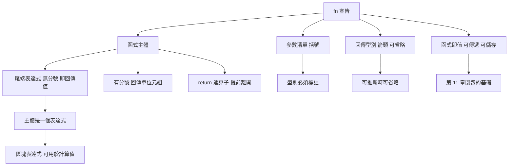

# 2.4 函式的宣告與返回值

## 函式的語法骨架

Rust 的函式宣告以 `fn` 關鍵字開頭，之後依序是函式名稱、括號中的參數清單與回傳型別。參數必須標註型別，回傳型別則可由編譯器推斷，因此常常省略。

```rust
fn add(a: i32, b: i32) -> i32 {
    a + b
}

fn main() {
    let sum = add(2, 3);
    println!("{sum}");
}
```

這段程式裡有兩個必須記住的規則。第一，**沒有隱式轉換**：`add(2, 3)` 的參數必須是 `i32`，傳入 `2u32` 會是編譯錯誤。第二，**型別必須明確或可推斷**：Rust 不允許像 C 那樣未初始化的參數，也不允許依賴呼叫端的上下文做隱式決定。

函式名稱與變數名稱使用相同的命名慣例：**snake_case**。型別名稱則使用 **UpperCamelCase**，這是 Rust 社群一致的慣例，型別與值的命名在視覺上就能區分。

```rust
fn calculate_area(width: f64, height: f64) -> f64 {
    width * height
}

fn main() {
    let area = calculate_area(3.0, 4.0);
    println!("{area}");
}
```

命名慣例不只是美觀問題。Rust 的編譯工具鏈會對不符合慣例的命名發出警告，例如把型別命名成 `my_type` 會收到 `non_camel_case_types` 警告。統一命名讓 `cargo clippy` 能夠自動套用常見的正確性建議，也讓大型專案裡的程式碼風格保持一致。

另一個慣例是**取得函式的名稱使用 `get_` 前綴**，這源自 Rust 的所有權語意：取得一份副本（`clone`）與取得一個借用（`borrow`）在名稱上就能區分。第 10 章的智慧指標會進一步說明這個慣例。

## 文件註解

Rust 內建對文件註解的支援，寫在三個斜線之後。文件註解可以包含 Markdown，並支援程式碼範例的自動測試。

```rust
/// 計算兩個整數的和。
///
/// # 範例
///
///     assert_eq!(add(2, 3), 5);
///
fn add(a: i32, b: i32) -> i32 {
    a + b
}

fn main() {
    println!("{}", add(1, 1));
}
```

`///` 是文件註解，`//!` 則是**模組層級**的文件註解，用來描述所在的模組。文件註解裡的程式碼範例會在 `cargo test` 時被編譯並執行，因此文件不會過時。第 15 章會說明 `cargo doc` 與文件測試的完整流程。

文件註解看起來與功能無關，但它有實質的工程價值：文件是型別資訊的一部分，與型別簽名一起留在原始碼裡，因此不會像外部 wiki 一樣與實作脫節。

## 回傳值：Rust 最重要的語法特性之一

Rust 函式的**最後一個表達式**若不加分號，其值就是回傳值；若加分號，該表達式的值被丟棄，函式改為回傳單位元組 `()`。

```rust
fn returns_value() -> i32 {
    42          // 沒有分號，42 就是回傳值
}

fn returns_unit() {
    42;         // 有分號，值被丟棄，回傳 ()
}

fn main() {
    let a = returns_value();
    println!("{a}");
    returns_unit();   // 若寫 let b = returns_unit(); 則 b 是 ()
}
```

這個差異是 Rust 與絕大多數語言最大的分歧點。在 C 中，函式回傳值必須用 `return` 明確指出，`return` 之外的求值結果一律被丟棄。Rust 反過來：**求值結果預設就是回傳值**，`return` 只是讓你在提前離開時指定值。

這個設計讓 Rust 的函式主體讀起來像一個**運算式**，而不是一串指令。函式的主體是一個從頭到尾求值的表達式，這個想法會在 3.1 節的 `if` 表達式與第 6 章的 `match` 上發揮得更完整。

```rust
fn absolute(x: i32) -> i32 {
    if x < 0 {
        -x
    } else {
        x
    }
}

fn main() {
    println!("{}", absolute(-5));
    println!("{}", absolute(5));
}
```

注意這裡的 `if` 沒有回傳 `()`：兩個分支都是 `i32`，所以整個 `if` 是 `i32` 型別的表達式，可以直接作為函式的回傳值。

### 分號的實際影響

分號的差異值得用一個具體例子說明。假設有個函式想回傳平方：

```rust
fn square(x: i32) -> i32 {
    x * x      // 正確：末行是表達式
}

// 若寫成下面這樣，編譯器會回報 expected i32, found ()
// fn broken(x: i32) -> i32 {
//     x * x;
// }

fn main() {
    println!("{}", square(7));
}
```

編譯器對 `broken` 給出的錯誤訊息是 `mismatched types: expected i32, found ()`。這個訊息初看之下不夠直觀，但它準確反映了語意：加了分號之後，末行的值被丟棄，函式改為回傳 `()`，而 `()` 不是 `i32`。

另一種常見情況是漏寫 `->` 回傳型別。

```rust
// 若寫成下面這樣，同樣會得到 expected i32, found ()
// fn wrong() -> i32 {
//     if true {
//         1
//     }
// }

fn main() {
    let v = if true { 1 } else { 0 };
    println!("{v}");
}
```

這裡 `if` 沒有 `else`，因此其值為 `()`，同樣導致型別不符。Rust 的編譯器在這類錯誤上通常給出「expected i32, found ()」並指出位置，辨識成本不高。

## 表達式與陳述式的統一

C 語言把語法單元分成兩類：**陳述式**（statement）與**表達式**（expression）。賦值、呼叫函式、控制結構是陳述式，它們執行副作用但不產生值；`a + b` 是表達式，它產生值但沒有副作用。兩者之間的邊界在 C 中相當模糊。

Rust 取消了這個區別：**Rust 只有表達式**。所有東西都是表達式，都能求值成某個值，只是有些表達式的值是 `()`。賦值運算式 `x = 5;` 的型別是 `()`，`if` 的各分支必須同型別，`{ let a = 1; a + 1 }` 這個區塊表達式的值是最後一行。

```rust
fn main() {
    let x = {
        let y = 2;
        y * y
    };
    println!("{x}");   // 4
}
```

這個「用區塊表達式計算一個值」的寫法在 C 中需要用逗號運算子或巢狀作用域變數來模擬，在 Rust 中則是自然的寫法。串接資料處理步驟時特別方便：

```rust
fn main() {
    let result = {
        let input = "10 20 30";
        let nums: Vec<i32> = input.split_whitespace()
            .map(|s| s.parse().unwrap())
            .collect();
        nums.iter().sum::<i32>()
    };
    println!("{result}");
}
```

## 早返回與多出口

雖然尾端表達式是主要的回傳方式，但實務中常常需要提前離開。`return` 在 Rust 中是運算子，能出現在任何表達式位置。

```rust
fn classify(n: i32) -> &'static str {
    if n < 0 {
        return "負數";
    } else if n == 0 {
        return "零";
    }
    "正數"
}

fn main() {
    println!("{}", classify(-1));
    println!("{}", classify(0));
    println!("{}", classify(5));
}
```

Rust 社群對「早返回」的態度是友善的：把主要路徑寫成最後的表達式，把例外情況用 `return` 提前送走。這與 C 的風格一致，閱讀時不需要在腦中追蹤「這個函式最後會不會漏掉某個分支」。

另一種常見風格是把 `if` 當成表達式，讓所有路徑都在函式主體內完成：

```rust
fn classify2(n: i32) -> &'static str {
    if n < 0 {
        "負數"
    } else if n == 0 {
        "零"
    } else {
        "正數"
    }
}

fn main() {
    println!("{}", classify2(3));
}
```

兩種風格各有支持者。`return` 版本在分支多的時候通常更好讀；`if` 表達式版本在分支少時更簡潔，且與 Rust 的表達式哲學一致。重要的是：**不要混用**。在同一個函式裡同時出現 `return` 與尾端表達式，會讓讀者難以判斷函式的真實出口。

## 參數與型別註解

Rust 強制要求參數標註型別，這是它與 C 最大的日常差異之一。C 的參數型別在多數情況下會退化成 int 提升，也沒有任何機制表達「這個參數要 32 位元整數」。

```rust
fn resize_image(width: u32, height: u32) -> (u32, u32) {
    let scale = 2;
    (width * scale, height * scale)
}

fn main() {
    let (w, h) = resize_image(100, 50);
    println!("{w}x{h}");
}
```

在 Rust 裡，把 `u32` 參數傳成 `i32` 會得到編譯錯誤，必須明確寫出 `as u32` 或改變參數型別。這項看似嚴格的要求，實際上消滅了大量「參數型別寫錯但剛好能跑」的缺陷。

進階一點的參數型別寫法可以表達「接受任何整數」，這需要泛型或 `impl Trait`，將在第 9 章說明。

### 引用參數與所有權

參數的傳遞方式決定了所有權的走向。若參數型別是 `T`，呼叫端的所有權會轉移給被呼叫端；若型別是 `&T`，被呼叫端只取得借用，呼叫端仍保有所有權。

```rust
fn show_len(s: &String) {
    println!("{}", s.len());
}

fn main() {
    let s = String::from("hello");
    show_len(&s);
    println!("{s}");   // s 仍可用，因為只是借用
}
```

以 `&T` 作為預設的參數形式是 Rust 的重要慣例：它讓函式預設不消耗呼叫端的資源。第 4 章會說明所有權的三條規則，第 5 章則處理借用跨越函式邊界時的生命週期問題。

## 函式是值

Rust 沒有特別的函式指標語法，函式本身就是一個型別，可以被賦值、傳遞與儲存。

```rust
fn double(x: i32) -> i32 {
    x * 2
}

fn triple(x: i32) -> i32 {
    x * 3
}

fn apply(f: fn(i32) -> i32, value: i32) -> i32 {
    f(value)
}

fn main() {
    let op = double;
    println!("{}", op(5));
    println!("{}", apply(triple, 5));

    let ops: [fn(i32) -> i32; 2] = [double, triple];
    for f in ops {
        println!("{}", f(10));
    }
}
```

這個能力是第 11 章閉包的基礎。閉包是能夠捕捉環境的匿名函式，型別上可以寫成 `impl Fn(i32) -> i32` 或 `Box<dyn Fn(i32) -> i32>`。當函式需要「策略」這類概念時，Rust 的函式值提供了與其他語言的函式指標類似的入口。

需要留意的是，`fn(i32) -> i32` 這個型別只涵蓋「不捕捉環境」的函式。若要接受會捕捉變數的閉包，必須改用泛型與 `Fn` trait 邊界，這是第 11 章的主題。

```rust
fn apply_twice<F>(f: F, value: i32) -> i32
where
    F: Fn(i32) -> i32,
{
    f(f(value))
}

fn main() {
    let n = 5;
    let result = apply_twice(|x| x + n, 1);
    println!("{result}");
}
```

這段程式的泛型寫法能接受任何實作 `Fn` 的值，包括捕捉了 `n` 的閉包，因此比固定型別的 `fn` 指標更有彈性。

## 遞迴

Rust 的函式可以自由遞迴，不需要像 C 那樣先宣告原型。

```rust
fn factorial(n: u64) -> u64 {
    if n <= 1 {
        1
    } else {
        n * factorial(n - 1)
    }
}

fn main() {
    println!("{}", factorial(10));
}
```

遞迴的執行期成本包括每次呼叫的堆疊框架與可能的尾端呼叫最佳化（TCO）。Rust 對尾端遞迴不做保證，因此深度遞迴仍有堆疊溢出的風險。第 11 章的迭代器能讓許多原本用遞迴表達的函式改以迴圈實作，兩者風格不同，但在大規模資料上迭代器更安全。

遞迴最大的價值在於表達遞迴定義的演算法：樹的走訪、分治、解析器的文法規則。這些問題用迴圈實作往往需要額外的堆疊資料結構，而遞迴天然對應。

```rust
fn sum_nested(data: &[Vec<i32>]) -> i32 {
    match data.first() {
        None => 0,
        Some(row) => row.iter().sum::<i32>() + sum_nested(&data[1..]),
    }
}

fn main() {
    let rows = vec![vec![1, 2], vec![3, 4], vec![5]];
    println!("{}", sum_nested(&rows));
}
```

這個函式的優雅之處在於 `match` 兩個分支的型別都是 `i32`，遞迴呼叫因此被當成一個普通的值來加總。換句話說，遞迴與表達式的結合，讓遞迴函式也能遵循尾端表達式的規則。

## 泛型預告

Rust 的函式可以對多個型別通用，這是泛型，會在第 9 章完整說明。

```rust
fn largest<T: PartialOrd>(list: &[T]) -> &T {
    let mut best = &list[0];
    for item in list {
        if item > best {
            best = item;
        }
    }
    best
}

fn main() {
    let nums = [1, 5, 3];
    let words = ["alpha", "zeta", "mu"];
    println!("{}", largest(&nums));
    println!("{}", largest(&words));
}
```

`<T: PartialOrd>` 是型別參數加上 trait 邊界。這個函式只對支援比較的型別有效，因此編譯器能安全地使用 `>` 運算子。這種「以 trait 表達需求」的做法是 Rust 靜態多態的核心，也是它能在沒有繼承樹的情況下達成零成本抽象的關鍵。

## 死碼與單元型別回傳

Rust 的編譯器會警告不可達程式碼（dead code），包括從未呼叫的函式、永遠不會到達的分支。

```rust
fn unused_helper(x: i32) -> i32 {
    x + 1
}

fn always_true() -> bool {
    true
}

fn main() {
    // unused_helper 未被使用，會產生警告
    if always_true() {
        println!("永遠成立");
    }
}
```

「死碼」在安全領域有另一個更重要的意義：不可達程式碼往往意味著邏輯錯誤。例如一個 `match` 沒有涵蓋所有情況，通常是遺漏了某個變體；此時編譯器會要求補上分支，而不是默默接受。

明確寫出 `-> ()` 的場合不多，但它在語意上是有意義的：它宣告「這個函式只為副作用而存在」。在以 `()` 為鍵值的映射表，或需要符合某個函式簽名的場景中，這個寫法能讓意圖一目了然。

```rust
fn log_line(msg: &str) -> () {
    println!("{msg}");
}

fn main() {
    log_line("hello");
}
```

## 表達式風格的哲學

把「函式主體是表達式」這件事放進更大的脈絡來看，會發現 Rust 的語法設計是整體一致的。第 2 章的遮蔽讓同一個名稱承載不同階段的型別；`if` 與 `match` 都是可求值的表達式；`?` 運算子把「失敗即返回」壓縮成一個運算符；迭代器把整串運算串成管線。

這些設計背後是同一個目標：**讓程式碼的結構直接對應到資料的結構**。一個函式回傳什麼，由它的表達式決定；一個分支走哪條路，由它的型別決定；一段資料經過哪些轉換，由運算式的串接決定。讀者不需要在指令與資料之間做心算對應，因為兩者是同一件事。

相對地，Rust 也保留了傳統的風格空間：分號、早返回、迴圈、標籤都在。它們不是被淘汰的遺物，而是同一套表達式思維的不同面貌——早返回之所以自然，是因為函式主體的求值可以提前中止；迴圈之所以自然，是因為 `loop` 也是表達式。

## 內聯與函式呼叫成本

Rust 與多數現代語言一樣，編譯器會對小型函式進行**內聯**（inlining），把函式呼叫展開為實際指令。這意味著「把邏輯抽成函式」通常不會帶來執行期成本，代價只出現在程式碼體積與編譯時間上。

內聯並非自動的，還可以手動標記。

```rust
#[inline(always)]
fn hot_path(x: u32) -> u32 {
    x.wrapping_mul(1664525).wrapping_add(1013904223)
}

fn main() {
    println!("{}", hot_path(7));
}
```

`#[inline(always)]` 是提示而非保證，`#[inline]` 則只是建議。實務上，只有在效能分析確認某個函式是瓶頸時才需要手動標記；否則把程式碼寫得清楚，往往已經產生了類似的最佳化效果。

另一個與效能相關的細節是 `#[inline]` 對泛型函式的意義：泛型函式在每個具體化型別上都有一份實作，跨 crate 呼叫時若沒有內聯，就會帶來額外的呼叫開销與失去最佳化的機會。標準庫因此大量使用 `#[inline]`。

## 與 C 的對照

把同一組概念並排比較，可以看清 Rust 為什麼如此設計：

| 概念 | C | Rust |
|---|---|---|
| 參數型別 | 可省略，會隱式提升 | 必須標註 |
| 隱式轉換 | 允許，且方向常出乎意料 | 完全禁止 |
| 回傳值 | 必須用 `return` 或指定 | 末行表達式即回傳 |
| 無回傳值 | 只能靠空 | 明確回傳 `()` |
| 函式主體 | 陳述式序列 | 單一表達式 |
| 函式傳遞 | 必須寫 `(*fp)(x)` | 直接傳函式名 |
| 遞迴 | 需先宣告原型 | 直接呼叫即可 |
| 未使用函式 | 多半無警告 | 產生 dead_code 警告 |

最值得注意的是「函式主體是單一表達式」這一行。其餘差異都可以靠寫法調整，但這一项改變了函式的本質：Rust 的函式不再是「一段執行的指令」，而是「一個求值的運算」。第 3 章的控制流程、第 6 章的模式對應，都是這個根本改變的延伸。

## 常見錯誤與除錯技巧

第一，忘記在 `if` 分支加上 `else`。若 `if` 被當成表達式使用，缺少 `else` 會導致型別不符；解法是補上 `else { ... }`，或改用 `let ... else`（3.1 節說明）。

第二，在表達式位置誤加分號。例如把 `matches.push(x);` 寫在某個需要值的函式主體裡，結果是回傳 `()`。檢查方式是看編譯器說明的「expected type」。

第三，把 `let` 綁定與比較搞混。Rust 的賦值是 `=`，比較是 `==`，但兩者的值都可以是布林型別，因此在 `if` 條件中賦值是合法的，只是風格上不推薦。

```rust
fn main() {
    let mut total = 0;
    let data = [1, 2, 3];
    for x in data {
        total += x;
    }
    println!("{total}");
}
```

第四，忽略編譯器的型別註解建議。當編譯器說「expected `i32`, found `u32`」時，最快的修法通常是依上下文調整，而不是立刻加上 `as` 轉型——`as` 會把一個明確的型別錯誤換成一個潛在的數值錯誤。

## 一個完整的表達式風格範例

下面這個函式把本章的諸多特性用在一起：表達式回傳、`if` 表達式、模式解構、早返回、型別註解與一個函式值。

```rust
fn summarize(label: &str, values: &[i64]) -> String {
    if values.is_empty() {
        return format!("{label}: 無資料");
    }

    let total: i64 = values.iter().sum();
    let mean = total as f64 / values.len() as f64;
    let label = label.to_uppercase();
    format!("{label}: 總和 {total}，平均 {mean:.2}")
}

fn render(title: &str, body: &str) -> String {
    format!("== {title} ==\n{body}")
}

fn main() {
    let data = [10, 20, 30];
    let body = summarize("總計", &data);
    println!("{}", render("報表", &body));

    let empty: [i64; 0] = [];
    println!("{}", summarize("總計", &empty));

    let formatter: fn(&str, &str) -> String = render;
    println!("{}", formatter("直接呼叫", "內容"));
}
```

這段程式沒有任何一行「只是執行」的指令，每個函式的主體都是一個求值成 `String` 的表達式。`summarize` 的早返回處理空資料的情況，正常路徑則以尾端表達式結尾；`label` 的遮蔽讓「原始標籤」與「大寫標籤」在型別與意圖上自然區分。第 3 章將說明控制流程如何在這樣的表達式風格中進一步組織。

值得留意的是 `summarize` 中 `mean` 的計算方式：`total as f64 / values.len() as f64`。兩個運算元都先轉成 `f64`，因此不會出現整數除法截斷的問題。這是 Rust 中整數與浮點混用的標準寫法——先把兩邊統一，而不是靠隱式轉換。第 9 章會介紹如何用泛型把這種轉換抽象成可重用的函式。

```rust
fn mean_f64(values: &[i64]) -> Option<f64> {
    if values.is_empty() {
        return None;
    }
    let total: i64 = values.iter().sum();
    Some(total as f64 / values.len() as f64)
}

fn main() {
    println!("{:?}", mean_f64(&[10, 20, 30]));
    println!("{:?}", mean_f64(&[]));
}
```

這個函式把「空資料」的情況以 `Option` 表達，既避免了除以零，也讓呼叫端必須明確處理沒有平均值的可能。第 8 章會說明 `Option` 與 `Result` 這類把失敗寫進型別的設計。

## 函式的形式與特徵



## 常見寫法速查

| 需求 | 寫法 | 說明 |
|---|---|---|
| 回傳值 | 末行不加 `;` | 末行是表達式即為回傳值 |
| 不回傳值 | 末行加 `;` | 回傳 `()` |
| 提前離開 | `return expr;` | 運算子，可在任何位置使用 |
| 無型別參數 | 不允許 | 必須標註，無隱式轉換 |
| 巢狀計算 | `{ ... }` 區塊表達式 | 取末行非分號的值 |
| 傳遞函式 | `fn(i32) -> i32` | 函式本身就是值 |
| 泛型函式 | `fn f<T: Trait>(...)` | 第 9 章主題 |
| 遞迴 | 直接呼叫自己 | 不需先宣告原型 |
| 文件說明 | `/// 註解` | 會被 `cargo doc` 渲染 |
| 強制內聯 | `#[inline(always)]` | 通常交由編譯器決定 |

## 小結

Rust 的函式語法把兩件事綁在一起：型別的嚴格性與求值語意的表達性。參數必須標註型別、沒有隱式轉換，讓介面契約無法被誤解；而「末行表達式即回傳值」的規則，讓每個函式的主體都是一個有值的運算式，讓函式讀起來像數學定義而非指令清單。

這兩個特徵在下一章會結合得更緊密：當 `if`、`match`、`loop` 全部都是表達式時，控制流程的撰寫方式就從「設定分支」變成了「求出一個值」。這種統一，是 Rust 讓複雜邏輯仍保有可讀性的核心手段。
