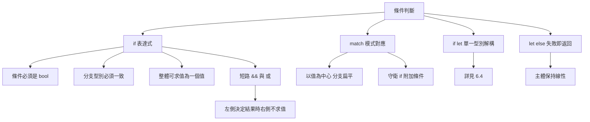

# 3.1 條件判斷（if / else）

## 條件必須是布林值

Rust 的 `if` 條件必須是 `bool` 型別，這是一條硬性規則，沒有例外。整數、指標、`Option` 都不能直接當條件使用。

```rust
fn main() {
    let count = 5;
    // if count {                 // 錯誤：expected `bool`, found integer
    //     println!("有東西");
    // }
    if count > 0 {
        println!("有東西");
    }
}
```

這條規則的價值在於**消除隱含的真相判斷**。Python 允許 `if items:`，空清單與零都視為假；C 允許 `if (ptr)`，非零指標視為真。兩種語言的規則本身沒有錯，但當它們與其他語言的規則混在同一个 codebase 裡時，誤讀的機率就會上升。Rust 選擇要求程式碼把比較寫出來，讓「什麼算成立」永遠是明示的。

```rust
fn main() {
    let items: Vec<i32> = vec![];
    let has_items = !items.is_empty();
    if has_items {
        println!("列表非空");
    }

    let maybe: Option<i32> = None;
    // if maybe { }               // 錯誤
    if maybe.is_some() {
        println!("有值");
    }
}
```

要注意的是，`Option<T>` 有一個專門的判斷方法 `is_some()` 與 `is_none()`，它們把「有沒有值」的意圖表達得很清楚。這比把 `Option` 轉成布林值再判斷要好得多——後者在 Rust 中根本不被允許。

## `if` 作為表達式

與 2.4 節討論的函式主體一致，Rust 的 `if` 是一個**表達式**：整個 `if` 會求值成一個值。這是它與 C 最顯著的差異之一。

```rust
fn main() {
    let x = 5;

    let value = if x > 3 {
        "大"
    } else {
        "小"
    };

    println!("{value}");
}
```

關鍵在於**兩個分支必須是同一型別**。若一個分支是 `i32`、另一個是 `&str`，編譯器會拒絕。

```rust
fn main() {
    let x = 5;
    // let value = if x > 3 { 1 } else { "小" };   // 錯誤：型別不符
    let value = if x > 3 { 1 } else { 0 };
    println!("{value}");
}
```

這個限制聽起來像缺點，實際上卻是最有價格的編譯期檢查之一。若允許分支型別不同，`if` 的結果型別就會是「其中之一」，型別系統必須引入聯合型別或 `Any` 之類的機制來表達，編譯器便無法再保證後續程式碼的正確性。Rust 選擇要求呼叫端自己決定該用哪個型別。

另一個常見寫法是讓 `if` 的兩個分支都回傳 `()`，此時它就相當於傳統的分支陳述式。

```rust
fn main() {
    let count = 3;
    if count > 5 {
        println!("很多");
    } else if count > 2 {
        println!("適中");
    } else {
        println!("很少");
    }
}
```

注意 `else if` 其實是**巢狀的 `if` 表達式**被放在 `else` 分支裡。這個結構上的事實在處理複雜條件時會顯現出重要性。

## 沒有三元運算子

Rust 沒有 C 與 Java 的 `?:` 條件運算子。替代方案就是 `if` 表達式本身。

```rust
fn main() {
    let x = 5;
    // let v = x > 3 ? "大" : "小";   // Rust 沒有這個語法
    let v = if x > 3 { "大" } else { "小" };
    println!("{v}");
}
```

這個取捨是有理由的。`?:` 把一個簡單的選擇壓縮成一行，但失去了分支的可讀性；Rust 的 `if` 寫法在簡單時同樣短，卻在複雜時能自然擴充為多分支。

```rust
fn label(n: i32) -> &'static str {
    if n < 0 {
        "負"
    } else if n == 0 {
        "零"
    } else if n < 10 {
        "個位數"
    } else {
        "多位數"
    }
}

fn main() {
    println!("{}", label(5));
}
```

以 `?:` 為出發點的寫法往往會在三個以上分支時退化成一串難以閱讀的巢狀三元運算子，而 Rust 的版本始終保持線性結構。

## 比較運算子與鏈式寫法

Rust 的比較運算子有六個：`==`、`!=`、`<`、`<=`、`>`、`>=`。它們都產生 `bool`，可以自由地以 `&&` 與 `||` 組合。

Rust **不支援** C 風格的連鎖比較。`a <= b <= c` 在 Rust 中是編譯錯誤，必須寫成 `a <= b && b <= c`。

```rust
fn main() {
    let a = 5;
    let b = 3;
    let c = 10;
    println!("{}", a > b && b < c);      // true
    println!("{}", 1 <= a && a <= 10);   // 明確的兩段比較
}
```

這個限制看似不便，實際上避免了 C 中 `a < b < c` 那種先把布林值轉成數字再比較的錯誤。在 Rust 裡，`b < c` 的結果是 `bool`，無法與整數比較，因此這類誤用根本無法寫出來。若要在多個值之間做範圍檢查，`(1..=10).contains(&a)` 這類範圍 API 往往更清楚。

`==` 與 `!=` 對自訂型別則需要自行實作 `PartialEq`，第 9 章會說明衍生巨集如何自動完成這件事。

## `if` 作為陳述式

當 `if` 的分支不產生值時，它的型別是 `()`，寫法與傳統的分支陳述式相同。實務上，兩種風格可以依語意混用：需要把結果存起來時用表達式風格，只是執行不同動作時用陳述式風格。

```rust
fn main() {
    let mut count = 0;

    // 表達式風格：結果被使用
    let label = if count > 0 { "非零" } else { "零" };
    println!("{label}");

    // 陳述式風格：只執行動作
    if count == 0 {
        count += 1;
    }
    println!("{count}");
}
```

判斷該用哪一種的原則很簡單：**若分支的產出會被後續程式碼用到，就用表達式風格；否則用陳述式風格**。混合使用沒問題，但同一個函式內保持一致會更好讀。

### `else if` 鏈的求值順序

`else if` 鏈是從上到下依序求值的，第一個成立的分支就會被選中。這與 `switch` 沒有不同，但 Rust 沒有 `switch` 的「多個 case 同時匹配」語法——所有分支的條件都是獨立的布林表達式。

```rust
fn grade(score: i32) -> &'static str {
    if score >= 90 {
        "A"
    } else if score >= 80 {
        "B"
    } else if score >= 70 {
        "C"
    } else if score >= 60 {
        "D"
    } else {
        "F"
    }
}

fn main() {
    println!("{}", grade(85));
    println!("{}", grade(42));
}
```

把分數由高到低排列是必要的：若把 `score >= 60` 寫在最前面，那麼 85 分也會被判成 `D`。這種「條件必須依序遞減」的隱含要求，是 `else if` 鏈最容易出錯的地方之一。

Rust 也提供 `match` 作為替代方案，它用值匹配取代了門檻比較，更不容易出錯。

```rust
fn grade_match(score: i32) -> &'static str {
    match score {
        90..=100 => "A",
        80..=89 => "B",
        70..=79 => "C",
        60..=69 => "D",
        _ => "F",
    }
}

fn main() {
    println!("{}", grade_match(85));
}
```

`match` 的範圍語法把「門檻」直接寫進型別，沒有順序問題，也不需要重複寫下限。第 6 章會說明 `match` 的完整規則。

## 短路求值

Rust 的 `&&` 與 `||` 具有**短路**語意：左側若已足以決定結果，右側不會被求值。

```rust
fn main() {
    let a: Option<i32> = None;
    let b: Option<i32> = Some(5);

    // 短路讓 && 左側為 None 時不會對 None 解參考
    if a.is_some() && a.unwrap() > 3 {
        println!("a 大於 3");
    }
    if a.is_none() || b.unwrap() > 3 {
        println!("a 為空或 b 大於 3");
    }
}
```

短路求值讓「先檢查再使用」的寫法變得安全且自然。在 Rust 中，更地道的做法是使用 `Option` 的組合子或 `?` 運算子（第 8 章），但短路邏輯仍然是理解 Rust 條件運算的基礎。

需要特別留意的是，`&&` 與 `||` 是**布林運算子**，兩邊都必須是 `bool`。它們不像 C 那樣可以混用整數，也不像 JavaScript 那樣會把各種型別轉成 truthy 值。

```rust
fn main() {
    let a = 1;
    let b = 2;
    // if a && b { }             // 錯誤：兩邊必須是 bool
    if a > 0 && b > 0 {
        println!("都是正數");
    }
}
```

短路還有另一層意義：它是**副作用的可控點**。Rust 的表達式求值順序大致由左至右，因此把可能 panic 的操作放在右側、由左側的檢查把關，是安全且易讀的寫法。

```rust
fn main() {
    let data = vec![1, 2, 3];
    let idx = 5;
    if idx < data.len() && data[idx] == 3 {
        println!("找到");
    }
}
```

這段程式的順序很重要：先檢查 `idx` 是否小於長度，再索引。若把兩個條件對調，`data[idx]` 就會在檢查之前 panic。

短路也讓**提早求值成本高昂的條件**成為可行做法。例如先檢查快取是否命中，再去做昂貴的計算。

```rust
fn main() {
    let cache_hit = false;
    let expensive = {
        // 因為 cache_hit 為 false，這個區塊仍然會被求值
        // 示範短路：只有在 cache_hit 為 true 時才會執行
        println!("執行昂貴計算");
        42
    };
    if !cache_hit || expensive > 0 {
        println!("需要計算");
    }
}
```

真實的短路例子如下：

```rust
fn expensive_lookup(map: &std::collections::HashMap<String, i32>, key: &str) -> Option<i32> {
    println!("查詢 {key}");
    map.get(key).copied()
}

fn main() {
    let mut map = std::collections::HashMap::new();
    map.insert("a".to_string(), 1);
    let key = "a";

    if map.contains_key(key) && expensive_lookup(&map, key).is_some() {
        println!("找到 {key}");
    }
}
```

因為 `map.contains_key(key)` 為真，`&&` 的右側才會被求值，`expensive_lookup` 因而被呼叫。若快取沒有命中，右側的昂貴查詢完全不會發生。

## 巢狀條件的可讀性問題

隨著條件數量增加，巢狀 `if` 會迅速變得難以閱讀。

```rust
fn check(user: &User, active: bool, trial: bool) -> bool {
    if active {
        if user.role == Role::Admin {
            if user.age >= 18 {
                return true;
            }
        } else if user.role == Role::Editor {
            if trial {
                return true;
            }
        }
    }
    false
}

struct User {
    role: Role,
    age: u32,
}

#[derive(PartialEq, Clone, Copy)]
#[allow(dead_code)]
enum Role {
    Admin,
    Editor,
    Viewer,
}

fn main() {
    let u = User { role: Role::Admin, age: 20 };
    println!("{}", check(&u, true, false));
}
```

這種寫法有兩個問題：一是巢狀過深，讀者要追蹤多層縮排才知道每個條件的適用範圍；二是「什麼情況下回傳 `true`」需要把腦中的分支樹攤平才能看清。

### 用 `match` 取代巢狀

`match` 是一種以**值**為中心的分支結構，每個分支都從上到下獨立書寫，沒有縮排的累積。Rust 官方文件在討論「巢狀 `if let` 的可讀性問題」時，明確建議改用 `match`。

```rust
struct User {
    role: Role,
    age: u32,
}

#[derive(PartialEq, Clone, Copy)]
#[allow(dead_code)]
enum Role {
    Admin,
    Editor,
    Viewer,
}

fn check(user: &User, active: bool, trial: bool) -> bool {
    match (user.role, active, trial) {
        (Role::Admin, true, _) => user.age >= 18,
        (Role::Editor, _, true) => true,
        _ => false,
    }
}

fn main() {
    let u = User { role: Role::Admin, age: 20 };
    println!("{}", check(&u, true, false));
}
```

把多個條件組合成一個元組再交給 `match`，是處理這類問題的常見手法：它讓分支條件彼此平行，而不是互相包含。`match` 的完整語法會在第 6 章說明。

### `match` 的守衛條件

守衛（guard）是附在 `match` 分支上的額外條件，用 `if` 關鍵字引出。它保留了 `match` 的扁平結構，同時能表達細緻的條件。

```rust
struct User {
    role: Role,
    age: u32,
}

#[derive(PartialEq, Clone, Copy)]
#[allow(dead_code)]
enum Role {
    Admin,
    Editor,
    Viewer,
}

fn check(user: &User, active: bool, trial: bool) -> bool {
    match user.role {
        Role::Admin if active => user.age >= 18,
        Role::Editor if trial => true,
        Role::Editor | Role::Viewer => false,
        Role::Admin => false,
    }
}

fn main() {
    let u = User { role: Role::Editor, age: 30 };
    println!("{}", check(&u, false, true));
}
```

守衛的優點是：守衛失敗時，程式會繼續嘗試後面的分支，而不是直接落入該分支。這與 `if` 的巢狀語意不同，因此守衛的順序有意義。

### `let ... else`：把失敗情況提前送走

`let ... else` 是 Rust 1.65 引入的語法，特別適合「若不符合預期就提前返回」的情境。

```rust
fn parse_age(s: &str) -> u32 {
    let Ok(age) = s.trim().parse::<u32>() else {
        return 0;
    };
    age
}

fn main() {
    println!("{}", parse_age("30"));
    println!("{}", parse_age("abc"));
}
```

它把巢狀的 `if let` 或 `match` 反轉成一個平坦的結構：主體的路徑保持線性，失敗情況被推到旁邊。第 6.4 節會詳細說明 `if let` 與 `let ... else` 的各種形式。

```rust
fn first_even(v: &[i32]) -> Option<i32> {
    let Some(&first) = v.first() else {
        return None;
    };
    if first % 2 == 0 {
        Some(first)
    } else {
        None
    }
}

fn main() {
    println!("{:?}", first_even(&[2, 4]));
    println!("{:?}", first_even(&[3, 4]));
    println!("{:?}", first_even(&[]));
}
```

這段程式同時示範了 `let ... else` 與 `Option` 的搭配：空切片的情況被 `else` 分支送走，主體則專注於「第一個元素是偶數」這個判斷。

### 巢狀 `if let` 的替代方案

Rust 官方文件在《The Rust Programming Language》第 19 章提到，巢狀的 `if let` 雖然語法上合法，但可讀性不佳，並建議改用 `match`。原因是巢狀 `if let` 會讓讀者難以一眼看出「哪些分支被合併、哪些是獨立的」。

```rust
fn describe(opt: Option<(i32, i32)>) -> String {
    // 巢狀 if let：可讀性較差
    if let Some((a, b)) = opt {
        if a == b {
            return format!("相等 {a}");
        } else {
            return format!("不等 {a} {b}");
        }
    }
    "沒有值".to_string()
}

fn main() {
    println!("{}", describe(Some((2, 2))));
    println!("{}", describe(Some((1, 2))));
    println!("{}", describe(None));
}
```

改寫成 `match` 之後，分支彼此平行，語意一目了然。

```rust
fn describe(opt: Option<(i32, i32)>) -> String {
    match opt {
        Some((a, b)) if a == b => format!("相等 {a}"),
        Some((a, b)) => format!("不等 {a} {b}"),
        None => "沒有值".to_string(),
    }
}

fn main() {
    println!("{}", describe(Some((3, 3))));
    println!("{}", describe(Some((1, 2))));
    println!("{}", describe(Some((1, 2))));
    println!("{}", describe(None));
}
```

守衛 `if a == b` 讓「相等」與「不等」兩個分支並排出現，而 `None` 分支獨立處理缺值的情況。相比原本的巢狀版本，資訊的層級關係被完全平攤開來。

## 布林運算子與位元運算子的區別

`&&` 與 `||` 處理的是布林值，`&` 與 `|` 處理的是整數。這組對比在 C 中因為隱式轉換而經常混淆，在 Rust 中則被型別系統徹底分開。

```rust
fn main() {
    let a = 0b1100u8;
    let b = 0b1010u8;

    // 位元運算：整數
    println!("{:08b}", a & b);      // 1000
    println!("{:08b}", a | b);      // 1110

    // 布林運算：必須先轉成 bool
    let x = 5;
    let y = 3;
    println!("{}", x > 0 && y > 0);  // true
}
```

值得注意的是，布林值本身在 Rust 中是**純粹的布林**，沒有 C 語言那種「整數同時扮演布林」的多型。這讓 `&&` 的短路語意完全可靠——它不需要擔心右側是整數時的真假判斷規則。

Rust 也提供了 `!` 作為邏輯非，作用於 `bool`；對整數而言，位元否定是 `!x`，兩者不會混淆。

## 條件的求值次數

`if` 的條件表達式只會被求值一次。這與某些語言中把條件視為陳述式、可在其中多次求值的情況不同。

```rust
fn main() {
    let mut calls = 0;
    let mut next = || {
        calls += 1;
        calls < 3
    };

    if next() {
        println!("第一次");
    }
    if next() {
        println!("第二次");
    }
    println!("總共呼叫 {calls} 次");
}
```

這個特性看似細節，實際上在處理有副作用的條件時很重要：Rust 保證條件不會被「無意義地」重複求值，因此把計數或 panic 放進條件中，其行為是可預測的。

## 效能考量

分支本身沒有執行期成本——`if` 只是編譯期選擇的跳轉指令。但分支內的內容可能有成本，例如昂貴的計算或配置。

在實務中，一個值得注意的模式是**先做便宜的檢查**。Rust 編譯器會依分支的機率進行最佳化，因此把常見的情況放在前面有時能改善分支預測命中率。

```rust
fn main() {
    let data = vec![1, 2, 3];
    if !data.is_empty() && data[0] == 1 {
        println!("第一個元素是 1");
    }
}
```

`is_empty()` 只是讀取長度欄位，成本極低；把它放在前面，就能在多數情況下避免後續的索引運算。這是「短路」在效能上的直接應用。

## 條件表達式的重構方向

當 `if` 條件愈來愈複雜時，有三個重構方向值得依序考慮。第一個方向是**提取布林變數**，把複合條件拆成具名變數。

```rust
fn main() {
    let age = 22;
    let has_ticket = true;

    let eligible = age >= 18 && has_ticket;
    if eligible {
        println!("可以入場");
    }
}
```

第二個方向是**改用 `match`**，特別是當判斷是依據「值落在哪一區間」或「值是哪一種型別」時。第三個方向是**引入自訂的型別**，把「有效的年齡」之類的約束封裝進型別本身。

```rust
fn main() {
    let age = 22;
    let eligible = match age {
        0..=17 => false,
        _ => true,
    };
    println!("{eligible}");
}
```

第三個方向最能體現 Rust 的哲學：**把不變條件從「執行期檢查」提升為「型別保證」**。例如與其到處檢查 `age >= 18`，不如定義一個 `Adult` 型別，只允許建構合法值。這與 2.1 節提到的「用型別承載不變條件」是同一個思路。

```rust
#[derive(Debug)]
struct Adult {
    age: u8,
}

impl Adult {
    fn new(age: u8) -> Option<Adult> {
        if age >= 18 {
            Some(Adult { age })
        } else {
            None
        }
    }
}

fn main() {
    match Adult::new(20) {
        Some(a) => println!("{a:?} 年齡 {}", a.age),
        None => println!("未滿 18 歲"),
    }
}
```

## 從條件走向型別

上述手段可以依「複雜度遞增」的順序排列：先用 `if` 表達式處理簡單的二選一；當分支變多且彼此獨立時改用 `match`；當判斷依據型別而非數值時改用 `if let`；當失敗情況需要提前離開函式時用 `let ... else`；最後，當某個約束在整個系統中都必須成立時，把它提升為型別。

這個演進順序反映了一個核心觀念：**條件判斷的複雜度，通常反映的是資料模型的不夠精確**。當「年齡」、「權限」、「有效期限」這類概念散落在一堆 `if` 之中時，把它們各自定義成一個型別，往往能讓條件判斷自然消失。

```rust
fn main() {
    // 與其到處檢查，不如讓型別承載約束
    let deadline = std::time::Duration::from_secs(60);
    let elapsed = std::time::Duration::from_secs(30);
    if elapsed < deadline {
        println!("仍在期限內");
    }
}
```

以 `Duration` 取代兩個整數秒數，比較的語意就變得自明，也不可能把「秒」與「毫秒」混在一起比較。

## 條件判斷的組織方式



## 與其他語言的對照

| 面向 | C | Python | Rust |
|---|---|---|---|
| 條件型別 | 整數或指標 | 任意物件（truthiness） | 必須是 `bool` |
| 非零為真 | 是 | 數字非零為真 | 不適用 |
| 空集合為真 | 不適用 | 是 | 不適用 |
| 三元運算子 | `?:` | `a if c else b` | 無 |
| 分支結果型別 | 不限 | 不限 | 必須一致 |
| 短路求值 | 有 | 有 | 有 |
| 可作為值 | 否 | 是 | 是 |

這張表的核心差異在最後兩列。C 與 Python 的 `if` 是純粹的流程控制；Rust 的 `if` 既是流程控制，也是求值機制。這使得 Rust 能夠把「根據條件選擇值」的寫法統一成單一形式——不需要為簡單情況準備三元運算子，為複雜情況準備另一套語法。

## 常見陷阱

第一，**把 `if` 寫成有值卻忘記讓分支同型**。例如一個分支回傳 `String::new()`（型別是 `String`），另一個回傳 `&str`，就會出現型別不符。正確做法是在分支內明確指定型別，或使用 `String::from`。

第二，**在 `if` 條件中誤用運算優先權**。`if a == b && c == d` 中，`&&` 的優先權低於 `==`，因此是預期的解讀；但 `if a & b == c` 就不是了。Rust 的編譯器對位元運算與比較的混用不常發出警告，需靠括號表達意圖。

第三，**以 `if` 取代型別安全的組合子**。處理 `Option` 與 `Result` 時，`if let` 與 `match` 是正確工具，而 `if x.is_some() { x.unwrap() }` 則同時做了兩次檢查，通常不如 `if let Some(v) = x` 來得清楚。

第四，**忘記短路可以省下 panic**。例如 `if let Some(v) = map.get(&key) { ... }` 這種寫法比 `if map.contains_key(&key) { map[&key] }` 安全，因為後者會做兩次查找，且若中間有其他執行緒修改集合（`HashMap` 需要內部可變性）就可能 panic。第 10 章的 `RefCell` 會說明這類情況。

第五，**以 `if` 判斷浮點數的相等**。`if x == 0.3 {` 這種寫法在浮點運算後幾乎不會成立，應改用容差比較，方式在 2.2 節說明。

第六，**在 `else` 分支遺漏處理**。`if` 沒有 `else` 時，條件不成立會直接往下走，許多初學者會在這個位置留下未處理的狀態。Rust 沒有 `-Wswitch` 那類警告來提醒，但可以用 `let ... else` 或 `match` 強迫表達所有情況。

```rust
fn parse_id(s: &str) -> u32 {
    let Ok(id) = s.parse::<u32>() else {
        panic!("無效的 id: {s}");
    };
    id
}

fn main() {
    println!("{}", parse_id("42"));
}
```

## 與其他語言的遷移對照

從 C 或 Python 轉到 Rust 時，條件判斷的改寫可以歸納成幾條規律。C 的 `if (x)` 要寫成 `if x != 0` 或 `if x.is_some()`；C 的 `a && b` 中若 a 可能是整數，Rust 需要先比較。Python 的 `if items:` 要寫成 `if !items.is_empty():`，而 `if items is not None:` 要寫成 `if let Some(x) = items:` 或 `if items.is_some():`。

C 的 `?:` 三元運算子要改寫成 `if` 表達式並注意分支同型。Python 的 `a if cond else b` 寫法在 Rust 中可以直接對應到 `if` 表達式，型別要求也相同。

最需要注意的差異是**錯誤處理的位置**。在 C 與 Python 中，條件判斷通常與後續的錯誤檢查分開；Rust 鼓勵把「可能失敗的取值」直接寫在條件裡，用 `if let` 或 `match` 一次完成檢查與取值。這讓「檢查過了卻用了舊值」這類缺陷在語言層面減少。

```rust
fn main() {
    let opt: Option<i32> = Some(3);

    // C/Python 風格：先檢查再取值
    if opt.is_some() {
        println!("{}", opt.unwrap());
    }

    // Rust 風格：檢查與取值一次完成
    if let Some(v) = opt {
        println!("{v}");
    }
}
```

## 總結

Rust 的條件判斷可以濃縮成四個要點：條件必須是 `bool`，杜絕了 truthiness 帶來的模糊；`if` 是表達式，分支型別必須一致，因此可以把判斷結果直接當成值使用；`&&` 與 `||` 短路求值，讓「先檢查再使用」安全且高效；當條件變複雜時，應從巢狀 `if` 轉向 `match`、守衛或 `let ... else`，以平坦的結構取代縮排的累積。

下一章的迴圈會沿用同一套表達式思維：`loop` 也是表達式，可以帶值跳出；`for` 則是迭代器的語法糖，讓迴圈的寫法從根本上排除了手動索引的常見錯誤。

本章的一切都指向同一個目標：**讓判斷的意圖可以被編譯器檢查**。條件必須是 `bool`，分支必須同型，短路保證了求值順序，守衛與 `let ... else` 讓複雜判斷維持扁平，而型別則是最終的歸宿。當一個約束只需要被檢查一次時，把它放進型別裡，讓其餘的程式碼不必再重複確認。
