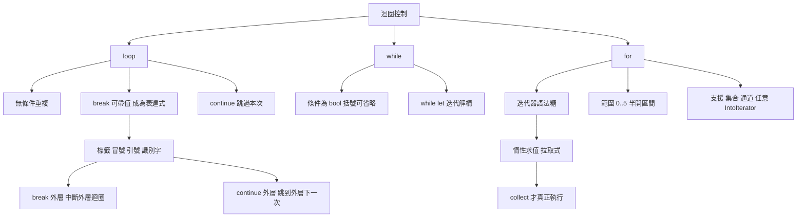
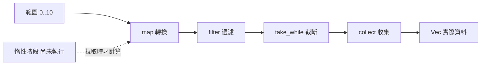

# 3.2 迴圈結構（loop、while、for）

## 三種迴圈與兩種思維

Rust 提供三種迴圈關鍵字：`loop`、`while` 與 `for`。表面上看，它們對應 C 語言的 `for(;;)`、`while` 與 `for`，但在語意上有一個根本差異：Rust 的 `for` 是**迭代器的語法糖**，而不是「計數器加條件」的組合。

這個差異帶來兩個後果。其一，Rust 沒有手動維護計數器的迴圈，因此也沒有「迭代器失效」（iterator invalidation）這類由集合被中途修改而引起的類 bug。其二，Rust 的 `for` 天然支援遍歷任何實作 `IntoIterator` 的型別，包括集合、範圍、通道結果，甚至自訂的產生器。

```rust
fn main() {
    // 數字
    for x in 0..5 {
        println!("{x}");
    }
    // 陣列
    for x in [1, 2, 3] {
        println!("{x}");
    }
    // 集合
    for x in vec![String::from("a"), String::from("b")] {
        println!("{x}");
    }
    // 雜湊表
    let mut map = std::collections::HashMap::new();
    map.insert("k", 1);
    for (k, v) in &map {
        println!("{k} = {v}");
    }
}
```

同一個 `for` 關鍵字涵蓋了這些資料來源，因為它背後統一是「把元素一個一個交出來」這個抽象。

## `loop`：無限迴圈與帶值跳出

`loop` 是最基礎的形式：沒有條件，重複執行直到被 `break` 中止。

```rust
fn main() {
    let mut count = 0;
    loop {
        count += 1;
        if count == 3 {
            break;
        }
    }
    println!("計數 {count}");
}
```

`loop` 的一個獨特之處是**可以帶值跳出**。`break` 後面加上一個值，這個值就是 `loop` 表達式的值。

```rust
fn main() {
    let mut n = 1;
    let result = loop {
        n *= 2;
        if n > 100 {
            break n;
        }
    };
    println!("{result}");
}
```

這個設計讓 `loop` 成為一種**表達式**，與 2.4 節的函式主體規則一致：外層表達式求值出 `i32`，所以 `result` 的型別是 `i32`。若 `break` 帶值而其他路徑不帶，編譯器會要求型別一致。

```rust
fn main() {
    // let v = loop { break 1; };   // 型別是 i32
    // let w = loop { break; };     // 型別是 ()，兩者不能混用
}
```

`continue` 則是跳過本次迭代，直接進入下一次。兩者可以巢狀組合，語意與其他語言相同。

```rust
fn main() {
    let mut sum = 0;
    let mut i = 0;
    loop {
        i += 1;
        if i > 10 {
            break;
        }
        if i % 2 != 0 {
            continue;
        }
        sum += i;
    }
    println!("偶數和 = {sum}");
}
```

`loop` 的典型用途是「重試直到成功」，這在網路請求與解析迴圈中很常見。

```rust
fn parse_until_ok(s: &str) -> Option<u32> {
    let mut rest = s;
    loop {
        match rest.trim().parse::<u32>() {
            Ok(v) => return Some(v),
            Err(_) => {
                // 繼續嘗試下一個片段
                match rest.split_once(' ') {
                    Some((_, tail)) => rest = tail,
                    None => return None,
                }
            }
        }
    }
}

fn main() {
    println!("{:?}", parse_until_ok("7 8 9"));
    println!("{:?}", parse_until_ok("x"));
}
```

## `while`：條件迴圈

`while` 在每次迭代前檢查條件，條件為真就執行本體。

```rust
fn main() {
    let mut count = 3;
    while count != 0 {
        println!("{count}");
        count -= 1;
    }
}
```

`while` 的括號是**可省略**的，條件不必加括號：

```rust
fn main() {
    let mut n = 3;
    while n > 0 {
        println!("{n}");
        n -= 1;
    }
}
```

`while` 與 `loop` 的差别在於，`while` 的條件表達式求值為 `()`（因為它是陳述式），因此 `while` 本身不是表達式，也不能帶值跳出。若需要帶值跳出，只能用 `loop` 加 `break value`。

另一個常見寫法是 `while let`，它讓迴圈在每次迭代時嘗試解構一個值，直到解構失敗為止。這在處理序列或串流時很實用。

```rust
fn main() {
    let mut stack = vec![1, 2, 3];
    while let Some(top) = stack.pop() {
        println!("取出 {top}");
    }
}
```

`while let` 在 6.4 節會有更完整的說明。它的直覺是「只要還能取出東西，就繼續」。

`while` 也能作為表達式使用，但它無法帶值跳出，因此實務上很少這樣寫；真正需要「重複嘗試直到某個條件成立並帶回結果」時，應使用 `loop` 搭配 `break value`。

```rust
fn main() {
    let mut n = 1;
    let result = loop {
        n *= 2;
        if n > 50 {
            break n;
        }
    };
    println!("{result}");
}
```

這段程式的結構是 `loop` 表達式：它的值由 `break` 決定，而 `break` 只能在某個條件下發生，因此編譯器能確定這個表達式一定會求值到 `i32`。

## `for` 與迭代器

`for` 迴圈把迭代器轉換為每次迭代取一個元素。它大致等價於下列展開：

```rust
fn main() {
    let mut iter = (0..5).into_iter();
    loop {
        match iter.next() {
            Some(x) => println!("{x}"),
            None => break,
        }
    }
}
```

實際編譯後的程式碼與這段展開非常接近，因為 `for` 本身正是編譯器對迭代器協議的語法糖。

這個設計帶來的第一個好處是**迴圈體積最小**。在 C 與 Java 中，遍歷集合必須寫成索引迴圈，並手動處理計數器與邊界；在 Rust 中只需寫 `for x in collection`。

第二個好處是**安全性**。Rust 的 `for` 無法用索引語法，因此不可能出現「索引超過集合長度」的 panic，也不可能出現「集合在迴圈中被修改導致索引失效」的問題。

第三個好處是**統一性**。任何實作 `IntoIterator` 的型別都能被 `for` 遍歷，包括 `Vec`、`HashMap`、陣列、切片、字串的位元組、範圍，甚至 `Option` 與 `Result`。

```rust
fn main() {
    // 遍歷 Option：Option 本身也實作 IntoIterator
    let opts = [Some(3), None];
    for v in opts.into_iter().flatten() {
        println!("{v}");
    }

    // 遍歷 Result，錯誤會被跳過
    let items: Vec<Result<i32, &str>> = vec![Ok(1), Err("bad"), Ok(3)];
    for v in items.into_iter().flatten() {
        println!("{v}");
    }

    // 遍歷字串的位元組
    for b in "ab".bytes() {
        println!("{b}");
    }
}
```

第三個範例特別值得注意：`Result` 實作了 `IntoIterator`，因此可以直接 `for` 走，這讓「處理一批可能失敗的操作」變得非常自然。

```rust
fn main() {
    let results: [Result<i32, &str>; 2] = [Ok(1), Ok(2)];
    for v in results {
        match v {
            Ok(n) => println!("成功 {n}"),
            Err(e) => println!("失敗 {e}"),
        }
    }
}
```

### 遍歷借用的三種形式

Rust 的 `for` 在遍歷集合時，有三種常見的借用形式，選擇哪一種取決於需求。

| 寫法 | 取得的所有權 | 適用情境 |
|---|---|---|
| `for x in v` | 移動整個集合 | 集合之後不再需要 |
| `for x in &v` | 不可變借用 | 最常見的預設 |
| `for x in &mut v` | 可變借用 | 需要就地修改元素 |

```rust
fn main() {
    let v = vec![String::from("a"), String::from("b")];

    for s in &v {
        println!("{s}");
    }
    println!("{v:?}");   // v 仍可用

    let mut nums = vec![1, 2, 3];
    for n in &mut nums {
        *n += 1;
    }
    println!("{nums:?}");
}
```

第一種形式會**消耗**集合：迭代完成後 `v` 已被移動，不能再使用。這是所有權規則在迴圈中的自然延伸，也是為什麼 `for s in &v` 是最常見的寫法。

### 遍歷雜湊表的順序

`HashMap` 的遍歷順序是**不確定的**，這與 `BTreeMap` 的有序遍歷形成對比。若程式需要穩定輸出，就該用 `BTreeMap` 或對結果排序。

```rust
fn main() {
    let mut map = std::collections::HashMap::new();
    map.insert("b", 2);
    map.insert("a", 1);

    let mut keys: Vec<&str> = map.keys().map(|k| *k).collect();
    keys.sort();
    println!("{keys:?}");
}
```

這個「先收集再排序」的寫法，比直接印出 `map.keys()` 更能給出可重現的結果，在測試中尤其重要。

## 範圍的數學語意

Rust 的範圍（range）語法直接反映了數學上的區間表示：

| 寫法 | 含義 | 備註 |
|---|---|---|
| `start..end` | $`[start, end)`$ | 半開區間，不含 `end` |
| `start..=end` | $`[start, end]`$ | 閉區間，含 `end` |
| `..` | $`[0, \text{max})`$ | 從 0 開始的全範圍 |
| `..end` | $`[0, end)`$ | 省略起點 |
| `start..` | $`[start, \text{max})`$ | 省略終點 |

```rust
fn main() {
    for x in 0..5 {          // 0 1 2 3 4
        print!("{x} ");
    }
    println!();

    for x in 0..=5 {         // 0 1 2 3 4 5
        print!("{x} ");
    }
    println!();

    for x in 0..3 {          // 0 1 2
        print!("{x} ");
    }
    println!();

    for x in (0..3).rev() {   // 2 1 0
        print!("{x} ");
    }
    println!();
}
```

`start..end` 採用半開區間是刻意的選擇，它與 Python 的 `range` 相同，好處之一是串接時不會重複計算邊界：

```rust
fn main() {
    let a = 0..3;      // 0 1 2
    let b = 3..6;      // 3 4 5
    for x in a.chain(b) {
        print!("{x} ");
    }
    println!();
}
```

兩個區間可以直接串接而不重複元素，這在切割資料時非常實用。

範圍還有兩個常用修飾方法：`rev()` 反轉順序，`step_by(n)` 每隔 n 個取一個。

```rust
fn main() {
    for x in (0..10).rev() {
        print!("{x} ");
    }
    println!();

    for x in (0..10).step_by(3) {
        print!("{x} ");
    }
    println!();

    for x in (0..10).rev().step_by(3) {
        print!("{x} ");
    }
    println!();
}
```

`step_by` 的步長必須是非零值，傳入 `0` 會 panic。範圍的型別推論也值得注意：`0..5` 的預設元素型別是 `i32`，若上下文需要 `usize`，可以寫成 `0..5usize` 或使用 `0..data.len()` 讓推論自然發生。

```rust
fn main() {
    let data = vec![1, 2, 3];
    for i in 0..data.len() {
        println!("{i}: {}", data[i]);
    }
}
```

這段程式是「索引式迴圈」的寫法，功能上正確但不是 Rust 的偏好風格：它需要手動維護索引，並且把邊界檢查留給執行期。更好的寫法是使用 `enumerate`，或直接遍歷元素。

```rust
fn main() {
    let data = vec![1, 2, 3];
    for (i, v) in data.iter().enumerate() {
        println!("{i}: {v}");
    }
}
```

兩者的差異在於，第二種寫法中「索引」是迭代器提供的副產品，而不是程式碼必須維護的狀態。當資料來源改變時（例如從 `Vec` 換成 `HashMap`），第二種寫法仍然成立。

## 迴圈標籤

Rust 支援**迴圈標籤**，讓 `break` 與 `continue` 能作用於外層迴圈。這在巢狀迴圈中非常實用。

```rust
fn main() {
    let mut found = None;
    'outer: for i in 0..5 {
        for j in 0..5 {
            if i * j == 6 {
                found = Some((i, j));
                break 'outer;
            }
        }
    }
    println!("{found:?}");
}
```

標籤的語法是單引號加識別字，寫在迴圈之前。`break 'outer` 會立即終止外層迴圈，而 `continue 'outer` 則跳到外層迴圈的下一次迭代。

```rust
fn main() {
    'outer: for i in 0..3 {
        for j in 0..3 {
            if j == 1 {
                continue 'outer;
            }
            println!("{i},{j}");
        }
    }
}
```

這個寫法在 C 中需要一個布林旗標變數，在 Java 中則需要標籤加 `break`。Rust 的做法更直接，也不需要可變的外部狀態。

## 迭代器的惰性

Rust 的迭代器是**惰性**（lazy）的：它不會一次把所有元素產生出來，而是在每次被呼叫 `next()` 時才計算下一個元素。

```rust
fn main() {
    let v = vec![1, 2, 3, 4, 5];
    let iter = v.iter().map(|x| {
        println!("計算 {x}");
        x * 2
    });

    println!("尚未開始");
    for x in iter {
        println!("得到 {x}");
    }
}
```

輸出顯示「計算」訊息只會在 `for` 迴圈真正拉取元素時才出現。惰性的好處是**可以處理無限序列**，也能避免為不需要的資料付出計算成本。

```rust
fn main() {
    let naturals = (1..).take(5);
    for n in naturals {
        println!("{n}");
    }
}
```

`(1..)` 是一個無限範圍，但 `take(5)` 讓它只產生五個元素就結束。若把整個序列收集起來，這段程式會永遠執行下去。

要把迭代器轉成實際的集合，需要呼叫 `collect`。

```rust
fn main() {
    let v: Vec<i32> = (1..=5).collect();
    println!("{v:?}");

    let squares: Vec<i32> = (1..=5).map(|x| x * x).collect();
    println!("{squares:?}");

    let sum: i32 = (1..=100).sum();
    println!("{sum}");
}
```

`collect` 的目標型別由上下文決定：標註成 `Vec<i32>` 就是向量，標註成 `HashMap` 就是映射表。這個機制是第 11 章的主題。

## `break` 與 `continue` 在迭代器鏈中的對應

在傳統迴圈中，`break` 與 `continue` 是流程控制關鍵字。在迭代器鏈中，它們有對應的組合子。

`break` 的作用是「提早結束並取某個值」，最接近的組合子是 `take_while`——它在前置條件不成立時停止，但不包含那個元素；若要包含停止的元素，則用 `take_while` 搭配 `chain` 或 `scan`。

```rust
fn main() {
    let data = [1, 2, 3, 99, 4, 5];
    let upto: Vec<i32> = data.iter().copied().take_while(|&x| x < 10).collect();
    println!("{upto:?}");
}
```

`continue` 的作用是「跳過某些元素」，對應的就是 `filter`。

```rust
fn main() {
    let data = [1, 2, 3, 4, 5, 6];
    let evens: Vec<i32> = data.iter().copied().filter(|x| x % 2 == 0).collect();
    println!("{evens:?}");
}
```

兩者的差異在語意的細節：迴圈中的 `break` 可以跳出並**帶回一個任意計算出來的值**，迭代器鏈則以「條件為假即停止」的方式表達類似的意圖。實務上，簡單的過濾與截斷用迭代器鏈更清晰；若需要在過程中做出複雜的決定，則回到 `for` 迴圈並使用 `break` 帶值。

另一個對應關係是 `fold` 與 `reduce`。它們把「迴圈中累積一個值」的模式表達成一個組合子。

```rust
fn main() {
    let sum = (1..=10).sum::<i32>();
    let prod = (1..=5).fold(1, |acc, x| acc * x);
    println!("{sum} {prod}");
}
```

## 效能直覺：零成本抽象

迭代器常被質疑「太抽象會不會變慢」。Rust 的答案是**零成本抽象**：迭代器的編譯結果與手寫迴圈等價，抽象不會帶來執行期成本。

編譯器透過兩種機制達成這點。第一是**內聯**：`map`、`filter`、`sum` 這些組合子都是泛型函式，編譯器會在具體化時把整條鏈展開。第二是**最佳化**：展開後的迴圈形態與手寫版本完全相同，因此同樣能套用向量化與分支預測等最佳化。

可以用 `cargo asm` 或 `cargo-asm` 觀察編譯結果，把泛型函式實例化成 assembly 後與手寫版本對照。

```bash
cargo install cargo-asm
cargo asm --release --lib "your_crate::sum_iter"
```

若不想安裝額外工具，也可以用 `cargo rustc -- --emit=asm` 產生組譯檔後直接檢視。

有一個例外要注意：迭代器的**型別複雜度**會影響編譯時間。極長的迭代器鏈（例如上百個 `map` 與 `filter` 串接）會產生龐大的單態化程式碼，導致編譯變慢。這是編譯時間的問題，不是執行期的問題。

另一個需要注意的點是**迭代器的邊界檢查成本**。`v.iter()` 會在每次迭代時檢查是否越界（雖然編譯器常能消除它），而 `v.iter().copied()` 與直接索引的差別極小。若在極度效能敏感的迴圈中，可以實測後再決定是否改寫。

### 一個可以實測的比較

下面兩段程式在執行期成本上幾乎相同，但表達意圖的方式不同。

```rust
fn main() {
    let data: Vec<u64> = (0..1_000_000).collect();

    // 手寫迴圈
    let mut sum_manual = 0u64;
    for x in &data {
        sum_manual = sum_manual.wrapping_add(*x);
    }

    // 迭代器
    let sum_iter: u64 = data.iter().copied().sum();

    println!("{sum_manual} {sum_iter}");
}
```

`sum` 之所以能與手寫迴圈等價，是因為它其實就是以迴圈實作的，只是把累積的型別與起始值交給型別系統推導。想要驗證這件事，可以把兩段程式分別編譯成 assembly 比較，會看到幾乎相同的指令序列。

需要特別留意的是，若把累積值改成 `u32`，`sum` 會因為溢出而 panic，而手寫版本若用 `wrapping_add` 則不會。兩者的行為差異來自型別與方法的選擇，而非抽象本身的成本。

## 迴圈中的所有權與借用

迴圈是借用檢查器最常發揮作用的場所，因為它同時涉及集合的擁有權與元素的借用。

```rust
fn main() {
    let v = vec![1, 2, 3];

    // 同時持有不可變借用與可變借用，編譯器會拒絕
    // let first = &v[0];
    // v.push(4);
    // println!("{first}");
    println!("{v:?}");
}
```

在 C++ 中這段程式碼同樣是未定義行為（迭代器失效），但只有在特定的重排情況下才會被偵測到；Rust 則一律在編譯期拒絕。

若真的需要在遍歷時修改集合，正確的做法是分兩階段：先收集要修改的索引，遍歷結束後再套用變更。

```rust
fn main() {
    let mut v = vec![1, 2, 3, 4, 5];

    let evens: Vec<usize> = v.iter().enumerate()
        .filter(|(_, x)| *x % 2 == 0)
        .map(|(i, _)| i)
        .collect();

    for i in evens {
        v[i] *= 10;
    }
    println!("{v:?}");
}
```

這個寫法把「讀取階段」與「修改階段」分開，因而滿足借用規則。第 5 章會詳細說明生命週期如何處理跨函式的借用，第 10 章的 `RefCell` 則提供執行期檢查的替代方案。

## 常見陷阱

第一，**在 `for` 中手動維護計數器**。這是最常見的「從其他語言帶來的習慣」，寫成 `for i in 0..v.len() { v[i] }` 的形式。應改用 `enumerate` 或直接遍歷元素。

第二，**忘記半開區間的右端不含**。`0..5` 產生五個元素而不是六個，`0..=5` 才包含 5。這個差異在計算迴圈次數時最容易被忽略。

第三，**在迴圈中反覆呼叫 `len()`**。`v.len()` 在 `Vec` 上是讀取一個欄位，成本很低，但這種寫法仍暗示著「索引式迴圈」的心智模型。

第四，**用 `loop` 卻忘了 `break`**。這會導致無限迴圈，編譯器能辨識出「這個 `loop` 沒有任何出口」的情況並發出 `unreachable_code` 警告，但無法偵測「執行期永遠走不到 `break`」的情況。

第五，**在迭代器鏈中使用副作用過多的操作**。惰性求值意味著鏈中的每一步都延後到拉取時才執行，因此若在鏈中夾帶有副作用的閉包，執行順序可能與閱讀程式碼時的直覺不同。

```rust
fn main() {
    let mut count = 0;
    let data = [1, 2, 3];

    let result: Vec<i32> = data.iter()
        .map(|x| {
            count += 1;
            x * 2
        })
        .collect();

    println!("{result:?} count = {count}");
}
```

`count` 的最終值是 3，代表 `map` 的閉包確實在三個元素上被呼叫了三次。若改成使用 `for` 直接呼叫同樣的閉包，計數結果相同，但兩種寫法的執行時機不同：迭代器鏈中的副作用發生在 `collect` 之後。

## 三種迴圈的對照

| 面向 | `loop` | `while` | `for` |
|---|---|---|---|
| 條件 | 無 | 每次迭代前檢查 | 由迭代器決定 |
| 表達式 | 是，可帶值跳出 | 否 | 否 |
| 括號 | 不適用 | 可省略 | 不適用 |
| 典型用途 | 重試、無限迴圈 | 依外部狀態終止 | 遍歷序列 |
| 對應迭代器 | 手動組合 | 手動組合 | 迭代器語法糖 |
| 手動計數器 | 需要 | 需要 | 不需要 |

## 迴圈控制的結構



## 迭代器的惰性管線



## 實務建議

第一，**優先使用 `for`**。它最安全、最簡潔，且在大多數情況下與手寫迴圈效能相同。只有在需要提早退出並帶值、或需要精細控制計數器時才考慮 `loop` 與 `while`。

第二，**需要索引時用 `enumerate`**。不要手動維護計數器。

```rust
fn main() {
    let names = ["甲", "乙", "丙"];
    for (i, name) in names.iter().enumerate() {
        println!("{i}: {name}");
    }
}
```

第三，**需要可變迭代時用 `iter_mut`**。它取得元素的可變借用，允許就地修改。

```rust
fn main() {
    let mut nums = vec![1, 2, 3];
    for n in nums.iter_mut() {
        *n *= 10;
    }
    println!("{nums:?}");
}
```

第四，**避免在迴圈中反覆呼叫 `len()` 與索引**。在 `for` 中取得長度並比較，是「手動索引迴圈」的殘留寫法，應改用迭代器。

第五，**巢狀迴圈加標籤**。當需要從內層跳出外層時，用 `'label: loop` 取代布林旗標變數。

第六，**優先用迭代器表達過濾與轉換**。當一段迴圈的主要內容是「對每個元素做某件事」，把它寫成迭代器鏈通常更短、更易測試，也更容易被最佳化。只有當流程控制複雜到無法用組合子清楚表達時，才回到 `for`。

```rust
fn main() {
    // 迴圈風格
    let mut names = vec![];
    for name in ["bob", "alice", "carol"] {
        if name.len() > 3 {
            names.push(name.to_uppercase());
        }
    }
    println!("{names:?}");

    // 迭代器風格
    let names: Vec<String> = ["bob", "alice", "carol"]
        .iter()
        .filter(|n| n.len() > 3)
        .map(|n| n.to_uppercase())
        .collect();
    println!("{names:?}");
}
```

兩種寫法的輸出相同，但迭代器版本把「過濾」與「轉換」兩個意圖分成兩個獨立步驟，讀者一眼就能看出資料經歷了哪些處理。

## 總結

Rust 的三種迴圈對應三種不同的思考方式：`loop` 適合「不知道何時結束，但知道何時該停」的情境，並且可以帶值跳出而成為表達式；`while` 適合「終止條件由外部狀態決定」的情境；`for` 適合「有一組元素要逐一處理」的情境，它是迭代器的語法糖，藉此從源頭排除了手動計數器與索引失效的類 bug。

更上層來看，Rust 的迴圈與迭代器並存而非互斥：迭代器提供零成本的抽象與惰性的求值模型，`for` 則讓它們的語法自然；`break` 與 `continue` 的流程控制能力在需要複雜決策時依然保留。兩者的結合，讓 Rust 既有高階語言的簡潔，又保有底層語言的效率與安全。

從安全性來看，迴圈是所有權與借用規則最密集交會的地方：`for` 的借用形式決定了集合是否被消耗，迭代過程中不可變借用與可變借用的共存被一律禁止，而迭代器的惰性則讓「何時取得資料」變成一個明確可控的問題。這些約束並非為了限制表達能力，而是為了讓迴圈中資料的流向始終一目了然。

從效能來看，Rust 把表達力與速度之間的取捨降到最低：`for` 展開後就是迴圈，迭代器鏈展開後也是迴圈，兩者的機器碼幾乎相同。於是「哪一種寫法比較快」這個問題在大多數情況下不需要被回答——因為答案都是一樣的。真正值得花時間的是別的事，例如資料結構的選擇、配置次數，以及快取局部性。

下一章將進入 Rust 最核心的主題：所有權。所有權制度正是支撐本章諸多借用規則的底層機制，它決定了誰能擁有資料、誰能借用資料，以及資料在什麼時候被釋放。
