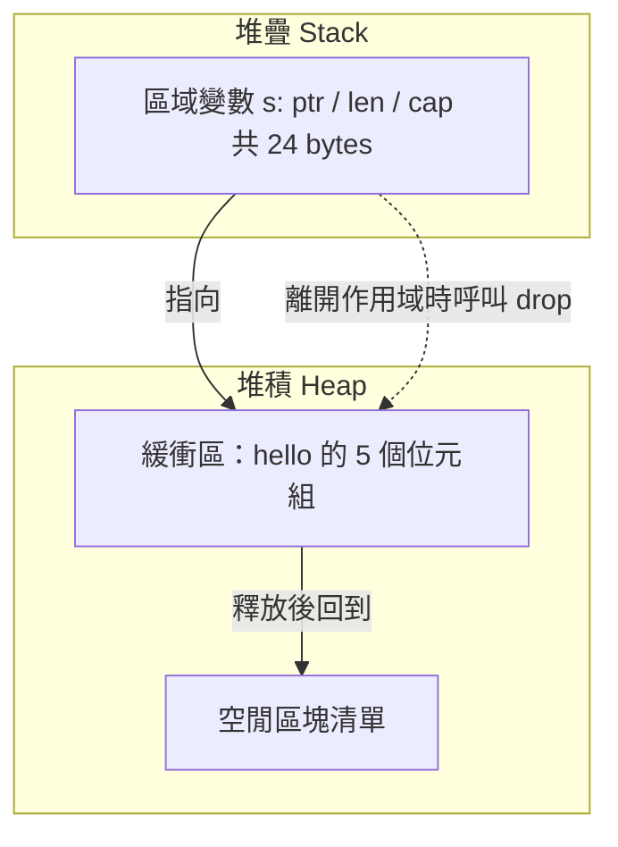

# 4.1 記憶體管理模型：堆疊（Stack）與堆積（Heap）

任何一個需要管理資源的語言，都必須先回答兩個問題：記憶體從哪裡來，以及記憶體最後由誰歸還。Rust 的答案是「所有權」，但在認識所有權之前，先要有一幅清晰的心智地圖，說明 Rust 的資料究竟住在記憶體的哪個角落。這幅地圖由兩塊區域構成：堆疊與堆積。

堆疊是一塊嚴格遵循後進先出秩序的線性記憶體。呼叫函式時，函式的參數、返回位址與區域變數會被依序推入堆疊；函式返回時，這些資料再依相反順序彈出。整個過程不需要任何配置器參與，也不需要查詢空閒區塊清單，因為堆疊頂端與空閒空間的分界線只會單調地移動。這就是「堆疊」名稱的由來，它像是一疊疊放的盤子，只能從最上面拿取。堆疊的容量在執行緒建立時就固定下來，之後無法擴充，但這並非缺陷，而是設計上的選擇：固定容量意味著每次存取都只需要一個框架指標加上一個固定的偏移量，不需要額外的表格查詢。

堆積則是完全不同的世界。堆積的容量可以在執行期成長，配置時必須由配置器（allocator）搜尋空閒區塊、切割成合適的大小，並把切割後的剩餘空間歸還給空閒清單。釋放時同樣要把區塊標記為可用，並嘗試與相鄰的空閒區塊合併，避免產生越來越多無法再利用的碎片。碎片是堆積的結構性問題：即使總體空閒記憶體十分充足，也可能因為空閒區塊散落各處而無法滿足較大的配置請求。堆積的存取則需要多一次解參考，因為存放資料的地方不在執行緒堆疊的固定位置。

兩者的成本差異可以歸納成一個比較表。

| 比較面向 | 堆疊（Stack） | 堆積（Heap） |
| --- | --- | --- |
| 配置方式 | 移動堆疊頂端指標，常數時間 | 配置器搜尋空閒區塊，成本不固定 |
| 釋放方式 | 移動指標，無需呼叫配置器 | 需呼叫配置器，可能觸發區塊合併 |
| 容量 | 建立執行緒時固定，之後不可變 | 可在執行期成長與縮減 |
| 生命週期 | 與區域變數的作用域完全一致 | 與變數的作用域無必然關係 |
| 碎片問題 | 不存在，皆為固定大小的框架 | 存在，取決於配置器的策略 |
| 存取速度 | 快，少一次解參考 | 慢，多一次記憶體存取 |

Rust 把這兩種特性映射到兩大類資料型別上。第一類是固定大小、可以直接放在堆疊上的型別，例如 `i32`、`f64`、`bool` 以及固定長度的陣列 `[u8; 32]`。這些型別的大小在編譯期就完全確定，複製它們等同於複製幾個位元組，因此它們額外實作了 `Copy` 特性，讓賦值操作只是位元複製而非所有權轉移。第二類是大小在執行期才確定的型別，例如 `String` 與 `Vec<T>`。它們的**結構本身**仍然住在堆疊上，而真正的**緩衝區**（buffer）配置在堆積上。

以 `String` 為例，它的內部佈局是三個 `usize`：一個指向堆積緩衝區的指標、一個表示目前長度的數字，以及一個表示已配置容量的數字。在 64 位元平台上，三者合計剛好是 $ 3 \times 8 = 24 $ 位元組。當你把 `String` 當成值傳遞時，被複製的是這 24 位元組的結構，而非堆積上的那串文字。

```rust
use std::mem::size_of;

fn main() {
    println!("size_of::<i32>() = {}", size_of::<i32>());
    println!("size_of::<String>() = {}", size_of::<String>());
    println!("size_of::<Vec<u8>>() = {}", size_of::<Vec<u8>>());

    let s = String::from("hello");
    let t = s;                 // 移動：複製 24 位元組的結構描述，s 至此失效
    println!("{}", t.len());
    // println!("{}", s.len());  // 若取消註解則編譯失敗：E0382
}
```

`Vec<T>` 的情況完全相同，只是把字元換成泛型元素，並且在型別上多攜帶一個 `usize` 的元素大小描述。以上程式碼可以直接用 `rustc` 編譯執行，觀察到 `size_of::<String>()` 的輸出正是 24。



這張圖解釋了「所有權」為何必須同時處理兩處記憶體。堆疊上的資料，其生命週期與區域變數完全綁定，當變數離開作用域，編譯器插入的 `drop` 呼叫會自動回收它，程式碼幾乎不需要操心。但堆積上的緩衝區不同：它的生命週期不由任何單一區域變數決定。如果沒有任何機制負責歸還，`String` 的緩衝區就會洩漏；如果有兩個變數都去歸還，就會變成重複釋放。於是 Rust 的所有權機制把「誰負責釋放堆積資源」這件事，綁定到堆疊上那一個變數身上。

這裡出現一個關鍵推論：Rust 必須在**編譯期**就能確定堆積資源由誰釋放。傳統的 C 語言把這個責任交給 程式設計師的紀律，程式碼允許任何一種寫法通過編譯，錯誤只在執行時以 use-after-free 的形式爆發。管理式語言如 Java 與 Go 放棄了靜態決定，改由垃圾收集器在執行期追蹤所有可達性，安全性保證了，但執行期成本與暫停時間也跟著來了。

記憶體安全問題可以分成兩大類。第一類是 use-after-free：程式讀寫一塊已經被釋放的記憶體，可能讀到任意內容，也可能寫入任意內容。第二類是資料競爭（data race）：兩個執行緒同時存取同一塊記憶體，其中至少一個是寫入，且存取沒有任何同步機制。前者在單執行緒的 C 程式中最為常見，後者則是並行程式中最危險的缺陷類別。

Rust 對這兩類問題的處理方式，是把它們從執行期錯誤轉換成編譯期錯誤。use-after-free 在 Rust 中被所有權規則擋下：值被移動之後，原來的變數立即失效，編譯器會以 `E0382` 拒絕程式。資料競爭則被借用檢查器擋下：可變借用必須是獨佔的，同一份資料在同一時刻不可能有兩個可變借用者，因此不可能有兩個執行緒同時寫入。

```rust
fn main() {
    let s1 = String::from("hello");
    let s2 = s1;
    println!("{}", s2);          // s1 已失效，此處改印 s2
    // println!("{}", s1);       // 若取消註解則編譯失敗：E0382，值已被移動
}
```

編譯器會明確指出 `s1` 的所有權已被轉移給 `s2`，而 `s1` 從此失效；取消註解的那一行便會得到 `error[E0382]: borrow of moved value: 's1'`。

這個取捨帶來了兩方面的差異。在效能上，Rust 程式沒有垃圾收集器的執行期負擔，也不需要手動呼叫 `free`，配置與釋放被編譯成固定的機器碼，與 C 的 `malloc`／`free` 相當，但多了一份編譯期保證。在工程體驗上，代價是編譯期更長、錯誤訊息更複雜，而且某些在 C 語言中完全合法、在型別上也安全的程式會被 borrow checker 拒絕。這是一個把成本從執行期搬到編譯期的取捨。

三種記憶體管理策略的成本分布可以用下表來對照。

| 策略 | 安全性保證 | 執行期成本 | 編譯期成本 | 適用情境 |
| --- | --- | --- | --- | --- |
| 手動管理（`malloc`／`free`） | 無，靠紀律 | 最低 | 最低 | 對延遲極度敏感的系統程式 |
| 垃圾收集（GC） | 有，執行期追蹤 | 有停頓與額外空間 | 低 | 物件生命週期複雜的長時間服務 |
| 所有權與借用檢查 | 有，編譯期證明 | 接近手動管理 | 明顯較高 | 大多數系統與網路服務 |

三者的差別不在於誰「更安全」，而在於安全保證的來源與時機。手動管理把成本付在人類的紀律上，GC 把成本付在執行期資源上，而 Rust 把成本付在編譯期。當你理解了堆疊與堆積的分界，以及 Rust 如何用堆疊上的結構來代表堆積上的資源，下一章的所有權規則就會顯得自然：它其實只是「讓堆疊上的變數成為堆積資源的合法繼承人」而已。

## 堆疊與堆積的對應關係

把上面的抽象落回程式碼，會發現 Rust 的型別系統其實非常一致地遵守著一條原則：凡是「編譯期就能知道大小」的資料，一律住在堆疊；凡是「編譯期不知道大小」的資料，其描述資訊住在堆疊，真正內容住在堆積。`i32`、`bool`、`char` 與 `[u8; 32]` 屬於前者，`String`、`Vec<T>`、`HashMap<K, V>` 與 `Box<T>` 屬於後者。

這個對應並非語言層面的任意選擇，而是由「所有權必須在編譯期決定歸還責任」這一要求推導出來的。如果 `String` 的緩衝區被配置在堆疊上，那麼它的容量就必須在編譯期固定，`push` 語義將無從存在；如果 `i32` 住在堆積上，那麼每次取值都要一次配置器呼叫與一次釋放，編譯期產生的機器碼將無法貼近硬體效率。Rust 在這兩端都選擇了對效能與安全性都最有利的一側。

有一個常見的誤解需要在此澄清：把 `String` 說成「在堆積上」是一種簡化。精確地說，`String` 這個值本身是三個 `usize` 欄位組成的結構，它作為區域變數住在堆疊上；只有它所指向的字元緩衝區在堆積。這個區別在除錯時非常實際——當你用 GDB 或 LLDB 觀察一個 `String` 區域變數時，會看到兩個指標與兩個數字，而不是字元本身。

```rust
fn main() {
    let s = String::from("hello world");
    let boxed = Box::new(42_i64);
    let heap_array = [0_u8; 1024];

    println!("String 結構大小：{} bytes", std::mem::size_of_val(&s));
    println!("Box 結構大小：{} bytes", std::mem::size_of_val(&boxed));
    println!("堆積陣列首元素：{}", heap_array[0]);
    println!("Box 內容：{}", *boxed);
}
```

這段程式碼說明了一件容易被忽略的事：`Box<i64>` 的大小是 8 位元組，與 `i64` 相同，儘管它把資料搬到了堆積。`Box` 存在的理由不是「把數字變大」，而是「讓一個編譯期大小未知的型別可以安全地放在堆疊上」，例如 `Box<dyn Error>` 這種 trait 物件，其內部是一個胖指標加上一個指標，正好 16 位元組。

## 碎片問題的深入

碎片是堆積管理最實際的痛點，值得再深入一層說明。碎片有兩種形態：外部碎片與內部碎片。外部碎片指的是空閒記憶體總量足夠，但沒有任何單一連續區塊足夠大，配置因此失敗。內部碎片則指配置器為了對齊（alignment）而把區塊向上取整，導致區塊尾端多出來無法利用的空間。

Rust 的預設全域配置器在 64 位元 Linux 上採用 jemalloc 風格的分級大小類別策略：不同大小的區塊被分到不同的 bin，空閒區塊依大小搜尋並在適當時機合併，以降低外部碎片。分配對齊則由型別本身保證，例如 `u64` 需要 8 位元組對齊，`Vec<u64>` 的起點一定落在 8 的倍數位址上。相較之下，C 語言的 `malloc` 只保證 16 位元組的基本對齊，型別層級的對齊要求要靠 `posix_memalign` 或 `std::alloc::alloc` 才能達成。

理解碎片有助於理解 Rust 的一項工程建議：對大量小物件，反覆配置與釋放不如配置一塊大的緩衝區後切片使用。`String` 之所以在多次 `push` 之後仍能保持效能，正是因為它在容量不足時會以倍增策略重新配置，把成本攤還到 $ O(1) $ 的每次追加。

## 兩類記憶體安全問題

use-after-free 之所以危險，不只是因為讀到垃圾資料。在現代作業系統中，已釋放的堆積區塊常被配置器重新分配給其他物件，因此 use-after-free 往往不是讀到隨機位元，而是讀到「別的物件的內容」，這使得缺陷極難重現與診斷。與此相對，記憶體洩漏屬於資源管理問題而非安全漏洞：程式功能正確，但長期執行會耗盡記憶體。

資料競爭的危險性則更高，因為它的結果取決於執行緒交錯的時序，同樣的程式碼在測試中可能永遠正常，在正式環境卻偶爾產生錯誤金額。這類「偶發且不可重現」的缺陷，是並行程式中最惡名昭彰的難題。

Rust 把這兩類問題都前移到編譯期：use-after-free 由所有權規則消除，資料競爭由借用檢查器排除，再加上 `Send` 與 `Sync` 兩個標記 trait 保證跨執行緒傳遞的型別本身是安全的。代價是編譯期必須做更多的全域分析，也因此編譯時間通常比 C 稍長。

## 生命週期與 drop 的時機

堆疊與堆積的差異，最終都會收斂到一個時間點：資源被釋放的那一刻。在 Rust 中，這個時間點由作用域（scope）決定。當一個變數離開它所宣告的區塊，編譯器會在該處插入對 `drop` 函式的呼叫；對於 `String` 而言，`drop` 的實作會呼叫 `Vec` 的釋放邏輯，最終把緩衝區歸還給配置器。這個過程是自動的、順序確定的，而且不需要執行緒在背景四處巡檢。

```rust
fn main() {
    {
        let owned = String::from("短命字串");
        println!("owned 的長度：{}", owned.len());
    }   // owned 在此離開作用域，緩衝區被釋放

    let moved = String::from("長命字串");
    std::mem::drop(moved);   // 也可以提早釋放，之後 moved 不可再使用
    println!("done");
}
```

注意最後一行不需要任何 `free` 或手動回收的呼叫，整個函式的結束就是資源回收的保證。這與 C 語言中 return 前必須記得逐一 `free` 的寫法形成強烈對比，也與 Go 的垃圾收集器所採取的「不知道何時會被回收」形成對照。

## Rust 型別與記憶體位置的對照

把常見型別依「描述資訊在哪裡、內容在哪裡」整理，可以得到一張很有用的速查表。

| 型別 | 結構大小（64 位元） | 內容位置 | 大小可變 | 實作 `Copy` |
| --- | --- | --- | --- | --- |
| `i32` | 4 bytes | 堆疊 | 否 | 是 |
| `char` | 4 bytes | 堆疊 | 否 | 是 |
| `bool` | 1 byte | 堆疊 | 否 | 是 |
| `[u8; 32]` | 32 bytes | 堆疊 | 否 | 是 |
| `String` | 24 bytes | 堆疊描述 + 堆積緩衝區 | 是 | 否 |
| `Vec<T>` | 24 bytes | 堆疊描述 + 堆積緩衝區 | 是 | 否 |
| `Box<T>` | 8 bytes | 堆疊描述 + 堆積內容 | 否 | 否 |
| `&str` | 16 bytes | 堆疊描述 + 借用他處 | 否 | 是 |
| `&[T]` | 16 bytes | 堆疊描述 + 借用他處 | 否 | 是 |

這張表也解釋了為什麼 `String` 與 `&str` 不能互換：`String` 自己擁有緩衝區，負責釋放；`&str` 只是借用 view，不負責釋放，而且它的生命週期必須短於被借用的資料。這條性質正是第 4.4 節切片主題的伏線。

## 為什麼所有權必須同時處理兩者

有一個問題常被忽略：為什麼 Rust 不能只為堆積資料設計一套規則，而不管堆疊資料？原因在於堆疊與堆積的歸還機制必須一致，否則型別系統會出現無法解釋的特例。如果 `String` 有所有權、`i32` 沒有，那麼一個函式簽章中的 `i32` 參數到底是複製還是移動，就成了語意模糊的地帶。Rust 的解法是：`Copy` 這個特性把兩者統一成同一條規則——賦值與傳參「複製值」；沒有 `Copy` 的型別「移動值」。

同時，Rust 也必須保證「堆疊資料的生命週期永不超過堆積資料」。若某個堆疊變數持有指向堆積緩衝區的指標，而它比緩衝區活得久，就會出現懸垂指標。Rust 用借用與生命週期規則來禁止這種組合，讓堆疊上的資料永遠不能活得比它所指向的堆積資料更久。所有權規則管「誰負責釋放」，生命週期規則管「誰不能比誰活得久」，兩者合起來才構成完整的記憶體安全。

## 靜態檢查取代動態檢查

把 Rust 與其他語言放在同一個天平上，就會看到一個清晰的取捨。Rust 用編譯期檢查取代執行期檢查：邊界檢查、型別檢查、執行緒安全檢查全部在編譯期完成，執行期幾乎沒有額外負擔。相對地，動態檢查把驗證成本留在執行期，程式碼更容易撰寫，但每次執行都要付出檢查的時間與空間。

用一個簡化的模型來描述：若一個操作的執行期成本是 $ c $ ，執行的次數是 $ n $ ，那麼動態檢查的總成本與靜態檢查的總成本可以寫成如下式。

$$
C_{\text{dynamic}} = O(n \cdot c), \quad C_{\text{static}} = O(1)
$$

靜態檢查把這筆成本壓縮成一次性編譯期成本，執行期不再有檢查的稅。這也是為什麼 Rust 適合長時間運行、對尾端延遲敏感的服務。
