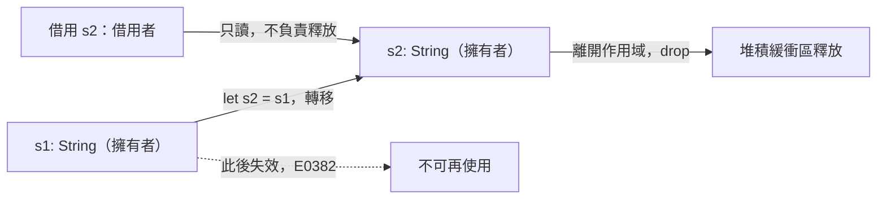

# 4.2 所有權的三大規則

所有權（ownership）是 Rust 記憶體安全模型的核心概念。它不是一條又一套孤立的規則，而是三條規則構成的一個完整系統；理解這三條規則，等於理解 Rust 與其他語言在資源管理上的根本分歧。所有權的問題起源於 4.1 節留下的那個難題：堆積上的記憶體必須有人負責釋放，而「有人」必須在編譯期就能確定。

Rust 的答案非常簡潔：每個值都有一個擁有者，擁有者就是一個變數。變數離開作用域時，它擁有的值就會被丟棄（drop）。這個設計把「資源釋放」這件事從執行期的隱性行為，徹底搬到了編譯期就能推理的靜態結構上。

## 規則一：每個值都有一個擁有者

第一條規則宣告了值的歸屬關係。當你用 `let` 宣告一個變數時，那個變數就成為該值的擁有者。這個歸屬是唯一的：同一個值在同一時間只會有一個擁有者，不存在「多個擁有者共同承擔釋放責任」的情況。

```rust
fn main() {
    let s1 = String::from("hello");
    println!("s1 的擁有者是 s1，長度為 {}", s1.len());
}
```

這裡 `s1` 是 `String` 值的擁有者。當 `s1` 離開 `main` 的作用域時，它所擁有的 `String` 會被丟棄，其堆積緩衝區被歸還給配置器。整個過程不需要呼叫 `free`，也不需要任何垃圾收集器的介入。

這條規則看似平淡，卻是三條規則的基石。因為擁有者是唯一的，Rust 才能在編譯期斷言「這個值只會被釋放一次」，從而排除重複釋放（double free）與 use-after-free。所謂「唯一擁有者」並不限制值被使用的方式，你可以把它借給別人、可以把它放進集合，甚至可以把它送到另一個執行緒，唯一不能做的就是讓兩個變數同時以擁有者的身分存在。

## 規則二：同一時間只能有一個擁有者

第二條規則規定，在同一時間點，一個值只能被一個擁有者持有。這條規則的實際效果，是在所有權發生轉移（move）時，讓原本的擁有者立刻失效。

```rust
fn main() {
    let s1 = String::from("hello");
    let s2 = s1;
    println!("s2 的長度是 {}", s2.len());
    // println!("{}", s1);   // 取消註解後編譯失敗：E0382，值已被移動
}
```

`let s2 = s1;` 這一行執行的是「移動」而非「複製」。堆積上的緩衝區只有一份，所有權從 `s1` 轉移到 `s2`，而 `s1` 從這一行之後就失效了。若嘗試再讀取 `s1`，編譯器會報出 `error[E0382]: borrow of moved value: 's1'`，並在註解中指出值被移動到的位置。

這個設計解決了 4.1 節提出的那個兩難。如果允許兩個擁有者，那麼 `s1` 與 `s2` 離開作用域時都會嘗試釋放同一塊緩衝區，造成重複釋放；如果允許「只有一個會釋放」，那麼必須在執行期記錄是誰，而這正是垃圾收集器要解決的問題。Rust 選擇了第三條路：讓所有權在編譯期就沿著一條單向的路徑流動，讓釋放責任永遠只落在路徑的末端。

值得注意的是，這條規則並不只影響堆積資料。`Copy` 型別如 `i32` 在賦值時同樣遵循「轉移所有權」的語法模型，只是因為它們的 `Copy` 實作讓編譯器在複製之後仍保留原變數的有效性，從使用者的觀點看就像單純的複製。

## 規則三：擁有者離開作用域時值被丟棄

第三條規則描述了釋放的時機。當擁有者變數離開它所宣告的作用域時，編譯器會在該處插入對 `drop` 的呼叫，值隨之被丟棄。對於堆疊上的型別，這個動作幾乎是免費的；對於 `String` 這類持有堆積資源的型別，`drop` 會一路呼叫到配置的釋放邏輯。

```rust
fn main() {
    {
        let inner = String::from("inner");
        println!("inner 的長度是 {}", inner.len());
    }
    println!("inner 已經離開作用域，其緩衝區已被釋放");

    let outer = String::from("outer");
    std::mem::drop(outer);
    println!("outer 已被提早釋放");
}
```

這條規則的重要性在於「確定性」。Java 的 `finalize` 可能在任何不可預期的時機被呼叫，Python 的垃圾收集時機取決於參考計數與循環偵測器的週期，而 Rust 的 `drop` 一定發生在離開作用域的那一刻，而且是精確到陳述句的位置。這種確定性讓 Rust 能夠安全地管理檔案句柄、資料庫連線與鎖，而不必依賴「最終一定會被釋放」的僥倖。

值得留意的是，變數被遮蔽（shadowing）並不會觸發 `drop`。下面這段程式碼中，第二個 `x` 是同一個作用域內的新變數，第一個 `x` 會在遮蔽生效的當下被丟棄，其堆積緩衝區立刻被釋放。

```rust
fn main() {
    let x = String::from("first");
    println!("第一次宣告的 x：{}", x);
    let x = String::from("second");
    println!("遮蔽後的 x：{}", x);
}
```

## `String` 與 `&str` 的轉移語意

理解 `String` 與 `&str` 的差異，是理解所有權操作的前提。`String` 是擁有者，持有堆積緩衝區並負責釋放；`&str` 是借用者，只是指向某處的一段 UTF-8 文字，不負責釋放，也無法比它所借用的資料活得更久。

兩者的互相轉換，就是所有權與借用的轉換。呼叫 `&s` 會把一個 `&String` 自動轉型成 `&str`，這個過程是零成本的，只是把「指標加長度」的描述改成同樣形狀的另一個描述。反過來，`s.clone().as_str()` 則是一次明確的深複製。

```rust
fn main() {
    let owned = String::from("hello");
    let borrowed: &str = &owned;
    println!("borrowed 的長度是 {}", borrowed.len());
    println!("owned 仍然可用，長度是 {}", owned.len());
}
```

這段程式碼展示了借用的兩個性質：被借用的值仍然完整可用，而借用者不承擔釋放責任。這與 `let s2 = s1;` 形成鮮明對比——在那個案例中 `s1` 失效了，在這個案例中 `owned` 依然有效。

## 規則的直覺：把釋放責任綁到作用域

三條規則的背後，其實只有一個設計意圖：把「資源的釋放責任」綁定到一個變數的作用域上。當變數離開作用域，資源必然被釋放，中間沒有任何分支、沒有任何例外路徑可以繞過。這等於在程式碼裡畫出一張**靜態的資源生命週期圖**：每一個值從被配置到被釋放之間的經過的路徑，在編譯期就完全確定。

這張圖是**單向**的。值可以從一個擁有者流向另一個擁有者，但不會分岔成兩條並行的持有路徑，也不會繞成環。這與垃圾收集器所面對的困難形成鮮明對比：GC 必須在執行期維持一張可達性圖，處理循環參考、處理弱參考的時機、處理回收時機與程式碼中其他邏輯的交互。Rust 把這些問題全部從執行期移除了，代價是程式碼必須服從所有权的形狀。

值得注意的是，Rust 並不禁止「同一份資料被多人看到」，它只是禁止「同一份資料被多人擁有」。多人讀取是安全的，多人同時寫入則是不安全的，而所有權系統只把「寫入」這件事收斂成獨佔的樣態。這樣的分工讓規則既嚴格又實用：常見的「呼叫端把資料借給幾個函式讀一讀」寫法完全不受阻礙，只有真正需要修改的場合才需要付出獨佔的代價。

## `Copy` 與 `Clone` 的分工

`Copy` 與 `Clone` 兩個特性經常被混淆，但它們處理的問題不同。`Copy` 表示「這個型別的複製是廉價且無副作用的」，因此編譯器在賦值與傳參時自動做位元複製，並允許原變數繼續使用。`Clone` 則是顯式的深複製，呼叫者必須主動要求。

`Copy` 只能套用在「沒有堆積資源」的型別上。判斷準則很簡單：型別的複製如果只是把一段位元組搬到別處，就應該是 `Copy`；如果複製會產生第二份需要獨立釋放的資源，那它就必須是移動而非複製。`i32`、`f64`、`char`、`bool` 與固定長度陣列屬於前者，`String`、`Vec<T>` 與 `Box<T>` 屬於後者。

```rust
#[derive(Clone, Debug)]
struct Point {
    x: i32,
    y: i32,
}

fn main() {
    let a = Point { x: 1, y: 2 };
    let b = a;                 // Point 沒有實作 Copy，這是移動
    // println!("{:?}", a);    // 取消註解後編譯失敗：E0382

    let c = b.clone();         // 明確的深複製，b 仍然可用
    println!("{:?} {:?} {} {}", b, c, b.x, b.y);
}
```

如果一個結構體裡含有 `String` 欄位，它就無法實作 `Copy`，因為複製它會導致兩個結構體都想釋放同一塊緩衝區。反過來，若一個結構體的所有欄位都實作了 `Copy`，那麼它自身也可以實作 `Copy`。編譯器會用 `E0184` 拒絕那些「含有非 `Copy` 欄位卻宣告 `Copy`」的結構體，正是這條規則的體現。

## 函式參數的所有權轉移

所有權在函式邊界上同樣遵循規則二。把 `String` 傳進函式就是轉移所有權，函式取得擁有者，並在函式返回時負責釋放。

```rust
fn consume(s: String) -> usize {
    println!("consume 持有 s，長度是 {}", s.len());
    s.len()
}

fn borrow(s: &str) -> usize {
    println!("borrow 只是借用 s，長度是 {}", s.len());
    s.len()
}

fn main() {
    let s = String::from("hello");
    let n = borrow(&s);
    println!("borrow 之後 s 仍然可用，長度是 {}", s.len());
    let m = consume(s);
    println!("consume 之後 s 不可用，consume 回傳 {}", m);
    println!("n = {}", n);
}
```

`borrow` 的簽章是 `&str`，因此傳入 `&s` 只是建立一個借用，`s` 在呼叫前後都保持有效。`consume` 的簽章是 `String`，因此傳入 `s` 是所有權轉移，呼叫之後 `s` 失效。實務上的通則是：若函式只讀取資料，簽章一律使用 `&str` 或 `&[T]`；只有當函式需要修改並取走資料時，才使用 `String` 或 `Vec<T>`。

## 自訂 `Drop`：讓資源釋放可以客製

規則三並不限定釋放的行為。`Drop` 特性允許型別自行定義「被丟棄時要做什麼」，而編譯器保證這個函式恰好被呼叫一次，且在變數離開作用域時自動執行。對於檔案、鎖與連線這類資源，這是讓 Rust 風格延伸到自訂型別上的機制。

```rust
struct Resource {
    name: String,
}

impl Resource {
    fn new(name: &str) -> Resource {
        println!("取得資源：{}", name);
        Resource { name: name.to_string() }
    }
}

impl Drop for Resource {
    fn drop(&mut self) {
        println!("釋放資源：{}", self.name);
    }
}

fn main() {
    {
        let _r = Resource::new("檔案句柄");
        println!("正在使用資源");
    }
    println!("作用域結束，資源已釋放");
}
```

`drop` 的實作在這裡被呼叫的時機，完全由作用域決定。實務上應盡量不要在 `drop` 中呼叫 `std::mem::drop` 自身，那會造成遞迴；也不要在 `drop` 中把借用轉成擁有，這條規則會在編譯期被擋下。

## 把 `String` 從函式還原

一個能把資源還原給呼叫者的完整範例，可以把所有權概念串在一起。這個函式接受一個 `String` 並產生出兩個：一個是新產生的字串，另一個是從原字串切出的片段。

```rust
fn split_prefix(s: String) -> (String, String) {
    let bytes = s.as_bytes();
    let mut cut = 0;
    for (i, &b) in bytes.iter().enumerate() {
        if b == b' ' {
            cut = i;
            break;
        }
    }
    let rest = s[cut..].to_string();
    let head = s[..cut].to_string();
    (head, rest)
}

fn main() {
    let original = String::from("hello world");
    let (head, rest) = split_prefix(original);
    println!("head = {}", head);
    println!("rest = {}", rest);
}
```

這裡 `split_prefix` 以值接收 `s`，所以呼叫端傳入時所有權就轉移進去了，函式結束後原字串已經被釋放。函式內部則透過 `to_string()` 製造兩份新的堆積緩衝區，並以元組把它們一併還給呼叫端。此處的 `s[cut..]` 借用寫法，正是第 4.4 節要深入討論的切片語法。

## 記憶體配置與釋放的時機

把配置與釋放放在一起觀察，可以得到一條清楚的時間線。`String::from` 呼叫配置器取得緩衝區，這是配置的那一刻；所有權沿著變數與函式呼叫一路流動，這是持有關係改變的過程；最後當擁有者離開作用域，`drop` 被呼叫，這是釋放的那一刻。

以一個完整的主函式為例，時間線是這樣的：進入 `main` 建立堆疊框架，`String::from` 在堆積配置緩衝區並把描述資訊放在堆疊上的區域變數中。變數宣告之後的程式碼都持有這個值，直到 `main` 結束。當 `main` 的作用域收尾，變數被丟棄，緩衝區回到配置器的空閒清單。整個過程中沒有任何一次執行期的「垃圾偵測」，也沒有任何一次由程式設計師手動呼叫的釋放。

```rust
fn main() {
    let a = String::from("第一份");     // 配置
    let b = a;                          // 轉移，不配置
    let c = b.clone();                  // 深複製，再配置一份
    println!("{} {}", b.len(), c.len());
    // 作用域結束：c 與 b 各釋放一份緩衝區
}
```

最後一行值得注意：因為 `c` 是獨立複製出來的緩衝區，`b` 與 `c` 各自擁有一份資源，離開作用域時各自釋放一次。若沒有 `clone`，整個過程只會有一份緩衝區，也就只需要釋放一次。所有權的設計讓「記憶體用了幾份」與「需要釋放幾次」這個問題永遠不需要人工追蹤。

## 常見的所有權陷阱

初學者最常遇到的困惑，是把「擁有」與「使用」混為一談。以下幾種寫法在別的語言中很自然，在 Rust 中卻會被編譯器擋下。

第一種是「已經給別人用了，卻還想繼續用」。這正是 `E0382` 涵蓋的情況，修正方式不是硬加 `clone`，而是先想清楚語意上是否真的需要兩份資料。

第二種是「把借用當成擁有來傳遞」。當函式簽章是 `String` 而呼叫端手上只有 `&str` 時，編譯器會要求提供 `String`。這時可以讓簽章改成 `&str`，這通常也是更好的設計。

第三種是「在迴圈中反覆複製大資料」。`for item in vec` 會自動取得迭代器；而 `for item in &vec` 才是在借用。寫法上的細微差異，會決定是否產生額外的配置。

第四種是「在函式間傳遞時不必要地轉移」。如果一個函式只是要讀取內容，把它寫成 `fn f(s: &str)` 幾乎永遠比 `fn f(s: String)` 更好，因為前者允許呼叫端繼續保有所有權。

```rust
fn take_ownership(s: String) -> String {
    println!("取得 {}", s);
    s
}

fn main() {
    let s = String::from("hello");
    let s2 = take_ownership(s);        // 轉移
    let s3 = take_ownership(s2.clone()); // 複製後再轉移，s2 仍然可用
    println!("{} {}", s2, s3);
}
```

## 所有權與多態

所有權與型別系統並非互不相干。`Box<dyn Trait>` 是兩者結合的關鍵：它把一個胖指標放在堆疊上，指標指向堆積上的具體型別，而 dispatch 由 vtable 在執行期完成。擁有權讓這個值有明確的釋放者，動態派發讓呼叫端不必知道具體型別，兩者結合就得到了 Rust 的多型容器。

```rust
trait Shape {
    fn area(&self) -> f64;
}

struct Circle(f64);
struct Square(f64);

impl Shape for Circle {
    fn area(&self) -> f64 {
        std::f64::consts::PI * self.0 * self.0
    }
}

impl Shape for Square {
    fn area(&self) -> f64 {
        self.0 * self.0
    }
}

fn total_area(shapes: &[Box<dyn Shape>]) -> f64 {
    shapes.iter().map(|s| s.area()).sum()
}

fn main() {
    let shapes: Vec<Box<dyn Shape>> = vec![Box::new(Circle(1.0)), Box::new(Square(2.0))];
    println!("總面積 = {}", total_area(&shapes));
}
```

這段程式碼中，`Vec<Box<dyn Shape>>` 這個值是唯一的擁有者，`total_area` 取得的 `&[Box<dyn Shape>]` 只是借用，因此在函式返回後形狀仍然存在並能被再次使用。`Box<dyn Trait>` 的細節會在第 10 章展開。

## 所有權與並行

所有權與執行緒安全的關聯更為直接。Rust 的執行緒 API 刻意要求跨執行緒傳遞資料時轉移所有權：`std::thread::spawn` 接受一個 `FnOnce()`，捕獲的 `String` 會被移動到新執行緒中。舊執行緒因此不再持有該資源，新執行緒則獨佔它。這不是額外的規則，而是所有權規則在並行環境下的自然延伸——轉移所有權等同於完成一次安全的跨執行緒交接。

第 12 章會說明 `Send` 與 `Sync` 兩個標記 trait 如何判斷型別能否跨執行緒，以及當多個執行緒確實需要共用同一份資料時，應該如何選擇 `Arc`、`Mutex` 或 `RwLock`。核心原則不變：共享的代價是同步，而同步的前提是所有權不能獨占。



## 三大規則的整體圖景

三條規則合起來構成一張靜態的資源生命週期圖。規則一保證每個資源都有歸屬，規則二保證歸屬不會分裂，規則三保證歸屬在離開作用域時一定收尾。在這張圖上，值的流向是一條有起點與終點的路徑，沒有分岔，也沒有迴圈。所有權之外的借用機制，則允許在不轉移歸屬的情況下暫時讀寫資源——下一節將完整討論它的規則。

| 規則 | 語意 | 對應的記憶體效果 | 常見錯誤碼 |
| --- | --- | --- | --- |
| 每個值有一個擁有者 | 歸屬唯一 | 釋放責任只有一份 | — |
| 同一時間只有一個擁有者 | 轉移使舊擁有者失效 | 排除重複釋放 | `E0382` |
| 擁有者離開作用域時丟棄 | 確定性釋放 | 杜絕記憶體洩漏 | — |

把這三條規則記在心中，Rust 程式設計的許多選擇就會有跡可循。為什麼函式預設以引用接收參數？因為借用比轉移更靈活。為什麼 `Vec` 的 `push` 需要 `&mut self`？因為可變借用必須是唯一的。所有權不是一套額外的語法糖，它是整個 Rust 記憶體模型的組織原則。
