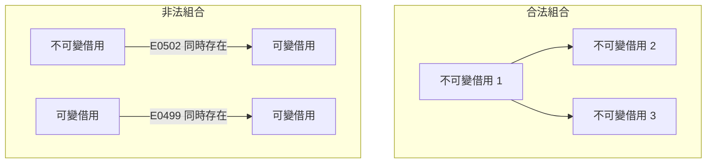

# 4.3 參考與借用（References and Borrowing）

所有權在設計上非常嚴格，但真實世界的程式很少把所有權一路搬到底。幾乎每個函式都會需要「看一下別人的資料」，而完全不碰資料的純函式並不多見。如果每次查看都要轉移所有權，程式碼會迅速變得笨拙，函式之間的組合也會受限。

借用（borrowing）就是為了解決這個問題而存在的機制。借用允許你**暫時使用**一個值而不取得它的所有權，代價是必須遵守一套嚴格的規則。這套規則正是 Rust 能夠保證資料競爭不存在的核心原因，也是整個語言最為人稱道、也最常被初學者挫折的部分。

## 借用是什麼

借用有兩種形式。`&T` 是一個**不可變借用**，它允許你讀取被借用的值，但不能修改它。`&mut T` 是一個**可變借用**，它允許你讀寫被借用的值，但獨佔它。兩者的差異不只是「能不能改」，還包括「能不能同時存在多個」。

```rust
fn calculate_length(s: &String) -> usize {
    s.len()
}

fn change(s: &mut String) {
    s.push_str(", world");
}

fn main() {
    let mut s = String::from("hello");
    let len = calculate_length(&s);
    println!("長度是 {}", len);
    change(&mut s);
    println!("修改後是 {}", s);
}
```

`calculate_length` 只讀取內容，所以簽章用 `&String`；`change` 要修改內容，所以簽章用 `&mut String`。呼叫結束後，原來的 `s` 依然完整可用，這正是借用相對於轉移的價值所在。

實務上，不可變借用幾乎都會寫成 `&str` 而非 `&String`。原因是 Rust 提供了**解參考強制轉換**（deref coercion）：當簽章是 `&str` 而呼叫端傳入 `&String` 時，編譯器會自動插入解參考，把 `&String` 轉成 `&str`。這讓 `&str` 成為「接受任何字串來源」的通用簽章，同時也讓 `String` 與 `&str` 在多數情境下可以互換。

## 三條借用規則

借用檢查器由三條規則構成，它們幾乎是整個 Rust 型別系統中最核心的部分。第一條規則是：**同一時間可以有多個不可變借用**。第二條規則是：**不可變借用與可變借用不能同時存在**。第三條規則是：**同一時間只能有一個可變借用**。

```rust
fn main() {
    let mut s = String::from("hello");

    // 規則一：多個不可變借用可以共存
    let r1 = &s;
    let r2 = &s;
    println!("{} {}", r1, r2);

    // 規則三：可變借用必須是唯一的
    let m = &mut s;
    m.push_str(" world");
    println!("{}", m);

    // 規則二：不可變借用存活期間不能產生可變借用
    // let r3 = &s;
    // let m2 = &mut s;
}
```

把這三條規則放進一個表格，可以看出它們各自防止了什麼。

| 規則 | 允許 | 禁止 | 對應錯誤碼 |
| --- | --- | --- | --- |
| 多個不可變借用可共存 | `let a = &s; let b = &s;` | — | — |
| 不可變與可變不能並存 | — | 讀取與寫入同時發生 | `E0502` |
| 可變借用必須唯一 | `let m = &mut s;` | 兩個同時存在的 `&mut` | `E0499` |

## 為什麼這些規則能消除資料競爭

這三條規則不是任意訂下的風格規範，而是直接對應資料競爭的定義。回顧一下：資料競爭是兩個或更多執行緒同時存取同一份記憶體，其中至少一個是寫入，且沒有任何同步機制。

Rust 的借用檢查器與 C++ 的執行期 race detector（例如 ThreadSanitizer）處理的是**同一類問題**，但切入的角度不同。ThreadSanitizer 在執行期監看每一次記憶體存取，比對存取區塊的歷史記錄，在偵測到衝突時報錯並中止。Rust 的借用檢查器則在編譯期建立一張「誰在什麼時候獨佔了哪一塊資料」的表格，任何可能導致衝突的重疊都在編譯期被拒絕。

關鍵在於 Rust 的可變借用必須是獨一的，而且不可變借用與可變借用不能並存。這兩點合起來意味著：任何時刻，對於任何一份資料，最多只有一個借用者擁有寫入權利，而所有讀取者都必須在此之前完成或在此之後才開始。這正好是資料競爭定義的否定形式，所以只要程式通過借用檢查，就不可能有資料競爭。

這是一個非常根本的差異。ThreadSanitizer 只能覆蓋被測試過的執行路徑，競態窗口可能出現在罕見的分支裡而從未被執行到；借用檢查器則覆蓋所有路徑，因為它分析的是型別與生命週期，而不是具體的執行流程。當然，Rust 仍然需要執行期的原子操作與鎖來保護**多個獨立資料**之間的不變量，但單一資料的存取衝突，已經在編譯期被徹底排除。



## 借用與所有權的取捨

借用不轉移責任，因此它帶來了額外的**生命週期約束**。借用者不能活得比被借用者更久，否則它手裡的參考就會指向已經被釋放的記憶體。所有權規則處理的是「誰負責釋放」，借用規則處理的是「誰不能比誰活得久」，兩者必須同時滿足。

這個取捨的意義是：借用非常靈活，因為它不需要負擔轉移的語意負擔，呼叫端可以繼續保有資料；但它並非免費的，每一個借用都會在生命週期圖上多加一條必須被檢查的邊。當生命週期關係變得複雜時，檢查器就會要求你寫出明確的標註，這將是第 5 章的主題。

在設計函式簽章時，有一個實用的判準：預設使用借用，只有當函式確實需要修改資料、或需要在函式返回後讓資料繼續存活時，才使用所有權轉移。

```rust
// 只需要讀取：借用
fn word_count(text: &str) -> usize {
    text.split_whitespace().count()
}

// 需要修改：可變借用
fn shout(text: &mut String) {
    text.make_ascii_uppercase();
}

// 需要產生新的擁有值：輸入借用，輸出擁有
fn titleize(text: &str) -> String {
    let mut out = String::with_capacity(text.len());
    for word in text.split_whitespace() {
        if !out.is_empty() {
            out.push(' ');
        }
        out.push_str(word);
    }
    out
}

fn main() {
    let mut s = String::from("hello rust world");
    shout(&mut s);
    println!("{}", s);
    println!("{}", word_count(&s));
    println!("{}", title_case_helper(&s));
}

fn title_case_helper(s: &str) -> String {
    titleize(s)
}
```

這個例子展示了三種簽章的分工。`word_count` 純讀取，`&str` 即可；`shout` 修改內容，`&mut String` 提供了獨佔的寫入權；`titleize` 從借用產生新的擁有值，輸出型別是 `String`，而輸入型別是 `&str`，簽章本身就把「不消耗輸入」的意圖寫清楚了。

## 動態排他鎖：把 `&mut T` 當成一把鎖

借用檢查器最實用的心智模型，是把 `&mut T` 視為一把在**編譯期**持有的鎖。這個模型把人類寫並行程式時的直覺直接映射到 Rust 的編譯期檢查。

在 C++ 中，要保護一份共享資料不被同時寫入，最常見的做法是 `std::mutex`。鎖必須在執行期呼叫 `lock()` 取得、在 `unlock()` 或 RAII 析構時釋放，而且鎖的持有範圍由程式設計師手工界定。這意味著「同一時間只有一個執行緒能寫入」這個保證，完全依賴程式碼的正確性，編譯器無法驗證。Rust 的可變借用提供了類似的保證，但是用型別與生命週期表達的。

有了這個心智模型，許多借用規則立刻變得自然。兩把可變鎖不能同時持有，就像兩把 `&mut` 不能同時存在。一把讀鎖與一把寫鎖不能並存，就像不可變借用與可變借用不能並存。鎖必須在解參前釋放，就像可變借用必須在可變參考的最後一次使用之後才結束。

```rust
use std::cell::RefCell;

fn main() {
    // 編譯期的鎖：&mut T
    let mut counter = 0;
    {
        let lock = &mut counter;
        *lock += 1;
        *lock += 1;
    }
    println!("counter = {}", counter);

    // 執行期的鎖：RefCell，把檢查延到執行期
    let shared = RefCell::new(0);
    {
        let mut guard = shared.borrow_mut();
        *guard += 5;
    }
    println!("shared = {}", shared.borrow());
}
```

`RefCell` 是這個模型的延伸：它把「獨佔」這個條件從編譯期搬到執行期，允許你在無法靜態滿足借用規則時，仍然取得共享的可變存取，代價是執行期可能 panic。第 10 章的內部可變性模式會完整討論這條路徑。

## 借用檢查器為何拒絕安全的程式

借用檢查器是一個保守的分析器。它的判準是「能否證明安全」，而不是「是否確實不安全」。當它無法證明一段程式是安全的，它會拒絕，即使那段程式在事實上完全正確。

造成這件事的根本原因是 Rust 只使用區域分析（NLL, Non-Lexical Lifetimes）。借用檢查器會計算每個借用的生命週期，但這個生命週期的判定僅基於詞彙作用域與資料流分析，不會做跨函式的全域推理。當資訊分散在多個函式之間，或當生命週期的關係需要同時考慮多條路徑時，檢查器就無法確定性地判定。

這裡有個簡化的示意。

```rust
fn main() {
    let mut data = vec![1, 2, 3];
    data.push(4);
    // 下面兩行若同時取消註解，編譯器會報 E0502：
    // let first = &data[0];   // 不可變借用
    // data.push(4);           // 需要可變借用，但不可變借用仍存活
    println!("{:?}", data);
}
```

這段程式在事實上是安全的：`first` 只指向 `data[0]`，而 `push` 只在尾端加入元素，不會使已存在的元素失效。但檢查器無法證明 `push` 不會重新配置緩衝區並搬移元素，因此保守地認為 `first` 的生命週期可能跨越 `push`，於是報出 `E0502`。

```rust
fn main() {
    let mut data = vec![1, 2, 3];
    let first = data[0];       // 複製出值，不保留借用
    data.push(4);
    println!("{} {}", first, data.len());
}
```

這個版本之所以能通過，不是因為檢查器變聰明了，而是因為借用根本沒有產生。把「取得借用」改寫成「取得值的副本」，或調整借用的作用域，讓它在需要可變存取之前就結束，都能繞開限制。**NLL 的實踐讓「縮短借用範圍」成為最常用的解法**，因為編譯器現在能精確地判斷一個借用最後一次被使用的位置。

## 切片語法的借用

`&s[..]` 與 `&mut s[..]` 是借用切片最常見的寫法。前者取得整段資料的不可變切片，後者取得可變切片。這兩種寫法與 `&s` 的差別在於，後者借用的是整個型別（`&String`、`&Vec<T>`），而前者借用的型別是切片（`&[T]`），因此更為通用。

```rust
fn main() {
    let s = String::from("hello");
    let whole: &str = &s[..];        // 不可變切片
    let part: &str = &s[1..3];       // 位元組範圍切片
    println!("{} {}", whole, part);

    let mut bytes = s.into_bytes();
    let slice: &mut [u8] = &mut bytes[..];
    slice[0] = b'H';
    println!("{}", String::from_utf8_lossy(&bytes));
}
```

注意 `&s[1..3]` 是**位元組**範圍而不是字元範圍。在這個例子中 `hello` 全是 ASCII，所以剛好對應字元；若字串包含多位元組字元，切在字元中間會造成 panic。第 4.4 節會專門處理這個問題。

## 常見錯誤與官方錯誤碼

Rust 的編譯器錯誤訊息設計得非常友善，每個錯誤都有一個穩定的代碼，可以查閱官方文件。借用相關的錯誤主要有以下幾個。

| 錯誤碼 | 意義 | 觸發情境 | 修正方向 |
| --- | --- | --- | --- |
| `E0502` | 可變借用衝突 | 不可變借用尚存時取得可變借用 | 縮短借用範圍或改用索引取值 |
| `E0503` | 只能以不可變方式借用 | 對 `&T` 呼叫需要 `&mut T` 的方法 | 改變簽章或取得可變引用 |
| `E0515` | 返回借用了本地變數的引用 | 函式返回指向區域變數的參考 | 回傳擁有值或加上生命週期標註 |
| `E0499` | 同時存在兩個可變借用 | 兩個 `&mut` 指向同一資料 | 拆分作用域或合併兩次操作 |
| `E0506` | 借用的值可能已被釋放 | 借用活得比被借用者久 | 加入生命週期標註或調整結構 |

`E0503` 的典型例子是把 `&T` 傳給需要 `&mut T` 的函式。

```rust
fn push_item(list: &mut Vec<i32>, item: i32) {
    list.push(item);
}

fn main() {
    let mut items = vec![1, 2, 3];
    // 改成 let items = ... 時，取消下一行註解會報 E0503
    push_item(&mut items, 4);
    println!("{:?}", items);
}
```

修正方式是把綁定改成 `let mut items`，或者把簽章改成接受 `&Vec<i32>`。

生命週期相關的錯誤則是另一組議題。下列簽章若省略生命週期，編譯器會報 `E0106`（missing lifetime specifier），因為它無法判斷回傳的參考該綁定到哪一個輸入：

```text
fn dangling() -> &String {
    let s = String::from("oops");
    &s
}
```

而明確寫出生命週期、卻回傳指向區域變數的參考時，編譯器會改報 `E0515`（cannot return reference to local variable）。正確的寫法有兩種：回傳擁有值 `String`，或者使用輸入生命週期標註，明確宣告回傳的參考與輸入綁定在同一段生命週期內。

```rust
fn dangling<'a>(s: &'a String) -> &'a String {
    s
}

fn main() {
    let owned = String::from("oops");
    println!("{}", dangling(&owned));
}
```

## 如何重構以通過檢查

面對借用檢查器的拒絕，有四種常見的修正策略。第一種是**複製**：呼叫 `clone()` 取得獨立副本，代價是額外的配置與記憶體。

第二種是**調整作用域**：把借用限制在一個更小的區塊中，讓它在需要可變存取之前就結束。這是成本最低、也最推薦的策略。

```rust
fn main() {
    let mut data = vec![1, 2, 3];
    {
        let first = &data[0];
        println!("{}", first);   // 借用在此結束
    }
    data.push(4);                 // 現在可以安全地取得可變借用
    println!("{:?}", data);
}
```

第三種是**用索引而非借用**：把 `&data[0]` 改成 `data[0]`，直接複製元素值。

第四種是**拆分資料結構**：把一個同時被讀寫的結構拆成多個，各自擁有的部分用借用串接。典型例子是把一個同時持有 `Vec` 與其長度的結構拆開，長度改由 `Vec` 自己提供。

```rust
fn main() {
    let mut names = vec![String::from("a"), String::from("b")];
    let mut lengths: Vec<usize> = Vec::new();

    for name in names.iter_mut() {
        name.push('!');
        lengths.push(name.len());
    }

    println!("{:?}", names);
    println!("{:?}", lengths);
}
```

這段程式同時示範了作用域調整與資料拆分兩種策略：`lengths` 是獨立的 `Vec`，不借用 `names`，因此沒有衝突。

## 迭代器與借用檢查器的張力

迭代器是 Rust 最受推崇的抽象之一，但它與借用檢查器之間存在真實的張力。`iter()` 回傳迭代器，其元素型別是 `&T`；`iter_mut()` 回傳迭代器，其元素型別是 `&mut T`；而 `into_iter()` 消費集合本身，回傳的元素型別是 `T`。選擇哪一個，取決於你需要讀、寫，還是轉移所有權。

```rust
fn main() {
    let mut v = vec![1, 2, 3];

    for x in &v {          // 借用，不可變
        println!("{}", x);
    }

    for x in &mut v {      // 可變借用
        *x += 1;
    }

    let doubled: Vec<i32> = v.iter().map(|x| x * 2).collect();
    println!("{:?} {:?}", v, doubled);
}
```

張力最明顯的地方出現在 `collect`。`collect` 需要一個可以 `push` 的目標容器，因此它需要對目標取得可變存取。如果目標恰好是某個正在被借用的集合，就會立刻衝突。

```rust
fn main() {
    let v = vec![1, 2, 3];
    let mut other = vec![0, 0, 0];

    for slot in other.iter_mut() {
        *slot = v.iter().sum();
    }
    println!("{:?} {:?}", v, other);
}
```

這個例子可以通過檢查，因為 `v` 是以不可變方式借用，與 `other` 的可變借用分屬不同的變數。但若改成把 `v` 自身作為收集目標，同時又持有 `v` 的迭代器，就會出現 `E0502`。理解這點之後，實務上的原則是：不要在同一個表達式中，讓一個集合既是借用來源又是可變收集目標。

迭代器的另一個好處是它可以避免中間借用。例如 `v.iter().filter(...).map(...)` 的整條鏈在需要可變存取之前就結束所有借用，因此不需要手動拆解作用域。這也是為什麼 Rust 社群偏好迭代器鏈而非索引迴圈。

## 借用與泛型簽章

借用與泛型結合時，有一組值得記住的規則。簽章寫成 `&T` 意味著「接受任何 `T` 的不可變借用」，而 `&mut T` 意味著「接受任何 `T` 的獨佔可變借用」。這個差異在實際設計中非常實用，因為同一個函式可以同時服務 `String`、`Vec<u8>` 與 `&str`。

```rust
fn total_len<T: AsRef<[u8]>>(items: &[T]) -> usize {
    items.iter().map(|i| i.as_ref().len()).sum()
}

fn shout_all<T: AsRef<str>>(items: &mut [T]) {
    for item in items.iter_mut() {
        println!("{}", item.as_ref().to_uppercase());
    }
}

fn main() {
    let mut owned = vec![String::from("ab"), String::from("cde")];
    println!("total_len = {}", total_len(&owned));
    shout_all(&mut owned);
}
```

像 `total_len` 這樣的簽章，因為接受 `&[T]`，可以同時處理 `Vec<String>`、`Vec<Vec<u8>>` 與 `Vec<&str>`，而不需要為每個元素型別各寫一份。這個彈性正是下一節主題的伏線：切片讓「一段連續資料」成為一種可以跨容器、跨型別傳遞的抽象。

## 生命週期的預告

借用檢查器最終一定會要求你明確寫出生命週期關係。當一個函式的簽章中出現多個引用時，編譯器無法判斷輸出引用對應哪個輸入引用，這時就會要求標註。

```rust
fn longer<'a>(x: &'a str, y: &'a str) -> &'a str {
    if x.len() > y.len() { x } else { y }
}

fn main() {
    let a = String::from("hello");
    let b = String::from("hi");
    println!("{}", longer(&a, &b));
}
```

`'a` 意味著「返回的引用，其生命週期不超過 `x` 與 `y` 中較短的那一個」。Rust 對大多數情況能夠自動推導生命週期，因此這個標註其實是顯式寫出編譯器本來就會推導出的東西。第 5 章會系統地討論生命週期標註語法、省略規則，以及借用檢查器在底層究竟如何運作。

## 借用規則總覽

回到最開始的三條規則，它們的意義可以這樣總結。

| 規則 | 保障的性質 | 若放寬會發生什麼 |
| --- | --- | --- |
| 多個不可變借用可共存 | 讀取並發是安全的 | 無實質風險，但會阻止優化 |
| 不可變與可變不能並存 | 不會有讀寫交錯 | 出現資料競爭 |
| 可變借用必須唯一 | 寫入互斥 | 出現資料競爭 |

借用檢查器用這三條規則，配合所有權的轉移語意，替 Rust 換來了一個極少見的性質：記憶體安全與執行緒安全，同時由編譯器保證，而且執行期幾乎沒有成本。這在下一節的切片主題中會有更直接的體現，因為切片正是借用檢查器在實際資料結構上的第一個應用。
