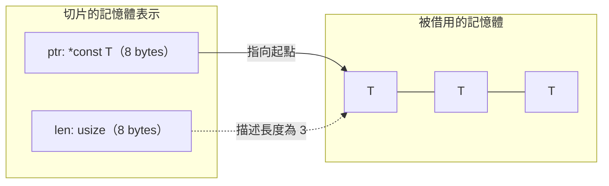

# 4.4 區段切片（Slices）

切片（slice）是 Rust 中一種以借用為基礎的**視圖**型別。它不擁有資料，而是借用一段連續記憶體，並記住這段記憶體的起始位置與長度。切片是借用檢查器在實際資料結構上的第一個應用：有了切片，函式可以接受「一段連續資料」，而不必關心這段資料是由 `Vec`、`String`、陣列還是別的容器提供。

切片同時也是 Rust 與其他語言在資料表達上的一個顯著差異。C 與 C++ 裡的裸指標只帶有一個位址，長度要另外傳遞或自行維護；Java 的 `List` 是擁有型別且間接層次固定；Python 的 `bytes` 是物件。Rust 的切片把「位址加長度」綁成一個不可分割的型別，編譯器因此能同時知道資料在哪裡與有多長，邊界檢查也才能被自動加上。

## 切片的定義

一個切片型別寫成 `&[T]`（不可變）或 `&mut [T]`（可變），其中 `T` 是元素型別。它在執行期由兩個部分組成：指向第一個元素的資料指標，以及元素數量。這兩者合稱為胖指標（fat pointer），因為它比一般的裸指標多了一個 `usize` 的長度欄位。

```rust
fn main() {
    let v = vec![10, 20, 30, 40, 50];
    let slice = &v[1..4];        // 借用 vec 的第 1 到第 3 個元素

    println!("長度是 {}", slice.len());
    println!("第一個元素是 {}", slice[0]);
    println!("切片是 {:?}", slice);
}
```

`&v[1..4]` 這個寫法做了一件重要的事：它取得 `v` 的**部分**內容，而不是整個 `v`。`v` 本身仍然是完整且可用的，你可以之後繼續對它做 `push`，也可以把整個 `v` 傳給別的函式。切片只是在某個時刻對某段記憶體的觀察。

## 字串切片與 UTF-8 邊界

字串切片 `&s[..]` 是切片在字串上的應用。`s` 可以是 `String` 也可以是 `&str`，`&s[..]` 產生一個 `&str`，其內容是 `s` 的全部位元組序列。

```rust
fn main() {
    let s = String::from("hello world");
    let whole = &s[..];
    let part = &s[0..5];
    let tail = &s[6..];

    println!("whole = {}", whole);
    println!("part = {}", part);
    println!("tail = {}", tail);
}
```

這裡有個關鍵的細節：字串的索引是**位元組**索引，不是字元索引。這是因為 Rust 的 `String` 內部儲存的是 UTF-8 編碼，而 UTF-8 是變長編碼，英文的每個字元佔 1 個位元組，中文的每個字元佔 3 個位元組，emoji 可能佔 4 個位元組。

因此，切在多位元組字元的中間會造成 panic。

```rust
fn main() {
    let s = String::from("中文");
    // let bad = &s[0..2];   // 切在「中」的三個位元組中間，會 panic
    let good = &s[0..3];      // 完整的一個字元
    println!("{}", good);
}
```

取消註解的那一行會導致程式在執行期 panic，訊息類似 `byte index 2 is not a char boundary`。這是 Rust 對字串安全的保護機制：字串切片必須落在 UTF-8 的字元邊界上，編譯期無法靜態驗證這件事，所以由執行期在 panic 中明確報錯，而不是靜默地產生無效的 `str`。

若需要依字元而非位元組切片，可以使用 `char_indices` 搭配字元邊界計算，或使用 `s.chars().collect::<Vec<char>>()` 先轉成字元陣列再切片。

```rust
fn main() {
    let s = String::from("中文abc");
    let chars: Vec<char> = s.chars().collect();
    let mid = &chars[1..4];
    println!("{}", mid.iter().collect::<String>());
}
```

`char_indices()` 是另一個常用工具，它會同時給出位元組索引與字元，適合用來尋找字元邊界。

```rust
fn main() {
    let s = String::from("a中b文c");
    for (idx, ch) in s.char_indices() {
        println!("第 {} 個位元組位置：{}", idx, ch);
    }
}
```

## 陣列切片的半開區間

陣列與 `Vec` 的切片語法是 `[start..end]`，採用**半開區間**語意：包含 `start` 位置的元素，不包含 `end` 位置的元素。也就是說，起點索引是包含的，終點索引是排除的。

```rust
fn main() {
    let a = [10, 20, 30, 40, 50];

    println!("{:?}", &a[1..3]);   // [20, 30]
    println!("{:?}", &a[..]);     // 全部
    println!("{:?}", &a[2..]);    // 從索引 2 到結尾
    println!("{:?}", &a[..3]);    // 從開頭到索引 3（不含）
}
```

採用半開區間而不是閉區間，是為了讓長度計算變得自然：`end - start` 就是切片的長度，不需要加一或減一。這個設計也讓切片與其他語言的慣例一致，例如 Python 的 `a[1:3]` 與 JavaScript 的 `Array.prototype.slice(1, 3)` 都是相同的語意。

邊界檢查是自動加上並在執行期生效的。如果 `end` 超過元素數量，或 `start > end`，程式會 panic。

```rust
fn main() {
    let a = [10, 20, 30];
    // let bad = &a[0..5];   // 越界，panic：range end index 5 out of range
    let ok = a.get(0..2);     // 安全版本，回傳 Option
    match ok {
        Some(s) => println!("{:?}", s),
        None => println!("範圍超出界線"),
    }
}
```

`get` 這個方法回傳 `Option`，是撰寫不會 panic 的存取程式碼的標準做法。邊界檢查的成本並非零，它會在每次索引時比較索引與長度，不過因為長度與切片一起存在於胖指標中，這個比較只需要讀取同一個 cache line 上的另一個欄位，代價極低。

## 胖指標：切片的記憶體表示

切片的實際表示是兩個 `usize` 組成：一個資料指標與一個長度。在 64 位元平台上合計如下。

$$
2 \times 8 = 16 \text{ bytes}
$$




這個表示解釋了許多語言層面的現象。最直接的是：切片**不能**直接轉成 `*const T`，因為型別系統會拒絕長度資訊的遺失。要取得裸指標必須明確呼叫 `as_ptr()`，這是刻意的設計門檻，讓「放棄邊界資訊」成為一個需要作者主動決定的動作。

```rust
fn main() {
    let v = vec![1i32, 2, 3, 4];
    let slice = &v[1..3];

    println!("ptr = {:?}", slice.as_ptr());
    println!("len = {}", slice.len());
    println!("size_of::<&[i32]>() = {}", std::mem::size_of::<&[i32]>());
    println!("size_of::<*const i32>() = {}", std::mem::size_of::<*const i32>());
}
```

輸出的結果顯示，切片引用的 size 是 16 位元組，而裸指標只有 8 位元組。這個差異在與 C 語言的 FFI 介面合作時特別重要：C 端只認得位址與長度兩個獨立參數，因此 Rust 端要用 `slice.as_ptr()` 與 `slice.len()` 分別提供。

胖指標也解釋了為什麼切片無法實作 `Copy` 之外的常見所有權操作——它的生命週期綁在被借用的資料上，離開作用域時不負責任何釋放。它也解釋了 `Vec` 的結構為何是三個 `usize`：`Vec` 本身是擁有者，持有 `ptr`、`len` 與 `cap`；而 `&[T]` 則是 `ptr` 與 `len` 兩者，把 `cap` 丟掉，因為借用者無權擴充緩衝區。

```rust
fn main() {
    let v = vec![1i32, 2, 3, 4];
    let s: &[i32] = &v;             // Vec 自動解參考成切片
    let p: *const i32 = s.as_ptr();
    let len: usize = s.len();
    println!("ptr = {:?}, len = {}", p, len);
}
```

## 切片的生命週期約束

切片不得比它所借用的資料活得更久。這是借用規則的直接後果，也是第 5 章生命週期的主題。

```rust
fn first_word(s: &str) -> &str {
    let bytes = s.as_bytes();
    for (i, &b) in bytes.iter().enumerate() {
        if b == b' ' {
            return &s[..i];
        }
    }
    s
}

fn main() {
    let text = String::from("hello world");
    println!("{}", first_word(&text));
}
```

`first_word` 的回傳型別 `&str` 並沒有標明生命週期，但編譯器能夠推導出：回傳的參考是從 `s` 借來的，因此它的生命週期必然不超過 `s`。這是生命週期省略規則（lifetime elision）的一個例子，第 5 章會完整說明。當一個函式有多個引用參數、無法自動推導時，就需要顯式標註。

下面的寫法是錯誤的，因為它企圖讓回傳的參考指向一個即將被釋放的區域變數。

```text
fn bad() -> &str {
    let s = String::from("oops");
    &s
}
```

編譯器會以 `E0106`（missing lifetime specifier）拒絕這段程式，因為簽章中沒有任何輸入可供推導。若把生命週期標註補上，錯誤會變成 `E0515`（cannot return reference to local variable `s`）。正確的做法是回傳擁有值 `String`，或者接受一個有明確生命週期的輸入參數。

```rust
fn good(s: &str) -> &str {
    s
}

fn main() {
    let owned = String::from("oops");
    println!("{}", good(&owned));
}
```

## 可變切片

`&mut [T]` 表示對一段連續資料的獨佔可變存取。它遵守與 4.3 節相同的借用規則：同一時間只能有一個可變借用存在，且在它存活的期間不能有其他借用。

```rust
fn double_all(values: &mut [i32]) {
    for v in values.iter_mut() {
        *v *= 2;
    }
}

fn main() {
    let mut a = [1, 2, 3, 4];
    double_all(&mut a);
    println!("{:?}", a);

    let mut v = vec![5, 6, 7];
    double_all(&mut v[..]);
    println!("{:?}", v);
}
```

`double_all` 接受 `&mut [i32]`，因此同一個函式可以處理固定長度陣列與 `Vec`，只要把它們轉成切片即可。這是切片抽象最直接的實用價值。

## 切片的分割與視窗

標準函式庫提供了幾個處理切片的高階工具。`split_at` 在指定的索引處把切片分成兩半，`split_at_mut` 則同時允許對兩半各自做可變存取。`chunks` 把切片切成固定大小的區塊，`windows` 則產生所有固定長度的滑動視窗。

```rust
fn main() {
    let v = vec![1, 2, 3, 4, 5, 6, 7];

    let (left, right) = v.split_at(3);
    println!("left = {:?}", left);
    println!("right = {:?}", right);

    for chunk in v.chunks(3) {
        println!("chunk = {:?}", chunk);
    }

    for window in v.windows(3) {
        println!("window = {:?}", window);
    }
}
```

`split_at` 會在執行期檢查索引是否在範圍內，越界時 panic。若需要不 panic 的版本，可以先用 `get` 檢查，或改用 `split_first`、`split_last`、`split` 這些以 `Option` 回傳的函式。

`split_at_mut` 是處理「把一段資料分成兩個可獨立修改的部分」的標準手段，例如在排序演算法中把區間分成兩半各自處理。

```rust
fn main() {
    let mut v = vec![1, 2, 3, 4, 5, 6];
    let (left, right) = v.split_at_mut(3);
    for x in left.iter_mut() {
        *x *= 10;
    }
    for x in right.iter_mut() {
        *x *= 100;
    }
    println!("{:?}", v);
}
```

`chunks` 與 `windows` 的差異在於尾端處理：`chunks(3)` 對長度 7 的切片會產生 3 個區塊，最後一塊長度為 1；`windows(3)` 則只產生完整的視窗，因此只會有 5 個結果。這個差異在處理以固定大小為單位傳輸的資料時很重要，例如網路協定中的訊框分組。

## 切片與 `Vec` 的關係

`Vec<T>` 與 `[T]` 的關係是擁有者與視圖的關係。`Vec` 擁有堆積緩衝區，負責配置與釋放；`[T]` 只是借用它的一部分。兩者之間的轉換是零成本的，因為 `Vec` 的解參考運算子 `Deref` 會自動把 `&Vec<T>` 轉成 `&[T]`。

```rust
fn main() {
    let mut v = vec![1i32, 2, 3, 4];

    {
        let s: &[i32] = &v;            // 自動解參考
        println!("{:?}", s);
    }
    let sm: &mut [i32] = &mut v;        // 同樣自動解參考
    println!("{}", sm.len());

    let mut owned: Vec<i32> = v.clone();  // 回到擁有型別
    {
        let back: &[i32] = owned.as_slice();   // 明確的 as_slice
        println!("{:?}", back);
    }
    let back_mut: &mut [i32] = owned.as_mut_slice();
    println!("{}", back_mut.len());
}
```

`as_slice()` 與 `as_mut_slice()` 這兩個方法提供了明確的轉換入口，當型別推導無法自動完成轉換時可以使用。實務上建議優先使用自動解參考，因為它更簡潔，也讓簽章中的 `&[T]` 保持單一路徑。

需要特別留意的是，`Vec` 與切片之間的**長度**並不相同。`Vec` 有 `len()` 與 `capacity()` 兩個概念，切片只有 `len()`。若把 `Vec` 轉成切片，容量資訊就永久消失了，因此切片不能被用來 `push` 元素。這正是「借用者無權擴充緩衝區」的型別層級表達。

## 切片是借用檢查器的第一個應用

切片最重要的意義不在語法，而在於它讓「一段連續資料」成為一種可以跨容器、跨型別傳遞的第一類抽象。這個能力是借用檢查器直接帶來的：既然函式可以宣告「我只要看一段連續資料，不管誰擁有它」，那麼所有權與借用的分工就得到了最自然的落實。

```rust
fn longest_or_default<'a>(a: &'a str, b: &'a str, fallback: &'a str) -> &'a str {
    if a.len() >= b.len() { a } else if b.len() > 0 { b } else { fallback }
}

fn main() {
    println!("{}", longest_or_default("apple", "fig", "none"));
    println!("{}", longest_or_default("", "kiwi", "none"));
}
```

這個函式的簽章裡沒有出現 `String`，也沒有出現 `Vec`。它接受三個 `&str`，可以接受 `String` 的切片、字串常數、或任何 `&str`。呼叫端不需要把資料交出來，因此呼叫之後仍然保有自己的資料。

同樣的原理適用於 `&[T]`。

```rust
fn sum_of(values: &[i32]) -> i32 {
    values.iter().sum()
}

fn main() {
    let array = [1, 2, 3];
    let vec = vec![4, 5, 6];
    let slice = &vec[1..];

    println!("{}", sum_of(&array));
    println!("{}", sum_of(&vec));
    println!("{}", sum_of(slice));
}
```

`sum_of` 對三種不同的來源使用了同一份實作。如果簽章寫成 `&Vec<i32>`，陣列就無法傳入；如果簽章寫成 `Vec<i32>`，呼叫端就必須交出所有權。切片剛好卡在這兩者之間最合適的位置。

## 字串方法與位元組切片

`String` 上有大量以切片為基礎的方法，它們實際上都是「在內部取得切片，然後在切片上操作」。理解這點可以消除對 `str` 與 `String` 方法差異的困惑。

| 方法 | 適用型別 | 回傳型別 | 說明 |
| --- | --- | --- | --- |
| `len()` | `str`、`[T]` | `usize` | 長度，位元組數 |
| `is_empty()` | `str`、`[T]` | `bool` | 是否為空 |
| `split()` | `str` | 迭代器 | 依分隔符切分 |
| `trim()` | `str` | `&str` | 去除兩端空白 |
| `contains()` | `str` | `bool` | 是否包含子字串 |
| `starts_with()` | `str` | `bool` | 前綴比對 |
| `iter()` | `[T]` | 迭代器 | 依序取得 `&T` |
| `iter_mut()` | `[T]` | 迭代器 | 依序取得 `&mut T` |
| `chunks()` | `[T]` | 迭代器 | 固定大小分塊 |
| `windows()` | `[T]` | 迭代器 | 滑動視窗 |

字串方法回傳的 `&str` 都是借用自原本的 `String`，因此它們不能活得比 `String` 更久。這正是生命週期省略規則在標準函式庫中的應用：`fn len(&self) -> usize` 的 `&self` 帶有一個生命週期，而回傳的 `usize` 不含引用，所以不需要標註。

`str` 與 `String` 的關係，與 `Vec<T>` 與 `[T]` 的關係完全平行：`String` 是 `Vec<u8>` 的保證 UTF-8 版本，`str` 則是 `[u8]` 的保證 UTF-8 版本。兩者之間的轉換由 `as_str()` 與 `as_mut_str()` 提供。

```rust
fn main() {
    let mut text = String::from("  Rust, Go, C  ");
    let trimmed = text.trim();
    println!("trimmed = [{}]", trimmed);

    let parts: Vec<&str> = trimmed.split(", ").collect();
    println!("parts = {:?}", parts);

    text.push_str("!");
    println!("text = {}", text);
}
```

注意 `parts` 中的每個元素都是對 `text` 內部緩衝區的借用。這個 `Vec<&str>` 之所以能存在，是因為 `text` 在其存活的期間都保持不變。相對地，若需要一個不依賴 `text` 的結果，就必須把每個部分 `to_string()` 成為擁有值。

## 二進位資料與 `Vec<u8>`

Rust 對文字與二進位資料有明確的區分。`String` 與 `str` 保證是有效的 UTF-8，而 `Vec<u8>` 與 `[u8]` 則是任意位元組。這個區分讓字串操作可以假設合法的編碼結構，同時讓網路協定、檔案格式與壓縮資料能用另一套型別處理。

```rust
fn main() {
    let bytes: Vec<u8> = vec![0x48, 0x65, 0x6c, 0x6c, 0x6f];
    println!("{:?}", bytes);

    let text = String::from_utf8(bytes.clone());
    match text {
        Ok(s) => println!("合法 UTF-8：{}", s),
        Err(e) => println!("不是合法 UTF-8：{}", e),
    }

    let raw: &[u8] = &bytes;
    let part: &[u8] = &raw[1..3];
    println!("中間兩位元組 = {:?}", part);
}
```

`from_utf8` 會在執行期驗證位元組序列是否為合法 UTF-8，並回傳 `Result` 而非直接 panic。這是「驗證成本由型別系統承擔」的又一個例子：Rust 不會假設資料有效，而是要求程式碼在型別上表達這份不確定性。

`as_bytes` 與 `into_bytes` 則是 `String` 與 `Vec<u8>` 之間的轉換通道。前者借用位元組而不消耗字串，後者則把 `String` 轉成 `Vec<u8>` 並交出所有權。

## 切片作為通用介面的設計價值

把前面幾節的內容合起來，可以看見切片在介面設計上的價值。一個函式若簽章是 `&[T]`，它就能接受 `Vec<T>`、`[T; N]`、任何連續切片，甚至 `String`（在元素是 `u8` 時）。這個「接受一切連續序列」的性質，正是 Rust 介面慣用 `&str` 與 `&[T]` 的原因。

```rust
use std::fmt::Display;

fn joined<T: Display>(items: &[T], sep: &str) -> String {
    let mut out = String::new();
    for (i, item) in items.iter().enumerate() {
        if i > 0 {
            out.push_str(sep);
        }
        out.push_str(&item.to_string());
    }
    out
}

fn main() {
    let nums = vec![1, 2, 3];
    let words = ["a", "b", "c"];
    let chars = vec!['x', 'y'];

    println!("{}", joined(&nums, "-"));
    println!("{}", joined(&words, ", "));
    println!("{}", joined(&chars, ""));
}
```

`joined` 對三種完全不同的容器使用了同一份實作，只因為它接受的是切片。這個寫法的好處不只是節省程式碼，更在於**降低介面的耦合度**：呼叫端不需要為了呼叫這個函式而改變自己的資料型別。

反過來，如果簽章寫成 `Vec<T>`，呼叫端就必須先把資料轉成 `Vec`；如果寫成泛型 `T: IntoIterator`，則失去了對「連續記憶體」這個性質的假設，實作者也無法用索引存取。切片在這三者之間提供了剛好合適的中點。

## 固定長度陣列與切片的取捨

Rust 的陣列 `[T; N]` 與切片 `[T]` 對應 C 語言中「陣列」與「陣列指標」的差別。固定長度陣列把長度寫進型別，因此編譯器能夠完全檢查索引範圍，也能在型別系統中表達「接受恰好 N 個元素」的介面。

```rust
fn sum3(a: [i32; 3]) -> i32 {
    a.iter().sum()
}

fn main() {
    let arr = [1, 2, 3];
    println!("{}", sum3(arr));
    println!("{}", sum3(arr));   // 陣列是 Copy，可以重複使用
}
```

`sum3` 接受固定長度的陣列，因此呼叫端無法傳入長度不同的資料，而長度資訊也被保留在型別中。相比之下，`fn sum(v: &[i32]) -> i32` 接受任何長度，但把長度資訊丟在編譯期之外。

兩者的取捨很清楚：固定長度陣列提供更強的靜態保證，但介面較不靈活；切片提供更通用的介面，安全性則由執行期的邊界檢查與編譯期的生命週期檢查共同把關。實務上的通則是，介面盡量接受切片，只有在長度本身就是語意的一部分時才使用固定長度陣列。

## 切片的型別層級意義

從型別系統的角度看，切片是 Rust 中第一個把「長度」納入型別資訊的常見型別。裸指標 `*const T` 不帶長度，`*const [T]` 則帶有長度但型別本身不可解參考。`&[T]` 兼備兩者：它帶有長度資訊，因此可以安全地做邊界檢查後的索引操作，同時因為它帶有生命週期，因此在型別層級就排除了懸垂指標。

| 型別 | 擁有資料 | 帶有長度 | 可安全索引 | 生命週期綁定 |
| --- | --- | --- | --- | --- |
| `Vec<T>` | 是 | 是 | 是 | 擁有者 |
| `[T; N]` | 是 | 固定 $ N $ | 是 | 擁有者 |
| `&[T]` | 否 | 是 | 是 | 被借用者 |
| `&mut [T]` | 否 | 是 | 是（獨佔） | 被借用者 |
| `*const T` | 否 | 否 | 否 | 無 |

## 常見的切片陷阱

切片操作有幾個容易踩到的陷阱，值得逐一提醒。

第一個陷阱是**字元與位元組的混淆**。`s.len()` 回傳的是位元組數，不是字元數。若要取得字元數量，應使用 `s.chars().count()`。

第二個陷阱是**範圍邊界的推論**。`&v[1..3]` 取到的是索引 1 與 2 兩個元素，而不是三個。

第三個陷阱是**以 `&` 結尾的範圍語法**。`&v[..]` 與 `&v[..len]` 等價，兩者都表示整段。

第四個陷阱是**切片無法成長**。`slice.push` 根本不存在，因為切片不擁有緩衝區，也無法知道容量。

第五個陷阱是**把 `&Vec<T>` 當成 `&[T]` 傳入卻被拒絕**。這種情況通常發生在泛型函式內部，需要用 `as_slice()` 明確轉換，或把簽章直接改成 `&[T]`。

```rust
fn sum_slice(s: &[i32]) -> i32 {
    s.iter().sum()
}

fn sum_generic<T: AsRef<[i32]>>(items: &[T]) -> i32 {
    items.iter().map(|i| i.as_ref().iter().copied().sum::<i32>()).sum()
}

fn main() {
    let v = vec![1, 2, 3];
    println!("{}", sum_slice(&v));

    let nested = vec![vec![1, 2, 3], vec![4, 5]];
    println!("{}", sum_generic(&nested));
}
```

## 從切片到生命週期

把本章與上一章放在一起，就能看見一條完整的因果鏈。所有權規則決定了「誰負責釋放」，借用規則決定了「誰能在什麼時候讀寫」，切片則是這兩套規則在資料結構上的具體落點：它把位址與長度綁在一起，把邊界檢查交給編譯器插入，把生命週期約束交給借用檢查器驗證。

三者缺一不可。若只有位址而沒有長度，就回到了 C 語言的裸指標，安全只能靠人工維護。若有長度而沒有生命週期，就會出現懸垂指標。若有生命週期而沒有邊界檢查，索引越界仍會造成未定義行為。

## 小結

切片把「一段連續記憶體」抽象成一個可攜帶長度、可安全索引、且生命週期受借用檢查器約束的型別。它是 Rust 陣列與 `Vec` 之間的橋樑，也是字串處理的基本單位。

回顧本章的因果鏈：所有權解決了「誰負責釋放」，借用解決了「誰能在什麼時候看它」，切片則是這套機制在資料結構上的直接產物。下一章將深入生命週期，把借用檢查器背後的推理規則完整攤開，讓你能夠讀懂那些複雜的錯誤訊息，並且在必要時寫出明確的標註。
