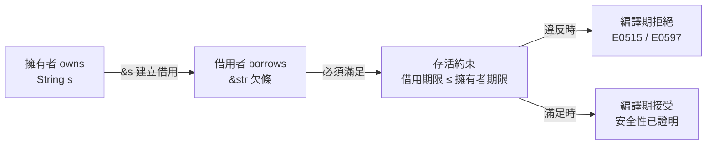
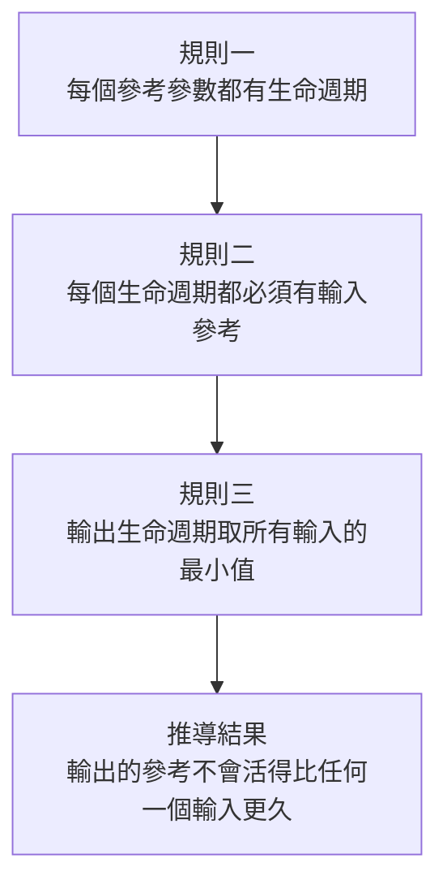
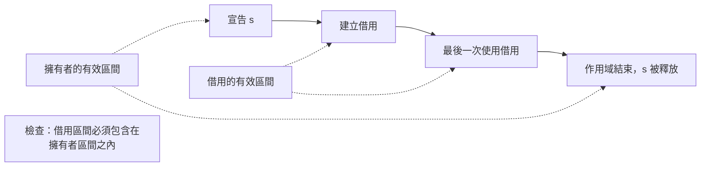

# 5.1 生命週期背後的意義

在第 4 章，我們學會了所有權與借用：把資料的所有權交出去，或者在有需要時暫時借用它。但借用有一個無法迴避的問題——借用是一張欠條，欠條本身沒有價值，它只在被借用的東西還活著時才有意義。程式設計師在寫 `&x` 的那一刻，其實已經默默做出了一個承諾：這張欠條不會活得比 `x` 更久。問題是，這個承諾要由誰來驗證？由程式設計師在腦中默記，還是由語言的編譯器來證明？Rust 毫不猶豫地選擇了後者，而「如何讓編譯器有能力驗證這個承諾」，正是生命週期機制存在的全部理由。

## 一、借用檢查器需要知道的唯一一件事

借用檢查器的工作，可以濃縮成一句話：**任何一張借用的欠條，都不能活得比被借用的東西更久**。這是一個關於時間的命題，而 Rust 的編譯器必須在沒有任何執行期資訊的情況下證明它成立。

考慮一個最簡單的函式，它回傳一個指向區域內部變數的參考：

```rust
// 編譯錯誤 E0515：回傳的參考指向了即將被釋放的區域變數
fn dangling() -> &str {
    let s = String::from("hello");
    &s
}
```

這段程式在邏輯上是錯的。函式回傳時，區域 `s` 連同它擁有的堆積記憶體會立刻被釋放，但呼叫端拿到的參考卻指向那塊已經被回收的記憶體。這正是 C 與 C++ 世界裡最危險的缺陷之一：use-after-free。差異只在於，在 C 裡它是執行期的段錯，在 Rust 裡它是編譯期的錯誤。

借用檢查器要拒絕這段程式，只需要回答一個問題：這張欠條的有效期，能不能涵蓋到呼叫端使用它的時刻？而要回答這個問題，檢查器必須知道被借用的資料「能活多久」。這就是「生命週期」這個詞在 Rust 裡的真正含義——它不是資源回收的排程器，而是借用關係在時間軸上的有效區間。

借用檢查器之所以無法只靠「所有權」規則完成工作，正是因為所有權規則處理的是空間上的排他性，而借用檢查處理的是時間上的相依性。兩者是互補的兩條座標軸：所有權保證「此刻記憶體只被一份活著的存在所掌控」，生命週期保證「這份存在不會在別人還用著它的時候消失」。



## 二、Rust 的生命週期不是執行期機制

初學者最常見的誤解，是把 Rust 的生命週期類比成 C++ 的建構子與解構子。這個類比在字面上成立，在機制上卻完全錯置，值得仔細拆解。

在 C++ 中，物件的建構子與解構子構成一段**執行期的時間軸**。建構子被呼叫，物件被初始化，然後經過一段或長或短的期間，最後解構子被呼叫，資源被釋放。這段期間是實實在在發生的：計時器在跑，資源在消耗，`shared_ptr` 的引用計數在執行期遞增與遞減，`std::weak_ptr` 的弱引用計數也在執行期維護。物件的「活多久」是執行期的事實，有時甚至可以在執行期觀測到——例如在一個解構函式裡印出時間戳。

Rust 的生命週期完全不是這樣。它**不在執行期記錄任何生命週期資訊**。Rust 沒有建構子與解構子的自動配對機制（`Drop` 是手動實作的 trait，而非語言保證的建構／解構對稱），沒有執行期計時器，沒有引用計數器，也沒有任何堆積上的生命週期表格。`&'a T` 這個型別在執行期的表示只包含一個指標與一個 `T`；`'a` 這個生命週期參數在編譯完成後就完全蒸發，不留下任何痕跡。

換句話說，C++ 的生命週期是**執行期機制**，Rust 的生命週期是**編譯期的型別資訊**。兩者同名，卻分屬完全不同的計算層次。Rust 用它來做的是靜態推理：把「這張欠條的有效期」當成一個可以參與代數運算的符號，讓編譯器像解方程式一樣推出約束是否可滿足。

| 面向 | C++ 建構子／解構子 | Rust 生命週期 |
| --- | --- | --- |
| 發生時機 | 執行期 | 編譯期 |
| 目的 | 初始化與釋放資源 | 描述借用關係的有效區間 |
| 是否有執行期狀態 | 有（計時、引用計數） | 無 |
| 對應的 Rust 機制 | `Drop` trait（手動） | 生命週期參數（`&'a T`） |
| 驗證時機 | 無法預先驗證，靠紀律 | 編譯期由借用檢查器證明 |

## 三、三條生命週期規則

Rust 的借用檢查並非憑空而來，它奠基在一組簡潔得令人意外的規則上。整組規則只包含三條，但它們足以推導出絕大多數借用情境的合法性。

第一條規則是：**每個參考參數都有一個生命週期**。無論你寫 `&T` 還是 `&'a T`，參考都自帶一個生命週期；省略符號只是讓編譯器替你推導出一個名字。

第二條規則是：**每個生命週期都有輸入參考**。也就是說，一個生命週期參數必須出現在某個輸入參數上，否則它就是多餘的。這條規則存在的理由是語義上的：輸出的生命週期必須有所依據，憑空出現的時間區間毫無意義。

第三條規則是：**輸出的生命週期是最短者**。若一個函式有多個輸入生命週期，回傳值（尤其是參考）的生命週期就是所有輸入中最短的那一個。



第三條規則是整組規則的核心，也是最容易在直覺上出錯的地方。舉例而言，若函式簽章是 `fn f<'a, 'b>(x: &'a str, y: &'b str) -> &'c str`，依規則三，`'c` 必須滿足 `'c` 不長於 `'a`，且 `'c` 不長於 `'b`。在實務上，人們通常直接把它寫成兩個參考共用同一個生命週期：

```rust
fn longest<'a>(x: &'a str, y: &'a str) -> &'a str {
    if x.len() > y.len() { x } else { y }
}

fn main() {
    let a = String::from("hello");
    let b = String::from("world!");
    println!("{}", longest(&a, &b));
}
```

這個寫法之所以嚴格，是因為它明確要求兩個輸入必須能同時被借用，也就是說它隱含了「`x` 與 `y` 必須活到足以支撐結果被使用」的約束。這個約束有時是必要的，有時是保守的過度限制——這正是 5.2 節要深入的主題。

三條規則可以用一張表完整概括，它們是整個生命週期機制的公理基礎：

| 規則 | 敘述 | 對型別的影響 | 對檢查的影響 |
| --- | --- | --- | --- |
| 規則一 | 每個參考參數都有生命週期 | `&T` 隱含一個 `'a` | 建立待求解的符號 |
| 規則二 | 每個生命週期都有輸入參考 | 杜絕憑空的期限 | 拒絕無依據的 `'c` |
| 規則三 | 輸出的生命週期是最短者 | 輸出期限是輸入期限的子集 | 建立約束不等式 |

這三條規則之所以能涵蓋如此廣泛的借用情境，是因為它們描述的是「期限之間的偏序關係」，而不是具體的時間點。編譯器從來不需要知道某個字串「活到第 100 行程式碼」這種資訊，它只需要知道「這個參考的期限是那個參考期限的子集」這種相對關係。相對關係比絕對時間容易推理得多，這也是 Rust 的期限分析能夠在不建置完整執行期模型的情況下運作的原因。

## 四、生命週期與借用檢查器是同一套機制

初學者常把生命週期當成「借用檢查器之上的一層規則」，彷彿先有借用檢查，然後生命週期再額外加嚴。這是嚴重的誤解，因為在實作層面，兩者是**同一套機制**。

借用檢查器在概念上是一個約束求解器。它把函式簽章裡的生命週期參數視為未知的代數符號，收集所有借用點產生的約束，再用代數規則推導出每個輸出的生命週期必須滿足什麼條件，最後把結果代入呼叫端檢查。而生命週期標註所做的，只是**讓這些符號有名字可寫**。

在沒有任何生命週期標註的情況下，編譯器並非無能為力，它只是被迫使用最粗劣的預設值：把所有參考的期限都視為同一個無區別的單位。這種粗劣預設在簡單函式裡還能運作，一旦函式需要把參考從一個輸入搬到另一個輸入就會失效。舉例來說，一個只接受 `&'a str` 卻要回傳 `&'static str` 的函式，就必須靠明確標註告訴編譯器「這個結果比輸入更長久」。

所以正確的心智模型是：**生命週期標註是借用檢查器能工作的語法，而不是另一層疊加的規則**。標註本身不做任何驗證，它只是把「期限關係」這個資訊餵給檢查器。檢查器才是唯一做判斷的地方。

## 五、生命週期是型別系統的一部分

Rust 與其他語言的一個關鍵差異，是**生命週期是型別的一部分**。在 C++ 中，`std::string&` 與 `std::string&&` 的生命週期語意寫在語言規格與設計者的腦中，編譯器並不真正理解參考的期限約束；而在 Rust 中，`&'a T` 與 `&'b T` 是兩個不同的型別，即使它們在執行期的佈局完全相同。當 `'a` 與 `'b` 的期限關係無法被統一時，這兩個型別就是不可互換的。

這帶來一個重要的後果：生命週期不只影響函式簽章，也會影響**型別的相容性判斷**、**泛型函式的實例化**，以及**特徵物件的邊界**。例如 `Box<dyn Error + 'static>` 這個寫法，明確宣告了這個錯誤物件必須不帶任何借用限制；而當我們談到 `T: 'static` 這個界限時，它本質上是在問「這個泛型參數裡面會不會藏著對短命資料的借用」。

把生命週期當成型別的組成部分，是理解 Rust 全部泛型與特徵機制的先決條件。當你後面看到編譯器抱怨「預期 `&'a str`，實際上是 `&'b str`」時，那不是格式不符，而是兩個期限不同的型別不能互換。

## 六、為什麼 Rust 選擇讓生命週期顯式化

Rust 的整體哲學是：**把執行期的不確定性搬到編譯期，用編譯期的一次性成本換取執行期的永久可靠性**。生命週期的顯式化正是這個哲學最具體的實現之一。

在 C++ 裡，「這個參考能活多久」是一個純粹的約定，寫在註解裡、寫在程式設計師的腦中、或者乾脆被忽略。Rust 把這件事提升到語言層面，用型別系統強制表達。它帶來的代價是真實的：編譯時間較長、學習曲線陡峭、程式碼偶爾顯得囉嗦。但它換來的是一個可以向第三方保證的性質——**在沒有 `unsafe` 的前提下，不可能出現 use-after-free**。這個保證不是「大概不會出錯」，而是可以用數學語句寫出來並由編譯器證明的命題。

值得強調的是，Rust 的顯式化是**按需的**而非全面的。大部分程式碼根本不需要寫生命週期，編譯器會依據省略規則自動推導。只有當型別結構無法自動推導時，標註才會浮出水面。這種「只在必要處顯式」的設計，讓顯式化帶來的心智負擔被控制在可管理的範圍內。

## 七、與垃圾收集器的對照

把 Rust 的生命週期機制放進整個記憶體管理的光譜中，它的位置就清楚了。

垃圾收集器的做法是**執行期追蹤**：在執行期維護一組根集合，定期掃描可達性，把不可達的物件回收。它的優點是程式碼幾乎不需要表達任何期限資訊，開發者完全不必思考生命週期；它的代價是執行期成本真實存在——每次配置都可能伴隨回收延遲，而且回收時機不可預測，這對即時性系統與尾延遲敏感的服務都是硬傷。

Rust 的做法正好相反：**編譯期標註換取零執行期成本**。生命週期資訊在編譯完成後完全蒸發，執行期的程式碼與手寫 C 一樣乾淨，沒有回收器、沒有追蹤根、沒有暫停。代價則是開發者必須在撰寫階段把期限關係想清楚。

| 面向 | 垃圾收集（Java、Go） | Rust 生命週期 |
| --- | --- | --- |
| 期限資訊來源 | 執行期追蹤可得 | 編譯期由型別標註 |
| 程式碼表達要求 | 幾乎不需要 | 複雜處需要標註 |
| 執行期成本 | 追蹤與回收開銷 | 零（編譯後無痕跡） |
| 暫停與尾延遲 | 存在 | 不存在 |
| 錯誤模式 | 洩漏、GC 壓力 | 編譯期借用衝突 |

這個對照說明了一件重要的事：**沒有哪一種方案是免費的**。GC 用執行期的持續開銷與不可預測的延遲，換取程式碼的輕鬆；Rust 用編譯期的思考負擔與建置時間，換取執行期的絕對可控。Rust 之所以選擇後者，是因為它認為對系統程式而言，可預測性與零開銷的價值，遠高於省下寫型別標註的那點時間。

## 八、生命週期與作用域的時間軸

要把期限關係說清楚，最有效的方式是把它畫成時間軸。在最簡單的情況裡，一個字串變數與它的借用者活在同一個作用域中，兩者的生存區間完全重疊，因此借用合法：



時間軸的視角解釋了許多看似不直覺的行為。當借用者被宣告在一個**內層**作用域時，借用的有效區間被限制在內層，程式碼顯然安全；反過來，若把借用者移到**外層**作用域，時間軸上借用區間就會超出擁有者區域，編譯器就會攔截。這是 Rust 借用檢查最直觀的失敗模式，也是新手最常遇到的場景。

值得注意的是，時間軸上的「最後一次使用」這個概念在早期版本並不存在。Rust 2015 的詞法生命週期把借用視為延伸到整個作用域，儘管實際上它可能只在第三行程式碼就被用到一次。Rust 2018 引入的非詞法生命週期把這個區間收斂到「建立點到最後一次使用點」，讓時間軸的畫法變得更精確，也讓許多原本被拒絕的程式得以通過。這個演進的主題，將在 5.2 節中以更技術性的角度展開。

## 九、本章展望

理解了「生命週期是借用檢查器的輸入資料」之後，接下來兩節就可以沿著一條清晰的因果鏈前進。5.2 節將拆解借用檢查器的演算法骨架，看看它如何把生命週期參數視為未知代數符號、如何求解約束、如何處理省略規則，以及它作為一個保守的區域分析器會在哪些地方拒絕實際安全的程式。5.3 節則回到具體語法，展示生命週期標註在函式、結構體與方法簽章中的寫法，並探討 `'static`、`PhantomData` 等實務細節，以及協變與逆變這些更抽象的性質。

整條因果鏈是這樣的：所有權給出空間上的排他規則，借用檢查器需要在時間上驗證欠條，而生命週期是把時間資訊放進型別系統的唯一途徑。理解這三者是一體的，就等於理解 Rust 記憶體安全的真正設計原理。
