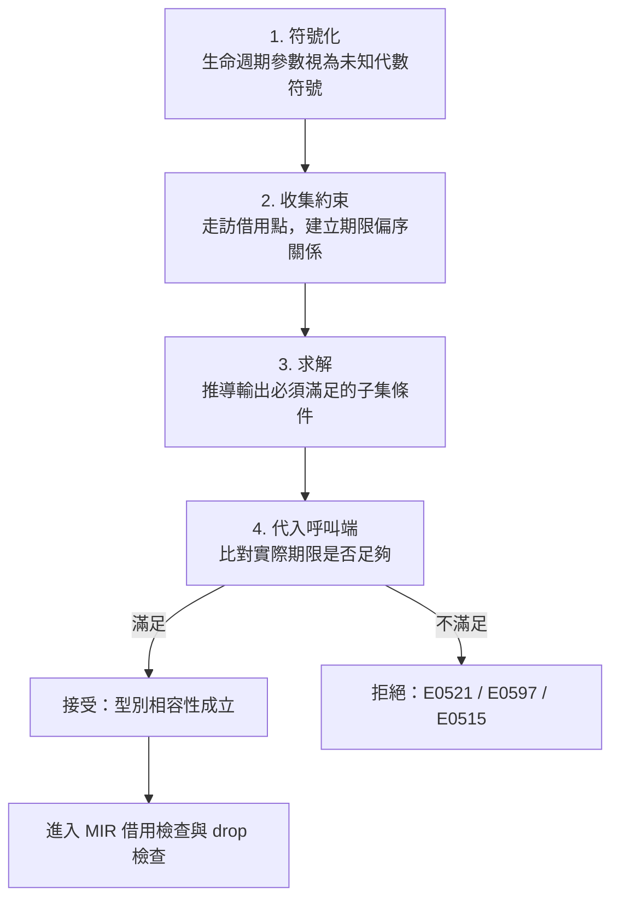
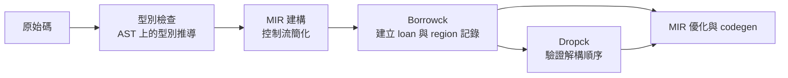

# 5.2 借用檢查器（Borrow Checker）如何運作

前一節建立了核心觀點：生命週期不是執行期機制，而是編譯期用來描述借用有效範圍的型別資訊。本節要做的，是把借用檢查器拆開來看——它究竟接受了什麼樣的輸入、採取了什麼樣的演算法、又會在哪些地方保守地拒絕程式。理解這套機制的內部邏輯之後，那些看似隨機的編譯器錯誤訊息就會變成可以預測、甚至可以主動引導設計的結果。

## 一、借用檢查器的演算法骨架

借用檢查器在概念上可以分成四個階段，它們在真實的 rustc 中是交錯進行的，但拆開來看會非常清楚。

第一階段是**符號化**：編譯器把被檢查函式的生命週期參數（例如 `fn longest<'a, 'b>(...)` 中的 `'a` 與 `'b`）視為未知的代數符號，而不是具體的值。這些符號代表「一段尚未確定的時間區間」，它們之間的關係需要被求出。

第二階段是**收集約束**：編譯器走訪函式本體，記下每一個借用點所產生的限制。參考 `&x` 會產生「這張欠條的有效期必須是 `x` 的期限之子集」這條約束；把參考存入一個更長生命週期的變數，則會產生「容器期限必須是 `x` 期限之子集」的約束。這些約束構成一個偏序關係網。

第三階段是**求解**：編譯器用代數規則推導出每個輸出的生命週期必須滿足什麼條件。以最常見的簽章為例，輸出生命週期必須是所有輸入生命週期的交集，也就是最短的那一個。用集合符號寫出來會更直觀：

$$
\llbracket 'c \rrbracket \subseteq \llbracket 'a \rrbracket \cap \llbracket 'b \rrbracket
$$

也就是說，輸出 `'c` 的存活區間必須被兩個輸入的存活區間同時涵蓋。

第四階段是**代入呼叫端檢查**：求解出的結果會被帶到呼叫該函式的每一個呼叫點，與呼叫端實際提供的壽命比較。若呼叫端提供的期限無法滿足函式要求的約束，編譯就在那一行報錯。



這個骨架解釋了借用檢查器的一個重要特徵：**它是局部的**。它檢查的是「這個函式的簽章對它的呼叫端要求了什麼」，而不是「整個程式在執行時的動態行為」。這也意味著同樣的程式碼，在不同的呼叫脈絡下可能得到不同的診斷。

## 二、一個具體例子的逐步推導

取第 5.1 節出現過的 `longest` 函式：

```rust
fn longest<'a>(x: &'a str, y: &'a str) -> &'a str {
    if x.len() > y.len() { x } else { y }
}

fn main() {
    let a = String::from("hello");
    let b = String::from("world!");
    println!("{}", longest(&a, &b));
}
```

符號化階段，編譯器看到一個生命週期參數 `'a`，它出現在兩個輸入參考與一個輸出參考上。收集約束階段，函式本體中有兩個可能的回傳路徑：回傳 `x` 或回傳 `y`。回傳 `x` 產生約束「輸出期限必須是 `'a` 的子集」，回傳 `y` 產生完全相同的約束。

於是求解結果是：輸出生命週期必須滿足

$$
\llbracket 'a \rrbracket_{\text{out}} \subseteq \llbracket 'a \rrbracket_{\text{in}}
$$

由於回傳路徑有兩條而 `'a` 只有一個符號，這兩條約束必須同時成立。編譯器因此得到一個關鍵推論：**回傳結果的有效期，受 `x` 與 `y` 兩者共同限制**。這正是「輸出的生命週期是最短者」這條規則的來源——如果 `x` 的期限是十單位、`y` 的期限是五單位，那麼輸出最多只能活五單位。

代入呼叫端檢查階段，假设呼叫端持有 `s1` 與 `s2` 兩個 `String`，它們的期限取決於各自的宣告位置。編譯器會要求這兩個字串的存活區間必須有交集，因為函式的簽章宣稱它會回傳其中一個。若其中一個在離開其作用域前就被丟棄，呼叫端就無法安全使用結果，編譯器便在此處攔截。

反過來說，如果一個簽章需要兩個期限不同的輸入——例如「最長的字串」加上「一則來自別處的附註」——就必須拆成兩個獨立的生命週期參數，並讓每個輸出對應到自己的輸入：

```rust
fn longest_with_note<'a, 'b>(
    x: &'a str,
    y: &'a str,
    note: &'b str,
) -> (&'a str, &'b str) {
    let best = if x.len() > y.len() { x } else { y };
    (best, note)
}

fn main() {
    let a = String::from("hello");
    let b = String::from("world!");
    let n = String::from("note");
    let (best, note) = longest_with_note(&a, &b, &n);
    println!("{best} {note}");
}
```

這個版本在型別上更容易使用，因為 `note` 不必與 `x`、`y` 同時存活；編譯器也會自然地檢查出「回傳的 `best` 只能活到 `x` 與 `y` 兩者都還活著為止」。若把 `note` 也標成 `'a`，則三個輸入就被綁成同一個期限，呼叫端必須讓三者同時存活。這種「簽章的每個生命週期參數都是一個可被獨立放寬或收緊的旋鈕」的性質，是 Rust 型別系統相當細膩的地方。

## 三、生命週期省略規則

若要求每個函式都寫出生命週期，程式碼會變得難以閱讀。Rust 提供了三條**省略規則（lifetime elision rules）**，讓編譯器在你不寫任何標註時也能推導出正確的期限關係。

第一條規則是：**每個參考參數各得一條生命週期**。也就是說，`fn f(x: &str, y: &str)` 會被理解成 `fn f<'a, 'b>(x: &'a str, y: &'b str)`，兩個輸入各自擁有一個獨立的生命週期。

第二條規則是：**若函式只有一個輸入生命週期，它就被指派給所有輸出**。這讓最常見的簽章能夠省略標註。

第三條規則是：**方法中若有 `&self`，`self` 的生命週期就被指派給所有輸出**。這一條特別重要，因為方法是最常見的借用入口。

| 情境 | 省略前（顯式寫法） | 省略後（編譯器視為） |
| --- | --- | --- |
| 兩個參考參數 | `fn f<'a, 'b>(x: &'a str, y: &'b str)` | `fn f(x: &str, y: &str)` |
| 單一參考參數 | `fn f<'a>(x: &'a str) -> &'a str` | `fn f(x: &str) -> &str` |
| 方法帶 `&self` | `fn g<'a>(&'a self) -> &'a str` | `fn g(&self) -> &str` |
| 多輸入且多輸出 | 無法省略 | 必須顯式標註 |

這三條規則加上「輸出的生命週期是最短者」，構成了省略規則的全部。把它們加總起來，一個只帶單一輸入生命週期的函式，其輸出期限就自動等於該輸入期限；而帶 `&self` 的方法，其輸出期限就自動綁定在物件身上。

## 四、為什麼被稱為「100 個生命週期的啟發式規則」

省略規則常被社群戲稱為「一百條生命週期規則」，這個暱稱帶著幾分無奈的幽默。原因是：官方的《Rust 程式設計語言》書中列出的省略規則只有三條，但書裡同時指出，要完整涵蓋所有可能的組合情況，實際上需要列舉的變體多達數十條。

更根本的問題在於，**省略規則本質上是一組啟發式（heuristic）而非公理（axiom）**。它們是編譯器在「不想要求使用者寫下無關緊要的標註」與「又必須得出唯一正確的期限關係」之間取的務實妥協。真正的公理只有「輸出期限是最短的」，省略規則是讓這條公理在常見情況下不必顯式書寫的糖衣。

啟發式的代價是：它只在被設計來覆蓋的情境裡有效。當簽章偏離常態——多個輸入、零個輸入、或多個不同期限的輸出——編譯器就會毫不猶豫地要求你手寫標註。這不是缺陷，而是承認「語法糖無法涵蓋所有真實世界的簽章形狀」。

理解這點很重要：當你在網路上看到有人說「省略規則有 bug」或「省略規則太聰明了」，那通常意味著他碰到了一個不屬於三條規則涵蓋範圍的簽章，正確的解法是顯式寫出生命週期，而不是繞過它。

## 五、常見的編譯器錯誤與其診斷

借用檢查器產生的錯誤訊息其實相當一致，值得逐一熟悉。以下是四個最常見的錯誤碼。

**E0106：缺少生命週期說明。** 當簽章無法套用任何一條省略規則時出現，典型例子是沒有任何輸入生命週期卻要回傳參考：

```rust
// 編譯錯誤 E0106：需要明確標註生命週期，因為輸出沒有任何輸入可依循
fn no_input() -> &str {
    "hello"
}
```

**E0515：返回引用本地變數。** 就是 5.1 節那個 `dangling` 函式，編譯器明確告訴你回傳的參考會在函式返回時變成懸空指標。

**E0521：借用的值已過期。** 這個錯誤出現在借用已經離開作用域之後才被使用，編譯器會指出「借用在這裡就已經過期了」。

**E0597：借用比區域存活更久。** 這是 E0521 的近親，通常出現在區域分析顯示某個變數會在借用的使用點之前就被丟棄。

| 錯誤碼 | 觸發條件 | 常見修法 |
| --- | --- | --- |
| E0106 | 簽章無法套用省略規則 | 顯式寫出生命週期參數 |
| E0515 | 回傳參考指向區域內部變數 | 回傳擁有者，或讓呼叫端傳入 |
| E0521 | 借用在到期後仍被使用 | 縮短作用域，或先 `clone` 成擁有者 |
| E0597 | 借用活得比來源區域久 | 重排變數宣告順序，或改用擁有式 API |

這些錯誤碼之間的細微差異，其實反映的是借用檢查器在**推導失敗的階段**不同：E0106 發生在簽章分析期，連約束都還沒建立；E0515 發生在函式的回傳檢查；E0521 與 E0597 則發生在具體的借用點與作用域交叉比對時。

## 六、借用檢查器的保守性

借用檢查器最值得批評的特性，是它會拒絕一些**實際安全**的程式。它不是不做最佳化，而是它的分析能力被刻意限制在一個保守但可預測的範圍內。

原因在於借用檢查器進行的是**區域分析（region analysis）**而非完整的資料流分析。區域分析把程式碼切成若干個生命週期區域，然後檢查每個引用點是否落在其可能使用的區域交集內。這種做法可以避免建置時間爆炸，也不需要做完整的別名分析，但它必然犧牲了精確度。

一個典型的被誤拒情境是借用跨越了迴圈迭代但實際上每次迭代都獨立：

```rust
fn main() {
    let mut v = Vec::new();
    for s in ["a", "b", "c"] {
        v.push(s);
    }
    let first = &v[0];
    println!("{first}");
}
```

這段程式在實務上完全安全，`v` 在 `first` 被使用前不會被修改，因此 `&v[0]` 與後續的 `println!` 之間沒有衝突。但舊版的借用檢查器會認為 `v` 在迴圈中被可變借用，之後又有不可變借用，因而報錯。修正方式不是放棄借用檢查，而是讓呼叫端的需求更明確地表達出來。

這種保守性的取捨是理性的：如果允許檢查器偶爾「猜對」，它就必須做更複雜的分析，而複雜分析帶來的編譯時間與診斷可解釋性損失，通常比它省下的那幾次重構更不划算。保守的錯誤訊息——「這裡有衝突，請調整」——遠比偶爾漏判造成的 use-after-free 更容易讓人接受。

## 七、借用檢查器與 MIR 的關係

借用檢查是在**中端表示（Mid-level IR, MIR）**上進行的，這個技術細節不是背景知識，而是理解行為差異的關鍵。

MIR 是 rustc 在型別檢查完成之後產生的控制流圖，它把高階語言降到一種非常接近機器碼、但仍然保有完整型別資訊的表示。每個函式的 MIR 主體都會被反覆「borrowck」——也就是借用檢查的專用階段——掃描。這個階段會建立所謂的**loan（借貸）**追蹤記錄：每個 `&` 與 `&mut` 都會在 MIR 中被記錄成一筆 loan，並標註它存活的範圍（region）與其後續的使用點。

借用檢查與 MIR 的關係，可以從三個方向理解。第一，借用檢查器在 MIR 上工作，意味著它看到的是已經完成控制流簡化的形式，比原始碼更容易做區域推斷。第二，Rust 2024 版（1.85 版）導入的延遲借用檢查，正是把 borrowck 從單次檢查改為跨 MIR 區塊的迭代檢查，讓某些複雜的借用情境更容易通過。第三，因為 MIR 保留型別資訊，借用檢查的結果能夠直接回饋給型別檢查器，形成兩階段的互相確認。



## 八、生命週期與 NLL：非詞法生命週期

早期（Rust 2015）的借用檢查採用**詞法生命週期（lexical lifetimes）**：一個借用的有效期就是它所在的整個作用域。這種規則簡單但極度浪費——只要在作用域內任何地方用過一次借用，整個作用域就都被「污染」，連明顯安全的使用也會被拒絕。

Rust 2018 版引入的**非詞法生命週期（Non-Lexical Lifetimes, NLL）** 是一項重大改進。它基於一個觀察：**借用的真正目的只是讓某個值在最後一次使用之前保持有效**。既然如此，借用的期限就應該從它的建立點延伸到最後一次使用點，而不是延伸整個作用域。

這個改變讓大量在舊規則下被拒絕的程式得以通過，同時沒有放寬任何真正的安全條件。NLL 的實作方式是在 MIR 的 CFG 上做資料流分析，計算每個 loan 的最後使用點。

```rust
fn main() {
    let mut v = Vec::new();
    v.push(1);
    v.push(2);
    let first = &v[0];
    println!("{first}");
    v.push(3);
}
```

在 NLL 下這段程式合法：`first` 的 loan 在 `println!` 之後就沒有再被使用，因此該 loan 從 `v` 的可變借用中解除了，後續的 `v.push(3)` 不再衝突。而在舊規則下，`first` 的借用會延伸到 `main` 作用域結尾，`v.push(3)` 就會被判定為衝突。

NLL 也讓 5.1 節提過的 `longest` 簽章變得不必要地嚴格——兩個輸入共用一個 `'a` 迫使呼叫端必須讓它們同時存活，而 NLL 的精確 region 讓我們能寫得更寬鬆。

## 九、借用檢查器不是唯一的安全機制

把借用檢查器想像成整個 Rust 安全體系的全部，是常見的誤解。實際上 Rust 的安全保證是多層堆疊的。

最底層是**型別系統的不變量**。所有權與借用規則維護的是「記憶體不會被重複釋放」「不會有兩個可變別名」這些結構性性質。生命週期檢查則在其上驗證「引用不會活得比資料久」。兩者聯手，構成了 Rust 在不使用 GC 與手動管理的前提下仍能保證記憶體安全的原因。

但借用檢查器有明確的邊界，這個邊界就是 `unsafe`。`unsafe` 區塊是程式設計師向編譯器聲明「這裡我會自己負責」的契約。它可以用來呼叫不受保證的外部函式、進行手動的記憶體操作，或繞過某些檢查。Rust 並不禁止 `unsafe`，但它把這條路徑設計成**必須被明確標記、必須被稽核、並且在 crate 邊界上被切割**的形式。`unsafe` 不是逃逸口，而是一個有名字、有範圍、有責任歸屬的邊界。

在借用檢查器之外，Rust 還有 panic 機制、`Option` 與 `Result` 對空值與失敗的表達、以及由編譯器保證的無資料競爭。每一層解決不同類別的錯誤，而它們共同構成了 Rust 的安全故事。理解借用檢查器只是其中一層，是學會用 Rust 安全地寫程式的第一步。

## 小結

借用檢查器的本質，是一個在 MIR 上執行的、以生命週期參數為代數符號的約束求解器。它先符號化、再收集約束、再求解、最後代入呼叫端檢查，四個階段構成完整流程。省略規則是這套流程之上的務實糖衣，用三條啟發式涵蓋了絕大多數簽章；遇到糖衣覆蓋不到的情況，顯式標註才是正解。NLL 讓期限判定從詞法作用域走向資料流層級，大幅提升了檢查器的精確度。而所有這些，最終都只服務於一個目標：讓「引用活得比資料久」這類錯誤在編譯期就被攔截，而不是留到執行期去崩潰。
