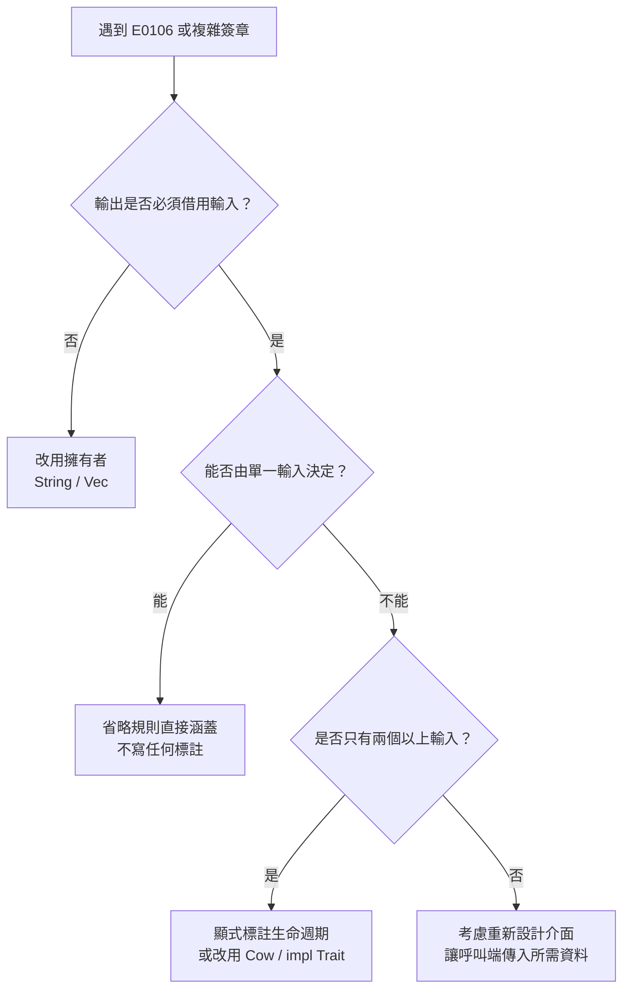
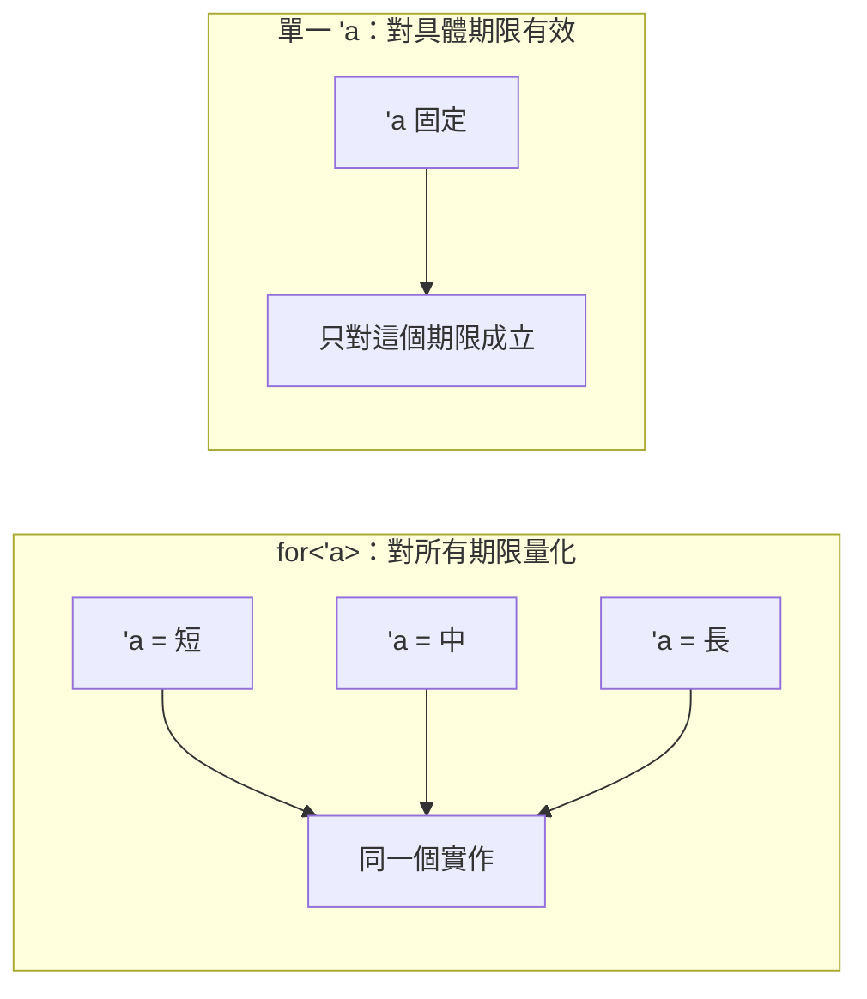

# 5.3 生命週期標註語法與實務範例

前兩節已經把生命週期的原理與借用檢查器的演算法拆解完畢，本節要回到具體的語法與程式碼。這個階段的目標不是背誦規則，而是建立一種能力：看到一個簽章時，能立刻說出「這裡的期限關係是什麼」，並且在設計 API 時主動選擇正確的生命週期形狀。生命週期標註在 Rust 中是一門小而精的語言，它只有少數幾種構件，卻足以表達絕大多數借用關係。

## 一、生命週期標註的語法要素

Rust 的生命週期標註只有四個基本構件。

**生命週期參數**寫作 `'` 加上識別字，最常見的是 `'a`、`'b`、`'c`。它是一個類型層面的泛型參數，與 `T` 或 `N` 這類型別參數本質相同，只是它約束的是期限而非值的形狀。

**生命週期引數**寫作 `&'a T`，表示「一個參考，其有效期受 `'a` 約束」。也可以寫成 `&'a mut T` 表示可變參考。

**生命週期參數宣告**寫在簽章的尖括號中，例如 `fn longest<'a>(...)`；在結構體與列舉中則寫在型別名稱之後，例如 `struct Excerpt<'a> { ... }`。

**impl 區塊中的生命週期宣告**出現在 `impl` 關鍵字之後，例如 `impl<'a> Excerpt<'a> { ... }`，表示這個實作區塊對 `Excerpt` 的生命週期參數進行操作。

一個重要的語法順序規則是：**生命週期參數必須寫在泛型型別參數之前**。因此簽章會寫成 `fn longest<'a, T>(...)`，而不是 `fn longest<T, 'a>(...)`。這個順序不是任意的，它反映了 Rust 對參數的分類慣例——生命週期先於型別，因為期限關係往往比值的形狀更早被確定。

這四個構件可以整理成一張速查表：

| 構件 | 寫法 | 出現位置 | 語意 |
| --- | --- | --- | --- |
| 生命週期參數 | `'a` | 簽章或型別參數清單 | 一個期限的符號名稱 |
| 生命週期引數 | `&'a T`、`&'a mut T` | 型別位置 | 借用及其期限約束 |
| 生命週期參數宣告 | `<'a>` | 函式簽章、`struct`、`enum` | 引入一個待求解的符號 |
| impl 宣告 | `impl<'a> Type<'a>` | impl 區塊開頭 | 把實作綁定到結構體的期限參數 |

這張表裡最容易被忽略的是最後一列。`impl<'a> Excerpt<'a>` 這個寫法之所以必要，是因為 Rust 要求 impl 區塊宣告它所操作的生命週期參數；即便實作本身不需要用到 `'a`（例如只是呼叫一個方法），這個宣告也不能省。省略它的寫法雖然合法，但會讓讀者以為這個實作不依賴期限，反而造成誤解。

另外還有一個易混淆的細節：生命週期參數的**名字**完全不帶語意。`'a`、`'b`、`'xyz` 在編譯器眼中毫無差別，它們只是符號。慣例上短名字用於短期限、長名字用於較長期限，但這純粹是給人看的約定，編譯器不會因為你把 `'short` 和 `'long` 對調就改變推論結果。真正有意義的只有一件事：同一個符號出現在多個位置，代表它們共用同一段期限。

## 二、三個典型範例

第一個範例是**回傳參考**。當函式回傳的參考完全來自某個輸入時，只需標註一次：

```rust
fn first_word(sentence: &str) -> &str {
    match sentence.split_whitespace().next() {
        Some(word) => word,
        None => sentence,
    }
}

fn main() {
    let text = String::from("hello wide world");
    let word = first_word(&text);
    println!("{word}");
}
```

這裡的 `&str` 省略了生命週期，編譯器依省略規則第二條推導出輸出期限等於輸入期限。若顯式寫出，形式如下：

```rust
fn first_word<'a>(sentence: &'a str) -> &'a str {
    match sentence.split_whitespace().next() {
        Some(word) => word,
        None => sentence,
    }
}

fn main() {
    let text = String::from("hello wide world");
    println!("{}", first_word(&text));
}
```

第二個範例是**回傳其中一個參考的引用**。當函式有兩個輸入參考、卻只能回傳其中之一時，兩個輸入必須共用同一個生命週期參數，因為輸出可能來自任何一邊：

```rust
fn longer<'a>(x: &'a str, y: &'a str) -> &'a str {
    if x.len() >= y.len() { x } else { y }
}

fn main() {
    let a = String::from("hello");
    let b = String::from("world!");
    println!("{}", longer(&a, &b));
}
```

這個簽章的含義是：「回傳的參考，生命周期不會長於 `x` 與 `y` 中較短的那一個」。編譯器在函式本體中檢查兩條回傳路徑時，會分別推導出「輸出期限 ⊆ `x` 期限」與「輸出期限 ⊆ `y` 期限」，兩者必須同時成立。

第三個範例是**簽章中的多生命週期**。當不同輸入確實具有不同期限時，就把它們拆開，並讓每個輸出綁定自己的輸入：

```rust
struct Pair<'a, 'b> {
    first: &'a str,
    second: &'b str,
}

fn split_pair<'a>(text: &'a str) -> Pair<'a, 'a> {
    let idx = text.find(',').unwrap_or(text.len());
    Pair {
        first: &text[..idx],
        second: &text[idx..],
    }
}

fn main() {
    let text = String::from("left,right");
    let pair = split_pair(&text);
    println!("{} / {}", pair.first, pair.second);
}
```

這個簽章說明了一件事：生命週期參數的數量不是越多越好，而是**恰好等於簽章中實際獨立的期限關係數量**。多寫一個 `'b` 卻沒有對應的獨立期限，是設計訊號而非必要。`Pair<'a, 'a>` 之所以寫成兩個 `'a`，是因為結構體的兩個欄位都是 `&str`，它們同樣受限於 `text` 的期限；結構體本身宣告了兩個生命週期參數，但實作它的函式只需要提供一個具體的期限。

## 三、結構體持有參考

結構體若要持有參考，就必須宣告生命週期參數。這不是可選的裝飾，而是型別定義的一部分：

```rust
struct Excerpt<'a> {
    part: &'a str,
}

impl<'a> Excerpt<'a> {
    fn new(part: &'a str) -> Excerpt<'a> {
        Excerpt { part }
    }

    fn first_sentence(&self) -> &str {
        match self.part.split('.').next() {
            Some(s) => s,
            None => self.part,
        }
    }
}

fn main() {
    let novel = String::from(".call me ishmael. some years ago...");
    let excerpt = Excerpt::new(&novel);
    println!("{}", excerpt.first_sentence());
}
```

為什麼 `Excerpt` 必須宣告生命週期參數？因為結構體的欄位型別是 `&'a str`，而 `'a` 這個符號在 `struct Excerpt` 的定義中必須被宣告，否則編譯器無從得知它指向的資料可以活多久。宣告了 `'a` 之後，編譯器就掌握了一條規則：**任何一個 `Excerpt<'a>` 的實例，都不可能活得比它所引用的那個字串更久**。

`impl<'a> Excerpt<'a>` 中的生命週期宣告則是把 impl 區塊與結構體的生命週期參數綁定。省略它並非不行，Rust 會推導出一個等價的匿名生命週期，但顯式寫出能讓讀者一眼看出這個實作是「對所有期限的 `Excerpt` 都成立」。

## 四、方法簽章中的生命週期

方法簽章是生命週期最常出現的地方，而絕大多數情況下完全不需要寫。省略規則第三條規定：方法若帶有 `&self`，`self` 的生命週期就被指派給所有輸出。

```rust
struct Excerpt<'a> {
    part: &'a str,
}

impl<'a> Excerpt<'a> {
    fn first_word(&self) -> &str {
        match self.part.split_whitespace().next() {
            Some(word) => word,
            None => self.part,
        }
    }
}

fn main() {
    let text = String::from("hello wide world");
    let excerpt = Excerpt { part: &text };
    println!("{}", excerpt.first_word());
}
```

`fn first_word(&self) -> &str` 與顯式寫出的 `fn first_word<'a>(&'a self) -> &'a str` 在型別上完全等價。省略規則第三條的直覺意義是：方法的輸出通常來自 `self` 所借用的資料，因此它的期限不可能超過 `self` 的期限。

但第三條有個重要的例外：**若方法還有其他參考參數，且輸出可能來自那些參數，就不能只靠 `self`**。此時編譯器會要求你顯式標註，因為省略規則無法判斷輸出的來源：

```rust
struct Excerpt<'a> {
    part: &'a str,
}

impl<'a> Excerpt<'a> {
    fn annotate<'b>(&'b self, note: &'b str) -> (&'b str, &'b str) {
        (self.part, note)
    }
}

fn main() {
    let text = String::from("some text");
    let excerpt = Excerpt { part: &text };
    let note = String::from("a note");
    let (part, annotated) = excerpt.annotate(&note);
    println!("{part} / {annotated}");
}
```

這個例子裡 `'b` 涵蓋了 `self` 與 `note` 兩者，說明輸出兩者皆有可能，因此輸出期限必須同時受兩者限制。

## 五、`'static` 生命週期

`'static` 是一個特殊的生命週期，代表「存在於整個程式的執行期間」。它有兩種常見的出現形式，語義截然不同。

第一種是 `&'static str`，代表一個永遠有效的字串參考。字串常值是編譯期就寫死在執行檔中的，因此它確實永遠有效：

```rust
fn greeting() -> &'static str {
    "hello, world"
}

fn main() {
    println!("{}", greeting());
}
```

第二種是 `T: 'static` 這個界限，代表「型別 `T` 不含任何生命週期受限的借用」。這是因為 `T: 'static` 這個界限的語義是「`T` 裡可能出現的任何借用，其期限都必須至少與 `'static` 一樣長」。因為沒有人能活到 `'static`，所以這個界限實際上等價於「`T` 裡不含任何借用」。

`'static` 的常見誤用，是把它當成「不需要生命週期」的萬用符號。例如在一個函式簽章中寫 `fn parse(input: &'static str)`，編譯器會接受，但呼叫端幾乎不可能滿足——除非傳入字串常值。更嚴重的是誤用 `Box<dyn Error + 'static>` 來存放帶有借用誤差的錯誤，那會強迫錯誤物件必須是擁有式的，或呼叫方必須把資料 `'static` 化。

正確的心智模型是：`'static` 不是「很長」，而是「無限長」。使用它意味著你願意對呼叫端做出最強的承諾。

還有一個容易混淆的寫法是 `&'static mut T`。它代表一個「活得無限久、而且可以被獨佔修改」的參考，這是比 `&'static T` 嚴格得多、也危險得多的承諾。標準函式庫中確實存在這類介面，例如用來操作程序全域狀態的 `static mut` 存取器，但任何使用都必須包在 `unsafe` 區塊裡。對一般應用程式而言，讀到 `&'static mut` 幾乎都代表著某個設計問題，而不是常見需求。

`'static` 另一個常見但容易誤用的位置是 `Box<dyn Trait + 'static>`。這個邊界的意義是「這個特徵物件的背後型別不能借用任何短命資料」，因此 `Box<dyn Error + 'static>` 只接受 `'static` 的錯誤型別。若你希望存放帶有借用誤差的錯誤，正確做法是使用 `Box<dyn Error + 'a>`，並讓容器的生命週期與借用來源綁定。

## 六、常見實務模式

第一個模式是**持有單一生命週期的包裝型別**。當一個型別需要包裝借用時，它就必須把生命週期帶進自己的定義，並且只能有生命週期而不能有型別參數，或反之：

```rust
struct Holder<'a> {
    data: Vec<&'a str>,
}

impl<'a> Holder<'a> {
    fn new(data: Vec<&'a str>) -> Holder<'a> {
        Holder { data }
    }

    fn len(&self) -> usize {
        self.data.len()
    }
}

fn main() {
    let owned = vec![String::from("x"), String::from("y")];
    let refs: Vec<&str> = owned.iter().map(|s| s.as_str()).collect();
    let holder = Holder::new(refs);
    println!("{}", holder.len());
}
```

第二個模式是**搭配 `PhantomData` 表明生命週期依賴**。當一個型別持有的是另一個帶生命週期的型別（例如 `Box<dyn Trait + 'a>`），編譯器已經能推導出生命週期依賴；但若依賴只存在於邏輯上而非結構上，就需要 `PhantomData` 手動標示：

```rust
use std::marker::PhantomData;

struct Parser<'a> {
    source: &'a str,
    _marker: PhantomData<&'a ()>,
}

impl<'a> Parser<'a> {
    fn new(source: &'a str) -> Parser<'a> {
        Parser {
            source,
            _marker: PhantomData,
        }
    }

    fn source(&self) -> &'a str {
        self.source
    }
}

fn main() {
    let text = String::from("data");
    let parser = Parser::new(&text);
    println!("{}", parser.source());
}
```

`PhantomData<&'a ()>` 是一個零大小的型別，它佔用零記憶體，卻讓編譯器知道 `Parser<'a>` 的生命週期確實依賴 `'a`，從而拒絕那些「把 `Parser` 移到字串作用域之外」的程式。若漏掉它，編譯器就不會追蹤這個依賴。

`PhantomData` 的型別參數還攜帶了額外語意：`PhantomData<&'a T>` 表示這個容器「擁有或借用了一個 `T`」，因此 dropck 會要求 `T` 的解構順序正確；`PhantomData<fn(&'a T)>` 則表示容器「只借用但永不擁有 `T`」，因此 `T` 被丟棄時容器不會被連帶拖垮；`PhantomData<*const T>` 表示容器對 `T` 擁有所有權但永不使用它。選擇哪一種，取決於型別在邏輯上與 `T` 的真實關係。這也是為什麼 `PhantomData` 不是萬用的——寫錯語意，編譯器就會依錯誤的假設做檢查。

第三個常見模式是**用 `Cow` 處理借用或擁有的雙重情境**。`Cow`（copy-on-write）列舉能同時表示「借用來的」與「自己擁有的」資料：

```rust
use std::borrow::Cow;

fn normalize(input: &str) -> Cow<'_, str> {
    if input.contains('\n') {
        Cow::Owned(input.replace('\n', " "))
    } else {
        Cow::Borrowed(input)
    }
}

fn main() {
    let text = String::from("one\ntwo");
    let result = normalize(&text);
    println!("{result}");
}
```

注意回傳型別寫的是 `Cow<'_, str>`，底線代表「借用期由編譯器推導」，這是省略生命週期的另一種形式，特別適合像這種「輸出的借用期綁定到某個輸入」的情況。

## 七、如何在實務中減少生命週期標註

標註越少，程式碼通常越好。實務上有三種手段能大幅減少必要標註的數量。

第一種是**讓函式接收擁有者**。若函式接收 `String` 而非 `&str`，就不需要任何生命週期標註，而且呼叫端可以自由選擇傳入擁有者或傳入 `&*s` 來借用。當函式需要修改內容或長期持有資料時，這個選擇幾乎總是正確的。

第二種是**使用 `impl Trait` 借用語法**。在引數位置上，`impl Trait` 讓呼叫端可以使用任何實作該特徵的型別，同時保持泛型的靜態多晶性：

```rust
fn summarize(text: &impl AsRef<str>) -> String {
    let s = text.as_ref();
    format!("{} 個字元", s.chars().count())
}

fn main() {
    println!("{}", summarize(&"hello"));
    println!("{}", summarize(&String::from("wide world")));
}
```

這裡沒有任何生命週期標註，卻達到了與泛型函式相同的表達力。

第三種是**使用 `Cow` 或 `Into` 系列轉換**。當介面需要同時接受借用與擁有兩種來源時，`Cow`、`AsRef`、`Into` 都是合適的中介，能讓生命週期的複雜度侷限在介面邊界之內，而不是散播到每個呼叫端。

這三種手段的共同哲學是「把複雜度推到邊界」。一個設計良好的函式，其簽章往往只有一種生命週期形狀——通常是「借用進、借用出」或「擁有的進、擁有的出」；混雜的形狀則留給需要轉換的邊界函式去處理。當你在 code review 中看到一個簽章帶了三四個生命週期參數時，值得停下來想一想：這個函式真的需要這麼多自由度嗎？答案往往是否定的，而簡化簽章通常也讓呼叫端更容易正確使用。

為了快速判斷該用哪一種策略，下表整理了常見簽章形狀與其生命週期需求：

| 簽章形狀 | 生命週期需求 | 呼叫端負擔 | 適用情境 |
| --- | --- | --- | --- |
| `fn f(x: String) -> String` | 無 | 必須轉移所有權 | 會長期持有或修改資料 |
| `fn f(x: &str) -> &str` | 單一，自動省略 | 借用即可 | 純讀取與轉換 |
| `fn f(x: &impl AsRef<str>)` | 單一，自動省略 | 借用或擁有皆可 | 泛用介面 |
| `fn f(x: &str) -> Cow<'_, str>` | 單一，底線推導 | 借用即可 | 可能需要修改 |
| `fn f<'a, 'b>(x: &'a T, y: &'b T)` | 多個，必須顯式 | 兩者期限需分別滿足 | 組合不同來源 |

從這張表可以看出，多生命週期簽章的呼叫端負擔明顯較高，因此它們的出現頻率理當最低。在實務上，絕大多數函式應該落在前三列，只有真正需要同時處理期限不同的資料時，才值得付出第四列的代價。



## 八、進階：協變、逆變與高階生命週期

最後介紹兩個更高階的概念，它們在閱讀標準函式庫簽章時會不斷出現。

**協變（covariance）與逆變（contravariance）** 描述的是生命週期參數在型別構造中的方向性。若型別 `Wrapper<'a>` 對 `'a` 是協變的，表示當 `'long: 'short` 時，`Wrapper<'long>` 可安全地轉型為 `Wrapper<'short>`——把壽命長的參考當成壽命短的參考使用是安全的，因為短的那個本來就只承諾活到短的位置。`&'a T` 對 `'a` 是協變的，`&'a mut T` 則是**逆變**的，因為把一個獨佔的長命參考降級成短命獨佔參考並不安全。實務上多數时候你不需要手動處理這些性質，但理解它們能解釋為何某些轉型被允許、某些不被允許。

**高階生命週期（Higher-Ranked Trait Bounds, HRTB）** 用 `for<'a>` 語法表示「對任何可能的生命週期都成立」：

```rust
fn pick<F>(f: F) -> String
where
    F: for<'a> Fn(&'a str) -> &'a str,
{
    let text = String::from("hello wide world");
    f(&text).to_string()
}

fn main() {
    let out = pick(|s| s.split_whitespace().next().unwrap_or(s));
    println!("{out}");
}
```

`for<'a> Fn(&'a T) -> &'a T` 的意思是：這個閉包必須能接受**任意**期限的借用，並回傳一個期限綁定於該次借用本身的結果。這是比單一具體生命週期更強的承諾，它描述的是「函式對生命週期保持泛型」而非「對某個具體期限有效」。`for<'a>` 會在兩種情況下自然出現：一是像上面這樣接受閉包時，二是實作特徵時需要保證實作對所有期限都成立。



## 收束：把生命週期用於組織資料

回顧這一章的三節：生命週期是借用檢查器所需的時間資訊，借用檢查器是把這些資訊轉化為編譯期證明的約束求解器，而生命週期標註則是把關係寫進型別的語法。三者是一體的——標註是介面，檢查器是引擎，生命週期則是被檢查的對象。

真正值得帶走的技能有兩點。第一，讀簽章時把每個生命週期參數視為一個「可以獨立放寬或收緊的旋鈕」，問自己「這個輸出的期限受哪些輸入限制」。第二，設計 API 時優先考慮讓函式接收擁有者或使用 `Cow`，把生命週期的複雜度壓縮在最小的介面邊界上；只有當借用確實帶來必要價值時，才引入生命週期標註。

第 6 章將進入結構體、列舉與模式對應。當你開始用結構體把多個欄位綁在一起時，生命週期參數會變得不可避免——一個持有參考的結構體，其生命週期必須宣告在型別名稱上，這正是第 6 章要處理的課題。所有權與生命週期，將在那裡成為組織資料的基本工具。
