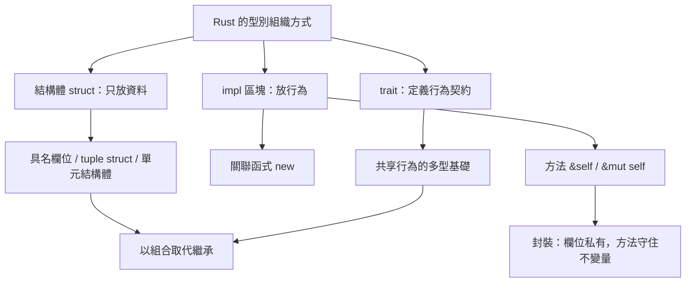

# 6.1 使用結構體（struct）組織資料

在前面的章節裡，我們用元組把幾個不同用途的值綁在一起，用陣列把同類型的值排成序列。這兩種工具都很好用，但都缺少一件關鍵的事：**名稱**。一個 `(String, u64, bool)` 到底是代表使用者、訂單還是設定项？讀程式碼的人只能靠猜或者靠註解。結構體（struct）就是 Rust 對這個問題的正式答案：它讓你把彼此相關的資料組成一個有明確語義的整體，而且這個整體還能帶著自己的行為一起前進。

## 一、結構體的三種形式

Rust 的結構體有三種寫法，差別在於欄位是用名稱指定，還是用位置指定。第一種是具名欄位（named fields），它是最常用也最推薦的形式：

```rust
struct User {
    active: bool,
    username: String,
    email: String,
    sign_in_count: u64,
}

fn main() {
    let user1 = User {
        email: String::from("someone@example.com"),
        username: String::from("someone"),
        active: true,
        sign_in_count: 1,
    };
    println!("{} / {}", user1.username, user1.email);
}
```

第二種是 tuple struct（元組結構體），它用括號而非大括號宣告欄位，欄位靠位置對應，適合語意本身就明確是「一組東西」的情況：

```rust
struct Meters(f64);
struct Point(f64, f64);

fn main() {
    let d = Meters(42.0);
    let p = Point(3.0, 4.0);
    println!("{:.1} 公尺，距離 {:.1}", d.0, (p.0 * p.0 + p.1 * p.1).sqrt());
}
```

第三種是單元結構體（unit struct），它沒有任何欄位，只是一個「存在」的標記，常用於實作某個行為的零大小型別：

```rust
struct Global;

struct Marker;

impl Marker {
    fn describe(&self) -> String {
        String::from("我是一個零大小的標記型別")
    }
}

fn main() {
    let m = Marker;
    println!("{}", m.describe());
}
```

三者共用同一套存取語法：具名欄位用 `user1.username`，tuple struct 用 `d.0`，單元結構體沒有欄位可取，但仍然可以當作型別使用。三者之間可以自由轉換，一個 tuple struct 可以用 `User { username, email }` 這樣的具名寫法初始化，反之亦然；唯一的差別只是宣告時的可讀性。

| 形式 | 宣告方式 | 存取欄位 | 適用情境 |
| --- | --- | --- | --- |
| 具名欄位 | `struct S { a: T }` | `s.a` | 預設選擇，欄位多於三個時 |
| tuple struct | `struct S(T)` | `s.0` | 語意明確的一組值，如 `Point` |
| 單元結構體 | `struct S;` | 無欄位 | 零大小標記型別 |

## 二、結構體與類別的差異

很多來自 C++、Java 或 C# 的讀者會下意識地把結構體當成「沒有繼承的類別」。這個類比只對了一半，卻足以造成大量誤導。Rust 的結構體**只是一組資料的聚合體**，它本身不包含方法；方法必須寫在關聯到它的 `impl` 區塊裡（下一節的主題）。更關鍵的是，Rust 完全沒有繼承機制，因此也沒有虛函式表、方法覆寫與基底類別建構子這些負擔。

Rust 給出的替代方案是兩樣東西：**組合**與**特徵**。當你想重用「某個東西有一個名稱、有年齡」這樣的行為時，不是去繼承一個 `Animal` 基底類別，而是把 `Name` 做成一個獨立的結構體，再把它「放進」動物裡。當你想讓不同型別都能參與同一組操作時，定義一個特徵（trait）並實作它。前者取代了「is-a」的繼承關係，後者取代了「可以做某件事」的行為多型。

另一個容易被忽略的差異是**資料與行為的分離**。在 Rust 裡，結構體的宣告處永遠只有欄位，方法一律在別處；這使得閱讀型別定義時可以快速掌握資料形狀，而不必在行為之間跳躍。這種分離在大型專案裡特別有價值：型別的資料布局是穩定的契約，行為則可以隨著特徵的擴充而演化。



用一句話收斂這段差異：C++ 的類別是「資料加行為的一體」，Rust 的結構體是「資料」，Rust 的 `impl` 加起來才是「類別」的職責，而 Rust 的 `trait` 提供了 C++ 介面與虛函式表所對應的位置。

| 面向 | C++ 的類別 | Rust 的結構體與 `impl` |
| --- | --- | --- |
| 資料與行為的位置 | 同一個 `class` 區塊內 | 分離：結構體放資料，`impl` 放行為 |
| 繼承 | 支援，單一繼承加多重介面 | 不支援，改用組合 |
| 多型機制 | 虛函式表加指標調整 | 特徵靜態多型或 `dyn` 特徵物件 |
| 建構子 | 與類同名，可多個重載 | 慣例上用關聯函式 `new`，非關鍵字 |
| 欄位可見性 | 由存取修飾符控制 | 預設私有，`pub` 明確公開 |
| 繼承帶來的耦合 | 子類依賴父類實作 | 依賴方向反轉，改由特徵宣告需求 |

這張表的意義不在於逐一比對語法，而在於指出 Rust 為什麼長得比較「散」。它把繼承樹的耦合拆成了幾個正交軸：資料形狀、行為實作、行為契約各自獨立，於是新增一種行為不需要動到原來的型別定義，新增一個欄位也不會被方法繼承的隱性依賴卡住。

## 三、欄位與所有權

結構體的欄位可以是任何型別，包含擁有堆積資源的 `String` 與 `Vec<T>`。一旦結構體擁有這類欄位，結構體本身也就不再是 `Copy` 型別，而是遵循完整的所有權規則。下面的程式碼示範了這一點：

```rust
struct Profile {
    name: String,
    age: u32,
}

fn main() {
    let p1 = Profile {
        name: String::from("小明"),
        age: 24,
    };
    let p2 = p1;               // 所有權移動，p1 失效
    println!("{}", p2.name);
    // println!("{}", p1.name);  // 編譯錯誤：值已被移動
}
```

這裡的移動是**欄位層級**的。編譯器在底層做的事情，等同於把 `name` 這個 `String` 的堆積指標從 `p1` 搬到 `p2`，再把 `age` 這個整數複製過去。因為 `String` 沒有額外的複製成本，整個 `Profile` 的移動也不會配置任何新記憶體。但正因如此，`p1` 之後就整個不可用了，連那個本可以隨意複製的 `age` 欄位也一併失效——Rust 的移動是整個值的移動，不做部分保留。

若只想借用而不取得所有權，可以改用 `&Profile`；而欄位本身的型別也可以獨立決定，例如 `name: &str` 表示這個結構體不擁有名字，只借用一段外部字串。這個區別在設計 API 時非常重要：一個持有 `String` 的結構體與一個持有 `&'a str` 的結構體，其生命週期與彈性完全不同。前者可以隨意送出，後者則綁在借用者身上。

欄位存取的語意也受這套規則約束。當你在列印語句裡寫 `p2.name`，編譯器會嘗試把這個 `String` 欄位**移動**出來；若 `p2` 之後還要用，就會得到「cannot move out of borrowed content」之類的錯誤。正確的寫法是加上 `&` 取借用：

```rust
struct Profile {
    name: String,
    age: u32,
}

fn main() {
    let p = Profile {
        name: String::from("小明"),
        age: 24,
    };
    let n = &p.name;
    println!("{n} / {}", p.age);
    // let m = p.name;  // 若之後還要用 p，這裡就會是移動而非借用
}
```

這是初學者最常撞到的所有權錯誤之一：它不是「Rust 很煩」，而是編譯器在防止你製造一份被部分取走的資料。理解到「欄位存取也是取值動作」這件事，這類錯誤就會自然消失。

## 四、建構與初始化

建立結構體值有幾種寫法。最基本的是逐欄位指定，欄位順序可以任意，但**每個欄位都必須被賦值**，漏掉任何一個都會得到編譯期錯誤。這項規則看似嚴格，實則是 Rust 風格的重要組成：它讓「新增一個欄位」成為一次編譯期可見的破壞性變更，強迫所有建構點同步更新，而不是留下一個默默等於零值的欄位。

```rust
struct Config {
    host: String,
    port: u16,
    verbose: bool,
}

fn main() {
    let c1 = Config {
        host: String::from("127.0.0.1"),
        port: 8080,
        verbose: false,
    };
    println!("{}:{} verbose={}", c1.host, c1.port, c1.verbose);
}
```

第二種是**結構體更新語法**（struct update syntax），用 `..` 開頭表示其餘欄位沿用另一個實例的值：

```rust
struct Config {
    host: String,
    port: u16,
    verbose: bool,
}

fn main() {
    let base = Config {
        host: String::from("127.0.0.1"),
        port: 8080,
        verbose: false,
    };
    let prod = Config {
        port: 443,
        ..base
    };
    println!("{}:{} verbose={}", prod.host, prod.port, prod.verbose);
}
```

要留意 `..base` 這個寫法的代價：它會把 `base` 中未被明確指定的欄位**移動**過來，於是 `base` 的部分欄位在此之後不可再被使用。如果 `base` 之後還要被用到，可以改成 `..base.clone()`，但前提是型別有實作 `Clone`。這個陷阱常被低估，值得記住。

第三種是透過 `impl` 區塊提供的關聯函式來建構，稍後第 6.2 節會專門說明。實務上，具名欄位結構體幾乎總是搭配 `new` 關聯函式使用，因為它能讓「建構時必須決定的事」集中在一處，不必散落在每個呼叫點。

結構體可以包含結構體，形成巢狀的資料層次：

```rust
struct Address {
    city: String,
    zip: String,
}

struct Employee {
    name: String,
    address: Address,
}

fn main() {
    let e = Employee {
        name: String::from("小明"),
        address: Address {
            city: String::from("台北"),
            zip: String::from("100").to_string(),
        },
    };
    println!("{} 在 {}", e.name, e.address.city);
}
```

巢狀的寫法稍嫌囉嗦，但換來的是兩件實用的東西：一是每個巢狀型別都能有自己的 `impl` 與方法，形成自然的模組邊界；二是欄位可以在不同層級各自封裝，`Employee` 的方法不必知道 `Address` 的內部細節，只依賴它公開的方法即可。

## 五、欄位初始化簡寫的陷阱

當欄位名稱與變數名稱相同時，Rust 允許省略欄位名：

```rust
struct User {
    email: String,
    age: u32,
}

fn email() -> String {
    String::from("function@example.com")
}

fn main() {
    let u = User {
        email: email(),
        age: 30,
    };
    println!("{}", u.email);
}
```

問題在於，如果把 `email: email()` 簡寫成 `email`，編譯器會把它解讀成「取欄位名 `email`，值為變數 `email`」，而這裡的 `email` 是一個函式項（function item），型別不符，於是編譯失敗。Rust 的解圍方式是明確寫出 `email: email()` 表示呼叫函式，而 `User { email, age }` 這種純簡寫只適用於「欄位名 == 變數名」的情況。撰寫時最保險的做法是簡寫只用於純粹的資料搬運，函式呼叫一律寫出完整形式。

這類簡寫的語法歧義在 Rust 中並不罕見。`{}` 既是具名欄位的括號，也是區塊表達式的括號；`{}` 既是格式字串的佔位符，也是運算子。這些重疊是語法設計的取捨，多數時候靠上下文就能分辨，但少數時候需要靠型別資訊或明確的寫法來消歧。

## 六、衍生 Debug 與 Clone

結構體預設不會自動支援除錯輸出與複製。`Debug` 特徵讓你能用 `{:?}` 印出結構體，`Clone` 讓你能做一份獨立的深拷貝。兩者都可以用**衍生**（derive）巨集自動產生：

```rust
#[derive(Debug, Clone)]
struct Point {
    x: f64,
    y: f64,
}

fn main() {
    let a = Point { x: 1.0, y: 2.0 };
    let b = a.clone();
    println!("{:?}", a);
    println!("{:?}", b);
    println!("{:#?}", a);
}
```

`{:?}` 給出單行輸出，`{:#?}` 則是每個欄位一行、帶縮排的多行格式，在巢狀結構體時特別好讀。衍生 `Clone` 意味著每個欄位都必須實作 `Clone`；若結構體含有 `Rc` 之類不實作 `Clone` 的欄位，衍生就會失敗，此時你需要手寫實作，或改用 `Copy`。反過來說，衍生 `Debug` 幾乎永遠是划算的，它對診斷幫助極大，成本則接近於零。

衍生也支援其他常見特徵，例如 `PartialEq` 讓結構體可以用 `==` 比較、`Copy` 讓它在賦值時被逐欄位複製而非整體移動、`Default` 讓它可以用 `Default::default()` 建立零值實例。`Default` 在搭配結構體更新語法時特別實用——你只要為必須自訂的欄位指定值，其餘交給預設。

衍生只是一種便利，真正重要的是理解它的**條件**：`#[derive(Clone)]` 要求每個欄位都實作 `Clone`，`#[derive(PartialEq)]` 要求每個欄位都實作 `PartialEq`。這個條件是遞迴的，因此像 `Vec<T>` 這種容器只要 `T` 實作了對應特徵就能自動跟上，而含有 `HashMap` 欄位的結構體只要 `HashMap` 本身實作了 `Clone` 就沒問題。少數型別刻意不實作 `Clone` 或 `PartialEq`，例如 `Rc<T>`（因為複製會破壞參考計數）與智慧指標的內部型別，遇到這種情況就必須手寫實作，並在其中定義你真正想要的語意。

## 七、常見的編譯期錯誤

結構體相關的錯誤多半集中在四類。第一類是 **E0063：缺少欄位**，也就是忘了初始化某個欄位。編譯器會直接告訴你少了什麼：

```text
error[E0063]: missing field `age` in initializer of `User`
 --> src/main.rs:7:13
  |
7 |     let u = User {
  |             ^^^^ missing `age`
```

修正方式就是把欠下的欄位補齊，或用 `..Default::default()` 明確表示其餘取預設值：

```rust
#[derive(Default)]
struct User {
    name: String,
    age: u32,
}

fn main() {
    let u = User {
        name: String::from("小明"),
        ..Default::default()
    };
    println!("{} {}", u.name, u.age);
}
```

第二類是 **E0616：欄位是私有的**，也就是從模組外部直接存取未加 `pub` 的欄位。第三類是 **E0382：值已被移動**，通常發生在把含有 `String` 的結構體傳給函式或指派給另一個變數之後。第四類則是型別不符，例如把 `&str` 直接指派給 `String` 欄位。

這四類錯誤的共同點是：它們全部在編譯期被攔下，而且錯誤訊息相當具體，會直接指出是哪個欄位、哪一行、期望什麼型別。相較之下，同樣的錯誤在 C++ 中可能表現為執行期的未定義行為，或在 Java 中變成難以追查的 `NullPointerException`。


## 七、記憶體佈局與對齊

結構體在記憶體中的排列方式，是欄位**依宣告順序**接續排放，並在必要時插入填充位元（padding），使每個欄位落在適合自己的對齊邊界上。若某欄位的大小為 $s_i $ ，對齊要求為 $a_i $ ，則整體大小可以粗略寫成

$$
S = \sum_{i=1}^{n} \operatorname{align\_up}(s_i,\ a_i)
$$

其中 $\operatorname{align\_up}$ 表示把每個欄位的大小向上取整到其對齊要求的倍數，再加上尾部為滿足整體對齊而補上的位元。這意味著**欄位順序會影響佔用空間**：把大的欄位放在前面，可以減少因對齊而產生的空洞。

Rust 預設的排列順序不保證與原始碼宣告順序一致（編譯器會重排以填補空隙）。若你需要保證欄位順序——例如透過 `extern "C"` 呼叫 C 函式，或把結構體的位元組直接寫進檔案——可以加上 `#[repr(C)]`。另一個 `#[repr(packed)]` 則會移除所有對齊填充，把欄位緊密排列，代價是可能產生未對齊的存取，讀取未對齊的欄位在部分架構上是未定義行為，同時編譯器會為這些存取插入位元組交換的程式碼而降低效能。兩者都屬於跨邊界互動時才需要的工具。

順帶一提，沒有任何欄位的單元結構體是**零大小型別**（zero-sized type），它的實例佔用零位元組，編譯器會讓每個實例共用同一個位址。這類型別在語意上就是「只有一個值」的單位元，例如 `()` 或 `std::marker::PhantomData` 就是用它們來表達「這個泛型參數在編譯期存在，但在執行期不佔空間」。

欄位順序的影響可以用 `size_of` 直接量出來。下列兩個結構體的欄位完全相同，只是順序不同，所佔的位元組數就不同：

```rust
struct SmallFirst {
    flag: u8,
    counter: u64,
}

struct LargeFirst {
    counter: u64,
    flag: u8,
}

fn main() {
    println!("SmallFirst = {}", std::mem::size_of::<SmallFirst>());
    println!("LargeFirst = {}", std::mem::size_of::<LargeFirst>());
}
```

把 `u8` 放在 `u64` 前面，前者會多出七個位元組的填充；把大的欄位往前放，填充就消失了。對於會被大量建立、且數量以百萬計的結構體，這幾個位元組的差異是可以量化的實際成本。

## 九、結構體作為不變量的容器

Rust 沒有類別，也沒有「private 欄位 + public 存取器」這種語言層級的建構子機制。但它給了另一套等價甚至更強的作法：**把欄位設為私有，只公開能保持不變量的方法**。欄位不加上 `pub`，就只能在定義該結構體的模組內直接存取；外部的程式碼必須呼叫方法，而方法可以把檢查寫在裡面。

```rust
pub struct Temperature {
    celsius: f64,
}

impl Temperature {
    pub fn new(celsius: f64) -> Self {
        Self { celsius }
    }
    pub fn celsius(&self) -> f64 {
        self.celsius
    }
    pub fn set_celsius(&mut self, value: f64) -> Result<(), String> {
        if !(-273.15..=1_000.0).contains(&value) {
            return Err(String::from("溫度超出合理範圍"));
        }
        self.celsius = value;
        Ok(())
    }
}

fn main() {
    let mut t = Temperature::new(21.5);
    println!("{:.1}", t.celsius());
    t.set_celsius(30.0).unwrap();
    println!("{:.1}", t.celsius());
    assert!(t.set_celsius(-500.0).is_err());
}
```

這就是 Rust 的**封裝（encapsulation）**：不變量由型別自己守住，而不是靠呼叫端自律。這裡的 `new` 之所以重要，是因為它是唯一能從外部建立 `Temperature` 的途徑；一旦把欄位設為私有，未來想調整內部表示（例如改存開爾文）都不會破壞呼叫端。第 7 章談到模組可見性時，這套「私有欄位加公開方法」的設計會再次出現。

## 十、一個完整的範例

把前面幾個概念合起來，下面這個程式示範了結構體如何承載資料、守住不變量，並且用衍生巨集取得除錯能力：

```rust
#[derive(Debug, Clone, PartialEq)]
struct Account {
    id: u32,
    owner: String,
    balance_cents: i64,
}

impl Account {
    fn new(id: u32, owner: &str) -> Self {
        Account {
            id,
            owner: owner.to_string(),
            balance_cents: 0,
        }
    }

    fn deposit(&mut self, cents: i64) -> Result<(), String> {
        if cents <= 0 {
            return Err(String::from("存款金額必須為正"));
        }
        self.balance_cents += cents;
        Ok(())
    }

    fn can_withdraw(&self, cents: i64) -> bool {
        cents > 0 && cents <= self.balance_cents
    }
}

fn main() {
    let mut acct = Account::new(1, "小明");
    acct.deposit(5_000).expect("存款應成功");
    println!("{acct:?}");
    println!("餘額（分）：{}", acct.balance_cents);
    assert!(acct.can_withdraw(5_000));
    assert!(!acct.can_withdraw(5_001));
    let copy = acct.clone();
    assert_eq!(acct, copy);
}
```

這段程式碼的重點不在語法，而在結構：`balance_cents` 是私有欄位，外部無法繞過 `deposit` 與 `can_withdraw` 硬改餘額；金額一律以整數分儲存，避免浮點誤差；`PartialEq` 讓結構體可以直接比較，`Debug` 讓它可以印出，`Clone` 讓它可以被安全地複製。

回頭看整節的脈絡，結構體在 Rust 中扮演的角色可以濃縮成三個關鍵字：**聚合**（把相關資料綁在一起）、**所有權**（綁在一起的同時決定誰負責釋放）、**封裝**（用私有欄位與方法把不變量守住）。第一個關鍵字是所有其他語言都有的；第二個是 Rust 特有的；第三個則是 Rust 用型別系統重新實現的物件導向核心。下一節我們就進入 `impl` 區塊，看看這些方法該怎麼寫才得體。
