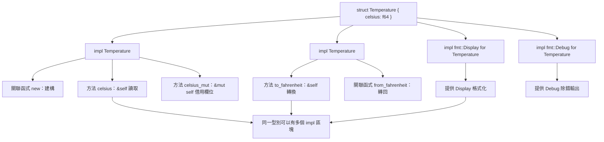

# 6.2 實作方法（impl 區塊）

上一節把結構體定義成純粹的資料容器，資料有了形狀，行為卻還沒有歸屬。Rust 的答案是 `impl` 區塊：它把一組函式關聯到某個型別，讓這些函式能以方法的形式被呼叫，同時允許同一個型別擁有多組彼此獨立的行為。這個安排把「資料」與「行為」在原始碼上分開，卻在型別系統裡重新綁在一起。

## 一、impl 區塊與關聯函式

`impl` 關鍵字後面接上型別名稱，括號內則列出函式。第一種形式是**關聯函式**（associated function），它沒有 `self` 參數，必須用型別名稱加 `::` 呼叫：

```rust
struct Person {
    name: String,
    age: u32,
}

impl Person {
    fn new(name: &str, age: u32) -> Self {
        Person {
            name: name.to_string(),
            age,
        }
    }
}

fn main() {
    let p = Person::new("小明", 30);
    println!("{} {}", p.name, p.age);
}
```

這裡有兩個關鍵細節。第一個是 `Self`：它是一個關鍵字，在 `impl` 區塊內代表「被實作的這個型別」本身，等價於 `Person`。使用 `Self` 的好處是，一旦型別改名，實作區塊內不需要跟著修改。第二個是 `new`：它在 Rust 裡**不是關鍵字**，只是一項社群慣例。它之所以成為慣例，是因為它讓「建立一個 `Person`」這件事在所有型別上都有統一的名稱，閱讀程式碼時不必猜。此外 `new` 也不必回傳 `Self`，理論上它可以回傳任何東西。

關聯函式並非只能當建構子用。它也可以是與該型別相關但不需要存取實例狀態的輔助函式，例如把一個型別轉換成另一種單位、產生預設值，或者作為型別的命名空間容納一組相關的函式。`impl` 區塊裡還可以定義**關聯常數**，讓型別帶著一些固定的具名數值：

```rust
#[derive(Debug)]
struct Meters(f64);

#[derive(Debug)]
struct Feet(f64);

impl Meters {
    const ZERO: Meters = Meters(0.0);

    fn to_feet(&self) -> Feet {
        Feet(self.0 * 3.28084)
    }
}

impl Feet {
    fn to_meters(&self) -> Meters {
        Meters(self.0 / 3.28084)
    }
}

fn main() {
    let m = Meters(100.0);
    println!("{:.2} 英尺", m.to_feet().0);
    println!("{:?}", Meters::ZERO);
}
```

關聯常數與關聯函式一樣是用 `::` 存取，且同樣不帶 `self`。把「常數」放在型別上而非模組上，語意上更貼近：它描述的正是「這個型別的某個特性」，而模組層級的常數則更像是一組無關的共用值。

## 二、方法與函式的差別

**方法**（method）與關聯函式的差別，在於方法的第一個參數是 `self`。這個參數有三種形式，它決定了方法能不能改變狀態：

```rust
struct Counter {
    count: u32,
}

impl Counter {
    fn new() -> Self {
        Counter { count: 0 }
    }

    fn get(&self) -> u32 {
        self.count
    }

    fn add(&mut self, delta: u32) {
        self.count += delta;
    }

    fn consume(self) -> u32 {
        self.count
    }
}

fn main() {
    let mut c = Counter::new();
    c.add(3);
    c.add(4);
    println!("{}", c.get());
    let taken = c.consume();
    println!("取走 {taken}，帳戶於此刻結清");
}
```

`&self` 取得的是不可變借用，方法可以讀取欄位但不能修改，也不需要在離開時負責釋放任何東西。`&mut self` 取得可變借用，方法可以修改欄位，但同一時間只能有一個可變借用存在。`self` 則是按值取得所有權，代表方法會把整個實例吃掉；離開方法時 `self` 被丟棄，裡面的資源隨之釋放，因此 `self` 方法之後原變數不可再使用。

| 接收者形式 | 所有權語意 | 可否修改狀態 | 呼叫後原值 |
| --- | --- | --- | --- |
| `&self` | 不可變借用 | 否 | 仍可用 |
| `&mut self` | 可變借用 | 是 | 仍可用 |
| `self` | 取走所有權 | 是 | 已失效 |

這三種形式不只是語法差異，它們是**契約**：閱讀 `&self` 方法的呼叫者可以放心地假設狀態不會被改動，因而在多執行緒情境中特別珍貴；而 `self` 方法則明確宣告「這個值到此為止為止」，讓資源的釋放時機完全落在型別設計者的掌控之中。

要特別留意 `self` 方法的隱含後果：一旦呼叫 `c.consume()`，變數 `c` 就被移走了，編譯器會禁止你再讀它。這不是bug，而是 Rust 避免「資源被釋放後仍被使用」的第一道防線。

## 三、自動解參考

Rust 有一項貼心的設計：當方法的接收者是 `&self` 時，呼叫者不需要寫出顯式的解參號。因為方法呼叫的語法 `receiver.method(args)` 會自動嘗試把 `receiver` 視為 `&T`、`&mut T` 或 `T` 三種形式之一來比對。

```rust
struct Point {
    x: i32,
    y: i32,
}

impl Point {
    fn get_x(&self) -> i32 {
        self.x
    }
}

fn main() {
    let p = Point { x: 3, y: 4 };
    let rp = &p;
    let mp = &mut { p.x };
    println!("{} {} {}", p.get_x(), rp.get_x(), mp);
}
```

上面這段程式碼中，`p.get_x()`、`rp.get_x()` 與 `(&p).get_x()` 三種寫法在方法查找時是等價的，編譯器會自動完成 `&` 或 `*` 的插入或移除。這個機制讓「對指標呼叫方法」與「對值呼叫方法」在閱讀程式碼時不需要特別區分，程式碼風格因此更統一。

要注意的是，這個便利只適用於方法呼叫的**接收者位置**。若把方法當成函式指標傳遞，例如 `let f = p.get_x;`，就必須寫成 `let f = Point::get_x;` 這種明確的關聯函式形式，因為那時已經沒有接收者可以自動解參考了。

同一套機制也會作用在欄位上。當你在 `&self` 方法內部寫 `self.name.len()` 時，編譯器會先取得 `self.name` 的借用，再對 `String` 呼叫 `len`，全程不需要寫任何 `&` 或 `*`。這種「自動借用」讓唯讀方法可以自由地以 `&self` 的身分存取欄位，而不必擔心不小心把它移走。

## 四、多個 impl 區塊

Rust 允許你為同一個型別撰寫多個 `impl` 區塊，這在實務上非常有用。你可以依照不同的理由把方法分組，例如把所有與建構相關的函式放在一起，把所有查詢方法放在一起：

```rust
struct Temperature {
    celsius: f64,
}

impl Temperature {
    fn new(celsius: f64) -> Self {
        Temperature { celsius }
    }
    fn celsius(&self) -> f64 {
        self.celsius
    }
    fn celsius_mut(&mut self) -> &mut f64 {
        &mut self.celsius
    }
}

impl Temperature {
    fn to_fahrenheit(&self) -> f64 {
        self.celsius * 1.8 + 32.0
    }
    fn from_fahrenheit(f: f64) -> Self {
        Temperature::new((f - 32.0) / 1.8)
    }
}

fn main() {
    let mut t = Temperature::new(20.0);
    println!("{:.1} 攝氏 = {:.1} 華氏", t.celsius(), t.to_fahrenheit());
    *t.celsius_mut() = 25.0;
    println!("{:.1}", t.celsius());
    let t2 = Temperature::from_fahrenheit(77.0);
    println!("{:.1}", t2.celsius());
}
```

分組的好處不只是閱讀體驗。更重要的是，你可以依照**特徵**來分組：同一個型別的不同特徵實作放在不同的 `impl` 區塊裡，這樣讀者一眼就能看出「這裡實作了哪些能力」。

```rust
use std::fmt;

struct Id(u64);

impl Id {
    fn new(raw: u64) -> Self {
        Id(raw)
    }
}

impl fmt::Display for Id {
    fn fmt(&self, f: &mut fmt::Formatter<'_>) -> fmt::Result {
        write!(f, "ID-{}", self.0)
    }
}

impl fmt::Debug for Id {
    fn fmt(&self, f: &mut fmt::Formatter<'_>) -> fmt::Result {
        write!(f, "Id({})", self.0)
    }
}

fn main() {
    let id = Id::new(42);
    println!("{id}");
    println!("{id:?}");
}
```

這種「一個型別、多個特徵實作」的寫法，是 Rust 沒有繼承卻能提供類似多型的關鍵。型別的行為契約由特徵宣告，實作內容則各自獨立。



## 五、泛型 impl 與特徵 bound

`impl` 區塊也可以為泛型型別而寫，並在型別參數加上限制。這是第 9 章的主題，這裡先給一個預告：

```rust
use std::fmt::Display;

struct Wrapper<T> {
    value: T,
}

impl<T: Display> Wrapper<T> {
    fn show(&self) -> String {
        format!("包裝內容：{}", self.value)
    }
}

impl<T> Wrapper<T> {
    fn into_inner(self) -> T {
        self.value
    }
}

fn main() {
    let w = Wrapper { value: 42 };
    println!("{}", w.show());
    let raw = w.into_inner();
    println!("{raw}");
}
```

注意這裡有兩個 `impl` 區塊：帶有 `T: Display` 限制的那個，只能被 `T` 實作 `Display` 時呼叫；而沒有任何限制的那個則對所有 `T` 都成立。這就是**特徵界線**的寫法：型別的核心功能對所有型別開放，額外的功能則以特徵為前提條件。這種做法在實務上比 C++ 的「同一個類別對所有泛型參數提供同一組方法」更靈活，也更符合 Rust「能力隨著實作而來」的哲學。

限制也可以寫在方法層級，這在只有少數方法需要額外能力時更精確：

```rust
use std::fmt::Debug;

struct Pair<A, B> {
    left: A,
    right: B,
}

impl<A: Debug, B: Debug> Pair<A, B> {
    fn show(&self) -> String {
        format!("({:?}, {:?})", self.left, self.right)
    }
}

impl<A, B> Pair<A, B> {
    fn swap(self) -> Pair<B, A> {
        Pair {
            left: self.right,
            right: self.left,
        }
    }
}

fn main() {
    let p = Pair { left: 1, right: "x" };
    println!("{}", p.show());
    let q = p.swap();
    println!("{}", q.show());
}
```

`swap` 沒有任何限制，因此對所有型別組合都可用；`show` 需要 `Debug`，因此把限制寫在 `impl` 上。若限制只影響單一方法，也可以把它寫在方法簽章內。這種「限制可以貼著需求放」的設計，是 Rust 泛型相對 C++ 模板最有價值的地方之一。

## 六、哪些東西不該放在 impl 裡

不是所有函式都該是方法。判斷標準很單純：**這個函式需要用到 `self` 的狀態嗎？** 若答案是「不需要」，它多半應該是一個自由函式（free function），放在模組層級。

以一個日誌模組為例，`fn log(message: &str)` 屬於自由函式，因為它跟任何特定型別都無關；而 `fn level(&self) -> Level` 則是方法，因為它要回答「這筆日誌本身的等級是什麼」。同樣地，一個把 `Vec<String>` 依長度排序的函式不需要 `self`，因此它應該是一個作用在切片上的自由函式，而不是硬塞進某個型別的 `impl` 裡。

把不屬於某型別的函式硬塞進 `impl` 裡，通常會讓 API 看起來比實際更複雜。判斷上的細微差別在於：一個不需要 `self` 的方法若放在 `impl` 內，呼叫時仍得寫 `Type::function(...)` 而不是 `function(...)`，讀者會誤以為它與該型別有某種耦合。慣例上，Rust 社群遵循一條接近法律條文的規則：**沒有 `self` 的操作屬於型別本身，有 `self` 的操作屬於值**。這條規則讓 `iter()` 這類方法總是作用於 `self` 上的某個元素，而 `sort()` 這類自由函式則作用於整個切片。

兩種寫法在實務上的差異，可以從呼叫端看出來。若把排序寫成自由函式，呼叫點必須寫出型別；若寫成方法，則由方法自己決定排序的是哪個欄位：

```rust
struct Task {
    title: String,
    priority: u8,
}

fn sort_by_priority(tasks: &mut [Task]) {
    tasks.sort_by(|a, b| b.priority.cmp(&a.priority));
}

impl Task {
    fn sort_urgent_first(tasks: &mut [Task]) {
        tasks.sort_by(|a, b| b.priority.cmp(&a.priority));
    }
}

fn main() {
    let mut list = vec![
        Task { title: String::from("報告"), priority: 2 },
        Task { title: String::from("修 bug"), priority: 9 },
    ];
    sort_by_priority(&mut list);
    for t in &list {
        println!("{} {}", t.priority, t.title);
    }
}
```

這段對照不是要說明哪一種比較好，而是要指出判準：當運作的主體是「切片裡的資料」而不是「某個 `Task` 物件」時，自由函式的語意更誠實。

## 七、命名慣例

Rust 的 API 命名有一套被廣泛採用的慣例，理解它能大幅降低閱讀陌生程式碼的成本：

| 前綴 | 語意 | 是否消耗原值 | 範例 |
| --- | --- | --- | --- |
| （無） | 就地操作或純查詢 | 否 | `sort`、`len` |
| `as_` | 廉價、無損的借用轉換 | 否 | `as_str`、`as_bytes` |
| `to_` | 可能配置記憶體的轉換 | 否 | `to_string`、`to_owned` |
| `into_` | 消耗原值並轉換所有權 | 是 | `into_bytes`、`into_inner` |

`as_` 系列是零成本的借用視圖，例如 `str::as_bytes` 只是把字串的位元組重新解讀，沒有任何配置。`to_` 系列則可能需要配置，例如 `str::to_string` 會建立一個新的 `String`。`into_` 系列最特別，它一定會消耗原值，理由通常是要改變資源的擁有者或型別，例如 `String::into_bytes` 會把字串的位元組整個拿走交給呼叫者。

理解這個區分有實用價值：當你看到 `into_` 就知道原值不能再用，看到 `as_` 就知道它只是視圖，看到 `to_` 就預期可能有一次配置。命名因此不只是風格，而是把成本與所有權的資訊編碼進名字裡。這也是為什麼 `new` 之外，Rust 社群會偏好 `from_*` 這種名稱來表示「從別的東西轉換而來」。

另外還有兩個值得注意的慣例。`try_*` 系列的方法回傳 `Result` 或 `Option`，表示這一步可能失敗但失敗是可預期的，例如 `fs::read_to_string` 對應的 `try_read` 心智模型；而 `get_` 與 `set_` 這組前綴在 Rust 社群中已被認為容易誤導而逐漸被棄用，取而代之的是直接使用動詞，例如 `temperature()` 取代 `get_temperature()`、`set_temperature(value)` 保留但建議寫成 `set_temperature`。原因很直觀：Rust 的 getter 幾乎都是純函數式的唯讀方法，不需要 `get_` 前綴來提示「這不會改變東西」。

## 八、鏈式呼叫與建造者模式

`self` 接收者還有一種極具影響力的用法：讓方法把 `self` 原封不動地還回來，於是呼叫可以一路串下去。

```rust
#[derive(Default)]
struct Config {
    host: String,
    port: u16,
    verbose: bool,
}

impl Config {
    fn host(mut self, host: &str) -> Self {
        self.host = host.to_string();
        self
    }
    fn port(mut self, port: u16) -> Self {
        self.port = port;
        self
    }
    fn verbose(mut self, verbose: bool) -> Self {
        self.verbose = verbose;
        self
    }
}

fn main() {
    let cfg = Config::default()
        .host("127.0.0.1")
        .port(8080)
        .verbose(true);
    println!("{}:{} verbose={}", cfg.host, cfg.port, cfg.verbose);
}
```

這種風格叫**建造者模式**（builder pattern），它把「設定一個選項」的動作變成可以任意組合的步驟。每一個方法都接收 `self` 並回傳 `Self`，所以中途不存在「半設定」的可變狀態，所有選項要到最後才被組裝成完整物件。Rust 社群特別偏好這種不可變的建造者風格，因為它與所有權規則配合得特別自然：每一步都消費上一個暫時值，編譯器因此能保證沒有重複設定或遺漏初始化的問題。

## 九、把不變量守在方法內

現在讓我們把前面的觀點整合成一個完整範例。這個 `BankAccount` 結構體的核心約束是：**餘額永不可以是負數**。我們要讓這個約束在型別層級成立，而不是靠每個呼叫端記得檢查。

```rust
#[derive(Debug)]
struct BankAccount {
    id: u32,
    owner: String,
    balance: i64,
}

impl BankAccount {
    fn new(id: u32, owner: &str) -> Self {
        BankAccount {
            id,
            owner: owner.to_string(),
            balance: 0,
        }
    }

    fn balance(&self) -> i64 {
        self.balance
    }

    fn deposit(&mut self, amount: i64) -> Result<(), &'static str> {
        if amount <= 0 {
            return Err("存款金額必須為正數");
        }
        self.balance += amount;
        Ok(())
    }

    fn withdraw(&mut self, amount: i64) -> Result<i64, &'static str> {
        if amount <= 0 {
            return Err("提款金額必須為正數");
        }
        if amount > self.balance {
            return Err("餘額不足");
        }
        self.balance -= amount;
        Ok(amount)
    }

    fn close(self) -> (u32, String, i64) {
        (self.id, self.owner, self.balance)
    }
}

fn main() {
    let mut acct = BankAccount::new(1, "小明");
    acct.deposit(10_000).expect("存款應成功");
    let taken = acct.withdraw(3_000).expect("提款應成功");
    println!("提款 {taken}，餘額 {}", acct.balance());

    assert!(acct.withdraw(100_000).is_err());
    assert!(acct.deposit(-1).is_err());

    let (id, owner, balance) = acct.close();
    println!("帳戶 {id} 屬於 {owner}，結餘 {balance}");
}
```

這個設計有幾個值得體會的地方。第一，`balance` 是私有欄位，外部無法直接把它設成負數；所有修改都必須走 `deposit` 與 `withdraw`，而這兩個方法都把檢查寫在裡面。第二，`balance()` 這個唯讀方法讓呼叫者可以查詢餘額，卻拿不到 `&mut`，因此無法繞過檢查。第三，`close(self)` 消費整個帳戶，回傳其最終狀態，這表達了「帳戶已結清，資源歸還給呼叫者」的語意，也示範了 `self` 接收者的用途。

最後，`Result` 的回傳型別是這段設計的關鍵。`withdraw` 回傳 `Result<i64, &'static str>`，代表「提款成功時給你多少錢，失敗時說明原因」。用 `&'static str` 當錯誤型別在這個規模的範例裡足夠用，但正式專案通常會定義專屬的錯誤型別，並在第 8 章討論 `thiserror` 與 `anyhow` 如何處理這類問題。

這裡也值得說明為什麼不用 `panic!`。`panic!` 適合「程式碼有 bug」的情況，而「餘額不足」是一種**可以預期的**業務結果。把可預期的失敗表達成 panic，等於把一個正常的執行路徑升級成程式中止；表達成 `Result` 則讓呼叫端有責任去處理，而「有責任處理」正是編譯器能幫忙的部分。Rust 的 `Result` 與 `Option` 之所以是語言的核心，不在於它們比較方便，而在於它們把「可能失敗」標記成型別資訊，讓遺漏變成編譯期錯誤。

## 十、常見的編譯期錯誤

方法相關的錯誤大致有四種。第一種是 **E0594**：在非 `mut` 的 `self` 上嘗試指派。若方法的接收者寫成 `self` 而非 `mut self`，`self` 本身不是可變綁定，此時想修改欄位就必須改用 `&mut self`。第二種是 **E0382**：值已被移動，通常是呼叫了 `self` 接收者的方法之後又去使用原變數。第三種是 **E0502**：同時存在不可變借用與可變借用，例如在迭代 `Vec` 的同時想改動其中元素。第四種則是方法名稱或簽章不符造成的編譯期找不到方法。

這四類錯誤共同的特徵是：它們全部描述的是**所有權與借用關係**的違規，而不是傳統意義上的「型別錯誤」。這正是 Rust 把一大類執行期難題前移到編譯期的結果。

## 十一、固有方法與特徵方法的界線

Rust 的方法有兩個來源：定義在自己 `impl` 區塊裡的**固有方法**，以及透過 `impl SomeTrait for MyType` 提供的**特徵方法**。兩者在呼叫語法上看不出差別，但設計意圖截然不同。

固有方法代表「這個型別天生就會做的事」，例如 `Vec` 的 `push`、`String` 的 `len`。特徵方法代表「這個型別在某一項能力上的表現」，例如 `Display` 的格式化輸出、`Iterator` 的迭代。任何型別都能實作任何特徵，只要它符合契約；這個契約就是編譯期檢查的依據。

```rust
use std::fmt::Display;

struct Celsius(f64);
struct Fahrenheit(f64);

impl Display for Celsius {
    fn fmt(&self, f: &mut std::fmt::Formatter<'_>) -> std::fmt::Result {
        write!(f, "{:.1}°C", self.0)
    }
}

impl Display for Fahrenheit {
    fn fmt(&self, f: &mut std::fmt::Formatter<'_>) -> std::fmt::Result {
        write!(f, "{:.1}°F", self.0)
    }
}

fn print_all(items: &[Box<dyn Display>]) {
    for item in items {
        println!("{item}");
    }
}

fn main() {
    let readings: Vec<Box<dyn Display>> = vec![
        Box::new(Celsius(21.5)),
        Box::new(Fahrenheit(70.7)),
    ];
    print_all(&readings);
}
```

選擇的原則是：若這項能力「所有該型別都應該有」，就做成固有方法；若它只是「一種可選的行為」，就做成特徵。這個區分讓語言能同時保有兩種擴充方式，而不必像 C++ 那樣把虛函式表強加給每一個型別。第 9 章會正式討論特徵的定義、實作與繫結，以及 `dyn` 特徵物件與泛型的取捨。

## 十三、方法的文件與可讀性

Rust 的慣例是使用 `///` 三斜線註解為公開項目撰寫文件，`cargo doc` 會把它們轉成 HTML 文件。文件註解裡可以包含 Markdown 與程式碼區塊，而 `#[doc = "..."]` 屬性則能產生不同於註解的文件說明。

對方法而言，文件最重要的部分不是描述它「做了什麼」，而是描述它的**契約**：參數的意義、回傳值的意義、可能發生的錯誤、以及呼叫者需要遵守的前提。例如 `withdraw` 的文件應該說明回傳的 `Err` 對應哪些情況，而不是只說「執行提款」。契約寫得清楚，方法的邊界就會變得明確；邊界明確了，呼叫端才知道哪些檢查可以交給方法、哪些必須自己處理。

## 十二、方法設計的整體思考

回顧整節，`impl` 區塊提供了三樣東西：把行為關聯到型別的能力、把「可觀察的狀態變化」限制在方法之內的能力，以及用多個區塊與特徵實作把大型型別拆解成可讀區塊的能力。

選用哪一種接收者，是每個方法最重要的設計決定。唯讀查詢用 `&self`，讓呼叫者能安全地共用同一份資料；狀態更新用 `&mut self`，讓編譯器確保不會有別的借用同時存在；而轉換語意或資源移交用 `self`，讓所有權的轉移變得明確而不可遺漏。Rust 編譯器的借用檢查器能保證記憶體安全，正是因為這三種形式把「誰能看見什麼、誰能改變什麼」寫進了型別裡。理解了這些，閱讀任何 Rust 程式碼的方法定義時，你都能從簽章一行推斷出它對狀態的影響，而不必把整個函式讀完。這種「簽章即文件」的性質，是 Rust API 能夠自我解釋的技術基礎，也是本節所有規則最終要達成的目標。


