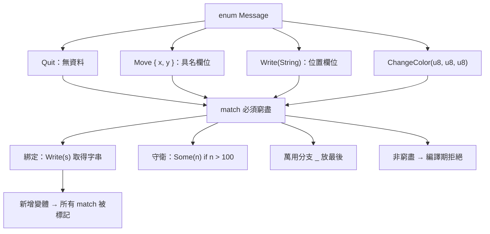

# 6.3 列舉（enum）與萬能的 match 模式對應

在前兩節裡，我們用結構體表達「一組相關的資料」，用方法表達「它能做的事」。但有一類問題這兩者都處理不了：資料的**形狀會變**，而且不同的形狀需要不同的資料。訂單的狀態可能是「待付款」「已付款」「已取消」，三者的後續處理完全不同；把狀態表示成 `String` 會讓任何拼字都能通過檢查，表示成整數則讓每個數字的意義只能靠註解維持。列舉就是為了解決這個問題而生的。

## 一、Rust 中列舉的獨特地位

Rust 的列舉與 C 或 Java 的列舉有本質差異。C 的列舉（其實是整數常數）每個變體沒有資料；Java 的列舉可以攜帶資料，但各變體的資料必須是同一個型別。Rust 的列舉則允許**每個變體攜帶完全不同的資料，甚至完全不同的型別**。

```rust
enum Message {
    Quit,
    Move { x: i32, y: i32 },
    Write(String),
    ChangeColor(u8, u8, u8),
}

fn main() {
    let m1 = Message::Quit;
    let m2 = Message::Move { x: 10, y: 20 };
    let m3 = Message::Write(String::from("hello"));
    let m4 = Message::ChangeColor(255, 0, 128);
    match m3 {
        Message::Quit => println!("quit"),
        Message::Move { x, y } => println!("move to {x},{y}"),
        Message::Write(s) => println!("write: {s}"),
        Message::ChangeColor(r, g, b) => println!("color {r},{g},{b}"),
    }
}
```

這個設計帶來一個非常實際的後果：當列舉的變體可以攜帶不同資料時，編譯器就能幫你**確認所有可能的情況都被處理了**。在 C 裡寫一個處理訊息種類的 `switch`，漏掉某個 `case` 只是一種風格問題；在 Rust 裡漏掉就是編譯期錯誤。這是 Rust 對待「不可遺漏的分支」最鮮明的態度。

從型別理論的角度來看，Rust 的列舉是**代數資料型**（algebraic data type，ADT）的和型（sum type）構造子：它的值恰好是所有變體的聯集。而 `struct` 對應的是積型（product type）構造子：一個值同時具備所有欄位。列舉與結構體這兩種型別構造子，加上 `Option`、`Result` 這兩個內建的常用列舉，構成 Rust 型別系統的骨架。

## 二、帶資料的列舉

列舉的變體有三種常見寫法。剛才的範例已經涵蓋了大部分：不帶資料的單元變體 `Quit`、帶具名欄位的 `Move { x, y }`、帶位置欄位的 `Write(String)`。第三種特別值得注意：位置欄位的寫法讓列舉與 tuple struct 的語法保持一致，閱讀時不需要重新學習一套規則。

```rust
#[derive(Debug)]
enum Shape {
    Circle { radius: f64 },
    Rectangle { width: f64, height: f64 },
    Triangle(f64, f64, f64),
    Point,
}

impl Shape {
    fn area(&self) -> f64 {
        match self {
            Shape::Circle { radius } => std::f64::consts::PI * radius * radius,
            Shape::Rectangle { width, height } => width * height,
            Shape::Triangle(a, b, c) => {
                let s = (a + b + c) / 2.0;
                (s * (s - a) * (s - b) * (s - c)).sqrt()
            }
            Shape::Point => 0.0,
        }
    }
}

fn main() {
    let shapes = [
        Shape::Circle { radius: 1.0 },
        Shape::Rectangle { width: 2.0, height: 3.0 },
        Shape::Triangle(3.0, 4.0, 5.0),
        Shape::Point,
    ];
    for s in &shapes {
        println!("{:.3}", s.area());
    }
}
```

這個範例把四種形狀統一在一個 `Vec` 裡，卻沒有犧牲任何形狀專屬的資料——圓有半徑，三角形有三邊，矩形有寬高。這在 C 裡需要一個帶有 `kind` 欄位與一堆選用欄位的通用結構體，在 Java 裡則需要把資料塞進 `Object` 欄位再強制轉型。Rust 的列舉把「這件事可能有哪些形狀」直接寫進型別裡。

## 三、match 的完整語意

`match` 是 Rust 最具代表性的控制流結構，它的語意可以用一句話概括：**必須窮盡所有可能**。編譯器會檢查每一個可能的列舉變體、整數值或布林值都被某個分支處理，若有遺漏，就以 "non-exhaustive patterns" 拒絕編譯。

```rust
enum Traffic {
    Green,
    Yellow,
    Red,
}

fn action(t: Traffic) -> &'static str {
    match t {
        Traffic::Green => "通行",
        Traffic::Yellow => "減速",
        Traffic::Red => "停止",
    }
}

fn main() {
    println!("{}", action(Traffic::Green));
}
```

若在這個 `match` 中漏掉 `Traffic::Red`，編譯器會直接指出非窮盡的匹配：

```text
error[E0004]: non-exhaustive patterns: `Traffic::Red` not covered
 --> src/main.rs:6:5
  |
6 |     match t {
  |           ^ not covered
  |     Traffic::Green => "通行",
  |     Traffic::Yellow => "減速",
  ...
```

這項檢查是雙向的：新增一個列舉變體時，所有處理該列舉的 `match` 都會被標記為需要更新，編譯器會替你列出所有受影響的位置。這正是 Rust 對待重構的態度——讓破壞性變更無法悄悄通過編譯。

分支的寫法有幾個常用形式：單一值、逗號分隔的多個值、範圍 `1..=5`、以及 `_` 萬用分支：

```rust
fn classify(n: i32) -> &'static str {
    match n {
        0 => "零",
        1 | 2 | 3 => "小",
        4..=9 => "中",
        n if n < 0 => "負數",
        _ => "大",
    }
}

fn main() {
    for n in [-1, 0, 2, 5, 100] {
        println!("{} => {}", n, classify(n));
    }
}
```

注意 `_` 分支必須放在最後，因為它會匹配任何值；把它寫在前面，後面的分支就永遠不會被檢查到，成為死碼。編譯器對此也會提出警告。

## 四、綁定與模式守衛

在 `match` 分支中，`=>` 左邊的**模式**不只是比對，它還能把資料綁定到變數上。這就是先前範例裡 `Message::Write(s)` 中的 `s`：它的型別由編譯器根據列舉變體推導出來，因此不需要你手動標註。

```rust
enum Message {
    Quit,
    Move { x: i32, y: i32 },
    Write(String),
}

fn describe(msg: Message) -> String {
    match msg {
        Message::Quit => String::from("退出"),
        Message::Move { x, y } => format!("移動到 ({x}, {y})"),
        Message::Write(text) => format!("寫入 {text}"),
    }
}

fn main() {
    let msg = Message::Move { x: 3, y: 4 };
    println!("{}", describe(msg));
}
```

模式還可以加上**守衛**（guard），也就是 `if` 條件。守衛讓你在綁定之後做進一步檢查：

```rust
fn classify(opt: Option<i32>) -> &'static str {
    match opt {
        Some(n) if n > 100 => "超大",
        Some(n) if n > 10 => "大",
        Some(_) => "小或負",
        None => "沒有資料",
    }
}

fn main() {
    println!("{}", classify(Some(500)));
    println!("{}", classify(Some(50)));
    println!("{}", classify(None));
}
```

守衛與分支的順序有關：編譯器由上而下比對，第一個「模式成立且守衛成立」的分支獲勝。因此守衛越具體越要放前面，`Some(n) if n > 100` 必須在 `Some(_)` 之前，否則它永遠不會被執行。守衛失敗時，編譯器會繼續往下一個分支找，而不是報錯。

守衛還有另一項常被忽略的能力：它可以綁定多個變數並用完整布林運算式描述條件。由於守衛可以呼叫任何函式，它能檢查關係式、呼叫驗證函式，甚至檢查集合 membership：

```rust
fn allowed(user: &str, blocked: &[&str]) -> bool {
    !blocked.contains(&user)
}

fn check(user: &str, blocked: &[&str]) -> String {
    match user {
        u if allowed(u, blocked) => format!("允許 {u}"),
        u if u.len() < 3 => format!("名稱過短：{u}"),
        _ => format!("封鎖的使用者：{user}"),
    }
}

fn main() {
    let blocked = ["root", "admin"];
    println!("{}", check("alice", &blocked));
    println!("{}", check("ab", &blocked));
    println!("{}", check("root", &blocked));
}
```

要注意分支的順序會影響守衛的效果：把「名稱過短」的分支放在「允許」之前，會讓過短的名稱在還沒被檢查封鎖清單之前就被另一條規則擋下。這種寫法容易出錯，實務上最好讓守衛彼此正交，並依「更具體」到「較寬鬆」的順序排列。

## 五、巢狀模式與或模式

模式可以巢狀，也就是在匹配列舉時直接解構它內部攜帶的資料。這讓複雜的資料形狀可以被一層層拆開，而不必在中間產生多餘的 `let` 綁定：

```rust
fn main() {
    let results: Vec<Result<Result<i32, String>, String>> = vec![
        Ok(Ok(10)),
        Ok(Err(String::from("內層壞了"))),
        Err(String::from("外層壞了")),
    ];

    for r in &results {
        match r {
            Ok(Ok(value)) => println!("兩層都成功：{value}"),
            Ok(Err(e)) => println!("外層成功，內層錯誤：{e}"),
            Err(e) => println!("外層錯誤：{e}"),
        }
    }
}
```

Rust 1.53 版起還支援**或模式**（or pattern），讓多個分支共用同一段處理邏輯，中間用直線分隔：

```rust
enum Token {
    Number(f64),
    Plus,
    Minus,
}

fn precedence(t: &Token) -> u8 {
    match t {
        Token::Plus | Token::Minus => 1,
        Token::Number(_) => 2,
    }
}

fn main() {
    println!("{}", precedence(&Token::Plus));
    println!("{}", precedence(&Token::Number(1.0)));
}
```

或模式也可以用在綁定上，只要各個模式的變數名稱一致。這個語法把「多個形狀走同一條路」的意圖直接寫出來，避免了為同一段邏輯複製多個分支。

## 六、匹配 tuple、slice 與結構體

`match` 的模式系統不只適用於列舉，它是一套通用的模式語言，同樣可以拆解 tuple、slice 甚至結構體。

```rust
fn main() {
    let pair = (1, -2, 3.5);
    match pair {
        (1, y, z) => println!("第一項是 1，y={y}，z={z}"),
        (x, 2, z) => println!("第二項是 2，x={x}，z={z}"),
        (x, y, z) => println!("其他：{x} {y} {z}"),
    }

    let arr = [1, 2, 3];
    match &arr[..] {
        [first, second, third] => println!("切片：{first} {second} {third}"),
        [first, ..] => println!("至少兩項，第一項是 {first}"),
        [] => println!("空切片"),
    }
}
```

匹配 slice 時，切片長度必須與模式一致，除非模式裡有 `..`。這是 Rust 的一項安全保證：一旦長度不對就拒絕編譯，而不是像某些語言那樣默默忽略多出來的元素。匹配結構體則可以直接用欄位名：

```rust
struct Point {
    x: i32,
    y: i32,
}

fn main() {
    let p = Point { x: 0, y: 7 };
    match p {
        Point { x: 0, y } => println!("在 y 軸上，y={y}"),
        Point { x, y: 0 } => println!("在 x 軸上，x={x}"),
        Point { x, y } => println!("({x}, {y})"),
    }
}
```

這個寫法可以讀成「如果 x 等於 0 就……」，是表達「某些特定組合」的天然手段。

## 七、match 與 if / else if 的比較

在 Rust 裡，`if` 與 `else if` 依然存在，但它們的適用範圍比許多語言窄。`if` 只能測試布林條件，而 `match` 則能測試「值是什麼形狀」——這是兩者最根本的差異。當你要根據一個列舉的分派行為時，用 `if` 寫會變成對列舉做一連串相等比較，既冗長又無法獲得窮盡檢查：

```rust
enum Status {
    Ready,
    Running,
    Failed(String),
}

fn describe(s: &Status) -> String {
    if let Status::Failed(msg) = s {
        return format!("失敗：{msg}");
    }
    match s {
        Status::Ready => String::from("待命"),
        Status::Running => String::from("執行中"),
        Status::Failed(_) => unreachable!(),
    }
}

fn main() {
    println!("{}", describe(&Status::Ready));
    println!("{}", describe(&Status::Failed(String::from("記憶體不足"))));
}
```

上面這段程式碼刻意展示了 `if let` 與 `match` 的混合用法：先用 `if let` 快速處理最關心的一種情況，再用 `match` 覆蓋其餘所有可能。這種寫法合法，但略顯彆扭——更好的做法是單獨使用 `match`，或者在下一節介紹的 `if let` 與 `let else` 組合中使用 `let else` 提前返回，讓主體保持平直。

值得強調的是，`match` 並不取代 `if`。判斷兩個數字的大小關係，用 `if a > b` 仍然是最自然的寫法；`match` 擅長的是「多種互斥形狀」的分派，而不是「真假」的分派。兩者搭配使用，才是 Rust 表達分支邏輯的完整工具箱。

## 八、match 是表達式

在 Rust 裡，`match` 不只是陳述式控制流，它本身是一個**表達式**，也就是說可以產生值。這是 Rust 優雅性的重要來源。

```rust
fn classify(opt: Option<i32>) -> String {
    match opt {
        Some(n) if n > 100 => format!("超大值：{n}"),
        Some(n) => format!("一般值：{n}"),
        None => String::from("沒有資料"),
    }
}

fn main() {
    let label = classify(Some(42));
    println!("{label}");
}
```

能夠把 `match` 當成值用，代表「每一條路徑都必須給出答案」這件事被語言強制保證。任何一個分支沒有回傳值，編譯器就會抱怨型別不符。這消除了 C 語言裡 switch 忘記 break 導致落入下一個 case 那一整類隱晦 bug 的溫床，因為 Rust 的分支不需要 break，它們天然互斥。

把 `match` 當成表達式還有一個附帶好處：分支的求值順序變得明確。在 Rust 裡，`match` 的各個分支是互斥的整數索引，類似 C 的 `switch`，因此不需要依賴 `break` 來避免落入下一個分支；同時它又像函式呼叫一樣保證恰好求值一次，沒有 C 語言中常見的「忘記賦值」或「重複賦值」的風險。這種把 C 的 `switch` 與 Haskell 的 `case` 兩者優點合而為一的設計，是 Rust 表達式語言成熟度的直接證據。

這也讓 Rust 能夠自然地表達「沒有值」的概念。`Option<T>` 是一個只有兩個變體的列舉，`None` 不帶資料、`Some` 帶一個 `T`；`Result<T, E>` 則是 `Ok(T)` 與 `Err(E)`。用 `match` 處理它們時，編譯器會強迫你考慮「沒有值」的情況，這是 Rust 沒有空指標例外的原因。

## 九、if let 與 while let

當我們只關心一種模式時，`match` 就顯得囉嗦了。此時可以用 `if let`：它只檢查一個模式，成功則執行主體，否則什麼都不做（或者執行 `else` 分支）。

```rust
fn main() {
    let config = Some("localhost");
    if let Some(host) = config {
        println!("主機：{host}");
    }
}
```

`while let` 則是迴圈版本：只要模式持續匹配就繼續迴圈，一旦不匹配就離開。典型的應用是從通道接收訊息，直到通道關閉：

```rust
use std::sync::mpsc;

fn main() {
    let (tx, rx) = mpsc::channel();
    tx.send(String::from("第一")).unwrap();
    tx.send(String::from("第二")).unwrap();
    drop(tx);

    while let Ok(msg) = rx.recv() {
        println!("收到：{msg}");
    }
    println!("通道已關閉，迴圈結束");
}
```

`if let` 與 `while let` 的細節，以及如何用它們取代巢狀的 `match`，將是下一節 6.4 的主題。

## 十、let else

Rust 1.65 版引入的 `let else` 語法，處理的是「必須匹配某個模式，否則就提前離開」這個非常常見的場景：

```rust
fn parse_pair(s: &str) -> Option<(i32, i32)> {
    let mut parts = s.split(',');
    let a = parts.next()?;
    let b = parts.next()?;
    let a = a.trim().parse::<i32>().ok()?;
    let b = b.trim().parse::<i32>().ok()?;
    Some((a, b))
}

fn describe(s: &str) -> String {
    let Some((a, b)) = parse_pair(s) else {
        return String::from("格式不正確");
    };
    format!("{a} 與 {b}")
}

fn main() {
    println!("{}", describe("1, 2"));
    println!("{}", describe("x, y"));
}
```

`let else` 的結構是：`let 模式 = 運算式 else { 必須發散（return、break、continue 或 panic）; };`。因為 `else` 分支一定會離開當前作用域，所以從 `let` 綁定出來的變數在後續程式碼中一定是成功的，編譯器因此能推導出它的型別，而不需要額外的 `else` 巢狀。

相較於傳統寫法，`let else` 把「失敗路徑」放在主體之前，讓主體保持平直：

```rust
fn parse_pair(s: &str) -> Option<(i32, i32)> {
    let mut parts = s.split(',');
    let a = parts.next()?.trim().parse::<i32>().ok()?;
    let b = parts.next()?.trim().parse::<i32>().ok()?;
    Some((a, b))
}

fn describe_old(s: &str) -> String {
    let a = match parse_pair(s) {
        Some((a, _b)) => a,
        None => return String::from("格式不正確"),
    };
    format!("{a}")
}

fn main() {
    println!("{}", describe_old("1, 2"));
}
```

兩段程式碼做的事完全相同，但後者必須先把成功值取出來再重新賦值，而前者直接綁定。當失敗路徑較長、需要記錄錯誤或做清理時，`let else` 的可讀性優勢會更明顯。

## 十一、為什麼 match 優於 switch

把 Rust 的 `match` 與 C 的 `switch` 並排比較，差異會非常清楚：

| 面向 | C 的 `switch` | Rust 的 `match` |
| --- | --- | --- |
| 綁定資料 | 不支援，只能比較常數 | 模式可解構並綁定變數 |
| 窮盡檢查 | 無，漏 case 靜默通過 | 必檢查，遺漏則編譯失敗 |
| 表達子 | 否，需要 `break` 與額外變數 | 是，可直接回傳值 |
| 類型範圍 | 整數或列舉整數 | 任意型別，含元組、slice、結構體 |
| 守衛 | 需在 case 內手寫 `if` | 原生支援模式守衛 |
| 新型別安全性 | 加變體可能破壞既有程式 | 編譯器標示所有受影響位置 |

C 語言的 `switch` 之所以弱勢，根源在於它建立在整數之上；而 Rust 的 `match` 建立在**型別之上**，所以它能表達「這個值可能是這些形狀之一」的完整資訊。當表達式是列舉時，編譯器知道所有可能值；當表達式是 tuple 或結構體時，編譯器知道它的形狀。於是 `match` 既是分支工具，也是解構工具。

## 十二、與代數資料型的關聯

前面提過 Rust 的列舉是代數資料型（ADT）之一。這個概念來自 Haskell 與 OCaml 等函式式語言，它們把型別視為「由構造子組合而成」的物件。Rust 與 Haskell 的對照相當直觀：Haskell 的 `data Shape = Circle Double | Rectangle Double Double` 對應 Rust 的 `enum Shape { Circle(f64), Rectangle(f64, f64) }`；Haskell 的 `data Person = Person { name :: String }` 對應 Rust 的 `struct Person { name: String }`。

兩者的差異在於 Rust 把建構子與型別分開了。Haskell 的 `Circle` 既是建構子也是型別名稱，Rust 則把它放進列舉裡成為 `Shape::Circle`。這個區分的代價是要多寫一次型別名稱，收益則是列舉可以把多種形狀收進同一個型別，而 Haskell 做不到——在 Haskell 裡，`Circle` 與 `Rectangle` 是兩個不同的型別，要放在同一個列表裡就必須再包一層。

OCaml 的對應則更接近「一個型別一個建構子」的風格，型別別名與建構子分離的方式與 Rust 類似，因此 Rust 的 `enum` 在概念上更接近 OCaml 的變型（variant）。三者的哲學差異在於：Haskell 鼓勵把不同形狀視為不同型別再以 sum type 組合，OCaml 與 Rust 則更常見地把同一個領域概念的所有形狀放進單一列舉，並讓方法隨型別走。

Rust 另外兩項與 Haskell 的差異值得留意：Rust 的列舉支援帶有具名欄位的變體， Haskell 需要用記錄語法（record syntax）另做一套約定；Rust 的 `match` 必須窮盡，Haskell 的模式比對則允許遺漏並以「非窮盡警告」提醒。Rust 的選擇更嚴格，代價是新增變體時必須補上所有分支，好處是遺漏絕對不會進入正式程式碼。

## 十三、列舉在實際領域的用法

列舉在實務上最常見的三種用途是**狀態機**、**指令解析**與**結果編碼**。

狀態機是最典型的例子。一台咖啡機的狀態可以是 `Idle`、`Brewing`、`Ready`、`Cleaning`，每個狀態能接受的指令不同，而不同指令在不同狀態下應該被拒絕。把狀態寫成列舉之後，「在 `Idle` 狀態下收到 `Clean` 指令」這件事會自然地表達成一個 `match`。

狀態機是最典型的例子。一台咖啡機的狀態可以是 `Idle`、`Brewing`、`Ready`、`Cleaning`，每個狀態能接受的指令不同，而不同指令在不同狀態下應該被拒絕。把狀態寫成列舉之後，「在 `Idle` 狀態下收到 `Clean` 指令」這件事會自然地表達成一個 `match`：

```rust
#[derive(Debug)]
enum MachineState {
    Idle,
    Brewing { cups: u8 },
    Ready { cups: u8 },
    Cleaning,
}

#[derive(Debug)]
enum Action {
    StartBrew,
    FinishBrew,
    Clean,
    Shutdown,
}

fn step(state: &MachineState, action: Action) -> Result<MachineState, String> {
    match (state, action) {
        (MachineState::Idle, Action::StartBrew) => Ok(MachineState::Brewing { cups: 1 }),
        (MachineState::Brewing { cups }, Action::FinishBrew) => {
            Ok(MachineState::Ready { cups: *cups })
        }
        (MachineState::Ready { .. }, Action::Clean) => Ok(MachineState::Cleaning),
        (MachineState::Idle, Action::Shutdown) => Err(String::from("尚未關機")),
        (_, action) => Err(format!("目前不支援的指令：{action:?}")),
    }
}

fn main() {
    let s = MachineState::Idle;
    let s = step(&s, Action::StartBrew).unwrap();
    let s = step(&s, Action::FinishBrew).unwrap();
    println!("{s:?}");
    assert!(step(&s, Action::Clean).is_ok());
    assert!(step(&s, Action::StartBrew).is_err());
}
```

注意 `match (state, action)` 這一行：把狀態與指令配成一個 tuple 再匹配，就能在同一個模式裡同時檢查「當前是什麼狀態」與「收到什麼指令」。這個技巧讓狀態機的合法轉移表直接寫在型別裡，任何不合法的轉移都無法通過編譯。用 `..` 忽略不關心的欄位，則讓模式保持聚焦。

指令解析則是另一種型態。命令列參數的子命令可以用列舉表達，每個變體攜帶自己需要的參數：

```rust
#[derive(Debug)]
enum Command {
    Add { path: String },
    Remove { path: String, force: bool },
    List { verbose: bool },
}

fn run(cmd: &Command) {
    match cmd {
        Command::Add { path } => println!("新增 {path}"),
        Command::Remove { path, force } => println!("移除 {path}，強制={force}"),
        Command::List { verbose } => println!("列出，詳細={verbose}"),
    }
}

fn main() {
    run(&Command::Remove {
        path: String::from("old.txt"),
        force: true,
    });
}
```

結果編碼則是把外部資料（網路封包、檔案格式、協定訊息）解析成型別化的列舉，再用 `match` 分派處理。有了列舉的攜帶資料能力，解析函式不必回傳一個什麼都可能塞的 `String`，而是回傳一個型別明確的列舉，呼叫端用 `match` 保證所有格式都被考慮到。

這三種用法有一個共同點：**它們描述的是「事情有哪幾種可能」**。當一個領域的概念是有限且互斥的，列舉就是最自然的表達；而且列舉一出現，編譯器就自動接手了「有沒有人忘記處理某一種情況」這個問題。



## 十四、小結

`match` 之所以被稱為「萬能」，是因為它把「比對值」這件事從整數比較提升為通用的模式語言，並且把「必須處理所有情況」變成語言層級的保證。列舉提供了模式的材料，`match` 提供了消耗材料的機制，兩者共同構成 Rust 對「不可遺漏的分支」這個問題的完整答案。

接下來的一節，我們會把焦點放在 `match` 的簡化用法上：當你只關心其中一種情況時，`if let` 能讓程式碼少一層巢狀；而當你必須匹配否則提前返回時，`let else` 提供了更平直的寫法。
