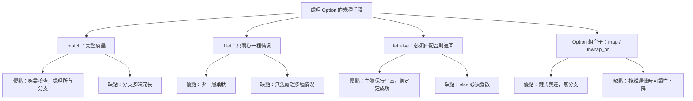

# 6.4 if let 簡化控制流

上一節的 `match` 是 Rust 表達分支邏輯的主力，但它有一個明確的使用前提：你得願意為每一种可能寫一個分支。當一個型別有五個變體，而你只對其中一個有興趣時，其餘四個分支就成了一份不得不填寫的負擔——寫上 `_ => {}` 吧，它確實能編譯，但讀者會疑惑「這裡真的沒有別的情況要處理嗎」。`if let` 就是為了消除這份負擔而生的。

## 一、if let 的語法與適用場景

`if let` 的結構是：`if let 模式 = 運算式 { 主體 }`。它會嘗試把運算式的值與模式比對，比對成功就把資料綁定進主體並執行，比對失敗就跳過整個 `if let`。

```rust
fn main() {
    let config: Option<String> = Some(String::from("localhost"));

    if let Some(host) = config {
        println!("主機名稱：{host}");
    }

    println!("程式結束");
}
```

它最典型的適用場景是處理 `Option`。`Option<T>` 有兩個變體：`Some` 帶著一個值，`None` 什麼都沒有。當你只关心「有值」這一件事時，`if let Some(v) = opt` 就是最直接地表達：

```rust
fn print_length(text: &Option<String>) {
    if let Some(t) = text {
        println!("長度為 {}", t.chars().count());
    }
}

fn main() {
    print_length(&Some(String::from("你好")));
    print_length(&None);
}
```

與 `match` 相比，`if let` 少了「必須窮盡」這個約束——因為它本來就沒有列舉所有分支的義務。這種「寬鬆」是它的優點，也是它的限制：一旦你後來需要處理 `None` 的情況，就必須把它升級成 `match`。

在下表中，可以看見三種分支控制流工具的分工：

| 工具 | 適用情況 | 失敗時的行為 | 能否處理多種情況 |
| --- | --- | --- | --- |
| `match` | 需要考慮所有分支 | 必須窮盡，否則編譯失敗 | 能 |
| `if let` | 只關心一種情況 | 靜默跳過或走 `else` | 不能 |
| `let else` | 必須取得值，否則中止 | 發散（return、panic 等） | 不能 |
| `while let` | 持續到模式不成立為止 | 自動離開迴圈 | 不能 |

## 二、與 match 的取捨

兩者的取捨可以整理成一句話：`if let` 用**表達力**換取**簡潔度**。當你需要處理多種情況時，`match` 是唯一正確的工具；當你只關心一種情況時，`match` 的完整結構是一種浪費。

```rust
fn main() {
    let value = Some(7);

    // 完整寫法
    match value {
        Some(n) => println!("match 得到 {n}"),
        None => println!("match 沒有值"),
    }

    // 簡化寫法
    if let Some(n) = value {
        println!("if let 得到 {n}");
    }
}
```

兩段程式碼的差別不只在長度，更在**語意的表達力**。`match` 版本明確宣告「這個值不是 `Some` 就是 `None`，兩種我都考慮了」；`if let` 版本則只說「如果有值就怎樣」，對 `None` 的態度是沉默的。程式碼的意圖不同，選擇自然也不同：若 `None` 是一個需要被處理的錯誤情況，就該用 `match`；若 `None` 只是一個「沒東西可做」的自然狀態，`if let` 更貼切。

還有一個實務上的差別值得注意：`match` 可以綁定多個變數，`if let` 也可以，但它只接受**單一**模式。若你需要同時檢查多個條件，就必須回到 `match`。從效能的角度來看，`if let` 與 `match` 沒有任何差別。編譯器會把兩者都最佳化成等價的分支指令，`if let` 沒有引入任何執行期負擔。所謂「更有效率」或「更簡潔」都是指程式碼的可讀性，而不是機器的運作速度。

## 三、else 分支與 else if let 串接

`if let` 完全可以帶 `else` 分支，這在「有值時做 A，沒值時做 B」的場景中非常實用：

```rust
fn main() {
    let maybe_name: Option<String> = None;

    if let Some(name) = &maybe_name {
        println!("你好，{name}");
    } else {
        println!("你好，訪客");
    }
}
```

`else` 分支在這裡的地位有點特別：它不是「匹配到 `None`」，而是「整個模式沒有匹配上」。因為 `if let` 只寫了一個模式，「沒有匹配上」實際上就等同於「模式不成立」。這個區別在模式更複雜時才有意義，例如：

```rust
fn main() {
    let pair = (1, -1);

    if let (a, b) = pair {
        if a > 0 && b > 0 {
            println!("兩者皆為正");
        } else {
            println!("有非正數");
        }
    }
}
```

這裡的 `else` 分支處理的是「`a > 0 && b > 0` 不成立」，而不是「模式不匹配」，因為 `(a, b)` 這個 tuple 模式對任何 tuple 都成立。

`else if let` 的串接則是一個容易讓程式碼變得難讀的寫法：

```rust
fn main() {
    let opt: Option<i32> = Some(3);

    if let Some(n) = opt {
        if n > 10 {
            println!("很大");
        } else if n > 5 {
            println!("中等");
        } else {
            println!("小");
        }
    }
}
```

問題在於多層縮排造成的閱讀負擔：程式碼的主體被推得越來越深，邏輯關係則被埋在括號裡。有兩種改善方式。第一種是**把條件合併成單一模式**，`if let Some(n) = opt` 搭配守衛無法表達，但 `match` 可以：

```rust
fn main() {
    let opt: Option<i32> = Some(3);

    match opt {
        Some(n) if n > 10 => println!("很大"),
        Some(n) if n > 5 => println!("中等"),
        Some(_) => println!("小"),
        None => println!("沒有資料"),
    }
}
```

第二種是**提取函式**，把巢狀的判斷搬到一個回傳值的函式裡，讓呼叫端保持一行。實務上，Rust 社群普遍偏好第二種：「早返回」比「深巢狀」更受到青睞。

## 四、let else：必須匹配否則提前返回

Rust 1.65 版引入的 `let else`，填補了 `if let` 與 `match` 之間的一個空隙：當你**必須**從模式中取得值，而且失敗時要立刻離開當前函式。

```rust
fn parse_port(s: &str) -> u16 {
    let Ok(port) = s.parse::<u16>() else {
        return 0;
    };
    port
}

fn main() {
    println!("{}", parse_port("8080"));
    println!("{}", parse_port("abc"));
}
```

語法結構是：`let 模式 = 運算式 else { 發散語句; };`。`else` 分支必須**發散**（diverge），也就是它不能正常結束——它必須 `return`、`break`、`continue` 或 `panic!`。這項限制是關鍵：因為 `else` 分支一定會離開，編譯器才能推論出「綁定一定成功」，因此 `port` 的型別就是 `u16` 而非 `Option<u16>`。

`let else` 帶來的改進是**主體保持平直**。`let else` 與 `unwrap_or` 系列方法也常被拿來比較。差別在於意圖：`unwrap_or` 適合「沒有值就用預設值」這種單純的替代，而 `let else` 適合「沒有值就整個流程中止」。若失敗只是要換一個預設值，用 `unwrap_or` 更精簡；若失敗代表後續流程根本無法進行，`let else` 才會把這個判斷寫清楚。

對照傳統寫法：

```rust
fn parse_port_old(s: &str) -> u16 {
    let port = match s.parse::<u16>() {
        Ok(p) => p,
        Err(_) => return 0,
    };
    port
}

fn main() {
    println!("{}", parse_port_old("8080"));
}
```

兩段程式碼的差別在於，傳統寫法必須先把成功值取出來放在一個 `let` 裡，再重新賦值給 `port`；`let else` 則直接綁定。當失敗路徑變長——例如需要記錄錯誤、做清理、寫入日誌——`let else` 的優勢會更明顯：

```rust
use std::fs;

fn read_config(path: &str) -> String {
    let content = fs::read_to_string(path)
        .unwrap_or_else(|_| String::from(""));
    let trimmed = content.trim();
    let Some(value) = trimmed.strip_prefix("port=") else {
        return String::from("缺少 port 欄位");
    };
    value.to_string()
}

fn main() {
    println!("{}", read_config("設定檔"));
}
```

在這個範例裡，函式的「正常路徑」是一條完全沒有縮排的直線，只有在異常情況下才會向左分支出去。這就是 `let else` 想要達成的效果。

## 五、while let

`while let` 是 `if let` 的迴圈版本：只要模式持續匹配就繼續執行主體，一旦不匹配就離開迴圈。它最典型的用途是從通道接收訊息，直到通道關閉：

```rust
use std::sync::mpsc;

fn main() {
    let (tx, rx) = mpsc::channel();

    for i in 1..=3 {
        tx.send(format!("訊息 {i}")).unwrap();
    }
    drop(tx);

    while let Ok(message) = rx.recv() {
        println!("收到：{message}");
    }
    println!("所有訊息已收畢");
}
```

這段程式碼的優雅之處在於，它同時處理了兩件事：接收訊息，以及偵測通道關閉。`rx.recv()` 在通道仍有訊息時回傳 `Ok(T)`，在所有發送端都被丟棄後回傳 `Err(RecvError)`。把 `Ok(message)` 當成模式餵給 `while let`，一旦回傳型別不再匹配，迴圈就自動結束。

`while let` 也能用於迭代器：`Iterator::next` 回傳 `Option`，所以 `while let Some(item) = iter.next()` 是最經典的寫法。`while let` 與 `for` 迴圈的關係也很類似：`for` 是 `while let` 的特例，它隱含了「把集合轉成迭代器並持續取出下一項」這兩件事。當你在 `for` 迴圈內需要同時操作迭代器本身（例如一邊取值一邊把元素放回佇列），`while let` 就是唯一能表達的寫法。

雖然 `for` 迴圈在大多數情況下更簡潔，但當你需要在迴圈體內修改迭代器本身的狀態時，`while let` 是唯一的選擇。

## 六、常見陷阱：變數遮蔽

`if let` 最容易踩到的陷阱，是它引入的綁定會**遮蔽**（shadow）外層的同名變數。這在 Rust 中是合法且常見的語言特性，但在 `if let` 裡特別容易造成困惑：

```rust
fn main() {
    let x = 5;
    if let Some(x) = Some(10) {
        println!("內層 x = {x}");
    }
    println!("外層 x = {x}");
}
```

輸出是「內層 x = 10」然後「外層 x = 5」。內層的 `x` 是全新綁定的變數，與外層的 `x` 只是同名。編譯器不會警告你，因為這正是 `if let` 讓「模式不匹配時維持原值」得以成立的機制：若沒有遮蔽，`if let` 綁定的變數在 `else` 分支裡根本不存在。

這個特性在實務上有兩種用法。第一種是**刻意的遮蔽**，用更明確的名稱取代外層較模糊的名稱；第二種是**意外的遮蔽**，特別容易出現在迴圈裡：

```rust
fn main() {
    let mut names = vec![String::from("A"), String::from("B")];
    for name in &names {
        if let Some(name) = name.strip_prefix('A') {
            println!("以 A 開頭：{name}");
        }
    }
    println!("{names:?}");
}
```

這段程式碼本身沒錯，但內層的 `name` 型別是 `&str` 而外層是 `String`，兩者同名卻語意不同，容易讓維護者困惑。良好的命名慣例是讓遮蔽後的變數名稱有意義地不同，例如把內層改成 `stripped`，程式碼的意圖會清楚得多。

## 七、從 match 到 if let 的重構

現在我們來看實際的重構過程。假設原本的程式碼是這樣：

```rust
fn process(input: Option<String>) -> String {
    match input {
        Some(ref s) if s.starts_with('#') => format!("標籤：{s}"),
        Some(ref s) => format!("文字：{s}"),
        None => String::from("空白"),
    }
}

fn main() {
    println!("{}", process(Some(String::from("#rust"))));
}
```

當我們發現「`None` 的情況其實不需要特別處理」時，可以簡化為：

```rust
fn process(input: Option<String>) -> String {
    if let Some(ref s) = input {
        if s.starts_with('#') {
            return format!("標籤：{s}");
        }
        return format!("文字：{s}");
    }
    String::from("空白")
}

fn main() {
    println!("{}", process(Some(String::from("#rust"))));
}
```

這次重構把分支數從三個減到兩個，但程式碼反而變長了。這是一個重要的提醒：**`if let` 不是萬能藥**。當原本的 `match` 分支都很簡單、而且失敗路徑也需要被明確處理時，保留 `match` 往往更好。

真正值得重構的情況是「`match` 裡有一個複雜分支，其餘都只是 `_ => {}`」：

```rust
fn describe(input: Option<String>) -> String {
    match input {
        Some(s) if s.len() > 10 => {
            let upper = s.to_uppercase();
            format!("長字串：{upper}")
        }
        _ => String::from("一般"),
    }
}

fn main() {
    println!("{}", describe(Some(String::from("很長的一段文字內容"))));
}
```

這段程式碼用 `if let` 會更誠實：

```rust
fn describe(input: Option<String>) -> String {
    if let Some(s) = input {
        if s.len() > 10 {
            let upper = s.to_uppercase();
            return format!("長字串：{upper}");
        }
    }
    String::from("一般")
}

fn main() {
    println!("{}", describe(Some(String::from("很長的一段文字內容"))));
}
```

重構的判準因此可以歸納為一句話：**當 `match` 的某一個分支承載了真正的邏輯，而其他分支只是佔位的時候，用 `if let` 加上早返回。** 否則，保留 `match`。這裡還有一項工具性的提醒：重構的時候值得在編輯器裡實際看一次編譯器的抱怨。Rust 的錯誤訊息經常會直接建議「try using `if let`」或「consider using `let else`」，這些建議來自編譯器的 lint 引擎，通常相當可靠。順著這些提示走，重構的方向幾乎不會錯。

## 八、if let 與 Option 的關係

`if let Some(v) = opt` 是 Rust 中處理 `Option` 的標準手法，這不是巧合，而是 `Option` 的設計直接催生了這個語法。`Option` 的存在本身，就是語言承認「這個值可能不存在」這件事，而不是像 C 那樣用 `NULL` 讓呼叫者自己去猜。

更現代的 Rust 風格，已經從 `if let` 進一步走向**方法鏈**。`Option` 提供了 `map`、`and_then`、`unwrap_or`、`unwrap_or_else` 等一整套組合子，讓「有值就轉換，沒值就用預設」可以用一行寫完：

```rust
fn main() {
    let input: Option<String> = Some(String::from("  42  "));

    let parsed: Option<i32> = input.as_deref().map(str::trim).and_then(|s| s.parse().ok());
    println!("{parsed:?}");

    let value = parsed.unwrap_or(-1);
    println!("{value}");
}
```

這段程式碼完全不需要 `if let`，因為所有的分支都被封裝進了組合子裡。值得留意的是，`map` 與 `and_then` 的差別正是「回傳值是不是還要再轉換一次」。`map` 的閉包回傳 `Option` 時會得到 `Option<Option<T>>`，所以 Rust 提供了 `and_then` 讓你直接串接；`flatten` 則是把巢狀的 `Option` 壓平。理解這些組合子的分工，就能讀懂絕大多數以 `Option` 為主的程式碼。

但這不代表 `if let` 過時：當失敗路徑需要做「不只是一個值」的動作——例如記錄錯誤、呼叫副作用、回傳 `Result`——時，`if let` 仍然是更直白的選擇。工具的取捨永遠取決於具體情境。

## 九、前後對照：巢狀 match 重構為 let else

最後讓我們看一個完整的重構對照。這是巢狀 `match` 最典型的用途——從一個複雜的結構中取出必要欄位，若取不到就返回錯誤：

```rust
fn get_user_city(raw: Option<&str>) -> Result<String, String> {
    let matched = match raw {
        Some(v) => v,
        None => return Err(String::from("沒有使用者")),
    };
    let name = match matched.split(',').next() {
        Some(n) => n,
        None => return Err(String::from("格式錯誤")),
    };
    Ok(name.to_string())
}

fn main() {
    println!("{:?}", get_user_city(Some("小明,台北")));
    println!("{:?}", get_user_city(Some("")));
}
```

用 `let else` 重構之後：

```rust
fn get_user_city(raw: Option<&str>) -> Result<String, String> {
    let Some(matched) = raw else {
        return Err(String::from("沒有使用者"));
    };
    let Some(name) = matched.split(',').next() else {
        return Err(String::from("格式錯誤"));
    };
    Ok(name.to_string())
}

fn main() {
    println!("{:?}", get_user_city(Some("小明,台北")));
    println!("{:?}", get_user_city(Some("")));
}
```

重構後的版本沒有任何巢狀，也沒有把值取出來再重新賦值，每個綁定都是一次性的、直接的、失敗即返回的流程。兩段程式碼行為完全一致，但第二段更容易閱讀、也更容易被看出「這裡的失敗路徑是什麼」。

這個模式在實際專案中極為常見：解析 HTTP 請求、讀取設定檔、從資料庫取出資料列，每一個都需要「取出欄位，失敗就回錯誤」的流程。`let else` 把這類流程的樣板程式碼壓縮到最低，讓主體邏輯成為程式碼中最醒目的部分。



## 九、常見錯誤與陷阱

`if let` 相關的編譯期錯誤不多，但有幾個值得留意。第一個是**不可反駁模式**（irrefutable pattern）的警告：若 `if let` 的模式一定會匹配，例如對一個非 `Option` 型別綁定 `Some(x)`，編譯器會警告說這個 `if let` 沒有存在的必要，應該直接改用 `let`：

```rust
fn main() {
    let value = 5;
    if let value = value {
        println!("{value}");
    }
}
```

第二個是**型別不匹配**。若 `if let` 右邊的運算式型別與模式不符，編譯器會直接拒絕。例如對 `Result` 使用 `Some` 模式，或對 `&str` 使用 `Some` 模式：

```rust
fn main() {
    let raw: Option<&str> = Some("ok");
    if let Some(text) = raw {
        println!("{text}");
    }
}
```

第三個是**移動語義的陷阱**。`if let Some(v) = opt` 會把 `opt` 裡的值移出來，如果之後還要用 `opt`，就會得到「use of moved value」的錯誤。要避免它，可以匹配引用 `if let Some(v) = &opt`，這樣 `v` 是 `&T` 而非 `T`；或者在只需要讀取時改用 `opt.as_ref()`。

```rust
fn main() {
    let opt = Some(String::from("內容"));
    if let Some(ref text) = opt {
        println!("長度 {}", text.len());
    }
    println!("{opt:?}");
}
```

這三個陷阱的共同根源，都是 `if let` 本質上是一個 `match` 的簡化版本——它同樣遵守 Rust 的所有權與型別規則，只是不要求窮盡。

## 十、在真實程式中的應用

`if let` 最常出現的地方，往往是處理「一行資料有多個欄位，但其中某些欄位可能缺失」的場景。CSV 解析就是典型例子：

```rust
fn parse_record(line: &str) -> Option<(String, u32)> {
    let mut parts = line.split(',');
    let name = parts.next()?.trim();
    let age = parts.next()?.trim().parse::<u32>().ok()?;
    Some((name.to_string(), age))
}

fn summarize(lines: &[&str]) -> String {
    let mut report = String::new();
    for line in lines {
        if let Some((name, age)) = parse_record(line) {
            report.push_str(&format!("{name} {age} 歲\n"));
        }
    }
    report
}

fn main() {
    let lines = vec!["小明,30", "壞掉的資料", "小美,25"];
    print!("{}", summarize(&lines));
}
```

這段程式碼裡，`parse_record` 內部用了 `?` 運算子——那是 `Result` 版本的捷徑；而 `summarize` 則用 `if let` 來處理「這行解析成功才納入報表」。兩者搭配起來，把「失敗是常態」的資料處理流程寫得相當自然：底層函式負責把失敗壓縮成 `None`，上層決定遇到 `None` 時該做什麼。

如果每一種失敗都需要不同的處理，`match` 會是更好的選擇：

```rust
fn parse_strict(line: &str) -> Result<(String, u32), String> {
    let mut parts = line.split(',');
    let name = parts
        .next()
        .ok_or_else(|| String::from("缺少姓名字段"))?;
    let age_str = parts
        .next()
        .ok_or_else(|| String::from("缺少年齡欄位"))?;
    let age = age_str
        .trim()
        .parse::<u32>()
        .map_err(|_| format!("年齡格式錯誤：{age_str}"))?;
    Ok((name.trim().to_string(), age))
}

fn main() {
    for line in ["小明,30", "壞掉的資料"] {
        match parse_strict(line) {
            Ok((name, age)) => println!("成功：{name} {age}"),
            Err(e) => println!("失敗：{e}"),
        }
    }
}
```

這組對照說明了一個核心判準：**當失敗的原因需要被區分時，用 `Result` 加 `match`；當失敗只需要被知道時，用 `Option` 加 `if let`。**

## 十一、一份實務風格指南

綜合前面所有的討論，我們可以把三種工具的選擇整理成一份可以直接套用的判準。

第一，**先問「有多少種情況需要處理」**。若超過一種，回到 `match`。`match` 是唯一提供窮盡檢查的工具，任何「可能要處理的情況」被遺漏時，它都會在編譯期攔下來。

第二，**若只需要一種情況，再問「不匹配時該怎麼辦」**。若不匹配就什麼都不做，用 `if let`；若不匹配時有必須執行的邏輯（記錄錯誤、送出警告、遞回錯誤），用 `if let ... else`；若不匹配時必須中止當前流程，用 `let else`。

第三，**若失敗的原因需要被區分**，就別用 `Option`，改用 `Result` 搭配 `match`。`Option` 只表達「有或沒有」，`Result` 才表達「為什麼沒有」。

第四，**若只是要一個預設值**，先考慮 `Option` 的組合子鏈，而不是 `if let`。`opt.map(f).unwrap_or(default)` 一行就表達了「有值就轉換，沒值就用預設」，可讀性通常優於分支。

第五，**注意巢狀深度**。當你發現 `if let` 裡面又出現 `if let`，或 `match` 裡面又出現 `match`，通常有更好的寫法：把它提取成獨立的函式，用早返回取代深巢狀。Rust 的現代風格幾乎一致偏好早返回而非深縮排。

這份判準的價值在於，它把一個「寫作偏好」的問題，轉換成可以機械套用的規則。當你不需要重新思考就能決定用哪個語法，程式碼的一致性自然會維持在高水準。

## 十二、小結

從語言設計的角度看，這三個語法的存在說明 Rust 團隊願意為「常見寫法」增加語法。傳統上，語言設計者偏好語法愈少愈好，因為每一個新關鍵字都是一筆學習成本；但 `let else` 的引入說明，若某種寫法在某個情境下顯著優於既有做法，增加一個語法是值得的。Rust 的語言演進一向遵循這個取向，例如 `let ... else`、或模式、`let` 鏈等特性，都是在實際程式碼中被驗證有明確價值之後才加入的。`if let`、`while let` 與 `let else` 這三個語法，處理的是同一個核心問題：**如何用最少的結構表達「模式可能不成立」**。`if let` 適合「成立就做什麼」的場景；`while let` 適合「持續到不成立為止」的場景；`let else` 適合「必須成立，否則離開」的場景。

選擇的原則始終是同一條：當多種情況都需要被處理，`match` 永遠是正確答案；當只需要一種情況，才用 `if let` 系列。而 `let else` 的引入，補上了「必須匹配」這個在先前語言中總是寫得彆扭的需求。Rust 的分支控制流不是三套互相競爭的工具，而是一組分工明確、彼此互補的詞彙。
