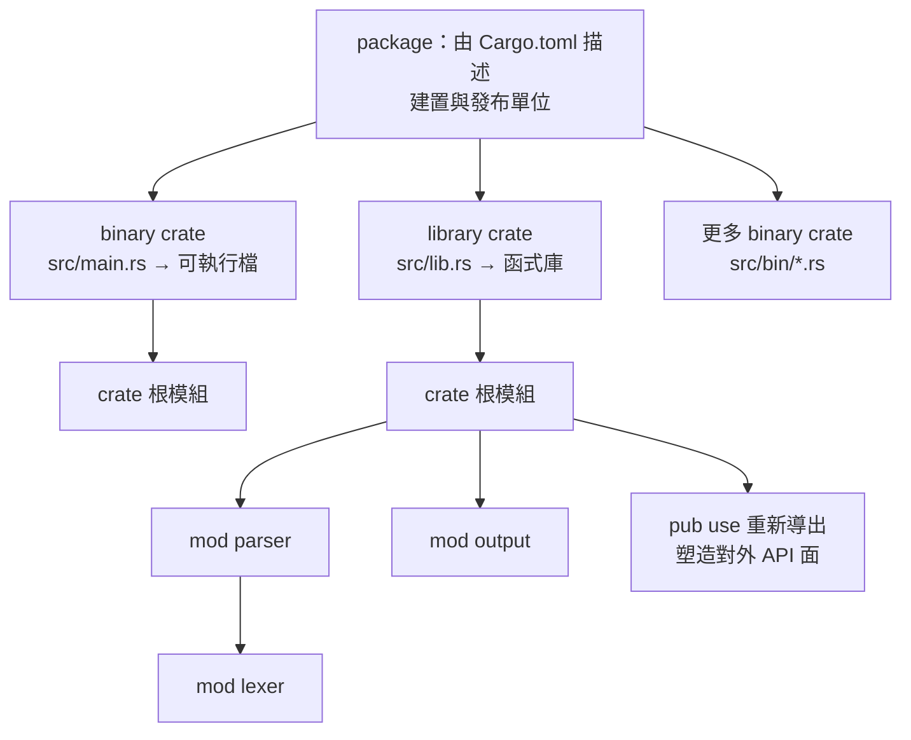

# 7.1 套件（Packages）、箱子（Crates）與模組（Modules）

在 Rust 的世界裡，有四個經常被混用的詞：package、crate、module 與 binary。它們各自對應到建置流程中的不同層級，釐清它們的差別，是理解整個 Rust 專案組織方式的前提。這一章先從這四個概念談起，再進入模組的宣告、可見性與組織慣例。

## 一、四個層級概念的區分

最底層的單位是 **crate**。crate 是 Rust 的**編譯單位**，是編譯器一次處理的完整單位。你可以把它理解成「一份交給 rustc 編譯的程式碼」。每個 crate 都有一個根模組，並且會產生一個成品：要么是函式庫（library），要么是可執行檔（binary）。crate 的名字在程式中由 `crate` 這個關鍵字代表。

往上一層是 **package**。package 是**建置與發布的單位**，由 `Cargo.toml` 檔案描述。一個 package 可以包含**一個或多個** crate：最常見的是一個函式庫 crate 加上一個二進位 crate，也可以只有其中之一。當你執行 `cargo build` 時，package 裡的每個 crate 都會各自被編譯。

再往內是 **module**。module 是 crate **內部**的組織單位，用來把程式碼切成有名字的區塊，並控制各區塊之間的可見性。module 的層級構成一棵樹，樹根就是 crate 根模組。

最後是 **binary**，也就是可執行檔本身。它是 crate 的一種成品形態，由帶有 `fn main()` 的 crate 根模組產生。

| 概念 | 對應到什麼 | 關鍵詞／檔案 | 數量關係 |
| --- | --- | --- | --- |
| crate | 編譯單位，產出一個成品 | `crate` | 一個 package 可有多個 crate |
| package | 建置與發布單位 | `Cargo.toml` | 一個 package 對應一個 `Cargo.toml` |
| module | crate 內的組織單位 | `mod` | 每個 crate 有一棵模組樹 |
| binary | 可執行檔 | `fn main()` | 一個 package 可有多個 binary |



這張圖表達了幾個關鍵事實。第一，package 與 crate 不是一對一的關係：一個 package 可以有任意數量的 crate。第二，binary 與 library 住在同一個 package 裡時，它們可以共享同一份原始碼——binary crate 可以把 library crate 當成相依的函式庫來使用，這是 Rust 專案最常見的佈局。第三，模組樹的根永遠是 crate 根，而 crate 根要嘛來自 `src/main.rs`，要嘛來自 `src/lib.rs`。

還有一個細節值得先說清楚：**crate 與 library 並不是同義詞**。在日常用語裡，人們常把「函式庫」和「crate」混用，但在 Cargo 的語境裡，crate 指的是編譯單位，而一個 crate 的成品既可能是函式庫，也可能是可執行檔。這個區分在處理「依賴一個 crate」這類句子時才會浮現——你依賴的其實永遠是函式庫 crate，因為只有函式庫 crate 能被其他專案連結。

理解這四層的關係，最實際的價值在於回答一個常見的疑問：「我要把這個函式庫發布到 crates.io，應該把程式碼放哪裡？」答案是放在函式庫 crate 根，也就是 `src/lib.rs` 所在的 package；而同一個 package 裡的 `src/main.rs` 則是這個函式庫的示範應用程式。當你在 crates.io 上看到一個套件時，幾乎都遵循這個結構。

## 二、crate 根與 src 目錄

Cargo 對 package 的檔案佈局有明確的預設慣例。若 `Cargo.toml` 所在的目錄裡有 `src/lib.rs`，Cargo 就會把它視為這個 package 的**函式庫 crate 根**；若有 `src/main.rs`，則視為**二進位 crate 根**。兩者可以同時存在。

這個佈局最常見的用途，是把可重用的邏輯放進函式庫 crate，把命令列介面放進二進位 crate：

```toml
[package]
name = "mytool"
version = "0.1.0"
edition = "2021"
```

```text
mytool/
├── Cargo.toml
├── src/
│   ├── lib.rs      ← 函式庫 crate 根
│   ├── main.rs     ← 二進位 crate 根
│   ├── parser.rs
│   └── output.rs
└── tests/
```

在這種佈局下，`main.rs` 可以寫 `use mytool::parser::Token;` 來使用函式庫 crate 裡的東西，而 `lib.rs` 則宣告整個函式庫的公開介面。這種「薄殼二進位」的做法好處是：核心邏輯可以在函式庫 crate 中被單獨測試，也能被其他專案當成相依套件使用。反過來說，如果只有 `src/main.rs` 而沒有 `src/lib.rs`，這個 package 就無法被其他專案相依——它只是一個應用程式。

`Cargo.toml` 也可以明確宣告函式庫的名稱與路徑，這在套件名稱與 crate 名稱需要不同時會用到：

```toml
[package]
name = "mytool"
version = "0.1.0"
edition = "2021"

[lib]
name = "mytool_core"
path = "src/lib.rs"
```

這裡 `[package] name` 是套件在 crates.io 上的名稱，`[lib] name` 則是函式庫 crate 在程式碼中被 `use` 引用時的名稱。兩者可以不同，這在做品牌命名或保留前綴時很有用。

Cargo 還支援在 `src/bin/` 目錄下放多個檔案，每個檔案都會產生一個獨立的二進位 crate。它們共用同一個 package 的函式庫 crate，因此是「一個專案、多個命令」最省事的佈局方式。像 `ripgrep` 這類工具就常用這種結構，把主要功能放進函式庫，再提供多個小工具。

## 三、模組的宣告

模組是用 `mod` 關鍵字宣告的。宣告本身可以放在任何地方，但慣例是放在檔案頂端：

```rust
mod parser {
    pub fn tokenize(input: &str) -> Vec<String> {
        input.split_whitespace().map(|s| s.to_string()).collect()
    }
}

mod output {
    pub fn print_tokens(tokens: &[String]) {
        for t in tokens {
            println!("{t}");
        }
    }
}

fn main() {
    let tokens = parser::tokenize("1 + 2");
    output::print_tokens(&tokens);
}
```

`mod parser { ... }` 括號內的內容就是模組本身，括號外則是它的父模組。若模組的內容較長，通常會拆到另一個檔案，這時 `mod` 宣告的結尾加上分號：

分號表示「這個模組的內容放在別處」，具體在哪裡由檔案系統的規則決定。Rust 2018 版之後，模組路徑不再與檔案系統綁定，`crate::`、`self::`、`super::` 三個關鍵字構成了路徑解析的基礎，這將是下一節的主題。

要留意的是，模組並不僅僅是「把檔案切開」。它的真正功能是**建立封裝邊界**：模組內的私有項目，對外是不可見的；這讓你可以把一個功能的內部細節完全藏起來，只暴露少數精心挑選的介面。第 6.1 節提到的「私有欄位加公開方法」之所以能成立，正是因為模組提供了這層邊界。

## 四、模組與檔案的對應規則

當 `mod foo;` 宣告的模組內容放在另一個檔案時，編譯器會依下列規則尋找：

| 模組宣告位置 | 尋找的檔案（優先順序） |
| --- | --- |
| crate 根（`src/main.rs`、`src/lib.rs`） | `src/foo.rs` 或 `src/foo/mod.rs` |
| `src/bar.rs` 內 | `src/bar/foo.rs` 或 `src/bar/foo/mod.rs` |
| `src/bar/mod.rs` 內 | `src/bar/foo.rs` 或 `src/bar/foo/mod.rs` |

兩種佈局各有擁護者。`src/foo.rs` 的形式較扁平，適合模組層級不深的專案；`src/foo/mod.rs` 的形式則能在 `src/foo/` 目錄下再放子模組檔案，層級關係在檔案系統上直接可見。目前 Rust 社群較推薦 `src/foo.rs` 搭配 `src/foo/` 子目錄的混合形式。

現代 Cargo 還支援用 `#[path = "..."]` 屬性把模組放在 `src` 以外的目錄：

```text
src/
├── lib.rs
└── support/
    └── legacy.rs
```

若 `src/lib.rs` 裡寫著 `#[path = "support/legacy.rs"] mod legacy;`，那麼 `src/support/legacy.rs` 這個檔案就會被當成 `legacy` 模組的內容來編譯，而它的模組路徑仍然是 `crate::legacy`——`#[path]` 只改變檔案位置，不改變模組的邏輯位置。模組本身的寫法與一般情況完全相同：

```rust
mod legacy {
    pub fn describe() -> &'static str {
        "這是來自舊目錄的模組"
    }
}

fn main() {
    println!("{}", legacy::describe());
}
```

這項功能主要用於遷移舊有專案的目錄結構，不建議在新專案中廣泛使用，因為它會讓模組樹與檔案樹脫節。模組與檔案的對應規則，說到底只是一種約定；Rust 允許你偏離它，代价是多花一點心力的維護。

## 五、可見性

Rust 的可見性預設是**私有**。一個沒有任何修飾符的項目，只有在它所在的模組及其子模組中可見。這與多數語言「預設公開」的做法相反，但這個預設值是深思熟慮的選擇。

Rust 提供幾種主要的可見性修飾符：

| 修飾符 | 可見範圍 | 典型用途 |
| --- | --- | --- |
| （無） | 目前模組及其子模組 | 預設值，實作細節 |
| `pub` | 任何地方 | 對外公開的 API |
| `pub(crate)` | 目前 crate 內 | 跨模組共用但不對外 |
| `pub(super)` | 父模組及其祖先 | 只給上一層使用 |
| `pub(in path)` | 指定路徑下的模組 | 更精細的控制 |

把它們放在一起比較，最能看出 Rust 對「封裝」的重視：

```rust
mod outer {
    pub struct Config {
        pub name: String,
        pub(crate) timeout: u32,
        pub(super) source: &'static str,
        secret: String,
    }

    pub mod inner {
        pub fn build() -> super::Config {
            super::Config {
                name: String::from("預設"),
                timeout: 30,
                source: "inner",
                secret: String::from("隱藏"),
            }
        }
    }
}

fn main() {
    let c = outer::inner::build();
    println!("{} {} {}", c.name, c.timeout, c.source);
    // c.secret 在此不可存取：secret 是私有的
}
```

這段程式碼示範了幾個要點。第一，結構體的欄位可見性與結構體本身的可見性是**獨立的**——`Config` 是 `pub` 的，但它的 `secret` 欄位不是。第二，`pub(crate)` 讓同一個 crate 內的其他模組能讀寫該欄位，但對 crate 外部隱藏，這是「多個模組合作但不想擴大公開面」的標準做法。第三，`pub(super)` 把可見性限制在父模組，等於宣告「這是給上一層用的細節」。

要特別注意的是，**私有欄位仍然可以被同一個模組內的函式自由存取**。Rust 的封裝不是「整個結構體不可從外部碰」，而是「外部只能透過你提供的方法來改變狀態」。這正是第 6.1 節討論過的不變量守衛模式能成立的基礎——把欄位設為私有，然後用 `pub fn` 的方法來維持不變量。

## 六、重新導出與公開 API 面

一個 crate 的公開 API 面，不一定等於檔案結構裡的模組結構。`pub use` 讓你可以把某個項目重新導出到另一個位置，從而塑造出一個穩定、扁平、與內部組織無關的公開介面。

```rust
mod parsing {
    pub struct Token {
        pub text: String,
    }

    pub fn tokenize(input: &str) -> Vec<Token> {
        input
            .split_whitespace()
            .map(|t| Token {
                text: t.to_string(),
            })
            .collect()
    }
}

mod formatting {
    pub fn render(tokens: &[super::parsing::Token]) -> String {
        tokens
            .iter()
            .map(|t| t.text.as_str())
            .collect::<Vec<&str>>()
            .join(" ")
    }
}

pub use parsing::{tokenize, Token};
pub use formatting::render;

fn main() {
    let tokens = tokenize("hello world");
    println!("{}", render(&tokens));
}
```

這個設計的價值在於：內部你可以任意重構模組結構，把 `parsing` 改名、把 `formatting` 併進別的模組、把 `tokenize` 拆成多個函式，只要 crate 根的 `pub use` 維持不變，使用者就不受影響。這正是第 6.2 節談到的「最小 API 面」在大型專案中的實際意義——**公開的介面應該反映使用者的需求，而不是實作者的檔案佈局**。

`pub use` 與 `use` 的差別只有一個關鍵字，但語意差異很大：普通 `use` 只是把項目引入當前作用域，之後仍然要用完整路徑引用；`pub use` 則是把項目**重新導出**到目前這個模組的公開介面上，等於宣告「這個項目是我這個模組的對外介面之一」。

## 七、常見的模組組織慣例

Rust 社群流傳著幾種模組組織方式。第一種是**按功能模組化**：依照「解析器」、「網路」、「儲存」這類功能切分模組，每個模組內含自己的型別與函式。這是最常見也最推薦的做法，因為功能的變動頻率通常一致，變動時要動的地方也就集中。

第二種是**按層次分層**：分成 `presentation`、`business`、`data` 三層。這種做法在移植既有系統時很常見，但容易導致每層內容雜湊，且跨層修改的時候數時影響面大。

第三種是**薄化 `main.rs`**：`main.rs` 只留下啟動邏輯，所有實作都在函式庫 crate 或子模組裡。這是 Rust 專案最常見的樣板，理由很實際：`main.rs` 沒有測試框架的便利（`#[cfg(test)]` 模組仍然存在，但函式庫 crate 更容易被整合測試），而且二進位 crate 無法被其他專案當作相依套件使用。

第四種是**保持檔案扁平**。模組數量在數十個之內時，把所有模組放在 `src/` 下的單層目錄裡，往往比建立多層目錄更好管理。目錄層級本身就是一種成本——每多一層，就多一次「這個檔案該放哪裡」的思考。

第六種是**把測試放在對的位置**。單元測試寫在被測模組的檔案內，用 `#[cfg(test)] mod tests` 括起來；整合測試則放在專案根目錄的 `tests/` 目錄下，作為外部使用者來呼叫公開 API。這個安排本身就是一種 API 設計的回饋——如果整合測試寫起來很彆扭，通常代表公開介面還不夠順手。

第五種的價值在於可見性的傳遞：`lib.rs` 裡的 `pub use` 決定了外部世界能碰到什麼，而內部模組用 `pub` 宣告的東西，若沒有被重新導出，就只有 crate 內部看得見。這層「隱形的公開 API」讓大型專案能保有極小的對外介面。

第五種是**讓 `lib.rs` 成為 API 的門面**。`lib.rs` 裡只放 `pub mod` 宣告與 `pub use` 重新導出，盡量不放實作。當有人問「這個函式庫怎麼用」，他們只需要看 `lib.rs` 的前二十行就能得到答案。

## 八、為什麼 Rust 預設不公開

Rust 選擇「預設私有」，與 C++、Java 的「預設公開」形成對比。這個選擇的核心理由是：**能公開的東西越少，需要維持相容性的東西就越少**。

對外公開的 API 是一份長期的承諾。一旦 `pub` 出去，使用者就可能依賴它，而你就再也不能輕易改變它。預設私有意味著「每一次加上 `pub` 都是一個深思熟慮的決定」，這就把封裝邊界的成本前置到設計階段，而不是留到維護階段才爆發。

其次，預設私有讓「封裝」成為不需要刻意記住的預設行為。新增一個欄位到公開的結構體時，若該欄位是私有的，就只有作者自己需要關心；反之，若預設是公開，新增欄位就等於悄悄擴大了 API 面。Rust 用語言層面的預設值，把這類維護負擔消除了。

最後，這個設計與 Rust 的其他哲學是一致的：**把安全性變成語言保證，而不是靠紀律**。「不要公開不需要公開的東西」在 Rust 裡不需要靠 code review 提醒，因為不寫 `pub` 本來就是預設。同樣地，「不要讓外部繞過你的不變量」也不需要靠約定，因為私有欄位本來就擋住了。

## 九、一個完整的模組樹範例

讓我們用一個完整的小專案把上述觀念串起來。這個專案是一個簡單的設定檔解析器，檔案佈局如下：

```text
settings/
├── Cargo.toml
├── src/
│   ├── main.rs
│   ├── lib.rs
│   ├── config/
│   │   ├── mod.rs
│   │   ├── parser.rs
│   │   └── value.rs
│   └── error.rs
```

`lib.rs` 是函式庫 crate 根，也是模組樹的根。它只宣告模組與重新導出，讓公開介面一目了然：

```rust
// ===== src/lib.rs =====
pub mod config;
mod error;

pub use config::{parse, Config};
pub use error::ConfigError;
```

`config/mod.rs` 宣告子模組，並決定哪些東西對外可見：

```rust
// ===== src/config/mod.rs =====
mod parser;
mod value;

pub use parser::parse;
pub use value::Config;
```

`config/value.rs` 定義資料型別，並在 `config` 模組內對外提供：

```rust
// ===== src/config/value.rs =====
#[derive(Debug, Clone, PartialEq)]
pub enum Value {
    Text(String),
    Number(f64),
    Flag(bool),
}

#[derive(Debug, Clone, Default, PartialEq)]
pub struct Config {
    pub entries: Vec<(String, Value)>,
}

impl Config {
    pub fn get(&self, key: &str) -> Option<&Value> {
        self.entries.iter().find(|(k, _)| k == key).map(|(_, v)| v)
    }
}

impl std::fmt::Display for Value {
    fn fmt(&self, f: &mut std::fmt::Formatter<'_>) -> std::fmt::Result {
        match self {
            Value::Text(t) => write!(f, "{t}"),
            Value::Number(n) => write!(f, "{n}"),
            Value::Flag(b) => write!(f, "{b}"),
        }
    }
}
```

`config/parser.rs` 實作解析邏輯，並以 `Result` 回報可區分的失敗原因：

```rust
// ===== src/config/parser.rs =====
use super::value::{Config, Value};
use crate::error::ConfigError;

pub fn parse(input: &str) -> Result<Config, ConfigError> {
    let mut entries = Vec::new();
    for (i, line) in input.lines().enumerate() {
        let line = line.trim();
        if line.is_empty() || line.starts_with('#') {
            continue;
        }
        let Some((key, raw)) = line.split_once('=') else {
            return Err(ConfigError::new(&format!("第 {} 行缺少等號", i + 1)));
        };
        let value = match raw.trim() {
            "true" => Value::Flag(true),
            "false" => Value::Flag(false),
            other => match other.parse::<f64>() {
                Ok(n) => Value::Number(n),
                Err(_) => Value::Text(other.to_string()),
            },
        };
        entries.push((key.trim().to_string(), value));
    }
    Ok(Config { entries })
}
```

`error.rs` 定義錯誤型別：

```rust
// ===== src/error.rs =====
use std::fmt;

#[derive(Debug)]
pub struct ConfigError {
    message: String,
}

impl ConfigError {
    pub fn new(message: &str) -> Self {
        ConfigError {
            message: message.to_string(),
        }
    }
}

impl fmt::Display for ConfigError {
    fn fmt(&self, f: &mut fmt::Formatter<'_>) -> fmt::Result {
        write!(f, "設定錯誤：{}", self.message)
    }
}

impl std::error::Error for ConfigError {}
```

`main.rs` 則是薄薄的一層殼，它依賴同一個 package 的函式庫 crate：

```rust
// ===== src/main.rs =====
use settings::parse;

fn main() {
    let sample = "\
name = demo
port = 8080
verbose = true
";
    match parse(sample) {
        Ok(config) => {
            println!("設定檔載入成功，共 {} 筆", config.entries.len());
        }
        Err(e) => {
            eprintln!("{e}");
            std::process::exit(1);
        }
    }
}
```

把上面這幾個檔案放進 `settings/` 目錄後，`cargo build` 就能直接建置成功，`cargo run` 則會印出「設定檔載入成功，共 3 筆」。這個範例把本節的觀念全部用上了：package 裡同時有函式庫 crate 與二進位 crate；模組依功能切分成 `config` 與 `error`；`pub use` 在 crate 根把 `Config`、`parse` 與 `ConfigError` 重新導出，形成扁平的公開 API；`mod parser;` 與 `mod value;` 保持私有，只有需要的項目才透過 `pub use` 對外開放；而 `main.rs` 幾乎不含任何邏輯，只是把流程串起來。

這個設計最實際的價值，在於它把「公開介面」與「內部組織」徹底解耦。當內部日後從三個檔案重組成五個檔案，只要 crate 根的 `pub use` 不變，使用者完全不受影響；反過來，若當初把 `pub use` 省掉、直接讓使用者寫 `use settings::config::value::Config;`，那麼未來任何一次檔案移動都會變成破壞性變更。

## 十、從零建立一個套件

概念談完，讓我們實際動手。Cargo 提供了 `cargo new` 指令建立新的 package：

```bash
cargo new mytool
cd mytool
cargo run
```

預設產生的結構裡，`src/main.rs` 是二進位 crate 根。若要加入函式庫 crate，可以再加上一個 `src/lib.rs`：

```bash
cargo new --lib mylib
```

`--lib` 會建立以 `src/lib.rs` 為根的函式庫 package。而 `cargo new --bin` 則明確指定建立二進位 crate，這在 package 同時含有兩種 crate 時可以用來區分。

有幾個常見的建置指令值得在此一併說明，因為它們對應到本節的四個概念：`cargo build` 會編譯整個 package 裡的所有 crate；`cargo build --release` 則以最佳化模式編譯，產出的機器碼速度較快但編譯較慢；`cargo check` 只做型別檢查不產生機器碼，因此迭代速度最快，是日常開發最常使用的指令；`cargo test` 會編譯並執行測試；`cargo doc --open` 則會產生 API 文件並在瀏覽器開啟。

在多人協作的專案中，`.gitignore` 通常至少會包含 `/target` 與 `**/*.rs.bk`；而 `Cargo.lock` 是否提交，則取決於這個 package 是應用程式還是函式庫：應用程式提交，函式庫不提交。這個差別的理由在 7.3 節會詳細說明。

當你執行 `cargo build` 時，Cargo 會把相依關係的解析結果寫進 `Cargo.lock`，並把編譯產物放進 `target/` 目錄。`target/` 是可重新產生的，所以它一定被寫在 `.gitignore` 裡；而 `Cargo.lock` 對應用程式來說則**應該被提交**，理由會在 7.3 節說明。

下一節，我們將深入 Rust 的路徑系統，看看 `crate::`、`self::`、`super::` 這三個關鍵字如何運作，以及 `use` 關鍵字如何把外部的項目引入當前作用域。
