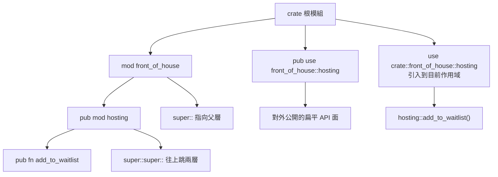

# 7.2 路徑與 use 關鍵字

模組樹建立起來之後，緊接著的問題就是：怎麼從一個位置走到另一個位置？Rust 的答案是**路徑**（path），而 `use` 關鍵字則是把路徑上的項目「拉」進目前作用域的捷徑。這一節要把路徑的三個關鍵字、`use` 的各種寫法，以及它們最常見的編譯期錯誤一次講清楚。

## 一、路徑的三種起點

Rust 的路徑由一系列用 `::` 連接的片段組成，每個片段代表一個模組、型別或項目。路徑可以從三個起點出發，這三個起點由三個關鍵字表示。

`crate::` 代表**目前的 crate 根**。從它出發的路徑永遠是絕對的，不受呼叫位置影響：

```rust
mod front_of_house {
    pub mod hosting {
        pub fn add_to_waitlist() {}
    }
}

pub fn eat_at_restaurant() {
    crate::front_of_house::hosting::add_to_waitlist();
}

fn main() {
    eat_at_restaurant();
}
```

`self::` 代表**目前的模組**，也就是 `use` 敘述所在的那一層：

```rust
mod front_of_house {
    pub mod hosting {
        pub fn add_to_waitlist() {}
    }

    pub fn eat_at_restaurant() {
        self::hosting::add_to_waitlist();
    }
}

fn main() {
    front_of_house::eat_at_restaurant();
}
```

`super::` 代表**父模組**。它特別適合在巢狀模組的實作裡，引用上一層的型別或函式：

```rust
pub fn eat_at_restaurant() {
    println!("歡迎光臨");
}

mod front_of_house {
    pub mod hosting {
        pub fn add_to_waitlist() {}

        pub fn eat_at_restaurant() {
            super::super::eat_at_restaurant();
        }
    }

    pub fn eat_at_restaurant() {
        hosting::add_to_waitlist();
    }
}

fn main() {
    front_of_house::hosting::eat_at_restaurant();
}
```

這裡的 `super::super::` 往上跳了兩層，從 `hosting` 模組走到 crate 根。這種寫法在巢狀較深時會變得冗長，實務上更常見的做法是在 `use` 敘述裡就把它綁定成一個短名稱。

| 起點 | 意義 | 典型用途 |
| --- | --- | --- |
| `crate::` | 目前的 crate 根模組 | 從深處回到頂層，路徑不受位置影響 |
| `self::` | 目前的模組 | 明確標示「同層的項目」 |
| `super::` | 父模組 | 在巢狀模組中引用上一層 |

`crate::` 與 `super::` 的差別在實務上非常明顯。`crate::` 是絕對路徑，永遠指向同一個地方；`super::` 是相對路徑，指向當前的父層。當你在 `config::parser` 模組裡寫 `super::value::Value` 時，它指的是 `config::value::Value`；但若把這個模組搬到別的位置，`super::` 的意義會跟著改變，而 `crate::config::value::Value` 則不會。

## 二、use 的作用

`use` 關鍵字把某個路徑引入當前作用域，讓你可以用簡短的名字直接引用它，而不必每次都打出完整路徑。

```rust
mod front_of_house {
    pub mod hosting {
        pub fn add_to_waitlist() {}
    }
}

use crate::front_of_house::hosting;

fn main() {
    hosting::add_to_waitlist();
}
```

`use` 導入的預設是**私有的**，也就是只有目前模組能用。若要把它變成公開的重新導出，需要加上 `pub`：

```rust
mod front_of_house {
    pub mod hosting {
        pub fn add_to_waitlist() {}
    }
    pub use hosting::add_to_waitlist;
}

fn main() {
    front_of_house::add_to_waitlist();
}
```

這個 `pub use` 的效果相當於「在 `front_of_house` 模組裡定義一個指向 `hosting::add_to_waitlist` 的別名，並且它是公開的」。它不會移動任何東西，只是提供了另一條通往同一函式的路徑。


這一點在實際程式碼裡可以觀察到：`use` 引入的項目在作用域內就像是在本地宣告的一樣，因此對同一個項目連續 `use` 兩次會產生「名稱重複定義」的編譯期錯誤。Rust 沒有 C++ 裡 `using namespace std;` 那樣的全域匯入（`use ...::*;` 只是在單一模組作用域內做有限的匯入），所以名稱衝突總是能被編譯器在局部範圍內指認出來。

`use` 的對象是**任何一個具名項目**：函式、結構體、列舉、列舉的變體、常數、靜態變數、模組，甚至 trait 本身都可以被引入。列舉的變體也能單獨引入，這在處理大量變體時相當方便：

```rust
#[derive(Debug, Clone, Copy, PartialEq)]
enum Color {
    Red,
    Green,
    Blue,
}

use Color::{Blue, Green, Red};

fn main() {
    let c = Red;
    println!("{c:?} {} {}", c == Green, c == Blue);
}
```

引入變體之後，`Red` 就像本地定義的列舉變體一樣可以直接使用。引入 trait 的寫法在實務上特別常見：

```rust
use std::fmt::Display;

fn show<T: Display>(value: &T) {
    println!("{value}");
}

fn main() {
    show(&42);
    show(&"hello");
}
```

在這裡，`use std::fmt::Display;` 把 trait 引入作用域，使得 `Display` 這個名稱可以直接用於泛型限制，而不必寫完整的 `std::fmt::Display`。這是第 9 章會正式討論的特徵語法，但在路徑系統的層面，它與引入任何其他項目沒有差別。


## 三、作用域與路徑的解析順序

Rust 的名稱解析（name resolution）有一套明確的規則，理解它能避免許多「明明有這個函式卻說找不到」的困惑。

最基本的一條是：**名稱從目前作用域開始，逐層向外搜尋，直到找到為止**。這與 C++ 的規則相同，但因為 Rust 對私有項目也遵循同樣的規則，所以搜尋的結果可能是一個「在這個位置看得到、但在那個位置看不到」的項目。

第二條規則是**同名項目在同一个作用域內不能重複**。若你在一個模組裡 `use` 了 `Foo`，又在同一個模組裡定義了 `Foo`，編譯器會報 E0255。這條規則是「不歧義」的直接後果。

第三條規則涉及 `use` 宣告的**位置**。Rust 2018 版之後，`use` 宣告的作用域是它所在的模組，與宣告的先後位置無關——這意味著你可以把 `use` 全部集中在檔案頂端，不必擔心它是否在使用點之前。Rust 2015 版則是單純的詞法作用域，`use` 必須在使用之前宣告。

第四條規則最容易被忽略：**在函式內部的 `use` 只在該函式內有效**：

```rust
mod tools {
    pub fn helper() -> i32 {
        7
    }
}

fn compute() -> i32 {
    use crate::tools::helper;
    helper()
}

fn main() {
    println!("{}", compute());
}
```

把 `use` 放在函式內，可以讓「這個函式用到了哪些外部名稱」一目了然，也避免污染模組作用域。當一個函式用到的名稱很少，或是與模組層級的其他名稱衝突時，這是很好的做法。

為了讓這些規則更好管理，Rust 社群普遍採用 `use` 宣告分組的慣例：先列crate 自己的模組，再列外部 crate，最後列 `std`，各組之間以空行分隔：

```text
use crate::config::{parse, Config};
use serde::{Deserialize, Serialize};
use std::collections::HashMap;
use std::fmt::Display;
```

`rustfmt` 預設會把 `use` 宣告依字母排序，並且在排序時把 `self`、`super`、`crate` 放在最前面——這個順序讓「從本地 crate 引入」和「從外部 crate 引入」在視覺上分開，進一步強化了可讀性。`rustfmt` 工具會自動維持 `use` 宣告的字母序，但不會自動加上分組的分隔空行，那需要人工處理或搭配 `rustfmt.toml` 設定。

## 四、別名

`use` 支援用 `as` 關鍵字指定別名。這在兩種情況下特別有用：原本的名字太冗長，或兩個型別撞名需要區分。

```rust
use std::collections::HashMap as Map;
use std::collections::HashMap;

fn main() {
    let mut counts: Map<String, i32> = Map::new();
    counts.insert(String::from("a"), 1);
    println!("{:?} {}", counts, counts.len());
}
```

在 Rust 2015 版中，別名是處理「兩邊都有 `HashMap`」這類衝突的標準手段；但在 2018 版之後，你可以直接用巢狀群組一次匯入多個項目，不必再靠別名迴避：

```rust
use std::collections::{HashMap, BTreeMap};

fn main() {
    let mut a: HashMap<String, i32> = HashMap::new();
    a.insert(String::from("k"), 1);
    let mut b: BTreeMap<String, i32> = BTreeMap::new();
    b.insert(String::from("k"), 2);
    println!("{} {}", a.len(), b.len());
}
```

別名仍然有它的位置：像 `use std::collections::HashMap as Map;` 這樣的簡寫，能讓註解型的程式碼讀起來更輕鬆；又或者當同一個 crate 的兩個路徑提供了同名但不同用途的型別時，別名能把它們清楚區分開來。

## 五、巢狀匯入與群組

`use` 最靈活的地方在於它能把多個層級的項目一次引入，而且支援兩種巢狀寫法。

第一種是**巢狀群組**（nested groups），用一組括號把多個項目一次匯入：

```rust
use std::collections::{HashMap, BTreeMap, HashSet};
use std::io::{Read, Write};

fn main() {
    let mut m: HashMap<String, i32> = HashMap::new();
    m.insert(String::from("a"), 1);
    let mut s: HashSet<i32> = HashSet::new();
    s.insert(7);
    let mut b: BTreeMap<i32, i32> = BTreeMap::new();
    b.insert(1, 1);
    println!("{} {} {}", m.len(), s.len(), b.len());
    let _ = std::io::stdout().flush();
}
```

第二種是**巢狀路徑**（nested paths），在括號裡直接展開一條完整路徑：

```rust
use std::collections::{HashMap, hash_map::Entry};

fn main() {
    let mut m: HashMap<String, i32> = HashMap::new();
    m.insert(String::from("a"), 1);
    match m.entry(String::from("a")) {
        Entry::Occupied(e) => {
            println!("已存在，值為 {}", e.get());
        }
        Entry::Vacant(e) => {
            e.insert(0);
            println!("新增了一筆");
        }
    }
}
```


另外還有一種常見寫法是**在群組中混入模組本身**：

```rust
use std::collections::{HashMap, hash_map};

fn main() {
    let mut m: HashMap<String, i32> = HashMap::new();
    m.insert(String::from("a"), 1);
    let entry = m.entry(String::from("a"));
    match entry {
        hash_map::Entry::Occupied(e) => println!("已存在：{}", e.get()),
        hash_map::Entry::Vacant(e) => {
            e.insert(0);
            println!("新增一筆");
        }
    }
    println!("{}", m.len());
}
```

這裡 `hash_map` 是一個模組，被整個匯入了作用域，因此可以寫 `hash_map::Entry`。這種寫法在需要使用同一模組內的多個型別時相當實用。

要注意的是，Rust 的 `use` 路徑**必須從 crate 根或外部 crate 的名稱開始**（除非使用 `self::`、`super::` 等前綴）。這與 C++ 的 `using namespace` 完全不同：Rust 鼓勵你在匯入時就把路徑寫完整，之後在程式碼裡使用簡短的名稱。這項設計讓「這個名稱來自哪裡」永遠可以從檔案開頭的 `use` 清單查到。

## 六、全域匯入的取捨

`use` 還支援一項特殊語法：`use 路徑::*;`。星號代表「把這個模組裡所有**公開**的項目都引入」。

```rust
use std::collections::*;

fn main() {
    let mut m: HashMap<String, i32> = HashMap::new();
    m.insert(String::from("a"), 1);
    let mut s: HashSet<i32> = HashSet::new();
    s.insert(1);
    println!("{} {}", m.len(), s.len());
}
```

星號匯入的範圍是受限的：它只匯入該模組中**公開可見**的項目，而且只影響宣告它的作用域。這兩點限制讓它比 C++ 的 `using namespace` 安全得多，但仍不足以消除辨識成本。

另一個限制是它**無法與私有項目互動**。若某個模組裡有一個 `pub(crate)` 的函式，星號匯入不會把它帶進來，因為那樣就會破壞可見性邊界了。當你看到程式碼裡出現 `HashMap`，你無法判斷它是從 `std::collections` 來的，還是從別的某個模組來的；你也無法一眼看出這個檔案依賴了哪些東西。當兩個 `use` 都用了星號而且都含有同名項目時，還會產生歧義錯誤。

實務上的建議是：**在正式程式碼中避免使用全域匯入**，把它留給測試模組。在 `#[cfg(test)] mod tests` 裡，測試會把一堆東西拉進同一個作用域，用星號可以省掉大量重複的 `use` 行：

```rust
#[cfg(test)]
mod tests {
    use super::*;
    use std::collections::HashMap;

    #[test]
    fn works() {
        let mut m = HashMap::new();
        m.insert(1, 2);
        assert_eq!(m.get(&1), Some(&2));
    }
}

fn main() {
    println!("測試模組之外的進入點");
}
```

注意即使在測試裡，`use super::*;` 也只匯入**父模組中可見的項目**，因為星號不會匯入私有的內容——這是 Rust 用隱私性保護程式碼的一個小而一致的例子。

## 七、pub use 與穩定的公開 API

`pub use` 是塑造公開 API 的核心工具。它讓你可以把深藏在內部模組裡的項目，重新導出到一個穩定的、扁平的位置。

```rust
mod parsing {
    pub struct Token {
        pub text: String,
    }

    pub fn tokenize(input: &str) -> Vec<Token> {
        input
            .split_whitespace()
            .map(|t| Token {
                text: t.to_string(),
            })
            .collect()
    }
}

mod formatting {
    pub fn render(tokens: &[super::parsing::Token]) -> String {
        tokens
            .iter()
            .map(|t| t.text.as_str())
            .collect::<Vec<&str>>()
            .join(" ")
    }
}

pub use parsing::{tokenize, Token};
pub use formatting::render;

fn main() {
    let tokens = tokenize("hello world");
    println!("{}", render(&tokens));
}
```

使用者在 crate 根寫 `use mytool::tokenize;` 就能取得函式，完全不需要知道 `parsing` 模組的存在。這帶來兩個性質。

第一是**抽象層級的可控性**。公開 API 反映的是使用者的需求（「我要把文字轉成 token」），而不是實作者的檔案佈局（「解析器放在 `parsing` 模組」）。這是抽象介面原則在 Rust 模組系統裡的直接體現。

第二是**重構的自由**。只要 crate 根的 `pub use` 維持不變，你可以任意重新排列內部模組、把一個模組拆成三個、把函式搬到別的檔案，使用者都不受影響。反過來說，如果當初省略了 `pub use`，使用者就會被迫依賴 `mytool::parsing::tokenize` 這樣的路徑，未來任何一次內部重構都變成了破壞性變更。

## 八、常見的編譯期錯誤

這三類錯誤有一個共同點：它們全部是**編譯期**的，而且錯誤訊息會直接點名是什麼路徑出了問題、從哪裡開始解析。與多數語言「執行期才發現找不到方法」相比，Rust 把這類問題提前到了第一次編譯。

**E0603：模組是私有的。** 這個錯誤出現在你從外部存取一個沒有 `pub` 的模組時：

```rust
mod private_module {
    pub fn helper() -> i32 {
        42
    }
}

fn main() {
    println!("{}", private_module::helper());
}
```

上面這段程式碼在 crate 內部是可以編譯的，因為父模組有權存取子模組的私有項目；但當另一個 crate 想要 `use mytool::private_module;` 時，就會得到 E0603 錯誤，訊息會明確指出「模組 `private_module` 是私有的」。

修正的方式是兩種：把模組改成 `pub mod`，或者在 crate 根加上 `pub use private_module::helper;` 重新導出。後者通常更好，因為它只公開你真正想公開的那一個項目，而不是整個模組。

**E0432：未解析的匯入。** 這個錯誤表示 `use` 敘述裡的路徑找不到對應的項目。最常見的原因是拼錯了名稱，或是在 Rust 2015 與 2018 之間的語法差異（例如 2015 需要 `extern crate`）。另一個常見原因是路徑的起點搞錯了——在 Rust 2018 之後，`use` 預設從 crate 根開始，若想用相對路徑必須顯式寫 `self::` 或 `super::`。

**E0659：歧義。** 這個錯誤出現在同一個名稱被匯入多次，而且程式碼中無法判斷該用哪一個：

```text
use std::collections::HashMap;
use std::collections::hash_map::HashMap;
```

編譯器會指出衝突的匯入：

```text
error[E0252]: the name `HashMap` is defined multiple times
 --> src/main.rs:1:5
  |
1 | use std::collections::HashMap;
  |     ------------------------- previous import of the type `HashMap` here
2 | use std::collections::hash_map::HashMap;
  |     ----------------------------------- same name imported here
```

修正方式是移除其中一個 `use`，或用別名把它們區分開：

```rust
use std::collections::HashMap;
use std::collections::hash_map::HashMap as Map;

fn main() {
    let mut m: HashMap<String, i32> = HashMap::new();
    m.insert(String::from("a"), 1);
    let mut n: Map<String, i32> = Map::new();
    n.insert(String::from("b"), 2);
    println!("{} {}", m.len(), n.len());
}
```

歧義錯誤是好事：它寧可在編譯期拒絕，也不會讓你猜錯。

## 九、模組設計的原則

「模組邊界即封裝邊界」是 Rust 模組設計最核心的原則。每一個模組都應該代表一個**有清楚職責的單位**，並且只公開其他單位真正需要的東西。

這個原則可以拆成幾條可操作的規則。第一，**模組名稱應該是名詞**，描述它「是什麼」而不是「做什麼」；動作應該留給其中的函式。第二，**公開的表面越小越好**，`pub` 的每一個都應該有理由。第三，**跨模組的依賴應該是單向的**，若兩個模組互相依賴，通常表示它們其實應該合併，或該抽出第三個模組。

第四條規則特別實用：**模組的公開介面應該可以用一句話說清楚**。若你無法用一句話描述某個模組提供什麼功能，通常表示它太雜亂了，該拆開。


第六條規則處理的是**模組的粒度**。一個模組如果只有十幾行程式碼，拆分成本可能高於收益；反過來，一個兩千行的模組則應該立刻拆開。實務上，一個模組最好能用一句話說清楚它的職責，並且能在單一畫面上讀完。Rust 編譯器對「單一檔案過大」並沒有任何警告，因此這條規則完全仰賴團隊的紀律。

第七條規則是**把「型別」與「行為」放在同一個模組裡**。Rust 沒有繼承，型別與其方法通常在同一個模組，這與 C++ 把型別與操作拆成不同標頭檔的傳統不同。若一個型別的方法散落在多個模組裡，閱讀者需要同時開啟多個檔案才能理解這個型別的行為，這是 Rust 社群普遍不採用的做法。

最後一條是**謹慎對待 `pub use` 的位置**。重新導出的宣告最好集中在 crate 根的 `lib.rs`，或是某個功能模組的 `mod.rs` 頂端。把它散落在各處，會讓「這個 crate 到底公開了什麼」變得難以回答，而這正是公開 API 面最需要清楚的地方。

## 十、把一個工具模組從私有改為公開 API

最後讓我們看一個具體的重構案例。假設我們有一個內部使用的工具模組：

```rust
mod string_utils {
    pub fn reverse(input: &str) -> String {
        input.chars().rev().collect()
    }

    pub fn is_palindrome(input: &str) -> bool {
        let cleaned: Vec<char> = input.chars().filter(|c| !c.is_whitespace()).collect();
        cleaned.iter().rev().eq(cleaned.iter())
    }
}

fn main() {
    println!("{}", string_utils::reverse("Rust"));
    println!("{}", string_utils::is_palindrome("never odd or even"));
}
```

這個模組目前是私有的，crate 外部無法使用。若我們希望它成為 crate 公開 API 的一部分，修改點只有兩處：把 `mod` 改成 `pub mod`，並在 crate 根加上 `pub use` 重新導出，讓使用者的匯入路徑不必包含模組名：

```rust
mod string_utils {
    pub fn reverse(input: &str) -> String {
        input.chars().rev().collect()
    }

    pub fn is_palindrome(input: &str) -> bool {
        let cleaned: Vec<char> = input.chars().filter(|c| !c.is_whitespace()).collect();
        cleaned.iter().rev().eq(cleaned.iter())
    }
}

pub use string_utils::{is_palindrome, reverse};

fn main() {
    println!("{}", reverse("Rust"));
    println!("{}", is_palindrome("never odd or even"));
}
```


這個例子裡還有一個細節值得注意：模組本身宣告為 `mod string_utils`（私有），但透過 `pub use` 把其中的函式提升到 crate 根。也就是說，crate 外部可以看到 `mytool::reverse`，卻**看不到** `mytool::string_utils` 這個模組。這種「只公開項目、不公開容器」的做法，是 Rust 中塑造精簡 API 面的常用手段，比直接寫 `pub mod` 更有彈性，也比完全不公開實用得多。

如果後來發現 `string_utils` 裡有三個函式都想公開，只需把它們加進 `pub use` 的清單即可，其他部分完全不動。反過來，若某個函式不打算公開，它就該留在 `mod string_utils` 裡不加 `pub use`，同時把函式本身的 `pub` 改成私有或 `pub(crate)`。可見性的層次是可以細緻調整的，而這正是模組系統作為封裝機制的價值所在。



這張圖把本章的觀念串在一起：模組樹定義了結構，可見性修飾符定義了邊界，`use` 定義了捷徑，而 `pub use` 則定義了對外承諾。當這四者搭配得當時，一個 crate 的內部可以任意重構，而它的使用者完全不受影響——這正是 Rust 能在保持靈活度的同時，提供清晰 API 契約的原因。

## 十一、小結

Rust 的路徑系統只有三個起點：`crate::` 指向絕對的根，`self::` 指向當前層，`super::` 指向父層。這三個關鍵字涵蓋了所有需求，也讓路徑的意義變得完全可預測。

`use` 則是把路徑變短的機制，它支援別名、巢狀群組、巢狀路徑與星號匯入，每一種都有各自的適用場景。而 `pub use` 是其中最重要的一項：它是把內部組織與對外 API 解耦的槓桿，讓 crate 能在不改變使用者程式碼的前提下自由重構。

回顧整節，`crate::`、`self::`、`super::` 這三個關鍵字提供了一個完全可預測的路徑解析模型：從哪裡出發、走哪一層、到哪裡為止，每一步都寫在程式碼裡。`use` 則是把這些冗長的路徑壓縮成簡短名稱的機制，它支援別名、群組、巢狀路徑與星號匯入，涵蓋了幾乎所有會遇到的導入需求。

而所有這些機制的最終目的，都服務於同一件事：**讓公開的介面與內部的組織解耦**。`pub use` 是這件事最直接的槓桿，也是 Rust 函式庫能夠提供穩定 API 契約的技術基礎。

掌握這些之後，第 7 章的最後一節要處理的是一個更實際的問題：如何把標準庫之外的第三方 crate 引入專案。
