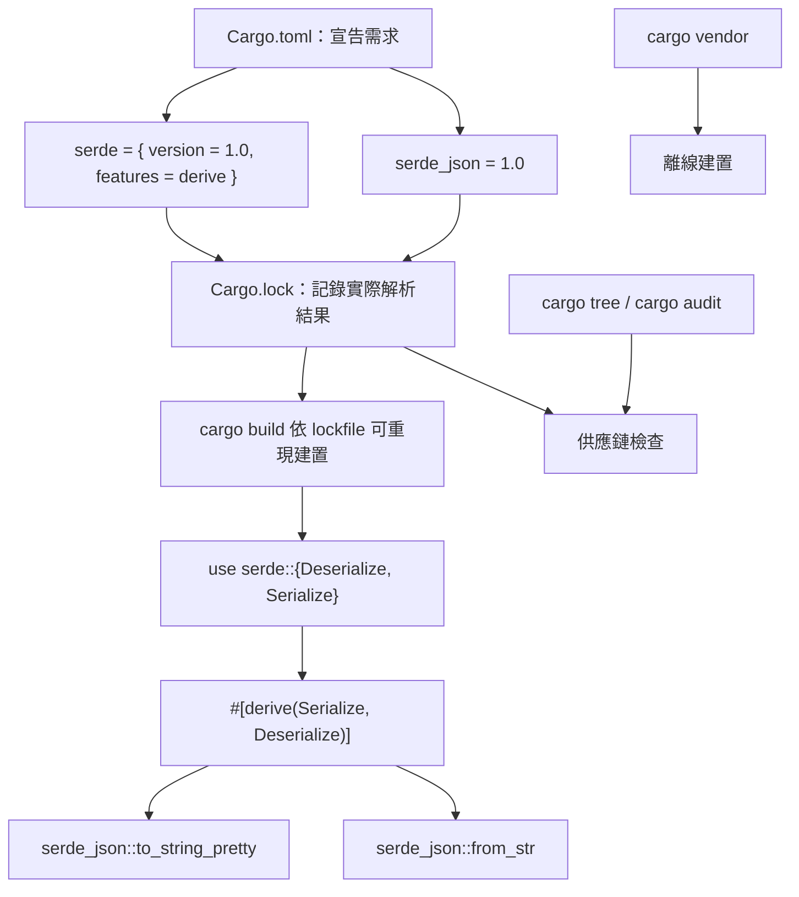

# 7.3 外部 Crates 的引入與使用

Rust 的標準庫雖然不算小，但它涵蓋的只是最基礎的部分——檔案、網路、序列化、命令列介面這些日常需求，標準庫都沒有提供。真正的解法是 crates.io 這個官方套件registry，以及 Cargo 這套相依性管理工具。本章要說明的是：如何引入外部 crate、如何在程式碼中使用它、如何管理相依性的版本，以及在供應鏈風險成為現實議題的今天，應該採取怎樣的態度。

## 一、三種引入外部 crate 的方式

第一種是使用 `cargo add` 指令，這是現代 Cargo 推薦的方式：

```bash
cargo add serde
cargo add serde --features derive
cargo add serde_json
cargo add anyhow --features std
```

`cargo add` 會自動把相依性寫進 `Cargo.toml`、更新 `Cargo.lock`，並且順帶把新 crate 的套件名稱加入原始碼檔案的 `use` 宣告裡。這個「順帶加入 `use`」的行為可以關閉，若你不想讓它動到原始碼：

```bash
cargo add serde --no-import
```

第二種是**手動編輯 `Cargo.toml`**。這種方式在需要精細控制版本需求、加入 git 來源或本地路徑相依時仍然必要：

```toml
[dependencies]
serde = { version = "1.0", features = ["derive"] }
serde_json = "1.0"
anyhow = "1.0"
```

第三種是執行 `cargo update` 來更新既有相依性的版本，或用 `cargo build` 讓 Cargo 自動解析並寫入 `Cargo.lock`。


在團隊協作中，`cargo add` 有一個容易被忽略的副作用：它會同時修改 `Cargo.toml` 與 `Cargo.lock`。前者是「意圖」，後者是「事實」，兩者都應該隨著這次新增相依一起進入版控。若團隊中有成員忘記提交 lockfile，其他人建置時就會解析出不同的版本，造成「在我這邊可以跑」的經典困擾。

若要從既有的專案匯出相依清單，`cargo add` 之外還有另一種做法：直接修改 `Cargo.toml` 後執行 `cargo check`，Cargo 會自動解析相依並寫入 lockfile。這個流程在移植舊專案時特別方便，因為你只需要知道相依的名稱與大致的版本即可。

## 二、Cargo.toml 與 Cargo.lock 的分工

這兩個檔案經常被搞混，但它們的職責截然不同。

`Cargo.toml` 宣告的是**相依性的需求範圍**。它寫的是「我需要 serde 1.x 系列，帶有 derive 功能」，這是一個**意圖**的表達，而不是一份精確的清單。

`Cargo.lock` 記錄的是**實際解析出來的結果**。它寫的是「我實際用的是 serde 1.0.219，它的相依是 serde_derive 1.0.219、proc-macro2 1.0.95 等等」。這是一份**事實**的記錄，精確到每個相依的每個版本。

這個分工決定了兩種專案的不同處理方式。**應用程式**（最終產出可執行檔的專案）應該把 `Cargo.lock` 提交到版控庫，因為它需要可重現的建置：今天能編譯的版本，半年後在 CI 上也必須能編譯。**函式庫**（要發布給別人用的 crate）則**不應該**提交 `Cargo.lock`，因為各個下游專案會把它們各自的相依版本合併起來，一份鎖定版本的檔案只會造成衝突。


版本控制系統的 `.gitignore` 也要配合這個原則：

```text
/target
```

對函式庫 crate 而言，若擔心 lockfile 被誤提交，可以在 `.gitignore` 中加上 `/Cargo.lock`；而對應用程式則應該明確不要忽略它。

另一個常見的疑慮是「lockfile 會不會讓我無法升級相依」。答案是**不會**：`cargo update` 指令會重新解析相依到允許範圍內的最新版本並更新 lockfile，而 `cargo update -p serde --precise 1.0.100` 則能鎖定特定版本。也就是說，lockfile 是「當下的事實」，而更新它是完全正常的維護動作，不必害怕。

## 三、在程式碼中使用 crate

引入外部 crate 之後，使用它的方式跟在 crate 內部使用模組完全一樣，都是透過路徑與 `use`。

```rust
use std::collections::HashMap;

fn main() {
    let mut counts: HashMap<String, i32> = HashMap::new();
    counts.insert(String::from("a"), 1);
    println!("{counts:?}");
}
```


這個轉換規則是雙向的且完全機械化：crate 名稱 `serde-json` 對應程式碼中的 `serde_json`，`tokio-util` 對應 `tokio_util`。少數 crate 的名稱本身不含連字號，但在套件名稱上仍然遵循同一規則，因此不會出現例外情況。


這裡有一個容易混淆的細節：外部 crate 名字與其 crate 根模組的名字是**分開**的。當一個 crate 有多個 binary crate 時，它們各自是獨立的 crate 根，因此 `cargo add` 引入的套件名稱可能與你要用的模組路徑不同。遇到這種情況，先看該 crate 的文件確認匯入路徑是最穩妥的做法。


```rust
use rand::Rng;

fn main() {
    let mut rng = rand::rng();
    let n: u8 = rng.random_range(1..=6);
    println!("擲出 {n}");
}
```

## 四、特徵與功能開關

很多 crate 的功能是透過**特徵**（feature）開關的。特徵是 Cargo 的機制，讓 crate 作者能把可選的相依性與功能打包，讓使用者選擇要開啟哪些。

```toml
[dependencies]
serde = { version = "1.0", features = ["derive"] }
```

這一行的意思是「使用 serde 1.0，並開啟 `derive` 功能」。`derive` 特徵讓 serde 能夠用 `#[derive(Serialize)]` 產生序列化程式碼，它需要 `serde_derive` 這個程序宏相依，而該相依預設是關閉的。

關閉預設特徵的寫法是：

```toml
[dependencies]
somecrate = { version = "1.0", default-features = false }
```

`default-features = false` 會關閉該 crate 所有預設開啟的特徵。這在嵌入式或 `no_std` 環境中特別重要，因為預設特徵往往會拉進 `std` 依賴，而那正是要避开的東西。

特徵之間也可以有相依關係，開啟某個特徵可能會連帶開啟其他特徵。`serde` 的 `derive` 特徵就是如此，它會拉進 `serde_derive` 這個程序宏相依，而後者又需要 `proc-macro2`、`quote` 與 `syn` 三個相依。這就是為什麼「加一個 crate」常常會讓編譯時間明顯增加——依賴鏈的深度比依賴的數量更影響建置時間。


```bash
cargo add serde --dry-run
cargo tree
```

## 五、依賴類型

Cargo 支援三種相依性類型，它們在 `Cargo.toml` 中以不同的段落宣告。

**一般相依**（`[dependencies]`）是程式碼在編譯與執行時都需要的部分，例如 `serde`。

**開發相依**（`[dev-dependencies]`）只在編譯測試、範例與 benchmarks 時需要，例如 `criterion` 這類效能測試框架。它們不會被打包進使用者的相依樹中。

**建置相依**（`[build-dependencies]`）在編譯**建置腳本**時需要，例如用來產生版本號或 protobuf 程式碼的 `prost-build`。

```toml
[dependencies]
serde = { version = "1.0", features = ["derive"] }

[dev-dependencies]
criterion = "0.5"

[build-dependencies]
prost-build = "0.13"
```

開發相依的特性是：它們**不會**成為你函式庫使用者的相依。當別人 `cargo add` 你的 crate 時，`criterion` 不會被拉進他們的專案。這讓你可以自由使用測試框架，而不必擔心把重量級相依推給使用者。

## 六、版本語意與可重現建置

Cargo 使用**語意化版本**（semantic versioning）的三段式版本號：`主版本.次版本.修訂版本`。主版本改變代表不相容的 API 變更，次版本代表向後相容的新功能，修訂版本代表向後相容的修補。

在 `Cargo.toml` 裡，版本需求可以寫成：

| 寫法 | 意義 |
| --- | --- |
| `"1.0.219"` | 相容性需求，接受所有 1.x 的版本（`^1.0.219`） |
| `"=1.0.219"` | 嚴格鎖定這個版本 |
| `"~1.0"` | 允許修訂版本變動（`>=1.0.0, <1.1.0`） |
| `"*"` | 任意版本（不建議） |

預設的相容性需求使用 caret 語意：寫 `"1.0"` 實際上等同於 `^1.0`，表示接受所有 `>=1.0.0, <2.0.0` 的版本。這是個合理的預設，因為它允許套件作者發布修補與次版本更新，卻不會在你不知情的時候把你升級到不相容的主版本。


`cargo update` 也支援針對單一相依更新：`cargo update -p serde` 只會重新解析 serde，其他相依保持不動。這讓「小步快跑」的相依維護策略變得可行——每次只升級一項、每次都跑一次測試，比一次全部升級更容易找出問題的來源。

當 lockfile 存在且沒有被修改時，`cargo build` 會嚴格依照它來建置。

## 七、常用 crate 家族速覽

Rust 生態系有幾個幾乎每個專案都會用到的 crate 家族。它們的組合方式，往往能決定一個專案的開發節奏。

| crate | 用途 | 常用特徵／搭配 |
| --- | --- | --- |
| `serde` | 序列化與反序列化的框架 | `derive`、`alloc` |
| `serde_json` | JSON 格式的解析與輸出 | 需搭配 `serde` |
| `tokio` | 非同步執行環境與工具 | `full`、`macros`、`rt-multi-thread` |
| `anyhow` | 動態錯誤型別，方便快速原型 | 搭配 `?` 與 `Context` |
| `thiserror` | 宣告式錯誤型別的衍生巨集 | 搭配 `derive` |
| `clap` | 命令列介面解析 | `derive` |
| `axum` | 高效能 HTTP 服務框架 | 搭配 `tokio`、`tower` |
| `rand` | 亂數產生 | `rng`、`thread_rng` |
| `tracing` | 結構化日誌與追蹤 | 搭配 `tracing-subscriber` |
| `reqwest` | HTTP 用戶端 | `json`、`rustls-tls` |


這些 crate 之間的搭配也有講究。若要做非同步的 HTTP 服務，`tokio` 提供執行環境，`axum` 提供路由與萃取層，錯誤處理用 `anyhow` 與 `thiserror`，日誌用 `tracing`，序列化用 `serde` 與 `serde_json`。這七個 crate 就能撐起一個相當完整、可上線的服務。反過來說，若專案只需要讀一個 JSON 檔案，就不必把整組都拉進來——`serde_json` 單獨就夠了。

`anyhow` 與 `thiserror` 的分工也值得記住：`thiserror` 適合定義**函式庫的公開錯誤型別**，因為它讓錯誤的結構成為型別資訊的一部分；`anyhow` 適合**應用程式層級的錯誤傳遞**，因為它允許任何錯誤被統一包裝。兩者常常一起使用：函式庫定義具體的錯誤列舉，應用程式在邊界處用 `anyhow` 統一收攝。

`tokio` 的特徵選擇也常讓人困惑。若要完整的執行環境，`features = ["full"]` 最省事，但會拉進不少用不到的元件；在正式專案裡，較精確的做法是只開啟實際需要的部分，例如 `["rt-multi-thread", "macros", "net", "time"]`。這是「最小依賴原則」在特徵層級的具體應用。

`serde` 不綁定任何格式，`serde_json` 與 `serde_yaml` 是平行的實作；`tokio` 提供執行環境，具體的 HTTP 伺服器則由 `axum` 與 `hyper` 提供。這樣的分工讓每個 crate 都能保持小巧，也讓使用者能按需求自由替換其中一層。

## 八、供應鏈風險與最小依賴原則

把外部 crate 引入專案，等於把對方的程式碼放進了自己的建置流程。這帶來一個真實的風險：**上游維護者若發布了惡意版本，你的專案在下次 `cargo build` 時就會執行它**。Rust 的 crate 發布流程要求 crate 必須被釋出兩週後才能被 `cargo install`，但對於已經在 `Cargo.toml` 裡的相依，這個延遲機制並不適用。

面對這個風險，實務上有幾條可行的守則。

第一是**最小依賴原則**：每一個新增的相依都應該有明確的理由。功能自己寫只要二十行程式碼，就不該為了這二十行引入一個有數百個相依的 crate。

第二是**檢視相依樹**。`cargo tree` 可以顯示完整的相依關係圖，許多次要相依正是隱藏在主要相依之下：

```bash
cargo tree
cargo tree --depth 1
cargo tree -i serde
```

第三是**使用 `cargo audit`** 檢查已知漏洞。RustSec Advisory Database 匯集了所有已知的 Rust 生態系漏洞，而 `cargo audit` 可以在 CI 中自動比對。

這裡有一個關鍵的區別：**Cargo 的相依解析並不做「重複宣告」**，只要兩個 crate 要求同一個相依的相容版本，Cargo 就會自動取一個兩者都滿足的版本。這是 Rust 的相依管理相當省心的地方，與 npm 的依賴樹地獄形成對比。但這也意味著相依鏈深處可能存在你完全不知道的 crate——`cargo tree` 之所以重要，正是為了把這層隱藏關係暴露出來。

不要讓 `cargo update` 成為按下 Enter 就會發生的事，而把它變成一個需要 review 的明確動作。


第六是**留意相依的授權條款**。crates.io 上的每個 crate 都必須有授權資訊，但授權種類並不統一，多數是 MIT 或 Apache-2.0，也有 GPL 或更嚴格的條款。企業環境通常需要法務部門確認整條相依鏈的授權相容性，`cargo-license` 這類工具可以協助產出清單。

第七是**避免使用 git 相依到未固定的分支**。像 `git = "https://github.com/xxx/repo"` 這種寫法會指向分支的最新提交，讓建置結果取決於遠端狀態，嚴重破壞可重現性；若非用不可，至少要鎖定特定的 commit 雜湊值。

## 九、離線環境的 cargo vendor

在網路受限的環境（例如內網建置伺服器或 air-gapped 的部署環境），`cargo vendor` 可以把所有相依下載到本機目錄，讓建置完全不依賴網路。

```bash
cargo vendor vendor-dir
```

執行後 Cargo 會印出一段需要加進專案設定的指示。建立 `.cargo/config.toml`：

```toml
[source.crates-io]
replace-with = "vendored-sources"

[source.vendored-sources]
directory = "vendor-dir"
```


`cargo vendor` 產生的目錄通常很大，因此實務上會把它放在版控之外，而是透過內部 artifact 伺服器分發。在有獨立 CI runner 的環境中，另一種常見做法是把相依快取放在 CI 系統的快取目錄，並以 lockfile 的雜湊值作為快取鍵——lockfile 不變就代表相依集合不變，快取即可重用。

離線環境還有一個細節要注意：`cargo vendor` 會把 `.cargo-checksum.json` 一起複製出來，Cargo 會用它來驗證檔案的完整性。若自行修改了 vendor 目錄裡的內容，驗證就會失敗。這其實是一件好事——它保證了離線建置所用的相依與 crates.io 上的原始內容完全一致。

這種「供應鏈完全納入版控」的做法在企業環境中很常見，優點是可稽核且離線可用，缺點是版控庫會變大，而且必須自己負責更新相依。

## 十、一個引入 serde 的完整範例

最後讓我們把本章的內容整合成一個完整可運作的範例。這個程式示範如何加入 `serde` 與 `serde_json`，用衍生巨集產生序列化實作，並把結果轉成 JSON 字串再解析回來。

```toml
[package]
name = "mytool"
version = "0.1.0"
edition = "2021"

[dependencies]
serde = { version = "1.0", features = ["derive"] }
serde_json = "1.0"
```

```rust
use serde::{Deserialize, Serialize};

#[derive(Debug, Clone, PartialEq, Serialize, Deserialize)]
struct User {
    id: u32,
    name: String,
    email: String,
    active: bool,
    #[serde(default)]
    tags: Vec<String>,
}

fn main() {
    let user = User {
        id: 7,
        name: String::from("小明"),
        email: String::from("ming@example.com"),
        active: true,
        tags: vec![String::from("admin")],
    };

    let json = serde_json::to_string_pretty(&user).expect("序列化應成功");
    println!("{json}");

    let restored: User = serde_json::from_str(&json).expect("反序列化應成功");
    assert_eq!(user, restored);
    println!("{restored:?}");
}
```

`serde` 的 `derive` 特徵是程序宏，它在編譯期讀取結構體的定義並產生實作 `Serialize` 與 `Deserialize` 的程式碼。這些產生的程式碼會呼叫 `serde` 核心函式庫提供的輔助函式，因此 `serde` 本身必須同時被列為相依——`serde` 與 `serde_derive` 在這裡是「同一個 crate 的兩個部分」，由 `derive` 特徵自動把後者拉進來。

`use serde::{Deserialize, Serialize};` 把兩個 derive 巨集引入作用域，注意它們是以**巨集**的形式被引入的——`#[derive(Serialize)]` 這類語法之所以能用，正是因為 `serde` crate 提供了名為 `Serialize` 的程序宏。

`#[serde(rename_all = "camelCase")]` 這類容器層級的屬性，則能控制序列化時的欄位命名慣例，讓 Rust 的 `snake_case` 欄位名對應到 JSON 的 `camelCase` 鍵。這種「序列化格式與內部表示分離」的能力，正是 `serde` 強大之處：內部命名可以遵循 Rust 慣例，外部格式可以遵循協定規格。

，這是 `serde` 提供的欄位層級屬性。它解決了向前相容的問題：日後新增欄位時，舊的資料不會因為缺少該欄位而解析失敗。

`to_string_pretty` 產生縮排過的 JSON，比 `to_string` 更適合人閱讀；而 `from_str` 則是把字串解析回結構體，它回傳 `Result`，所以需要用 `expect` 處理可能失敗的情況。第 8 章會討論 `Result` 與錯誤處理的完整做法。

順帶一提，若只需要序列化而不需要反序列化，可以只匯入 `Serialize` 而省略 `Deserialize`；反之亦然。程式宏帶來的是編譯期成本，只匯入需要的部分能讓建置稍微快一點。

，這個專案就能直接 `cargo run` 並看到輸出。整個過程中沒有手動撰寫任何序列化程式碼——**衍生巨集把重複的样板程式碼從開發者手中拿走了**，這是 Rust 生態系裡「宣告式優於命令式」最直觀的例子之一。



這張圖把本章的主題串成一條線：`Cargo.toml` 說明「我想要什麼」，`Cargo.lock` 記錄「我實際用了什麼」，`cargo build` 依此產生可重現的結果，而 `cargo tree`、`cargo audit` 與 `cargo vendor` 則是確保這條供應鏈可信的工具。

## 十一、小結

引入外部 crate 在技術上很簡單——一條 `cargo add` 指令加上一個 `use` 宣告。真正需要思考的是**管理**：`Cargo.toml` 與 `Cargo.lock` 的分工讓「意圖」與「事實」各歸其位；特徵機制讓可選功能可以精細開關；三種依賴類型讓測試與建置工具不會污染使用者的相依樹。

而在安全意識已經成為工程基本功的今天，對外部相依保持謹慎不再是可选项。最小依賴原則、檢視相依樹、稽核已知漏洞、離線環境下的 vendor 方案，這些做法共同構成 Rust 專案的供應鏈防線。Rust 官方也已經在crates.io 上推行簽章發布，正是為了讓「這個 crate 確實來自它宣稱的作者」這件事可以被驗證。

回到本書的主軸：Rust 的哲學是把安全性從工程紀律變成語言保證。套件管理這個領域尚未完全走到那一步，但它正在往同一個方向走——而每一位使用者在按下 `cargo add` 之前的那個判斷，都是這個方向上一個不可省略的環節。
