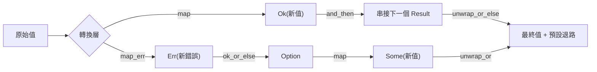

# 8.1 可復原錯誤與 Result 型別

## 把「可能失敗」寫進型別裡

在前面的章節裡，我們處理過「值可能不存在」的情況，用的是 `Option<T>`。但真實世界的失敗不只有「有或沒有」兩種狀態：檔案可能不存在，但「不存在」的原因可能分別是路徑打錯、權限不足、磁碟毀損或網路中斷，而這些原因對呼叫者來說意味著完全不同的處置方式。Rust 用 `Result<T, E>` 這個列舉把這件事表達出來：成功時攜帶 `T`，失敗時攜帶 `E`。

`Result` 的定義相當精簡，它只有兩個變體，且兩者都帶有資料。為了避免與標準庫的名稱衝突，下面的範例把它命名為 `MyResult`，實際使用時你不需要自己定義：

```rust
// 標準庫中的定義（此處僅為示意，故改名以免衝突）
#[derive(Debug, Clone, PartialEq)]
pub enum MyResult<T, E> {
    Ok(T),
    Err(E),
}

fn main() {
    let r: MyResult<u32, String> = MyResult::Ok(42);
    println!("{r:?}");
}
```

這個定義的意義不只在於列舉本身，而在於它出現在函式的**回傳型別**位置。當你寫下 `fn read_config(path: &str) -> Result<String, ConfigError>` 的時候，「這個函式可能失敗」這件事就已經是型別簽章的一部分，任何呼叫者都無法忽略它。相較之下，多數語言把失敗資訊藏在說明文件、註解或慣例裡，Rust 把它放進編譯器可以檢查的位置。

`Result<T, E>` 本身是一個泛型列舉，泛型與列舉的組合是 Rust 的常見手法：`T` 與 `E` 都是由呼叫端決定具體是什麼型別，因此同一個 `Result` 可以裝載字串與 `io::Error`，也可以裝載整數與自訂的列舉錯誤。`Option<T>` 是它的簡化版本，只保留了成功與「沒有值」兩種狀態。

## Rust 為什麼不用例外

Rust 的官方立場相當明確：**例外不是不可靠的機制，例外只是不符合 Rust 的風格**。這裡的核心主張不是「例外不能檢查錯誤」，因為 Java 的受檢查例外（checked exception）同樣能強迫處理。真正的爭議在於語意的可預測性：例外讓「錯誤會發生」這件事無法出現在型別裡，只能存在於控制流程的隱藏狀態中。

Rust 的設計者選擇讓錯誤成為**型別層面的事實**。若一個函式可能回傳錯誤，這點必須寫進簽章；若簽章寫了 `Result`，編譯器就會強制呼叫者做出決定——處理它、傳播它、或明確忽略它。這個做法的代價是寫起來更囉嗦，好處是任何一個函式的失敗行為都不需要追蹤呼叫堆疊就能得知。

另一個實際差異在於錯誤資訊的**攜帶方式**。在多數語言裡，拋出的例外是一個物件，型別通常是通用的 `Exception`，具體語意要靠訊息字串判讀。Rust 的 `Err(E)` 則要求錯誤值有一個明確的型別，該型別可以攜帶結構化的資訊，例如 HTTP 狀態碼、資料庫錯誤碼，或使用者輸入中出錯的欄位名稱。這使得錯誤不只是一段給人看的文字，而是可以被程式邏輯處理的資料。

Rust 並非完全否定執行期的不可預測性，它只是把不可復原的失敗另闢一條路徑處理，也就是下一節的 `panic!`。可復原與不可復原的切分，是 Rust 錯誤處理的核心分類。

## 用 match 處理 Result

處理 `Result` 最基本也最直接的方式是 `match`，而 Rust 會要求你把兩個分支都寫出來：

```rust
fn parse_port(input: &str) -> Result<u16, String> {
    match input.trim().parse::<u16>() {
        Ok(port) => Ok(port),
        Err(e) => Err(format!("無法解析埠號 {input}: {e}")),
    }
}

fn main() {
    println!("{:?}", parse_port("8080"));
    println!("{:?}", parse_port("abc"));
}
```

這裡的 `match` 展現了 Rust 錯誤處理最典型的樣貌：分支的**成功側**把值繼續往回傳，**失敗側**把錯誤重新包裝成更上層型別所接受的錯誤。錯誤不是被「處理掉」而是被「轉譯」——每一層函式都把自己能理解的錯誤往上送，並且附上自己這一層的語意。

如果忘記寫其中一個分支，編譯器會直接報錯，錯誤訊息是 `non-exhaustive patterns: 'Err(_) not covered`。這個設計避免了 JavaScript 中 `result.error` 可能為 `undefined` 而觸發 `TypeError` 的典型問題：型別系統已經保證 `Err` 分支一定會被考慮到。

當兩個分支的回傳內容型別不同但你只想取其中一種時，可以用 `if let` 簡化；但在錯誤處理的語境下，`match` 幾乎總是更合適，因為它強迫你思考失敗路徑。`let ... else` 則是另一個選擇，它把 `Err` 分支寫成 panic 的形式，適合用於「不可能失敗」的前置條件。

## unwrap 與 expect 的語意

`Result` 提供 `unwrap` 與 `expect` 兩個方法。它們的共同點是：當值為 `Ok` 時直接取出內部值，當值為 `Err` 時**觸發 panic**。差別在於 panic 時攜帶的訊息。

```rust
fn main() {
    let raw = "8080";
    let port = raw.parse::<u16>().unwrap();
    println!("埠號是 {port}");

    let bad = "not-a-port";
    match bad.parse::<u16>() {
        Ok(p) => println!("埠號是 {p}"),
        Err(e) => println!("解析失敗：{e}"),
    }
}
```

`unwrap` 在 `Err` 時 panic，panic 訊息會印出 `called 'Result::unwrap()' on an 'Err' value: ...`，並附上**檔名與行號**，讓你立刻知道是哪一行呼叫出了問題。`expect` 則允許你附帶一段自訂訊息，訊息會出現在 panic 輸出中：

```rust
fn read_port() -> u16 {
    std::env::var("PORT")
        .expect("環境變數 PORT 必須被設定")
        .parse()
        .expect("PORT 必須是數字")
}

fn main() {
    std::env::set_var("PORT", "8080");
    println!("埠號是 {}", read_port());
}
```

`expect` 的訊息描述的是**呼叫者的前置條件**，這是它存在的理由。`unwrap` 產生的訊息只說「這裡是 `Result::unwrap` 失敗」，資訊量低；`expect` 產生的訊息說明「為什麼你會走到這條路」，對除錯的價值高得多。因此在實務上，專案內部優先使用 `expect`，而 `unwrap` 留給測試與教學範例。

## 什麼時候可以用 unwrap

濫用 `unwrap` 是 Rust 社群公認的壞味道，因為它把一個**型別層面的強迫處理**重新降級成了執行期的意外。規則很簡單：`unwrap` 只在你**能夠證明**這個 `Err` 分支永遠不會發生的時候才合理。

典型的合理場景有三種。第一是**測試**。測試中你控制所有輸入，若測試資料本身是錯的，那麼測試失敗正是你想要的結果，這時 `unwrap` 讓測試碼碼保持乾淨。第二是**已知的常數與不變量**。例如解析一個由編譯期常數組成的字串，或存取一個你在初始化時已經驗證過的陣列索引。第三是**示範與教學**，程式碼的目的是展示語言機制而非處理真實輸入。

除此之外就應該是壞味道了。特別危險的寫法是對外部輸入直接 `unwrap`：使用者送來 `"abc"`、檔案系統回傳權限錯誤、網路連線逾時，這些都不是「不可能發生」的事件。這類程式在測試環境可能永遠綠燈，上了線才會以 panic 的形式崩潰，而且崩潰點是呼叫 `unwrap` 的那個函式，與真正的錯誤來源隔了一層。

一個務實的折衷是 `unwrap_or`、`unwrap_or_else` 與 `unwrap_or_default`：它們把錯誤轉成一個預設值繼續執行，適合在「失敗時有合理退路」的場景，例如設定檔缺漏時採用預設值。關鍵是要讓退路的選擇是**明確的**，而不是圖省事。

## Option 與 Result 的關係

`Option<T>` 可以理解為「`Result<T, ()>` 的一個特化版本」——它只表示有或沒有，不攜帶失敗原因。兩者共享同一組組合子方法名稱，因此可以在心智模型上互相對照。

```rust
fn first_char(s: &str) -> Option<char> {
    s.chars().next()
}

fn first_char_of_result(s: &str) -> Result<char, String> {
    s.chars().next().ok_or_else(|| "字串是空的，無法取出首字".to_string())
}

fn main() {
    println!("{:?}", first_char("Rust"));
    println!("{:?}", first_char_of_result("Rust"));
    println!("{:?}", first_char_of_result(""));
}
```

`ok_or` 與 `ok_or_else` 就是 `Option` 轉 `Result` 的橋樑：前者接受一個已經算好的 `E`，後者接受一個延遲求值的閉包，在 `None` 真的發生時才建立錯誤值。後者幾乎總是更好的選擇，因為當 `Option` 是 `Some` 時，錯誤訊息的建造成本被完全省下。

反方向也有對應的 `Option`：`Result::ok()` 把 `Err` 丟掉只留下 `Option`，`Result::err()` 則反之。這個轉換在「我確定上游已經處理過錯誤，只想拿值」時很有用，但要注意它會**丟失錯誤資訊**，在正式程式中應視為需要說明理由的決定。

`Option` 與 `Result` 之間還有一組更細緻的對應：`Option::ok_or` 與 `Option::ok_or_else` 把 `None` 升格成 `Err`，而 `Result::ok` 把 `Err` 降格成 `None`。這兩組方法共同構成了一條**資訊量遞減的通道**，讓你可以有意識地選擇在某一層把錯誤細節丟掉，只留下「有沒有值」這件事。降格應該是謹慎的決定而非便利的寫法，否則除錯時會發現關鍵資訊已經在某一層不知不覺地蒸發了。

另一個常用的工具是 `transpose`，它把 `Result<Option<T>, E>` 轉換成 `Option<Result<T, E>>`，在需要區分「外層容器不存在」與「內層值不存在」的場景中很有用。

兩個型別共享的組合子包括 `map`、`map_err`、`and_then`、`and_then` 的 `Option` 版本、`unwrap_or` 與 `unwrap_or_else`。把它們視為同一族「轉換管線」工具，會讓 API 心智負擔大幅下降。

## 組合子方法族

組合子的核心是**在不回傳值型別的情況下做轉換**。它們的價值在於讓複雜的錯誤處理流程可以串成一條線性的管線，而不必到處展開 `match`。

| 方法 | 作用於 `Result` | 作用於 `Option` |
| --- | --- | --- |
| `map` | 對 `Ok` 中的值做轉換，保留 `Err` | 對 `Some` 中的值做轉換 |
| `map_err` | 對 `Err` 中的值做轉換，保留 `Ok` | 不適用 |
| `and_then` | 對 `Ok` 中的值做回傳 `Result` 的轉換 | 對 `Some` 中的值做回傳 `Option` 的轉換 |
| `ok_or` | 把 `Result` 轉成 `Option`（丟棄錯誤） | 把 `Option` 轉成 `Result` |
| `ok_or_else` | 把 `Result` 轉成 `Option`（丟棄錯誤） | 把 `Option` 轉成 `Result`，錯誤延遲建立 |
| `unwrap_or` | 取值，失敗時用預設值 | 取值，`None` 時用預設值 |
| `unwrap_or_else` | 取值，失敗時呼叫閉包取得預設值 | 取值，`None` 時呼叫閉包取得預設值 |

`map` 與 `map_err` 的分工是這一族的核心：前者改寫成功路徑的值的型別，後者改寫失敗路徑的錯誤型別。兩者互不干擾，因此可以同時使用來把 `Result<u32, String>` 變成 `Result<String, AppError>`。

```rust
use std::num::ParseIntError;

fn double(s: &str) -> Result<u32, ParseIntError> {
    s.parse::<u32>().map(|n| n * 2)
}

fn describe(s: &str) -> Result<String, String> {
    double(s)
        .map(|n| format!("兩倍是 {n}"))
        .map_err(|e| format!("計算失敗：{e}"))
}

fn main() {
    println!("{:?}", describe("21"));
    println!("{:?}", describe("abc"));
}
```

`and_then` 與 `map` 的差別在回傳型別：`map` 的閉包必須回傳非 `Result` 的值，而 `and_then` 的閉包可以回傳另一個 `Result`，從而串接多個可能失敗的步驟：

```rust
fn parse_pair(s: &str) -> Result<(u32, u32), String> {
    let mut parts = s.split(',');
    let a = parts.next().ok_or("缺少第一個數字")?;
    let b = parts.next().ok_or("缺少第二個數字")?;
    let a = a.trim().parse::<u32>().map_err(|e| e.to_string())?;
    let b = b.trim().parse::<u32>().map_err(|e| e.to_string())?;
    Ok((a, b))
}

fn main() {
    println!("{:?}", parse_pair("1, 2"));
    println!("{:?}", parse_pair("1"));
}
```

這段程式碼裡的 `?` 會在第 8.3 節詳細說明。此處先注意其結構：`map_err` 把不同來源的錯誤統一轉成 `String`，而 `and_then` 讓我們可以把「解析數字」這樣的步驟組合成一個可重用的函式。

## 用型別表達「錯誤的可能」

把錯誤放進回傳型別，是 Rust 與 Go 最容易被拿來對照的設計差異。Go 的慣用寫法是回傳 `(value, error)`，其中 `error` 是一個介面：

```go
func readConfig(path string) (string, error) {
    data, err := os.ReadFile(path)
    if err != nil {
        return "", err
    }
    return string(data), nil
}
```

這段 Go 程式碼在語意上與 Rust 的 `Result<String, io::Error>` 相當，但 Rust 的編譯器**無法保證**呼叫者檢查了 `Err`。Go 也無法保證——`err` 是可以隨手忽略的變數，靜態檢查工具（`errcheck` 之類）能協助，但不在語言保證之內。

Rust 的差異在於「可能失敗」是簽章的一部分，編譯器會強迫你在每個呼叫點做出處置。即使型別簽章寫得很長，它帶來的是**可被工具驗證的性質**，這正是 Rust 一貫的設計哲學：把常見的工程紀律提升為語言保證。

另一個角度是資訊的結構化程度。Go 的 `error` 是一個介面，具體的錯誤型別通常被包裝成不透明的值；Rust 的 `E` 是**泛型參數**，可以精確指定為某個具體型別，也可以是 `Box<dyn Error>` 這種動態型別。選擇權在設計者手上，而這正是第 8.3 節 `thiserror` 與 `anyhow` 的分工基礎：底層函式用具體的錯誤型別，上層用動態的錯誤型別。

這裡還有一個容易被忽略的差異：例外在多數語言中是**隱式控制流**，拋出與捕捉的邊界不在型別裡，因此「這個函式會不會拋出什麼」只能靠閱讀實作或文件得知。`Result` 把這條邊界畫在型別上，於是「這個函式的錯誤是什麼形狀」成為一等的、可被 grep 與搜尋的資訊。對大型程式碼庫而言，這種可搜尋性本身就是實質的工程收益：你可以用 `grep 'io::Result'` 找出所有可能涉及檔案系統的地方，而這在以例外為主的語言裡是做不到的。

## 實務範例：解析使用者輸入

把上述觀念合起來，看一個完整的範例。這個函式解析一行設定文字，格式是 `key=value`，並對各種失敗情形給出可操作的訊息：

```rust
use std::collections::HashMap;

#[derive(Debug)]
pub enum ConfigError {
    MissingKey(String),
    BadFormat { line: usize, reason: String },
    BadValue { key: String, value: String },
}

fn parse_line(line: &str, lineno: usize) -> Result<(String, String), ConfigError> {
    let (key, value) = line
        .split_once('=')
        .ok_or_else(|| ConfigError::BadFormat {
            line: lineno,
            reason: "缺少 '=' 分隔符".to_string(),
        })?;
    let key = key.trim();
    if key.is_empty() {
        return Err(ConfigError::BadFormat {
            line: lineno,
            reason: "鍵名為空".to_string(),
        });
    }
    Ok((key.to_string(), value.trim().to_string()))
}

pub fn parse_config(text: &str) -> Result<HashMap<String, String>, ConfigError> {
    let mut map = HashMap::new();
    for (i, line) in text.lines().enumerate() {
        let line = line.trim();
        if line.is_empty() || line.starts_with('#') {
            continue;
        }
        let (key, value) = parse_line(line, i + 1)?;
        if map.insert(key.clone(), value).is_some() {
            return Err(ConfigError::BadValue {
                key: key.clone(),
                value: "重複的設定項".to_string(),
            });
        }
    }
    Ok(map)
}

fn main() {
    let text = "port=8080\nhost=127.0.0.1\n";
    match parse_config(text) {
        Ok(map) => println!("{map:?}"),
        Err(e) => println!("錯誤：{e:?}"),
    }
}
```

注意這個設計裡的每個選擇。`ConfigError` 是具體的列舉而非字串，因此呼叫者可以用 `match` 針對不同情形分別處理——例如缺鍵時填入預設值，格式錯誤時直接報錯退出。錯誤的訊息攜帶了行號與鍵名，這些資訊對使用者定位問題有實際價值。

函式的回傳型別是 `Result<HashMap<String, String>, ConfigError>`，這意味著「設定檔解析可能失敗」是這份程式碼結構的一部分，而不是某個文件段落裡的一句話。

## 組合子管線的全貌

把 `Result` 與 `Option` 的組合子視為一條管線，有助於掌握它們的組合方式：



這張圖的實用價值在於：**成功路徑與失敗路徑是兩條平行線**。`map` 只在成功線上作用，`map_err` 只在失敗線上作用，`and_then` 讓成功線可以接上另一條需要處理錯誤的管線。當你發現自己在寫巢狀三層的 `match` 時，通常代表管線還沒有被拉直。

## 概率、期望與組合子的直觀

雖然 Rust 不允許在一般控制流程中依賴機率，但 `Result` 的組合子恰好能用一種直觀的方式來描述「多個可能失敗的步驟串在一起」的場景。假設每個步驟成功的機率是 $ p $ ，那麼一條有 $ n $ 個步驟的管線全部成功的機率是：

$$
p_{\text{total}} = p^n
$$

這解釋了為什麼實務上偏好**把多個檢查合併到更早的邊界**。例如與其讓五個函式各自可能回傳錯誤，不如在最外層做一次輸入驗證，然後讓內部函式接收已經驗證過的型別（所謂 make invalid states unrepresentable）。型別一旦能保證前置條件成立，內部的錯誤分支就消失了，管線的成功率自然回升。

`unwrap_or_else` 與 `ok_or_else` 之所以是「延遲求值」，理由也在這裡。如果預設值的建立成本是顯著的，那麼在成功路徑上額外付費就是純粹的浪費。組合子的這項設計讓錯誤處理的成本只發生在真正需要的時候。

$$
\text{cost}_{\text{success}} = \text{base} + 0 \cdot \text{fallback}
$$

這也是 `map_err` 與 `map` 在成本考量上對稱的原因：兩者都只在自己的路徑上執行，失敗路徑上的轉換開銷不會洩漏到成功路徑。

## 設計指引

回顧本章，有幾條可以帶走的原則。首先，**能不用 `unwrap` 就不要用**，只有在能證明 `Err` 不會發生時才使用它；其餘情況用 `match` 明確表達意圖。其次，**讓錯誤型別帶著結構**，自訂的列舉錯誤比 `String` 有用得多，因為它讓錯誤可以被程式處理。第三，**在每一層轉譯錯誤**，`map_err` 是把底層的技術細節轉成上層能理解的語意的最佳位置。

第四，**分清楚哪些錯誤可復原、哪些不可**。使用者輸入格式錯誤、檔案暫時無法鎖定、網路逾時，這些是可復原的，應該回到 `Result`；程式邏輯違反了自身的不變量，那是不可復原的，應該 panic。這個分類一旦模糊，錯誤處理就會變成到處 `unwrap` 與到處 panic 混合的混亂狀態。
第五，注意**所有權與錯誤傳播的關係**。當一個函式回傳 `Err` 時，錯誤值的所有權被轉移給呼叫者，這意味著錯誤訊息裡可以攜帶從底層一路收集上來的上下文，而且不需要額外的記憶體配置或執行期成本。`String` 型別的錯誤訊息因此可以放心地串接多次 `format!`，代價只是堆積上一次配置。

第六，**不要過早優化錯誤的表示法**。在還不確定呼叫者會如何區分錯誤種類時，先用 `Box<dyn Error>` 或 `String` 讓程式跑起來，等到真的有第二種處理分支的需求時，再把它細化成具體的列舉型別。反過來說，一旦你寫下 `ConfigError` 這樣的型別，未來要新增變體就會是**破壞性變更**，所有未處理新變體的 `match` 都會編譯失敗——這正是你想要的效果。

最後，記住 `Result` 的價值不在於它比例外「更安全」這種籠統的說法，而在於**它讓錯誤的處理位置變成可見、可檢查、可統計的東西**。當你進入第 8.3 節，會看到 `?` 運算子如何讓這種可見性不必以繁瑣的樣板程式碼為代價。