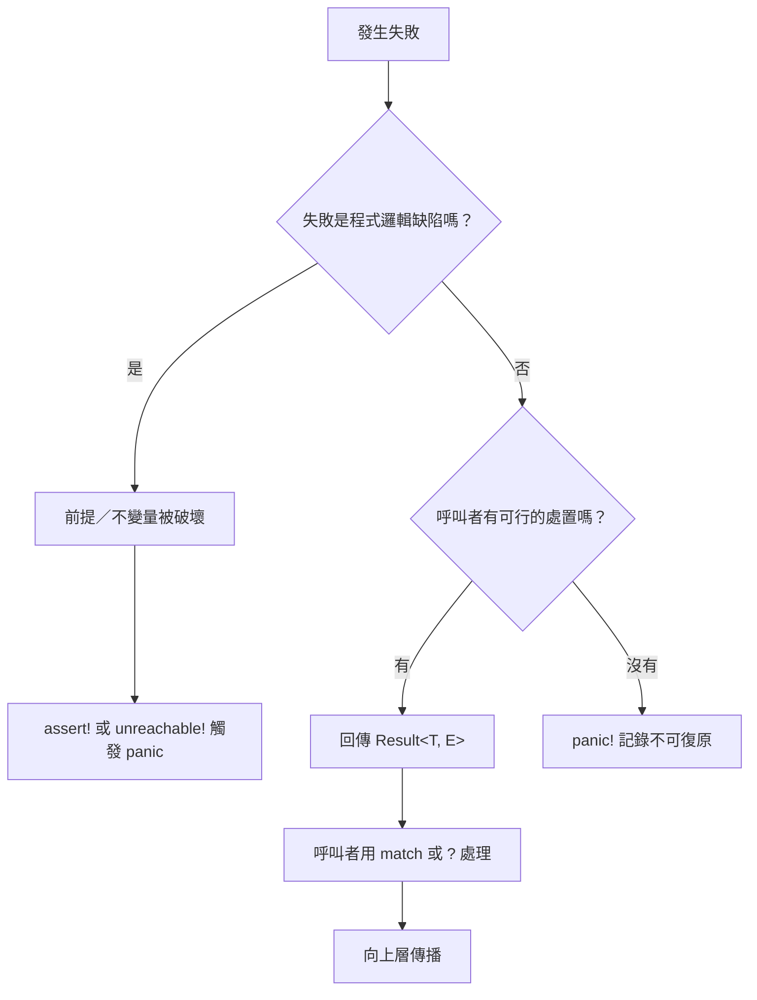

# 8.2 不可復原錯誤與 panic!

## panic 是什麼

`panic!` 是 Rust 用來表示「這個情況不該發生，若發生則程式邏輯有誤」的機制。當 panic 被觸發時，程式會印出 panic 訊息，然後依據編譯設定選擇解旋（unwind）或中止（abort）。

和 `Result` 相比，panic 的定位非常明確：它**不是**用來表達可預期的失敗，而是用來表達程式邏輯的崩潰。Rust 標準庫在多種情況下會自動 panic，其中最常見的是以下幾類：

```rust
fn main() {
    let v = vec![1, 2, 3];
    println!("{}", v[10]);          // 索引超出範圍：index out of bounds
    // let x = 1 / 0;               // 整數除以零：attempt to divide by zero
    // let s = String::from("hi");
    // let r = &s[0..5];            // 字串切片超出字元邊界
    // let o: Option<u32> = None;
    // println!("{}", o.unwrap());  // unwrap 失敗：called `Option::unwrap()` on a `None` value
    // assert!(1 > 2, "條件不成立");  // assert 失敗
}
```

上面這段程式碼在執行時會 panic 並終止。把它改成 `v.get(10)` 就會得到 `Option`，不會崩潰。

這些 panic 的共同特徵是：**它們在設計上都被視為「程式碼寫錯了」的情況**。陣列索引超出範圍通常代表程式邏輯有誤；`unwrap` 失敗代表你宣稱這個值必定存在，但實際上不存在；`assert!` 失敗則是程式明確宣告「這個不變量必須成立」，而它被打破了。

常見的觸發來源可以整理成一份速查表：

| 來源 | 典型程式碼 | panic 訊息關鍵字 |
| --- | --- | --- |
| 切片索引越界 | `v[10]` | `index out of bounds` |
| `String` 位元組邊界切錯 | `&s[0..5]` | `byte index 5 is not a char boundary` |
| 整數除以零 | `1 / 0` | `attempt to divide by zero` |
| `unwrap` 失敗 | `opt.unwrap()` | `called 'Option::unwrap()' on a 'None' value` |
| `expect` 失敗 | `res.expect("...")` | 你的自訂訊息 |
| `assert!` 失敗 | `assert!(x > 0)` | `assertion failed: x > 0` |
| `assert_eq!` 失敗 | `assert_eq!(a, b)` | `assertion failed: left == right` |
| 整數溢位（debug 模式） | `i32::MAX + 1` | `attempt to add with overflow` |
| 索引超出 `String` 的位元組長度 | `s.chars().nth(i).unwrap()` | `Option::unwrap` 類 |
| 借用期間的可變存取衝突 | 同時持有 `&mut` 與 `&` | 編譯期錯誤，非 panic |

這個表格透露一個重要事實：**索引、除零、溢位這些「意外」多數其實是編譯期就該被發現的**，Rust 把它們做成 panic 只是因為在某些泛型或動態情境下無法靜態判定。例如 `v[i]` 裡的 `i` 若是執行期才知道，編譯器無法證明它合法，因此選擇在執行期檢查並 panic。

`panic!` 本身是一個巨集，可以直接呼叫：

```rust
fn divide(a: i32, b: i32) -> i32 {
    if b == 0 {
        panic!("除數不能為零");
    }
    a / b
}

fn main() {
    println!("{}", divide(10, 2));
    println!("{}", divide(10, 0));
}
```

## 解旋與中止

panic 被觸發後，程式行為有兩種可能，這由 `Cargo.toml` 中的 `panic` 設定決定：

```toml
[profile.release]
panic = "abort"
```

預設值是 `"unwind"`。在解旋模式下，panic 會沿著呼叫堆疊逐層向上退栈，每一层的 panic 掛鉤（panic hook）都會被呼叫，最後如果沒有被 `catch_unwind` 捕捉，執行緒就會以非零狀態碼結束。Rust 預設會在解旋過程中釋放堆積配置的記憶體，這是 Rust 的 RAII 保證能夠在 panic 時依然成立的原因。

在中止模式下，panic 會直接呼叫 `abort()` 結束整個行程，不進行解旋，因此不執行任何 `Drop` 實作。這個模式的優點是**可執行檔更小、panic 路徑更快**，因為省去了堆疊回溯與清理程式碼。代價是所有資源都靠行程結束來釋放，且無法使用 `catch_unwind`。

選擇哪一種，取決於程式碼的性質。伺服器或長駐服務通常使用預設的解旋，因為 `catch_unwind` 提供的隔離能力有價值；CLI 工具或嵌入式環境則可能選中止以縮小體積。無論選哪一種，安全保證都相同——因為 panic 不會導致記憶體不安全。

## assert 家族的用途

`assert!` 系列是 Rust 表達不變量的主要工具，也是 panic 最「合理」的用途來源：

```rust
fn clamp_to_range(value: i32, min: i32, max: i32) -> i32 {
    assert!(min <= max, "min ({min}) 不可大於 max ({max})");
    value.clamp(min, max)
}

fn main() {
    assert_eq!(clamp_to_range(5, 0, 10), 5);
    assert_eq!(clamp_to_range(-5, 0, 10), 0);
    assert!(clamp_to_range(50, 0, 10) == 10);
}
```

`assert!` 接受一個布林條件，`assert_eq!` 比較兩個值是否相等（除相等外還要求兩者的 `Debug` 實作存在，因此可以印出差異）。兩者都有攜帶訊息的變體：`assert!(cond, "訊息 {}", 變數)` 與 `assert_eq!(a, b, "訊息")`。

Rust 社群對 `assert!` 的態度比對 `unwrap` 寬容得多。`assert!` 是在**宣告一個不變量**，它的失敗代表程式有 bug，屬於程式碼缺陷的快速暴露，而非執行期的正常分支。它們應該出現在「這裡的條件依程式設計必定成立」的位置。

另外還有 `debug_assert!`，它只在偵錯（debug）編譯下生效，發行版會被完全移除。適合放成本較高、但只在開發期有價值的不變量檢查。

## 標記未完成的程式碼

Rust 提供三個巨集專門用來標記「這裡還沒寫」：`unreachable!`、`todo!` 與 `unimplemented!`。它們都接受一個可選的說明字串，且都會 panic：

```rust
fn classify(value: i32) -> &'static str {
    match value {
        0 => "零",
        1 => "一",
        _ => unreachable!("value 應只限於 0 或 1，但收到 {value}"),
    }
}

fn not_yet_written() -> u32 {
    todo!("等待實作此函式")
}

fn planned_feature() -> Vec<u8> {
    unimplemented!("此功能預計在下一個版本提供")
}

fn main() {
    println!("{}", classify(0));
    println!("{}", classify(1));
}
```

`unreachable!` 語意最強，它宣告「這條路徑在型別或邏輯保證下不可能被執行到」，因此它的出現通常意味著某個 `match` 少了一個分支，或某個前置條件被破壞。`todo!` 宣告「功能尚未完成」，是最誠實的暫時性標記。`unimplemented!` 則宣告「這是刻意留白，未來可能實作也可能移除」。

三者都會 panic，因此**在正式程式碼中留著 `todo!` 是危險的**。若 `todo!` 所在的程式碼路徑可能被執行到，就會在執行期崩潰。更好的做法是在開發階段使用 `todo!`，並在合併前把它換成真正的實作或明確的 `Result`。

## panic 掛鉤與診斷輸出

Rust 預設的 panic 掛鉤（panic hook）會把 panic 訊息印到標準錯誤，並附上發生位置與堆疊回溯。這個預設行為可以透過 `std::panic::set_hook` 覆寫，實務上常見的用途是在服務程式中把 panic 轉成結構化日誌：

```rust
use std::panic;
use std::sync::Arc;

fn install_hook() {
    let previous = panic::take_hook();
    panic::set_hook(Box::new(move |info| {
        eprintln!("[FATAL] 服務崩潰：{info}");
        previous(info);
    }));
}

fn main() {
    install_hook();
    let data: Vec<u8> = Vec::new();
    println!("{}", data[0]);
}
```

掛鉤還能讓你記錄 panic 的「類型」資訊。`PanicHookInfo` 提供了 `payload()` 方法，可以從中取出被 panic 的值——它可能是 `&str`、`String` 或任何 `Any + Send` 的型別。取出之後，`downcast_ref` 可以把它還原成原始型別，這在 `catch_unwind` 的場景中特別有用。

不過要留意，掛鉤是在 panic 發生時執行的，它本身不能 panic。若掛鉤內部出錯，Rust 會中止整個行程，因此掛鉤裡的程式碼要寫得盡可能簡單且絕不失敗。

## panic 與 Drop 的互動

panic 與 `Drop` 的互動是 Rust 的一個精細設計點。當 panic 發生並開始解旋時，Rust 會呼叫堆疊上所有尚未被釋放的值的 `Drop` 實作，這正是 Rust 的 RAII 保證能夠延伸到 panic 情境的原因。

但這裡有個微妙之處：**如果 `Drop` 實作本身又 panic，程式會直接中止**（被稱為 "panic while panicking"）。Rust 不允許在解旋過程中再啟動第二層解旋，因為那會讓狀態變得無法預測。因此在 `Drop` 裡面呼叫 `unwrap()` 是一個明確的反模式。

實務上的規則是：`Drop` 實作裡的程式碼必須**不會失敗**。需要做可能失敗的清理工作（例如送出網路封包），應該在正常流程中、離開作用域之前完成，而不是塞進 `Drop`。

這個差異在與 C++ 對照時特別明顯。C++ 的解構函式同樣不該拋出例外，但這是純粹的約定，沒有人強迫你遵守；Rust 則在語言與標準庫層面提供了 `ManuallyDrop` 等工具，並且用「panic in drop 直接中止」的規則強迫你在設計時就考慮到這個問題。

## 兩種哲學觀點

Rust 社群對 panic 扮演的角色存在真實的分歧，這個分歧值得好好理解，因為它會影響你的日常設計決策。

**保守派**認為 panic 應該被視為「bug 的訊號」，是一種 asserts，也就是「這段程式不該執行到這裡」。在這個觀點下，panic 只用於表達程式邏輯的不變量被破壞，絕不應該用來表達可預期的錯誤分支。Rust 官方文件也大致持這個立場，強調「panic 表示程式有 bug」。

**實用派**則指出，在某些系統中，「繼續執行」比「崩潰」更危險。例如在交易系統、醫療設備或即時控制系統中，一個處於未定義狀態的程式繼續運行可能比立刻停止更糟。這派認為 panic 作為「快速失敗」（fail fast）機制有其價值，而且 Rust 的 panic **可以被 `catch_unwind` 捕捉**，所以並非無法優雅降級。

實務上的共識是：先用 `Result` 表達可預期的失敗，把 panic 留給真正的邏輯錯誤，並且在系統邊界（例如服務的請求處理迴圈）設置 `catch_unwind` 作為最後一道防線。這個共識同時滿足了兩派的核心關切——可預期的錯誤仍然得到結構化處理，而真正危險的狀態仍然能快速被察覺。

需要補充的是，這個共識在**不同領域的權重不同**。後端服務與 CLI 工具幾乎一致地站在保守派這一邊，因為可預期的錯誤佔了絕大多數。而嵌入式與即時系統則會給實用派更多權重，因為「停機」有時比「帶著錯誤狀態繼續跑」更安全。Rust 本身不替你做這個決定。

## 為什麼 panic 適合表達邏輯錯誤

panic 之所以是表達「程式邏輯有誤」的合適工具，理由在於它的**性質**不同於例外。例外承載的是「某個可預期的情況發生了」，而 panic 承載的是「我原本相信某件事為真，而它不為真」。

這個區分可以從型別上看出來。`Result<T, E>` 的 `E` 型別是**呼叫者預期要處理的**；panic 則沒有對應的型別，因為它的意義不取決於呼叫者要如何回應，而取決於程式內部有個前提被打破了。

考慮一個 `Vec` 的索引操作。`v[i]` 在 `i` 越界時 panic，而不是回傳 `Result`，因為「索引越界」不是呼叫者能處理的錯誤——呼叫者傳入了不該傳入的值，或者程式內部的迴圈邏輯有誤。在這兩種情況下，能做的只是修好程式。

這也解釋了為什麼 `Vec` 另外提供 `get` 方法回傳 `Option<&T>`：當「索引可能無效」是一個**正常的輸入條件**時（例如查詢一個使用者可能不存在的 ID），就該用 `get`；而當它是一個程式缺陷時，才用 `[]` 讓它 panic。

## 與行程崩潰的差別

panic 與行程崩潰（segmentation fault 之類）在機制上不同，但在 Rust 裡 panic **不會**造成記憶體不安全。這是 Rust 安全性保證的一個重要面向：即使 panic 在某個函式中發生，該函式所持有的所有權與借用規則依然成立。

原因是 panic 走的是**正常的解旋流程**。當 panic 發生時，Rust 會沿著堆疊逐層執行 `Drop` 實作，這些解構子遵守與平時完全相同的所有權規則。`Mutex` 會被解鎖，檔案句柄會被關閉，配置出去的記憶體會被回收。若程式在 panic 之後還能繼續執行（透過 `catch_unwind`），資料結構的不變量依然是完整的。

這與 C++ 的例外有本質差異。C++ 的例外在解旋時同樣會呼叫解構子，但只要有任何人寫了一個不符合 RAII 慣例的類別——例如手動 `malloc` 卻沒有在解構子裡 `free`——解旋就會造成記憶體洩漏甚至更糟。Rust 因為所有資源管理都強制透過所有權與 `Drop`，這個問題在語言層級被消除了。

`catch_unwind` 可以把 panic 轉成一個值：

```rust
use std::panic;

fn main() {
    let result = panic::catch_unwind(|| -> u32 {
        panic!("內部發生 panic");
    });
    match result {
        Ok(v) => println!("正常結束：{v}"),
        Err(e) => {
            if let Some(s) = e.downcast_ref::<&str>() {
                println!("捕捉到 panic：{s}");
            }
        }
    }
}
```

但**不建議把 `catch_unwind` 當作流程控制手段**。理由是 panic 語意上代表「程式有 bug」，用 `catch_unwind` 讓它變成正常分支，等於在程式裡隱藏了一個缺陷。Rust 社群共識是：`catch_unwind` 適合用在**邊界**——例如 Web 伺服器處理單一請求時，避免一個請求的崩潰拖垮整個行程——而不適合用來實現類似「嘗試某事，失敗就換個做法」的邏輯。那種需求應該用 `Result` 表達。

## 從 panic 轉為 Result

有時你會遇到這樣的狀況：底層函式用 panic 表示失敗，但你希望上層能以 `Result` 的方式處理它。Rust 提供兩條路徑。

第一條是 `unwrap_or_else`，它把「會 panic 的操作」包成一個閉包，在 `Ok` 路徑上正常取值，在 `Err` 路徑上觸發 panic：

```rust
fn risky_call() -> Result<u32, String> {
    "42".parse::<u32>().map_err(|e| e.to_string())
}

fn main() {
    let value = risky_call().unwrap_or_else(|e| panic!("轉換失敗：{e}"));
    println!("{value}");
}
```

這裡的 `risky_call` 是一個回傳 `Result` 的函式。整段的效果是把 `Err` 分支重新表達成帶有更多資訊的 panic。

這其實只是在改寫 panic 訊息，語意上並沒有真的把 panic 轉成 `Result`。

第二條是 `catch_unwind`，它才是真正的轉換：

```rust
use std::panic::{catch_unwind, AssertUnwindSafe};

fn safe_len(s: &str) -> Result<usize, String> {
    match catch_unwind(AssertUnwindSafe(|| s.len())) {
        Ok(n) => Ok(n),
        Err(e) => {
            let msg = if let Some(s) = e.downcast_ref::<&str>() {
                s.to_string()
            } else {
                "未知的 panic".to_string()
            };
            Err(msg)
        }
    }
}

fn main() {
    println!("{:?}", safe_len("hello"));
}
```

這個寫法在技術上可行，但在實務上要非常謹慎。`catch_unwind` 只能捕捉 unwind 模式的 panic，設定為 `panic = "abort"` 時完全無效。更重要的是，panic 發生後，被 panic 的函式可能已經處於部分修改的狀態，因此把「任意 panic」轉成 `Err` 有安全上的顧慮——這就是為什麼標準庫要求你用 `AssertUnwindSafe` 明確聲明「我知道這裡可能破壞不變量，我承擔責任」。

正確的做法永遠是：把可能失敗的邏輯寫成回傳 `Result` 的函式，而不是先寫成 panic 再事後捕獲。

## panic 的效能

Rust 的 panic 路徑比正常的錯誤傳播慢，這是已知且被接受的取捨。panic 需要走解旋流程、呼叫 panic 掛鉤、格式化訊息、印出堆疊回溯，這些操作在錯誤路徑上顯著昂貴。

但關鍵在於**正常路徑是零成本的**。`Result` 的錯誤值在編譯期就已經在型別裡，`?` 運算子在編譯期被展開成簡單的分支判斷，沒有任何額外的執行期開銷。`panic!` 巨集在最佳化編譯下，只有真正觸發 panic 的那條路徑會帶來代價。

這個取捨的邏輯是：既然 panic 代表程式有 bug，那麼它的執行頻率理應極低，慢一點也無妨；相對地，正常路徑佔據了絕大多數的執行時間，絕不能有絲毫浪費。相比之下，許多語言的例外機制在**每次拋出**時都有成本，而 Rust 的 `Result` 是把成本移到型別檢查階段。

從數學的角度看，若程式中 panic 的發生機率是 $ p $ ，而一次 panic 的額外成本是 $ c $ ，那麼每單位時間的平均額外負擔是：

$$
\text{overhead} = p \cdot c
$$

這個乘積之所以可以接受，是因為 Rust 把 $ p $ 壓得極低——正常程式的 $ p $ 接近 $ 0 $ ，因為所有可預期的失敗都已經被 `Result` 攔截。相較之下，若把可預期的失敗也做成 panic， $ p $ 就會來到 $ 10^{-2} $ 甚至更高的量級，此時 $ c $ 再小，整體成本也會顯著上升。

這個分析說明了 Rust 的設計哲學：不是讓 panic 變快，而是讓 panic **不該發生**。兩條路都通往同一個結果，但「不該發生」的成本是零，而「變快」有下限。

對極度講究效能的場景，可以使用 `panic = "abort"` 來進一步降低 panic 路徑的成本，代價是失去解旋與 `catch_unwind` 能力。

## panic 與 Result 的選擇流程

在實際專案裡，判斷「該用 panic 還是 `Result`」的過程其實可以結構化。我們把它畫成一個決策流程：



這個流程的關鍵在第一個判斷題：「失敗是程式邏輯缺陷嗎？」如果答案是否定的，那麼幾乎總是該用 `Result`。第二個判斷題則是在沒有可行處置方案時的退路——此時 `Result` 會強迫呼叫者寫出沒有實際意義的錯誤處理程式碼，這是「用 panic 表達絕望」的理由。

## 實務建議

綜合以上，實務上有幾條清楚的建議。**不要用 panic 做可預期的錯誤分支**；使用者輸入、檔案不存在、網路逾時這些都應該是 `Result`。**用 `assert!` 表達不變量**，用 `expect` 取代 `unwrap` 來提升診斷品質。

**把 `todo!` 當作暫時的施工標記**，在合併前必須清除，並且記得 `todo!` 所在的路徑是否真的不可達。**在服務邊界設置 `catch_unwind`**，讓單一請求的 panic 不會讓整個行程倒下，同時記錄下 panic 訊息供告警使用。**不要用 `catch_unwind` 實作控制流程**，那是 `Result` 的工作。

最後，**panic 是可診斷的**。Rust 的 panic 訊息會包含檔名、行號、任務緒資訊與堆疊回溯，開發階段直接閱讀就好，不必急著加 `catch_unwind`。很多時候 panic 訊息本身就是最清楚的錯誤報告，把它轉成 `Err` 反而丟失了資訊。

還有一個容易被忽略的實務技巧：**在 `main` 裡用 `Result` 收尾**。把 `fn main` 改成 `fn main() -> Result<(), Box<dyn Error>>`，任何未處理的 `Err` 都會以 `Debug` 格式印出並讓程式以失敗狀態碼結束。這讓 CLI 工具的錯誤輸出既簡潔又符合慣例，同時省掉了手寫 `eprintln!` 與 `std::process::exit(1)` 的樣板程式碼。