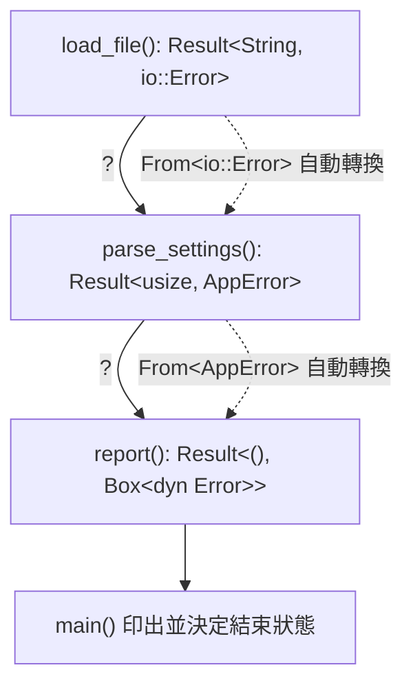

# 8.3 錯誤傳播的捷徑：? 運算子

## ? 的語意

`?` 運算子讓錯誤傳播從繁瑣的樣板程式碼變成一行。它只能在回傳 `Result`（或 `Option`）的函式裡使用，作用是：當左邊的運算式得到 `Err` 時，**立即以它回傳**，並且在回傳之前把錯誤型別轉換成這個函式所要求的型別。

```rust
use std::fs;
use std::io::Read;

fn read_config(path: &str) -> Result<String, std::io::Error> {
    let mut content = String::new();
    fs::File::open(path)?.read_to_string(&mut content)?;
    Ok(content)
}

fn main() {
    println!("{:?}", read_config("Cargo.toml"));
}
```

這段程式碼若用 `match` 展開，大致要寫成這樣：

```rust
use std::fs;
use std::io::Read;

fn read_config(path: &str) -> Result<String, std::io::Error> {
    let mut file = match fs::File::open(path) {
        Ok(f) => f,
        Err(e) => return Err(e),
    };
    let mut content = String::new();
    match file.read_to_string(&mut content) {
        Ok(_) => Ok(content),
        Err(e) => return Err(e),
    }
}

fn main() {
    println!("{:?}", read_config("Cargo.toml"));
}
```

`?` 運算子把這兩段 `match` 壓縮成兩行。關鍵在於它不只是「展開 `match`」這麼簡單——它同時完成了**錯誤型別的轉換**，這是第二個段落的主題。

值得注意的是，`?` 版本的回傳型別依然是 `Result<String, std::io::Error>`，與展開版完全相同。`?` 沒有改變函式的語意契約，只是讓程式碼更短。

## 轉換的機制：From 特徵

當 `?` 遇到 `Err(e)` 時，它需要把 `e` 轉成函式回傳型別所要求的 `E`。這個轉換透過 `From` 特徵完成。`From` 的定義非常簡單：

```rust
pub trait Convert<T>: Sized {
    fn convert(value: T) -> Self;
}

fn main() {
    let n = 42;
    let s = String::from("42");
    println!("{n} {s}");
}
```

`?` 的轉換規則是：如果 `E: From<源錯誤型別>`，則呼叫 `E::from(e)` 把源錯誤轉成目標錯誤。對同一個錯誤型別，這個轉換是恆等轉換（`From` 的空白實作）。

標準庫為此提供了廣泛的支援。最常見的是 `Box<dyn Error>`，它對所有實作 `Error` 的型別都有 `From` 實作：

```rust
use std::error::Error;
use std::fs;

fn read_and_count(path: &str) -> Result<usize, Box<dyn Error>> {
    let content = fs::read_to_string(path)?;
    Ok(content.lines().count())
}

fn main() {
    println!("{:?}", read_and_count("Cargo.toml"));
}
```

在這裡，`fs::read_to_string` 回傳 `Result<String, io::Error>`，而函式要求 `Box<dyn Error>`。因為 `Box<dyn Error>: From<io::Error>` 成立，轉換自動完成，程式碼裡不需要任何 `map_err`。

這個機制的威力在多層呼叫鏈中才真正展現。假設底層回傳 `io::Error`，中層想把它包成自己的錯誤型別 `AppError`，最上層想用 `Box<dyn Error>`，那麼每一層只需要實作一次 `From`：

```rust
use std::error::Error;
use std::fmt;
use std::io;

#[derive(Debug)]
enum AppError {
    Io(io::Error),
    Parse(String),
}

impl From<io::Error> for AppError {
    fn from(e: io::Error) -> Self {
        AppError::Io(e)
    }
}

impl Error for AppError {
    fn source(&self) -> Option<&(dyn Error + 'static)> {
        match self {
            AppError::Io(e) => Some(e),
            AppError::Parse(_) => None,
        }
    }
}

impl fmt::Display for AppError {
    fn fmt(&self, f: &mut fmt::Formatter<'_>) -> fmt::Result {
        match self {
            AppError::Io(e) => write!(f, "IO 錯誤：{e}"),
            AppError::Parse(m) => write!(f, "解析錯誤：{m}"),
        }
    }
}

fn read_raw(path: &str) -> Result<String, io::Error> {
    std::fs::read_to_string(path)
}

fn parse_settings(path: &str) -> Result<usize, AppError> {
    let content = read_raw(path)?;          // io::Error 自動轉成 AppError
    let count = content.lines().filter(|l| !l.is_empty()).count();
    Ok(count)
}

fn report(path: &str) -> Result<(), Box<dyn Error>> {
    let n = parse_settings(path)?;          // AppError 自動轉成 Box<dyn Error>
    println!("共 {n} 行");
    Ok(())
}

fn main() {
    report("Cargo.toml").unwrap();
}
```

注意 `parse_settings` 裡那個 `?`：它同時處理了兩件事——判斷錯誤、轉換型別。這是 `?` 與單純的 `match` 展開之間最重要的差別。

## ? 對 Option 也有效

`?` 不只對 `Result` 有效，在回傳 `Option` 的函式裡它會把 `None` 直接回傳：

```rust
fn first_word(s: &str) -> Option<&str> {
    let s = s.trim();
    if s.is_empty() {
        return None;
    }
    let word = s.split_whitespace().next()?;   // None 時直接回傳 None
    Some(word)
}

fn main() {
    println!("{:?}", first_word("hello world"));
    println!("{:?}", first_word("   "));
}
```

這裡 `?` 的行為是：若 `next()` 回傳 `None`，立刻從函式回傳 `None`；否則把內部值解包後繼續。寫法上比 `and_then` 冗長，但在需要把中間值從 `Option` 提升為外層函式的型別時很有用。

一個實務上的重要差異是：**`?` 在 `Result` 與 `Option` 之間不能直接互通**。在回傳 `Result` 的函式裡對 `Option` 使用 `?` 會得到編譯錯誤，反之亦然。標準庫提供了 `ok_or` 與 `ok_or_else` 作為橋樑，讓你可以顯式地做這個轉換：

```rust
fn first_word(s: &str) -> Option<&str> {
    let s = s.trim();
    if s.is_empty() {
        return None;
    }
    s.split_whitespace().next()
}

fn first_word_checked(s: &str) -> Result<&str, String> {
    let word = first_word(s).ok_or_else(|| "字串沒有任何單字".to_string())?;
    Ok(word)
}

fn main() {
    println!("{:?}", first_word_checked("hello world"));
    println!("{:?}", first_word_checked("   "));
}
```

注意這裡的 `?` 作用在 `Result` 上——`ok_or_else` 已經把 `Option` 轉成了 `Result`，所以 `?` 得以運作。這個模式在把多個 `Option` 串接成 `Result` 的呼叫鏈時非常實用。

## 與 try 的對照

`?` 運算子與其他語言的 try 機制在概念上相近，但細節差異很大。把它們並排比較可以看清 Rust 版本的特點。

在 Kotlin 中，`try` 是一個**表達式**，可以出現在任何地方，回傳值型別固定為 `Result<T, Exception>`：

```kotlin
val value = try {
    riskyOperation()
} catch (e: Exception) {
    fallback()
}
```

在 C# 中，`try` 是**陳述式**區塊，而「安全呼叫」使用 null 傳播：

```csharp
var length = possiblyNull?.Length ?? 0;
```

Rust 的 `?` 與兩者都不同：它是**運算子**，用在運算式位置，且它的行為完全由**函式的回傳型別**決定。回傳型別是 `Result<T, E>` 時它處理 `Err`，是 `Option<T>` 時它處理 `None`，回傳型別是別的東西時它根本不能使用。

這個設計差異帶來一個重要後果：`?` 讓錯誤的型別**隨著呼叫鏈自然演進**。每一層函式可以選擇不同的錯誤型別，只要 `From` 轉換存在，`?` 就會自動完成橋接。相較之下，Kotlin 的 `try` 產生的錯誤永遠是 `Exception`，C# 的例外則是在**不受型別系統約束**的動態通道上流動。

換句話說，Rust 的 `?` 不只是語法糖，它是**型別導引的錯誤傳播**。

## ? 在呼叫鏈中的傳播

把 `?` 放在呼叫鏈裡看，轉換的機制會更清楚：



圖中的實線代表控制流程，虛線代表型別轉換。每一跳的轉換都必須有對應的 `From` 實作存在，否則編譯器會拒絕這個 `?`。這是 `?` 最重要的性質：**錯誤能走多遠，是由型別系統決定的，不是由程式設計者的紀律決定的**。

這個圖也解釋了為什麼 `From` 的實作要精心設計。若 `AppError` 沒有 `From<io::Error>`，你就必須手寫 `map_err(|e| AppError::Io(e))`，這在每個呼叫點都要重複，而且容易在某個地方漏掉。加上 `From` 之後，轉換變成宣告在型別上的事實，只需要寫一次。

## 多層呼叫鏈的完整範例

下面是一個從檔案讀取一路傳播到最上層的完整例子，展示每一層如何用自己的語意表達錯誤：

```rust
use std::error::Error;
use std::fmt;
use std::fs;
use std::io;

#[derive(Debug)]
enum ConfigError {
    Io(io::Error),
    Syntax { line: usize, message: String },
}

impl fmt::Display for ConfigError {
    fn fmt(&self, f: &mut fmt::Formatter<'_>) -> fmt::Result {
        match self {
            ConfigError::Io(e) => write!(f, "無法讀取檔案：{e}"),
            ConfigError::Syntax { line, message } => {
                write!(f, "第 {line} 行語法錯誤：{message}")
            }
        }
    }
}

impl Error for ConfigError {}

impl From<io::Error> for ConfigError {
    fn from(e: io::Error) -> Self {
        ConfigError::Io(e)
    }
}

fn load_file(path: &str) -> Result<Vec<String>, ConfigError> {
    let raw = fs::read_to_string(path)?;          // io::Error -> ConfigError
    Ok(raw.lines().map(str::to_string).collect())
}

fn validate(lines: &[String]) -> Result<(), ConfigError> {
    for (i, line) in lines.iter().enumerate() {
        if !line.contains('=') {
            return Err(ConfigError::Syntax {
                line: i + 1,
                message: "缺少 '=' 分隔符".to_string(),
            });
        }
    }
    Ok(())
}

fn load_config(path: &str) -> Result<usize, ConfigError> {
    let lines = load_file(path)?;
    validate(&lines)?;
    Ok(lines.len())
}

fn main() -> Result<(), Box<dyn Error>> {
    match load_config("config.txt") {
        Ok(n) => {
            println!("設定檔有效，共 {n} 行");
            Ok(())
        }
        Err(e) => {
            eprintln!("錯誤：{e}");
            Err(e.into())
        }
    }
}
```

這段程式碼的分層是教科書式的：最底層 `load_file` 知道 I/O 錯誤，中層 `validate` 知道語法錯誤，最上層 `main` 決定如何呈現給使用者。每一層的錯誤型別都是**自己這一層最自然的表達**，而不是一個所有層共用的通用錯誤。

## 在 main 中使用 ?

Rust 允許 `main` 直接回傳 `Result`，簽章是 `fn main() -> Result<(), Box<dyn Error>>`。當 `main` 回傳 `Err` 時，Rust 會用 `Debug` 格式印出錯誤，並讓行程以失敗狀態碼結束。

這個慣例的好處是 CLI 工具不必寫：

```rust
fn load_config(path: &str) -> Result<usize, Box<dyn std::error::Error>> {
    let content = std::fs::read_to_string(path)?;
    Ok(content.lines().count())
}

fn run() -> Result<(), Box<dyn std::error::Error>> {
    let n = load_config("Cargo.toml")?;
    println!("設定檔有效，共 {n} 行");
    Ok(())
}

fn main() {
    if let Err(e) = run() {
        eprintln!("錯誤：{e}");
        std::process::exit(1);
    }
}
```

而只要寫：

```rust
fn load_config(path: &str) -> Result<usize, Box<dyn std::error::Error>> {
    let content = std::fs::read_to_string(path)?;
    Ok(content.lines().count())
}

fn main() -> Result<(), Box<dyn std::error::Error>> {
    let n = load_config("config.txt")?;
    println!("設定檔有效，共 {n} 行");
    Ok(())
}
```

注意 `Debug` 格式意味著錯誤訊息會以類似 `Syntax { line: 3, message: "缺少 '=' 分隔符" }` 的形式出現。對使用者來說，`Display` 格式通常更合適，因此實務上常見的折衷是在 `main` 中明確 `match` 並用 `Display` 印出，如上面完整範例所示。

另一個常見寫法是 `fn main() -> Result<(), Box<dyn Error + Send + Sync>>`，加上 `Send + Sync` 是為了讓錯誤值能在執行緒之間移動，在某些框架中是必要的。

`main` 回傳 `Result` 還有一個副作用值得注意：Rust 的 `Termination` 機制會在 `main` 回傳 `Err` 時使用**非零的退出碼**，這讓 shell 腳本可以直接檢查 `$?` 來判斷程式是否成功。這與許多語言的預設行為不同——在 Java 裡，未捕捉的例外同樣會導致非零退出碼，但 Rust 讓這件事變成**顯式宣告**而非隱含行為。

## 自訂錯誤型別與 thiserror

手寫 `Display` 與 `Error` 實作雖然不難，但每個錯誤型別都要寫好幾個 `match`，冗長且容易出錯。`thiserror` 程序巨集解決了這個問題：

```toml
[dependencies]
thiserror = "1"
```

```rust
use thiserror::Error;

#[derive(Debug, Error)]
enum ConfigError {
    #[error("無法讀取檔案：{source}")]
    Io {
        #[from]
        source: std::io::Error,
    },

    #[error("第 {line} 行語法錯誤：{message}")]
    Syntax { line: usize, message: String },

    #[error("缺少必要的設定項：{0}")]
    Missing(String),
}

fn main() {
    let e = ConfigError::Missing("port".to_string());
    println!("{e}");
}
```

`thiserror` 會自動產生 `Display` 實作，把每個欄位依格式字串填入，同時產生 `Error` 實作。`#[source]` 標記的欄位會被設為 `source()` 的回傳值，形成**錯誤鏈**——這一點在第 8.2 節談到 `Error::source` 時已經提過，它讓上層可以用 `anyhow` 的報告功能走訪整條鏈。

`thiserror` 的 `#[from]` 標記會同時建立 `source()` 關係**並**生成對應的 `From` 實作。因此上面的 `ConfigError::Io` 可以直接用 `?` 從 `io::Error` 轉換過來，只要把欄位標成 `#[from]` 即可：

```rust
use thiserror::Error;

#[derive(Debug, Error)]
enum ConfigError {
    #[error("無法讀取檔案：{source}")]
    Io {
        #[from]
        source: std::io::Error,
    },

    #[error("缺少必要的設定項：{0}")]
    Missing(String),
}

fn load_file(path: &str) -> Result<Vec<String>, ConfigError> {
    let raw = std::fs::read_to_string(path)?;   // 自動轉成 ConfigError::Io
    Ok(raw.lines().map(str::to_string).collect())
}

fn main() {
    println!("{:?}", load_file("Cargo.toml").is_ok());
}
```

`thiserror` 的欄位語法有幾個值得記住的慣例。`#[error("...")]` 裡的具名欄位可以直接以 `{name}` 插值，位置參數則用 `{0}`、`{1}` 這樣的索引，這對應到列舉的元組變體。`#[source]` 標記會把欄位設為 `source()` 的回傳值，建立錯誤鏈但**不**生成 `From` 實作；`#[from]` 則同時建立 `source()` 關係**並**生成 `From` 實作，因此 `#[from] source: std::io::Error` 一行就等於上面手寫的 `From` 實作加上 `#[source]` 標記。

`#[error(transparent)]` 則是另一個常用選項，它讓錯誤在 `Display` 與 `source()` 上**完全透明地轉發**給內部錯誤，通常用在只包裝單一來源的包裝型別上。

## 幾種錯誤處理方式的對照

Rust 生態系裡存在好幾種錯誤處理風格，它們各有適用場景：

| 方式 | 錯誤型別 | 呼叫者可否區分不同錯誤 | 適用位置 |
| --- | --- | --- | --- |
| `Result<T, E>` 搭配具體列舉 | `MyError` | 可以，用 `match` | 函式庫的公開 API |
| `Result<T, Box<dyn Error>>` | 動態 | 只能看訊息 | 內部工具、簡單的應用程式 |
| `anyhow::Result<T>` | 動態且支援上下文鏈 | 只能看訊息與鏈 | 應用層、CLI 工具 |
| `panic!` | 無 | 不適用 | 不變量被破壞、不可復原的邏輯錯誤 |
| `Option<T>` | 無原因 | 不適用 | 「有或沒有」且失敗原因無意義 |
| `unwrap` / `expect` | 無 | 不適用 | 測試、已證明不可能失敗的路徑 |

從這張表可以看出，主要的判斷軸只有兩條：**呼叫者需不需要區分錯誤種類**，以及**這是可復原的失敗還是邏輯缺陷**。第一條決定了該用具體的列舉還是動態的錯誤型別；第二條決定了該用 `Result` 還是 `panic!`。

一個常見的實務組合是：最底層的模組用具體的 `thiserror` 錯誤型別，因為它們可能成為別人的依賴；中層開始轉為 `anyhow`，把各種錯誤收進同一個通道並附加上下文；最上層 `main` 印出完整的原因鏈。

## 應用層用 anyhow

`thiserror` 適合**函式庫**：那裡的錯誤型別是公開 API 的一部分，呼叫者可能需要針對不同錯誤做不同處置。而**應用程式**通常不需要這種精確度——它只是需要把錯誤往上送，直到最上層印出來。這就是 `anyhow` 的定位。

```toml
[dependencies]
anyhow = "1"
```

```rust
use anyhow::{Context, Result};

fn load_file(path: &str) -> Result<String> {
    std::fs::read_to_string(path)
        .with_context(|| format!("讀取設定檔 {path} 失敗"))
}

fn parse_pairs(text: &str) -> Result<Vec<(String, String)>> {
    text.lines()
        .filter(|l| !l.trim().is_empty())
        .map(|l| {
            let (k, v) = l.split_once('=')
                .ok_or_else(|| anyhow::anyhow!("格式錯誤：{l}"))?;
            Ok((k.trim().to_string(), v.trim().to_string()))
        })
        .collect()
}

fn main() -> Result<()> {
    let text = load_file("config.txt")?;
    let pairs = parse_pairs(&text)?;
    println!("共 {} 組設定", pairs.len());
    Ok(())
}
```

`anyhow::Result<T>` 實際上是 `Result<T, anyhow::Error>` 的別名，而 `anyhow::Error` 是一個**動態的錯誤型別**，可以容納任何實作 `Error` 的型別，並且支援從上下文建構。

`anyhow` 與 `thiserror` 的分工可以用一句話總結：`thiserror` 定義**具體的**錯誤型別，`anyhow` 承載**任意的**錯誤型別。兩者並不衝突，一個應用程式完全可以兩者都用：底層模組用 `thiserror` 定義精確的錯誤，應用層用 `anyhow` 把它們收進動態的通道。

## 錯誤訊息設計

好的錯誤訊息分兩層：**給使用者看的訊息**與**給開發者看的上下文**。前者要說明「發生了什麼、你可以怎麼做」，後者要保留「在哪裡、為什麼」的技術細節。

這個分層的必要性來自兩類讀者的需求不同。使用者想知道的是「設定檔格式不對，請檢查第三行的設定」；開發者想知道的是「在 `parse_port` 的第 12 行，解析 `ParseIntError { kind: InvalidDigit }` 失敗」。前者需要可行動的指引，後者需要精確的技術位置。把兩者混在一段訊息裡，結果是使用者看到一堆無關的 Rust 型別名稱，開發者則要從冗長的句子裡挖出重點。

`anyhow::Context` 的 `.context()` 正是用來附加上下文的：

```rust
use anyhow::{Context, Result};

fn process(path: &str) -> Result<u64> {
    let raw = std::fs::read_to_string(path)
        .with_context(|| format!("無法開啟 {path}"))?;
    let mut total = 0u64;
    for (i, line) in raw.lines().enumerate() {
        let n: u64 = line
            .trim()
            .parse()
            .with_context(|| format!("第 {} 行不是合法的數字", i + 1))?;
        total += n;
    }
    Ok(total)
}

fn main() {
    println!("{:?}", process("Cargo.toml").is_err());
}
```

這個寫法的價值在於**上下文是隨著傳播逐層累積的**。最底層只知道自己失敗了，`context` 在每一層補上該層的資訊，最後呼叫者拿到的錯誤鏈裡包含了完整的路徑：

```
錯誤：無法開啟 /etc/app/config.toml
Caused by:
    0: 第 3 行不是合法的數字
    1: parse error: invalid digit found in string
```

這個輸出形態就是 `anyhow` 的 `Debug` 實作所產生的，它同時滿足了兩個讀者：使用者看到最上層的「無法開啟某某檔案」，開發者看到底層的解析細節。

值得注意的是，`Context` 是**延遲求值**的：closure 只在錯誤真的發生時才執行，所以附加上下文的成本不會影響成功路徑。這與 `ok_or_else` 的設計哲學一致——錯誤處理的成本只在錯誤發生時才付出。

在 `thiserror` 的世界裡，分層則是透過 `#[source]` 標記與 `Error::source()` 實作來達成的。`source()` 回傳的錯誤會被同樣的機制收進原因鏈，因此 `thiserror` 與 `anyhow` 在輸出形態上是相容的：底層用 `thiserror` 定義的錯誤，被上層的 `anyhow` 接住之後，原因鏈照樣完整。

## 常見陷阱

第一個陷阱是**在回傳型別不是 `Result` 的函式裡使用 `?`**。編譯器會直接報錯 `? operator can only be used in a function that returns Result or Option`，這是好事——它強迫你把回傳型別寫對，而不是偷偷忽略錯誤。

第二個陷阱是 **`let _ = ...` 吞掉錯誤**。這種寫法在 Rust 中是合法的，但會完全丟棄 `Err`：

```rust
fn risky_operation() -> Result<(), String> {
    Err("某種失敗".to_string())
}

fn main() {
    let _ = risky_operation();      // 錯誤被完全忽略
}
```

有時候這是有意的（例如「我不在乎這個錯誤」），但更多時候它是隱形的 bug。Clippy 的 `let_underscore_must_use` 與 `unused_must_use` lint 會協助抓出這些地方，尤其注意 `#[must_use]` 標記。

第三個陷阱是 **`unwrap_or` 掩蓋了真正的錯誤語意**。`unwrap_or(預設值)` 與 `unwrap_or_else(|| 預設值)` 都能讓錯誤消失，但兩者的成本特性不同——前者即使在成功路徑上也要先算好預設值。

第四個陷阱是**在 `Err` 分支裡忘記加上上下文**。`?` 自動轉換型別，但不會自動告訴你「這次失敗是在做什麼」。第 8.2 節提到 `expect` 能提供更好的診斷訊息，相同的原理在 `Result` 世界裡由 `with_context` 與 `map_err` 扮演。

第五個陷阱是**過度使用 `Box<dyn Error>`**。它方便，但會讓錯誤型別失去結構，使得呼叫者無法針對特定錯誤做處理。判斷標準很簡單：**如果呼叫者有可能需要針對這類錯誤採取不同行動，就該用具體的錯誤型別**。

第六個陷阱是**在 `?` 之前先做部分處理**。例如這個寫法：

```rust
fn main() -> Result<(), Box<dyn std::error::Error>> {
    let raw = std::fs::read_to_string("Cargo.toml").unwrap_or_default();
    let n = raw.len() as u32;                              // 只剩下這一處會報錯
    println!("{n}");
    Ok(())
}
```

第一行的 `unwrap_or_default` 把「檔案不存在」和「檔案是空的」混為一談，錯誤資訊從此無法追回。`?` 的傳播鏈之所以珍貴，正是因為它**保證錯誤一路上行**，中途任何一次轉換都必須明確宣告。

第七個陷阱則是**忽略 `?` 的上下文**。`?` 會自動做型別轉換，但轉換本身不帶任何語意資訊。若 `From` 實作只是單純地包裝而不加上任何描述性資訊，錯誤訊息在往上走的過程中會變得越來越難以辨識。好的 `From` 實作應該在做轉換時順手補上這一層的語意。

## 錯誤處理的哲學總結

回顧整個第 8 章，Rust 的錯誤處理可以濃縮成一句話：**Rust 把「錯誤會發生」從一個執行期的意外，變成了一個型別層面的事實**。

這個轉變帶來三個具體的後果。第一，**錯誤的可能性被寫在簽章裡**，任何讀到函式型別的人都知道它可能失敗、錯誤是什麼形狀。第二，**處理的位置是強迫的**，編譯器不會允許你忽略一個 `Err`。第三，**抽象的成本是零的**，`?` 在編譯期被展開成簡單的分支判斷，沒有任何執行期負擔。

從設計的角度看，這個轉變的價值在於**把不變量集中管理**。傳統的錯誤處理把「這個函式可能失敗」這件事散落在文件、約定、以及每個呼叫點的檢查裡；Rust 把它收斂到型別簽章這一處。這不只節省了程式碼，更讓錯誤的**完整性**變成可被工具驗證的性質——編譯器可以保證沒有任何一條路徑會遺漏處理。

另一個值得體會的面向是**錯誤的表達成本與使用頻率無關**。`Result<T, E>` 的大小在編譯期就確定，不論 `E` 是什麼型別，錯誤值的儲存都不會佔用額外空間，除非真的發生錯誤並把它建構出來。這與例外模型形成對比——在例外模型裡，錯誤路徑的程式碼體積與堆疊成本都會隨著錯誤種類的增多而膨脹。

`Result` 負責可復原的失敗，`panic!` 負責不可復原的邏輯錯誤，`?` 負責讓兩者沿著呼叫鏈向上流動。當這三者搭配得當，錯誤處理不再是程式碼的雜訊，而是程式結構的一部分。

這個觀念有一個更廣的延伸：**在 Rust 裡，「某種情況會發生」不是一個註解或文件段落裡的敘述，而是必須表現在型別上的事實**。這條原則適用於 `Option`（值可能不存在）、`Result`（操作可能失敗）、`bool`（條件可能不成立）、`Vec`（長度可能為零）。當一個語言要求設計者用型別來表達所有這些可能性，程式碼的正確性檢查就不再依賴下游的自律，而是由編譯器統一把關。

而在下一章，議題會從「錯誤怎麼表達」轉向「抽象怎麼表達」。泛型與特徵讓你可以寫出**對型別完全泛化**的函式，同時在每個具體型別上獲得最佳效能——這是 Rust「零成本抽象」承諾的技術基礎。