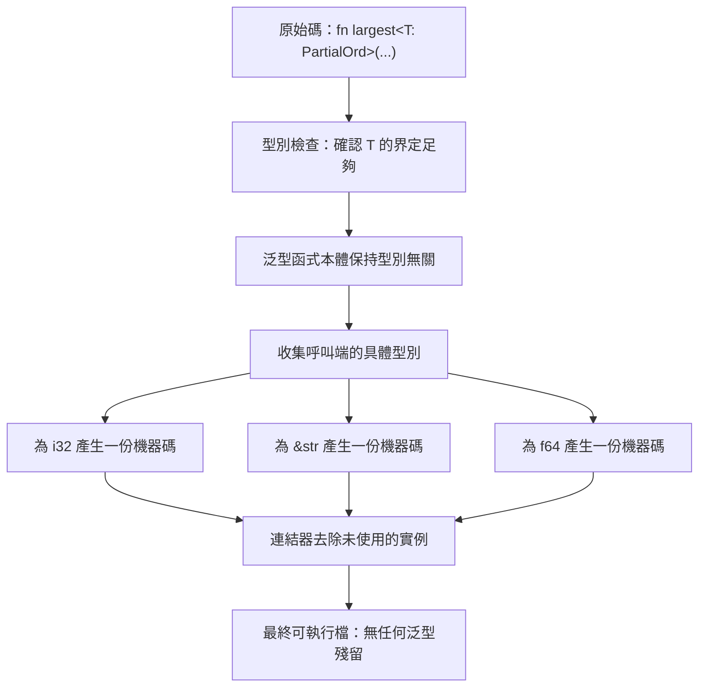

# 9.1 泛型型別參數（Generics）

## 泛型函式

泛型是 Rust 抽象機制的基礎。與其為整數、浮點數、字串各寫一份同樣邏輯的函式，不如寫一份泛型函式，讓它適用於任何符合條件的型別：

```rust
fn largest<T: PartialOrd>(list: &[T]) -> &T {
    let mut largest = &list[0];
    for item in list {
        if item > largest {
            largest = item;
        }
    }
    largest
}

fn main() {
    let numbers = [34, 50, 25, 77, 31];
    println!("最大的數是 {}", largest(&numbers));
    println!("最長的字串是 {}", largest(&["a", "abc", "ab"]));
}
```

`<T: PartialOrd>` 這段稱為**特徵界定**（trait bound），它說明泛型參數 `T` 必須實作 `PartialOrd`。`<T>` 等同於 `<T: Sized>`，而 `Sized` 隱含在所有泛型參數中，因此泛型型別的長度在編譯期就已知。

`largest` 的回傳型別 `&T` 也值得留意：它回傳的是**借用的參考**，而非擁有型別的值。這讓函式不需要複製資料，也不會造成所有權轉移，呼叫端仍然保有原本的陣列。

在簽章中寫出特徵界定是必須的，因為編譯器需要知道 `T` 支援 `>` 運算子才能編譯這個函式。若去掉界定，編譯器會報錯說 `T` 沒有一致的比較運算子。

## 泛型結構體與列舉

泛型可以用在結構體與列舉上，參數同樣以 `<T>` 宣告：

```rust
struct Point<T> {
    x: T,
    y: T,
}

struct Wrapper<T> {
    value: T,
}

enum Either<L, R> {
    Left(L),
    Right(R),
}

impl<T> Point<T> {
    fn new(x: T, y: T) -> Self {
        Point { x, y }
    }
}

impl<T: Copy> Point<T> {
    fn duplicate(&self) -> Point<T> {
        Point { x: self.x, y: self.y }
    }
}

fn main() {
    let p = Point::new(1.0, 2.0);
    let q = Point { x: 5, y: 10 };
    println!("({}, {})", p.x, p.y);
    println!("({}, {})", q.x, q.y);
}
```

這裡的 `impl<T>` 與 `impl<T: Copy>` 展示了 Rust 的**選擇性特徵實作**機制。同樣是 `Point`，泛型的 `impl` 區塊對所有 `T` 都可用，而帶有 `Copy` 界定的區塊只對滿足條件的 `T` 可用。若把 `Copy` 的界定去掉而直接複製 `self.x`，編譯器就會因為 `T` 未必是 `Copy` 而拒絕。

`Either<L, R>` 是一個實用的泛型列舉，它只要求兩個型別各自實作 `PartialOrd` 就能提供比較能力。注意 Rust 的泛型是**結構式的**——`Option<T>`、`Result<T, E>`、`Vec<T>` 這些都是標準庫裡的泛型型別，你無法在不重新實作的前提下新增新的 `Option`。

## 單態化

Rust 的泛型在編譯期會被**單態化**（monomorphization）：編譯器為每個實際使用的具體型別產生一份專屬的程式碼。

```rust
fn print_it<T: std::fmt::Display>(x: &T) {
    println!("{x}");
}

fn main() {
    print_it(&1);
    print_it(&1.5);
    print_it(&"hi");
}
```

這段程式碼在編譯期會變成三份函式：`print_it::<i32>`、`print_it::<f64>` 與 `print_it::<&str>`。每一份都是針對該型別最佳化後的機器碼。

單態化的**好處**是零執行期成本。泛型在編譯期消失，執行期完全不知道抽象的存在，`print_it` 與直接寫 `println!("{}", 1)` 產生相同的程式碼。而且每一份都經過最佳化器處理，因此泛型程式碼的效能往往比執行期泛型語言更好。

單態化的**代價**是編譯時間與程式體積。每多一個具體型別，就多一份程式碼。以 `serde` 這類高度泛型的 crate 為例，它的單態化結果可能比原始碼大上數十倍。

這個取捨的量化可以用一個簡單的模型描述。若泛型函式有 $`n`$ 個實例化，每個實例的平均程式碼大小是 $`s`$ ，那麼最終的程式體積約為：

$$
\text{size} \approx n \cdot s
$$

而編譯時間則近似為：

$$
t_{\text{compile}} \approx n \cdot c + t_{\text{base}}
$$

其中 $`c`$ 是單一實例化的編譯成本， $`t_{\text{base}}`$ 是不依賴實例化數量的固定成本。這個模型解釋了為什麼大型泛型 crate 會有編譯時間爆炸的現象—— $`n`$ 隨著依賴樹的深度呈乘積式增長。

## 與 C++ 模板的比較

Rust 的泛型與 C++ 的模板表面上很像，但行為上有重要差異。

最關鍵的差異是**錯誤發生的時機**。C++ 的模板錯誤在**實例化時**才出現，也就是當編譯器真正看到 `largest<SomeType>` 時才會檢查。以下程式碼在 C++ 中可以通過模板定義階段的檢查，只有在實例化時才會失敗：

```cpp
template <typename T>
T largest(std::vector<T> v) {
    return *std::max_element(v.begin(), v.end());  // 對沒有 operator< 的型別會出錯
}
```

Rust 則是在**撰寫泛型函式本身時**就檢查。你在函式本體裡呼叫 `item > largest` 的那一刻，編譯器就已經知道 `T: PartialOrd` 這個條件，於是立刻拒絕任何不滿足條件的用法。錯誤訊息出現在錯誤發生的位置，而不是在遙遠的呼叫點。

第二個差異是**模板的兩階段名稱查找**。C++ 模板中依賴名稱的查找在定義與實例化時各進行一次，這導致著名的「template 的兩階段查找」規則，以及一些難以解釋的編譯錯誤。Rust 沒有這個概念，泛型的語意只有一套。

第三個差異是 Rust **沒有特化（specialization）**，也沒有 C++ 那種明確指定實作的方式。要在 Rust 中為特定型別提供最佳化版本，用的是**特徵界定**而非模板特化，這在第 9.3 節會說明。

第四個差異是**型別安全性**。C++ 的模板可以接受非型別參數，讓同一份模板產生行為差異極大的程式碼；Rust 的泛型參數只能是型別，語意受到語言規範的嚴格約束。

## 生命週期與泛型參數的順序

在簽章中，生命週期參數必須寫在泛型參數**之前**，這是硬性的語法規則：

```rust
fn longest<'a>(x: &'a str, y: &'a str) -> &'a str {
    if x.len() > y.len() { x } else { y }
}

fn main() {
    println!("{}", longest("hello", "worldwide"));
}
```

正確的寫法是 `fn longest<'a, T: PartialOrd>(x: &'a T, y: &'a T) -> &'a T`。若寫成 `fn longest<T, 'a>`，編譯器會直接報錯，告訴你生命週期參數必須排在型別參數之前。

這個順序不是隨意的。Rust 的語法把簽章拆成「生命週期部分」與「型別部分」兩塊，生命週期描述的是**引用的有效期間**，型別描述的是**值的種類**，前者是後者的前提，因此自然排在前面。

在第 5 章我們已經看過省略生命週期的規則，在多個生命週期參數並存時（例如 `&'a str` 與 `&'b str`），省略生命週期會讓編譯器嘗試推導，而推導失敗時就會要求你明確標註。

## 泛型與 impl Trait 的取捨

Rust 有兩種方式表達「參數接受多種型別」。傳統的泛型寫法是把型別參數寫進簽章，`impl Trait` 則把它藏起來：

```rust
// 泛型版本
fn print_all_generic<T: std::fmt::Debug>(items: &[T]) {
    for i in items {
        println!("{i:?}");
    }
}

// impl Trait 版本
fn print_all_impl(items: &[impl std::fmt::Debug]) {
    for i in items {
        println!("{i:?}");
    }
}

fn main() {
    print_all_generic(&[1, 2, 3]);
    print_all_impl(&[1, 2, 3]);
}
```

兩者在此例中行為相同，但 `impl Trait` 有個重要限制：**每個函式簽章中只能出現一次**。你不能寫 `fn foo(a: impl Trait, b: impl Trait)`，因為那兩個 `impl Trait` 會被視為**不同的**泛型參數，型別系統無法推論它們相同。若需要多個參數同型，就必須改用顯式的泛型參數：

```rust
fn compare_same<T: std::fmt::Debug>(a: T, b: T) {
    println!("{a:?} {b:?}");
}

fn main() {
    compare_same(1, 2);
    compare_same("a", "b");
}
```

另一個限制是 `impl Trait` 不能用在**回傳型別的位置以外的地方**做更複雜的綁定，例如「一個持有某個特徵物件的容器」這類需求就不能用 `impl Trait` 表達。

從效能角度看，兩種寫法都會被單態化，成本相同。差別純粹在**可讀性與表達力**：`impl Trait` 讓簽章更簡潔，適合「這個函式接受任何實作某特徵的型別，但呼叫端不需要指定它」的情境。

## 泛型與特徵界定的關係

特徵界定是泛型的**必要條件**。沒有界定，泛型函式就無法使用任何依賴具體型別的操作，因為編譯器不知道 `T` 是什麼。

這個關係可以分三個層次來看：

| 層次 | 寫法 | 意義 |
| --- | --- | --- |
| 完全無界定 | `fn f(x: T)` | `T` 完全由呼叫端決定，函式本體不能做任何假設 |
| 基本界定 | `fn f<T: Clone>(x: T)` | `T` 必須實作 `Clone`，可以呼叫其方法 |
| 多重界定 | `fn f<T: Clone + Debug + Send>(x: T)` | 同時滿足多個特徵的條件 |

界定也可以用 `where` 子句寫在簽章之後，適合比較長或需要多行的情況：

```rust
use std::fmt::Debug;

fn show<T>(x: T)
where
    T: Clone + Debug,
{
    println!("{:?}", x.clone());
}

fn main() {
    show(vec![1, 2, 3]);
    show(String::from("hi"));
}
```

`where` 子句還能界定**關聯型別**，這是特徵進階用法的入口：

```rust
fn largest_item<T>(items: &[T]) -> Option<T>
where
    T: Copy + PartialOrd,
{
    let mut it = items.iter();
    let first = it.next()?;
    let mut best = *first;
    for x in it {
        if *x > best {
            best = *x;
        }
    }
    Some(best)
}

fn main() {
    println!("{:?}", largest_item(&[3, 9, 2]));
}
```

這裡的 `T: Copy + PartialOrd` 對應到特徵界定，而像 `T::Item: PartialOrd` 這種寫法，則需要 `T` 被界定在一個帶有 `Item` 關聯型別的特徵上，例如 `T: Iterator`，這是第 9.2 節會詳細說明的機制。

要注意的是，界定並不只是「允許你呼叫這些方法」，它同時**承諾了語意**。要求 `T: Clone` 不只是語法上的便利，而是宣告「這個函式可能需要複製 `T`」，因此 `T` 必須能安全地複製。這個隱含的語意契約是 Rust 泛型設計中非常重要的一環。

## 實務中的泛型

泛型在實務中的應用可以歸納為幾個方向。

**容器**是最直接的例子。`Vec<T>`、`HashMap<K, V>`、`Option<T>`、`Result<T, E>` 全部是泛型，它們把記憶體管理與型別安全結合起來，同時對所有元素型別最佳化。

**演算法與迭代器**是第二個方向。第 11 章會詳細討論迭代器，但這裡可以先預告：`Iterator` 特徵配合泛型，讓 `map`、`filter`、`fold` 這些組合子在任何元素型別上都能運作，並且被完全展開成靜態程式碼。

**零成本抽象**是第三個方向，也是 Rust 最重要的設計承諾之一。所謂零成本抽象，指的是「抽象不會帶來執行期成本」。泛型與單態化的結合正是這個承諾的技術基礎：你在原始碼層次獲得泛型的靈活性，在執行期獲得具體型別的最佳化。

要理解這個承諾的份量，可以做一個對比：如果用執行期泛型（例如 Go 的 `interface{}` 或 C++ 的虛函式）來實作同樣的抽象，每次呼叫都會有間接跳轉、無法內聯、且需要装箱。而 Rust 的泛型版本在編譯期就被展開成直接的函式呼叫，內聯器可以自由地跨函式最佳化。

這個對比可以用一個抽象的模型來說明。假設一個泛型函式在原始碼中被呼叫 $`n`$ 次，且在一次程式的執行過程中總共被呼叫 $`k`$ 次。靜態派發的執行期開銷近似為：

$$
\text{cost}_{\text{static}} \approx k \cdot c_{\text{direct}}
$$

而動態派發則多了一層間接跳轉與可能的快取未命中：

$$
\text{cost}_{\text{dynamic}} \approx k \cdot \left( c_{\text{direct}} + c_{\text{indirect}} \right)
$$

其中 $`c_{\text{indirect}}`$ 是間接跳轉的成本。這個差異通常在幾個百分點到幾倍的量級之間，具體取決於快取行為與分支預測。關鍵是**它恆為正**，因此在沒有其他考量的情況下，靜態派發永遠是更好的選擇。

## 與其他語言的泛型比較

**Java 的型別擦除**是與 Rust 最大的對比。Java 的泛型在編譯期被擦除成原始型別，泛型資訊只存在於編譯器內部，執行期完全不存在。這造成幾個後果：`List<String>` 與 `List<Integer>` 在執行期是同一個型別，因此無法建立 `new ArrayList<String>()` 再塞入整數而不經過明確的轉型；`instanceof` 也無法檢查具體的型別參數。Rust 走的是另一條路，透過單態化保留完整的型別資訊。

Java 也用**通配符**（`? extends T` 與 `? super T`）來表達型別的變化，Rust 則完全沒有這個概念——Rust 的泛型是**完全具體**的，`Vec<T>` 就是 `Vec<T>`，沒有任何需要「放寬」的場合。

**C# 的變型（variance）標註**是另一種取向。C# 允許在泛型參數上宣告 `in`（逆變）、`out`（協變）或 `in out`（不變），用來表現型別參數在函式簽章中的位置。C# 的 `IEnumerable<out T>` 表示 `IEnumerable<string>` 可以指派給 `IEnumerable<object>`，因為 `IEnumerable` 只以「產生 `T`」的方式使用 `T`。

Rust 沒有型別參數層級的變型標註，但預設的泛型型別是**協變**的：`&'a Vec<T>` 可以當作 `&'a Vec<U>` 使用（其中 `U: T`）。變型與生命週期的交互作用是一個微妙的議題，例如 `&'a Vec<&'a T>` 實際上是**不可變**的，這個「協變收縮」的特性在 Rust 裡是隱含的。

**Go** 完全沒有泛型（在 1.18 之前），使用 `interface{}` 加上型別斷言來達成類似的效果。Go 1.18 之後加入了型別參數，語法接近 Rust，但受限於沒有 trait bound 的語法（用介面限制取代），能力較弱。

**TypeScript** 的泛型則是**純編譯期**的，完全不存在於執行期，型別資訊在編譯後被完全抹除。Rust 的選擇是保留資訊並為此付出單態化的代價。

總結這些比較，Rust 的泛型在幾個關鍵點上與眾不同：**沒有型別擦除**、**編譯期就報錯**、**單態化換取零執行期成本**、以及**特徵界定提供了比 Java 的上限/下限更精確的約束表達**。

## 零成本抽象的量化

「零成本」這個詞在 Rust 社群被大量使用，但它常常被誤解成「抽象完全沒有代價」。更精確的說法是：**抽象在執行期沒有代價**——泛型、特徵物件、迭代器鏈、`?` 運算子這些機制，在原始碼層次提供了抽象，但在機器碼層次不留痕跡。

這個說法可以從三個層次來理解。**執行期成本**：泛型呼叫在編譯期展開後就是直接呼叫，沒有間接跳轉、沒有装箱、沒有查表。**編譯期成本**：這是真正存在的代價，包含單態化的時間與程式體積。**心智成本**：泛型的簽章比具體版本複雜，閱讀者需要理解特徵界定才能掌握約束。

第三項往往被低估。一個 `fn process<T: Read + Seek + Write>(...)` 的簽章，對不熟悉 Rust 的人來說比 `fn process(file: &mut File)` 難讀得多。因此實務上的判準是：**只有在型別參數確實帶來跨型別重用時才使用泛型**，否則用具體型別寫清楚更好。

值得留意的是，Rust 讓這個取捨變得可以量化。若某個泛型函式被實例化 $`n`$ 次，每次產生的程式碼大小為 $`s`$ ，而每個實例的編譯成本為 $`c`$ ，則：

$$
\text{size}_{\text{total}} = n \cdot s, \qquad
t_{\text{compile}} = n \cdot c
$$

這兩個式子直接給出了優化方向：若編譯時間過長，減少**實例化數量**比縮小**單一實例大小**有效得多；而這正是引入 `dyn Trait` 的主要動機——把 $`n`$ 份靜態程式碼換成一份動態派發程式碼加 $`n`$ 份呼叫端程式碼。

反過來，若你需要把不同型別的值**放進同一個集合**，泛型就無能為力了。此時必須使用 `Box<dyn Trait>` 這類的特徵物件，而 `Box` 正是第 10 章的主題。這個分工是清晰的：**泛型處理「同型但不同具體型別」的情況，特徵物件處理「真正異質」的情況**。

## 泛型在實務中的取捨

泛型並非永遠是最佳選擇。以下幾個情況值得考慮別的方案。

當**只需要接受少數幾種型別**時，用泛型可能造成程式碼爆炸。假設你要寫一個只接受 `String` 或 `&str` 的函式，用泛型會需要 `T: AsRef<str>` 加上一堆複雜的界定，這時候兩個 `impl` 區塊或一個 `Into<String>` 的轉換更簡單。

當**型別數量失控**時，單態化的成本會明顯上升。若一個泛型函式在整個程式庫中被實例化上百次，編譯時間與二進位檔大小都會受影響。緩解方式是引入 trait object（`Box<dyn Trait>`），把執行期成本換成編譯期成本的反面。

當**需要執行期多型**時，泛型幫不上忙。泛型在編譯期就決定了具體型別，若你要的是「執行期才知道要呼叫哪個實作」，那麼必須使用 `dyn Trait`，這是第 9.2 節的主題。

最後，**`impl Trait` 與 `dyn Trait` 的選擇**有一個實用的判準：如果回傳型別只有一個、而且你不打算讓呼叫端依賴它，那麼用 `impl Trait`（回傳 `impl Iterator<Item = u8>`）通常比 `Box<dyn Iterator<Item = u8>>` 更好，因為它省去了堆配置與一次間接跳轉。

## 單態化的編譯流程

泛型從原始碼到機器碼的轉換過程，可以畫成這樣：



這個流程的關鍵在於**收集與產生是分離的**。型別檢查發生在泛型的抽象層級，確保函式本體對所有可能的 `T` 都正確；而機器碼的產生發生在具體型別已知之後，因此可以使用所有只對具體型別成立的最佳化，例如假設 `i32` 的相加不會溢位。

最後的「連結器去除未使用的實例」步驟也很重要。即使編譯器為十個型別產生了程式碼，若只有三個真的被呼叫到，其餘的會在連結時被丟棄。這意味著**單態化的成本主要在編譯期**，最終程式的體積只反映實際用到的型別。