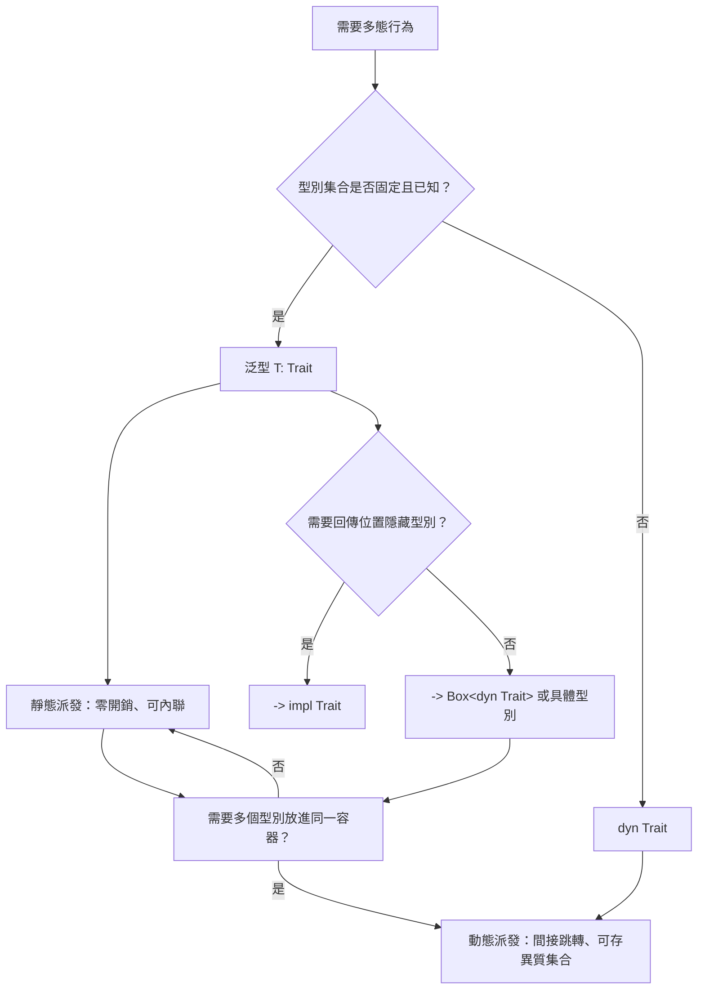

# 9.2 定義與實作特徵（Traits）

## 特徵是什麼

特徵（trait）是 Rust 的**行為介面**。它描述一組型別「必須提供什麼能力」，但不指定這些能力如何實作。

```rust
pub trait Summary {
    fn summarize(&self) -> String;

    fn author(&self) -> String {
        String::from("（未提供作者）")
    }
}

struct Article {
    title: String,
}

impl Summary for Article {
    fn summarize(&self) -> String {
        format!("文章：{}", self.title)
    }
}

fn main() {
    let a = Article { title: "Rust".to_string() };
    println!("{}", a.summarize());
    println!("{}", a.author());
}
```

這個定義包含三個部分。**方法簽章** `fn summarize(&self) -> String` 宣告了實作者必須提供的方法。**預設實作** `fn author(&self)` 提供了實作者可以選擇覆寫的預設行為。**特徵名稱** `Summary` 本身則是型別系統用來識別這個介面的標籤。

特徵與 Java 的 `interface` 在表面上看起來很像，但有幾個關鍵差異。最重要的差異是**預設方法可以呼叫其他方法**。在 Java 8 之後，介面也有預設方法，但預設方法不能呼叫抽象方法（因為實現者可能沒有實作它）。在 Rust 中，特徵的預設方法可以無限制地呼叫同一特徵的其他方法：

```rust
pub trait Summary {
    fn summarize(&self) -> String;

    fn notify(&self) -> String {
        format!("摘要：{}", self.summarize())
    }
}

struct Article {
    title: String,
}

impl Summary for Article {
    fn summarize(&self) -> String {
        format!("文章：{}", self.title)
    }
}

fn main() {
    let a = Article { title: "Rust".to_string() };
    println!("{}", a.notify());
}
```

這個能力讓特徵可以提供**有行為的組合**，而不只是宣告介面。標準庫中的 `Iterator` 就是靠這個機制，從單一的 `next()` 方法衍生出 `map`、`filter`、`collect` 等數十個方法。

## 為什麼用特徵而不是類別繼承

Rust **完全沒有類別繼承**。這是刻意的設計選擇，理由有三個。

第一，**多重繼承的衝突**。在 C++ 中，如果兩個父類別都有同名的方法，就會產生歧義，需要用 `using` 宣告來消解。Rust 用特徵取代繼承，讓一個型別可以實作多個特徵，而這些特徵之間的方法名稱衝突時，必須用**完全限定語法**來消歧：

```rust
trait Fly {
    fn fly(&self) -> String;
}

trait Swim {
    fn fly(&self) -> String {
        String::from("水中的飛行")
    }
}

struct Duck;

impl Fly for Duck {
    fn fly(&self) -> String { String::from("飛天") }
}

impl Swim for Duck {}

fn main() {
    let d = Duck;
    println!("{}", Fly::fly(&d));
    println!("{}", <Duck as Fly>::fly(&d));
}
```

第二，**可以為既有型別實作特徵**。Rust 的 orphan 規則允許你在自己的 crate 中，為標準庫的型別實作你自己的特徵：

```rust
use std::fmt;

struct Meters(f64);

trait Describe {
    fn describe(&self) -> String;
}

impl Describe for Meters {
    fn describe(&self) -> String {
        format!("{} 公尺", self.0)
    }
}

impl fmt::Display for Meters {
    fn fmt(&self, f: &mut fmt::Formatter<'_>) -> fmt::Result {
        write!(f, "{}m", self.0)
    }
}

fn main() {
    let m = Meters(100.0);
    println!("{}", m.describe());
    println!("{m}");
}
```

這種「為別人的型別加行為」的能力，在 Java 中只能透過包裝類別或繼承來達成，而繼承又受限於既有的類別階層。

第三，**沒有繼承的隱性耦合**。Java 的子類別隱含地依賴父類別的實作細節，一個 `protected` 方法的改動就可能破壞所有子類別。Rust 的特徵沒有這種隱性耦合，實作者只依賴特徵宣告的契約。

## 實作特徵

實作特徵的語法是 `impl Trait for Type`，其中 `Trait` 在前：

```rust
pub trait Summary {
    fn summarize(&self) -> String;

    fn author(&self) -> String {
        String::from("（未提供作者）")
    }
}

pub struct Article {
    pub title: String,
    pub author: String,
    pub content: String,
}

impl Summary for Article {
    fn summarize(&self) -> String {
        format!("{}，由 {} 撰寫", self.title, self.author)
    }

    fn author(&self) -> String {
        self.author.clone()
    }
}

fn main() {
    let a = Article {
        title: "Rust 簡介".to_string(),
        author: "ccc".to_string(),
        content: "內容".to_string(),
    };
    println!("{}", a.summarize());
    println!("{}", a.author());
}
```

注意 `impl Summary for Article` 與 `impl Article` 的差異。**固有實作**（inherent impl）定義型別自己的方法，寫在 `impl Type` 區塊裡，只能對本地型別定義。**特徵實作**（trait impl）定義某個特徵的方法，可以對本地或（在 orphan 規則允許下）外部型別定義。

同一個型別可以有多個特徵實作區塊，也可以有多個固有實作區塊。Rust 允許把多個特徵實作寫在同一個區塊裡：

```rust
use std::fmt;

pub struct Article {
    pub title: String,
}

impl fmt::Display for Article {
    fn fmt(&self, f: &mut fmt::Formatter<'_>) -> fmt::Result {
        write!(f, "{}", self.title)
    }
}

impl fmt::Debug for Article {
    fn fmt(&self, f: &mut fmt::Formatter<'_>) -> fmt::Result {
        write!(f, "Article({})", self.title)
    }
}

fn main() {
    let a = Article { title: "Rust 簡介".to_string() };
    println!("{a}");
    println!("{a:?}");
}
```

## 孤兒規則

Rust 對「誰可以為誰實作特徵」有嚴格的規定，這條規則叫做**孤兒規則**（orphan rule）。

規則的內容是：在 `impl Trait for Type` 中，`Trait` 與 `Type` **至少有一個必須是本地型別**（定義在當前 crate 中的型別）。若兩者都是外部型別，則禁止實作。

這個限制存在的理由是**避免不同 crate 對同一個型別的實作互相衝突**。假設 crate A 與 crate B 都依賴 crate C，crate C 定義了 `struct Foo`。若 A 與 B 都為 `Foo` 實作同一個來自 crate D 的特徵，那麼當某個 crate 同時依賴 A 與 B 時，編譯器就無法決定該用哪一份實作——這是 Rust 所禁止的「coherence」問題。

孤兒規則的實際效果是：

| 實作組合 | 是否允許 | 原因 |
| --- | --- | --- |
| 本地型別實作外部特徵 | 允許 | 型別是本地的 |
| 外部型別實作本地特徵 | 允許 | 特徵是本地的 |
| 本地型別實作本地特徵 | 允許 | 兩者都是本地的 |
| 外部型別實作外部特徵 | 禁止 | 兩者都是外部的，可能衝突 |

這個規則的實際影響是：你不能直接為 `Vec<String>` 或 `i32` 實作 `Iterator`（因為兩者都是外部的），但你可以定義自己的新特徵然後為 `Vec<String>` 實作它。標準庫自己則不受此限，因為它是所有 crate 的根依賴。

有一種常見的繞道手法是**新類型模式**（newtype pattern）：定義一個自己的包裝型別，內含外部型別，然後為它實作外部特徵：

```rust
struct MyVec(Vec<u8>);

impl IntoIterator for MyVec {
    type Item = u8;
    type IntoIter = std::vec::IntoIter<u8>;

    fn into_iter(self) -> Self::IntoIter {
        self.0.into_iter()
    }
}

fn main() {
    let v = MyVec(vec![1, 2, 3]);
    for x in v {
        println!("{x}");
    }
}
```

## 預設方法與覆寫

預設方法的價值在於**提供合理的預設行為，同時允許精確覆寫**。

```rust
pub trait Notification {
    fn required(&self) -> bool;

    fn message(&self) -> String {
        if self.required() {
            String::from("這是一則必要通知")
        } else {
            String::from("這是一則一般通知")
        }
    }
}

struct Always;
struct Never;

impl Notification for Always {
    fn required(&self) -> bool { true }
}

impl Notification for Never {
    fn required(&self) -> bool { false }
    fn message(&self) -> String {
        String::from("永不發送")
    }
}

fn main() {
    println!("{}", Always.message());
    println!("{}", Never.message());
    let n = Never;
    println!("{}", n.message());
    println!("{}", Notification::message(&n));
    println!("{}", <Never as Notification>::message(&n));
}
```

這個設計有一個重要的語意特性：**預設方法只能在「以特徵為呼叫目標」時被呼叫**。也就是說，若呼叫的是型別本身的同名方法，會優先使用固有方法；若要強制呼叫特徵的預設實作，必須使用完全限定語法：

```rust
pub trait Notification {
    fn required(&self) -> bool;

    fn message(&self) -> String {
        if self.required() {
            String::from("這是一則必要通知")
        } else {
            String::from("這是一則一般通知")
        }
    }
}

struct Never;

impl Notification for Never {
    fn required(&self) -> bool { false }
    fn message(&self) -> String {
        String::from("永不發送")
    }
}

fn main() {
    let n = Never;
    println!("{}", n.message());                    // 呼叫 Never 的覆寫版本
    println!("{}", Notification::message(&n));      // 呼叫特徵的預設實作
    println!("{}", <Never as Notification>::message(&n));
}
```

這個區別在實務上很重要，因為特徵的預設方法與型別的固有方法可能同名卻語意不同，混淆會導致難以察覺的 bug。

值得補充的是，預設方法的另一個用途是**表達「可覆寫的策略」**。當一個特徵同時提供多個預設方法，而這些方法互相組合成一個完整的行為，`Self` 的物件可以被當作**模板方法**（template method）使用。實作者只需覆寫其中最關鍵的一兩個步驟，其餘邏輯由特徵提供。這與傳統的繼承-based 設計功能相近，但由於沒有繼承，沒有菱形繼承與隱性耦合的問題。

## 靜態多態

特徵的呼叫在 Rust 中預設是**靜態多態**。當你寫 `value.summarize()` 而 `value` 的型別是 `Article` 時，編譯器會直接呼叫 `Article` 的那份實作，並且可能進一步把它內聯。

```rust
pub trait Summary {
    fn summarize(&self) -> String;
}

struct Article {
    title: String,
}

impl Summary for Article {
    fn summarize(&self) -> String {
        format!("文章：{}", self.title)
    }
}

fn print_summary(item: &impl Summary) {
    println!("{}", item.summarize());
}

fn main() {
    let a = Article { title: "Rust".to_string() };
    print_summary(&a);
}
```

用泛型寫法則是等價的：

```rust
pub trait Summary {
    fn summarize(&self) -> String;
}

struct Article {
    title: String,
}

impl Summary for Article {
    fn summarize(&self) -> String {
        format!("文章：{}", self.title)
    }
}

fn print_summary<T: Summary>(item: &T) {
    println!("{}", item.summarize());
}

fn main() {
    let a = Article { title: "Rust".to_string() };
    print_summary(&a);
}
```

兩者的關鍵差異在於**呼叫端能否提及 `T`**。用泛型版本時，`T` 在函式主體內是可見的，你可以寫 `T::associated_type` 或要求 `T` 實作更多特徵；用 `impl Trait` 版本時做不到，因此泛型版本的表達力更強。

靜態多態的效能特性是：**呼叫開銷為零**。因為編譯器知道確切的型別，方法呼叫被直接內聯，接收者的型別資訊完全消失。這就是「零成本抽象」的真正含義——抽象在原始碼裡存在，在機器碼裡不存在。

## 動態多態與特徵物件

有時候你需要**執行期**的多態：呼叫的時候才知道實際型別。這時要用 `dyn Trait`：

```rust
pub trait Summary {
    fn summarize(&self) -> String;
}

pub struct Article { pub title: String }
pub struct Tweet { pub user: String }

impl Summary for Article {
    fn summarize(&self) -> String { format!("文章：{}", self.title) }
}

impl Summary for Tweet {
    fn summarize(&self) -> String { format!("推文：{}", self.user) }
}

fn notify(item: &dyn Summary) {
    println!("{}", item.summarize());
}

fn main() {
    let a = Article { title: "Rust 簡介".to_string() };
    let t = Tweet { user: "ccc".to_string() };
    notify(&a);
    notify(&t);
}
```

`&dyn Summary` 是**特徵物件**（trait object）。它的執行期結構是一個**胖指標**（fat pointer），由兩個部分組成：

$$
\text{fat pointer} = (\text{資料指標}, \text{vtable 指標})
$$

資料指標指向具體的型別實例，vtable 指標指向一張**虛函式表**，表內記錄了該型別對此特徵每個方法的函式指標、以及型別的長度與對齊資訊。之所以稱為「胖」指標，是因為它比普通指標多佔一個指標的空間。

這個結構帶來三個執行期成本。第一是**間接跳轉**，方法呼叫要經過 vtable 查表後再跳轉，無法直接內聯。第二是**無法最佳化**，編譯器不知道被呼叫的具體型別，因此無法針對特定型別做最佳化。第三是**需要指標的額外空間**。

優點則是**單一型別可以容納多種實作**。`Vec<Box<dyn Summary>>` 可以同時裝著 `Article` 與 `Tweet`，這是泛型做不到的。

一個實務上的重要區別是**`Box<dyn Trait>` 與 `&dyn Trait`**。前者擁有堆積上的資料（呼叫者負責釋放），後者只是借用（生命週期由呼叫者保證）。在結構體欄位中，必須用 `Box<dyn Trait>`，因為結構體需要擁有資料。

## 靜態與動態的取捨

兩種派發方式的選擇，可以總結成下面的對照：

| 面向 | 靜態多態（泛型） | 動態多態（`dyn Trait`） |
| --- | --- | --- |
| 派發時機 | 編譯期 | 執行期 |
| 呼叫開銷 | 零，可內聯 | 一次間接跳轉 |
| 支援異質集合 | 否 | 是 |
| 程式體積 | 每個型別一份 | 一份 vtable 加呼叫端 |
| 編譯時間 | 隨型別數增加 | 較固定 |
| 表達力 | 可用 `T::Assoc`、多特徵界定 | 只能用一個特徵 |

實務上的判準是：**若可能的實作型別在撰寫時已知且數量有限，用泛型；若型別數量不定或來自外掛，用 `dyn Trait`。**

一個中間選項是 `impl Trait` 用於**引數位置**（接受多種型別，但不需要知道具體型別），以及用於**回傳位置**（隱藏具體型別但仍然靜態派發）。回傳 `impl Iterator<Item = u8>` 讓呼叫端無法指名具體型別，但不需要堆配置，也沒有間接跳轉。

## 關聯型別

關聯型別是特徵用來**引用實作者的某個型別**的機制：

```rust
pub trait Container {
    type Item;

    fn first(&self) -> Option<&Self::Item>;
    fn all(&self) -> Vec<&Self::Item>;
}

fn main() {
    let c = vec![1, 2, 3];
    println!("{:?}", c.first());
}
```

`type Item;` 是關聯型別的宣告。實作者必須指定它對應的具體型別：

```rust
pub trait Container {
    type Item;

    fn first(&self) -> Option<&Self::Item>;
    fn all(&self) -> Vec<&Self::Item>;
}

pub struct Stack<T> {
    items: Vec<T>,
}

impl<T> Container for Stack<T> {
    type Item = T;

    fn first(&self) -> Option<&T> {
        self.items.first()
    }

    fn all(&self) -> Vec<&T> {
        self.items.iter().collect()
    }
}

fn main() {
    let s = Stack { items: vec![10, 20, 30] };
    println!("{:?}", s.first());
}
```

使用時，`Container::Item` 需要透過完全限定語法取得，因為編譯器在這個位置無法從上下文推斷是哪個實作者：

```rust
pub trait Container {
    type Item;

    fn first(&self) -> Option<&Self::Item>;
}

struct Bag {
    items: Vec<i32>,
}

impl Container for Bag {
    type Item = i32;

    fn first(&self) -> Option<&i32> {
        self.items.first()
    }
}

fn print_first<C: Container>(c: &C)
where
    C::Item: std::fmt::Debug,
{
    let first: Option<&C::Item> = c.first();
    println!("{first:?}");
}

fn main() {
    let bag = Bag { items: vec![1, 2, 3] };
    print_first(&bag);
}
```

關聯型別的價值在於**一個特徵可以有多個實作者，各自有不同的關聯型別，但共享同一份邏輯**。`Iterator` 的 `Item`、`Add` 的 `Output`、`From` 的 `Target` 都是這個模式。

### 關聯型別的問題

關聯型別有一個根本的性質：**一個實作者只能指定一個值**。這在某些情境下不夠用。舉例來說，若你想讓一個特徵同時提供兩種可能的輸出型別：

```rust
trait Parse {
    type Output;
    type Error;
    fn parse(&self) -> Result<Self::Output, Self::Error>;
}

fn main() {
    let n = "42";
    println!("{}", n.len());
}
```

這個設計看起來合理，但有個問題：`Result<T, E>` 的 `Output` 已經由 `T` 決定了，若特徵再加一個 `Output` 關聯型別，就會與 `Result` 的泛型參數脫鉤。於是 `Self::Output` 與 `Result<Self::Output, Self::Error>` 中的 `Self::Output` 是同一個型別，但這層關係無法被型別系統表達。

Rust 對這個問題的處理方式是**泛型關聯型別**（generic associated types，GAT），它允許關聯型別帶有自己的參數：

```rust
trait LendingIterator {
    type Item<'a>
    where
        Self: 'a;

    fn next_lend<'a>(&'a mut self) -> Option<Self::Item<'a>>
    where
        Self: 'a;
}

struct Counter {
    values: Vec<i32>,
    pos: usize,
}

impl LendingIterator for Counter {
    type Item<'a> = &'a i32;

    fn next_lend<'a>(&'a mut self) -> Option<Self::Item<'a>>
    where
        Self: 'a,
    {
        let idx = self.pos;
        self.pos += 1;
        self.values.get(idx)
    }
}

fn main() {
    let mut c = Counter { values: vec![1, 2, 3], pos: 0 };
    println!("{:?}", c.next_lend());
}
```

GAT 是 Rust 1.65 穩定版引入的特性，主要用於解決借用型別的生命週期問題。它讓「回傳借用自 `self` 的資料」這類特徵得以正確表達。

### 關聯型別與 trait object

關聯型別有個重要限制：**特徵物件不能有泛型方法，也難以處理關聯型別的唯一性問題**。具體而言，若一個特徵有方法回傳 `Self::Item`，當它被轉成 `dyn Trait` 時，編譯器無法確定 `dyn Trait::Item` 對應到哪個具體型別——因為不同的實作者可能有不同的 `Item`。

Rust 目前的處理方式是：含有**泛型方法**（帶有自己的型別參數）的特徵不能成為 trait object。而單純的關聯型別在多數情況下是可以的，但會帶來一些笨拙的語法。

另一個相關限制是**沒有辦法要求 `Self::Item` 等於某個具體型別**。你可以寫 `fn get(&self) -> Self::Item`，但不能寫 `fn get(&self) -> u32` 然後期望不同實作者回傳不同的東西——那正是關聯型別存在的理由，但它的存在也意味著**呼叫端無法假設回傳型別**。這個取捨是刻意的：特徵物件的統一性要求回傳型別必須由實作者決定。

## 物件安全性

**物件安全**（object safety）是判斷一個特徵能否被轉成 trait object 的規則。整體而言，一個特徵要物件安全，它的方法必須滿足幾項條件。

第一，**不能有泛型方法**。例如 `fn from_iter<T: IntoIterator>(...)` 就不行，因為 trait object 無法承載未知的 `T`。

第二，**不能有 `Self` 型的參數或回傳值**（但可以接受 `&Self`、`&mut Self` 或 `Box<Self>`）。因為當呼叫 `dyn Trait` 的方法時，沒有人知道 `Self` 究竟是什麼。

第三，**不能有 `where Self: Sized` 的方法被排除**，也就是說，若方法帶有 `where Self: Sized` 界定，它在 trait object 上會被排除在 vtable 之外，這是允許的。

第四，關聯型別與常數的處理需要小心。有關聯型別的特徵通常**無法**成為 trait object，除非該關聯型別有明確的約束（例如 `type Item: Copy`）或特徵中宣告 `where Self: Sized`。

常見的物件安全限制整理如下：

| 特徵元素 | 是否物件安全 | 原因 |
| --- | --- | --- |
| `fn f(&self)` | 安全 | 接收者借用，呼叫端不需要知道具體型別 |
| `fn f(self)` | 安全 | 接收者被消耗，仍不需要知道具體型別 |
| `fn f(self: Box<Self>)` | 安全 | 透過 `Box` 間接持有 |
| `fn f(&self) -> Self` | 不安全 | 回傳型別是 `Self` |
| `fn f<T: Trait>(&self, x: T)` | 不安全 | 泛型方法 |
| `fn f(&self) -> Self::Item` | 視情況 | 需要 `Self::Item` 有明確約束 |
| `fn f(&self)` where `Self: Sized` | 排除 | 該方法不會出現在 vtable 中 |

`Self: Sized` 這個界定是解決物件安全問題的**標準手法**。它宣告「這個方法只在具體型別上呼叫，不參與動態派發」，因此把它從 vtable 中排除：

```rust
pub trait Summary {
    fn summarize(&self) -> String;

    fn into_summary(self) -> String
    where
        Self: Sized,
    {
        format!("摘要（擁有）：{}", self.summarize())
    }
}

struct Article {
    title: String,
}

impl Summary for Article {
    fn summarize(&self) -> String {
        format!("文章：{}", self.title)
    }
}

fn main() {
    let a = Article { title: "Rust".to_string() };
    println!("{}", a.into_summary());
}
```

`Clone` 與 `PartialEq` 這些標準庫特徵都用了這個技巧。`Clone::clone(&self) -> Self` 若要物件安全就會有問題，因此標準庫的定義是：

```rust
pub trait Duplicate: Sized {
    fn duplicate(&self) -> Self;
    fn duplicate_from(&mut self, source: &Self)
    where
        Self: Sized,
    {
        *self = source.duplicate();
    }
}

impl Duplicate for i32 {
    fn duplicate(&self) -> Self {
        *self
    }
}

fn main() {
    let mut a = 1;
    a.duplicate_from(&5);
    println!("{a}");
}
```

注意 `Clone: Sized` 這個父界定——它意味著 `Clone` **不能**作為 trait object（`dyn Clone` 是非法的）。這是刻意的，因為 `clone` 回傳 `Self` 本身就無法在 trait object 上呼叫。

## 泛型與 trait object 的取捨

把本章的內容放在一起，可以畫成一張決策圖：



這個圖的實用價值在於區分兩種不同的需求。一個是**「我對多種型別做同樣的事」**，這用泛型解決，成本是編譯期單態化。另一個是**「我要把多種型別放在一起」**，這用 trait object 解決，成本是執行期間接跳轉。兩者常常被混為一談，但其實是完全不同的問題。

順帶一提，Rust 的泛型與 trait object 可以**混合使用**。`Vec<Box<dyn Summary>>` 裡的元素是動態派發的，但呼叫 `Vec` 的方法時（例如 `len()`）是靜態的。理解這種混合，是寫出高效 Rust 程式碼的基礎。

## 物件安全的實際影響

物件安全的限制在實務上會影響 API 設計，最常見的影響是**讓一個特徵無法作為 trait object 使用**。

考慮一個你想當作 trait object 使用的特徵，但它含有某個泛型方法：

```rust
#[derive(Clone, Debug)]
pub struct Record {
    pub id: String,
}

pub trait Repository {
    fn all(&self) -> Vec<Record>;

    fn find_by_id<T: AsRef<str>>(&self, id: T) -> Option<Record> {
        self.all().into_iter().find(|r| r.id.as_str() == id.as_ref())
    }
}

struct MemoryRepo {
    records: Vec<Record>,
}

impl Repository for MemoryRepo {
    fn all(&self) -> Vec<Record> {
        self.records.clone()
    }
}

fn main() {
    let repo = MemoryRepo {
        records: vec![
            Record { id: "a".to_string() },
            Record { id: "b".to_string() },
        ],
    };
    println!("{:?}", repo.find_by_id("b"));
}
```

`find_by_id` 是泛型方法，因此 `Repository` **不能**成為 trait object，`Box<dyn Repository>` 會編譯失敗。這種情況有兩種解法。第一種是把泛型方法加上 `where Self: Sized` 界定，把它排除在 vtable 之外：

```rust
#[derive(Clone, Debug)]
pub struct Record {
    pub id: String,
}

pub trait Repository {
    fn all(&self) -> Vec<Record>;

    fn find_by_id<T: AsRef<str>>(&self, id: T) -> Option<Record>
    where
        Self: Sized,
    {
        self.all().into_iter().find(|r| r.id.as_str() == id.as_ref())
    }
}

struct MemoryRepo {
    records: Vec<Record>,
}

impl Repository for MemoryRepo {
    fn all(&self) -> Vec<Record> {
        self.records.clone()
    }
}

fn main() {
    let repo = MemoryRepo {
        records: vec![
            Record { id: "a".to_string() },
            Record { id: "b".to_string() },
        ],
    };
    println!("{:?}", repo.find_by_id("b"));
}
```

如此一來 `Repository` 就可以作為 trait object，但代價是**呼叫端無法透過 `dyn Repository` 使用 `find_by_id`**——因為方法不在 vtable 中。

第二種解法是**把泛型方法改成接受非泛型的參數**，例如把 `id: &str` 直接寫死。這種做法最簡單，代價是呼叫端失去自動轉換（例如傳入 `String` 時要寫 `&s`）的便利。

另一個常見的實務影響是**含有 `Clone` 的特徵不能作為 trait object**，因為 `Clone: Sized`。若你需要一個可以 trait object 化的特徵，同時又想在動態派發下複製元素，標準做法是另外定義一個方法（例如 `fn duplicate(&self) -> Self::Item`），而不要讓 `Clone` 進入 vtable。

還有一個細微但重要的點：**特徵物件的 `Self` 型別是不可知的**，這意味著 `Self::Item` 這類關聯型別在 trait object 上要透過 `dyn Trait` 的形式來指定，且需要額外的約束才能讓編譯器接受。設計一個預定要作為 trait object 使用的特徵時，最好先寫一個 `Box<dyn MyTrait>` 的測試，確認型別系統接受這個用法。

## 空實作與 blanket impl

一個特別的實作形式是**空實作**（blanket implementation），它只宣告「這個型別實作這個特徵」，但把所有方法都留給預設實作：

```rust
pub trait Marker {}

impl<T> Marker for T {}

fn needs_marker<T: Marker>(_x: &T) {}

fn main() {
    needs_marker(&42);
    needs_marker(&"hello");
}
```

這個寫法的效果是**所有型別都自動實作 `Marker`**，因為 `impl<T> Marker for T` 中的 `T` 是完全泛型的。這是實作「自動取得某個能力」的常見手法。

另一種常見的空實作是**把某個特徵的實作委派給另一個特徵**：

```rust
pub trait Summary {
    fn summarize(&self) -> String;
}

pub trait DisplaySummary {
    fn display_summary(&self) -> String;
}

impl<T: Summary> DisplaySummary for T {
    fn display_summary(&self) -> String {
        format!("<{}>", self.summarize())
    }
}

struct Article {
    title: String,
}

impl Summary for Article {
    fn summarize(&self) -> String {
        format!("文章：{}", self.title)
    }
}

fn main() {
    let a = Article { title: "Rust".to_string() };
    println!("{}", a.display_summary());
}
```

這個 blanket impl 的效果是：任何實作了 `Summary` 的型別，自動也實作了 `DisplaySummary`。這在實務中非常有用，因為它避免了為每個型別重複撰寫轉接程式碼。

blanket impl 的注意事項是**它可能與其他實作衝突**。若 crate A 寫了 `impl<T: Summary> DisplaySummary for T`，那麼 crate B 就不能再為某個也實作 `Summary` 的型別單獨實作 `DisplaySummary`，因為這會產生重疊。Rust 的編譯器會直接拒絕這樣的程式碼，而 orphan 規則正是阻止這類衝突的第一道防線。