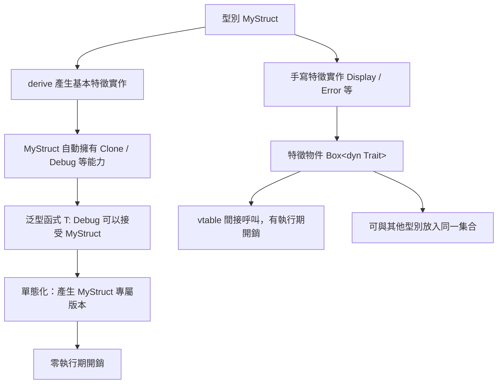

# 9.3 特徵繫結（Trait Bounds）與派生（derive）

## 特徵繫結的三種寫法

特徵繫結（trait bound）是「這個泛型參數必須滿足哪些條件」的宣告。Rust 提供三種寫法，它們在語意上完全等價，差別只在於可讀性與適用場景。

第一種是**內聯界定**，把界定直接寫在尖括號裡：

```rust
use std::fmt::Debug;

fn print_all<T: Debug>(items: &[T]) {
    for item in items {
        println!("{item:?}");
    }
}

fn main() {
    print_all(&[1, 2, 3]);
    print_all(&["a", "b"]);
}
```

第二種是 **`where` 子句**，把界定移到簽章之後：

```rust
use std::fmt::Debug;

fn print_all<T>(items: &[T])
where
    T: Debug,
{
    for item in items {
        println!("{item:?}");
    }
}

fn main() {
    print_all(&[1, 2, 3]);
    print_all(&["a", "b"]);
}
```

第三種是**多重界定**，用 `+` 連接多個特徵：

```rust
use std::fmt::{Debug, Display};

fn report<T: Debug + Display>(value: &T) {
    println!("{value} / {value:?}");
}

fn main() {
    report(&42);
    report(&"hi");
}
```

這三種寫法可以混合使用，也可以在特徵名後加上括號來帶入生命週期或關聯型別的界定：

```rust
use std::fmt::Debug;

fn describe<T>(items: &[T])
where
    T: Debug + Clone + Send + 'static,
{
    for item in items {
        let copy = item.clone();
        println!("{copy:?}");
    }
}

fn main() {
    describe(&[String::from("a"), String::from("b")]);
}
```

實務上的選擇原則很直覺：**單一或兩個簡短的界定用內聯形式**，超過兩個、或需要關聯型別界定時用 `where`。`where` 的可讀性優勢在簽章很長時特別明顯。

## 為什麼 Rust 能支援多個特徵

這個問題的答案直接關係到 Rust 的整體設計哲學。

Java 的類別只能**單一繼承**，但可以**實作多個介面**。這個限制並非任意，而是因為 Java 的類別繼承攜帶了「is-a」的語意——子類別必須是父類別的特例，而特例只能有一個父親。介面因為只是行為契約，沒有限制數量。

Rust 沒有繼承，也就不需要「is-a」的語意。它只有**特徵**，而特徵純粹是行為契約，沒有任何語意上的理由限制一個型別能實作幾個。因此 Rust 的型別可以同時實作任意多個特徵：

```rust
use std::fmt::{Debug, Display};

struct Report {
    title: String,
}

impl Display for Report {
    fn fmt(&self, f: &mut std::fmt::Formatter<'_>) -> std::fmt::Result {
        write!(f, "報告：{}", self.title)
    }
}

impl Debug for Report {
    fn fmt(&self, f: &mut std::fmt::Formatter<'_>) -> std::fmt::Result {
        write!(f, "Report({})", self.title)
    }
}

fn main() {
    let r = Report { title: "季度".to_string() };
    println!("{r}");
    println!("{r:?}");
}
```

這個能力帶來的實際效果是**行為的組合而非型別的階層**。傳統物件導向設計中，「一個型別同時具有可比較、可序列化、可格式化三種行為」往往意味著要建立複雜的繼承樹或委派模式；在 Rust 中，只要三個 `impl` 區塊並排寫在一起即可。

另一個好處是**沒有菱形繼承問題**。在 C++ 中，若 `D` 同時繼承 `B` 與 `C`，而兩者都繼承自 `A`，則 `A` 的方法在 `D` 上會產生歧義。Rust 的特徵沒有這種結構性問題，因為特徵之間不存在「祖先—後代」的關係。

值得補充的是，Rust 的特徵之間**可以**建立「父特徵」關係（supertrait），例如 `trait Read: Write`，表示實作 `Read` 的型別必然也實作 `Write`。這是明確宣告的依賴，與 C++ 的隱性多重繼承不同，不會產生歧義。

## 派生巨集

`#[derive(...)]` 讓編譯器自動產生特徵實作。最常用的一組是：

```rust
#[derive(Debug, Clone, PartialEq, Eq, Hash, PartialOrd, Ord, Default)]
struct User {
    id: u32,
    name: String,
    active: bool,
}

fn main() {
    let a = User {
        id: 1,
        name: "ccc".to_string(),
        active: true,
    };
    let b = a.clone();
    println!("{a:?}");
    println!("{}", a == b);
}
```

除了標準庫的這些，`serde` 提供了序列化的派生：

```toml
[dependencies]
serde = { version = "1", features = ["derive"] }
serde_json = "1"
```

```rust
use serde::{Deserialize, Serialize};

#[derive(Debug, Serialize, Deserialize)]
struct Config {
    port: u16,
    host: String,
    verbose: bool,
}

fn main() {
    let cfg = Config {
        port: 8080,
        host: "127.0.0.1".to_string(),
        verbose: false,
    };
    let json = serde_json::to_string(&cfg).unwrap();
    println!("{json}");
}
```

常用的派生巨集可以整理成這張表：

| 巨集 | 產生的特徵 | 行為 | 前提條件 |
| --- | --- | --- | --- |
| `Debug` | `fmt::Debug` | 產生 `{:?}` 輸出 | 所有欄位都可 `Debug` |
| `Clone` | `Clone` | 產生深層複製 | 所有欄位都可 `Clone` |
| `Copy` | `Copy` | 複製時位元複製 | 所有欄位都可 `Copy`，且型別無 `Drop` |
| `PartialEq` | `PartialEq` | 產生 `==` 與 `!=` | 所有欄位都可 `PartialEq` |
| `Eq` | `Eq` | 標示「全等」 | 所有欄位都可 `Eq` |
| `PartialOrd` | `PartialOrd` | 產生 `<` `>` 等比較 | 所有欄位都可 `PartialOrd` |
| `Ord` | `Ord` | 產生全序比較 | 所有欄位都可 `Ord` |
| `Hash` | `Hash` | 產生雜湊值 | 所有欄位都可 `Hash` |
| `Default` | `Default` | 產生預設值 | 所有欄位都可 `Default` |
| `Serialize` | `serde::Serialize` | 序列化為 JSON 等格式 | 來自 `serde` crate |

## 派生是編譯期的程式碼生成

派生巨集本質上是**編譯期的程式碼生成**。`#[derive(Clone)]` 展開後大致等於：

```rust
#[derive(Debug)]
struct User {
    id: u32,
    name: String,
    active: bool,
}

impl Clone for User {
    fn clone(&self) -> Self {
        User {
            id: self.id,
            active: self.active,
            name: self.name.clone(),
        }
    }
}

fn main() {
    let u = User { id: 1, name: "ccc".to_string(), active: true };
    let v = u.clone();
    println!("{v:?}");
}
```

這個展開是由編譯器的**內建巨集**（built-in macro）完成的，不需要外部 crate。`serde` 的 `Serialize` 與 `Deserialize` 則是由**程序巨集**（procedural macro）完成的——它們是真正的 Rust 程式，在編譯期執行並產生 token 串，再交給編譯器繼續處理。

無論哪種機制，結果都相同：**派生的結果與手寫的等價**，但少寫了幾十行重複樣板程式碼。

這個「等價性」是派生最重要的保證。由於派生是機械式的規則應用，它不會有人為疏漏。實務上唯一需要留意的，是派生所實作的**語意是否正確**。

## 派生對欄位的要求

派生巨集有個關鍵特性：**它要求所有欄位都實作對應的特徵**。這是機械式生成的必然結果，因為派生的程式碼基本上是「對每個欄位呼叫對應的方法」。

```rust
#[derive(Clone)]
struct HoldsNonClone {
    id: u32,
    text: String,
}

fn main() {
    let a = HoldsNonClone { id: 1, text: "x".to_string() };
    let b = a.clone();
    println!("{} {}", b.id, b.text);
}
```

這段程式碼會編譯失敗，因為 `Box<dyn Fn()>` 不實作 `Clone`，而 `Clone` 的派生要求 `id` 與 `callback` 都可 `Clone`。錯誤訊息會明確指出是 `callback` 欄位的問題。

這個限制看似嚴格，實則是一種**保護**。它保證了派生的 `Clone` 一定是**深層複製**，不會出現「複製了容器卻共享內部指標」的淺層陷阱。

`Copy` 的要求更嚴格：除了所有欄位都可 `Copy` 之外，型別本身**不能實作 `Drop`**。原因是 `Copy` 語意上表示「這個值複製後，原始值可以安全地繼續存在且兩者互不影響」；而 `Drop` 的存在表示型別有釋放資源的責任，此時複製會導致重複釋放，因此 Rust 直接禁止這種組合。

```rust
use std::rc::Rc;

#[derive(Copy, Clone)]
struct Point {
    x: i32,
    y: i32,
}

#[derive(Clone)]
struct Wrapper {
    // Rc<i32> 可 Clone 不可 Copy
    count: Rc<i32>,
}

fn main() {
    let p = Point { x: 1, y: 2 };
    let q = p;
    let w = Wrapper { count: Rc::new(3) };
    let w2 = w.clone();
    println!("{} {} {}", q.x, w.count, w2.count);
}
```

## Copy 與 Clone 為什麼要分開

`Copy` 與 `Clone` 分開派生不是冗餘，而是刻意的設計。

`Clone` 的語意是「可以建立一個等價的副本」，這對任何型別都合理。`Copy` 的語意強得多：「複製之後，位元層級的複製就是完整的複製，不需要任何額外動作，且原值仍然有效」。`Copy` 的存在意味著型別在**位元複製**之後不會有任何資源管理上的問題。

這個區別在有堆積指標的型別上非常明顯。`String` 實作 `Clone` 但不實作 `Copy`，因為複製一個 `String` 必須配置新的堆積記憶體並複製內容。若 `String` 是 `Copy`，位元複製會讓兩個值指向同一塊記憶體，其中一個離開作用域時釋放記憶體，另一個就會被釋放後使用——這是典型的 use-after-free。

`Rc<T>` 的情況類似，它的引用計數使得「複製值」必須同時增加計數，因此它只能 `Clone` 不能 `Copy`。

實務上的規則是：**只有純粹由值組成的型別（全部欄位都是 `Copy` 或原始型別）才應該派生 `Copy`**。一旦型別含有 `String`、`Vec`、`Box`、`Rc` 或任何智慧指標，就應該停在 `Clone`。

另一個常見的陷阱是**派生 `Copy` 與手寫 `Drop` 衝突**：

```rust
#[derive(Copy, Clone)]
struct Resource {
    id: u32,
}

fn main() {
    let r = Resource { id: 7 };
    let s = r;
    println!("{} {}", r.id, s.id);
}
```

若再為 `Resource` 加上 `impl Drop`，編譯器會直接拒絕這個組合，錯誤訊息會說明 `Copy` 與 `Drop` 無法共存於同一個型別。

Rust 在編譯期就禁止這種組合，避免了資源被重複釋放的隱患。

## 常見的特徵實作

除了派生之外，最常見的特徵實作是 `Display` 與 `std::error::Error`。

```rust
use std::error::Error;
use std::fmt;

#[derive(Debug)]
pub struct ParseError {
    pub field: String,
    pub raw: String,
}

impl fmt::Display for ParseError {
    fn fmt(&self, f: &mut fmt::Formatter<'_>) -> fmt::Result {
        write!(f, "欄位 {} 的值 {:?} 無法解析", self.field, self.raw)
    }
}

impl Error for ParseError {
    fn source(&self) -> Option<&(dyn Error + 'static)> {
        None
    }
}

fn parse_field(field: &str, raw: &str) -> Result<u32, ParseError> {
    raw.parse::<u32>().map_err(|_| ParseError {
        field: field.to_string(),
        raw: raw.to_string(),
    })
}

fn main() {
    match parse_field("port", "abc") {
        Ok(v) => println!("{v}"),
        Err(e) => println!("{e}"),
    }
}
```

這個範例涵蓋了幾個要點。`Display` 實作**面向使用者**，所以用自然語言描述問題；`Debug` 透過派生取得，面向開發者，包含完整的結構資訊。`Error` 實作讓這個型別可以被 `?` 轉換（只要有對應的 `From` 實作），並且在第 8.3 節的錯誤鏈中扮演角色。

`Error` 實作只需要 `Debug` 與 `Display` 作為前提條件，這正是 `Error: Debug + Display` 這個父特徵界定的作用。實作者因此無法忘記實作 `Display`——編譯器會提醒你。

## 孤兒規則的實務影響

孤兒規則在實務中的影響，主要出現在你想為**既有的外部型別**擴充功能時。

假設你想讓 `Vec<String>` 能夠直接被 `serde` 序列化，但 `serde` 只為 `Vec<T>` 實作了序列化，而 `Vec<T>` 對 `T` 有額外要求。這個時候你可以用新類型模式繞過：

```rust
use serde::{Deserialize, Serialize};

#[derive(Debug, Serialize, Deserialize)]
struct StringList(Vec<String>);

fn main() {
    let list = StringList(vec!["a".to_string(), "b".to_string()]);
    println!("{list:?}");
}
```

這個包裝型別可以自由實作 `Serialize`，因為 `StringList` 是本地型別。它同時保留了與 `Vec<String>` 之間的轉換能力。

另一個常見的應用是**為外部型別實作自己的特徵**。假設你定義了一個 `Describe` 特徵，然後想讓 `Duration` 也能實作它：

```rust
use std::time::Duration;

trait Describe {
    fn describe(&self) -> String;
}

impl Describe for Duration {
    fn describe(&self) -> String {
        format!("{} 秒", self.as_secs())
    }
}

fn main() {
    println!("{}", Duration::from_secs(90).describe());
}
```

這是允許的，因為 `Describe` 是本地特徵。對照之下，若 `Describe` 來自另一個 crate，而你想為 `Duration`（外部型別）實作它，就會被孤兒規則拒絕。

這個規則帶來的實務原則很簡單：**當你想為外部型別加行為時，讓特徵保持本地**。若需要用到外部特徵，就改用新類型模式。

## 泛型參數的預設值

特徵界定還可以帶上**預設型別參數**，這在容器 crate 中非常常見：

```rust
use std::fmt::Debug;

trait Storage {
    type Item;

    fn put(&mut self, item: Self::Item);
    fn take(&mut self) -> Option<Self::Item>;
}

struct LogBuffer<T = u32> {
    items: Vec<T>,
}

impl<T> Storage for LogBuffer<T> {
    type Item = T;

    fn put(&mut self, item: T) {
        self.items.push(item);
    }

    fn take(&mut self) -> Option<T> {
        self.items.pop()
    }
}

fn main() {
    let mut buf: LogBuffer = LogBuffer { items: Vec::new() };
    buf.put(42);
    println!("{:?}", buf.take());
}
```

`LogBuffer<T = u32>` 中的 `= u32` 是**預設型別參數**。當使用時不指定 `T`（如 `LogBuffer` 而不是 `LogBuffer<String>`），編譯器會採用預設值。這個機制在 Rust 2021 之前比較常用，之後因為 `impl Trait` 與型別別名（type alias）的發展而較少使用。

這裡要特別注意，**預設型別參數不能用在函式簽章中**。`fn foo<T = u32>(...)` 是非法的，只有結構體與列舉可以宣告預設值。此外，預設型別參數在方法的呼叫處**不會**被套用——你寫 `LogBuffer::<T>::new()` 時必須顯式指定。

## 界定錯誤的診斷

泛型最令人挫折的經驗之一，是編譯器錯誤訊息常常很冗長。它之所以如此，是因為當編譯器無法證明某個特徵成立時，它必須列出**所有可能的實例化組合**來說明哪一個不成立。

```rust
use std::fmt::Debug;

fn show<T: Clone + Debug>(value: T) {
    println!("{:?}", value.clone());
}

fn main() {
    show(42);
    show(String::from("hi"));
}
```

這段程式碼本身沒問題，但若把 `Clone` 換成一個只對部分型別實作的自訂特徵，錯誤訊息會變成一大段帶有 `note: required by a bound in ...` 的堆疊。

改善診斷品質的實務技巧有幾個。第一是**讓界定盡量精簡**：每多一個特徵界定，錯誤訊息中需要考慮的組合就多一份。第二是**用 `where` 子句把界定集中**，讓錯誤訊息更容易閱讀。第三是**先寫具體的函式測試**，確認型別真的滿足了所有需求，再抽成泛型。

Clippy 也提供了相關的 lint，例如 `trait_duplication_in_bounds` 會提醒你在多處重複相同的界定。

## 特徵與泛型的組合慣例

實務上，泛型與特徵很少單獨出現，它們通常以固定的組合被使用。認識這些組合能讓你讀懂標準庫的簽章。

最常見的是 **`T: Trait + ?Sized`**。`?Sized` 是**鬆弛的 Sized 界定**，允許 `T` 是不可Sized的型別（例如 `str` 或 `[T]`）。這是必要的，因為泛型參數預設隱含 `Sized`，而特徵物件 `dyn Trait` 恰好是不可 Sized 的。若沒有 `?Sized`，你就無法寫出接受 `&dyn Trait` 的泛型函式：

```rust
use std::fmt::Debug;

fn print_debug<T: Debug + ?Sized>(value: &T) {
    println!("{value:?}");
}

fn main() {
    let s: &str = "hello";
    print_debug(s);
    print_debug(&42);
}
```

第二個常見組合是**關聯型別的投影**。當特徵有 `type Item`，而函式需要同時處理多種實作者時，可以用 `<T as Trait>::Item` 的完全限定寫法來指稱關聯型別：

```rust
use std::fmt::Debug;

trait Container {
    type Item;

    fn first(&self) -> Option<&Self::Item>;
}

fn show_first<C>(c: &C)
where
    C: Container,
    C::Item: Debug,
{
    if let Some(item) = c.first() {
        println!("{item:?}");
    }
}

struct Bag<T> {
    items: Vec<T>,
}

impl<T> Container for Bag<T> {
    type Item = T;

    fn first(&self) -> Option<&T> {
        self.items.first()
    }
}

fn main() {
    show_first(&Bag { items: vec![1, 2, 3] });
    show_first(&Bag { items: vec!["a", "b"] });
}
```

第三個組合是**透過關聯型別統一不同的介面**。標準庫的 `IntoIterator` 就是最好的例子——`Vec`、`HashMap`、`String`、甚至整數都能呼叫 `.into_iter()`，因為它們都實作了 `IntoIterator`，而它的 `Item` 關聯型別描述了迭代出來的元素型別。透過這個設計，泛型演算法只需寫一份。

這三個組合共同說明了一件事：**特徵的關聯型別是 Rust 抽象系統中最靈活的部分**，它讓「介面」不只是方法集合，而是**帶著型別資訊的方法集合**。這正是 Rust 能夠在不依賴繼承階層的情況下，建立起類似 Java 泛型與 C++ 模板之表達力的原因。

## 派生的進階用法

除了標準庫提供的這些，`serde` 還支援**自訂序列化**。當型別的欄位名稱與序列化後的欄位名稱不同，或是需要跳過某些欄位時，可以搭配 `#[serde(rename)]` 與 `#[serde(skip)]`：

```rust
use serde::{Deserialize, Serialize};

#[derive(Debug, Serialize, Deserialize)]
struct Config {
    #[serde(rename = "listen_port")]
    port: u16,
    #[serde(skip)]
    cache: Option<Vec<u8>>,
}

fn main() {
    let cfg = Config {
        port: 8080,
        cache: None,
    };
    println!("{cfg:?}");
}
```

這裡的 `rename` 把 Rust 欄位名 `port` 對應到序列化後的 `listen_port`，而 `skip` 則讓 `cache` 不參與序列化。這類客製化是 `derive` 之外的補充，但大多數情況下預設行為已經足夠。

另一個常見的進階用法是**為泛型型別派生**。只要所有泛型參數都滿足對應的特徵要求，派生巨集就能自動為泛型結構體產生正確的實作：

```rust
use std::fmt::Debug;

#[derive(Debug, Clone, PartialEq)]
struct Wrapper<T> {
    value: T,
}

fn main() {
    let a = Wrapper { value: 1 };
    let b = a.clone();
    println!("{:?}", a == b);
}
```

這裡的 `#[derive(Clone)]` 對 `Wrapper<T>` 產生的實作，其要求是 `T: Clone`。當你寫 `Wrapper<String>` 時，`String` 確實實作 `Clone`，所以編譯通過；而 `Wrapper<某個不可 Clone 的型別>` 就會在編譯期被擋下。派生的泛型要求是由編譯器自動推導的，不需要手動撰寫任何額外程式碼。

這是派生宏最優雅的特性之一：**它把「所有欄位都要滿足要求」這條規則自動推廣到了所有型別層級**。你不需要為 `Wrapper<T>`、`Wrapper<Wrapper<T>>` 或任何巢狀組合重複撰寫實作。

## 為什麼 Rust 能組合行為而 Java 不能

回到本章開頭的問題：既然 Rust 沒有繼承，為什麼它能組合出比 Java 更靈活的行為？

答案在於兩種機制解決的是**不同的問題**。Java 的繼承解決的是「程式碼重用」——子類別複用父類別的實作。Rust 用**泛型**與**特徵預設方法**解決同一個問題，但方式不同：預設方法提供重用，`impl Trait for T` 提供泛化，而**多重實作**提供組合。

Java 的多重介面實作並非組合，而是「同時符合多個契約」。Rust 的多重特徵實作則是「同時擁有多組方法」。差別在於 Java 若兩個介面有同名方法，必須手動消歧；而 Rust 的特徵之間若方法名衝突，編譯器會要求明確的限定語法，衝突因此變得**可見**而非隱藏。

另一個差異是**為外部型別實作**。Java 中你想讓 `java.util.List` 支援某個自訂介面，只能包裝或改用繼承自它的類別；Rust 中你可以在自己的 crate 裡定義 `trait Summarizable`，然後直接 `impl Summarizable for Vec<T>`——因為特徵是本地的。這就是 Rust 能在不修改型別定義的情況下擴充既有型別的原因。

這三點合起來，讓 Rust 的抽象能力不依賴任何階層結構：**沒有父類別、沒有子類別、沒有菱形繼承**，只有彼此獨立的行為契約。這也解釋了為什麼 Rust 的 `Vec<T>`、`String`、`Box<T>` 這些型別能自由地實作 `Display`、`Debug`、`Clone`、`From` 等多種特徵，而彼此之間毫無干擾。

## 靜態派發與 vtable 的取捨

這個標題值得單獨說明，因為它在實務中的影響比想像中大。

一個型別可以**同時**有靜態派發的呼叫與 vtable 的呼叫，兩者並存不悖：

```rust
use std::fmt::{Debug, Display};

trait Greet {
    fn greet(&self) -> String;
}

struct Robot;

impl Greet for Robot {
    fn greet(&self) -> String {
        String::from("嗶嗶")
    }
}

impl Display for Robot {
    fn fmt(&self, f: &mut std::fmt::Formatter<'_>) -> std::fmt::Result {
        write!(f, "機器人")
    }
}

impl Debug for Robot {
    fn fmt(&self, f: &mut std::fmt::Formatter<'_>) -> std::fmt::Result {
        write!(f, "Robot")
    }
}

fn static_greet<T: Greet>(x: &T) -> String {
    x.greet()
}

fn dynamic_greet(x: &dyn Greet) -> String {
    x.greet()
}

fn main() {
    let r = Robot;
    println!("{}", static_greet(&r));
    println!("{}", dynamic_greet(&r));
}
```

`static_greet` 呼叫的是**靜態派發**：編譯器知道 `T = Robot`，直接把 `Robot::greet` 內聯進去。`dynamic_greet` 呼叫的是**動態派發**：透過 vtable 查表後跳轉。

這裡的取捨有三層。**效能層面**：靜態派發零開銷，動態派發多一次間接跳轉。**程式體積層面**：靜態派發為每個型別產生一份程式碼，動態派發只有一份 vtable。**表達力層面**：只有動態派發能讓不同型別共存於同一個容器。

實務上的建議是**預設用靜態派發，只在確實需要異質容器時才付動態派發的代價**。這個判斷在設計 API 時特別重要：一個公開的函式若接受 `impl Trait`，呼叫端可以使用泛型或 trait object 兩種方式，函式本身則因為單態化而對每個呼叫者最佳化。

反過來，一個接受 `Box<dyn Trait>` 的函式則**永遠**是動態派發，無論呼叫端傳入什麼。若這個函式在-hot path 上被大量呼叫，這就是一個值得注意的效能陷阱。

## 派生、界定與靜態多態的整體關係

把本章到目前為止的概念串起來，可以畫出這張圖：



這張圖說明了 Rust 抽象體系的完整鏈路：**derive 提供預設的特徵實作，泛型加特徵界定提供靜態的多型性，trait object 提供動態的多型性**。三者共享同一套特徵定義，這是 Rust 抽象系統的一致性所在。

## 引出第 10 章

本章到這裡，Rust 的型別系統與特徵機制已經相當完整。你可以用泛型寫出對型別完全泛化的演算法，用特徵表達行為契約，用派生自動產生大量樣板程式碼。

但有一個問題尚未解決：**所有權與生命週期的靜態限制**。

泛型與特徵都在**編譯期**運作，這意味著它們能表達的關係是靜態的、固定的。但實務中經常需要**執行期決定**的關係。例如一個節點需要持有多個同類型的子節點，而這些子節點的數量在執行期才知道；或是一個物件需要被多個擁有者共享，而共享關係在執行期才建立。

第 5 章的所有權規則之所以嚴格，正是因為 Rust 用靜態的方式保證記憶體安全。要突破這個限制，就必須引入**執行期的引用計數**或**執行期的借用檢查**。

這正是第 10 章智慧指標的主題。`Box<T>` 提供堆積配置與擁有權轉移，`Rc<T>` 提供共享所有權與執行期計數，`RefCell<T>` 提供內部可變性與執行期借用檢查。這三者讓 Rust 的抽象能力從「編譯期確定」延伸到「執行期彈性」，同時不犧牲記憶體安全——只是把部分檢查的時機從編譯期挪到了執行期。

換句話說，第 9 章讓你能**泛化**你的程式碼，第 10 章讓你能**組合**你的程式碼。兩者結合，才是 Rust 所謂零成本抽象的完整拼圖。