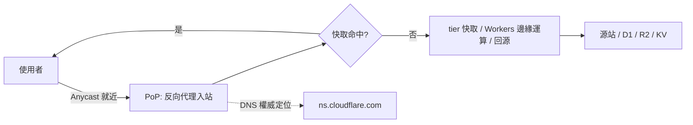

# 1.2 Cloudflare 是什麼：CDN、DNS 與全球網路的原理

## 本節目標

- 理解反向代理（reverse proxy）如何讓一台 DNS 指向的機器「變成」全球網路。
- 認識 Anycast 路由：同一個 IP 宣告到全球數百個節點，封包自動找最近的一個。
- 掌握 DNS 權威伺服器、PoP、快取層級與命中率模型，作為後續章節的地基。

## 一行定義

Cloudflare 是一張**鋪在網際網路上的反向代理網**：你把 DNS 指向它，它就把全球各地節點變成你網站的門市兼保全。全球約 20% 的網站以它作為流量入口，覆蓋 300+ 個城市的 PoP（Point of Presence，網路節點機房）。

## 反向代理原理

正常架站，DNS 的 A 記錄直接指向你的伺服器 IP。使用 Cloudflare 時，DNS 改指向 Cloudflare 的 IP，你的源站（origin）隱藏在後面：

```
   無 Cloudflare:
   使用者 ----------------> [源站伺服器]            單點、暴露 IP

   有 Cloudflare:
   使用者 -- 20ms --> [Cloudflare PoP] -- 回源 -- [源站]
                        | 快取靜態資源
                        | 過濾 DDoS / 惡意流量
                        | 附加 WAF / 快取規則
```

關鍵性質：

1. **終結 TLS 的位置變了**：使用者與 PoP 握手（近、快），PoP 與源站另建連線（可快取、可重試）。
2. **可觀測性**：所有請求流經同一層，日誌、限流、認證都在邊緣做。
3. **容錯**：任一 PoP 故障，Anycast 自動把流量改投其他節點，使用者無感。

## Anycast：一個 IP，全球多處宣告

單播（unicast）下一個 IP 只屬於一台機器；Anycast 讓**多個地理位置同時透過 BGP 宣告同一個 IP 前綴**。邊界閘道協定（BGP）的路由協商，天然會把使用者的封包送往「自治系統（AS-path）躍點數最少、最近」的宣告點：

$$\text{使用者收到的路由} = \arg\min_{p \in \text{PoPs}} \big(\text{AS hop count},\ \text{地理距離}\big)$$

於是「最近節點」不再由工程師設定，而是由網路拓扑自行湧現。台北使用者多半落在台北 PoP，台北故障時自動落到香港、東京。這就是 Cloudflare 淡定扛下史上多次 Tbps 級 DDoS 的基礎：攻擊流量被攤到數百個節點上就地清洗。

## PoP：網路的細胞結構

PoP 是一組放在同一機房的伺服器叢集，通常包含：接入路由器（peering）、DDoS 清洗設備、負載平衡層、快取伺服器，以及（現代）邊緣運算執行環境。Cloudflare 的網路健康度常用兩個指標衡量：

| 指標 | 意義 | 全球化後的目標 |
|------|------|----------------|
| PoP 數 | 機房覆蓋密度 | 335+ 城市（持續增加） |
| 95% 人口延遲 | 95% 使用者可達的 RTT | < 50ms |

## DNS 權威伺服器

DNS 是分層的查詢系統：根（.）→ 頂級域（TLD）→ 權威伺服器。Cloudflare 扮演的「權威伺服器」儲存你 zone 的最終答案（A/AAAA/CNAME/MX/TXT…），並以 Anycast 提供服務 —— 這也是為什麼把 nameserver 改成 Cloudflare 是接入的第一步：

```
dig NS example.com
;; ANSWER:
example.com.  86400  IN  NS  ada.ns.cloudflare.com.
example.com.  86400  IN  NS  bob.ns.cloudflare.com.
```

兩個 nameserver 是全球相同的 Anycast 位址，任一台故障不影響解析 —— 相較於傳統「主 + 備」的 DNS 架構，可用性高出一個量級。

## 快取層級與命中率的 Poisson 模型

Cloudflare 的快取關係存在多層：

```
Tier 級 (upper-tier) 快取 <---- lower-tier PoP 未命中時回 tiers
        ^                                  |
        |                                  | lower-tier 快取
     全域共享                          使用者請求
```

lower-tier PoP 沒命中時，回源的不是你的源站，而是 tier 級快取 —— 讓「冷門資源的第二次全球請求」就命中。這種層級化設計把命中率從「每個 PoP 獨立累積」變成「全球共享累積」。

快取的有效性可用 Poisson 過程建模：設某資源的請求率為 $\lambda$（每秒），快取 TTL 為 $T$ 秒，則在 TTL 內至少來一個請求（即快取被「保溫」）的機率為：

$$P(\text{保溫}) = 1 - e^{-\lambda T}$$

命中率隨 $T$ 與 $\lambda$ 呈飽和曲線上升。例如 $\lambda = 1$ req/s、$T = 60$s：$P \approx 1 - e^{-60} \approx 1$；反之 $\lambda = 0.001$、$T = 60$s：$P \approx 5.7\%$。**這說明分工：高流量熱點由 CDN 高度吸收，長尾內容則靠 tier 分層設法保溫。**

## 這些原理如何收斂成一個平台



理解了「Anycast 入口 + 快取 + 可編程邊緣」三件事，後續所有 Cloudflare 服務（Pages、Workers、R2…）都不過是這張網上的不同掛載點。下一節將盤點這張服務全景。

## 小結與練習

**重點回顧**

1. Cloudflare 本質是全球反向代理網：DNS 指向它，它就近終結連線、快取、清洗，再回源。
2. Anycast 靠 BGP 天然擇近，識別故障自動切換；DNS 權威服務也受益於此。
3. 快取保溫機率 $1 - e^{-\lambda T}$ 解釋了為何「熱點內容」與「長尾內容」需要不同策略。

**練習**

1. 對你任一網站執行 `dig NS` 與 `dig A`，判斷它目前是否經過反向代理（`Server` header 常見 `cloudflare` 即為證據）。
2. 用 $1 - e^{-\lambda T}$ 計算：TTL 設 300s，請求率多少才有 90% 命中保溫機率？
3. 畫出「使用者 → PoP → tier 快取 → 源站」四層架構，標出每一層可能發生的快取命中與回源條件。
