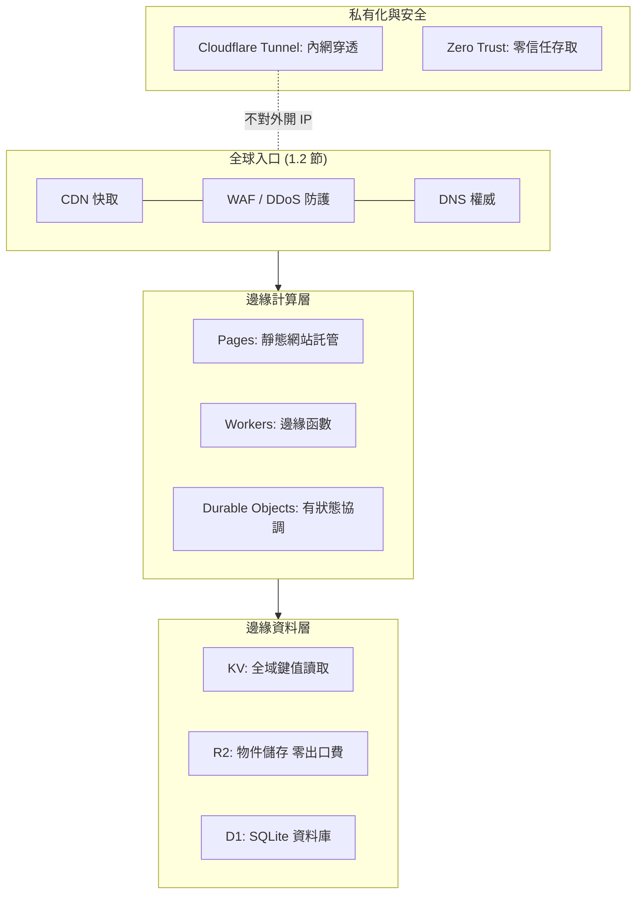

# 1.3 Cloudflare 服務全景

## 本節目標

- 建立 Cloudflare 全域服務的地圖：Pages、Workers、D1、KV、R2、Durable Objects、Tunnel、Zero Trust。
- 用「傳統 VPS/LAMP 對照表」理解每一項服務取代了什麼、省掉了什麼。
- 看懂免費 / 付費方案的界線，選出本書所需的組合。

## 全景圖

## 各服務一句話定位

| 服務 | 是什麼 | 傳統對應物 | 免費額度重點 |
|------|--------|-----------|--------------|
| Pages | 靜態網站 + 前端框架託管，Git push 即部署 | Nginx 靜態檔 + CI | 無限頻寬、500 次/月建置 |
| Workers | 邊緣執行的 JavaScript/TS/Python/WASM 函數 | Express / PM2 / 負載平衡器 | 10 萬請求/天 |
| KV | 高讀取、最終一致的鍵值儲存 | Redis（唯讀快取場景） | 10 萬讀/天 |
| R2 | S3 相容物件儲存，**出口流量免費** | S3（出口 0.09 USD/GB） | 10 GB/月 |
| D1 | 依 region 放置的 SQLite 資料庫 | MySQL/PostgreSQL VPS | 5 GB 儲存、500 萬列讀/天 |
| Durable Objects | 單實例有狀態物件，強一致協調 | 你自建的單點服務（如 WebSocket 房間） | 隨 Workers 付費方案 |
| Tunnel | 免開連接埠、免公網 IP，把內網服務接上全球網路 | OpenVPN + 反向代理 + 埠轉發 | 免費可多用戶 |
| Zero Trust | 身分驅動的存取控制（取代 VPN） | OpenVPN + LDAP + bastion | 50 使用者免費 |

## 與傳統 LAMP/VPS 對比

| 維度 | VPS + LAMP | Cloudflare 全家桶 |
|------|-----------|------------------|
| 作業系統 | 自己打 patch | 不需管（隔離層交給平台） |
| Web 伺服器 | 安裝/調校 Nginx/Apache | 平台內建（Pages 直接吃靜態檔） |
| TLS 憑證 | certbot 申請、每 90 天續約 | 內建自動佈簽 |
| 擴容 | 買機器、改 nginx worker | 自動水平擴展，按請求計費 |
| 冷啟動 | 程序常駐（RAM 固定成本） | Workers V8 隔離，微秒級 |
| 資料庫 | 自架 MySQL + 備份腳本 | D1 / R2 / KV 全託管 |
| 對外攻擊面 | 開放 80/443/22 | 預設關閉入站（Tunnel 可全免） |
| 計費 | 固定月租（閒置也付錢） | 免費層起跳，用量計費 |
| 學習曲線 | 全控制、責任自負 | 抽象層高、可移植性要留意 |

核心差異是一句話：**VPS 賣你「一台機器」，Cloudflare 賣你「部署的結果」**。前者你管理行程與硬體，後者你只寫程式碼。

## 計算模型的理論差異

傳統伺服器 = 常駐行程模型，成本與時間掛鉤（不接單也在燒錢）：

$$
C_{\text{VPS}} = \text{固定月租} \approx c \cdot t
$$

Workers = 請求驅動模型，成本與請求量與 CPU 時間掛鉤：

$$
C_{\text{Workers}} = \sum_{\text{requests}} (\text{CPU time}) \cdot p \leq Q \cdot c_{\max}
$$

低流量時 Cloudflare 近乎免費；高流量時成本線性成長、且無備援閒置浪费。**這對個人網站與中小專案是結構性的成本優勢。**

## 本書選用的組合

後續章節將依難度遞增使用：

1. **Pages** 部署靜態網站（第 1 章）。
2. **Workers** 加入 API 與動態邏輯（第 2 章）。
3. **KV / R2 / D1** 處理快取、檔案與結構化資料（第 3 章）。
4. **Durable Objects** 打造即時協作（第 4 章）。
5. **Tunnel + Zero Trust** 打通內網服務（第 5 章）。

選型判斷原則：先問資料的**一致性與就近性需求**——統計素材用 KV（最終一致即夠），帳務用 D1（強一致），大型二進位用 R2，跨區域單點協调用 Durable Objects。

## 小結與練習

**重點回顧**

1. Cloudflare 全景 = 全球入口（CDN/DNS/WAF）+ 邊緣計算+ 邊緣資料（KV/R2/D1）+ 連線與安全。
2. 與 VPS 的本質差別：從「管機器」變成「管程式碼」，成本從固定變成隨用量。
3. R2 免出口費對「大流量讀取檔案」的網站是殺手級差異。

**練習**

1. 假設你的作品集網站每月 50 萬請求、20 GB 出口流量，分別以 (a) 5 USD/month VPS (b) Cloudflare 免費層估算成本，並列出你放棄了什麼控制權。
2. 判斷以下需求該用 KV、D1 還是 R2：(a) 限流計數器 (b) 部落格文章 (c) 縮圖檔案 (d) 使用者登入資料。
3. 畫出「傳統 LAMP」與「Cloudflare 全家桶」兩張架構圖，標注兩者你需要負責維運的節點數量差異。
