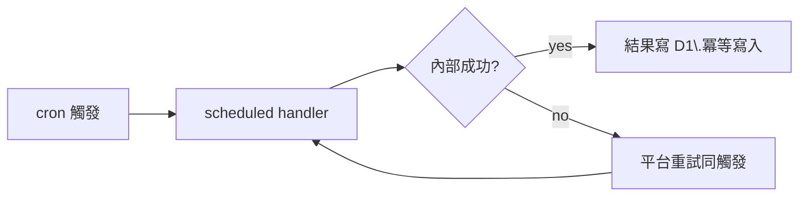

# 7.2 排程任務：Cron Triggers 與定時抓取

## 本節目標

- 複習 cron 表達式的語法（分/時/日/月/週五個欄位）與常見陷阱。
- 在 `wrangler.toml` 設定 `triggers.crons`，撰寫 `scheduled` handler。
- 實作：每天凌晨抓 GitHub releases，存進 D1。
- 掌握 cron 重試與冪等（idempotency）的注意事項——這是排程系統最容易埋 bug 的地方。

## 歷史：從 `/etc/crongtab` 到邊緣

Cron 是 1975 年 Unix 的發明：每分鐘喚醒、比對時間表、執行 job。它解決的是**「機器要一直醒著等事情發生，太浪費」**的問題。雲端世代出現學徒：AWS CloudWatch Events（2015）、Grafana 定時任務、GitHub Actions schedule（2019）。共同特徵：**你不用養一條睡不著的 process**，把「何時 + 做什麼」宣告出去即可。

Cron Triggers（2019 上線於 Cloudflare）的架構不同於傳統 cron：平台的排程器在每個到期時間點「叫醒」你的 Worker，把事件送進 `scheduled` handler。你只有**擁有 job 內容**的責任，沒有「機器何時醒」的責任。

### Cron 語法速查（五個欄位）

```
分   時   日   月   週(0=週日, 6=週六)
*    *    *    *    *
```

| 表達式 | 意義 |
|--------|------|
| `0 23 * * *` | 每天 23:00 |
| `*/5 * * * *` | 每 5 分鐘 |
| `0 9 * * 1-5` | 平日每天 09:00 |
| `0 0 1 * *` | 每月 1 號 00:00 |
| `30 7-20 * * 1-5` | 平日 07:30、08:30 …… 20:30 |

**陷阱提醒**：欄位是「日」與「週」，兩者都非 `*` 時有些實作下變成 OR 而非 AND——Cloudflare Cron Triggers 的語意是 **日與週同時設定時為 OR**，要精確請避免雙重限制。時區是 **UTC**，拿台灣時間 `0 0 * * *` 做晨報要寫成 `0 16 * * *`（前一天 UTC 16:00 = 台灣 00:00）。

## 設定與 handler

```toml
# wrangler.toml
name = "release-watcher"
main = "src/index.ts"
compatibility_date = "2025-01-15"

[[d1_databases]]
binding = "DB"
database_name = "cccbook"
database_id = "xxxxx"

[triggers]
crons = ["0 16 * * *"]        # 每天台灣 00:00（UTC 16:00）
```

```ts
// src/index.ts
export default {
  async fetch(req: Request, env: Env, ctx: ExecutionContext) {
    return new Response("ok");
  },

  async scheduled(event: ScheduledEvent, env: Env, ctx: ExecutionContext) {
    ctx.waitUntil(syncReleases(env));   // 給背景時間，不會被硬殺
  },
};

interface Release { repo: string; tag: string; published: string }

export async function syncReleases(env: Env): Promise<number> {
  const repos = ["cloudflare/workers-sdk", "denoland/deno", "rust-lang/rust"];
  const stmt = env.DB.prepare(
    `INSERT INTO github_releases (repo,tag,published_at,fetched_at)
     VALUES (?1,?2,?3,?4)
     ON CONFLICT(repo,tag) DO UPDATE SET published_at=?3, fetched_at=?4`
  );
  let count = 0;
  for (const repo of repos) {
    const res = await fetch(`https://api.github.com/repos/${repo}/releases?per_page=5`, {
      headers: { "User-Agent": "cccbook-watcher" },
    });
    if (!res.ok) continue;                       // 單一失敗不影響其他 repo
    const list: Array<{ tag_name: string; published_at: string }> = await res.json();
    for (const r of list) {
      stmt.bind(repo, r.tag_name, r.published_at, new Date().toISOString());
      await stmt.run();
      count++;
    }
  }
  return count;
}
```

```sql
CREATE TABLE IF NOT EXISTS github_releases (
  repo TEXT, tag TEXT,
  published_at TEXT, fetched_at TEXT,
  PRIMARY KEY (repo, tag)
);
```

## 重試與冪等（idempotency）

**重試是 feature 不是 bug**。Workers scheduled 有兩種失敗行為：handler 抛出例外時，平台可能重試同一個 cron 觸發（`event.retryCount` 可查詢）。因此設計鐵則是：

1. **同一觸發重複執行 N 次不會產生錯誤資料**。上面的 `ON CONFLICT ... DO UPDATE` 就是把「寫一次」與「寫 N 次」等價化——這就是冪等。
2. **隨機性要控制**：不要在 job 裡 `crypto.randomUUID()` 產生主鍵，否則重試會插出兩筆重複內容不同的資料。
3. **天然標記**：`event.cron` 與 `event.scheduledTime`（毫秒時間戳）可當 job 的邏輯鑰匙；時間戳允許 > 週期 ± 一段時間的不準度，不依賴它做業務 PK。
4. **外部副作用重複**：寄信類 job 必須自己記一張 `job_log` 表（見 7.4 Queue 節），重試前先查是否已做過。



## 小結與練習

Cron Triggers 把「養一頭睡不著的 process」外包給平台，你只需回答「何時 + 做什麼」。這裡最大的工程素養不是語法，而是**假定重試會發生**，把寫入設計得重複執行也安全。

**練習**

1. 寫一個 `*/10 * * * *` 的 job，抓 `https://www.cloudflarestatus.com/api/v2/summary.json` 存進 D1，並做出「過去一小時內是否有 new incident」的查詢。
2. 把上面 `syncReleases` 改成每 30 分鐘，觀察重複插入是否產生重複資料（應該不會，驗證之）。
3. 加入失敗統計：handler 失敗時寫一筆到 `cron_errors` 表，包含 `event.scheduledTime` 與 retry 次數。
