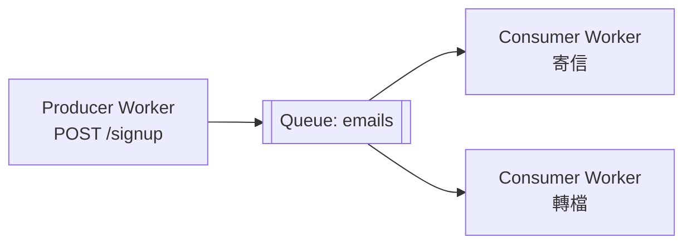

# 7.4 Service Bindings 與 Queue

## 本節目標

- 理解 Service Bindings：Worker 之間直接呼叫，不走公網 HTTP 的意義與理論根據。
- 掌握 Cloudflare Queues 的 Producers / Consumers 模型，以及「解耦非同步工作」的理論。
- 實作：寄信與轉檔兩種典型非同步工作，透過 Queues 拆出來。

## 歷史：微服務的兩條路

| 年代 | 作法 | 傳輸成本 |
|------|------|----------|
| 2007+ 微服務一期 | 服務葉之間用 REST / gRPC 走內網 | 序列化（HTTP 開銷）+ 網路延遲 |
| 2012+ 事件驅動 | 加上 Kafka / Redis Queue，生產者/消費者解耦 | 重複投遞或後續重試的空間 |
| 2021+ 邊緣微服務 | Service Bindings（Worker→Worker 直呼） | 同 PoP 內的函式呼叫等級 |
| 2022+ 邊緣事件 | Cloudflare Queues 通用 GA（2023） | 平台管理的 FIFO 優先序 |

**Service binding 的關鍵抽象**：Worker A 呼叫 Worker B 時，不需要 B 的公網 URL、不需要 DNS、不經公網 TLS 握手，語意像跨語言的**函式呼叫**。理論依據是 IPC（Inter-Process Communication）從「訊息總要過 socket」進化成「地址只需要是邏輯名」——名字定義在 yaml / toml，平台負責解析到同 PoP 的實例。

## Service Bindings 實作

```toml
# wrangler.toml（呼叫者這邊）
[[services]]
binding = "AUTH"
service = "auth-worker"
# environment = "production"   # 可指向特定 env
```

```ts
// 主 Worker：把「簽 token」外包給 auth-worker
export default {
  async fetch(req: Request, env: Env, ctx: ExecutionContext): Promise<Response> {
    if (req.url.includes("/token")) {
      // 不是 HTTP；這是呼叫另一個 Worker 的 fetch
      const res = await env.AUTH.fetch("https://internal/token", {
        method: "POST", body: JSON.stringify({ userId: "u-123" }),
      });
      return new Response(await res.text());
    }
    return new Response("ok");
  },
};
```

```ts
// auth-worker（被呼者）：像一般 fetch handler
export default {
  async fetch(req: Request): Promise<Response> {
    const { userId } = await req.json();
    return Response.json({ token: await signToken(userId) });
  },
};
```

**好處**：延遲省一次全公網來回（尤其兩個 Worker 都在邊緣 PoP 上）、內部呼叫不外洩 API 路徑、可以分開部署不同團隊的 Worker。**界線**：兩者仍共享 PoP 資源額度，別把同一請求內拆得太細；拆分原則是**改變部署節奏與團隊邊界**，不是「拆得越多越小越好」。

## Queues：Producer / Consumer



**理論對照**：這就是 1980 年代訊息佇列（message queue，TIBCO/Rendezvous 一路到 Kafka）解決的老問題——**把「現在做完」的同步要求，換成「總會做完」的異步承諾**。要點有三：

1. **削峰**：尖峰流量進佇列排隊，消費者按自己節奏拉取，不會炸。
2. **重試**：消費者失敗時訊息回隊（可配 `max_retries`），生產者不用知道消費者臨時掛掉。
3. **隔離**：消費者故障不影響生產者的 API 響應。

```toml
# wrangler.toml（生產者側）
[[queues.producers]]
binding = "MAIL_QUEUE"
queue = "signup-emails"

# （消費者側，另一個 Worker 的 wrangler.toml）
# [[queues.consumers]]
# queue = "signup-emails"
# max_retries = 3
# dead_letter_queue = "signup-emails-dlq"
# max_batch_size = 10
```

```ts
// signup-worker.ts：Producer
export default {
  async fetch(req: Request, env: Env): Promise<Response> {
    if (req.method === "POST" && new URL(req.url).pathname === "/signup") {
      const { email } = await req.json();
      await env.DB.prepare("INSERT INTO users(email) VALUES (?)").bind(email).run();

      // 1) 立刻回應使用者（不等寄信）
      // 2) 把「寄信」這件事丟進佇列
      await env.MAIL_QUEUE.send({
        type: "welcome_email",
        email,
        userId: crypto.randomUUID(),
      });
      return Response.json({ ok: true }, { status: 201 });
    }
    return new Response("not found", { status: 404 });
  },
};
```

```ts
// mail-worker.ts：Consumer
export default {
  async queue(batch: MessageBatch<any>, env: Env): Promise<void> {
    for (const msg of batch.messages) {
      if (msg.body.type === "welcome_email") {
        await sendEmail(env, msg.body.email, `
          <h1>歡迎加入！</h1>
          <p>你的帳號已建立完成。</p>`);
        msg.ack();                              // 明示成功，訊息移除
      } else {
        msg.retry({ delaySeconds: 60 });        // 失敗，等 60 秒再投遞
      }
    }
  },
};

async function sendEmail(env: Env, to: string, html: string) {
  // MailChannels / Resend / Mailgun 等，本書以第三方 API 為例
  const res = await fetch("https://api.mailchannels.net/tx/v1/send", {
    method: "POST",
    headers: { "content-type": "application/json" },
    body: JSON.stringify({
      personalizations: [{ to: [{ email: to }] }],
      from: { email: "noreply@your.domain", name: "CCCBook" },
      subject: "歡迎！",
      content: [{ type: "text/html", value: html }],
    }),
  });
  if (!res.ok) throw new Error(`mail failed: ${res.status}`);
}
```

**冪等再度登場**：7.2 的鐵則在 Queues 更嚴格——重試是常態（`max_retries` + DLQ），消費者要能承受**同一訊息被處理多次**（至少一次語意，at-least-once）。兩個標準做法：

- **業務鍵去重**：以 `userId` 當鑰匙，寄信前查 `sent_emails` 表，已寄過就 `msg.ack()`。
- **狀態機推進**：把「未寄 → 已寄」的轉移條件寫死，重試只是重推狀態，不重產副作用。

```ts
// 至少一次語意的保險
const done = await env.DB.prepare("SELECT 1 FROM sent_emails WHERE user_id=?")
  .bind(msg.body.userId).first();
if (done) { msg.ack(); continue; }
await sendEmail(env, msg.body.email, html);
await env.DB.prepare("INSERT INTO sent_emails(user_id) VALUES (?)").bind(msg.body.userId).run();
msg.ack();
```

## 小結與練習

Service Bindings 把 Worker 間通訊從「過公網的 HTTP」降級成「同 PoP 的函式呼叫」；Queues 把「同步做完」換成「異步保證做完」。兩者合起來讓你設計系統時有了微服務經典兩件套：**同步呼叫（要快）**+ **異步工作（要可靠）**，並各自適用在正確的延遲敏感度上。

**練習**

1. 把 7.3 的留言推播改走 Queues：`POST /api/posts/:id/comments` 寄一個 `notify_room` 訊息，消費者呼叫對應 DO。思考：這樣做和直接 `env.ROOM.get(...).fetch(...)` 比的得失是什麼？
2. 為 `welcome_email` 補上 DLQ：重試三次失敗後，把訊息寫一份到 `signup-emails-dlq`，另一個小消費者把失敗 email 存進 D1 待人工重寄。
3. 寫一個 `transcode` 型的消費者：Consumer 呼叫 Service Binding 連到 `media-worker`（有轉檔 mock 邏輯），驗證「佇列 + service binding」的組合。
